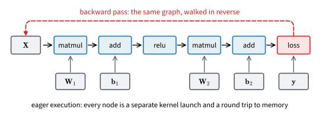

# Computation Graphs and Compilation
:label:`sec_compilation`

In :numref:`sec_perf_model` the activation function `gelu_ish` took eight
to nine times as long as a single addition on the same tensor, although its
arithmetic hardly mattered. Each of its eight elementwise operations ran as
a GPU kernel of its own, which read its inputs from GPU memory and wrote
its result back: 18 array transfers where 2 would do
(:numref:`subsec_perf-regimes`). On a small tensor the same chain is slow
for another reason. Every operation is issued from Python, and the host
takes longer to launch a kernel than the GPU takes to run it. Can a
framework run such a chain without the traffic and without the launches?

Both costs come from *eager execution*, which runs a program one operation
at a time, as Python reaches it. Activations, normalizations, residual
additions, and optimizer updates are all chains of cheap operations, so
the two costs turn up in every model. The remedy for both is to hand the
whole program to a compiler before it runs. A compiler can merge the eight
operations of `gelu_ish` into one kernel that reads $x$ once and writes
the result once, which removes the traffic of the bandwidth-bound regime.
It can also record a sequence of kernels and replay it without Python,
which removes the launches of the overhead-bound regime. A compute-bound
operation, such as one large matrix product, gains from neither. For the
billion-parameter GPT of this chapter, whose arrays hold tens of millions
of elements, merging is the remedy that counts; replay matters for small
models and small minibatches.

```{.python .input #compilation-compute-graphs-and-compilation}
%%tab pytorch
import math
import numpy as np
import torch
from torch import nn
from torch.nn import functional as F
from d2l import torch as d2l
```

```{.python .input #compilation-compute-graphs-and-compilation}
%%tab jax
import math
import numpy as np
import jax
from jax import numpy as jnp
from flax import nnx
import optax
from d2l import jax as d2l
```

```{.python .input #compilation-compute-graphs-and-compilation-1}
%%tab pytorch
torch.set_float32_matmul_precision('high')  # fp32 matmuls may use tf32
```

## Graph Capture
:label:`subsec_comp-capture`

A compiler must see a program whole before it can rewrite it, but Python
executes a program one line at a time. A framework therefore has to obtain
the program as a graph first, and some Python constructs do not fit into a
graph.

### Computation Graphs
:label:`subsec_comp-graph`

The computation of a neural network forms a *computation graph*: its nodes
are operations, and its edges carry tensors from one operation to the next.
Automatic differentiation walks this graph backward to compute gradients
(:numref:`sec_autograd`). A framework with a *tape*, a log of the
operations in the order they ran, records the graph during the forward
pass. A framework that differentiates by tracing the function, as
described below, records it when asked for a derivative.
:numref:`fig_compute_graph` shows the graph of a two-layer network
$\textrm{relu}(\mathbf{X}\mathbf{W}_1 + \mathbf{b}_1)\mathbf{W}_2 +
\mathbf{b}_2$ followed by a loss.


:label:`fig_compute_graph`

Such a record cannot speed up the forward pass of an eager program: by the
time it exists, every operation has already run as a kernel of its own.
Each of those operations has cost the host the time $h$ that Python, the
framework, and the driver need to issue one call
(:numref:`subsec_perf-sweep`), and each elementwise one has made a round
trip through GPU memory. To merge the `add` with the `relu` that follows
it, a compiler needs the graph before the forward pass runs. Obtaining it
in advance is called *graph capture*.

:begin_tab:`pytorch`
In PyTorch $h$ is about 13 µs per operation on our machine.
:end_tab:

:begin_tab:`jax`
In JAX each un-jitted operation is a call of its own through XLA's
runtime, which takes several tens of microseconds on our machine; a jitted
function costs about this once per call, however many kernels it runs.
:end_tab:

### Tracing

The usual way to capture a graph is to run the function once on
*placeholders*, objects that carry the shape and dtype of a tensor but no
values. Every tensor operation applied to a placeholder is recorded instead
of computed, and the record is the graph. Python code that does not depend
on tensor values runs as usual and leaves only its effect: a loop over four
layers leaves four copies of the layer's operations, and arithmetic on
shapes leaves constants. The graph never sees the loop, only what the loop
did. Running a function to record its operations is called *tracing*. A
compiler then translates the graph into kernels, fusing operations where
it can, and caches them. Later calls with arguments of the
same shapes and dtypes reuse the cached kernels
(:numref:`fig_compile_pipelines`).


:label:`fig_compile_pipelines`

:begin_tab:`pytorch`
In PyTorch, `torch.compile` wraps a function or a module. At the first
call, its front end, TorchDynamo, runs the function's Python bytecode on
placeholders and records the tensor operations
:cite:`Ansel.Yang.He.ea.2024`. AOTAutograd derives the backward graph from
the forward graph, and the Inductor compiler turns both into fused kernels.
Dynamo also installs *guards*, cheap checks of what the graph assumes, such
as the shapes and dtypes of the inputs. A later call runs the compiled code
if its guards pass.
:end_tab:

:begin_tab:`jax`
In JAX, `jax.jit` wraps a function. At the first call it traces the
function with abstract *tracer* values as placeholders and records the
operations in a typed intermediate representation, the *jaxpr*
:cite:`Frostig.Johnson.Leary.2018`. The XLA compiler turns the jaxpr into
fused kernels. The compiled code is cached under the shapes and dtypes of
the arguments, and `jax.make_jaxpr` prints the jaxpr of a function.
:end_tab:

### Branches on Values

Tracing cannot follow a branch that depends on a value. A placeholder has a
shape but no value, so when the function asks `if x.sum() > 0:`, tracing
has no answer, and the answer may differ from call to call. A capture
system can respond in one of three ways. It can *freeze* the branch: trace
with a real input instead of a placeholder, record the branch that this
input took, and take the same branch on every later call, whatever the
data. This is fast and wrong. It can *refuse*: raise an error, so that the
programmer writes the branch as a tensor operation the graph can hold. Or
it can *fall back*: end the graph before the branch, let Python take the
decision at run time, and continue in a second graph.

A branch can be written as a tensor operation in two ways. A *select*
computes both alternatives and keeps one; a *conditional* operation
computes only the one it needs. A branch on a shape, such as
`if x.shape[0] > 4:`, needs neither, since shapes are known during
tracing. Which of the three responses does our framework choose for a
function that branches on the sign of a sum?

```{.python .input #compilation-capture-two-philosophies-1}
%%tab pytorch
def f(x):
    x = x * 2
    if x.sum() > 0:        # Python needs the value of this comparison
        return x + 1
    return x - 1

explanation = torch._dynamo.explain(f)(torch.randn(8, device=d2l.try_gpu()))
print(f'graphs: {explanation.graph_count}, '
      f'breaks: {explanation.graph_break_count}')
for graph in explanation.graphs:
    print(graph.code.strip())
```

```{.python .input #compilation-capture-two-philosophies-1}
%%tab jax
def f(x):
    x = x * 2
    if x.sum() > 0:        # Python needs the value of this comparison
        return x + 1
    return x - 1

try:
    jax.jit(f)(jnp.ones(8))
except jax.errors.TracerBoolConversionError as e:
    print(type(e).__name__)

def f_select(x):  # Both alternatives in the graph; select keeps one
    x = x * 2
    return jax.lax.select(x.sum() > 0, x + 1, x - 1)

print(jax.make_jaxpr(f_select)(jnp.ones(8)))
```

:begin_tab:`pytorch`
By default `torch.compile` falls back, with a *graph break* and no
warning; `torch._dynamo.explain`, an internal function of PyTorch, counts
the breaks. The first graph ends at the comparison and returns its result
with the doubled `x`; Python takes the branch, and the second graph holds
the branch this random input took. Every call returns to Python between
the two. `fullgraph=True` and `torch.export`, which captures whole
programs for deployment, refuse instead. The `torch.jit.trace` of
TorchScript, PyTorch's earlier compiler, freezes, with only a warning. The
select `torch.where(x.sum() > 0, x + 1, x - 1)` removes the break.
:end_tab:

:begin_tab:`jax`
`jax.jit` refuses. Converting a tracer to a Python `bool` raises an error,
and the branch must be written as a tensor operation. `jax.lax.select`
computes both alternatives and keeps one, so the whole function becomes a
single graph: the jaxpr shows the comparison `gt` feeding `select_n`.
`jax.lax.cond` executes only one alternative, which matters when they are
expensive.
:end_tab:

### Shapes and Recompilation

A compiler specializes the kernels to the shapes in the graph: it chooses
tile sizes, loop bounds, and memory layouts for them. It must therefore
compile again for a new shape, unless it compiled for a symbolic size, with
the length as a variable of the kernel. A training loop whose last minibatch
is smaller than the others, as with the Fashion-MNIST loaders of
:numref:`sec_fashion_mnist`, compiles once more for that minibatch. A loop
over sequences of varying length may compile at almost every step. There are
two remedies: keep the set of shapes small, for instance by padding
sequences to a few fixed lengths, or compile code that works for a range of
sizes. We call a compiled function on vectors of lengths 8, 8, 16, and 32
and count its compilations.

```{.python .input #compilation-capture-two-philosophies-2}
%%tab pytorch
compilations = []
def recording_backend(gm, example_inputs):  # Called once per compilation
    compilations.append(gm)
    return gm.forward                       # Run the captured graph as is

g = torch.compile(lambda x: torch.sin(x) + 1, backend=recording_backend)
for n in (8, 8, 16, 32):
    g(torch.ones(n, device=d2l.try_gpu()))
print(f'compilations: {len(compilations)}')
print(compilations[-1].code.strip())
```

```{.python .input #compilation-capture-two-philosophies-2}
%%tab jax
@jax.jit
def g(x):
    print(f'tracing g for shape {x.shape}')  # Python runs only while tracing
    return jnp.sin(x) + 1

for n in (8, 8, 16, 32):
    g(jnp.ones(n))
```

:begin_tab:`pytorch`
`torch.compile` passes each captured graph to a *backend*, normally
Inductor. Ours records the graph and runs it as it is, so the list counts
compilations: two for three shapes. The first call compiles for length 8
and guards on it. At length 16 the guard fails, and Dynamo compiles again
with the length as a symbol, the `torch.SymInt` argument of the printed
graph, which serves length 32 as well. After a few recompilations of one
function, eight at the time of writing, Dynamo runs it eagerly.
:end_tab:

:begin_tab:`jax`
`jax.jit` always specializes. The `print` runs only while the function is
traced, so it reports each trace: one for length 8, none for the second
call at length 8, and one each for 16 and 32. Every new shape means a new
trace and a new XLA compilation. Other Python side effects, such as
drawing from NumPy's random generator, also happen at trace time only. An
argument that is a Python value rather than an array, such as a number of
layers, can be marked static with `static_argnums`; the function is then
traced once for each distinct value.
:end_tab:

## Operation Fusion
:label:`subsec_comp-fusion`

Fusion merges several operations into one kernel.
:numref:`subsec_perf-regimes` counted the traffic that `gelu_ish` causes
without it; now we let a compiler remove that traffic and check whether
the count of bytes predicts the gain before anything runs.

### Counting Memory Traffic

Python evaluates `gelu_ish(x)` as eight operations, each of which produces
a temporary array: $t_1 = 0.5x$, $t_2 = x^3$, $t_3 = 0.04\, t_2$,
$t_4 = x + t_3$, $t_5 = 0.8\, t_4$, $t_6 = \tanh t_5$, $t_7 = 1 + t_6$,
and the result $t_1 t_7$. In eager execution each operation is a kernel that
reads its array arguments from GPU memory and writes its result back. Six
operations read one array and two read two, so the chain reads ten arrays
and writes eight. A fused kernel reads $x$ once, keeps every temporary in
registers, and writes the result once (:numref:`fig_fusion`). For arrays of
$n$ elements of $b$ bytes each, the ratio of the bytes moved is

$$\frac{\textrm{bytes moved, eager}}{\textrm{bytes moved, fused}} =
\frac{(10 + 8)\, n b}{(1 + 1)\, n b} = 9.$$

Fusion should therefore shorten the chain ninefold, provided that both
versions are limited by bandwidth. They are. The fused kernel performs
about a dozen FLOPs per element and moves 8 bytes for it in fp32, 4 in and
4 out: an intensity below 2 FLOP/byte. Its arithmetic runs on the GPU's
ordinary fp32 units, whose 82.6 TFLOP/s put the ridge point near
82 FLOP/byte. The kernel would need several hundred FLOPs per element
before arithmetic set its time. On the $4000 \times 4000$ fp32 matrix of
the cell below, 61 MiB per array, the eager chain moves 1.07 GiB, at least
1.1 ms at $\beta = 1.008$ TB/s; the fused kernel should need 0.13 ms.


:label:`fig_fusion`

We compile `d2l.gelu_ish`, the function of :numref:`sec_perf_model`, and
check first that the compiled version computes the same values. They
agree to rounding error, not bit for bit, since a compiler may reorder
floating-point operations. Then we time both versions and convert each
time into a bandwidth: the bytes that version moves, divided by its time.

```{.python .input #compilation-what-the-compiler-does-fusion}
%%tab pytorch
x = torch.randn(4000, 4000, device=d2l.try_gpu())
compiled = torch.compile(d2l.gelu_ish)
assert torch.allclose(d2l.gelu_ish(x), compiled(x), atol=1e-6)  # Same answer
arrays_moved = {'eager': 18, 'compiled': 2}  # In units of x.nbytes
for desc, fn in (('eager', d2l.gelu_ish), ('compiled', compiled)):
    b = d2l.Benchmark(lambda: fn(x), desc=desc)
    print(f'{b}, {arrays_moved[desc] * x.nbytes / b.time / 1e9:.0f} GB/s')
```

```{.python .input #compilation-what-the-compiler-does-fusion}
%%tab jax
x = jax.random.normal(d2l.get_key(), (4000, 4000))
compiled = jax.jit(d2l.gelu_ish)
assert jnp.allclose(d2l.gelu_ish(x), compiled(x), atol=1e-6)  # Same answer
arrays_moved = {'eager': 18, 'compiled': 2}  # In units of x.nbytes
for desc, fn in (('eager', d2l.gelu_ish), ('compiled', compiled)):
    b = d2l.Benchmark(lambda: fn(x), desc=desc)
    print(f'{b}, {arrays_moved[desc] * x.nbytes / b.time / 1e9:.0f} GB/s')
```

The compiled chain is eight to ten times faster, close to the predicted
nine, and both versions move data at about 0.7 TB/s or more. The compiler
made memory no faster and arithmetic no cheaper. It removed 16 of the 18
array transfers.

The same count applies at the scale of a language model. The chapter's
running example is a GPT with a billion parameters and width $d = 2048$,
trained on minibatches of 8 sequences of 1,024 tokens
(:numref:`sec_perf_model`). For this paragraph we replace its SwiGLU
feed-forward networks by the GELU variant of hidden width $4d = 8192$
(`act='gelu'` in `d2l.GPT`). The activation then receives
$8 \cdot 1024 = 8192$ tokens times $4d = 8192$ hidden units, about
$6.7 \times 10^7$ elements per layer and 128 MiB per array in bf16.
Written as `gelu_ish`, the eager chain moves 18 such arrays, 2.25 GiB,
about 2.4 ms at $\beta$; fused, it takes 0.27 ms. The two matrix
products around it perform
$2 \cdot 2 \cdot 8192 \cdot 2048 \cdot 8192 \approx 5.5 \times 10^{11}$
FLOPs, about 3.3 ms at the bf16 peak of 165 TFLOP/s. Unfused, the
activation adds about three quarters to the time of these two products in
the forward pass; fused, under a tenth. Both are lower bounds, since real
kernels reach neither peak.

The ratio of the two times does not depend on the number of tokens $M$.
The eager chain moves $18 \cdot 4dM$ elements of 2 bytes, and the two
matrix products perform $2 \cdot 2 \cdot M \cdot d \cdot 4d$ FLOPs, so

$$\frac{t_\textrm{activation}}{t_\textrm{products}} =
\frac{144\, dM/\beta}{16\, d^2 M/P} = \frac{9 P}{\beta d}
= \frac{9 I^*}{d} \approx 0.72$$

with the ridge point $I^* = P/\beta \approx 164$ FLOP/byte and
$d = 2048$. Thus the unfused activation costs as much as the products
around it when the width is nine ridge points, about 1,500, and it matters
less in wider models, since the arithmetic grows with $d^2$ and the memory
traffic only with $d$.

Real models seldom write GELU as a chain of eight operations. They call
the framework's own GELU, as `act='gelu'` does, and common activations like
it are fused already. What a compiler adds is that it fuses any chain,
including ones that no library anticipated: a SwiGLU gate, a custom
activation, an optimizer update.

### Fusion Patterns

Compilers fuse two kinds of patterns. The first is the *elementwise
chain*, such as `gelu_ish`: a sequence of operations each of which computes
element $i$ of its output from element $i$ of its inputs. The whole chain
runs in one kernel in which each thread applies every operation to its own
elements. In an ordinary training step this is the more common pattern by
far, since a chain follows nearly every matrix product, in both passes.

A *reduction*, such as a softmax or a layer normalization, combines
elementwise operations with a maximum or a sum over each row. When the row
fits in on-chip memory, a fused kernel loads it once, computes the
reduction and the normalized outputs there, and writes the row once. A
longer row has to be read more than once, and the exercises ask how often.

Compilers do not change the algorithm. A large matrix product is limited
by arithmetic and runs as one tuned library kernel, which may also apply a
bias, or a common activation, to each tile before writing it; a compiler
calls that kernel and fuses the code around it. Nor can fusion remove an
intermediate result that the algorithm needs in full. A compiler that
fuses the softmax of attention still writes the $T \times T$ matrix of
scores to memory. FlashAttention (:numref:`sec_attention-at-scale`) never
writes it, because it changes the algorithm: it works in tiles and updates
the softmax incrementally :cite:`Dao.Fu.Ermon.ea.2022`. General-purpose
compilers do not derive such changes. At most they recognize a common
spelling of attention and call a kernel written by hand in its place.
Such kernels are often written in Triton :cite:`Tillet.Kung.Cox.2019`, a
language for GPU kernels embedded in Python.

## Compiling a Training Step
:label:`subsec_comp-wholestep`

A training step is less tidy than one activation on a large array. It
contains matrix products in both passes, elementwise chains for the
activations and their derivatives, and an update of every parameter. What
does compiling all of it gain? Let us start with a small step, small
enough that we can count everything it does, and predict its time before
running it. It trains a multilayer perceptron with four linear layers of
width 1,024 and `gelu_ish` between them, on a minibatch of 512
examples, with a squared loss and gradient descent.

```{.python .input #compilation-compiling-a-training-step-1}
%%tab pytorch
class MLP(nn.Module):
    """Linear layers with the gelu_ish chain between them."""
    def __init__(self, width=1024, depth=4):
        super().__init__()
        self.layers = nn.ModuleList(nn.Linear(width, width)
                                    for _ in range(depth))

    def forward(self, X):
        for layer in self.layers[:-1]:
            X = d2l.gelu_ish(layer(X))
        return self.layers[-1](X)

def train_step(net, X, Y, lr=0.1):  # Forward, backward, SGD update
    loss = ((net(X) - Y) ** 2).mean()
    grads = torch.autograd.grad(loss, list(net.parameters()))
    with torch.no_grad():
        for p, g in zip(net.parameters(), grads):
            p -= lr * g
    return loss
```

```{.python .input #compilation-compiling-a-training-step-1}
%%tab jax
def init_mlp(key, width=1024, depth=4):
    """Weights and biases drawn uniformly from +-1/sqrt(width)."""
    bound = 1 / width**0.5
    keys = jax.random.split(key, (depth, 2))
    return [(jax.random.uniform(kW, (width, width), minval=-bound,
                                maxval=bound),
             jax.random.uniform(kb, (width,), minval=-bound, maxval=bound))
            for kW, kb in keys]

def mlp(params, X):  # Linear layers with the gelu_ish chain between them
    for W, b in params[:-1]:
        X = d2l.gelu_ish(X @ W + b)
    W, b = params[-1]
    return X @ W + b

def train_step(params, X, Y, lr=0.1):  # Forward, backward, SGD update
    loss_fn = lambda p: ((mlp(p, X) - Y) ** 2).mean()
    loss, grads = jax.value_and_grad(loss_fn)(params)
    return loss, jax.tree.map(lambda p, g: p - lr * g, params, grads)
```

:begin_tab:`pytorch`
`torch.autograd.grad` returns the gradients instead of accumulating them
in each parameter's `.grad`, so the step reads the parameters and the data
and changes nothing but the parameters.
:end_tab:

:begin_tab:`jax`
The step is a pure function: it takes the parameters and the data and
returns the loss and the updated parameters.
:end_tab:

Two counts predict the step. The first is the device's work. Each of the
four products of the forward pass performs
$2 \cdot 512 \cdot 1024 \cdot 1024 \approx 1.1 \times 10^9$ FLOPs, and the
backward pass needs about twice as many, so the step performs about
$1.3 \times 10^{10}$ FLOPs: 0.16 ms on the tf32 tensor cores at
82.6 TFLOP/s. The 4.2 million parameters occupy 16 MiB in fp32; reading
them in both passes, writing their gradients, and reading both to write
the update moves about 96 MiB, which takes 0.1 ms. The activations, 2 MiB per
array, add little once fused. Without gaps, the step would take about a
quarter of a millisecond.

The second count decides this step: the operations that eager execution
issues. The forward pass and the loss issue about forty, the backward pass
about twice as many, and the update two for each of the eight parameter
tensors, well over a hundred in all. At a host time $h$ of at least ten
microseconds each, the eager step takes more than a millisecond on any
GPU, at least five times the device's work on ours. Its arrays are too
small for fusion to save much traffic, so whatever compilation gains here
must come from the launches.

Compilation itself takes time, from about a second for a small step to
minutes for a large model, spent at the first call. If compilation takes
$t_\textrm{compile}$ and the compiled step saves
$t_\textrm{eager} - t_\textrm{compiled}$ per call, the compiled run
overtakes the eager one after

$$n^* = \frac{t_\textrm{compile}}{t_\textrm{eager} - t_\textrm{compiled}}$$
:eqlabel:`eq_compile_break_even`

steps. A run much longer than $n^*$ steps gains from compilation, and a
shorter one loses. With a compilation time of 30 s and a saving of 10 ms
per step, for instance, the break-even point is 3,000 steps, a fraction of
a typical training run but more than most quick experiments.

We compile the step and time its first call, which includes the
compilation. Then we time the eager and the compiled step and compute $n^*$
from :eqref:`eq_compile_break_even`.

```{.python .input #compilation-whole-step-compilation-measured}
%%tab pytorch
net = MLP().to(d2l.try_gpu())
X, Y = (torch.randn(512, 1024, device=d2l.try_gpu()) for _ in range(2))
compiled_step = torch.compile(train_step)
t_first = d2l.Benchmark(lambda: compiled_step(net, X, Y),
                        warmup=0, repeats=1).time  # Includes compilation
t_eager = d2l.Benchmark(lambda: train_step(net, X, Y)).time
t_compiled = d2l.Benchmark(lambda: compiled_step(net, X, Y)).time
saved = t_eager - t_compiled  # Per step; a difference of two short times
print(f'first call: {t_first:.1f} s\n'
      f'eager: {1000 * t_eager:.2f} ms, compiled: {1000 * t_compiled:.2f} ms\n'
      'break-even: ' + (f'about {float(f"{t_first / saved:.1g}"):,.0f} steps'
                        if saved > 0 else 'never, compiled is not faster'))
# explain is internal to torch; it clears the compile cache and recompiles
print('graphs:', torch._dynamo.explain(train_step)(net, X, Y).graph_count)
```

```{.python .input #compilation-whole-step-compilation-measured}
%%tab jax
params = init_mlp(d2l.get_key())
X, Y = (jax.random.normal(d2l.get_key(), (512, 1024)) for _ in range(2))
compiled_step = jax.jit(train_step)
t_first = d2l.Benchmark(lambda: compiled_step(params, X, Y),
                        warmup=0, repeats=1).time  # Includes compilation
t_eager = d2l.Benchmark(lambda: train_step(params, X, Y)).time
t_compiled = d2l.Benchmark(lambda: compiled_step(params, X, Y)).time
saved = t_eager - t_compiled  # Per step; a difference of two short times
print(f'first call: {t_first:.1f} s\n'
      f'eager: {1000 * t_eager:.2f} ms, compiled: {1000 * t_compiled:.2f} ms\n'
      'break-even: ' + (f'about {float(f"{t_first / saved:.1g}"):,.0f} steps'
                        if saved > 0 else 'never, compiled is not faster'))
```

The eager step takes milliseconds, as the count of operations predicted,
and the device sits idle for most of it. Compilation helps here only as
far as it takes launches off the host. A compiled step whose kernels are
still launched one at a time stays overhead-bound, with fewer kernels to
launch; to come near the estimate, the whole step has to start on the
device with one call from the host. The first call takes far longer than a
step, and the break-even point lies between about two hundred and a few
thousand steps, a small fraction of a real training run.

:begin_tab:`pytorch`
Here compilation makes the step less than twice as fast, still five to ten
times the estimate of its device work. The last line counts two graphs:
`torch.autograd.grad` ends the first, which holds the forward pass and the
loss and from which AOTAutograd derived the backward graph, and a second
holds the update. Inductor fuses the elementwise chains, but on arrays of
2 MiB that saves little, and its generated code still launches every kernel
from Python. The printed first call can reuse kernels that Inductor cached
on disk in earlier runs of the notebook; with an empty cache it can take
several seconds. The break-even point divides by the difference of two
host-bound times, so it varies by a factor of two between runs.
:end_tab:

:begin_tab:`jax`
Here the jitted step runs at the estimate, 0.25 ms, a hundred times faster
than the un-jitted one: `jax.jit` compiles the loss, the gradients, and the
update into one XLA program, which Python starts with one call. One line of
code gains a factor of a hundred. Un-jitted, `jax.value_and_grad` also
linearizes and transposes the loss function in Python at every call, so
the step costs even more host time than its count of operations predicts.
Un-jitted JAX is for debugging; training steps are jitted.
:end_tab:

## Kernel Replay
:label:`subsec_comp-overhead`

Compilation cannot make the host faster at issuing a kernel; it can only
issue fewer kernels, or none. Fusion cannot merge matrix products, and
every kernel that remains needs a launch. When the kernels are short, the
launches set the time. Let us take the extreme case, a stack of 60 linear
layers of width 256 without biases, each followed by a tanh, applied to a
minibatch of 64.

Each layer performs a product of
$2 \cdot 64 \cdot 256 \cdot 256 \approx 8.4 \times 10^6$ FLOPs and a tanh
over 16,384 elements, so a call issues 120 operations. The roofline allows
a layer well under a microsecond: 0.1 µs for its FLOPs at the tf32 rate,
less than half a microsecond for the 384 KiB its product reads and writes.
Real kernels this small take longer. A kernel needs about a microsecond on
the device however little it computes, since it has to start and wait for
its first data; :numref:`subsec_perf-sweep` measured this floor for
`x + 1` on a small tensor. The floor is measured, not predicted.

Eager execution issues the 120 operations one at a time, at the host time
$h$ each. Since $h$ exceeds the device time of a kernel, the GPU finishes
each kernel before the next one arrives, and the stack takes about
$120\,h$. Issued without the host in the loop, it would take 120 times the
device time of a kernel, which is at least the floor. Taking Python out of
the loop can therefore gain at most $h$ divided by the floor: a factor of
ten or more on our machine, set by the host CPU more than by the GPU.

The way to do it is to record the sequence of kernel launches once and to
replay the whole sequence with a single command. NVIDIA GPUs support this
through *CUDA graphs*. A CUDA graph stores each kernel with its launch
configuration and the memory addresses of its arguments; replaying it takes
one launch from the host, after which the GPU runs the kernels back to back.
The recording is rigid. Its shapes and addresses are fixed, so new inputs
are copied into the recorded input buffers before a replay, the next replay
overwrites the outputs, and nothing inside the sequence may wait for a value
read by the CPU.

```{.python .input #compilation-the-overhead-regime-capture-and-replay}
%%tab pytorch
deep = nn.Sequential(*[m for _ in range(60)  # 120 operations per call
                       for m in (nn.Linear(256, 256, bias=False), nn.Tanh())])
deep = deep.to(d2l.try_gpu())
x = torch.randn(64, 256, device=d2l.try_gpu())

fused = torch.compile(deep)  # Inductor kernels, launched one at a time
replayed = torch.compile(deep, mode='reduce-overhead')  # As a CUDA graph
with torch.no_grad():  # Inference: every call is a complete step
    fused(x)
    replayed(x)  # Compiles and warms up; the next call records
    times = {}
    for desc, f in (('eager', deep), ('compiled', fused),
                    ('reduce-overhead', replayed)):
        t = times[desc] = d2l.Benchmark(lambda: f(x), repeats=100).time
        print(f'{desc}: {1000 * t:.2f} ms/call, '
              f'{1e6 * t / 120:.1f} µs per operation')
    # The kernels of the compiled stack, against the time of a call
    d2l.show_profile(d2l.kernel_times(lambda: fused(x)),
                     1000 * times['compiled'], rows=3)
```

```{.python .input #compilation-the-overhead-regime-capture-and-replay}
%%tab jax
def init_deep(key, depth=60, width=256):  # 120 operations per call
    return list(jax.random.uniform(key, (depth, width, width),
                                   minval=-width**-0.5, maxval=width**-0.5))

def deep(params, x):
    for W in params:
        x = jnp.tanh(x @ W)
    return x

params = init_deep(d2l.get_key())
x = jax.random.normal(d2l.get_key(), (64, 256))
jitted = jax.jit(deep)
jitted(params, x)  # First call compiles
times = {}
for desc, f in (('eager', deep), ('jit', jitted)):
    t = times[desc] = d2l.Benchmark(lambda: f(params, x), repeats=100).time
    print(f'{desc}: {1000 * t:.2f} ms/call, '
          f'{1e6 * t / 120:.1f} µs per operation')
# The kernels of the jitted stack, against the time of a call
d2l.show_profile(d2l.kernel_times(lambda: jitted(params, x)),
                 1000 * times['jit'], rows=3)
```

Eager, an operation takes the host time $h$. Replayed, the stack takes
about 2 µs per operation, about twice the floor of a bare `x + 1`, because
a replayed kernel does more than start: it reads its operands and
computes. The gain is the ratio of the two times, so it falls short of the
bound by about this factor of two.

:begin_tab:`pytorch`
The three timings separate the two remedies. Surprisingly, the stack
compiled by Inductor is no faster than eager. The tanh is not merged into
the library's product kernel, so nothing is fused, and Inductor's
generated code launches each kernel from Python at about the same 18 µs
per operation as eager dispatch. That is more than the 13 µs of a bare
call in :numref:`subsec_perf-sweep`, since $h$ depends on the call and on
the load of the host, and with a floor of 1 µs it puts the bound near
eighteen. All of the gain, about
a factor of eight, comes from replay. `mode='reduce-overhead'` makes
`torch.compile` record its kernels as CUDA graphs: the first call compiles
and warms up, the second records, and later calls with the same shapes
copy the input into the recorded buffer and replay. `Benchmark` warms up
with three calls, so the timed calls are replays.
:end_tab:

:begin_tab:`jax`
`jax.jit` already removes Python from the loop: the compiled function
starts with one call. The eager version dispatches its 120 operations one
at a time, at some 50 µs each, which puts the bound near fifty, and it is
twenty to thirty times slower. Current XLA releases also record runs of
consecutive kernels on a GPU as CUDA graphs, which XLA calls command
buffers, so a jitted function is replayed without a separate mode.
:end_tab:

:begin_tab:`pytorch`
Replay applies to the training step of :numref:`subsec_comp-wholestep` as
well. The pieces of the step, the forward and backward passes of the first
graph and the update of the second, are recorded as separate CUDA graphs
and replayed in turn; since a replay overwrites the outputs of the
previous one, a result that must survive the next call has to be cloned.
We replay the step and add up the time the device spends in its kernels,
with the profiler of :numref:`subsec_perf-profiler`.
:end_tab:

```{.python .input #compilation-replaying-the-training-step}
%%tab pytorch
replayed_step = torch.compile(train_step, mode='reduce-overhead')
t = d2l.Benchmark(lambda: replayed_step(net, X, Y)).time
busy = sum(d2l.kernel_times(lambda: replayed_step(net, X, Y)).values())
print(f'training step, reduce-overhead: {1000 * t:.2f} ms/call, '
      f'GPU busy {busy:.2f} ms')
```

:begin_tab:`pytorch`
Replay brings the step below a millisecond, and the device's work,
0.25 ms, matches the estimate made before the first timing. The device is
still busy for only about a third of the step. The host runs Python
between the replays, at the graph break, where autograd starts the
backward graph, and in the bookkeeping of each replay, so the step remains
overhead-bound. The count of the device's work was right; what is left of
the step is host time between the graphs.
:end_tab:

## Limits of Compilation
:label:`subsec_comp-hurts`

Compilation saves time only for code that runs more than $n^*$ times, and
only on the operations that are bandwidth- or overhead-bound. One large
matrix product leaves nothing to fuse and no launches to hide, though the
chains around it still gain. Within those conditions, three things decide
whether compiling a program is worth the trouble.

* **Branches on values.** A hot loop full of branches on tensor values is
  captured, if at all, in fragments separated by returns to Python. In a
  training loop the usual causes look harmless: reading the loss into
  Python to log it, a test such as `if loss < 0.1:`, or an operation whose
  output shape depends on the data, such as selecting the nonzero entries
  of a tensor. Move such code out of the compiled function, or rewrite it
  as selects and conditional operations.
* **Changing shapes.** Every new shape may cost a compilation, and the
  short last minibatch of an epoch is one of them: drop it, or pad it to
  the full size.
* **Debugging.** Compiled code does not run line by line. Breakpoints and
  print statements inside it behave differently, and errors point into
  generated code. Debug eagerly, then compile.

Compilation leaves the largest consumers of memory where they are: the
parameters, the optimizer state, and the activations saved for the
backward pass. :numref:`sec_memory_precision` measures them and shows how
lower precision and recomputation reduce them.

## Summary

Eager execution runs a program one operation at a time, so every
elementwise operation makes a round trip through GPU memory and every
operation costs the host time of a launch. Graph capture traces the
program on placeholders into a graph. A branch on a tensor value cannot be
recorded, so a capture system freezes it, refuses it, or falls back to
Python. A compiler that specializes to shapes compiles again for a new
shape, unless it compiled for a symbolic size. Fusion merges elementwise
chains, and reductions whose rows fit on the chip, into single kernels; for
`gelu_ish` it divides the memory traffic and the time by about nine.
Replaying a recorded sequence of kernels as a CUDA graph removes the
launches, which small models and small steps need: a compiled step that
still launches its kernels one by one stays overhead-bound. Compilation
costs time at the first call, saves it after $n^*$ steps, and cannot speed
up a compute-bound matrix product.

## Exercises

:begin_tab:`pytorch`
1. [code] **Value-dependent branches.** The function `f` of
   :numref:`subsec_comp-capture` breaks the graph at its `if`.
    1. Compile `f` with `fullgraph=True` and read the error. Rewrite the
       branch with `torch.cond`, check with `torch._dynamo.explain` that it
       captures one graph, and check that both versions return the same
       values. How does `torch.cond` differ from `torch.where`?
    1. Time the compiled original and the compiled `torch.where` version
       with `d2l.Benchmark`, once on the 8-element input of
       :numref:`subsec_comp-capture` and once on a $4000 \times 4000$
       input. Explain the time difference at each size.
    1. `torch.where` evaluates both branches. Describe a pair of branches
       for which this costs more than the graph break saves.

2. [code] **Shape changes.** `torch.compile` guards on the shapes of its
   inputs and recompiles when a guard fails (:numref:`subsec_comp-capture`).
    1. Compile a function that computes `torch.tanh(x) * 2 + 1` with the
       recording backend of :numref:`subsec_comp-capture`, and call it on
       vectors of lengths 8, 16, 32, and so on up to 8192. Predict the
       number of compilations, count them, and read the reason for each
       recompilation with `torch._logging.set_logs(recompiles=True)`.
    1. Repeat with `torch.compile(..., dynamic=False)`. How many
       compilations happen now, and what do the calls after the last
       compilation run?
    1. Instead, call `torch._dynamo.mark_dynamic(x, 0)` on the first input
       before the first call. How many compilations happen, and when would
       you prefer this over the default?
:end_tab:

:begin_tab:`jax`
1. [code] **Value-dependent branches.** Tracing replaces the values of the
   arguments by placeholders (:numref:`subsec_comp-capture`).
    1. Rewrite the branch of `f` once with `jnp.where` and once with
       `jax.lax.cond`, and print both jaxprs with `jax.make_jaxpr`. Which
       operations does each version execute at run time?
    1. Apply `jax.vmap` to the `jax.lax.cond` version over a batch of
       vectors and print its jaxpr. Explain what became of the conditional,
       and why.
    1. Jit a function that returns `x + 1` when `x.shape[0] > 4` and
       `x - 1` otherwise, and call it on vectors of lengths 3, 5, and 6.
       Explain why it does not raise the error that `f` raises, and count
       its traces.

2. [code] **Shape changes.** A jitted function is specialized to the shapes
   of its arguments (:numref:`subsec_comp-capture`).
    1. Jit a function that returns the mean of `jnp.tanh(x)` over a vector
       `x`, and let its Python body increment a global counter. Call it in
       a loop on vectors of lengths 100, 200, and 300, three times each.
       Count the traces, and time the first and the later calls at each
       length.
    1. Pad every input to length 512 and pass the function what it needs
       to exclude the padding from the mean, so that one trace serves all
       three lengths. Check the results against the unpadded version.
    1. Instead, pass the padded vector together with its length, mark the
       length with `static_argnums`, and slice inside the function. Count
       the traces and explain the count. Name an argument of a training
       step for which `static_argnums` is the right tool.
:end_tab:

3. **Padding buckets.** A compiled step that is specialized to static
   shapes (:numref:`subsec_comp-capture`) compiles once for every distinct
   input shape it sees. Consider a training run of $10^5$ steps in which
   every batch holds sequences of one length $\ell$, drawn uniformly from
   $\{1, \ldots, 512\}$, and is padded to a length $\ell' \geq \ell$. One
   compilation costs 20 s, and a step at padded length $\ell'$ costs
   $50\,\textrm{ms} \cdot \ell'/512$.
    1. Pad every batch to the next multiple of $w$, for $w$ dividing 512.
       Find the number of compilations and the expected padded length as
       functions of $w$, and write the total run time $T(w)$.
    1. Minimize $T(w)$ over $w$ treated as a continuous variable, and state
       how the optimal $w$ scales with the compilation cost and with the
       number of steps. Compare $T$ at $w = 1$, at the two powers of two
       nearest the optimum, and at $w = 512$.
    1. Padding to the next power of two compiles ten shapes. Compute its
       expected padded length and total run time, and compare them with
       those of $w = 64$. For which distribution of lengths would powers
       of two be the better choice?

4. [code] **Fusion behind a matrix product.** ● Compilation leaves a large
   matrix product unchanged but fuses the elementwise chain that follows
   it. Consider `gelu_ish(a @ a)` for an $n \times n$ matrix `a` in bf16 on
   a GPU with peak compute $P$, bandwidth $\beta$, and ridge point
   $I^* = P/\beta$, the arithmetic intensity at which the time to compute
   equals the time to move the data. Model the product as compute-bound,
   taking $2n^3/P$ seconds. Model the chain as bandwidth-bound: eager
   execution moves $m$ arrays of $n^2$ elements of $b$ bytes each through
   memory, and the fused kernel moves two such arrays.
    1. Derive the speedup bound $S(n)$ of the compiled over the eager
       computation in terms of $n$, $m$, $b$, and $I^*$, and show that it
       tends to 1 as $n$ grows. With $m = 18$ as counted for `gelu_ish`,
       evaluate $S(n)$ for bf16 on an RTX 4090 ($I^* \approx 164$
       FLOP/byte) at $n = 1024$, $4096$, and $16384$, and find the $n$ at
       which $S(n)$ falls to $1.1$.
    1. Measure the eager and the compiled time of `gelu_ish(a @ a)` with
       `d2l.Benchmark` for $n = 256, 512, \ldots, 8192$. Plot the measured
       speedup together with $S(n)$, and explain where and why the two
       differ.

5. **Fusing a reduction.** ● A numerically safe softmax over each row of an
   $R \times d$ fp32 matrix can be written as five eager operations: the
   row maximum, the subtraction of that maximum, the exponential, the row
   sum, and the division by that sum.
    1. Count the elements that the five eager kernels read from and write
       to memory, keeping only terms proportional to $Rd$. Count the same
       for a single fused kernel that holds each row in on-chip memory, and
       state the speedup bound for a bandwidth-bound softmax.
    1. A row longer than the on-chip memory must be read from memory more
       than once. Find the smallest number of passes over a row, and the
       resulting traffic, for a fused kernel that computes the maximum and
       the sum in separate passes. Then do the same for a kernel that
       maintains both in one pass over the entries $x_1, \ldots, x_d$ of a
       row, with $m_0 = -\infty$, $s_0 = 0$, and
       $m_j = \max(m_{j-1}, x_j)$,
       $s_j = s_{j-1}\, e^{m_{j-1} - m_j} + e^{x_j - m_j}$. Check that
       $s_d = \sum_j e^{x_j - m_d}$.

:begin_tab:`pytorch`
6. [code] **Compiling the optimizer.** ● The step of
    :numref:`subsec_comp-wholestep` writes plain gradient descent by hand.
    1. Rewrite the step with `torch.optim.Adam` and the usual sequence of
       `zero_grad`, `backward`, and `step`. Apply `torch._dynamo.explain`
       to it. How many graphs does it capture, where does it break, and
       which parts of the step fall into which graph?
    1. Count the parameter-sized arrays that one update must read and
       write at minimum, for plain SGD and for Adam (:numref:`sec_adam`).
       Then time the eager and the compiled step, once with
       `torch.optim.SGD` and once with `torch.optim.Adam`. For which
       optimizer does compiling the update gain more, and why?

    *Adapted from Michael Lazos,
    [Compiling the optimizer with torch.compile](https://docs.pytorch.org/tutorials/recipes/compiling_optimizer.html),
    PyTorch recipe.*
:end_tab:

:begin_tab:`jax`
6. [code] **Trace-time constants.** The Python body of a jitted function
    runs only while it is traced (:numref:`subsec_comp-capture`).
    1. Jit a function that returns `x + np.random.randn()`, call it twice,
       and print its jaxpr. Explain the two outputs.
    1. A dropout function draws its mask with `jax.random.bernoulli` from
       a key held in a global variable. Jit it, call it, assign a new key
       to the global variable, and call it again. Explain the result, and
       rewrite the function so that every step draws a fresh mask.
:end_tab:

7. [code] **Overhead crossover.** ● Use the stack of 60 layers of width
   256 at batch size 64 from :numref:`subsec_comp-overhead`, with its eager
   and its replayed version. Replay removes the host time $h$ of each
   launch from the critical path, but not the time each kernel takes to
   execute.
    1. Time both versions for depths $L$ from 10 to 200 at width 256, and
       fit each time as $t(L) = c + sL$. Compare the eager slope per layer
       with the host time of the layer's two operations, and explain the
       replayed slope.
    1. A kernel that performs $F$ FLOPs and moves $B$ bytes takes at least
       $\max(F/P, B/\beta)$ seconds on a GPU with peak compute $P$ and
       bandwidth $\beta$. Predict from this bound the width at which the
       matrix product of one layer takes as long to execute as to launch.
       Then time both versions at depth 60 for widths from 64 to 4096,
       plot the ratio of eager to replayed time against the width, and
       compare the width at which the ratio approaches 1 with your
       prediction.

8. [extended] **A tracer of your own.** ●● Build a miniature tracing
   compiler in plain Python, with NumPy arrays as the values on which the
   captured program finally runs.
    1. Write a class `Tracer` whose instances carry a `shape` but no
       values, and functions `tanh`, `exp`, and `relu` that take a
       `Tracer`. Each operation on a `Tracer` appends a node to a shared
       graph and returns a new `Tracer`. A node holds the operation, its
       inputs, and the shape of its result. Support the arithmetic
       operators, the matrix product `@`, the comparison `>`, the methods
       `sum` and `max` with `axis` and `keepdims` arguments, and the three
       functions. Trace a copy of `gelu_ish` that calls your `tanh` on a
       placeholder of a given shape, and print the graph one node per line.
    1. Make `Tracer.__bool__` raise an error. Trace a function that
       returns `x + 1` when `x.shape[0] > 4` and `x - 1` otherwise, and a
       second function that branches the same way on `x.sum() > 0`.
       Explain which of the two your tracer can record, and what the
       recorded graph keeps of the branch.
    1. Write an interpreter that executes a graph node by node on NumPy
       arrays, and check its result against a direct NumPy evaluation of
       `gelu_ish`.
    1. Write a pass that partitions the graph into fused kernels under the
       rule that an elementwise node may join the kernel of its inputs, a
       matrix product forms a kernel of its own, and a reduction ends the
       kernel it belongs to. State how your pass treats a node whose inputs
       come from different kernels. For `gelu_ish`, for the five-operation
       softmax, and for the two-layer network
       `relu(x @ W1 + b1) @ W2 + b2`, count the kernel launches and the
       array elements moved through memory under one kernel per node and
       under your partition.

[Discussions](https://d2l.discourse.group/t/36789)

<!-- slides -->

::: {.slide}
::: {.cover}
[Dive into Deep Learning · §13.3]{.kicker}

Computation Graphs and Compilation<br>
**graph capture · operation fusion · a training step · kernel replay**
:::
:::

::: {.slide title="An Eight-Operation Activation Moves 1.07 GiB to Produce 61 MiB"}
[The problem]{.kicker}

`gelu_ish`: $0.5\,x\,(1 + \tanh(0.8\,(x + 0.04\,x^3)))$ on a
$4000 \times 4000$ fp32 matrix, 61 MiB:

- eager: 8 kernels, each reads its inputs from GPU memory and writes back;
  18 arrays moved, **1.07 GiB, at least 1.1 ms** at 1 TB/s;
- needed: read $x$ once, write once: **122 MiB, 0.13 ms**.

::: {.d2l-note}
Running one operation at a time costs memory traffic and launches, not
arithmetic. A compiler that sees the whole program can remove both.
:::
:::

::: {.slide title="By the End of This Deck You Can"}
[Goals]{.kicker}

- explain how tracing captures a program, and what it does with a branch on
  a value;
- predict the speedup of fusion from a count of bytes;
- predict a training step's time from FLOPs, bytes, and its number of
  operations, and name its regime;
- compute after how many steps compilation saves time;
- tell when replaying a CUDA graph helps, and when not to compile.

**Running example:** one RTX 4090 ($\beta$ = 1 TB/s; 165 TFLOP/s bf16,
82.6 TFLOP/s tf32) and the 1B GPT of width 2048.
:::

::: {.slide title="Compilation Fixes Two of the Three Regimes"}
[Where this fits]{.kicker}

::: {.cols .vc}
::: {.col}
| section | adds |
|---|---|
| The Performance Model | roofline, three regimes, timing, profiling |
| Hardware | where peak arithmetic and bandwidth come from |
| **Computation Graphs and Compilation** | **fusion and kernel replay** |
| Memory and Precision | what fits: bytes per parameter and per token |
| Multi-GPU from First Principles | data parallelism by hand, its cost model |
| Data Parallelism in Practice | one process per GPU, overlap |
| Sharding the Training State | 16 bytes per parameter, split across GPUs |
| Case Study: Optimizing a Transformer | the whole method on one GPT |
:::

::: {.col .narrow}
- **Uses:** bandwidth- and overhead-bound regimes; the host time $h$ per
  call.
- **Skips:** writing kernels by hand, exporting models for deployment.
:::
:::
:::

::: {.slide title="A Record Made During the Forward Pass Comes Too Late"}
{width=82%}

- Eager: each node is a kernel launch costing the host time $h$
  (10 µs or more per call on our machine) and, if elementwise, a round
  trip through memory.
- To merge `add` and `relu`, a compiler needs the graph *before* running:
  *graph capture*.
:::

::: {.slide title="Tracing Records Tensor Operations on Placeholders" only="pytorch"}
{width=92%}

- Placeholders: shape and dtype, no values. Tensor operations are
  recorded; Python loops unroll.
- `torch.compile`: Dynamo captures the graph from bytecode, AOTAutograd
  derives the backward, Inductor compiles; guards check the shapes.
:::

::: {.slide title="Tracing Records Tensor Operations on Placeholders" only="jax"}
{width=92%}

- Placeholders: shape and dtype, no values. Tensor operations are
  recorded; Python loops unroll.
- `jax.jit`: traces to a jaxpr; XLA compiles it, cached per shape and dtype.
:::

::: {.slide title="A Branch on a Value Can Be Frozen, Refused, or Left to Python"}
`if x.sum() > 0:` cannot be answered while tracing: a placeholder has no
value.

| response | what happens |
|---|---|
| freeze | the example's branch, on every call: fast and wrong |
| refuse | an error; rewrite as a *select* or a *conditional* |
| fall back | a graph break; Python decides between two graphs |

- *Select*: compute both alternatives, keep one. *Conditional*: compute
  only the one taken.
- Branches on *shapes* are fine.
:::

::: {.slide title="torch.compile Falls Back: Two Graphs, One Break" only="pytorch"}
```{.python #compilation-exercises-1}
def f(x):
    x = x * 2
    if x.sum() > 0:        # needs a value
        return x + 1
    return x - 1
```

- Graph 1: `x * 2`, `sum`, `> 0`; Python reads the result. Graph 2: the
  branch taken.
- `fullgraph=True` and `torch.export` refuse; `torch.jit.trace` freezes
  (with a warning).
- `torch.where(x.sum() > 0, x + 1, x - 1)`: one graph.
:::

::: {.slide title="jax.jit Refuses a Branch on a Value" only="jax"}
```{.python #compilation-exercises-2}
def f(x):
    x = x * 2
    if x.sum() > 0:        # needs a value
        return x + 1
    return x - 1
```

- `jax.jit(f)` raises `TracerBoolConversionError`.
- `jax.lax.select(x.sum() > 0, x + 1, x - 1)` computes both and keeps
  one: a single graph.
- `jax.lax.cond` computes only one alternative.
:::

::: {.slide title="A New Shape Compiles Again, Then Dynamo Generalizes" only="pytorch"}
@!compilation-capture-two-philosophies-2

- Calls at lengths 8, 8, 16, 32: two compilations.
- The second graph takes the length as a symbol (`SymInt`) and serves
  length 32 as well.
:::

::: {.slide title="Every New Shape Means a New Trace" only="jax"}
@compilation-capture-two-philosophies-2

- The `print` runs only while tracing: three traces for four calls.
- Remedies: pad to a few fixed shapes; `static_argnums` for Python values.
:::

::: {.slide title="Check: Compilations for Ragged Sequences"}
[Check]{.kicker}

A step compiled for fixed shapes sees minibatches of sequence lengths
100, 128, 100, 75, 128, 100. How many compilations without padding, and
with padding to the next multiple of 64?

::: {.fragment .fade-up}
- Without padding: one per distinct length, 3 (100, 128, 75).
- Padded: 100 and 75 become 128, so 1; the length-75 batch then does
  about 70% more work.
:::
:::

::: {.slide title="Fusion Moves 2 Arrays Instead of 18"}
{width=80%}

- Both versions are bandwidth-bound: about 12 FLOPs per 8 bytes, far
  below the ridge point (82 FLOP/byte for fp32 arithmetic).
- Predicted speedup: the ratio of bytes, $18/2 = 9$.
:::

::: {.slide title="Fused gelu_ish Runs 8–10× Faster at About the Same Bandwidth"}
@!compilation-what-the-compiler-does-fusion

- Check `allclose` first: compilers reorder floating-point arithmetic.
- Both versions move data at 0.7 TB/s or more.

::: {.d2l-note}
Memory is no faster and arithmetic no cheaper: 16 of the 18 transfers are
gone.
:::
:::

::: {.slide title="Check: The Activation of the 1B GPT"}
[Check]{.kicker}

GELU variant of the GPT: width $d = 2048$, hidden $4d = 8192$; 8
sequences of 1,024 tokens; bf16. Eager `gelu_ish` per layer at 1 TB/s,
against the two matrix products at 165 TFLOP/s?

::: {.fragment .fade-up}
- 8,192 tokens $\times$ 8,192 hidden units $= 6.7 \times 10^7$ elements,
  128 MiB per array.
- Eager: $18 \times 128$ MiB $= 2.25$ GiB, about 2.4 ms; fused: 0.27 ms.
- Products: $5.5 \times 10^{11}$ FLOPs, about 3.3 ms.
- Ratio $9P/(\beta d) = 9I^*/d \approx 0.72$ for any number of tokens,
  with the ridge point $I^* = P/\beta \approx 164$ FLOP/byte; it reaches 1
  at $d \approx 1{,}500$.
:::
:::

::: {.slide title="Compilers Fuse Chains and Row Reductions, Not Algorithms"}
| fused | example |
|---|---|
| elementwise chains | activations, residual adds, optimizer updates |
| reductions, when a row fits on the chip | softmax, layer norm: one read, one write per row |

- Unchanged: the large matrix product, already one tuned kernel.
- Out of reach: the $T \times T$ attention scores. FlashAttention avoids
  them by a new algorithm (tiles, incremental softmax), written by hand.
:::

::: {.slide title="Predict the Step: 0.25 ms of Work, Milliseconds of Launches"}
MLP, 4 layers of width 1,024, minibatch 512, fp32 with tf32 products.

- FLOPs: about $3 \times 4 \times 2 \cdot 512 \cdot 1024^2 \approx 1.3
  \times 10^{10}$: 0.16 ms at 82.6 TFLOP/s.
- Bytes: 16 MiB of parameters, about 6 passes, about 96 MiB: 0.1 ms.
- Eager: well over 100 operations at $h \geq 10$ µs: more than 1 ms, at
  least 5× the work.

::: {.d2l-note}
The eager step is overhead-bound; its 2 MiB arrays leave little for
fusion.
:::
:::

::: {.slide title="The Compiled Step Still Launches Its Kernels One by One" only="pytorch"}
@!compilation-whole-step-compilation-measured

- Compiled: less than 2× faster, still 5–10× the 0.25 ms of work.
- Two graphs: break at `torch.autograd.grad`; Inductor's code launches
  each kernel from Python.
- First call: warm on-disk cache; cold, several seconds.
:::

::: {.slide title="One XLA Program Runs the Step at the Estimate" only="jax"}
@!compilation-whole-step-compilation-measured

- Jitted: about 0.25 ms, the estimate; about 100× faster than the
  un-jitted step.
- One program, one call: loss, gradients, update.
- Un-jitted JAX is for debugging; training steps are jitted.
:::

::: {.slide title="Compilation Saves Time After a Break-Even Number of Steps"}
$$n^* = \frac{t_\textrm{compile}}{t_\textrm{eager} - t_\textrm{compiled}}$$

- 30 s of compilation, 10 ms saved per step: $n^* = 3{,}000$ steps.
- Our step: a few hundred to a few thousand steps (warm or cold compile
  cache), a small fraction of a real training run.
:::

::: {.slide title="Thin Layers Leave the GPU Waiting for Python"}
60 layers, width 256, batch 64: 120 operations per call.

- Roofline: under 1 µs per layer. Measured floor: about 1 µs per kernel
  (`x + 1`).
- Eager: $120\,h$. Without Python: at least $120 \times$ floor.
- Predicted gain: at most $h$ / floor, ten or more here; set by the host
  CPU more than by the GPU.
:::

::: {.slide title="A CUDA Graph Replays a Recorded Kernel Sequence"}
- Records kernels, launch configurations, and argument addresses.
- Replay: one launch from the host; the GPU runs the kernels back to back.
- Rigid: fixed shapes and addresses; inputs copied into recorded buffers;
  outputs overwritten by the next replay; no CPU reads inside.

::: {.d2l-note}
Record once, replay many times: the host cost per step becomes one launch.
:::
:::

::: {.slide title="Check: Which Regime, and How Much Can Replay Gain?"}
[Check]{.kicker}

A step launches 400 kernels at 8 µs of host time each. The GPU needs
1.5 ms of work. Which regime? What is the best speedup from replay?

::: {.fragment .fade-up}
- Host: $400 \times 8$ µs $= 3.2$ ms $> 1.5$ ms: overhead-bound.
- With replay the step takes about the GPU's 1.5 ms: at most about
  $3.2 / 1.5 \approx 2.1\times$.
:::
:::

::: {.slide title="Replay, Not Fusion, Makes the Stack Eight Times Faster" only="pytorch"}
@!compilation-the-overhead-regime-capture-and-replay

- `compiled`: Inductor's kernels, launched one at a time from Python:
  no faster, about 18 µs per operation like eager.
- `reduce-overhead`: CUDA graphs; about 2 µs per operation, twice the
  floor of `x + 1`.
- Gain about 8, below the bound $h$ / floor $\approx 18$: a replayed
  kernel also reads and computes.
:::

::: {.slide title="jit Runs the Stack 20–30× Faster Than Eager Dispatch" only="jax"}
@!compilation-the-overhead-regime-capture-and-replay

- `jax.jit`: one call from Python for all 120 operations; about 2 µs per
  operation, twice the floor of `x + 1`.
- Below the bound $h$ / floor $\approx 50$: a replayed kernel also reads
  and computes.
- XLA also records kernel runs as CUDA graphs (command buffers).
:::

::: {.slide title="Replay Brings the Training Step Below a Millisecond" only="pytorch"}
@!compilation-replaying-the-training-step

- Device work about 0.25 ms: the estimate holds.
- Busy about a third of the step: Python still runs between the replayed
  graphs.

::: {.d2l-note}
The device's work was predicted correctly; what is left is host time.
:::
:::

::: {.slide title="Check: Compile It or Not?"}
[Check]{.kicker}

- An evaluation of 200 minibatches; compiling takes 30 s and saves 5 ms
  per step.
- A model called on a sequence that grows by one token per call.
- A step that is one $8192 \times 8192$ bf16 matrix product.

::: {.fragment .fade-up}
- $n^* = 6{,}000 > 200$: stay eager.
- A new shape per call: pad to a few lengths, or leave it eager.
- Compute-bound: nothing to fuse, no launches to hide.
:::
:::

::: {.slide title="Wrap-up"}
[Wrap-up]{.kicker}

- Tracing records tensor operations on placeholders; a branch on a value is
  frozen, refused, or left to Python.
- `gelu_ish` on 61 MiB: eager moves 1.07 GiB, fused 122 MiB; 8–10× faster.
- GELU variant of the 1B GPT: unfused activation $9I^*/d \approx 0.72$ of
  the products' time; fused, under a tenth.
- MLP step: 0.25 ms of work under milliseconds of launches; compiling
  gains only as far as it takes launches off the host.
- CUDA graphs replay 120 small kernels with one launch.

**Next:** memory and precision.
:::
