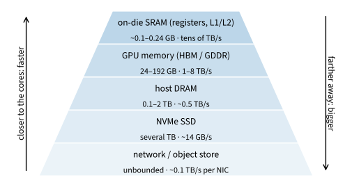
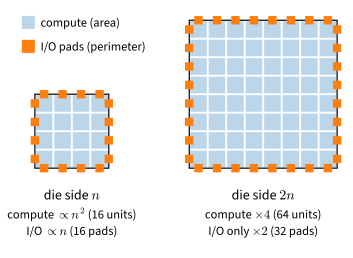
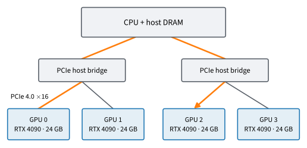

# Hardware
:label:`sec_hardware`

The previous section characterized a GPU by two constants—its peak arithmetic
rate $P$ and its memory bandwidth $\beta$—and showed that an operation
performing $I$ FLOPs per byte runs at most at $\min(P, I\beta)$. On the
RTX 4090, $P = 165$ TFLOP/s for bf16 matrix products and $\beta \approx 1$
TB/s: in the time the card reads one byte from memory, it can execute 165
floating-point operations. Where do these two numbers come from, and why does
moving a byte take so much longer than a FLOP?

Consider generating text one token at a time with a 1B-parameter GPT
(:numref:`sec_kv-cache`). In bf16 its weights occupy 2 GB, and every generated
token reads all of them. The arithmetic for one token ($2 \times 10^9$ FLOPs)
takes the tensor cores 12 µs, while reading 2 GB of weights at the achieved
0.9 TB/s takes 2.2 ms. A single stream therefore decodes at most ~450
tokens/s, leaving the arithmetic units idle over 99% of the time.

Three physical facts explain this gap: data must cross boundaries between
chips; off-chip wires scale more slowly than on-chip transistors; and moving
a byte consumes orders of magnitude more energy than computing with it.
Together they explain why the ridge point $P/\beta$ is in the hundreds and has
risen over hardware generations. Our worked example is the workstation that
runs this book's notebooks (four RTX 4090 GPUs, late 2026);
:citet:`Hennessy.Patterson.2011` treat computer architecture in depth, and
:numref:`sec_hardware_buyers` discusses hardware selection.

```{.python .input #hardware}
%%tab pytorch
import math
import numpy as np
import torch
from torch import nn
from torch.nn import functional as F
from d2l import torch as d2l
```

```{.python .input #hardware}
%%tab jax
import math
import numpy as np
import jax
from jax import numpy as jnp
from flax import nnx
import optax
from d2l import jax as d2l
```

## The Memory Hierarchy
:label:`subsec_hw-bytes`

Every byte a program touches resides in a hierarchy of memories that trade
capacity for speed (:numref:`fig_memory_hierarchy`). On-die registers and
SRAM caches hold ~0.1 GB and deliver tens of TB/s. The GPU's off-die DRAM—*high-bandwidth
memory* (HBM) on data-center cards or GDDR on consumer cards—holds tens to
hundreds of GB at 1–8 TB/s. Host DRAM holds hundreds of GB at ~0.5 TB/s per
CPU socket, NVMe flash holds terabytes at ~14 GB/s, and network storage sits
further out still.


:label:`fig_memory_hierarchy`

### Bandwidth and Latency

:numref:`fig_bandwidth_ladder` ranks the data paths of a training job across
nearly three orders of magnitude, from 14 GB/s (NVMe) to 8 TB/s (NVIDIA B200
HBM). One rule explains every step: **bandwidth equals the number of data
wires times the bit rate per wire**. The RTX 4090 accesses its GDDR6X memory
over 384 wires at 21 Gb/s each (~1 TB/s), whereas its PCIe 4.0 ×16 slot has
16 lanes per direction at 16 Gb/s each (32 GB/s)—roughly the same speed per
wire, but $24\times$ fewer wires.

Distance sets the wire count. HBM stacks sit inside the GPU package
millimeters from the die, connected by thousands of short wires; board traces
support hundreds of wires, and slots or cables a few dozen lanes. **Each step
away from the die cuts the wire count—and with it the bandwidth—by roughly an
order of magnitude.** A B200 reads HBM at 8 TB/s, reaches peer GPUs over
NVLink 5 at 0.9 TB/s (using ~36 lanes at 200 Gb/s each), and reaches the host
over PCIe 5.0 at 64 GB/s.


:label:`fig_bandwidth_ladder`

Bandwidth governs steady-state flow; *latency* is the time for the first byte
to arrive (:numref:`fig_latency_ladder`, with RTX 4090 microbenchmarks from
:citet:`Luo.Fan.Li.ea.2024`). One eager operation dispatched from Python takes
10–100 µs of host time (of which the hardware kernel launch is 1–5 µs). In
10 µs the RTX 4090 can stream 10 MB, which is why small operations are
dominated by dispatch overhead rather than memory or compute.


:label:`fig_latency_ladder`

Latency and bandwidth interact through the *access pattern*. DRAM achieves its
rated bandwidth only on sequential addresses. Let us gather a 1 GiB fp32
vector `x[idx]` once with `idx` equal to the identity permutation and once
with a random permutation. GPU memory transfers data in 32-byte *sectors*, so
each random 4-byte read fetches an entire 32-byte sector while the index and
output vectors still stream sequentially (~$3\times$ more bytes moved in all).

```{.python .input #hardware-bandwidth-and-latency}
%%tab pytorch
n = 256 * 1024 * 1024
x = torch.randn(n, device=d2l.try_gpu())  # 1 GiB fp32
times = {}
for desc in ('identity', 'random'):
    idx = (torch.arange(n, device=x.device) if desc == 'identity' else
           torch.randperm(n, device=x.device))
    # Bytes per element: the index and the output stream; x is read as
    # 4 bytes in order, or as a whole 32-byte sector at a random address
    nbytes = idx.dtype.itemsize + 4 + (4 if desc == 'identity' else 32)
    times[desc] = d2l.Benchmark(lambda: x[idx]).time
    print(f'{desc:8s}: {1e3 * times[desc]:5.1f} ms, '
          f'{nbytes * n / times[desc] / 1e12:.2f} TB/s at {nbytes} B/element')
    del idx  # Free the 2 GiB index before making the next one
print(f'random / identity: {times["random"] / times["identity"]:.1f}x')
```

```{.python .input #hardware-bandwidth-and-latency}
%%tab jax
n = 256 * 1024 * 1024
x = jax.random.normal(d2l.get_key(), (n,))  # 1 GiB fp32
gather = jax.jit(lambda x, idx: x[idx])
times = {}
for desc in ('identity', 'random'):
    idx = (jnp.arange(n) if desc == 'identity' else
           jax.random.permutation(d2l.get_key(), n))
    # Bytes per element: the index and the output stream; x is read as
    # 4 bytes in order, or as a whole 32-byte sector at a random address
    nbytes = idx.dtype.itemsize + 4 + (4 if desc == 'identity' else 32)
    times[desc] = d2l.Benchmark(lambda: gather(x, idx)).time
    print(f'{desc:8s}: {1e3 * times[desc]:5.1f} ms, '
          f'{nbytes * n / times[desc] / 1e12:.2f} TB/s at {nbytes} B/element')
print(f'random / identity: {times["random"] / times["identity"]:.1f}x')
```

The identity gather streams at ~0.9 TB/s, whereas the random gather takes
~37 ms—roughly an order of magnitude slower—and achieves only a third of peak
bandwidth even when credited with a full 32-byte sector per read. Beyond
32-byte sectors, DRAM serves data from open *rows* of a few kilobytes;
consecutive addresses share an open row, whereas random addresses repeatedly
pay the latency of opening a new row (and miss address-translation caches).

Dense matrix products and embedding lookups (which read contiguous rows of
thousands of bytes per token) stream efficiently. In contrast, fine-grained
random accesses (sparse matrices, graph traversals, hash tables) run at a
fraction of $\beta$. More generally, transferring a contiguous block of $n$
bytes with start-up latency $\alpha$ takes $t(n) = \alpha + n/\beta$ and
reaches half of peak bandwidth at $n_{1/2} = \alpha\beta$ :cite:`Hockney.1994`.
For an NVMe drive ($\alpha \approx 50\text{--}100$ µs, $\beta = 14$ GB/s),
$n_{1/2} \approx 1$ MB, which is why datasets on disk are shuffled in
megabyte-scale shards rather than individual examples.

## Compute and Memory Bandwidth
:label:`subsec_hw-shoreline`

### Area and Perimeter

Arithmetic units fill the interior of a silicon die (scaling with area,
$O(n^2)$), whereas I/O pads sit along the perimeter, or *shoreline* (scaling
with edge length, $O(n)$, :numref:`fig_shoreline`). Shrinking transistors has
the same effect: logic density quadruples when feature size halves, while
solder-bump pitch at the die edge shrinks much more slowly.


:label:`fig_shoreline`

Architects mitigate the shoreline bottleneck in two ways:

1. **HBM on a silicon interposer:** Stacking DRAM dies vertically next to the
   GPU die replaces a few hundred board traces with thousands of short, dense
   interposer wires (giving a B200 8 TB/s versus ~0.5 TB/s for a CPU socket).
2. **Multi-die packages:** Because lithography caps single-die area at the
   *reticle limit* (~$858\,\textrm{mm}^2$), flagship accelerators such as the
   B200 join two reticle-limit dies on one package, doubling the perimeter to
   accommodate eight HBM stacks.

### Generational Trends

Across NVIDIA's data-center generations from V100 (2017) through A100 and H100
to B200 (2024), dense 16-bit FLOP/s grew by ~$2.6\times$ per generation, memory
bandwidth by ~$2.0\times$, and capacity by ~$1.8\times$
:cite:`Gholami.Yao.Kim.ea.2024`. Consequently, the ridge point doubled from
139 FLOP/byte on the V100 to 295 on the H100 (281 on the B200): an operation
with intensity 200 FLOP/byte was compute-bound on a V100 but is
bandwidth-bound on an H100 or B200.

### Energy per Operation
:label:`subsec_hw-energy`

Power sets a second hard cap on bandwidth. In a 45 nm CMOS process
(:numref:`fig_energy_ladder`, :citet:`Horowitz.2014`), an fp32 multiply costs
3.7 pJ and an 8-bit integer add 0.03 pJ, whereas reading 64 bits from off-chip
DRAM costs 1.3–2.6 nJ—roughly the energy of **500 fp32 multiplications**.
On-chip SRAM reads lie in between (10–100 pJ depending on distance). While
modern process nodes scale all numbers down, the hierarchy remains unchanged:
moving data costs far more energy than computing on it. Kernel fusion,
narrower number formats, and activation recomputation save power for the exact
same reason they save time.


:label:`fig_energy_ladder`

## The GPU
:label:`subsec_hw-gpu`

### Streaming Multiprocessors

A GPU dedicates its die area to thousands of arithmetic units organized into
*streaming multiprocessors* (SMs; 128 on the RTX 4090). Each SM executes
threads in lockstep groups of 32 called *warps*. Instead of relying on massive
caches to hide DRAM latency, an SM switches warps on every cycle so other
warps compute while stalled warps wait for memory.

By Little's law :cite:`Little.1961`, keeping a memory pipe of bandwidth
$\beta = 1.0$ TB/s full across a latency of 250 ns requires
$1.0\,\textrm{TB/s} \times 250\,\textrm{ns} \approx 250$ KB in flight at all
times (~2 KB per SM, or 16 warps per SM each waiting on a 4-byte load per
thread). Kernels that expose too little parallelism to keep 250 KB in flight
become latency-bound rather than bandwidth-bound.

### Tensor Cores and Number Formats

*Tensor cores* multiply and accumulate small matrix tiles in a single
instruction, amortizing instruction fetch and decode over an entire tile, much
like a TPU systolic array :cite:`Kung.1988,Jouppi.Young.Patil.ea.2017`. On an
H100, bf16 tensor cores deliver 989 TFLOP/s versus 67 TFLOP/s for scalar fp32
($15\times$); on the consumer RTX 4090, the ratio is $2\times$.

We can derive the RTX 4090's peak throughput directly from its specification:
128 SMs $\times$ 128 fp32 units $= 16{,}384$ units, each executing one fused
multiply-add (2 FLOPs) per cycle at the 2.52 GHz boost clock:

$$
P_\textrm{fp32} = 16{,}384 \times 2 \times 2.52 \times 10^{9}\ \textrm{s}^{-1}
\approx 82.6\ \textrm{TFLOP/s}.
$$

Its tensor cores run tf32 at the same 82.6 TFLOP/s, bf16 (with fp32
accumulation) at $2\times = 165.2$ TFLOP/s, and fp8 at $4\times = 330.4$
TFLOP/s.


:label:`fig_float_formats`

As :numref:`fig_float_formats` illustrates, narrowing the format has two
roofline effects:

1. **Halving the width halves the bytes moved** (speeding up bandwidth-bound
   kernels up to $2\times$ and halving weight storage), except for tf32, which
   computes on 19-bit mantissas inside the tensor cores but still stores 32-bit
   floats in memory.
2. **Halving the width usually doubles the tensor-core compute roof $P$.**

Formats of 8 bits or fewer require explicit scale factors. fp8 uses E4M3 for
forward activations/weights and E5M2 for gradients with per-tensor or per-block
scales :cite:`Micikevicius.Stosic.Burgess.ea.2022`. At 4 bits (fp4 / E2M1,
encoding only 15 values from $-6$ to $6$), per-tensor scaling fails on
outliers, so hardware applies *microscaling*—one shared scale per block of 16
(NVFP4) or 32 (OCP MX) elements :cite:`Rouhani.Zhao.More.ea.2023`.

### Accelerator Specifications

:numref:`tab_gpu_specs` compares two data-center GPUs and two consumer cards.

:Four GPUs as of late 2026. Dense tensor-core throughput with fp32 accumulation at boost clock, in TFLOP/s (TF). Links count one direction.
:label:`tab_gpu_specs`

| | H100 SXM | B200 | RTX 4090 (ours) | RTX 5090 |
|---|---|---|---|---|
| memory $C$ | 80 GB HBM3 | 180 GB HBM3e | 24 GB GDDR6X | 32 GB GDDR7 |
| memory bandwidth $\beta$ | 3.35 TB/s | 8 TB/s | 1.0 TB/s | 1.8 TB/s |
| bf16 | 989 TF | 2,250 TF | 165 TF | 210 TF |
| fp8 | 1,979 TF | 4,500 TF | 330 TF | 419 TF |
| fp4 | — | 9,000 TF | — | 1,676 TF |
| ridge point (bf16) | 295 FLOP/B | 281 FLOP/B | 164 FLOP/B | 117 FLOP/B |
| link to other GPUs | NVLink 4, 450 GB/s | NVLink 5, 900 GB/s | PCIe 4.0 ×16 via host, $\le 32$ GB/s | PCIe 5.0 ×16 via host, $\le 64$ GB/s |
| power | 700 W | 1,000 W | 450 W | 575 W |

## Data Paths outside the GPU

### The Host
:label:`subsec_hw-cpu`

While the GPU performs the arithmetic, the host CPU still performs three tasks
that can bottleneck training: dispatching kernels ($h$ per call), running the
data-loading and preprocessing pipeline, and staging host-to-device transfers
over PCIe.

The GPU's DMA *copy engine* can transfer data over PCIe concurrently with SM
computation only from page-locked (*pinned*) host memory. Transfers from
ordinary *pageable* memory must first be copied by the CPU into an internal
pinned staging buffer. Let us compare pageable and pinned transfer rates for
a 256 MiB array.

```{.python .input #hardware-the-cpu-s-role}
%%tab pytorch
x_pageable = torch.randn(64 * 1024 * 1024)  # 256 MiB on the host
x_pinned = x_pageable.pin_memory()
gpu = d2l.try_gpu()
for desc, src in [('pageable', x_pageable), ('pinned', x_pinned)]:
    t = d2l.Benchmark(lambda: src.to(gpu, non_blocking=True)).time
    print(f'{desc}: {src.nbytes / t / 1e9:.1f} GB/s')
```

```{.python .input #hardware-the-cpu-s-role}
%%tab jax
x_pageable = np.random.default_rng().standard_normal(
    64 * 1024 * 1024, dtype=np.float32)  # 256 MiB on the host
gpu = jax.devices()[0]
on_gpu = jax.sharding.SingleDeviceSharding(gpu, memory_kind='device')
x_pinned = jax.device_put(x_pageable, jax.sharding.SingleDeviceSharding(
    gpu, memory_kind='pinned_host'))
for desc, src in [('pageable', x_pageable), ('pinned', x_pinned)]:
    t = d2l.Benchmark(
        lambda: jax.device_put(src, on_gpu).block_until_ready()).time
    print(f'{desc}: {src.nbytes / t / 1e9:.1f} GB/s')
```

The pinned transfer reaches ~23 GB/s—about three quarters of PCIe 4.0 ×16's
32 GB/s theoretical ceiling, and $40\times$ slower than GPU memory—while the
pageable transfer is slower due to the extra host-memory copy. Datasets that
fit in GPU memory should stay on the device; minibatches streamed from the
host should use pinned memory (`pin_memory=True` in PyTorch; `'pinned_host'`
sharding in JAX) overlapped with compute.

### Links between GPUs
:label:`subsec_hw-interconnects`

Data-center GPUs communicate over dedicated NVLink fabrics (450 GB/s per
direction on H100, 900 GB/s on B200). Consumer RTX 4090 cards lack both NVLink
and PCIe peer-to-peer (P2P) access: as :numref:`fig_pcie_topology` shows,
every inter-GPU byte on our four-GPU workstation must travel up one PCIe 4.0
link, through host DRAM, and down another, capping GPU-to-GPU transfers at the
~23 GB/s pinned-copy rate ($40\times$ slower than NVLink 5).


:label:`fig_pcie_topology`

For our 1B-parameter GPT ($S = 4$ GB of fp32 gradients), moving the gradients
once at 23 GB/s takes at least 0.17 s on our workstation versus < 5 ms over
NVLink 5—more than half of the 0.3 s compute time of an 8,192-token step at
peak bf16 throughput.

## Workloads on the Roofline
:label:`subsec_hw-two-workloads`

Language model inference spans two regimes
(:numref:`subsec_kv-cache-prefill-decode`). *Prefill* processes a prompt of
$n$ tokens in parallel, achieving intensity $I \approx n$ (up to the layer
width) and running on the compute roof. *Decode* generates one token per step,
reading all $2N$ bytes of bf16 weights plus the KV cache for an intensity of
$I \approx 1$ FLOP/byte.

### Single-Stream and Batched Decoding

Because single-stream decoding is bandwidth-bound, its token rate is bounded
by

$$
\textrm{tokens/s} \;\lesssim\;
\frac{\beta}{\textrm{bytes per token}} \;=\;
\frac{\beta}{2N + \textrm{KV bytes}}.
$$
:eqlabel:`eq_hw_decode_bound`

When a model's weights fill a card's memory capacity $C$, the maximum
single-stream decode rate is the inverse of the *memory sweep time* $C/\beta$:
the time required to read every byte of GPU DRAM once. Across all four GPUs in
:numref:`tab_gpu_specs`, capacity and bandwidth vary by $7\text{--}8\times$,
yet $C/\beta$ stays near **20 ms** (24 ms on H100 and RTX 4090, 22.5 ms on
B200, 18 ms on RTX 5090). Any model that fills its GPU therefore decodes a
single stream at roughly 40–55 tokens/s, whether on a consumer card or a
flagship data-center GPU.

Batching $B$ concurrent sequences amortizes weight reads across $B$ tokens,
raising weight intensity to $I \approx B$ FLOP/byte until $B$ reaches the
ridge point (as measured in :numref:`subsec_perf-roofline-test`), though each
sequence still reads its own KV cache (:numref:`subsec_kv-cache-batching`).

### Rules of Thumb

:numref:`tab_rules_of_thumb` summarizes the key hardware constants used
throughout the rest of this chapter.

:Rules of thumb: characteristic magnitudes, their values on our machine (four RTX 4090s without peer-to-peer access), and why each matters.
:label:`tab_rules_of_thumb`

| quantity | magnitude, late 2026 | our machine | why it matters |
|---|---|---|---|
| host time per call, $h$ | 10 µs to 0.1 ms | 13–100 µs (:numref:`sec_perf_model`) | small operations cannot keep the GPU busy |
| peak bf16 rate, $P$ | 0.17–2.3 PFLOP/s | 165 TFLOP/s | speed limit of large matrix products |
| GPU memory bandwidth, $\beta$ | 1–8 TB/s | ~0.9 TB/s (1.0 rated) | speed limit of elementwise ops and decoding |
| ridge point, $P/\beta$ | 120–300 FLOP/byte | 164 FLOP/byte | below it, memory bandwidth sets the time |
| sweep time, $C/\beta$ | ~20 ms | 24 ms | largest model that fits decodes 1 stream at ~40–55 tok/s |
| host to device, pinned | 32–64 GB/s (PCIe 4/5) | ~23 GB/s | keep training data on device or in pinned memory |
| GPU to GPU | 450–900 GB/s (NVLink) | $\le 23$ GB/s via host (:numref:`sec_multi_gpu`) | sets the time of every gradient exchange |
| bytes per parameter (Adam) | 16 (fp32), 18 (mixed) | 16–18 | determines what model size fits (:numref:`sec_memory_precision`) |
| bytes per token, decode | $2N$ + KV cache (bf16) | | tokens/s $\lesssim \beta / \textrm{bytes per token}$ |

## Summary

Bandwidth is wire count times rate per wire. Because wires exit a die along
its perimeter while arithmetic units fill its area—and because off-chip data
movement costs hundreds of times more energy than arithmetic—the ridge point
$P/\beta$ lies in the hundreds of FLOP/byte and has risen across hardware
generations. Memory transfers 32-byte sectors from open DRAM rows, so fine-grained
random reads achieve only a fraction of $\beta$, and saturating $\beta$
requires $\beta \times \textrm{latency}$ bytes in flight across warps.
Narrower number formats halve memory traffic and usually double $P$. Finally,
single-stream decoding is bounded by $\beta / (2N + \textrm{KV bytes})$, and
because the memory sweep time $C/\beta$ is ~20 ms across modern GPUs, the
largest model that fits on any card decodes a single stream at ~40–55
tokens/s.

## Exercises

1. [code] **Latency and bandwidth, measured.** ● The block transfer model $t(n) = \alpha + n/\beta$ with $n_{1/2} = \alpha\beta$ (:numref:`subsec_hw-bytes`) describes a single synchronous call.
    1. Predict $n_{1/2}$ for the elementwise multiplication `x * 1.5` of :numref:`subsec_perf-regimes`, taking $\alpha = h$ and $\beta$ from your measurements in :numref:`sec_perf_model`.
    1. Time `x * 1.5` for tensor sizes from 1 MB to 2 GB, plot achieved bandwidth against size on log–log axes, and relate the regime transitions to :numref:`fig_latency_ladder` and the on-die L2 cache capacity in :numref:`fig_memory_hierarchy`.
    1. Repeat the host-to-device measurement of :numref:`subsec_hw-cpu` for transfers from 4 KB to 256 MB, and fit $\alpha$ and the asymptotic bandwidth.

2. **Wires and rates.** :numref:`subsec_hw-bytes` writes bandwidth as the number of wires times the rate per wire.
    1. A DDR5-6400 DIMM has 64 data wires at 6.4 Gb/s each. An HBM3e stack has 1,024 data wires, and a B200 carries eight stacks. Compute the bandwidth of one DIMM, the number of DIMMs needed for a 0.5 TB/s CPU socket, and the per-wire data rate implied by the B200's 8 TB/s in :numref:`tab_gpu_specs`. Which factor accounts for the gap between the CPU socket and the B200?
    1. Each of the two dies of a B200 sits next to four of the eight HBM stacks. If the SMs on each die read both halves of memory equally often at a combined 8 TB/s, what bandwidth must the on-package bridge carry in each direction?

3. **Starved input pipeline.** Suppose the GPU compute of a training job can
   process 2 GB/s of decoded images. Each CPU worker runs two sequential
   stages: reading compressed JPEGs from NVMe at 1 GB/s (compressed) and
   decoding them on one CPU core at 0.3 GB/s (decoded output, an $8\times$
   size expansion). The training loop then copies each decoded batch synchronously
   from pageable host memory to the GPU at 12 GB/s before computing.
    1. At what rate (in decoded bytes/s) does one worker deliver batches, and
       which stage binds?
    1. How many parallel worker processes are needed to keep the GPU fed?
    1. By what fraction does the synchronous pageable copy lengthen each step,
       and how does switching to asynchronous pinned-memory copies at 24 GB/s
       change this?

4. **Ridge point of a link.** The ridge point $P/\beta$ applies to any data
   path of bandwidth $\beta$, counting the FLOPs a device can execute while
   one byte crosses the path.
    1. Compute $P/\beta$ in bf16 for an RTX 4090 against its own DRAM and
       against the 23 GB/s host-staged GPU-to-GPU path, and for a B200 against
       its HBM and against one direction of NVLink 5 (900 GB/s).
    1. In data-parallel training (:numref:`sec_multi_gpu`), each GPU holds a
       model with $N$ parameters, processes $T$ tokens per step at ~$6N$ FLOPs
       per token, and sums bf16 gradients via an allreduce that sends ~$4N$
       bytes per GPU. Without overlap, show that communication takes no longer
       than compute if and only if $T$ exceeds a threshold proportional to the
       link's ridge point, independent of $N$.
    1. Evaluate this token threshold for NVLink 5, for the 23 GB/s pinned-copy
       rate, and for the 2.4 GB/s achieved by default host-staged NCCL on our
       workstation (:numref:`sec_multi_gpu_concise`).

5. **Launch-bound decode.** In eager single-stream decoding, the CPU launches
   every kernel of every block while the GPU reads the block's weights. Suppose
   each of $L$ blocks of width $d$ holds $12d^2$ bf16 weights and launches
   $K = 12$ kernels per token at $h = 8$ µs of host time per kernel.
    1. Show that whether host launch time or weight-read time binds is
       independent of $L$, and find the crossover width $d^*$ on the RTX 4090
       and on the B200.
    1. Evaluate both bounds for GPT-2 Small ($d = 768$, $L = 12$) on the
       RTX 4090. Which bound binds?
    1. What does the shift in $d^*$ from the RTX 4090 to the B200 imply for
       the importance of CUDA graph capture-and-replay (:numref:`sec_compilation`)
       on faster GPUs?

6. [code] **Block-shuffled gather.** ● Repeat the gather benchmark of
   :numref:`subsec_hw-bytes`, but permute contiguous blocks of $k$ elements
   for $k \in \{1, 2, 4, \ldots, 1024\}$ instead of individual elements. Plot
   the achieved bandwidth against block size in bytes, and compare the
   crossover size with the 32-byte sector size and the kilobyte scale of a
   DRAM row.

7. **Latency hiding.** ● Apply Little's law (:numref:`subsec_hw-gpu`) to
   memory latency hiding:
    1. Compute the bytes in flight needed to saturate the B200's 8 TB/s HBM at
       250 ns latency, and compare with the 250 KB of the RTX 4090. What does
       the ~$2\times$ generational growth of bandwidth at nearly constant DRAM
       latency imply for the parallelism kernels must expose?
    1. In pointer chasing, each load's address depends on the previous load,
       allowing only one request in flight per chain. On a CPU with 90 ns DDR5
       latency and 64-byte cache lines, compute the bandwidth of a single
       chain and the number of independent chains required to saturate a
       0.5 TB/s socket.

[Discussions](https://d2l.discourse.group/t/36788)

<!-- slides -->

::: {.slide}
::: {.cover}
[Dive into Deep Learning · §13.2]{.kicker}

Hardware Anatomy: CPUs, GPUs, Tensor Cores, and Memory Hierarchy<br>**memory hierarchy · wire count & shoreline · sector access · SMs & Tensor Cores · PCIe & NVLink · decode sweep time**
:::
:::

::: {.slide title="Why a 165-TFLOP/s GPU Decodes Only 450 Tokens/s"}
[Motivation]{.kicker}

::: {.cols .vc}
::: {.col}
- **Arithmetic time ($12\,\mu\text{s}$):** Executing $2N = 2 \times 10^9\text{ FLOPs}$ per token on a 1B GPT takes $12\,\mu\text{s}$ at $165\text{ TFLOP/s}$.
- **Memory transfer time ($2.2\text{ ms}$):** Streaming all $2\text{ GB}$ of `bf16` weights from GDDR6X at $0.9\text{ TB/s}$ takes $2.2\text{ ms}$—nearly **$200\times$ longer**!
- **Throughput ceiling ($\sim 450\text{ tok/s}$):** Single-stream decoding leaves Tensor Cores idle over $99\%$ of the time.
:::

::: {.col .fig .big}
@fig:ch13-perf-decode-bottleneck
:::
:::
:::

::: {.slide title="The Memory Hierarchy: Trading Capacity for Bandwidth"}
[Memory Hierarchy]{.kicker}

{height=420px}

- **On-die registers & SRAM ($L_1$/shared, $L_2$):** Hold $\sim 0.1\text{ GB}$ millimeters from the ALUs and deliver tens of $\text{TB/s}$.
- **Off-die GPU DRAM (GDDR6X / HBM3e) & beyond:** Capacity grows by orders of magnitude ($24\text{--}180\text{ GB}$ DRAM $\to$ hundreds of $\text{GB}$ host RAM $\to$ $\text{TB}$ NVMe), while bandwidth drops by orders of magnitude at every boundary.
:::

::: {.slide title="Bandwidth Equals Wire Count Times Bit Rate per Wire"}
[Physical Bandwidth]{.kicker}

::: {.cols .vc}
::: {.col .fig}
{height=460px}
:::

::: {.col}
- **The wire law:** $\text{BW} = N_{\text{wires}} \times r_{\text{wire}}$ (number of data wires times bit rate per wire).
- **RTX 4090 GDDR6X vs. PCIe 4.0 $\times 16$:** Memory uses $384\text{ wires} \times 21\text{ Gb/s} \approx 1.0\text{ TB/s}$; PCIe uses $16\text{ lanes} \times 16\text{ Gb/s} = 32\text{ GB/s}$ per direction—similar per-wire speed, but **$24\times$ fewer wires**.
- **Distance sets wire count:** Every step away from the silicon die (HBM interposer $\to$ PCB traces $\to$ PCIe slot/cables) cuts wire density and bandwidth by roughly $10\times$.
:::
:::
:::

::: {.slide title="The Latency Ladder: From Register Cycles to Python"}
[Access Latency]{.kicker}

::: {.cols .vc}
::: {.col .fig}
{height=450px}
:::

::: {.col}
- **Bandwidth vs. latency:** Bandwidth governs steady-state flow; latency $\alpha$ is the delay before the first byte arrives.
- **On-chip vs. off-chip:** Register/SRAM reads take nanoseconds ($10\text{--}30\text{ ns}$); off-chip GPU DRAM takes $\sim 250\text{ ns}$.
- **Python dispatch ($10\text{--}100\,\mu\text{s}$):** Launching one eager operation from Python takes $40\text{--}400\times$ longer than a DRAM read—enough time for the RTX 4090 to stream $10\text{ MB}$ of data.
:::
:::
:::

::: {.slide title="Sequential Streaming vs. Random 32-Byte Sector Reads"}
[Access Patterns]{.kicker}

GPU DRAM achieves its rated bandwidth $\beta$ only on sequential, coalesced addresses. Below, we gather a $1\text{ GiB}$ `float32` array `x[idx]` using an identity permutation versus a random permutation:

@!hardware-bandwidth-and-latency

::: {.d2l-note .warn}
**Why random gathers lose $10\times$ in speed:** Memory transactions fetch **32-byte sectors** (wasting $28$ of $32\text{ B}$ per random 4-byte read), and random addresses repeatedly miss open **kilobyte-scale DRAM rows** and address-translation caches.
:::
:::

::: {.slide title="Block Transfers and Half-Bandwidth Size n_1/2"}
[Hockney Transfer Model]{.kicker}

::: {.cols .vc}
::: {.col}
$$t(n) \;=\; \alpha + \frac{n}{\beta}, \qquad \beta_{\textrm{eff}}(n) \;=\; \frac{\beta}{1 + \alpha\beta / n}$$

- **Half-performance size ($n_{1/2} = \alpha\beta$):** The payload size where transfer time $n/\beta$ equals start-up latency $\alpha$, achieving $\frac{1}{2}\beta$.
- **NVMe disk shuffling ($\alpha \approx 70\,\mu\text{s}$, $\beta = 14\text{ GB/s}$):** $n_{1/2} \approx \mathbf{1\text{ MB}}$; random $4\text{ KB}$ reads waste $>99\%$ of drive bandwidth, so datasets must be stored in megabyte shards.
:::

::: {.col .fig}
@fig:ch13-perf-hockney-transfer
:::
:::
:::

::: {.slide title="The Shoreline Bottleneck: Compute Is Area, I/O Is Edge"}
[Silicon Geometry]{.kicker}

::: {.cols .vc}
::: {.col .fig}
{height=420px}
:::

::: {.col}
- **Area vs. perimeter scaling:** Logic transistors fill the die interior ($O(L^2)$), whereas off-chip I/O pads line the die perimeter or *shoreline* ($O(L)$).
- **HBM on a silicon interposer:** Stacking DRAM dies vertically next to the GPU over thousands of micron-scale interposer wires gives a B200 $8\text{ TB/s}$ (vs. $\sim 0.5\text{ TB/s}$ for CPU DDR5 channels).
- **Multi-die packages:** Joining two reticle-limit dies ($\sim 858\text{ mm}^2$ each) doubles the shoreline to fit eight HBM stacks.
:::
:::
:::

::: {.slide title="Generational Scaling: Compute Outgrows Bandwidth"}
[Hardware Trends]{.kicker}

::: {.cols .vc}
::: {.col}
- **Disproportionate scaling (2017–2024):** Across V100 $\to$ A100 $\to$ H100 $\to$ B200, 16-bit Tensor Core peak $P$ grew $18\times$ while HBM bandwidth $\beta$ grew $8.9\times$.
- **Doubled ridge point ($I^* = P/\beta$):** The threshold intensity to saturate compute rose from $139\text{ FLOP/B}$ (V100) to $281\text{--}295\text{ FLOP/B}$ (B200/H100).
- **Systems consequence:** An operation at $I = 200\text{ FLOP/B}$ that was compute-bound on V100 is **bandwidth-bound** on H100 and B200!
:::

::: {.col .fig .big}
@fig:ch13-perf-generational-ridge
:::
:::
:::

::: {.slide title="The Energy Cost of Moving Bytes vs. Arithmetic"}
[Power & Energy]{.kicker}

::: {.cols .vc}
::: {.col .fig}
{height=380px}
:::

::: {.col}
- **Off-chip memory dominates power:** In $45\text{ nm}$ CMOS (Horowitz, 2014), an `fp32` multiply costs $3.7\text{ pJ}$, whereas reading $64\text{ bits}$ from off-chip DRAM costs $1.3\text{--}2.6\text{ nJ}$—roughly **500 `fp32` multiplications**.
- **On-chip SRAM is $20\text{--}100\times$ cheaper** ($10\text{--}100\text{ pJ}$).
- **Power caps bandwidth:** Every technique that saves memory traffic—operator fusion, narrower formats, on-chip tiling—saves watts for the exact same physical reason it saves milliseconds.
:::
:::
:::

::: {.slide title="Streaming Multiprocessors and Latency Hiding"}
[GPU Execution Model]{.kicker}

::: {.cols .vc}
::: {.col}
$$\textrm{Bytes in flight} \;=\; \beta \times \textrm{latency} \;\approx\; 250\textrm{ KB}$$

- **Zero-overhead warp switching:** Each of the $128$ SMs executes threads in 32-thread **warps**, switching resident warps every cycle whenever one stalls on a $250\text{ ns}$ DRAM load.
- **Little's Law occupancy floor:** Sustaining $1.0\text{ TB/s}$ requires $\ge 250\text{ KB}$ in flight ($\sim 16$ active warps/SM issuing 4-byte loads); tiny grids cannot hide DRAM latency.
:::

::: {.col .fig}
@fig:ch13-perf-sm-latency-hiding
:::
:::
:::

::: {.slide title="Deriving Peak FLOP/s from SMs, Clock, and Tensor Cores"}
[Tensor Cores]{.kicker}

::: {.cols .vc}
::: {.col}
$$P_{\textrm{fp32}} \;=\; 128 \times 128 \times 2 \times 2.52\textrm{ GHz} \;\approx\; 82.6\textrm{ TFLOP/s}$$

- **Systolic tile multipliers:** Tensor Cores amortize instruction fetch and register access across matrix tiles in a single instruction with `fp32` accumulation.
- **Throughput scaling by precision:** `tf32` reaches $82.6\text{ TFLOP/s}$ ($1\times$), `bf16`/`fp16` doubles to $165.2\text{ TFLOP/s}$ ($2\times$), and `fp8` quadruples to $330.4\text{ TFLOP/s}$ ($4\times$).
:::

::: {.col .fig}
@fig:ch13-perf-tensor-core-math
:::
:::
:::

::: {.slide title="Floating-Point Formats: Exponent Range and Precision"}
[Number Formats]{.kicker}

{height=320px}

- **Why `bfloat16` replaced `float16` for training:** `fp32`, `tf32`, and `bf16` all share an **8-bit exponent** (dynamic range $\sim 10^{\pm 38}$), so `bf16` requires no loss scaling.
- **Twofold roofline benefit:** Stepping down in bit width (except `tf32`, which is stored as 32-bit `fp32` in DRAM) both **halves memory bytes moved** and **doubles Tensor Core $P$**. Sub-8-bit formats (`fp8`, `fp4`) require per-tensor or per-block (16–32 element) microscaling.
:::

::: {.slide title="Data-Center vs. Consumer GPU Specifications"}
[Accelerator Comparison]{.kicker}

Comparing two flagship data-center GPUs against two consumer cards highlights where consumer cards trade off capacity, bandwidth, and multi-GPU interconnects:

| Specification | H100 SXM | B200 | RTX 4090 (Ours) | RTX 5090 |
| :--- | :---: | :---: | :---: | :---: |
| **Memory Capacity ($C$)** | $80\text{ GB HBM3}$ | $180\text{ GB HBM3e}$ | $24\text{ GB GDDR6X}$ | $32\text{ GB GDDR7}$ |
| **Memory Bandwidth ($\beta$)** | $3.35\text{ TB/s}$ | $8.0\text{ TB/s}$ | $1.01\text{ TB/s}$ | $1.79\text{ TB/s}$ |
| **`bfloat16` Tensor Core ($P$)** | $989\text{ TFLOP/s}$ | $2{,}250\text{ TFLOP/s}$ | $165.2\text{ TFLOP/s}$ | $209.5\text{ TFLOP/s}$ |
| **`fp8` / `fp4` Tensor Core** | $1{,}979$ / — | $4{,}500$ / $9{,}000$ | $330.4$ / — | $419$ / $1{,}676$ |
| **Ridge Point ($I^*$, `bf16`)** | $295\text{ FLOP/B}$ | $281\text{ FLOP/B}$ | $164\text{ FLOP/B}$ | $117\text{ FLOP/B}$ |
| **Inter-GPU Link (1-way)** | NVLink 4 ($450\text{ GB/s}$) | NVLink 5 ($900\text{ GB/s}$) | PCIe 4.0 ($\le 32\text{ GB/s}$) | PCIe 5.0 ($\le 64\text{ GB/s}$) |
:::

::: {.slide title="Host-to-Device Transfers: Pageable vs. Pinned Memory"}
[Host Data Paths]{.kicker}

The GPU's DMA copy engines can stream minibatches over PCIe concurrently with SM execution only if the source buffer resides in page-locked (**pinned**) host RAM:

@!hardware-the-cpu-s-role

- **Why pageable memory is slower:** The OS can swap pageable pages at any time, forcing the driver to copy pageable arrays on the CPU into a private pinned staging buffer before DMA begins.
- **Systems rule:** Keep small datasets resident in GPU DRAM; for streamed datasets, allocate host batches in pinned memory (`pin_memory=True` / `'pinned_host'`) and copy asynchronously (`non_blocking=True`).
:::

::: {.slide title="Inter-GPU Links: NVLink Fabrics vs. Host-Staged PCIe"}
[Multi-GPU Topology]{.kicker}

::: {.cols .vc}
::: {.col .fig}
{height=390px}
:::

::: {.col}
- **No NVLink or PCIe peer-to-peer (P2P):** As `nvidia-smi topo` shows, every byte exchanged between GPUs on our workstation travels up one PCIe 4.0 $\times 16$ link, through host DRAM, and down another ($\le 23\text{ GB/s}$, nearly **$40\times$ slower** than NVLink 5's $900\text{ GB/s}$).
- **Impact on our 1B GPT ($4\text{ GB}$ `fp32` gradients):** One gradient transfer takes $\ge 0.17\text{ s}$ over host-staged PCIe vs. $< 5\text{ ms}$ over NVLink 5.
:::
:::
:::

::: {.slide title="LLM Inference on the Roofline: Prefill vs. Decode"}
[Workload Analysis]{.kicker}

Autoregressive language model serving splits into two distinct roofline regimes for a model of $N$ parameters stored in `bfloat16` ($2N$ bytes):

$$\textrm{Prefill ($n$ prompt tokens): } I \approx n \;\textrm{(compute-bound)}, \qquad \textrm{Decode ($1$ token): } I \approx 1 \;\textrm{(bandwidth-bound)}$$

- **Single-stream decode bound:** Because generating one token reads all $2N$ weight bytes plus the KV cache at intensity $I \approx 1 \ll I^*$, token generation speed is governed strictly by memory bandwidth $\beta$:
  $$\textrm{tokens/s} \;\lesssim\; \frac{\beta}{\textrm{bytes moved per token}} \;=\; \frac{\beta}{2N + \textrm{KV bytes}}$$
- **1B GPT on RTX 4090 ($\beta \approx 0.9\text{ TB/s}$, $2N = 2\text{ GB}$):** At short context lengths, $\textrm{tokens/s} \lesssim \frac{900\text{ GB/s}}{2\text{ GB}} \approx \mathbf{450\text{ tokens/s}}$.
:::

::: {.slide title="The 20 ms Memory Sweep Time and Batched Decoding"}
[Capacity & Sweep Time]{.kicker}

::: {.cols .vc}
::: {.col}
- **Universal $\sim 20\text{ ms}$ sweep invariant ($C/\beta$):** Reading a full GPU's DRAM once takes $18\text{--}24\text{ ms}$ across RTX 4090, RTX 5090, H100, and B200 alike.
- **Full-card 1-stream ceiling:** Any model whose weights fill its card decodes a single sequence at $\beta/C \approx \mathbf{42\text{--}56\text{ tokens/s}}$.
- **Batched decoding ($B$ streams):** Shares each weight read across $B$ tokens ($I \approx B$), multiplying total throughput linearly until $B \approx I^*$.
:::

::: {.col .fig .big}
@fig:ch13-perf-sweep-time-invariant
:::
:::
:::

::: {.slide title="Concept Check: Hardware Bandwidth, Formats, and Decode"}
[Check Your Understanding]{.kicker}

Work out the following hardware estimates on the RTX 4090 ($\beta_{\textrm{achieved}} \approx 0.9\text{ TB/s}$, `bf16` peak $P = 165\text{ TFLOP/s}$, `fp8` peak $330\text{ TFLOP/s}$, ridge $I^* = 164\text{ FLOP/byte}$):

1. We switch from `bfloat16` to `fp8` for (a) an elementwise kernel at $I = 0.25\text{ FLOP/B}$ and (b) a large matmul at $I = 1{,}000\text{ FLOP/B}$. What speedup does each get, and why does neither get $4\times$?
2. An 8B-parameter model in `bfloat16` ($16\text{ GB}$ of weights, KV cache neglected) runs on the RTX 4090. What is the maximum token throughput for **1 stream** ($B = 1$) and across **64 concurrent streams** ($B = 64$)?

::: {.d2l-note .fragment .fade-up}
**Answers:**

1. **(a) $2\times$ faster** (bandwidth-bound: halves bytes moved); **(b) $2\times$ faster** (compute-bound: doubles Tensor Core $P$ from $165 \to 330\text{ TFLOP/s}$). Neither gains $4\times$ because only one roof binds at a time!
2. **1 stream ($B = 1$):** Streaming $16\text{ GB}$ at $0.9\text{ TB/s}$ takes $17.8\text{ ms/step}$ $\to$ **$\approx 56\text{ tokens/s}$**. **Batch $B = 64$:** Still bandwidth-bound ($I \approx 64 < 164$), so each step still takes $\sim 17.8\text{ ms}$ $\to$ **$64 \times 56 \approx 3{,}600\text{ tokens/s}$** total!
:::
:::

::: {.slide title="Summary: Hardware Laws and Characteristic Magnitudes"}
[Key Takeaways]{.kicker}

| Hardware Principle / Metric | Rule / Formula | RTX 4090 / Workstation | Practical Systems Consequence |
| :--- | :--- | :--- | :--- |
| **Wire Bandwidth Law** | $\beta = \textrm{wires} \times \textrm{rate/wire}$ | $1.0\text{ TB/s}$ DRAM vs. $23\text{ GB/s}$ PCIe | Each hop off-die cuts wire count and bandwidth by $\sim 10\text{--}40\times$ |
| **Shoreline & Energy** | Compute $\propto L^2$, I/O $\propto L$ | $1\text{ DRAM read} \approx 500\text{ FLOPs}$ | Ridge points ($117\text{--}295\text{ FLOP/B}$) rise across generations |
| **Sector & Row Access** | $t(n) = \alpha + n/\beta$, 32-B sectors | Random gather $\sim 10\times$ slower | Coalesce memory reads; shuffle disk data in $\ge 1\text{ MB}$ blocks |
| **Little's Law (SMs)** | $\textrm{In-flight} = \beta \times \textrm{latency}$ | $\approx 250\text{ KB}$ ($128$ SMs) | Kernels must expose enough warps to hide $250\text{ ns}$ DRAM latency |
| **Precision Narrowing** | $\textrm{Bytes} \div 2$, Tensor Core $P \times 2$ | `tf32` $83\text{ TF/s} \to$ `bf16` $165\text{ TF/s}$ | Speeds up both bandwidth-bound and compute-bound kernels |
| **Decode & Sweep Time** | $\textrm{tok/s} \lesssim \beta / (2N + \textrm{KV})$ | $C/\beta \approx 24\text{ ms}$ ($\sim 42\text{ tok/s}$ full) | Single-stream decode is memory-bound; batching raises $I \approx B$ |
:::
