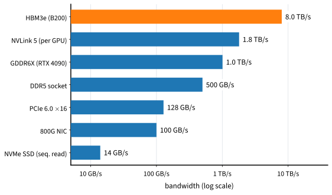
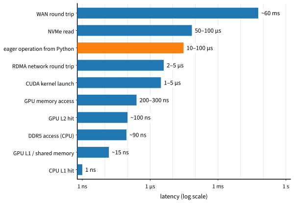
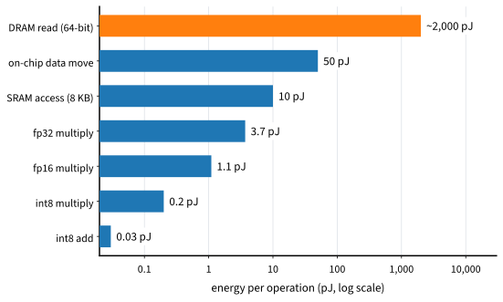

# Hardware
:label:`sec_hardware`

The previous section described a GPU by two numbers, its peak arithmetic
rate $P$ and its memory bandwidth $\beta$, and found that an operation
performing $I$ FLOPs per byte it moves runs at most at $\min(P, I\beta)$.
We took both numbers as given. On the RTX 4090 they are
165 trillion floating-point operations per second on bf16 matrices and
about one trillion bytes per second, so in the time the card reads one byte
from its memory it can perform about 165 floating-point operations. Where
do the two numbers come from, and why does a byte take so much longer than
a FLOP?

The gap decides the speed of a task we met in :numref:`sec_kv-cache`,
generating text one token at a time. Suppose we generate with a GPT of one
billion parameters. In bf16 its weights occupy 2 GB, and every generated
token needs all of them. The arithmetic for one token, about
$2 \times 10^9$ FLOPs, takes the tensor cores 12 µs, while reading the
2 GB of weights at the 0.9 TB/s that :numref:`sec_perf_model` measured
takes the memory 2.2 ms. The card therefore produces at most about 450
tokens per second for a single stream of text, and its arithmetic units sit
idle more than 99% of the time. Peak arithmetic does not predict speed,
because every operand must first arrive through a memory system that is far
slower.

The explanation rests on three physical facts. Data must cross the
boundaries between chips. The wires that cross them grow in number more
slowly than the transistors that compute. And moving a byte takes far more
energy than computing with it. Together they explain why the ridge point
$P/\beta$ is large and has grown over the years. Our worked
example is the machine that runs this book's notebooks, a workstation with
four RTX 4090s, which we call *our machine*. The numbers below are those of
late 2026. They will change, but the relations between them change slowly,
and the relations are what this section is about.
:citet:`Hennessy.Patterson.2011` treat computer architecture in depth;
:numref:`sec_hardware_buyers` gives purchase advice.

```{.python .input #hardware}
%%tab pytorch
import math
import numpy as np
import torch
from torch import nn
from torch.nn import functional as F
from d2l import torch as d2l
```

```{.python .input #hardware}
%%tab jax
import math
import numpy as np
import jax
from jax import numpy as jnp
from flax import nnx
import optax
from d2l import jax as d2l
```

## The Memory Hierarchy
:label:`subsec_hw-bytes`

Every byte a program touches lives somewhere in a hierarchy of memories
(:numref:`fig_memory_hierarchy`), and each level trades capacity for speed.
The fastest memories, the registers and caches, sit on the *die*, the slab of
silicon that holds the GPU's transistors; together they hold about a tenth
of a gigabyte and deliver tens of terabytes per second. The GPU's own DRAM,
the *high-bandwidth memory* (HBM) of datacenter parts or the GDDR of
consumer cards, holds tens to hundreds of gigabytes at one to eight
terabytes per second. Host DRAM holds hundreds of gigabytes at about half a
terabyte per second per CPU socket. NVMe flash holds terabytes at about
fourteen gigabytes per second. Network storage has no practical limit on
capacity but delivers only what the network card can carry.


:label:`fig_memory_hierarchy`

### Bandwidth and Latency

:numref:`fig_bandwidth_ladder` ranks the data paths of a training job by
bandwidth, from the 14 GB/s of an NVMe drive to the 8 TB/s of the HBM next
to an NVIDIA B200, the datacenter GPU of 2024: almost three orders of
magnitude. One rule accounts for the steps. The bandwidth of a path is the
number of its data wires times the rate per wire. The RTX 4090 reads its
GDDR6X memory over 384 wires at 21 Gb/s each, 1 TB/s. Its PCIe 4.0 ×16
slot has 16 lanes per direction at 16 Gb/s each, 32 GB/s. The wires are
about equally fast, but the slot has 24 times fewer of them.

What sets the number of wires is distance. HBM sits in the GPU's package,
millimeters from the die, and thousands of short wires join the two.
Memory chips on the board get hundreds, a slot or a cable a few dozen
lanes. **Each step away from the die cuts the wires, and with them the
bandwidth, by roughly an order of magnitude or more.** A B200 reads its HBM
at 8 TB/s, reaches other GPUs over NVLink at 0.9 TB/s, and reaches the host
through its PCIe 5.0 slot at 64 GB/s. The RTX 4090 steps from 1 TB/s on the
board straight down to 32 GB/s through its slot. NVLink wins back part of
its step with the other factor: its few dozen lanes run at 200 Gb/s each,
ten times a GDDR6X wire, at a cost in power for every lane.


:label:`fig_bandwidth_ladder`

Bandwidth says how fast data flows once it flows. *Latency* says how long
the first byte takes to arrive. Latencies span eight orders of magnitude
(:numref:`fig_latency_ladder`), from a one-nanosecond hit in a CPU's L1
cache to a sixty-millisecond round trip across a continent; the GPU entries
come from microbenchmarks of the RTX 4090 :cite:`Luo.Fan.Li.ea.2024`. The
highlighted entry matters most in this chapter. One eager operation
dispatched from Python takes some ten to a hundred microseconds of host
time, depending on the framework and the host, of which the kernel launch
is 1–5 µs (:numref:`sec_perf_model` measured the host time $h$ per call
in your framework). Even 10 µs is enough for the RTX 4090 to stream
10 MB, more than many operations of a small model read, which is why this
chapter keeps returning to fewer, larger operations.


:label:`fig_latency_ladder`

Latency and bandwidth meet in the *access pattern*. DRAM delivers its rated
bandwidth only for runs of consecutive addresses: a sequential read waits
out the latency once and then streams, while a random read waits out a
whole access for every few bytes it uses. How much does the order cost? Let
us gather a 1 GiB vector `x` of fp32 numbers through an index vector,
`x[idx]`, once with `idx` the identity and once with a random permutation,
which requests the same elements in a different order. The identity gather
reads `x` and the index and writes the output in order, so it should run at
the bandwidth measured in :numref:`sec_perf_model`.

The random gather reads `x` at arbitrary addresses, and GPU memory
delivers data in *sectors* of 32 bytes, so every 4-byte read of `x` moves
eight times the bytes it uses. The index and the output still stream in
order, so counting a full sector for every random read adds 28 bytes per
element, not a factor of eight. If bytes alone set the time, the random
gather would take about three times as long as the identity gather.

:begin_tab:`pytorch`
PyTorch indexes with 8-byte integers, so the identity gather moves
16 bytes per element, 4.3 GB in all: about 4.8 ms at 0.9 TB/s. The random
gather moves 44 bytes per element, 2.75 times as many.
:end_tab:

:begin_tab:`jax`
JAX indexes with 4-byte integers, so the identity gather moves 12 bytes
per element, 3.2 GB in all: about 3.6 ms at 0.9 TB/s. The random gather
moves 40 bytes per element, 3.3 times as many.
:end_tab:

```{.python .input #hardware-bandwidth-and-latency}
%%tab pytorch
n = 256 * 1024 * 1024
x = torch.randn(n, device=d2l.try_gpu())  # 1 GiB fp32
times = {}
for desc in ('identity', 'random'):
    idx = (torch.arange(n, device=x.device) if desc == 'identity' else
           torch.randperm(n, device=x.device))
    # Bytes per element: the index and the output stream; x is read as
    # 4 bytes in order, or as a whole 32-byte sector at a random address
    nbytes = idx.dtype.itemsize + 4 + (4 if desc == 'identity' else 32)
    times[desc] = d2l.Benchmark(lambda: x[idx]).time
    print(f'{desc:8s}: {1e3 * times[desc]:5.1f} ms, '
          f'{nbytes * n / times[desc] / 1e12:.2f} TB/s at {nbytes} B/element')
    del idx  # Free the 2 GiB index before making the next one
print(f'random / identity: {times["random"] / times["identity"]:.1f}x')
```

```{.python .input #hardware-bandwidth-and-latency}
%%tab jax
n = 256 * 1024 * 1024
x = jax.random.normal(d2l.get_key(), (n,))  # 1 GiB fp32
gather = jax.jit(lambda x, idx: x[idx])
times = {}
for desc in ('identity', 'random'):
    idx = (jnp.arange(n) if desc == 'identity' else
           jax.random.permutation(d2l.get_key(), n))
    # Bytes per element: the index and the output stream; x is read as
    # 4 bytes in order, or as a whole 32-byte sector at a random address
    nbytes = idx.dtype.itemsize + 4 + (4 if desc == 'identity' else 32)
    times[desc] = d2l.Benchmark(lambda: gather(x, idx)).time
    print(f'{desc:8s}: {1e3 * times[desc]:5.1f} ms, '
          f'{nbytes * n / times[desc] / 1e12:.2f} TB/s at {nbytes} B/element')
print(f'random / identity: {times["random"] / times["identity"]:.1f}x')
```

The identity gather runs at about 0.9 TB/s, as predicted. The random
gather takes about 37 ms, roughly an order of magnitude longer, and even
counted at a whole sector per read it reaches only a third of the
bandwidth. Sectors explain a factor of three. Most of the rest is the DRAM
itself. A DRAM chip delivers bytes from a *row* of a few kilobytes that it
must open first, and opening a row takes far longer than reading from an
open one. Consecutive addresses share a row; random ones almost
never do. Memory moves sectors, not numbers, and it moves them fastest from
a row that is already open. The cell cannot rule out a second cause,
misses in the caches that translate the GPU's addresses; an exercise at the
end of the section measures how long a run of consecutive elements must be
to remove the extra cost.

Matrix products stream by design, since they read their operands in large
tiles. Sparse matrices, graph traversals, and hash tables, which read a few
bytes at each random address, run near the rate we just measured. An
embedding lookup, although a gather too, does not: each token reads a whole
row of the table, thousands of consecutive bytes. Data that must be read in
random order is best read in blocks of this kind. A block of $n$ bytes
costs one latency $\alpha$ plus $n/\beta$ of streaming,
$t(n) = \alpha + n/\beta$, so it reaches half the bandwidth at
$n_{1/2} = \alpha\beta$ :cite:`Hockney.1994`. For the NVMe drive of
:numref:`fig_latency_ladder` (50 to 100 µs at 14 GB/s) that is about a
megabyte, so a dataset read in shuffled order is shuffled in blocks of a
megabyte or more, not example by example.

## Compute and Memory Bandwidth
:label:`subsec_hw-shoreline`

An operation is limited by arithmetic only if it performs at least as
many FLOPs per byte as the ridge point. The larger the ridge point, the
more operations are limited by bandwidth instead. The ridge point of the
RTX 4090 is 164 FLOP/byte, and that of a B200 is 281
(:numref:`tab_gpu_specs` below). Both are large for a reason of geometry,
and the same geometry predicts that the ratio tends to rise over time.

### Area and Perimeter

Arithmetic units fill the interior of a die, so compute scales with the
die's area. The wires that leave the chip, through the I/O circuits that
talk to memory, sit on the die's edge. Doubling the side length of a die
quadruples the number of arithmetic units, but the edge only doubles: with
side length $n$, compute grows as $n^2$ and I/O as $n$
(:numref:`fig_shoreline`). Smaller transistors have the same effect.
Halving the feature size quadruples the units on the same die, while the
I/O along its edge barely grows, because the solder bumps that connect the
edge to the package shrink far more slowly than transistors. Chip
designers call the edge the *shoreline*. Because it grows more slowly than
the interior, the number of bytes per FLOP that a chip can feed itself
tends to fall from one generation to the next.


:label:`fig_shoreline`

Chip designers work around the short shoreline in two ways. The first is
HBM. It stacks DRAM dies vertically and places the stack on a silicon
*interposer* next to the GPU die, where thousands of short, dense wires
replace the few hundred long board traces of a socketed memory module.
This is how a B200 reaches 8 TB/s while a CPU socket manages about
0.5 TB/s. The DRAM cells are no faster; there are many more wires, and they
are much shorter. The second is to put several dies into one package.
Lithography caps the size of a die at the *reticle limit*, about
$858\,\textrm{mm}^2$, and flagship accelerators are built at that limit. A
B200 consists of two such dies, joined by a bridge on the package, and acts
as one GPU. Two dies have no better ratio of edge to area than one, but
they take both totals past what a single die allows: twice the edge holds
twice the HBM stacks, eight on a B200. In return, traffic between the two
halves of the GPU must now cross a chip boundary, the bridge.

### Generational Trends

Across NVIDIA's flagship datacenter GPUs, from the V100 of 2017 through the
A100 and H100 to the B200, dense 16-bit throughput grew about 2.6-fold per
generation, memory bandwidth about 2.0-fold, and memory capacity about
1.8-fold; twenty years of server hardware show the same order
:cite:`Gholami.Yao.Kim.ea.2024`. Because compute outgrows bandwidth, the
ridge point rises, from 139 FLOP/byte on the V100 to 295 on the H100.
Operations far from both ridges kept their regime, but those in between
changed sides: an operation at 200 FLOP/byte was compute-bound on a V100
and is bandwidth-bound on an H100.

A single generation need not follow the trend, because which roof grows
faster from one product to the next is a design decision. From the H100 to
the B200, compute grew 2.3-fold and bandwidth 2.4-fold, so the ridge point
fell slightly, from 295 to 281 FLOP/byte. From the RTX 4090 to the
RTX 5090, bandwidth grew much faster than compute, and the ridge point fell
from 164 to 117 (:numref:`tab_gpu_specs`). Over many generations, though,
compute still grows faster than bandwidth, and the ridge point rises.

### Energy per Operation
:label:`subsec_hw-energy`

Energy sets a second cap on bandwidth, beside the shoreline.
:numref:`fig_energy_ladder` shows the energy of elementary operations in a
45 nm process :cite:`Horowitz.2014`. An 8-bit integer addition costs
0.03 pJ and an fp32 multiplication 3.7 pJ, while reading 64 bits from DRAM
costs 1.3–2.6 nJ, about as much as 500 fp32 multiplications. Reads from the
SRAM of on-chip caches lie in between, and they cost more the larger the
array, from 10 pJ for 8 KB to 100 pJ for 1 MB, because the bits travel
farther. Newer processes lower every entry, but the order stays the same:
moving data costs more than computing with it, and the farther it moves,
the more it costs.


:label:`fig_energy_ladder`

A chip has a fixed power budget, so it can move at most its power divided
by the energy per byte. At the DRAM energy of the figure, 160 to 330 pJ per
byte, streaming 8 TB/s would draw 1.3 to 2.6 kW, more than the 1,000 W of
an entire B200. The B200 reaches 8 TB/s only because its memory moves a
bit for several times less energy than the DRAM of the figure: newer memory
interfaces lower the cost per bit for every kind of DRAM, and the short
wires of HBM inside the package lower it further. The techniques of this
chapter save energy for the same reason that they save time. Fusing
operations into one kernel keeps intermediate results on the die, narrower
formats halve the bytes of every operand, and recomputing activations in
the backward pass, instead of storing them, replaces memory traffic with
cheap arithmetic.

## The GPU
:label:`subsec_hw-gpu`

The two roofline numbers of a GPU come from two kinds of units: memory
interfaces on the shoreline, which set $\beta$, and arithmetic units in
the interior, which set $P$. The arithmetic side also decides which number
formats run fast.

### Streaming Multiprocessors

A GPU spends its area on thousands of simple arithmetic units rather than
on the elaborate control logic of a CPU core. The units are grouped into
*streaming multiprocessors* (SMs); the RTX 4090 has 128 of them. Each SM
runs threads in groups of 32, called *warps*, that execute in lockstep. A
CPU core hides the latency of memory behind large caches. An SM hides it
by switching: while one warp waits a few hundred nanoseconds for its data,
others compute.

How many warps must be waiting at any moment? Little's law
:cite:`Little.1961` answers this. In a steady state, the number of requests
in flight equals the throughput times the latency of one request, so for a
memory system the bytes in flight equal the bandwidth times the latency.
At 1.0 TB/s and the 250 ns of :numref:`fig_latency_ladder`, the RTX 4090
needs about 250 KB in flight at every moment to stream at its rated
bandwidth. That is about 2 KB per SM, or 16 warps per SM whose 32 threads
each wait on one 4-byte load: a third of the 48 warps an SM can hold,
doing nothing but wait. Fast kernels therefore load 16 bytes per
thread at once and issue several loads before they wait for any. A kernel
too small for the machine cannot keep that many bytes in flight, and
latency rather than bandwidth then sets its time.

Matrix products meet the same limit on the arithmetic side. A product
kernel gives each SM one tile of the output at a time, so a product with
fewer tiles than the GPU has SMs leaves some SMs idle; an exercise in
:numref:`sec_perf_model` works out this tile model. That is as much
microarchitecture as this book needs.

### Tensor Cores and Number Formats

What makes GPUs deep learning machines is a further specialization, the
*tensor core*: a unit that multiplies two small matrix tiles and
accumulates the product in a single instruction. A scalar unit spends most
of its energy on fetching and decoding an instruction for every
multiplication. A tensor core spreads that cost over a whole tile, the same
idea as the systolic array of Google's TPU
:cite:`Jouppi.Young.Patil.ea.2017,Kung.1988`. On an H100, bf16 matrix
arithmetic runs at 989 TFLOP/s and ordinary fp32 arithmetic at 67 TFLOP/s,
a factor of fifteen. Consumer cards devote less of their area to tensor
cores; on the RTX 4090 the factor is two.

The peak of the RTX 4090 takes one line to derive, and the recipe works
for any GPU once the vendor's architecture documentation gives the
tensor-core factor. The card has 16,384 fp32 units, 128 per SM, and each
completes one fused multiply-add, two FLOPs, per clock cycle. At its boost
clock of 2.52 GHz this gives

$$
P_\textrm{fp32} = 16{,}384 \times 2 \times 2.52 \times 10^{9}\ \textrm{s}^{-1}
\approx 82.6\ \textrm{TFLOP/s}.
$$

The tensor cores run tf32 at this same rate, and bf16 with fp32
accumulation at twice it: 165 TFLOP/s, the $P$ of
:numref:`sec_perf_model`. The large products there came within about a
tenth of it, and some slightly exceeded it, because the card raises its
clock above the rated boost when power and temperature allow. The same
doubling gives 330 TFLOP/s for fp8, a value we derive but never measure in
this book. On every GPU of this section, matrix multiplications are the
fastest operations on the chip, provided their operands come in a format
that the tensor cores support.

:numref:`sec_numerics` introduced these formats: a sign bit, exponent bits
that set the *range*, and mantissa bits that set the *precision*. fp32,
tf32, and bf16 share an 8-bit exponent and therefore the same range.
:numref:`fig_float_formats` draws the formats that current tensor cores
accept, down to 4 bits. Two consequences of the width matter for the
roofline.


:label:`fig_float_formats`

First, **a narrower format moves fewer bytes**. Halving the width halves
the bytes of every operand, so a bandwidth-bound operation runs up to twice
as fast, and the weights of a model take half the memory. tf32 is the
exception. Its values are stored in 32 bits, so it saves no memory
traffic; it changes only how the tensor cores compute. Datacenter parts run
it several times faster than fp32. On the RTX 4090 the two peaks are equal,
and tf32 helps only because the tensor cores come closer to their peak
than the fp32 units do.

Second, **a narrower format usually raises the compute roof**. A multiplier
for 8-bit values takes much less area than one for 16-bit values, so on
most current parts each halving of the width roughly doubles the peak
FLOP/s. The ratio is a design choice, though, not a law of nature.

Formats of 8 bits and fewer cover so little range that their values are
stored together with a scale factor. fp8 comes in two variants, E4M3 (4
exponent and 3 mantissa bits) for precision and E5M2 for range
:cite:`Micikevicius.Stosic.Burgess.ea.2022`, and one scale per tensor
works for it in most layers. At 4 bits one scale per tensor fails. The
sixteen bit patterns of fp4 (E2M1) encode only fifteen distinct numbers,
from $-6$ to $6$, so a scale set by a few large outliers rounds most other
values of the tensor to zero. Newer tensor cores therefore scale small
blocks of values separately. In the *microscaling* formats every block of
32 values shares one power-of-two scale :cite:`Rouhani.Zhao.More.ea.2023`,
and NVIDIA's NVFP4 format shares a finer scale among 16 values. Training
in bf16 with fp32 master weights is the subject of
:numref:`sec_memory_precision`; the recipes for 8 bits and fewer belong to
:numref:`sec_lm_low_precision`.

### Accelerator Specifications

:numref:`tab_gpu_specs` collects the two roofline numbers, and the other
quantities of this section, for two datacenter GPUs and two consumer
cards, including our own. Accelerators from other vendors (AMD's
Instinct GPUs, Google's TPUs, AWS's Trainium) follow the same design of
stacked memory beside a die full of matrix units, and the same reasoning
applies to them.

:Four GPUs as of late 2026. Memory, bandwidth, links and power from vendor datasheets (B200: per GPU of NVIDIA's DGX B200 system); throughput of the GeForce cards derived as in the text. Throughput is dense (without structured sparsity) with fp32 accumulation at boost clock, in TFLOP/s (TF); GeForce cards run fp8 at half rate when they accumulate in fp32, but not fp4. Links count one direction.
:label:`tab_gpu_specs`

| | H100 SXM | B200 | RTX 4090 (ours) | RTX 5090 |
|---|---|---|---|---|
| memory | 80 GB HBM3 | 180 GB HBM3e | 24 GB GDDR6X | 32 GB GDDR7 |
| memory bandwidth | 3.35 TB/s | 8 TB/s | 1.0 TB/s | 1.8 TB/s |
| bf16 | 989 TF | 2,250 TF | 165 TF | 210 TF |
| fp8 | 1,979 TF | 4,500 TF | 330 TF | 419 TF |
| fp4 | — | 9,000 TF | — | 1,676 TF |
| ridge point (bf16) | 295 FLOP/B | 281 FLOP/B | 164 FLOP/B | 117 FLOP/B |
| link to other GPUs | NVLink 4, 450 GB/s | NVLink 5, 900 GB/s | PCIe 4.0 ×16 via host memory, at most 32 GB/s | PCIe 5.0 ×16 via host memory, at most 64 GB/s |
| power | 700 W | 1,000 W | 450 W | 575 W |

Capacity $C$, the slowest-growing of the three quantities, decides what
fits at all. Training our 1B-parameter GPT with Adam in fp32 stores
16 bytes per parameter for the weights, their gradients, and the two moment
estimates, 15 GiB before any activations, which an RTX 4090 holds with
9 GiB to spare.

## Data Paths outside the GPU

A GPU computes only on data in its own memory. Everything else arrives over
links that are one to two orders of magnitude slower: from the host, which
holds the dataset, and from other GPUs, which hold the other replicas of a
model.

### The Host
:label:`subsec_hw-cpu`

The CPU no longer does the arithmetic of a deep learning machine: one
RTX 4090 delivers roughly ten times the fp32 arithmetic of a 64-core server
CPU. It still does three jobs that can limit training. A CPU thread issues
every kernel the GPU runs and takes host time for every call it makes. The
CPU also runs the input pipeline: decoding images, tokenizing text,
augmenting and batching. If the pipeline falls behind, the GPU waits,
whatever its peak throughput. The number of worker
processes it takes to keep up is the GPU's appetite in decoded bytes per
second divided by what one worker delivers, and a worker that runs its
stages one after another delivers less than even its slowest stage.

The third job is to stage the copies to the GPU. Every host-to-device copy
crosses PCIe, and the GPU's *copy engine*, a unit that moves data over PCIe
while the SMs compute, reads only from host memory that the operating
system may not move or swap out, called page-locked or *pinned* memory. As
:numref:`sec_use_gpu` showed, every byte of an ordinary, *pageable* host
array is therefore first copied by the CPU into pinned memory and only
then transferred. An array that already sits in pinned memory skips the first
copy, and its transfer can overlap with computation. We time both kinds of
copy for a 256 MiB array to find the ceiling of the host link.

```{.python .input #hardware-the-cpu-s-role}
%%tab pytorch
x_pageable = torch.randn(64 * 1024 * 1024)  # 256 MiB on the host
x_pinned = x_pageable.pin_memory()
gpu = d2l.try_gpu()
for desc, src in [('pageable', x_pageable), ('pinned', x_pinned)]:
    t = d2l.Benchmark(lambda: src.to(gpu, non_blocking=True)).time
    print(f'{desc}: {src.nbytes / t / 1e9:.1f} GB/s')
```

```{.python .input #hardware-the-cpu-s-role}
%%tab jax
x_pageable = np.random.default_rng().standard_normal(
    64 * 1024 * 1024, dtype=np.float32)  # 256 MiB on the host
gpu = jax.devices()[0]
on_gpu = jax.sharding.SingleDeviceSharding(gpu, memory_kind='device')
x_pinned = jax.device_put(x_pageable, jax.sharding.SingleDeviceSharding(
    gpu, memory_kind='pinned_host'))
for desc, src in [('pageable', x_pageable), ('pinned', x_pinned)]:
    t = d2l.Benchmark(
        lambda: jax.device_put(src, on_gpu).block_until_ready()).time
    print(f'{desc}: {src.nbytes / t / 1e9:.1f} GB/s')
```

:begin_tab:`pytorch`
`pin_memory()` returns a copy of a tensor in pinned memory, and
`non_blocking=True` issues the copy from pinned memory without waiting for
it to finish; from pageable memory the copy is synchronous, whatever the
flag says. The CUDA driver performs that pageable copy in chunks through
pinned buffers of its own, so it stages one chunk while the previous one
crosses the link. A `DataLoader(pin_memory=True)` pins every minibatch on a
background thread as the workers deliver it.
:end_tab:

:begin_tab:`jax`
JAX names the memory in which an array lives by its *memory kind*:
`'device'` for the GPU's memory and `'pinned_host'` for pinned host
memory, while a NumPy array lives in pageable memory. A `device_put` of a
NumPy array first copies the whole array into pinned memory and only then
starts the transfer, so the pageable time is the sum of the two copies.
JAX may run several transfers at once, and the last one issued can finish
first; since `Benchmark` waits only for the last result, each timed call
here waits for its own copy.
:end_tab:

The pinned copy reaches about 23 GB/s, close to three quarters of the 32 GB/s
that a PCIe 4.0 ×16 link carries in each direction, and about forty times below
the card's own memory bandwidth. On a PCIe 5.0 host or a laptop this rate is
another number. The pageable copy is slower, because every byte first makes an
extra trip through host memory. Data that the GPU reads repeatedly therefore
belongs on the device. Data that must arrive at every step, such as
minibatches, should come from pinned memory, with the copy overlapped with
computation.

### Links between GPUs
:label:`subsec_hw-interconnects`

GPUs that work together exchange gradients, parameters, or activations
over links. Datacenter GPUs have a dedicated fabric: NVLink 5 gives each
B200 900 GB/s in each direction to its peers. Consumer GPUs have only
PCIe, and NVIDIA does not enable peer-to-peer transfers between RTX 4090
cards, so two of them in one machine cannot send data to each other
directly.

Our machine shows the consequence (:numref:`fig_pcie_topology`). Its four
RTX 4090s sit in pairs behind two PCIe host bridges, and every byte from
one GPU to another is staged through host memory: up one PCIe link,
through the CPU's memory, and down another. A copy between two of our GPUs
therefore runs at most at the pinned copy rate, and only if the two hops
overlap; one after the other, they halve it. That is almost forty times
less than one direction of NVLink 5. How fast an *allreduce*, the
collective operation that sums the gradients of all GPUs, runs over this
path is the subject of :numref:`sec_multi_gpu`.


:label:`fig_pcie_topology`

Data-parallel training of our 1B-parameter GPT on two GPUs sums the
$S = 4$ GB of fp32 gradients of every step across the GPUs. Moving them
once at the pinned copy rate takes at least 0.17 s on our machine,
and less than 5 ms over one direction of NVLink 5. Is 0.17 s a lot? A GPU
that processes, say, 8,192 tokens per step performs about
$6N = 6 \times 10^9$ FLOPs per token for the forward and backward passes,
$5 \times 10^{13}$ FLOPs in all, which takes 0.3 s even at the peak of
165 TFLOP/s. On our machine the exchange alone therefore adds more than
half a step, unless it overlaps with computation.

## Workloads on the Roofline
:label:`subsec_hw-two-workloads`

Let us return to the opening example, now with the whole table in hand. A
language model runs in two regimes (:numref:`subsec_kv-cache-prefill-decode`).
*Prefill* pushes a prompt of $n$ tokens through the network at once, so
every weight fetched from memory serves $n$ tokens, and the intensity grows
with $n$ until the width of the layers caps it
(:numref:`subsec_perf-counting`). For our 1B GPT, whose layers have width
2,048, a prompt of a thousand tokens gives about 500 FLOPs per byte, above
every ridge point in :numref:`tab_gpu_specs`. *Decode* generates one token
per step and reads every weight for it, about one FLOP per byte. Prefill
runs at the speed of the tensor cores, decode at the speed of memory.

### Single-Stream Decoding

Since a decode step is bandwidth-bound, the bytes it reads limit the rate
at which a single stream of text grows. With weights in bf16, $2N$ bytes,

$$
\textrm{tokens/s} \;\lesssim\;
\frac{\beta}{\textrm{bytes per token}} \;=\;
\frac{\beta}{2N + \textrm{KV bytes}}.
$$
:eqlabel:`eq_hw_decode_bound`

One stream gets at most one token per pass over its bytes, which bounded
our 1B-parameter GPT at 450 tokens per second at the start of this section.
Faster arithmetic does not raise this bound. Storing the weights in a
narrower format does, in proportion to the bytes it saves; prefill gains
instead from every format that raises the compute roof.

The bound becomes a property of the card when the weights fill its memory.
Dividing capacity by bandwidth gives the *sweep time* $C/\beta$, in which a
GPU reads every byte of its memory once: 24 ms for the H100, 22.5 ms for
the B200, 24 ms for the RTX 4090, and 18 ms for the RTX 5090. Memory
differs by a factor of seven across these parts and bandwidth by a factor
of eight, yet the sweep time stays near 20 ms. A model whose weights fill
the memory therefore decodes one stream at no more than one token per
sweep, about 40 to 56 tokens per second, on a consumer card and a
datacenter part alike. A bigger card holds a bigger model and reads it no
faster. Anyone choosing hardware to serve the largest model it holds
should look at this number before any other.

### Batched Decoding

Batching moves decode up the roofline. A step for $B$ sequences reads the
weights once and produces $B$ tokens, an intensity of about $B$ FLOPs per
byte of weights. The step time then stays flat while $B$ lies below the
ridge point and grows in proportion to $B$ beyond it, which is what the
bf16 weight matrix of :numref:`subsec_perf-roofline-test` did on this
card. In a whole model, though, every sequence still reads its own
key–value cache (:numref:`subsec_kv-cache-batching`), and batching does
not share those bytes. The crossover moves to larger batches, and for long
contexts it never comes. Inference servers therefore batch the requests of
many users and keep the caches small.

### Rules of Thumb

To place any other workload on the roofline, we need the constants that the
rest of this chapter writes as symbols. :numref:`tab_rules_of_thumb`
collects them, with their magnitudes on current hardware and their values
on our machine. On another machine only that column changes.

:Rules of thumb: characteristic magnitudes, their values on our machine (four RTX 4090s without peer-to-peer access), and why each matters.
:label:`tab_rules_of_thumb`

| quantity | magnitude, late 2026 | our machine | why it matters |
|---|---|---|---|
| host time per call, $h$ | 10 µs to 0.1 ms per call | measured in :numref:`sec_perf_model` | small operations cannot keep the GPU busy |
| peak bf16 rate, $P$ | 0.17–2.3 PFLOP/s | 165 TFLOP/s | the speed limit of large matrix products |
| GPU memory bandwidth, $\beta$ | 1–8 TB/s | about 0.9 TB/s (1.0 rated) | the speed limit of elementwise operations and of decode |
| ridge point, $P/\beta$ | 120–300 FLOP/byte | 164 FLOP/byte | below it, memory sets the time |
| sweep time, $C/\beta$ | about 20 ms | 24 ms (rated $\beta$) | the largest model that fits decodes one stream at about 50 tokens/s |
| host to device, pinned | at most 32 GB/s (PCIe 4.0) to 64 GB/s (PCIe 5.0), one direction | about 23 GB/s | keep data on the device |
| GPU to GPU | 450–900 GB/s over NVLink, one direction | staged through host memory, at most the pinned copy rate; measured in :numref:`sec_multi_gpu` | sets the time of every gradient exchange |
| bytes per parameter, training with Adam | 16 (fp32), 18 (mixed precision) | | what fits (:numref:`sec_memory_precision`) |
| bytes per token, decode | $2N$ + KV cache (bf16) | | tokens/s $\lesssim$ bandwidth / bytes per token |

Real programs usually fall short of both roofs, because eager execution
sends every intermediate result through memory and takes $h$ for every
operation. :numref:`sec_compilation` removes both costs.

## Summary

Bandwidth is the number of wires times the rate per wire. Wires leave a
chip along its edge, so compute grows with the area of a die and I/O with
its perimeter, every step away from the die leaves fewer wires, and the
power budget caps the bytes a chip can move per second. The ridge point
$P/\beta$ therefore lies in the hundreds of FLOPs per byte and tends to
rise over generations. Order matters as well as volume: memory moves whole
sectors from open rows, so random reads reach a fraction of $\beta$, and a
GPU reaches $\beta$ only with bandwidth times latency bytes in flight. A
narrower format moves fewer bytes and usually raises $P$. Single-stream
decoding runs at most at $\beta$ divided by the bytes per token, so a model
that fills its card decodes one token per sweep of the memory, and the
sweep time is about 20 ms on every current GPU.

## Exercises

1. [code] **Latency and bandwidth, measured.** ● The block model of
   :numref:`subsec_hw-bytes`, $t(n) = \alpha + n/\beta$ with
   $n_{1/2} = \alpha\beta$, describes a call that is timed to completion on
   its own, so every measurement below waits for the device after each
   call.
    1. Predict $n_{1/2}$ for the elementwise multiplication `x * 1.5` of
       :numref:`subsec_perf-regimes`, counting the bytes it reads and
       writes, with $\alpha$ the host time per call $h$ that
       :numref:`sec_perf_model` measures for your framework and $\beta$
       the bandwidth that the same cell measures on your GPU.
    1. Time `x * 1.5` for tensors from 1 MB to 2 GB, and plot the
       achieved bandwidth against the size on logarithmic axes. Identify
       the regimes that the curve passes through, and relate the sizes at
       which it changes regime to :numref:`fig_latency_ladder` and to the
       on-die capacity in :numref:`fig_memory_hierarchy`. In which regime
       does the curve depart from $t(n)$, and why?
    1. Repeat the host-to-device measurement of :numref:`subsec_hw-cpu`
       for transfers from 4 KB to 256 MB, and fit $\alpha$ and the
       bandwidth. Where does the fitted $\alpha$ fall on
       :numref:`fig_latency_ladder`?

1. **Wires and rates.** :numref:`subsec_hw-bytes` writes bandwidth as the
   number of wires times the rate per wire.
    1. A DDR5-6400 DIMM has 64 data wires, each carrying 6.4 Gb/s. An
       HBM3e stack has a data interface of 1,024 wires, and a B200 carries
       eight stacks. Compute the bandwidth of one DIMM, the number of
       DIMMs that supply the 0.5 TB/s of a CPU socket, and the rate per
       wire that the B200's 8 TB/s in :numref:`tab_gpu_specs` implies.
       Which factor accounts for the gap between the socket and the B200,
       the number of wires or the rate per wire?
    1. The two dies of a B200 act as one GPU, and each die has four of the
       eight HBM stacks next to it. Assume that the SMs of each die read
       both halves of the memory equally often, at the full 8 TB/s in
       total. What bandwidth must the bridge carry in each direction? Use
       the wires-times-rate argument to explain how an on-package bridge
       can meet this requirement when a link between packages cannot.

1. **Format halving on the roofline.** Model the step from one format to
   a format of half its width, as :numref:`subsec_hw-gpu` describes, by a
   doubling of the peak arithmetic $P$ and a halving of the bytes that
   every operation moves.
    1. Use the roofline bound $\min(P, I\beta)$ to compute the speedup of an
       operation of intensity $I$, and show that it does not depend on
       $I$.
    1. A skinny matrix product with batch size $B$, much smaller than
       the matrix, and $b$ bytes per element has an intensity of about
       $2B/b$ FLOPs per byte. Using :numref:`tab_gpu_specs`, find the
       batch size at which this product becomes compute-bound on the B200
       in bf16, fp8, and fp4, and on the RTX 5090 in the same three
       formats. Compare the bf16 value for the RTX 4090 with the
       measurement of :numref:`subsec_perf-roofline-test`.
    1. Use the result of the first sub-problem to explain the pattern in
       the batch sizes of the previous sub-problem, and identify the entry
       of :numref:`tab_gpu_specs` that breaks the pattern. What does that
       format step give a bandwidth-bound operation, and what does it give a
       compute-bound one?

1. **Starved input pipeline.** The compute of a training job alone would
   process 2 GB/s of decoded images. One worker process prepares batches
   by running two stages in sequence. It reads compressed JPEG files from
   NVMe in shuffled order at 1 GB/s of compressed data, and it decodes
   them on one CPU core at 0.3 GB/s of decoded output. Decoding expands
   the data eightfold. The training loop then copies each decoded batch
   from pageable host memory to the GPU at 12 GB/s before it computes on
   the batch.
    1. At what rate, in decoded bytes, does one worker deliver batches?
       Which stage binds, and what would a drive with twice the read rate
       change?
    1. Workers run in parallel on separate cores. How many workers keep
       the GPU fed?
    1. With enough workers, the synchronous copy still lengthens every
       training step. By what fraction does it lengthen the step, and by
       what fraction after a switch to pinned memory at twice the pageable
       rate? What does an asynchronous copy change?

1. **Ridge point of a link.** The ridge point $P/\beta$ of
   :numref:`subsec_perf-counting` applies to any data path, with $\beta$
   the bandwidth of that path: it counts the FLOPs that a device performs
   in the time one byte crosses the path.
    1. Compute $P/\beta$ in bf16 for an RTX 4090 against its own memory
       and against the host-staged GPU-to-GPU path of
       :numref:`subsec_hw-interconnects` at the pinned copy rate,
       about 23 GB/s. Compute it for a B200 against its HBM and against one
       direction of NVLink 5, 900 GB/s.
    1. In data-parallel training (:numref:`sec_multi_gpu`), every GPU
       holds a copy of a model with $N$ parameters and processes $T$
       tokens per step at about $6N$ FLOPs per token. The GPUs then sum
       their bf16 gradients with an allreduce, which sends about twice
       the gradient bytes from every GPU. Assume that compute runs at peak
       and does not overlap communication. Show that communication takes
       no longer than compute if and only if $T$ exceeds a threshold
       proportional to the ridge point of the link, and that the threshold
       does not depend on $N$.
    1. Evaluate the threshold for the host-staged path, for NVLink, and
       for the 2.4 GB/s at which each GPU sends during a large allreduce
       that NCCL performs over the staged path of
       :numref:`fig_pcie_topology` at its default settings
       (:numref:`sec_multi_gpu_concise` measures it). By what factor does the
       ridge point of each of these links exceed the memory ridge point of
       the same GPU? Relate the factors to the wires-times-rate argument
       of :numref:`subsec_hw-bytes`.

1. **Energy per byte.** Use the energies of :numref:`fig_energy_ladder`,
   and charge every FLOP the energy of one fp32 multiply.
    1. Find the arithmetic intensity at which the energy of the arithmetic
       equals the energy of reading its operands from DRAM, and compare it
       with the ridge point of the RTX 4090. What limits the time of an
       operation with an intensity of 100 FLOP/byte, and what dominates
       its energy?
    1. An 8-billion-parameter model in bf16 decodes on a B200 at the bound
       of :eqref:`eq_hw_decode_bound`, ignoring the KV cache, while the
       card draws its full 1,000 W. Compute the energy per generated token
       and the electricity cost of one million tokens at 0.30 US dollars
       per kWh. Repeat for 64 streams that share every weight read, after
       checking that the batched step is still bandwidth-bound.

1. **Memory sweep time.** Let a model in bf16 fill a fraction $f$ of a
   GPU's memory with its weights, and ignore the KV cache.
    1. Use :eqref:`eq_hw_decode_bound` to bound the single-stream decode
       rate in terms of $f$ and the sweep time $C/\beta$. For each GPU in
       :numref:`tab_gpu_specs`, what fraction of its memory may the
       weights fill if one stream must decode at 100 tokens per second?
    1. Under the long-run growth rates of :numref:`subsec_hw-shoreline`,
       by what factor does the sweep time change per hardware generation?
       What does this factor imply for the decode rate of the largest
       model that fits on each new generation?

1. **Launch-bound decode.** In eager single-stream decode, the CPU launches
   every kernel of every block for every token, while the GPU reads the weights
   of every block. Consider a GPT whose $L$ blocks of width $d$ each hold about
   $12d^2$ weights in bf16 and launch at least $K = 12$ kernels per token.
   Take, for example, 8 µs of host time per kernel, near the low end of the
   range that :numref:`fig_latency_ladder` gives for an eager operation.
   Launches are asynchronous, so a decode step takes at least the larger of the
   total launch time and the time to read the weights. Ignore the embedding
   table and the KV cache.
    1. Show that which of the two times is larger does not depend on $L$,
       and find the width $d^*$ at which they are equal on the RTX 4090 and
       on the B200.
    1. Evaluate both bounds on the decode rate of the GPT-2 configuration
       of :numref:`subsec_gpt-loading`, with $d = 768$ and 12 blocks, on
       the RTX 4090. Which bound binds?
    1. What does the change of $d^*$ from the RTX 4090 to the B200 imply
       for the benefit of the capture-and-replay of
       :numref:`sec_compilation` on faster GPUs?

1. [code] **Block-shuffled gather.** ● Repeat the gather of
   :numref:`subsec_hw-bytes`, but permute blocks of $k$ consecutive
   elements instead of single elements, for $k$ from 1 to 1,024. Plot the
   bandwidth against the block size in bytes. At what block size does the
   shuffled gather approach the identity gather? Compare that size with the
   32-byte sector and with a DRAM row of a few kilobytes, and say what it
   implies for the granularity of shuffled reads from GPU memory.

1. **Latency hiding.** ● Little's law, as :numref:`subsec_hw-gpu` applies
   it, sets the bytes a memory system must keep in flight.
    1. Compute the bytes in flight for the B200 at the same 250 ns of
       latency, and compare them with the 250 KB of the RTX 4090.
       Bandwidth grows about $2\times$ per generation, while DRAM latency
       has stayed nearly constant for decades. What does this imply for the
       parallelism that a kernel must expose on each new generation?
    1. In pointer chasing, the address of every load comes from the
       previous load, so a chain of loads has one request in flight. A CPU
       has the DDR5 access latency of :numref:`fig_latency_ladder`, 90 ns,
       and fetches 64-byte cache lines. Compute the bandwidth of one chain
       and the number of independent chains that would saturate a socket
       with 0.5 TB/s.

[Discussions](https://d2l.discourse.group/t/36788)

<!-- slides -->

::: {.slide}
::: {.cover}
[Dive into Deep Learning · §13.2]{.kicker}

Hardware<br>
**wires and rates · access patterns · area and perimeter · tensor cores and formats · links to the host and between GPUs · decode**
:::
:::

::: {.slide title="One Stream on a 165-TFLOP/s Card Gets Only 450 Tokens per Second"}
[The problem]{.kicker}

A GPT with 1B parameters generates text on one RTX 4090.

- Per token: $2 \times 10^9$ FLOPs at 165 TFLOP/s $\approx$ 12 µs.
- Per token: 2 GB of bf16 weights at the measured 0.9 TB/s $\approx$ 2.2 ms.
- One stream: at most $\approx$ 450 tokens/s; the tensor cores idle
  > 99% of the time.

::: {.d2l-note}
Peak FLOP/s does not predict speed. **Every operand must first arrive
through memory**, and memory is far slower than arithmetic.
:::
:::

::: {.slide title="By the End of This Deck You Can"}
[Goals]{.kicker}

- derive peak FLOP/s $P$ from a spec sheet and explain why the ridge
  point $P/\beta$ is in the hundreds;
- estimate the bandwidth of a path from its wires, and a transfer time
  from its bandwidth and latency;
- predict what a random access pattern and a narrower format cost;
- bound decode speed by bandwidth / bytes per token, and by the sweep time.

**Idea:** wires leave a chip only at its edge, so bytes are scarce and
arithmetic is cheap. **Running example:** one RTX 4090 (165 TFLOP/s bf16,
1.0 TB/s, 24 GB) and a 1B-parameter GPT (2 GB of weights in bf16).
:::

::: {.slide title="Hardware Explains the Two Numbers of the Roofline"}
[Where this fits]{.kicker}

::: {.cols .vc}
::: {.col}
| section | adds |
|---|---|
| The Performance Model | roofline, three regimes, timing, profiling |
| **Hardware** | **where peak arithmetic and bandwidth come from** |
| Computation Graphs and Compilation | fusion and kernel replay |
| Memory and Precision | what fits: bytes per parameter and per token |
| Multi-GPU from First Principles | data parallelism by hand, its cost model |
| Data Parallelism in Practice | one process per GPU, overlap |
| Sharding the Training State | a model no card holds |
| Case Study: Optimizing a Transformer | the whole method on one GPT |
:::

::: {.col .narrow}
- **Uses:** arithmetic intensity $I$ (FLOPs per byte), the ridge point,
  the host time per call $h$.
- **Skips:** buying advice (Tools appendix), writing kernels, multi-node
  fabrics.
:::
:::
:::

::: {.slide title="Each Level Down Holds More Bytes and Delivers Fewer per Second"}
{height=430px}

Registers and caches: ~0.1 GB at tens of TB/s. GPU memory: 24–180 GB at
1–8 TB/s. Host, flash, network: bigger and slower again.
:::

::: {.slide title="Bandwidth Is Wires Times Rate per Wire"}
::: {.cols .vc}
::: {.col}
{height=480px}
:::

::: {.col .narrow}
- RTX 4090 memory: 384 wires × 21 Gb/s = 1 TB/s.
- PCIe 4.0 ×16: 16 lanes × 16 Gb/s = 32 GB/s per direction.
- Same speed per wire, 24× fewer wires.
- B200: HBM 8 TB/s → NVLink 0.9 TB/s → PCIe 5.0 64 GB/s.
- NVLink 5: ~36 lanes × 200 Gb/s: few wires, each very fast.
:::
:::
:::

::: {.slide title="One Eager Operation Takes at Least as Long as Streaming 10 MB"}
::: {.cols .vc}
::: {.col}
{height=470px}
:::

::: {.col .narrow}
- Host time of one eager operation from Python: 10–100 µs, depending on
  the framework and the host.
- In 10 µs the RTX 4090 streams 10 MB.
- Many small operations are limited by the host time $h$ per call, not by
  the GPU.
:::
:::

[GPU latencies: RTX 4090 microbenchmarks (Luo et al., 2024)]{.small}
:::

::: {.slide title="A Random Gather Reaches Only a Third of the Bandwidth"}
@!hardware-bandwidth-and-latency

`x[idx]` on 1 GiB of fp32, `idx` the identity or a random permutation.

- Random read: a whole 32-byte sector; index and output still stream, so
  about 3× the bytes.
- Measured: about 37 ms, an order of magnitude more.
- DRAM reads fastest from an open row of a few KB; random addresses rarely
  share one.

::: {.d2l-note}
Memory moves sectors, not numbers, and moves them fastest from rows
already open.
:::
:::

::: {.slide title="Check: How Large Must a Shuffled Block Be?"}
[Check]{.kicker}

A block of $n$ bytes costs latency $\alpha$ plus $n/\beta$. An NVMe drive:
$\alpha$ = 50–100 µs, $\beta$ = 14 GB/s. Which block size reaches half
the bandwidth?

::: {.fragment .fade-up}
- Half the bandwidth at $n = \alpha\beta$ = 0.7–1.4 MB.
- Shuffle a dataset in blocks of a megabyte or more, not example by
  example.
:::
:::

::: {.slide title="Compute Grows with Area, I/O with Perimeter"}
::: {.cols .vc}
::: {.col}
{height=440px}
:::

::: {.col .narrow}
- Side ×2: compute ×4, I/O ×2.
- HBM beside the die: thousands of short wires, 8 TB/s on a B200 against
  0.5 TB/s for a CPU socket.
- A die is capped at ~858 mm² (reticle limit); two dies give twice the
  edge, room for eight HBM stacks.
:::
:::
:::

::: {.slide title="Compute Outgrew Bandwidth, and the Ridge Point Doubled"}
| GPU (year) | 16-bit dense | bandwidth | ridge point |
|---|---|---|---|
| V100 (2017) | 125 TF | 0.9 TB/s | 139 FLOP/B |
| A100 (2020) | 312 TF | 2.0 TB/s | 153 FLOP/B |
| H100 (2022) | 989 TF | 3.35 TB/s | 295 FLOP/B |
| B200 (2024) | 2,250 TF | 8 TB/s | 281 FLOP/B |

Per generation: compute ×2.6, bandwidth ×2.0, capacity ×1.8. At
200 FLOP/B: compute-bound on a V100, bandwidth-bound on an H100.

[V100: fp16. Server hardware over 20 years: compute ×3.0, DRAM ×1.6, interconnect ×1.4 every 2 years (Gholami et al., 2024)]{.small}
:::

::: {.slide title="Streaming 8 TB/s at 45 nm DRAM Energy Would Draw 1.3–2.6 kW"}
::: {.cols .vc}
::: {.col}
{height=385px}
:::

::: {.col .narrow}
- 64-bit DRAM read ≈ 500 fp32 multiplies.
- 8 TB/s × 160–330 pJ/B = 1.3–2.6 kW, more than a whole B200 (1 kW).
- Current DRAM costs several times less per bit; HBM less again.
:::
:::

::: {.d2l-note}
Power caps bandwidth: a chip moves at most watts / joules per byte.
:::

[45 nm process (Horowitz, 2014)]{.small}
:::

::: {.slide title="Bytes in Flight = Bandwidth × Latency"}
Little's law: requests in flight = throughput × latency.

- RTX 4090: 1.0 TB/s × 250 ns $\approx$ 250 KB in flight.
- 128 SMs (processor blocks), each running warps of 32 threads in
  lockstep: about 2 KB per SM, i.e. 16 warps each waiting on one 4-byte
  load per thread, a third of the 48 an SM holds.
- A kernel too small to keep 250 KB in flight runs at the pace of
  latency, not bandwidth.

::: {.d2l-note}
SMs hide latency by switching warps, so a kernel must expose enough work.
:::
:::

::: {.slide title="Peak FLOP/s = Units × 2 × Clock × Tensor Factor"}
RTX 4090: 16,384 fp32 units (128 SMs × 128), one fused multiply-add per
cycle at 2.52 GHz.

$$P_\textrm{fp32} = 16{,}384 \times 2 \times 2.52\ \textrm{GHz} \approx 82.6\ \textrm{TFLOP/s}$$

- tf32 on the tensor cores: same 82.6 on this card.
- bf16, fp32 accumulation: ×2 = 165 TFLOP/s, reached within about a
  tenth by large products.
- fp8: ×2 again = 330 TFLOP/s (derived, not measured here).
:::

::: {.slide title="Narrower Formats Halve the Bytes and Usually Double the FLOP/s"}
{height=340px}

- Bytes: always halved, except tf32 (computed in 19 bits, stored in 32).
- ≤ 8 bits need a scale; fp4 has only 15 values from −6 to 6, so one
  scale per block of 16–32 values.
:::

::: {.slide title="Check: What Does fp8 Give Two Operations?"}
[Check]{.kicker}

On the RTX 4090, switch from bf16 to fp8: (a) an elementwise operation at
$I = 0.25$ FLOP/B; (b) a matmul at $I = 1{,}000$ FLOP/B.

::: {.fragment .fade-up}
- (a) bandwidth-bound: half the bytes, 2× faster.
- (b) compute-bound: $P$ 165 → 330 TFLOP/s, 2× faster.
- Neither gains 4×: each is limited by only one roof at a time.
:::
:::

::: {.slide title="Consumer Cards Have Lower Ridge Points and No Fast GPU Link"}
| | H100 | B200 | RTX 4090 | RTX 5090 |
|---|---|---|---|---|
| memory $C$ | 80 GB | 180 GB | 24 GB | 32 GB |
| bandwidth $\beta$ | 3.35 TB/s | 8 TB/s | 1.0 TB/s | 1.8 TB/s |
| bf16 $P$ | 989 TF | 2,250 TF | 165 TF | 210 TF |
| ridge $P/\beta$ | 295 | 281 | 164 | 117 |
| GPU link, one way | 450 GB/s | 900 GB/s | ≤ 32 GB/s via host | ≤ 64 GB/s via host |

[Dense, fp32 accumulation, boost clock; vendor datasheets, late 2026]{.small}
:::

::: {.slide title="Pinned Host Memory Feeds PCIe at Three Quarters of Its Rate"}
@!hardware-the-cpu-s-role

- Pinned: about 23 of PCIe 4.0's 32 GB/s, about forty
  times below GPU memory.
- Pageable: an extra copy through host memory first.
- Keep data on the device; copy minibatches from pinned memory, overlapped.
:::

::: {.slide title="Without Peer-to-Peer, Every Inter-GPU Byte Goes through the Host"}
{height=400px}

GPU to GPU: at most the pinned copy rate, about 23 GB/s, and only if
both hops overlap; almost 40× below one direction of NVLink 5. The 4 GB of
fp32 gradients of the 1B GPT: ≥ 0.17 s per step here, more than half of
the 0.3 s that 8K tokens take at peak.
:::

::: {.slide title="Prefill Is Compute-Bound, Decode Is Bandwidth-Bound"}
GPT with $N$ parameters in bf16, prompt of $n$ tokens:

- prefill: $2Nn$ FLOPs on $2N$ bytes of weights, $I$ up to about $n$,
  capped by the layer width (≈ 500 for $n$ = 1,000 at width 2,048);
- decode: $2N$ FLOPs on $2N$ bytes plus the KV cache, $I \approx 1$.

$$\textrm{tokens/s} \lesssim \frac{\beta}{2N + \textrm{KV bytes}}$$

1B GPT on the RTX 4090: 0.9 TB/s / 2 GB $\approx$ 450 tokens/s.
:::

::: {.slide title="Sweep Time Is About 20 ms on Every GPU"}
Sweep time $C/\beta$: read every byte of memory $C$ once at bandwidth
$\beta$.

| | H100 | B200 | RTX 4090 | RTX 5090 |
|---|---|---|---|---|
| $C/\beta$ | 24 ms | 22.5 ms | 24 ms | 18 ms |
| largest model, one stream | ≈ 42 tok/s | ≈ 44 tok/s | ≈ 42 tok/s | ≈ 56 tok/s |

::: {.d2l-note}
A bigger card holds a bigger model and reads it no faster.
:::
:::

::: {.slide title="Batching Moves Decode up the Roofline until the Ridge Point"}
A step for $B$ sequences reads the weights once: $I \approx B$ FLOP/B.

- Measured in the previous deck on $16{,}384^2$ bf16 weights (0.54 GB):
  time flat at about 0.6 ms up to $B \approx 128$, then linear in $B$ past
  the ridge, 164.
- Each sequence still reads its own KV cache, which batching does not
  share: the crossover moves to larger $B$.
:::

::: {.slide title="Check: Decoding an 8B Model"}
[Check]{.kicker}

An 8B-parameter model in bf16 on the RTX 4090, KV cache ignored: tokens
per second for one stream, and for a batch of 64?

::: {.fragment .fade-up}
- One stream: 16 GB per step at 0.9 TB/s, $\approx$ 56 tokens/s.
- Batch 64: still below the ridge ($I \approx 64 < 164$), same step time,
  $\approx$ 3,600 tokens/s over all 64 streams.
:::
:::

::: {.slide title="Wrap-up"}
[Wrap-up]{.kicker}

- Bandwidth = wires × rate per wire; each step from the die cuts the
  wires: 1 TB/s on the board, 23 GB/s to the host, no faster GPU to GPU.
- Compute is area, I/O is perimeter, and power caps the bytes: ridge
  points of 117–295 FLOP/B, rising over generations.
- Random reads reach a third of $\beta$; reaching $\beta$ needs
  $\beta \times$ latency bytes in flight.
- Narrower formats halve the bytes and usually double $P$.
- Decode: $\lesssim \beta$ / bytes per token, 450 tokens/s for the 1B GPT;
  a full card decodes one token per sweep, about 20 ms.

**Next:** computation graphs and compilation remove eager overhead and
fuse away memory round trips.
:::
