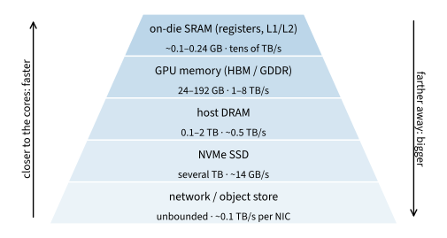
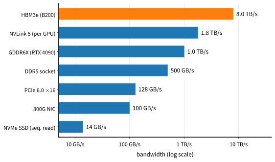
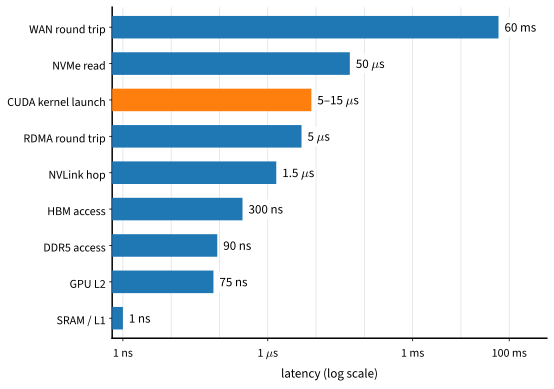
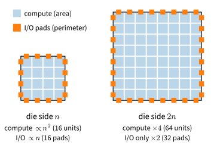
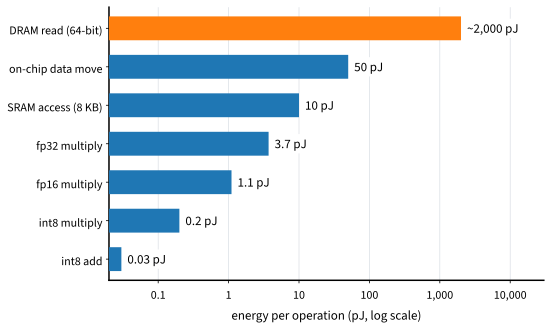
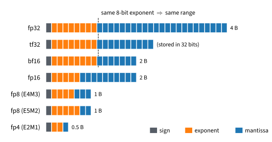
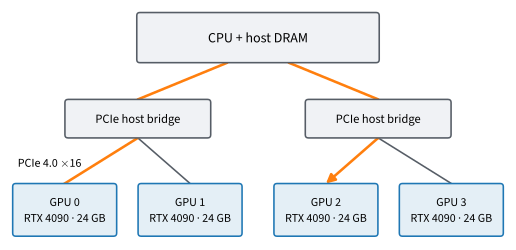

# Hardware
:label:`sec_hardware`

The roofline model of the previous section describes a GPU by two numbers
from its specification sheet, its peak arithmetic rate $P$ and its memory
bandwidth $\beta$. An operation that performs $I$ FLOPs per byte it moves runs at
most at $\min(P, I\beta)$. On the RTX 4090 memory lags far behind arithmetic:
the card performs up to 165 trillion floating-point operations per second
on bf16 matrices, but it reads its own memory at only about one trillion
bytes per second. This section asks where the two numbers come from, and
why the bandwidth falls so far short of the arithmetic rate.

The gap decides the speed of a task we met in :numref:`sec_kv-cache`,
generating text one token at a time. Suppose we generate with a GPT of one
billion parameters. In bf16 its weights occupy 2 GB, and every generated
token needs all of them. The arithmetic for one token, about
$2 \times 10^9$ FLOPs, takes the tensor cores 12 µs, while reading the
2 GB of weights takes the memory 2 ms. The card therefore produces at most
about 500 tokens per second for a single stream of text, and its arithmetic
units sit idle more than 99% of the time. Peak arithmetic does not predict
speed, because every operand must first arrive through a memory system
that is far slower.

The explanation rests on three physical facts. Data must cross the
boundaries between chips. The wires that cross them grow in number more
slowly than the transistors that compute. And moving a byte takes far more
energy than computing with it. Together they explain why the ratio
$P/\beta$, the ridge point, is large and has grown over the years. The
same reasoning covers the paths to the host and between GPUs, and our
worked example is this book's build machine, a workstation with four
RTX 4090s.

The numbers below are those of late 2026. They will change, but the
relations between them change slowly: memory is orders of magnitude slower
than arithmetic, each chip boundary lowers bandwidth by roughly another
order of magnitude, and compute grows faster than bandwidth, which grows
faster than capacity.
:citet:`Hennessy.Patterson.2011` treat computer architecture in depth;
:numref:`sec_hardware_buyers` gives purchase advice.

```{.python .input #hardware}
%%tab pytorch
from d2l import torch as d2l
import torch
```

```{.python .input #hardware}
%%tab jax
from d2l import jax as d2l
import jax
from jax import numpy as jnp
import numpy as np
```

## The Memory Hierarchy
:label:`subsec_hw-bytes`

Every byte a program touches lives somewhere in a hierarchy of memories
(:numref:`fig_memory_hierarchy`), and each level trades capacity for speed.
The GPU's on-die memories, its registers and caches, hold about a tenth of
a gigabyte and deliver tens of terabytes per second. The GPU's own DRAM,
the *high-bandwidth memory* (HBM) of datacenter parts or the GDDR of
consumer cards, holds tens to hundreds of gigabytes at one to eight
terabytes per second. Host DRAM holds hundreds of gigabytes at about half a
terabyte per second per CPU socket. NVMe flash holds terabytes at about
fourteen gigabytes per second. Network storage has no practical limit on
capacity but delivers only what the network card can carry.


:label:`fig_memory_hierarchy`

### Bandwidth and Latency

:numref:`fig_bandwidth_ladder` ranks the data paths of a training job by
bandwidth, from the 14 GB/s of an NVMe drive to the 8 TB/s of the HBM next
to an NVIDIA B200 GPU, almost three orders of magnitude. The steps follow
physical boundaries. HBM sits in the same package as the GPU die,
millimeters away and connected to it by thousands of short wires. Every
connector, board trace, or cable that data must cross reduces the
bandwidth. As a rule of thumb, **each chip boundary lowers the bandwidth
by roughly an order of magnitude**. On our build machine the two most important
paths differ by a factor of thirty. The RTX 4090 reads its GDDR6X memory at
1 TB/s, while its PCIe 4.0 link to the host carries 32 GB/s in each
direction.


:label:`fig_bandwidth_ladder`

Bandwidth says how fast data flows once it flows. *Latency* says how long
the first byte takes to arrive. :numref:`fig_latency_ladder` shows that
latencies span eight orders of magnitude, from a one-nanosecond hit in a
CPU's L1 cache to a sixty-millisecond round trip across a continent. The
GPU cache and memory entries come from microbenchmarks of the RTX 4090
:cite:`Luo.Fan.Li.ea.2024`. The highlighted entry matters most in this
chapter. A framework that
dispatches an operation from Python spends 5–15 µs of host time on it, of
which the CUDA driver's kernel launch takes 1–5 µs. In that time the RTX
4090 could stream 5–15 MB from its memory, more than many operations of a
small model read. This host cost creates the overhead regime of
:numref:`sec_perf_model`, and it is the reason this chapter keeps
returning to fewer, larger operations.


:label:`fig_latency_ladder`

Latency and bandwidth meet in the *access pattern*. DRAM delivers its rated
bandwidth only for *bursts* of consecutive addresses: opening a new row
takes on the order of a hundred nanoseconds, after which the following
bytes stream at full rate. A sequential read waits out the latency once
per burst, a random read once for every few bytes it uses. Streaming
therefore approaches the rated bandwidth, while pointer chasing and
scattered gathers reach only a fraction of it. Caches help only when
accesses are local and predictable. Dense tensor operations stream by
design, since a matrix multiplication reads its operands in large tiles.
Sparse and gather-heavy workloads do not, and a dataset that is read in
shuffled order is best shuffled in large blocks.

### Measured Memory Bandwidth

The number from this hierarchy that matters most for the roofline is the
bandwidth that our card achieves in practice. A large elementwise
operation measures it: multiplying a 1 GB vector by 2 reads and writes every element
once, so we know the bytes moved, and the arithmetic is negligible.

```{.python .input #hardware-where-bytes-live}
%%tab pytorch
x = torch.randn(256 * 1024 * 1024, device=d2l.try_gpu())  # 1 GB fp32
t = d2l.Benchmark(lambda: x * 2.0).time
print(f'measured {2 * x.numel() * 4 / t / 1e12:.2f} TB/s '
      f'(spec: about 1.0 TB/s)')
```

```{.python .input #hardware-where-bytes-live}
%%tab jax
x = jax.random.normal(d2l.get_key(), (256 * 1024 * 1024,))  # 1 GB fp32
t = d2l.Benchmark(lambda: x * 2.0).time
print(f'measured {2 * x.size * 4 / t / 1e12:.2f} TB/s '
      f'(spec: about 1.0 TB/s)')
```

The kernel streams about 0.9 TB/s, within about ten percent of the
specification. Every large elementwise operation in a network runs at this
rate, whatever it computes, because its bytes and not its arithmetic set
its time.

## Compute and Memory Bandwidth
:label:`subsec_hw-shoreline`

An operation is limited by arithmetic only if it performs at least as
many FLOPs per byte as the ridge point. The larger the ridge point, the
more operations are limited by bandwidth instead. The ridge point of the
RTX 4090 is 164 FLOP/byte, and that of a B200 is 281
(:numref:`tab_gpu_specs` below). Both numbers follow from the geometry of
chips, and the same geometry predicts that the ratio tends to rise over
time.

### Area and Perimeter

Arithmetic units fill the interior of a die, so compute scales with the
die's area. The wires that leave the chip, through the I/O circuits that
talk to memory, sit on the die's edge. Doubling the side length of a die
quadruples the number of arithmetic units, but the edge only doubles: with
side length $n$, compute grows as $n^2$ and I/O as $n$
(:numref:`fig_shoreline`). Smaller transistors have the same effect.
Halving the feature size quadruples the units on the same die, while the
I/O along its edge barely grows, because the solder bumps that connect the
edge to the package shrink far more slowly than transistors. Chip
designers call the edge the *shoreline*. Because it grows more slowly than
the interior, the number of bytes per FLOP that a chip can feed itself
tends to fall from one generation to the next.


:label:`fig_shoreline`

Chip designers work around the short shoreline in two ways. The first is
HBM. It stacks DRAM dies vertically and places the stack on a silicon
*interposer* next to the GPU die, where thousands of short, dense wires
replace the few hundred long board traces of a socketed memory module.
This is how a B200 reaches 8 TB/s while a CPU socket manages about
0.5 TB/s. The DRAM cells
are no faster; there are many more wires, and they are much shorter. The
second is to put several dies into one package. Lithography caps the size
of a die at the *reticle limit*, about $858\,\textrm{mm}^2$, and flagship
accelerators are built at that limit. A B200 consists of two such dies,
joined by a bridge on the package, and acts as one GPU. Beyond one package,
GPUs must exchange data over links, whose bandwidth
:numref:`subsec_hw-interconnects` examines.

### Generational Trends

Across NVIDIA's flagship datacenter GPUs, from the V100 of 2017 through the
A100 and H100 to the B200 of 2024, dense 16-bit throughput grew about
2.6-fold per generation, memory bandwidth about 2.0-fold, and memory
capacity about 1.8-fold. A study of twenty years of server hardware finds
the same order: peak compute grew 3.0-fold every two years, DRAM bandwidth
1.6-fold, and interconnect bandwidth 1.4-fold
:cite:`Gholami.Yao.Kim.ea.2024`. Because compute outgrows bandwidth, the
ridge point rises: from about 140 FLOP/byte on the V100 to about 290 on the
H100. Workloads that were compute-bound a decade ago are bandwidth-bound
today.

A single generation need not follow the trend, because which roof grows
faster from one product to the next is a design decision. From the H100 to the B200,
compute grew 2.3-fold and bandwidth 2.4-fold, so the ridge point fell
slightly, from 295 to 281 FLOP/byte. From the RTX 4090 to the RTX 5090,
bandwidth grew much faster than compute, and the ridge point fell from 164
to 117 (:numref:`tab_gpu_specs`). Over many generations, compute still
grows faster than bandwidth, and the ridge point rises.

### Energy per Operation
:label:`subsec_hw-energy`

Energy gives a second reason why data movement dominates.
:numref:`fig_energy_ladder` shows the energy of elementary operations in a
45 nm process :cite:`Horowitz.2014`. An 8-bit integer addition costs
0.03 pJ and an fp32 multiplication 3.7 pJ, while reading 64 bits from DRAM
costs 1.3–2.6 nJ, about as much as 500 fp32 multiplications. Reads from
on-chip SRAM lie in between, and they cost more the larger the array, from
10 pJ for 8 KB to 100 pJ for 1 MB, because the bits travel farther. Newer
processes lower every entry, but the order stays the same: moving data
costs more than computing with it, and the farther it moves, the more it
costs.


:label:`fig_energy_ladder`

The techniques of this chapter save energy for the same reason that they
save time. Fusion (:numref:`sec_compilation`) keeps intermediate results on
the die instead of writing them to DRAM. Narrower formats
(:numref:`sec_memory_precision`) halve the bytes of every operand.
Recomputation uses cheap arithmetic to avoid expensive memory traffic.
Each performs more arithmetic per byte fetched.

## The GPU
:label:`subsec_hw-gpu`

The two roofline numbers of a GPU come from two kinds of units: memory
interfaces on the shoreline, which set $\beta$, and arithmetic units in
the interior, which set $P$. The arithmetic side also decides which number
formats run fast.

### Streaming Multiprocessors

A GPU spends its area on thousands of simple arithmetic units rather than
on the elaborate control logic of a CPU core. The units are grouped into
*streaming multiprocessors* (SMs); the RTX 4090 has 128 of them. Each SM
runs threads in groups of 32, called *warps*, that execute in lockstep, and
it switches among many resident warps to hide memory latency: while one
warp waits a few hundred nanoseconds for its data, others compute. That is
as much microarchitecture as this book needs. When a profiler reports
*occupancy*, it means the fraction of an SM's warp slots that hold
resident warps, which are available to hide latency. A kernel that is too
small for the machine has too few warps to keep 128 SMs busy, and launch
cost and latency, rather than bandwidth or arithmetic, set its time.

### Tensor Cores and Number Formats

What makes GPUs deep learning machines is a further specialization, the
*tensor core*: a unit that multiplies two small matrix tiles and
accumulates the product in a single instruction. A scalar unit spends most
of its energy on fetching and decoding an instruction for every
multiplication. A tensor core spreads that cost over a whole tile, the same
idea as the systolic array of Google's TPU
:cite:`Jouppi.Young.Patil.ea.2017,Kung.1988`. On an H100, bf16 matrix
arithmetic runs at 989 TFLOP/s and ordinary fp32 arithmetic at 67 TFLOP/s,
a factor of fifteen. Consumer cards devote less of their area to tensor
cores; on the RTX 4090 the factor is two in bf16 and four in fp8. Either
way, matrix multiplications are the fastest operations on the chip,
provided their operands come in a format that the tensor cores support.

:numref:`sec_numerics` introduced these formats: a sign bit, exponent bits
that set the *range*, and mantissa bits that set the *precision*. fp32,
tf32, and bf16 share an 8-bit exponent and therefore the same range, while
fp16 trades range for precision and needs loss scaling to keep small
gradients from underflowing. :numref:`fig_float_formats` draws the formats
that current tensor cores accept, down to 4 bits. Two consequences of the
width matter for the roofline.


:label:`fig_float_formats`

First, **a narrower format moves fewer bytes**. Halving the width halves
the bytes of every operand, so a bandwidth-bound operation runs up to twice
as fast, and the weights of a model take half the memory. tf32 is the
exception. The tensor cores compute with its 10-bit mantissa, but its
values are stored in 32 bits, so it raises the compute roof without saving
any memory traffic.

Second, **a narrower format usually raises the compute roof**. A multiplier
for 8-bit values takes much less area than one for 16-bit values. On most
current parts each halving of the width therefore roughly doubles the peak
FLOP/s: the RTX 4090 performs 165 TFLOP/s in bf16 and 330 TFLOP/s in fp8.
The ratio is a design choice, though. Intel's Gaudi 3 runs fp8 at its bf16
rate, and NVIDIA's B300 runs fp4 at three times its fp8 rate.

Formats of 8 bits and fewer cover so little range that their values are
stored together with a scale factor. fp8 comes in two variants, E4M3 for
precision and E5M2 for range :cite:`Micikevicius.Stosic.Burgess.ea.2022`,
and one scale per tensor works for it in most layers. That is the usual
recipe on the RTX 4090 and the H100, whose tensor cores have no support
for finer scales. At 4 bits one scale per tensor fails. The sixteen bit
patterns of fp4 (E2M1) encode only fifteen distinct numbers, from $-6$ to
$6$, so a scale set by a few large outliers rounds most other values of
the tensor to zero. Blackwell-generation NVIDIA and AMD CDNA 4 tensor cores therefore scale
small blocks of values separately. In the *microscaling* formats every
block of 32 values shares one power-of-two scale
:cite:`Rouhani.Zhao.More.ea.2023`, and NVIDIA's NVFP4 format shares a
finer scale among 16 values. The recipes that train large models in these
formats belong to the Language Models part.

Training and inference use the formats differently. Training keeps master
weights and optimizer state in fp32 and accumulates matrix products in
fp32, with bf16 as the usual format for the arithmetic
(:numref:`sec_memory_precision`). Inference runs forward only and can use
the narrowest format that preserves the quality of the model.

### Accelerator Specifications

:numref:`tab_gpu_specs` collects the two roofline numbers, and the other
quantities of this section, for two datacenter GPUs and two consumer
cards, including our own.

:Representative GPUs in late 2026, from vendor datasheets (B200: per GPU of NVIDIA's DGX B200 system). Throughput is dense (without 2:4 sparsity) with fp32 accumulation at boost clock, in TFLOP/s (TF); links count one direction.
:label:`tab_gpu_specs`

| | H100 SXM | B200 | RTX 4090 (ours) | RTX 5090 |
|---|---|---|---|---|
| memory | 80 GB HBM3 | 180 GB HBM3e | 24 GB GDDR6X | 32 GB GDDR7 |
| memory bandwidth | 3.35 TB/s | 8 TB/s | 1.0 TB/s | 1.8 TB/s |
| bf16 | 989 TF | 2,250 TF | 165 TF | 210 TF |
| fp8 | 1,979 TF | 4,500 TF | 330 TF | 419 TF |
| fp4 | — | 9,000 TF | — | 1,676 TF |
| ridge point (bf16) | 295 FLOP/B | 281 FLOP/B | 164 FLOP/B | 117 FLOP/B |
| link to other GPUs | NVLink 4, 450 GB/s | NVLink 5, 900 GB/s | PCIe 4.0 ×16 via host memory, 32 GB/s | PCIe 5.0 ×16 via host memory, 64 GB/s |
| power | 700 W | 1,000 W | 450 W | 575 W |

The RTX 5090's fp4 entry is four times its fp8 entry, not two times,
because GeForce cards run fp8 and fp16 tensor arithmetic at half rate when
they accumulate in fp32, and fp4 carries no such penalty. Accelerators from
other vendors, such as AMD's Instinct GPUs, Google's TPUs, and AWS's
Trainium chips, follow the same design of stacked memory beside a die full
of matrix units, and the roofline reasoning applies to them unchanged.

Capacity, the slowest-growing of the three quantities, decides what fits
at all. Training our 1B-parameter GPT with Adam in fp32 stores 16 bytes
per parameter for the weights, their gradients, and the two moment
estimates, 16 GB in all before any activations
(:numref:`sec_memory_precision` breaks this total down). An RTX 4090
holds that with 8 GB to spare for activations; a model twice as large does
not fit.

## Data Paths outside the GPU

A GPU computes only on data in its own memory. Everything else arrives over
links that are one to two orders of magnitude slower: from the host, which
holds the dataset, and from other GPUs, which hold the other replicas of a
model.

### The Host
:label:`subsec_hw-cpu`

The CPU no longer does the arithmetic of a deep learning machine: one RTX
4090 delivers more than ten times the fp32 arithmetic of a 64-core server
CPU. It still does three jobs that can limit training. First, the CPU
orchestrates. A CPU thread launches every kernel the GPU runs, at 5–15 µs
of host time per eager operation (:numref:`fig_latency_ladder`), until the
compilation of :numref:`sec_compilation` takes Python out of the loop.
Second, the CPU runs the input pipeline: decoding images, tokenizing text,
augmenting and batching. If the pipeline falls behind, the GPU waits,
whatever its peak throughput.

Third, the CPU feeds the bus, since every host-to-device copy crosses
PCIe. As :numref:`sec_use_gpu` showed, an ordinary, *pageable* host array
is first copied into page-locked memory, which the GPU's copy engine can
read directly, and only then transferred. An array that already sits in
pinned (page-locked) memory skips the first copy, and its transfer can
overlap with computation. We time both kinds of copy for a 256 MB array to
find the ceiling of the host link.

```{.python .input #hardware-the-cpu-s-role}
%%tab pytorch
x_pageable = torch.randn(64 * 1024 * 1024)  # 256 MB on the host
x_pinned = x_pageable.pin_memory()
gpu = d2l.try_gpu()
for desc, src in [('pageable', x_pageable), ('pinned', x_pinned)]:
    t = d2l.Benchmark(lambda: src.to(gpu, non_blocking=True)).time
    print(f'{desc}: {src.numel() * 4 / t / 1e9:.1f} GB/s')
```

```{.python .input #hardware-the-cpu-s-role}
%%tab jax
x_pageable = np.random.default_rng().standard_normal(
    64 * 1024 * 1024, dtype=np.float32)  # 256 MB on the host
gpu = jax.devices()[0]
on_gpu = jax.sharding.SingleDeviceSharding(gpu, memory_kind='device')
x_pinned = jax.device_put(x_pageable, jax.sharding.SingleDeviceSharding(
    gpu, memory_kind='pinned_host'))
for desc, src in [('pageable', x_pageable), ('pinned', x_pinned)]:
    t = d2l.Benchmark(
        lambda: jax.device_put(src, on_gpu).block_until_ready()).time
    print(f'{desc}: {x_pageable.nbytes / t / 1e9:.1f} GB/s')
```

:begin_tab:`pytorch`
`pin_memory()` returns a copy of a tensor in page-locked memory, and
`non_blocking=True` issues the copy to the GPU from pinned memory without
waiting for it to finish. From pageable memory the copy is synchronous,
whatever the flag says. A `DataLoader(pin_memory=True)` pins every
minibatch on a background thread of the main process as the workers
deliver it, so that the training loop can issue non-blocking copies.
:end_tab:

:begin_tab:`jax`
JAX names the memory in which an array lives by its *memory kind*:
`'device'` for the GPU's memory and `'pinned_host'` for page-locked host
memory. A NumPy array lives in pageable host memory. One `device_put` with
a `'pinned_host'` sharding copies it into pinned memory, and transfers from
there to the GPU need no further copy on the host. JAX may run several
transfers at once, and the last one to be issued can finish before the
others. `Benchmark`, which waits only for the last result, would then
stop the clock early, so every call here waits for its own copy.
:end_tab:

The pinned copy reaches about 23 GB/s, close to the 32 GB/s that a PCIe
4.0 ×16 link carries in each direction and forty times below the card's own
memory bandwidth. The pageable copy is slower, because every byte first
makes an extra trip through host memory. Data that the GPU reads
repeatedly therefore belongs on the device. Data that must arrive at every
step, such as minibatches, should come from pinned memory, with the copy
overlapped with computation.

### Links between GPUs
:label:`subsec_hw-interconnects`

When one GPU is not enough, GPUs exchange gradients, parameters, or
activations over links that are much slower than their memories.
Datacenter GPUs have a dedicated fabric for this. NVLink 5 gives each B200
1.8 TB/s to its peers, 900 GB/s in each direction, about a tenth of its
memory bandwidth. A GB200 NVL72 rack joins 72 GPUs into one NVLink domain.
Consumer GPUs have only PCIe; the RTX 3090 and 3090 Ti were the last
GeForce cards with an NVLink connector. NVIDIA also does not support
peer-to-peer transfers between RTX 4090 or RTX 5090 cards, so two such
cards in one machine cannot send data to each other directly even over
PCIe.

Our build machine shows the consequence (:numref:`fig_pcie_topology`). Its
four RTX 4090s sit in pairs behind two PCIe host bridges. Without
peer-to-peer access, every byte from one GPU to another is staged through
host memory: up one PCIe link, through the CPU's memory, and down another.
A copy between two of our GPUs therefore runs at most at the rate of one
PCIe 4.0 link, the 23 GB/s that the pinned copy above reached, about 40
times less than one direction of NVLink 5. Collective communication
libraries such as NCCL reach even less on this staged path at their
default settings, and :numref:`sec_multi_gpu_concise` traces where their
time goes.


:label:`fig_pcie_topology`

Data-parallel training of our 1B-parameter GPT on two GPUs sums the 4 GB
of fp32 gradients of every step across the GPUs. Moving 4 GB once takes
at least 0.17 s at 23 GB/s and less than 5 ms over one direction of
NVLink 5. On our machine, communication therefore adds at least 0.17 s to
every step of this model, unless it overlaps with computation.
:numref:`sec_multi_gpu` turns such numbers into a cost model and checks
its predictions on this machine.

## Workloads on the Roofline
:label:`subsec_hw-two-workloads`

The numbers of this section place a single language model in two regimes,
as :numref:`sec_kv-cache` measured on this card. *Prefill* pushes a prompt
of $n$ tokens through the network at once and uses every weight fetched
from memory for all $n$ tokens, an intensity of about $n$ FLOPs per byte.
A prompt of a thousand tokens lies far above any ridge point. *Decode*
generates one token per step. For a GPT with $N$ parameters it performs
about $2N$ FLOPs and reads every weight and the key–value cache, an intensity of about one FLOP per byte
(:numref:`subsec_kv-cache-prefill-decode`). Prefill runs at the speed of
the tensor cores, decode at the speed of memory.

### Single-Stream Decoding

Since a decode step is bandwidth-bound, the bytes it reads limit the rate
at which a single stream of text grows. With weights in bf16, $2N$ bytes,

$$
\textrm{tokens/s} \;\lesssim\;
\frac{\beta}{\textrm{bytes per token}} \;=\;
\frac{\beta}{2N + \textrm{KV bytes}}.
$$
:eqlabel:`eq_hw_decode_bound`

For our 1B-parameter GPT, 2 GB of weights at the 0.9 TB/s we measured cap
decode near 450 tokens per second on one RTX 4090. Faster arithmetic does
not raise this bound. Storing the weights in a narrower format does, in
proportion to the bytes it saves. Prefill gains instead from every format
that raises the compute roof.

### Batched Decoding

Batching moves decode up the roofline. A step for $B$ sequences reads the
weights once and produces $B$ tokens, while every sequence still reads its
own key–value cache (:numref:`subsec_kv-cache-batching`). The measurement
of :numref:`sec_kv-cache` stopped at 64 sequences, where the step is still
bandwidth-bound. Here we follow the weights alone past the ridge point. We
time one bf16 weight matrix of a large model, $16{,}384 \times 16{,}384$
(0.54 GB), multiplied by a batch of $B$ activation vectors, one row per
sequence, for $B$ from 1 to 1,024.

```{.python .input #hardware-batched-decoding}
%%tab pytorch
d = 16384
W = torch.randn(d, d, dtype=torch.bfloat16, device=d2l.try_gpu())  # 0.54 GB
for B in (1, 4, 16, 64, 256, 1024):
    X = torch.randn(B, d, dtype=torch.bfloat16, device=W.device)
    t = d2l.Benchmark(lambda: X @ W).time
    print(f'B = {B:4d}: {1e3 * t:5.2f} ms, {B / t:9,.0f} rows/s, '
          f'{2 * B * d * d / t / 1e12:5.1f} TFLOP/s')
```

```{.python .input #hardware-batched-decoding}
%%tab jax
d = 16384
W = jax.random.normal(d2l.get_key(), (d, d), dtype=jnp.bfloat16)  # 0.54 GB
for B in (1, 4, 16, 64, 256, 1024):
    X = jax.random.normal(d2l.get_key(), (B, d), dtype=jnp.bfloat16)
    t = d2l.Benchmark(lambda: X @ W).time
    print(f'B = {B:4d}: {1e3 * t:5.2f} ms, {B / t:9,.0f} rows/s, '
          f'{2 * B * d * d / t / 1e12:5.1f} TFLOP/s')
```

The product performs $2Bd^2$ FLOPs on $2d^2$ bytes of weights, an
intensity of about $B$ FLOPs per byte. For $B = 1$ it is bandwidth-bound
and takes about 0.6 ms, the time to read 0.54 GB. Up to a batch of 64 the
time barely changes, so the rows per second through this matrix grow
almost in proportion to the batch. The roofline puts the crossover where
the intensity reaches the ridge point, at a batch of about 164. Beyond it
the time grows in proportion to the batch, and the arithmetic rate levels
off near the 165 TFLOP/s peak. One matrix on one card
covers both ends of :numref:`fig_roofline`.

In a whole model the
key–value caches add bytes that batching does not share, so the crossover
moves to larger batches, and for long contexts it never comes. Inference
servers therefore batch the requests of many users and keep the caches
small. The systems that do so, with their schedulers, paged caches, and
speculative decoding, belong to the Language Models part.

### Rules of Thumb

With the magnitudes of :numref:`tab_rules_of_thumb`, a workload can be
placed on the roofline before it runs: count its FLOPs and bytes, divide
by $P$ and $\beta$, and compare the result with the host cost of its
operations. Real programs usually fall short of both roofs, because eager
execution sends every intermediate result through memory and incurs the
host cost of every operation. :numref:`sec_compilation` removes both
costs.

:Rules of thumb: characteristic magnitudes and why each matters.
:label:`tab_rules_of_thumb`

| quantity | magnitude | why it matters |
|---|---|---|
| eager operation from Python | 5–15 µs of host time (kernel launch 1–5 µs) | small operations cannot keep the GPU busy |
| GPU memory bandwidth | 1–8 TB/s | the speed limit of elementwise operations and of decode |
| PCIe ×16, one direction | 32 GB/s (4.0) to 64 GB/s (5.0) | host$\leftrightarrow$device; keep data on the device |
| NVLink, per GPU and direction | 450–900 GB/s | datacenter GPUs exchange data an order of magnitude faster than PCIe |
| bytes per parameter, training with Adam | 16 (fp32), 18 (mixed precision) | what fits (:numref:`sec_memory_precision`) |
| bytes per token, decode | $2N$ + KV cache (bf16) | tokens/s $\lesssim$ bandwidth / bytes per token |
| DRAM read against fp32 multiply | about 500 times the energy | fuse, narrow the format, recompute |

## Summary

Memory is a hierarchy in which each level farther from the arithmetic
holds orders of magnitude more bytes and delivers orders of magnitude fewer
per second. Each chip boundary lowers the bandwidth by about an order of
magnitude, and latencies span eight orders of magnitude. Our RTX 4090
streams its memory at about 0.9 TB/s, close to its specification. Compute
grows with the area of a die and I/O with its perimeter, and moving a byte
takes more energy than computing with it. Compute has therefore outgrown
bandwidth, and the ridge point of flagship GPUs has roughly doubled over
four generations, to about 290 FLOP/byte, although a single generation can
lower it. Tensor cores make matrix arithmetic the fastest work on a GPU in
the formats they support. Halving the width of a format halves the bytes
moved and, on most parts, doubles the peak FLOP/s; tf32 raises only the
compute roof. Outside the GPU, bandwidth drops by one to two orders of
magnitude. On our machine a copy from pinned host memory reaches about
23 GB/s over PCIe 4.0, and a copy between two GPUs, staged through host
memory, runs no faster, while NVLink 5 carries 900 GB/s per direction.
Prefill is compute-bound, and single-stream decode is bandwidth-bound at
about $\beta$ divided by the bytes per token, roughly 450 tokens per second
for a 1B-parameter GPT on an RTX 4090. Batching raises the intensity of
decode in proportion to the batch until it reaches the ridge point.

## Exercises

1. [code] **Latency and bandwidth, measured.** A transfer of $n$ bytes
   over a path with latency $\alpha$ and bandwidth $\beta$ takes about

   $$t(n) = \alpha + \frac{n}{\beta},$$

   so it reaches half the bandwidth at $n_{1/2} = \alpha\beta$
   :cite:`Hockney.1994`. The model describes a call that is timed to
   completion on its own, so every measurement below waits for the device
   after each call.
    1. Predict $n_{1/2}$ for the elementwise kernel `x * 2.0` of
       :numref:`subsec_hw-bytes`, counting the bytes it reads and writes,
       with $\alpha$ the host time of an eager operation in
       :numref:`fig_latency_ladder` and $\beta$ the bandwidth that the
       code of that subsection measures on your GPU.
    1. Time `x * 2.0` for tensors from 1 MB to 2 GB, and plot the
       achieved bandwidth against the size on logarithmic axes. Identify
       the regimes that the curve passes through, and relate the sizes at
       which it changes regime to :numref:`fig_latency_ladder` and to the
       on-die capacity in :numref:`fig_memory_hierarchy`. In which regime
       does the curve depart from $t(n)$, and why?
    1. Repeat the host-to-device measurement of :numref:`subsec_hw-cpu`
       for transfers from 4 KB to 256 MB, and fit $\alpha$ and $\beta$.
       Where does the fitted $\alpha$ fall on :numref:`fig_latency_ladder`?

1. **Shoreline countermeasures.** :numref:`subsec_hw-shoreline` names two
   countermeasures to the shoreline problem: wider memory interfaces and
   more dies per package.
    1. A DDR5-6400 DIMM has 64 data wires, each carrying 6.4 Gb/s. An
       HBM3e stack has a data interface of 1,024 wires, and a B200 carries
       eight stacks. Compute the bandwidth of one DIMM, the number of
       DIMMs that supply the 0.5 TB/s of a CPU socket, and the rate per
       wire that the B200's 8 TB/s in :numref:`tab_gpu_specs` implies.
       Which factor accounts for the gap between the socket and the B200,
       the number of wires or the rate per wire?
    1. A B200 consists of two dies at the reticle limit of
       $858\,\textrm{mm}^2$. Treat every die as a square. Compare the
       total edge length of the two dies, after setting aside one edge of
       each for the bridge that joins them, with the edge length of a
       hypothetical single die of twice the area. Then show that $n$ dies
       of a fixed area offer an edge length per unit area that does not
       depend on $n$.
    1. The two dies of a B200 act as one GPU. Which traffic does the split
       move across a chip boundary that a single die would keep on-die?
       What bandwidth must the bridge carry, compared with the 8 TB/s of
       HBM? Use the physical reason behind the chip-boundary rule of
       :numref:`subsec_hw-bytes` to explain how an on-package bridge can
       meet this requirement.

1. **Format halving on the roofline.** Model the step from one format to
   a format of half its width, as :numref:`subsec_hw-gpu` describes, by a
   doubling of the peak arithmetic $P$ and a halving of the bytes that
   every operation moves.
    1. Use the roofline bound $\min(P, I\beta)$ to compute the speedup of an
       operation of intensity $I$, and show that it does not depend on
       $I$.
    1. A skinny matrix product with batch size $B$, much smaller than
       the matrix, and $b$ bytes per element has an intensity of about
       $2B/b$ FLOPs per byte. Using :numref:`tab_gpu_specs`, find the
       batch size at which this product becomes compute-bound on the B200
       in bf16, fp8, and fp4, and on the RTX 5090 in the same three
       formats. Compare the bf16 value for the RTX 4090 with the batch
       sweep of :numref:`subsec_hw-two-workloads`.
    1. Use the result of the first sub-problem to explain the pattern in
       the batch sizes of the previous sub-problem, and identify the entry
       of :numref:`tab_gpu_specs` that breaks the pattern. What does that
       format step give a bandwidth-bound operation, and what does it give a
       compute-bound one?

1. **Starved input pipeline.** The compute of a training job alone would
   process 2 GB/s of decoded images. One worker process prepares batches
   by running two stages in sequence. It reads compressed JPEG files from
   NVMe in shuffled order at 1 GB/s of compressed data, and it decodes
   them on one CPU core at 0.3 GB/s of decoded output. Decoding expands
   the data eightfold. The training loop then copies each decoded batch
   from pageable host memory to the GPU at 12 GB/s before it computes on
   the batch.
    1. At what rate, in decoded bytes, does one worker deliver batches?
       Which stage binds, and what would a drive with twice the read rate
       change?
    1. Workers run in parallel on separate cores. How many workers keep
       the GPU fed?
    1. With enough workers, the synchronous copy still lengthens every
       training step. By what fraction does it lengthen the step, and by
       what fraction after a switch to pinned memory at twice the pageable
       rate? What does an asynchronous copy change?

1. **Ridge point of a link.** The ridge point $P/\beta$ of
   :numref:`subsec_perf-counting` applies to any data path, with $\beta$
   the bandwidth of that path: it counts the FLOPs that a device performs
   in the time one byte crosses the path.
    1. Compute $P/\beta$ in bf16 for an RTX 4090 against its own memory
       and against the host-staged GPU-to-GPU path of
       :numref:`subsec_hw-interconnects` at 23 GB/s. Compute it for a B200
       against its HBM and against one direction of NVLink 5, 900 GB/s.
    1. In data-parallel training (:numref:`sec_multi_gpu`), every GPU
       holds a copy of a model with $N$ parameters and processes $T$
       tokens per step at about $6N$ FLOPs per token. The GPUs then sum
       their bf16 gradients with an *allreduce*, a collective operation
       that sends about twice the gradient bytes from every GPU. Assume
       that compute runs at peak and does not overlap communication. Show
       that communication takes no longer than compute if and only if $T$
       exceeds a threshold proportional to the ridge point of the link,
       and that the threshold does not depend on $N$.
    1. Evaluate the threshold for the host-staged path, for NVLink, and for
       an effective 2 GB/s, the rate that NCCL reaches on the staged path
       of :numref:`fig_pcie_topology` at its default settings. By what
       factor does the ridge point of each of these links exceed the memory
       ridge point of the same GPU? Relate the factors to the chip-boundary
       rule of :numref:`subsec_hw-bytes`.

1. **Energy per byte.** Use the energies of :numref:`fig_energy_ladder`,
   and charge every FLOP the energy of one fp32 multiply.
    1. Find the arithmetic intensity at which the energy of the arithmetic
       equals the energy of reading its operands from DRAM, and compare it
       with the ridge point of the RTX 4090. What limits the time of an
       operation with an intensity of 100 FLOP/byte, and what dominates
       its energy?
    1. A B200 is rated at 1,000 W and streams 8 TB/s from HBM. Compute
       the power that this traffic would draw at the DRAM energy of
       :numref:`fig_energy_ladder`, and the largest energy per byte that
       the power rating allows. Explain the discrepancy with the packaging
       of :numref:`subsec_hw-shoreline`.
    1. An 8-billion-parameter model in bf16 decodes on a B200 at the bound
       of :eqref:`eq_hw_decode_bound`, ignoring the KV cache, while the
       card draws its full 1,000 W. Compute the energy per generated token
       and the electricity cost of one million tokens at 0.30 US dollars
       per kWh. Repeat for 64 streams that share every weight read, after
       checking that the batched step is still bandwidth-bound.

1. **Memory sweep time.** The *sweep time* $C/\beta$ of an accelerator
   with memory capacity $C$ and bandwidth $\beta$ is the time it takes to
   read every byte of its memory once.
    1. Compute the sweep time of each GPU in :numref:`tab_gpu_specs`.
    1. A model in bf16 fills a fraction $f$ of the memory with its
       weights. Ignore the KV cache, and use :eqref:`eq_hw_decode_bound` to
       bound the single-stream decode rate in terms of $f$ and the sweep
       time. Which rate does the bound allow for the largest model that
       each GPU can hold?
    1. Under the long-run growth rates of :numref:`subsec_hw-shoreline`,
       by what factor does the sweep time change per hardware generation?
       What does this factor imply for the decode rate of the largest
       model that fits on each new generation?

1. **Launch-bound decode.** In eager single-stream decode, the CPU
   launches every kernel of every block for every token, while the GPU
   reads the weights of every block. Consider a GPT whose $L$ blocks of
   width $d$ each hold about $12d^2$ weights in bf16 and launch $K = 12$
   kernels per token. Take 8 µs of host time per kernel, within the range
   that :numref:`fig_latency_ladder` gives for an eager operation. Launches
   are asynchronous, so a decode step takes at least the larger of the
   total launch time and the time to read the weights. Ignore the
   embedding table and the KV cache.
    1. Show that which of the two times is larger does not depend on $L$,
       and find the width $d^*$ at which they are equal on the RTX 4090 and
       on the B200.
    1. Evaluate both bounds on the decode rate of the GPT-2 configuration
       of :numref:`subsec_gpt-loading`, with $d = 768$ and 12 blocks, on
       the RTX 4090. Which bound binds?
    1. What does the change of $d^*$ from the RTX 4090 to the B200 imply
       for the benefit of the capture-and-replay of
       :numref:`sec_compilation` on faster GPUs?

1. [code] **Burst versus random access.** ● Let `x` be the 1 GB vector
   of :numref:`subsec_hw-bytes`, and gather it through an index vector
   `idx` of the same length, as `x[idx]`.
    1. Time the gather with `idx` a random permutation and with `idx` the
       identity permutation, which request the same elements in a
       different order. Report the achieved bandwidth of each, counting
       the index, the gathered elements, and the output, and the ratio of
       the two.
    1. Compare the ratio with the cost that the burst model of
       :numref:`subsec_hw-bytes` assigns to a random read. Explain the
       difference with the resident warps of :numref:`subsec_hw-gpu`.
    1. Permute blocks of $k$ consecutive elements instead of single
       elements, for $k$ from 1 to 1,024, and plot the bandwidth against
       the block size in bytes. At what block size does the shuffled gather
       approach the identity gather? What does this size imply for the
       granularity of shuffled reads from a dataset?

1. **Latency hiding.** ● Little's law :cite:`Little.1961` states that in
   a steady state the average number of requests in flight equals the
   throughput times the average latency of one request. For a memory
   system, the bytes in flight therefore equal the bandwidth times the
   latency.
    1. Take 250 ns, the GPU memory latency of
       :numref:`fig_latency_ladder`, as the latency of a load on the RTX
       4090, with its 1.0 TB/s and 128 SMs. How many bytes must be in
       flight to sustain the rated bandwidth? If every thread has one 4-byte load outstanding, how
       many warps per SM must be waiting on memory at any moment?
    1. Repeat the byte count for the B200 at the same latency. Bandwidth
       grows about $2\times$ per generation, while DRAM latency has
       stayed nearly constant for decades. What does this imply for the
       parallelism that a kernel must expose on each new generation?
    1. In pointer chasing, the address of every load comes from the
       previous load, so a chain of loads has one request in flight. A CPU
       has the DDR5 access latency of :numref:`fig_latency_ladder`, 90 ns,
       and fetches 64-byte cache lines. Compute the bandwidth of one chain
       and the number of independent chains that would saturate a socket
       with 0.5 TB/s.

[Discussions](https://d2l.discourse.group/t/36788)

<!-- slides -->

::: {.slide}
::: {.cover}
[Dive into Deep Learning · §13.2]{.kicker}

Hardware<br>
**memory hierarchy · area and perimeter · tensor cores and formats · links to the host and between GPUs · prefill and decode**
:::
:::

::: {.slide title="One Stream on a 165-TFLOP/s Card Gets Only 500 Tokens per Second"}
[The problem]{.kicker}

A GPT with 1B parameters generates text on one RTX 4090.

- Per token: $2 \times 10^9$ FLOPs at 165 TFLOP/s $\approx$ 12 µs.
- Per token: 2 GB of bf16 weights at 1 TB/s $\approx$ 2 ms.
- One stream: at most $\approx$ 500 tokens/s; the tensor cores idle
  > 99% of the time.

::: {.d2l-note}
Peak FLOP/s does not predict speed. **Every operand must first arrive
through memory**, and memory is far slower than arithmetic.
:::
:::

::: {.slide title="By the End of This Deck You Can"}
[Goals]{.kicker}

- read peak FLOP/s $P$, memory bandwidth $\beta$, and the ridge point
  $P/\beta$ off a spec sheet, and explain why the ridge is in the hundreds;
- estimate a transfer time on any link from its bandwidth;
- say what a narrower format gives each side of the ridge;
- bound decode speed by bandwidth / bytes per token, and predict the
  batch at which decode turns compute-bound.

**Idea:** wires cross chip edges, so bytes are scarce and arithmetic is
cheap. **Running example:** one RTX 4090 (165 TFLOP/s bf16, 1.0 TB/s,
24 GB) and a 1B-parameter GPT (2 GB of weights in bf16).
:::

::: {.slide title="Hardware Explains the Two Numbers of the Roofline"}
[Where this fits]{.kicker}

::: {.cols .vc}
::: {.col}
| section | adds |
|---|---|
| The Performance Model | roofline, three regimes, timing, profiling |
| **Hardware** | **where peak arithmetic and bandwidth come from** |
| Compute Graphs and Compilation | fusion and kernel replay |
| Memory and Precision | what fits: bytes per parameter and per token |
| Multi-GPU from First Principles | data parallelism by hand, its cost model |
| Multi-GPU in Practice | production data parallelism, sharding |
| Case Study: Optimizing a Transformer | the whole method on one GPT |
:::

::: {.col .narrow}
- **Uses:** arithmetic intensity $I$ (FLOPs per byte), the ridge point.
- **Skips:** buying advice (Tools appendix), writing kernels, multi-node
  fabrics.
:::
:::
:::

::: {.slide title="Each Level Down Holds More Bytes and Delivers Fewer per Second"}
{height=430px}

Registers and caches: ~0.1 GB at tens of TB/s. GPU memory: 24–288 GB at
1–8 TB/s. Host, flash, network: bigger and slower again.
:::

::: {.slide title="Each Chip Boundary Cuts Bandwidth about Tenfold"}
::: {.cols .vc}
::: {.col}
{height=480px}
:::

::: {.col .narrow}
- Our box (orange): GDDR6X at 1.0 TB/s, PCIe 4.0 at 32 GB/s per
  direction, a factor of 30.
- HBM: millimeters from the die, thousands of short wires.
- Every connector, trace, or cable lowers bandwidth.
:::
:::
:::

::: {.slide title="One Eager Operation Takes as Long as Streaming 10 MB"}
::: {.cols .vc}
::: {.col}
{height=470px}
:::

::: {.col .narrow}
- Host time per operation dispatched from Python: 5–15 µs.
- In that time the RTX 4090 streams 5–15 MB.
- Many small operations: the overhead regime.
:::
:::

[GPU latencies: RTX 4090 microbenchmarks (Luo et al., 2024)]{.small}
:::

::: {.slide title="A Large Elementwise Operation Measures Bandwidth"}
@hardware-where-bytes-live

Bytes known exactly (read 1 GB, write 1 GB), arithmetic negligible:
about 0.9 of the specified 1.0 TB/s.
:::

::: {.slide title="Check: How Long Does Reading All of GPU Memory Take?"}
[Check]{.kicker}

Time to read every byte once: RTX 4090 (24 GB, 1.0 TB/s) and B200
(180 GB, 8 TB/s)?

::: {.fragment .fade-up}
- RTX 4090: 24 GB / 1 TB/s = 24 ms. B200: 180 GB / 8 TB/s = 22.5 ms.
- A model that fills either card's memory decodes at most about 40 tokens
  per second, however fast the arithmetic.
:::
:::

::: {.slide title="Compute Grows with Area, I/O with Perimeter"}
::: {.cols .vc}
::: {.col}
{height=440px}
:::

::: {.col .narrow}
- Side ×2: compute ×4, I/O ×2.
- HBM beside the die: thousands of short wires, 8 TB/s on a B200 against
  0.5 TB/s for a CPU socket.
- Two dies per package at the reticle limit.
:::
:::
:::

::: {.slide title="Compute Outgrew Bandwidth, and the Ridge Point Doubled"}
| GPU (year) | bf16 dense | bandwidth | ridge point |
|---|---|---|---|
| V100 (2017) | 125 TF | 0.9 TB/s | 139 FLOP/B |
| A100 (2020) | 312 TF | 2.0 TB/s | 153 FLOP/B |
| H100 (2022) | 989 TF | 3.35 TB/s | 295 FLOP/B |
| B200 (2024) | 2,250 TF | 8 TB/s | 281 FLOP/B |

Per generation: compute ×2.6, bandwidth ×2.0, capacity ×1.8. A single
step can lower the ridge (H100 → B200).

[Server hardware over 20 years: compute ×3.0, DRAM ×1.6, interconnect ×1.4 every 2 years (Gholami et al., 2024)]{.small}
:::

::: {.slide title="A DRAM Read Costs as Much Energy as 500 Multiplications"}
::: {.cols .vc}
::: {.col}
{height=440px}
:::

::: {.col .narrow}
- Larger SRAM arrays cost more per read: the bits travel farther.
- Fusion, narrower formats, and recomputation save energy for the same
  reason they save time.
:::
:::

[45 nm process (Horowitz, 2014)]{.small}
:::

::: {.slide title="Narrower Formats Halve the Bytes and Usually Double the FLOP/s"}
{height=340px}

- Bytes: always halved. RTX 4090: 165 TFLOP/s bf16, 330 fp8.
- tf32: compute mode only, still 32 bits in memory.
- Exceptions: Gaudi 3 fp8 = bf16 rate; B300 fp4 = 3× fp8.
:::

::: {.slide title="Consumer Cards Have Lower Ridge Points and No Fast GPU Link"}
| | H100 | B200 | RTX 4090 | RTX 5090 |
|---|---|---|---|---|
| memory | 80 GB | 180 GB | 24 GB | 32 GB |
| bandwidth $\beta$ | 3.35 TB/s | 8 TB/s | 1.0 TB/s | 1.8 TB/s |
| bf16 $P$ | 989 TF | 2,250 TF | 165 TF | 210 TF |
| ridge $P/\beta$ | 295 | 281 | 164 | 117 |
| GPU link, one way | 450 GB/s | 900 GB/s | 32 GB/s via host | 64 GB/s via host |

1B GPT, fp32 Adam: 16 B per parameter = 16 GB, before activations.

[Dense, fp32 accumulation, boost clock; vendor datasheets, late 2026]{.small}
:::

::: {.slide title="Check: What Does fp8 Give Two Operations?"}
[Check]{.kicker}

On the RTX 4090, switch from bf16 to fp8: (a) an elementwise operation at
$I = 0.25$ FLOP/B; (b) a matmul at $I = 1{,}000$ FLOP/B.

::: {.fragment .fade-up}
- (a) bandwidth-bound: half the bytes, 2× faster.
- (b) compute-bound: $P$ 165 → 330 TFLOP/s, 2× faster.
- Neither gains 4×: each is limited by only one roof at a time.
:::
:::

::: {.slide title="Pinned Host Memory Feeds PCIe Near Its Ceiling"}
@!hardware-the-cpu-s-role

- Pinned: about 23 of PCIe 4.0's 32 GB/s, forty times below GPU memory.
- Pageable: an extra copy through host memory first.
- Keep data on the device; copy minibatches from pinned memory, overlapped.
:::

::: {.slide title="Without Peer-to-Peer, Every Inter-GPU Byte Goes through the Host"}
{height=400px}

GPU to GPU: at most one PCIe link, about 23 GB/s, 40× below one direction
of NVLink 5. The 4 GB of fp32 gradients of the 1B GPT: ≥ 0.17 s per step
here, < 5 ms on NVLink.
:::

::: {.slide title="Prefill Is Compute-Bound, Decode Is Bandwidth-Bound"}
GPT with $N$ parameters in bf16, prompt of $n$ tokens:

- prefill: $2Nn$ FLOPs on $2N$ bytes of weights, $I \approx n$;
- decode: $2N$ FLOPs on $2N$ bytes plus the KV cache, $I \approx 1$.

$$\textrm{tokens/s} \lesssim \frac{\beta}{2N + \textrm{KV bytes}}$$

1B GPT on the RTX 4090: 0.9 TB/s / 2 GB $\approx$ 450 tokens/s.
:::

::: {.slide title="Batching Moves Decode up the Roofline until the Ridge Point"}
@!hardware-batched-decoding

$16{,}384^2$ bf16 weights (0.54 GB), batch $B$: $I \approx B$ FLOP/B.
Time flat while $B \ll 164$ (the ridge point), then linear in $B$.
:::

::: {.slide title="Check: Decoding an 8B Model"}
[Check]{.kicker}

An 8B-parameter model in bf16 on the RTX 4090, KV cache ignored: tokens
per second for one stream, and for a batch of 64?

::: {.fragment .fade-up}
- One stream: 16 GB per step at the rated 1 TB/s, $\approx$ 60 tokens/s.
- Batch 64: still below the ridge ($I \approx 64 < 164$), same step time,
  $\approx$ 4,000 tokens/s over all 64 streams.
:::
:::

::: {.slide title="Wrap-up"}
[Wrap-up]{.kicker}

- Bandwidth drops at every boundary: RTX 4090 memory 0.9 TB/s measured,
  PCIe 23 GB/s from pinned memory, GPU to GPU no faster, through the host.
- Compute is area, I/O is perimeter, and data movement dominates energy:
  ridge points of 117–295 FLOP/B, rising over generations.
- Narrower formats halve the bytes and usually double $P$.
- Single-stream decode of the 1B GPT: ≲ 450 tokens/s; batching raises
  throughput until $B$ reaches the ridge, $\approx 164$.

**Next:** compute graphs and compilation remove eager overhead and fuse
away memory round trips.
:::
