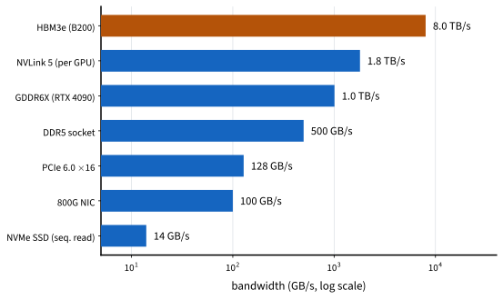
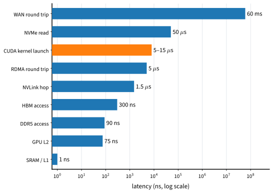
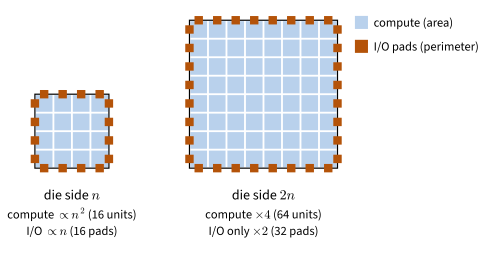
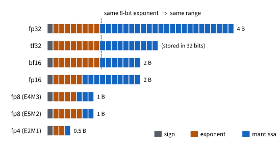
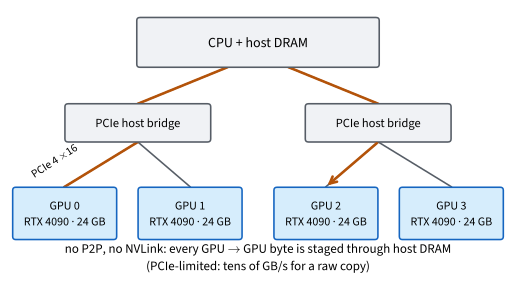
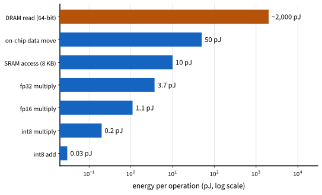

# Hardware
:label:`sec_hardware`

The previous section introduced a model with two machine parameters. A machine
delivers $\min(P, I\beta)$: peak arithmetic $P$ when the operation supplies
enough work per byte, and bandwidth $\beta$ times intensity otherwise. This section
explains where those two numbers come from, why their ratio — the ridge
point — has climbed over the long run of hardware generations, and what else about
the machine (latency, capacity, interconnect, energy) a practitioner needs
in order to reason about performance before running anything. The aim is
enough working knowledge to read a profiler, size a model, and identify an
appropriate optimization. For the
complementary question — *what hardware should I buy* — see the buyer's
guide in :numref:`sec_hardware_buyers`; this section is about why the
machine behaves the way it does, whatever machine you have. For a proper
treatment of computer architecture see :cite:`Hennessy.Patterson.2011`.

The specific hardware values below were verified in mid-2026 and will
change with new products. More stable are the ratios and trends: memory is
orders of magnitude slower than arithmetic,
every chip boundary costs roughly another order of magnitude, and compute
grows faster than bandwidth, which grows faster than capacity. The numerical
values should therefore be checked for the hardware in use.

```{.python .input #hardware}
%%tab pytorch
from d2l import torch as d2l
import time
import torch

torch.set_float32_matmul_precision('high')
```

```{.python .input #hardware}
%%tab jax
from d2l import jax as d2l
import jax
from jax import numpy as jnp
import numpy as np
import time
```

## The Memory Hierarchy
:label:`subsec_hw-bytes`

Every byte your program touches lives somewhere in a hierarchy
(:numref:`fig_memory_hierarchy`), and each level trades capacity for speed:
small pools close to the arithmetic are fast; large pools far away are
slow. On one end sit the GPU's on-die memories — registers and caches
totaling on the order of a tenth of a gigabyte, reachable at tens of
terabytes per second. Then comes the GPU's own DRAM — the *high-bandwidth
memory* (HBM) of datacenter parts or the GDDR of consumer cards — tens to
hundreds of gigabytes at one to eight terabytes per second. Host DRAM
holds hundreds of gigabytes at a few hundred gigabytes per second; NVMe
flash holds terabytes at about fourteen gigabytes per second; and network
storage offers effectively unbounded capacity, at whatever your network
card delivers.


:label:`fig_memory_hierarchy`

Two comparisons quantify the hierarchy. :numref:`fig_bandwidth_ladder`
ranks data paths by bandwidth: from an
NVMe drive's 14 GB/s, through PCIe and socket DRAM, up to on-package HBM
at 8 TB/s. The span is almost three orders of magnitude, and the levels
correspond to physical boundaries: on-package memory is fastest because
it sits on the same package, millimeters from the die over thousands of
short interposer wires; everything that crosses a connector,
a board trace, or a cable reduces available bandwidth. As a rule of thumb,
**every chip boundary costs roughly an order of
magnitude of bandwidth**. Performance therefore improves when data remains
near the arithmetic units that use it.


:label:`fig_bandwidth_ladder`

:numref:`fig_latency_ladder` compares the same systems by *latency* — how long
before the first byte arrives — and spans eight orders of magnitude, from
a one-nanosecond L1 hit to a sixty-millisecond WAN round trip. Note where
the highlighted point sits: launching a CUDA kernel costs 5–15 µs of
latency, thousands of L2 hits' worth, which is why the overhead regime of
:numref:`sec_perf_model` exists at all and why this chapter keeps returning
to "fewer, larger operations".


:label:`fig_latency_ladder`

Latency and bandwidth interact through *access patterns*. DRAM delivers
its rated bandwidth only for *burst* reads: addressing a location costs
on the order of a hundred nanoseconds, after which sequential transfers
stream at full rate — so the first word of a random read is hundreds of
times more expensive than the words that follow it. Sequential streaming
therefore approaches rated memory bandwidth, whereas
pointer-chasing does not;
caches amortize latency only when access patterns are local and
predictable. For dense tensors this is mostly handled for you — a matmul
kernel is a carefully choreographed burst-read machine — but it is why
sparse and gather-heavy workloads struggle to reach more than a fraction
of rated bandwidth, and why shuffled *dataset* access is best done at the
granularity of large blocks.

Let's measure the one number from this subsection that matters most for
the roofline: our card's achievable memory bandwidth. A large elementwise
scaling reads and writes every element once — bytes moved are known
exactly, arithmetic is negligible — so timing it *is* measuring bandwidth:

```{.python .input #hardware-where-bytes-live}
%%tab pytorch
x = torch.randn(256 * 1024 * 1024, device=d2l.try_gpu())  # 1 GB fp32
t = d2l.Benchmark(lambda: x * 2.0).time
print(f'measured {2 * x.numel() * 4 / t / 1e12:.2f} TB/s '
      f'(spec: about 1.0 TB/s)')
```

```{.python .input #hardware-where-bytes-live}
%%tab jax
x = jax.random.normal(jax.random.PRNGKey(0), (256 * 1024 * 1024,))  # 1 GB
t = d2l.Benchmark(lambda: x * 2.0).time
print(f'measured {2 * x.size * 4 / t / 1e12:.2f} TB/s '
      f'(spec: about 1.0 TB/s)')
```

A well-shaped streaming kernel lands within tens of percent of the
specification — the spec number is real, not marketing. Remember what
this kernel is: a direct measurement of the bandwidth-bound regime. Every elementwise
operation in every network you train runs at this speed, no matter how
little it computes.

## Why Compute Outruns Bandwidth
:label:`subsec_hw-shoreline`

The geometric scaling of compute and I/O explains the ridge point in
:numref:`sec_perf_model`. Arithmetic units fill the *interior* of a die:
double the die's side length (or halve the feature size) and you get four
times the compute, because compute scales with *area*. But the wires that
leave the chip — the I/O drivers that talk to memory — live on the die's
*edge*, and the edge only doubles. Compute scales as $n^2$, I/O as $n$
(:numref:`fig_shoreline`). Chip designers call the edge "beachfront", and
there is never enough of it: bytes-per-FLOP therefore tends to fall across hardware generations.


:label:`fig_shoreline`

HBM is the countermeasure: stack DRAM dies vertically and place the stack
on a silicon *interposer* millimeters from the GPU die, so thousands of
short, dense wires replace the few hundred long board traces a socketed
DIMM gets. That is how a B200 reaches nearly 8 TB/s while a CPU socket
manages 0.5 TB/s — not faster DRAM cells, but vastly more, vastly shorter
wires.
The second countermeasure is size: dies are manufactured against a hard
lithographic ceiling (the *reticle limit*, about $858\,\textrm{mm}^2$),
and flagship accelerators live at it — a B200 is two reticle-limit dies
bridged into one logical GPU. When a die cannot grow further, multiple dies
are connected on-package or
through a network. :numref:`subsec_hw-interconnects` examines the resulting
bandwidth limits.

The long-run trend to memorize, averaged over many hardware generations
at fixed precision: **compute grows about $4\times$ per generation,
bandwidth about $2\times$, capacity about $1.7\times$.** Over the years
the ridge point — compute over bandwidth — has therefore *risen*, and
workloads that were compute-bound a decade ago are bandwidth-bound today.
Do not expect every product step to obey the average, though: which roof
moves faster in any single generation is a packaging and market decision,
and it can go the other way. The H100$\to$B200 step grew compute and
bandwidth almost in lockstep (both about $2.3\times$ — the ridge point
barely moved, in fact edging slightly *down*), and the consumer
4090→5090 step bought bandwidth far faster than compute, dropping its
ridge point by nearly a third — check the ridge row of
:numref:`tab_gpu_specs` below. The shoreline sets the long-run pressure;
engineering choices determine whether compute or bandwidth improves more
in a particular generation.
Averaged over the decade, compute wins — which is why a chapter about
performance is mostly a chapter about bytes, and why it will remain one.

## The GPU
:label:`subsec_hw-gpu`

A GPU spends its area on thousands of simple arithmetic units rather than
on the deep control logic of a CPU core. The units are organized into
*streaming multiprocessors* (SMs) — our RTX 4090 has 128 of them — and
each SM executes threads in lockstep groups of 32 called *warps*,
swapping between many resident warps to hide memory latency. That is as
much microarchitecture as this book needs: when a profiler reports
"occupancy" it means resident warps available for latency-hiding; when a
kernel is "too small for the machine" it means too few warps to keep 128
SMs busy — the launch-overhead regime again.

What makes GPUs *deep learning* machines is a further specialization:
**tensor cores**, silicon shaped exactly like a small matrix
multiply-accumulate. A scalar unit spends most of its energy on
instruction handling per multiply; a tensor core amortizes that control
over an entire $16\times 16$-ish tile, executing it as one instruction —
the same insight as the TPU's systolic array
:cite:`Jouppi.Young.Patil.ea.2017,Kung.1988`. The consequence: matrix
multiplications run an order of magnitude faster than anything else on
the chip, *provided* the data comes in the formats the tensor cores
speak. :numref:`fig_float_formats` compares their bit allocations.


:label:`fig_float_formats`

Two rules organize the comparison. First, **the exponent width sets the
range, the mantissa width sets the precision**. fp32, tf32, and bf16 all
carry the same 8-bit exponent: they represent the same span of
magnitudes, so swapping among them costs precision, not range — you give
up decimal places, which deep learning mostly tolerates, rather than the
ability to represent a large activation at all. fp16's 5-bit exponent
trades range for precision, which is why it needs the loss-scaling
machinery we will meet in :numref:`sec_memory_precision`, and why bf16
has become the training default. The sub-byte formats push the same trade
to its limit and lean on per-block scaling factors to survive
:cite:`Micikevicius.Stosic.Burgess.ea.2022`: fp8 comes in two flavors
(E4M3 for activations and weights, wider-range E5M2 for gradients, in the
usual recipe rather than by any rule), and fp4 has just sixteen
representable values.
Second, **every halving of storage wins twice**: half the bits means
double the peak FLOP/s (twice the tile fits in the same silicon) *and*
half the bytes per operand — reduced precision moves the roofline bound along
both axes at once. tf32 is the exception that proves the byte rule: it is
a tensor-core *compute* format that still stores 32 bits (the figure
draws exactly this), so it buys throughput but saves nothing on memory
traffic. Each halving yields about $2\times$ higher throughput on current silicon,
not the $4\times$ suggested by multiplying the compute and storage factors.
Larger generational gains also depend on architectural changes.

The numbers-dense table, for orientation (conventions below it):

:Representative accelerator specifications, mid-2026 (dense throughput, fp32 accumulation, boost clocks).
:label:`tab_gpu_specs`

| | H100 SXM | B200 SXM | RTX 4090 (ours) | RTX 5090 |
|---|---|---|---|---|
| memory | 80 GB HBM3 | 180 GB HBM3e | 24 GB GDDR6X | 32 GB GDDR7 |
| bandwidth | 3.35 TB/s | 7.7 TB/s | 1.0 TB/s | 1.8 TB/s |
| bf16 dense | 989 TF | 2,250 TF | 165 TF | 210 TF |
| fp8 dense | 1,979 TF | 4,500 TF | 330 TF | 419 TF |
| fp4 dense | — | 9,000 TF | — | 1,676 TF |
| ridge (bf16) | ~295 FLOP/B | ~292 FLOP/B | ~165 FLOP/B | ~117 FLOP/B |
| power | 700 W | 1,000 W | 450 W | 575 W |

*Conventions: dense throughput (no 2:4 sparsity), fp32 accumulation, boost
clocks, vendor datasheets as of mid-2026. The B200 column is the shipping
HGX B200 spec; the GB200 NVL72 variant of the same silicon runs 186 GB at
8 TB/s and up to 1,200 W. The 5090's fp4 entry is $4\times$ its fp8 entry,
not $2\times$, because GeForce parts run fp8/fp16 tensor math at half rate
when accumulating in fp32 while fp4 carries no such penalty.*

The same constraints produce the same shape at every vendor —
high-bandwidth stacked memory next to a die full of matrix engines: AMD's
MI355X (288 GB HBM3e at 8 TB/s, 2,500 TF dense bf16), Google's TPU v7
(192 GB at 7.4 TB/s, 2,307 TF), Amazon's Trainium2 (96 GB at 2.9 TB/s,
667 TF). Different silicon, one design point; the roofline reasoning of
this chapter applies unchanged to all of them.

The table does not show a further distinction: *training* hardware must hold
activations for the backward pass and accumulate gradients robustly
(bf16 with fp32 accumulation as the floor — :numref:`sec_memory_precision`),
while *inference* can run forward-only in the smallest format quality
allows. That asymmetry shapes the memory anatomy we build in
:numref:`sec_memory_precision`, and so does capacity, which grew the
*slowest* of the three curves.

## The CPU's Role
:label:`subsec_hw-cpu`

The CPU in a deep learning machine is no longer where the FLOPs happen —
one RTX 4090 out-multiplies a 64-core CPU by two orders of magnitude —
but it remains responsible for three performance-sensitive tasks. First, the CPU is the
*orchestrator*: every kernel the GPU runs was launched by a CPU thread at
5–15 µs apiece (:numref:`fig_latency_ladder`), which is the
Python dispatch constraint from :numref:`sec_perf_model` — until the
capture-and-replay of :numref:`sec_compilation` takes the CPU out of that
loop. Second, it runs
the *input pipeline*: decoding JPEGs, tokenizing text, augmenting,
batching — if those operations fall behind, the GPU remains idle regardless of its
peak throughput (a dataloader-starved profile is the overhead regime with extra
steps). Third, it *feeds the bus*: host-to-device copies cross PCIe, and
how you stage the host memory matters. A regular (pageable) host tensor
must first be copied into a locked staging buffer before DMA can move it;
allocating the tensor in *pinned* (page-locked) memory skips that step
and, as a bonus, allows the copy to proceed asynchronously alongside
compute. How much the staging costs — and who controls it — differs
between our two frameworks:

```{.python .input #hardware-the-cpu-s-role}
%%tab pytorch
x_pageable = torch.randn(64 * 1024 * 1024)          # 256 MB on the host
x_pinned = x_pageable.pin_memory()
gpu = d2l.try_gpu()
for desc, src in [('pageable', x_pageable), ('pinned', x_pinned)]:
    t = d2l.Benchmark(lambda: src.to(gpu, non_blocking=True),
                      desc=f'{desc} H2D').time
    print(f'{desc}: {x_pageable.numel() * 4 / t / 1e9:.1f} GB/s')
```

```{.python .input #hardware-the-cpu-s-role}
%%tab jax
# JAX manages host staging internally; measure the achieved H2D rate.
x_host = np.random.randn(64 * 1024 * 1024).astype(np.float32)  # 256 MB
t = d2l.Benchmark(lambda: jax.device_put(x_host), desc='H2D').time
print(f'device_put: {x_host.nbytes / t / 1e9:.1f} GB/s')
```

:begin_tab:`pytorch`
Pinned memory roughly doubles the pageable rate, and the pinned figure
sits near PCIe's practical ceiling — tens of GB/s, a factor of about
forty below the GPU's own memory. This is why the standard input
pipeline asks for both pieces at once: `DataLoader(pin_memory=True)` to
stage batches in pinned memory, `.to(device, non_blocking=True)` to
overlap the copy with compute.
:end_tab:

:begin_tab:`jax`
The physical link supports tens of GB/s, yet `jax.device_put` from a
pageable NumPy array lands far below
the bus limit — around one gigabyte per second at our pin. The copy is
not the cost; JAX's transfer path (validation, layout, staging through
its own host buffer) is, and that is itself the lesson: a transfer runs
at the speed of its slowest *stage*, and the framework owns some of the
stages. JAX programs sidestep the problem structurally rather than tuning
it — keep arrays resident on the device, let the input pipeline overlap
transfers with compute, and treat a per-step `device_put` of fresh host
data as a red flag.
:end_tab:

The resulting guideline is to stage data on the device and overlap
unavoidable transfers with compute. Inter-device transfers are bounded by
the applicable interconnect rather than by local device-memory bandwidth;
the multi-GPU sections measure that difference directly.

## Interconnects: Our Box as the Worked Example
:label:`subsec_hw-interconnects`

When one GPU is not enough, devices exchange gradients, parameters, or
activations over an interconnect whose bandwidth is usually far below
local memory bandwidth. Datacenter
parts attack the problem with dedicated fabrics: NVLink gives each B200
1.8 TB/s to its peers — memory-class bandwidth below HBM — and
an NVL72 rack wires 72 GPUs into a single 130 TB/s domain. Consumer
parts get PCIe, and the current GeForce generations (RTX 40 and 50
series) have *peer-to-peer transfers disabled* as market segmentation,
the fact that shapes the rest of this chapter: two RTX 4090s in one box
may not even talk PCIe-directly to each other. (It was not always so — the
RTX 3090 still carried an NVLink bridge; its successors dropped it.)

Our build machine makes the consequence concrete
(:numref:`fig_pcie_topology`). Its four RTX 4090s hang in pairs off two
PCIe host bridges; with P2P disabled, *every* byte from one GPU to
another is staged through host DRAM — up one PCIe link, through the
CPU's memory system, down another. Measured end to end
(:numref:`sec_multi_gpu` does the measuring), a large GPU-to-GPU copy
sustains roughly twenty GB/s — PCIe-limited, two orders of magnitude
below an NVL72's ~1.8 TB/s per GPU. A collective library like NCCL
extracts even less on this staged path (a couple of GB/s of effective bus
bandwidth), because its ring/tree chunking assumes a peer-to-peer fabric
and its P2P-less fallback moves bytes with a latency-bound mechanism by
default; the wire itself does not slow down for NCCL.
:numref:`sec_multi_gpu` diagnoses this and names the one-line
workaround, which :numref:`sec_multi_gpu_concise` weighs. Either
way the staging path, not the link count, sets the ceiling, so the rate
does *not* improve from two GPUs to four.


:label:`fig_pcie_topology`

This host-staged configuration makes communication costs directly
measurable. Most
readers' multi-GPU machines look like ours, not like an NVL72; and a slow
fabric makes the *accounting* of parallel training vivid — on this box,
communication costs are impossible to ignore, so the cost model of
:numref:`sec_multi_gpu` predicts real behavior instead of disappearing
into NVLink headroom. We will not have to assert why datacenter fabrics
exist; we will have measured it.

## Energy Cost of Data Movement
:label:`subsec_hw-energy`

Energy provides another comparison. :numref:`fig_energy_ladder` shows the
energy cost of elementary
operations at a fixed process node :cite:`Horowitz.2014`: an 8-bit
integer add costs 0.03 pJ, an fp32 multiply 3.7 pJ — and *one 64-bit
read from DRAM costs about 2,000 pJ*. Thus this table assigns one DRAM
read approximately the energy of five hundred fp32 multiplies. The exact
numbers depend on process and hardware generation, but the ordering
explains why data movement is often a primary power and performance cost.


:label:`fig_energy_ladder`

The practical corollaries are the fixes this chapter teaches: fusion
(:numref:`sec_compilation`) saves energy, not just time, by keeping
intermediates on-die; low-precision formats
(:numref:`sec_memory_precision`) halve the bytes and hence nearly halve
the energy per operand; recomputation trades cheap arithmetic for
expensive memory traffic. The techniques in this chapter follow the same principle: perform more
arithmetic per byte fetched, as quantified by :numref:`fig_energy_ladder`.

## Reading the Roofline: Two Workloads
:label:`subsec_hw-two-workloads`

The hardware numbers place one language model in two different performance
regimes.
Consider a language model of the kind built in
:numref:`sec_gpt`, with $N$ parameters in bf16 ($2N$ bytes of weights),
serving a prompt and then generating.

**Prefill** — processing the prompt — pushes the whole context through
the network at once. Each weight fetched from memory is reused across
every token in the context, so arithmetic intensity is on the order of
the context length: hundreds to tens of thousands of FLOPs per byte,
far above any ridge point. A long, well-batched prefill is therefore
typically *compute-bound*: it runs at the tensor cores' pace and benefits
from every format halving. (A one-line prompt is not — intensity needs
context to reuse each weight against.)

**Decode** — generating one token at a time — is the opposite. Producing
a single token performs about $2N$ FLOPs but must read all $2N$ weight
bytes (plus the KV cache of :numref:`sec_kv-cache`): intensity $\approx
1$ FLOP/byte, the bottom of the roofline. Decode is *bandwidth-bound*,
and its bandwidth limit is

$$
\textrm{tokens/s} \;\lesssim\;
\frac{\beta}{\textrm{bytes per token}} \;=\;
\frac{\beta}{2N + \textrm{KV bytes}}.
$$
:eqlabel:`eq_hw_decode_bound`

An 8-billion-parameter model in bf16 reads at least 16 GB per generated
token; on our 1 TB/s card that caps generation near sixty tokens per
second *regardless of compute*, while the same card's prefill chews
through the prompt at tensor-core speed. One model, both ends of
:numref:`fig_roofline` — and the reason batching multiple generation
streams is the central trick of inference serving: batching shares each
weight read across streams, multiplying intensity by the batch size.
The systems that exploit this belong to the Language Models part —
batching schedulers, paged caches, speculative decoding — while the
*economics* fit in the equation above.

The following table summarizes the characteristic performance scales:

:Performance rules of thumb — characteristic magnitudes and why each matters.
:label:`tab_rules_of_thumb`

| quantity | magnitude | why it matters |
|---|---|---|
| kernel launch | 5–15 µs | small ops cannot feed the GPU (:numref:`sec_compilation`) |
| GPU memory bandwidth | 1–8 TB/s | the decode/elementwise speed limit |
| PCIe per direction | tens of GB/s | host$\leftrightarrow$device; get data on-device, keep it there |
| NVLink-class fabric | ~1.8 TB/s per GPU | why datacenter multi-GPU scales and PCIe boxes struggle |
| bytes/param, training with Adam | ~16–20 (mixed precision) | memory anatomy of :numref:`sec_memory_precision` |
| bytes/token, decode | ~2 × params + KV | tokens/s ≤ bandwidth / this |
| DRAM read vs fp32 multiply | ~500× the energy | fuse, shrink formats, recompute |

## Summary

* Memory is a hierarchy: each level away from the arithmetic holds orders
  of magnitude more bytes and delivers orders of magnitude fewer per
  second, with the compared latencies spanning eight decades. Bandwidth is
  earned by streaming; boundaries cost an order of magnitude each.
* Compute scales with die area, I/O with die perimeter. The long-run
  outcome is compute growing ~4× per generation against bandwidth's ~2×
  and capacity's ~1.7×, so the ridge point has risen over the years —
  though a single product step can move it either way (B200 and the RTX
  5090 both nudged it *down* by buying bandwidth). HBM-on-interposer is a
  countermeasure, not a repeal.
* Tensor cores make matrix arithmetic an order of magnitude faster than
  everything else, in exchange for format discipline: same exponent =
  same range; every halving of width doubles FLOP/s and halves bytes.
* The CPU orchestrates (kernel launches), feeds (input pipeline), and
  stages (pinned-memory PCIe copies). Inter-GPU bandwidth on consumer
  boxes is host-staged and PCIe-limited — tens of GB/s for a raw copy,
  and only a couple of GB/s of NCCL busbw at its default fallback
  settings (:numref:`sec_multi_gpu` finds the binding stage) — one to
  three orders of magnitude below an NVLink domain, which is why
  datacenter fabrics exist.
* In the cited 45 nm measurements, a DRAM access costs about as much
  energy as 500 fp32 multiplies. Fusion, reuse, and recomputation can
  therefore reduce both data-movement time and energy.
* One model can live at both ends of the roofline: long-context prefill
  is typically compute-bound, single-stream decode is bandwidth-bound
  with tokens/s ≲ bandwidth / model bytes.

## Exercises

1. [code] **Latency and bandwidth, measured.** A transfer of $n$ bytes
   over a path with latency $\alpha$ and bandwidth $\beta$ takes about

   $$t(n) = \alpha + \frac{n}{\beta},$$

   so it reaches half the bandwidth at $n_{1/2} = \alpha\beta$. The model
   describes a call that is timed to completion on its own, so every
   measurement below waits for the device after each call.
    1. Predict $n_{1/2}$ for the elementwise kernel `x * 2.0` of
       :numref:`subsec_hw-bytes`, counting the bytes it reads and writes,
       with $\alpha$ the kernel-launch latency of
       :numref:`fig_latency_ladder` and $\beta$ the bandwidth that the
       code of that subsection measures on your GPU.
    1. Time `x * 2.0` for tensors from 1 MB to 2 GB, and plot the
       achieved bandwidth against the size on logarithmic axes. Identify
       the regimes that the curve passes through, and relate the sizes at
       which it changes regime to :numref:`fig_latency_ladder` and to the
       on-die capacity in :numref:`fig_memory_hierarchy`. In which regime
       does the curve depart from $t(n)$, and why?
    1. Repeat the host-to-device measurement of :numref:`subsec_hw-cpu`
       for transfers from 4 KB to 256 MB, and fit $\alpha$ and $\beta$.
       Where does the fitted $\alpha$ fall on :numref:`fig_latency_ladder`?

1. **Shoreline countermeasures.** :numref:`subsec_hw-shoreline` names two
   countermeasures to the shoreline problem: wider memory interfaces and
   more dies per package.
    1. A DDR5-6400 DIMM has 64 data wires, each carrying 6.4 Gb/s. An
       HBM3e stack has a data interface of 1,024 wires, and a B200 carries
       eight stacks. Compute the bandwidth of one DIMM, the number of
       DIMMs that supply the 0.5 TB/s of a CPU socket, and the rate per
       wire that the B200's 7.7 TB/s in :numref:`tab_gpu_specs` implies.
       Which factor accounts for the gap between the socket and the B200,
       the number of wires or the rate per wire?
    1. A B200 consists of two dies at the reticle limit of
       $858\,\textrm{mm}^2$. Treat every die as a square. Compare the
       total edge length of the two dies, after setting aside one edge of
       each for the bridge that joins them, with the edge length of a
       hypothetical single die of twice the area. Then show that $n$ dies
       of a fixed area offer an edge length per unit area that does not
       depend on $n$.
    1. The two dies of a B200 act as one GPU. Which traffic does the split
       move across a chip boundary that a single die would keep on-die?
       What bandwidth must the bridge carry, compared with the 7.7 TB/s of
       HBM? Use the physical reason behind the chip-boundary rule of
       :numref:`subsec_hw-bytes` to explain how an on-package bridge can
       meet this requirement.

1. **Format halving on the roofline.** Model the step from one format to
   a format of half its width, as :numref:`subsec_hw-gpu` describes, by a
   doubling of the peak arithmetic $P$ and a halving of the bytes that
   every operation moves.
    1. Use :eqref:`eq_roofline` to compute the speedup of an operation of
       intensity $I$, and show that it does not depend on $I$.
    1. For a skinny matrix product with batch size $B$ and $b$ bytes per
       element, :eqref:`eq_matmul_intensity` approximates the intensity by
       $2B/b$. Using :numref:`tab_gpu_specs`, find the batch size at which
       this product becomes compute-bound on the B200 in bf16, fp8, and
       fp4, and on the RTX 5090 in the same three formats.
    1. Use the result of the first sub-problem to explain the pattern in
       the batch sizes of the previous sub-problem, and identify the entry
       of :numref:`tab_gpu_specs` that breaks the pattern. What does that
       format step buy a bandwidth-bound operation, and what does it buy a
       compute-bound one?

1. **Starved input pipeline.** The compute of a training job alone would
   process 2 GB/s of decoded images. One worker process prepares batches
   by running two stages in sequence. It reads compressed JPEG files from
   NVMe in shuffled order at 1 GB/s of compressed data, and it decodes
   them on one CPU core at 0.3 GB/s of decoded output. Decoding expands
   the data eightfold. The training loop then copies each decoded batch
   from pageable host memory to the GPU at 12 GB/s before it computes on
   the batch.
    1. At what rate, in decoded bytes, does one worker deliver batches?
       Which stage binds, and what would a drive with twice the read rate
       change?
    1. Workers run in parallel on separate cores. How many workers keep
       the GPU fed?
    1. With enough workers, the synchronous copy still lengthens every
       training step. By what fraction does it lengthen the step, and by
       what fraction after a switch to pinned memory at twice the pageable
       rate? What does an asynchronous copy change?

1. **Ridge point of a link.** The ridge point $P/\beta$ of
   :numref:`subsec_perf-counting` applies to any data path, with $\beta$
   the bandwidth of that path: it counts the FLOPs that a device performs
   in the time one byte crosses the path.
    1. Compute $P/\beta$ in bf16 for an RTX 4090 against its own memory
       and against the host-staged GPU-to-GPU path of
       :numref:`subsec_hw-interconnects` at 20 GB/s. Compute it for a B200
       against its HBM and against NVLink at 1.8 TB/s.
    1. In data-parallel training (:numref:`sec_multi_gpu`), every GPU
       holds a copy of a model with $N$ parameters and processes $T$
       tokens per step at about $6N$ FLOPs per token. The GPUs then sum
       their bf16 gradients with an *allreduce*, a collective operation
       that sends about twice the gradient bytes from every GPU. Assume
       that compute runs at peak and does not overlap communication. Show
       that communication takes no longer than compute exactly when $T$
       exceeds a threshold proportional to the ridge point of the link,
       and that the threshold does not depend on $N$.
    1. Evaluate the threshold for the host-staged path, for NVLink, and for
       an effective 2 GB/s, the rate that NCCL reaches on the staged path
       of :numref:`fig_pcie_topology` at its default settings. By what
       factor does the ridge point of each of these links exceed the memory
       ridge point of the same GPU? Relate the factors to the chip-boundary
       rule of :numref:`subsec_hw-bytes`.

1. **Energy per byte.** Use the energies of :numref:`fig_energy_ladder`,
   and charge every FLOP the energy of one fp32 multiply.
    1. Find the arithmetic intensity at which the energy of the arithmetic
       equals the energy of reading its operands from DRAM, and compare it
       with the ridge point of the RTX 4090. What limits the time of an
       operation with an intensity of 100 FLOP/byte, and what dominates
       its energy?
    1. A B200 is rated at 1,000 W and streams 7.7 TB/s from HBM. Compute
       the power that this traffic would draw at the DRAM energy of
       :numref:`fig_energy_ladder`, and the largest energy per byte that
       the power rating allows. Explain the discrepancy with the packaging
       of :numref:`subsec_hw-shoreline`.
    1. An 8-billion-parameter model in bf16 decodes on a B200 at the bound
       of :eqref:`eq_hw_decode_bound`, ignoring the KV cache, while the
       card draws its full 1,000 W. Compute the energy per generated token
       and the electricity cost of one million tokens at 0.30 US dollars
       per kWh. Repeat for 64 streams that share every weight read, after
       checking that the batched step is still bandwidth-bound.

1. **Memory sweep time.** The *sweep time* $C/\beta$ of an accelerator
   with memory capacity $C$ and bandwidth $\beta$ is the time it takes to
   read every byte of its memory once.
    1. Compute the sweep time of each GPU in :numref:`tab_gpu_specs`.
    1. A model in bf16 fills a fraction $f$ of the memory with its
       weights. Ignore the KV cache, and use :eqref:`eq_hw_decode_bound` to
       bound the single-stream decode rate in terms of $f$ and the sweep
       time. Which rate does the bound allow for the largest model that
       each GPU can hold?
    1. Under the long-run growth rates of :numref:`subsec_hw-shoreline`,
       by what factor does the sweep time change per hardware generation?
       What does this factor imply for the decode rate of the largest
       model that fits on each new generation?

1. **Launch-bound decode.** In eager single-stream decode, the CPU
   launches every kernel of every block for every token, while the GPU
   reads the weights of every block. Consider a GPT whose $L$ blocks of
   width $d$ each hold about $12d^2$ weights in bf16 and launch $K = 12$
   kernels per token. Take 8 µs per launch, from the
   range of :numref:`fig_latency_ladder`. Launches are asynchronous, so a
   decode step takes at least the larger of the total launch time and the time to
   read the weights. Ignore the embedding table and the KV cache.
    1. Show that which of the two times is larger does not depend on $L$,
       and find the width $d^*$ at which they are equal on the RTX 4090 and
       on the B200.
    1. Evaluate both bounds on the decode rate of the GPT-2 configuration
       of :numref:`subsec_gpt-loading`, with $d = 768$ and 12 blocks, on
       the RTX 4090. Which bound binds?
    1. What does the change of $d^*$ from the RTX 4090 to the B200 imply
       for the payoff of the capture-and-replay of
       :numref:`sec_compilation` on faster GPUs?

1. [code] **Burst versus random access.** ● Let `x` be the 1 GB vector
   of :numref:`subsec_hw-bytes`, and gather it through an index vector
   `idx` of the same length, as `x[idx]`.
    1. Time the gather with `idx` a random permutation and with `idx` the
       identity permutation, which request the same elements in a
       different order. Report the achieved bandwidth of each, counting
       the index, the gathered elements, and the output, and the ratio of
       the two.
    1. Compare the ratio with the cost that the address-setup model of
       :numref:`subsec_hw-bytes` assigns to a random read. Explain the
       difference with the resident warps of :numref:`subsec_hw-gpu`.
    1. Permute blocks of $k$ consecutive elements instead of single
       elements, for $k$ from 1 to 1,024, and plot the bandwidth against
       the block size in bytes. At what block size does the shuffled gather
       approach the identity gather? What does this size imply for the
       granularity of shuffled reads from a dataset?

1. **Latency hiding.** ● Little's law :cite:`Little.1961` states that in
   a steady state the average number of requests in flight equals the
   throughput times the average latency of one request. For a memory
   system, the bytes in flight therefore equal the bandwidth times the
   latency.
    1. Take the HBM access latency of :numref:`fig_latency_ladder`,
       300 ns, as the latency of a load on the RTX 4090, with its 1.0 TB/s
       and 128 SMs. How many bytes must be in flight to sustain the rated
       bandwidth? If every thread has one 4-byte load outstanding, how
       many warps per SM must be waiting on memory at any moment?
    1. Repeat the byte count for the B200 at the same latency. Bandwidth
       grows about $2\times$ per generation, while DRAM latency has
       stayed nearly constant for decades. What does this imply for the
       parallelism that a kernel must expose on each new generation?
    1. In pointer chasing, the address of every load comes from the
       previous load, so a chain of loads has one request in flight. A CPU
       has the DDR5 access latency of :numref:`fig_latency_ladder`, 90 ns,
       and fetches 64-byte cache lines. Compute the bandwidth of one chain
       and the number of independent chains that would saturate a socket
       with 0.5 TB/s.

<!-- slides -->

::: {.slide title="Where the Two Numbers Come From"}
The roofline had two free parameters: peak compute $P$ and
bandwidth $\beta$. This section is where they come from — and
why $P/\beta$ has climbed over the long run.

- bytes live in a **hierarchy**: each level out is bigger and
  slower by orders of magnitude
- compute is **area**, I/O is **perimeter**
- arithmetic is (energetically) free; **moving operands is the
  budget**

Properties here; buying advice lives in the Tools appendix.
:::

::: {.slide title="Bandwidth Across the Memory Hierarchy"}
{width=85%}

Every chip boundary reduces bandwidth by roughly one order of magnitude.
Keep frequently used data near the device.
:::

::: {.slide title="Latency: Eight Orders of Magnitude"}
{width=85%}

The highlighted range — 5–15 µs to launch a kernel — is why the
overhead regime exists.
:::

::: {.slide title="Measured Hardware Characteristics"}
A big elementwise op *is* a bandwidth meter — bytes known,
arithmetic negligible:

@hardware-where-bytes-live

Streaming kernels land within tens of percent of spec.
:::

::: {.slide title="Compute and I/O Scaling"}
{width=80%}

Over many generations, compute grows by about 4×, bandwidth by 2×, and
capacity by 1.7×, so the ridge point tends to increase.
Any single step can buck it: B200 and RTX 5090 both bought
bandwidth faster, and their ridge points *fell*. Packaging picks
which wall moves; HBM-on-interposer is the countermeasure.
:::

::: {.slide title="Floating-Point Format Comparison"}
{width=75%}

Same 8-bit exponent (fp32/tf32/bf16) ⇒ same range: swapping costs
precision, not magnitude. Every halving of *storage* wins twice:
2× FLOP/s *and* half the bytes — tf32 buys throughput only, it
still stores 32 bits.
:::

::: {.slide title="Our Box vs. a Datacenter Rack"}
{width=70%}

No P2P on GeForce: every inter-GPU byte staged through host
DRAM — PCIe-limited, tens of GB/s for a raw copy (a couple for
NCCL busbw at its default fallback — §13.5 finds the stage),
flat from 2 to 4 GPUs. An NVL72 gives each GPU 1.8 TB/s. That
gap *is* the multi-GPU chapter.
:::

::: {.slide title="Energy, and One Model at Both Ends"}
{width=72%}

One DRAM read ≈ 500 fp32 multiplies.

. . .

Prefill: weight reuse ~ context length ⇒ typically compute-bound.
Decode: every token reads all weights ⇒ tokens/s ≲ β / model
bytes. One model, both ends of the roofline.
:::
