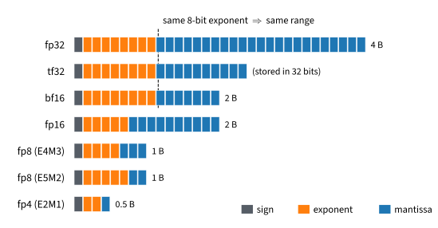

# Hardware
:label:`sec_hardware`

The previous section characterized a GPU by two constants—its peak arithmetic
rate $P$ and its memory bandwidth $\beta$—and showed that an operation
performing $I$ FLOPs per byte runs at most at $\min(P, I\beta)$. On the
RTX 4090, $P = 165$ TFLOP/s for bf16 matrix products and $\beta \approx 1$
TB/s: in the time the card reads one byte from memory, it can execute 165
floating-point operations. Where do these two numbers come from, and why does
moving a byte take so much longer than a FLOP?

Consider generating text one token at a time with a 1B-parameter GPT
(:numref:`sec_kv-cache`). In bf16 its weights occupy 2 GB, and every generated
token reads all of them. The arithmetic for one token ($2 \times 10^9$ FLOPs)
takes the tensor cores 12 µs, while reading 2 GB of weights at the achieved
0.9 TB/s takes 2.2 ms. A single stream therefore decodes at most ~450
tokens/s, leaving the arithmetic units idle over 99% of the time.

Three physical facts explain this gap: data must cross boundaries between
chips; off-chip wires scale more slowly than on-chip transistors; and moving
a byte consumes orders of magnitude more energy than computing with it.
Together they explain why the ridge point $P/\beta$ is in the hundreds and has
risen over hardware generations. Our worked example is the workstation that
runs this book's notebooks (four RTX 4090 GPUs, late 2026);
:citet:`Hennessy.Patterson.2011` treat computer architecture in depth, and
:numref:`sec_hardware_buyers` discusses hardware selection.

```{.python .input #hardware}
%%tab pytorch
import math
import numpy as np
import torch
from torch import nn
from torch.nn import functional as F
from d2l import torch as d2l
```

```{.python .input #hardware}
%%tab jax
import math
import numpy as np
import jax
from jax import numpy as jnp
from flax import nnx
import optax
from d2l import jax as d2l
```

## The Memory Hierarchy
:label:`subsec_hw-bytes`

Every byte a program touches resides in a hierarchy of memories that trade
capacity for speed (:numref:`fig_memory_hierarchy`). On-die registers and
SRAM caches hold ~0.1 GB and deliver tens of TB/s. The GPU's off-die DRAM—*high-bandwidth
memory* (HBM) on data-center cards or GDDR on consumer cards—holds tens to
hundreds of GB at 1–8 TB/s. Host DRAM holds hundreds of GB at ~0.5 TB/s per
CPU socket, NVMe flash holds terabytes at ~14 GB/s, and network storage sits
further out still.


:label:`fig_memory_hierarchy`

### Bandwidth and Latency

:numref:`fig_bandwidth_ladder` ranks the data paths of a training job across
nearly three orders of magnitude, from 14 GB/s (NVMe) to 8 TB/s (NVIDIA B200
HBM). One rule explains every step: **bandwidth equals the number of data
wires times the bit rate per wire**. The RTX 4090 accesses its GDDR6X memory
over 384 wires at 21 Gb/s each (~1 TB/s), whereas its PCIe 4.0 ×16 slot has
16 lanes per direction at 16 Gb/s each (32 GB/s)—roughly the same speed per
wire, but $24\times$ fewer wires.

Distance sets the wire count. HBM stacks sit inside the GPU package
millimeters from the die, connected by thousands of short wires; board traces
support hundreds of wires, and slots or cables a few dozen lanes. **Each step
away from the die cuts the wire count—and with it the bandwidth—by roughly an
order of magnitude.** A B200 reads HBM at 8 TB/s, reaches peer GPUs over
NVLink 5 at 0.9 TB/s (using ~36 lanes at 200 Gb/s each), and reaches the host
over PCIe 5.0 at 64 GB/s.


:label:`fig_bandwidth_ladder`

Bandwidth governs steady-state flow; *latency* is the time for the first byte
to arrive (:numref:`fig_latency_ladder`, with RTX 4090 microbenchmarks from
:citet:`Luo.Fan.Li.ea.2024`). One eager operation dispatched from Python takes
10–100 µs of host time (of which the hardware kernel launch is 1–5 µs). In
10 µs the RTX 4090 can stream 10 MB, which is why small operations are
dominated by dispatch overhead rather than memory or compute.


:label:`fig_latency_ladder`

Latency and bandwidth interact through the *access pattern*. DRAM achieves its
rated bandwidth only on sequential addresses. Let us gather a 1 GiB fp32
vector `x[idx]` once with `idx` equal to the identity permutation and once
with a random permutation. GPU memory transfers data in 32-byte *sectors*, so
each random 4-byte read fetches an entire 32-byte sector while the index and
output vectors still stream sequentially (~$3\times$ more bytes moved in all).

```{.python .input #hardware-bandwidth-and-latency}
%%tab pytorch
n = 256 * 1024 * 1024
x = torch.randn(n, device=d2l.try_gpu())  # 1 GiB fp32
times = {}
for desc in ('identity', 'random'):
    idx = (torch.arange(n, device=x.device) if desc == 'identity' else
           torch.randperm(n, device=x.device))
    # Bytes per element: the index and the output stream; x is read as
    # 4 bytes in order, or as a whole 32-byte sector at a random address
    nbytes = idx.dtype.itemsize + 4 + (4 if desc == 'identity' else 32)
    times[desc] = d2l.Benchmark(lambda: x[idx]).time
    print(f'{desc:8s}: {1e3 * times[desc]:5.1f} ms, '
          f'{nbytes * n / times[desc] / 1e12:.2f} TB/s at {nbytes} B/element')
    del idx  # Free the 2 GiB index before making the next one
print(f'random / identity: {times["random"] / times["identity"]:.1f}x')
```

```{.python .input #hardware-bandwidth-and-latency}
%%tab jax
n = 256 * 1024 * 1024
x = jax.random.normal(d2l.get_key(), (n,))  # 1 GiB fp32
gather = jax.jit(lambda x, idx: x[idx])
times = {}
for desc in ('identity', 'random'):
    idx = (jnp.arange(n) if desc == 'identity' else
           jax.random.permutation(d2l.get_key(), n))
    # Bytes per element: the index and the output stream; x is read as
    # 4 bytes in order, or as a whole 32-byte sector at a random address
    nbytes = idx.dtype.itemsize + 4 + (4 if desc == 'identity' else 32)
    times[desc] = d2l.Benchmark(lambda: gather(x, idx)).time
    print(f'{desc:8s}: {1e3 * times[desc]:5.1f} ms, '
          f'{nbytes * n / times[desc] / 1e12:.2f} TB/s at {nbytes} B/element')
print(f'random / identity: {times["random"] / times["identity"]:.1f}x')
```

The identity gather streams at ~0.9 TB/s, whereas the random gather takes
~37 ms—roughly an order of magnitude slower—and achieves only a third of peak
bandwidth even when credited with a full 32-byte sector per read. Beyond
32-byte sectors, DRAM serves data from open *rows* of a few kilobytes;
consecutive addresses share an open row, whereas random addresses repeatedly
pay the latency of opening a new row (and miss address-translation caches).

Dense matrix products and embedding lookups (which read contiguous rows of
thousands of bytes per token) stream efficiently. In contrast, fine-grained
random accesses (sparse matrices, graph traversals, hash tables) run at a
fraction of $\beta$. More generally, transferring a contiguous block of $n$
bytes with start-up latency $\alpha$ takes $t(n) = \alpha + n/\beta$ and
reaches half of peak bandwidth at $n_{1/2} = \alpha\beta$ :cite:`Hockney.1994`.
For an NVMe drive ($\alpha \approx 50\text{--}100$ µs, $\beta = 14$ GB/s),
$n_{1/2} \approx 1$ MB, which is why datasets on disk are shuffled in
megabyte-scale shards rather than individual examples.

## Compute and Memory Bandwidth
:label:`subsec_hw-shoreline`

### Area and Perimeter

Arithmetic units fill the interior of a silicon die (scaling with area,
$O(n^2)$), whereas I/O pads sit along the perimeter, or *shoreline* (scaling
with edge length, $O(n)$, :numref:`fig_shoreline`). Shrinking transistors has
the same effect: logic density quadruples when feature size halves, while
solder-bump pitch at the die edge shrinks much more slowly.


:label:`fig_shoreline`

Architects mitigate the shoreline bottleneck in two ways:

1. **HBM on a silicon interposer:** Stacking DRAM dies vertically next to the
   GPU die replaces a few hundred board traces with thousands of short, dense
   interposer wires (giving a B200 8 TB/s versus ~0.5 TB/s for a CPU socket).
2. **Multi-die packages:** Because lithography caps single-die area at the
   *reticle limit* (~$858\,\textrm{mm}^2$), flagship accelerators such as the
   B200 join two reticle-limit dies on one package, doubling the perimeter to
   accommodate eight HBM stacks.

### Generational Trends

Across NVIDIA's data-center generations from V100 (2017) through A100 and H100
to B200 (2024), dense 16-bit FLOP/s grew by ~$2.6\times$ per generation, memory
bandwidth by ~$2.0\times$, and capacity by ~$1.8\times$
:cite:`Gholami.Yao.Kim.ea.2024`. Consequently, the ridge point doubled from
139 FLOP/byte on the V100 to 295 on the H100 (281 on the B200): an operation
with intensity 200 FLOP/byte was compute-bound on a V100 but is
bandwidth-bound on an H100 or B200.

### Energy per Operation
:label:`subsec_hw-energy`

Power sets a second hard cap on bandwidth. In a 45 nm CMOS process
(:numref:`fig_energy_ladder`, :citet:`Horowitz.2014`), an fp32 multiply costs
3.7 pJ and an 8-bit integer add 0.03 pJ, whereas reading 64 bits from off-chip
DRAM costs 1.3–2.6 nJ—roughly the energy of **500 fp32 multiplications**.
On-chip SRAM reads lie in between (10–100 pJ depending on distance). While
modern process nodes scale all numbers down, the hierarchy remains unchanged:
moving data costs far more energy than computing on it. Kernel fusion,
narrower number formats, and activation recomputation save power for the exact
same reason they save time.


:label:`fig_energy_ladder`

## The GPU
:label:`subsec_hw-gpu`

### Streaming Multiprocessors

A GPU dedicates its die area to thousands of arithmetic units organized into
*streaming multiprocessors* (SMs; 128 on the RTX 4090). Each SM executes
threads in lockstep groups of 32 called *warps*. Instead of relying on massive
caches to hide DRAM latency, an SM switches warps on every cycle so other
warps compute while stalled warps wait for memory.

By Little's law :cite:`Little.1961`, keeping a memory pipe of bandwidth
$\beta = 1.0$ TB/s full across a latency of 250 ns requires
$1.0\,\textrm{TB/s} \times 250\,\textrm{ns} \approx 250$ KB in flight at all
times (~2 KB per SM, or 16 warps per SM each waiting on a 4-byte load per
thread). Kernels that expose too little parallelism to keep 250 KB in flight
become latency-bound rather than bandwidth-bound.

### Tensor Cores and Number Formats

*Tensor cores* multiply and accumulate small matrix tiles in a single
instruction, amortizing instruction fetch and decode over an entire tile, much
like a TPU systolic array :cite:`Kung.1988,Jouppi.Young.Patil.ea.2017`. On an
H100, bf16 tensor cores deliver 989 TFLOP/s versus 67 TFLOP/s for scalar fp32
($15\times$); on the consumer RTX 4090, the ratio is $2\times$.

We can derive the RTX 4090's peak throughput directly from its specification:
128 SMs $\times$ 128 fp32 units $= 16{,}384$ units, each executing one fused
multiply-add (2 FLOPs) per cycle at the 2.52 GHz boost clock:

$$
P_\textrm{fp32} = 16{,}384 \times 2 \times 2.52 \times 10^{9}\ \textrm{s}^{-1}
\approx 82.6\ \textrm{TFLOP/s}.
$$

Its tensor cores run tf32 at the same 82.6 TFLOP/s, bf16 (with fp32
accumulation) at $2\times = 165.2$ TFLOP/s, and fp8 at $4\times = 330.4$
TFLOP/s.


:label:`fig_float_formats`

As :numref:`fig_float_formats` illustrates, narrowing the format has two
roofline effects:

1. **Halving the width halves the bytes moved** (speeding up bandwidth-bound
   kernels up to $2\times$ and halving weight storage), except for tf32, which
   computes on 19-bit mantissas inside the tensor cores but still stores 32-bit
   floats in memory.
2. **Halving the width usually doubles the tensor-core compute roof $P$.**

Formats of 8 bits or fewer require explicit scale factors. fp8 uses E4M3 for
forward activations/weights and E5M2 for gradients with per-tensor or per-block
scales :cite:`Micikevicius.Stosic.Burgess.ea.2022`. At 4 bits (fp4 / E2M1,
encoding only 15 values from $-6$ to $6$), per-tensor scaling fails on
outliers, so hardware applies *microscaling*—one shared scale per block of 16
(NVFP4) or 32 (OCP MX) elements :cite:`Rouhani.Zhao.More.ea.2023`.

### Accelerator Specifications

:numref:`tab_gpu_specs` compares two data-center GPUs and two consumer cards.

:Four GPUs as of late 2026. Dense tensor-core throughput with fp32 accumulation at boost clock, in TFLOP/s (TF). Links count one direction.
:label:`tab_gpu_specs`

| | H100 SXM | B200 | RTX 4090 (ours) | RTX 5090 |
|---|---|---|---|---|
| memory $C$ | 80 GB HBM3 | 180 GB HBM3e | 24 GB GDDR6X | 32 GB GDDR7 |
| memory bandwidth $\beta$ | 3.35 TB/s | 8 TB/s | 1.0 TB/s | 1.8 TB/s |
| bf16 | 989 TF | 2,250 TF | 165 TF | 210 TF |
| fp8 | 1,979 TF | 4,500 TF | 330 TF | 419 TF |
| fp4 | — | 9,000 TF | — | 1,676 TF |
| ridge point (bf16) | 295 FLOP/B | 281 FLOP/B | 164 FLOP/B | 117 FLOP/B |
| link to other GPUs | NVLink 4, 450 GB/s | NVLink 5, 900 GB/s | PCIe 4.0 ×16 via host, $\le 32$ GB/s | PCIe 5.0 ×16 via host, $\le 64$ GB/s |
| power | 700 W | 1,000 W | 450 W | 575 W |

## Data Paths outside the GPU

### The Host
:label:`subsec_hw-cpu`

While the GPU performs the arithmetic, the host CPU still performs three tasks
that can bottleneck training: dispatching kernels ($h$ per call), running the
data-loading and preprocessing pipeline, and staging host-to-device transfers
over PCIe.

The GPU's DMA *copy engine* can transfer data over PCIe concurrently with SM
computation only from page-locked (*pinned*) host memory. Transfers from
ordinary *pageable* memory must first be copied by the CPU into an internal
pinned staging buffer. Let us compare pageable and pinned transfer rates for
a 256 MiB array.

```{.python .input #hardware-the-cpu-s-role}
%%tab pytorch
x_pageable = torch.randn(64 * 1024 * 1024)  # 256 MiB on the host
x_pinned = x_pageable.pin_memory()
gpu = d2l.try_gpu()
for desc, src in [('pageable', x_pageable), ('pinned', x_pinned)]:
    t = d2l.Benchmark(lambda: src.to(gpu, non_blocking=True)).time
    print(f'{desc}: {src.nbytes / t / 1e9:.1f} GB/s')
```

```{.python .input #hardware-the-cpu-s-role}
%%tab jax
x_pageable = np.random.default_rng().standard_normal(
    64 * 1024 * 1024, dtype=np.float32)  # 256 MiB on the host
gpu = jax.devices()[0]
on_gpu = jax.sharding.SingleDeviceSharding(gpu, memory_kind='device')
x_pinned = jax.device_put(x_pageable, jax.sharding.SingleDeviceSharding(
    gpu, memory_kind='pinned_host'))
for desc, src in [('pageable', x_pageable), ('pinned', x_pinned)]:
    t = d2l.Benchmark(
        lambda: jax.device_put(src, on_gpu).block_until_ready()).time
    print(f'{desc}: {src.nbytes / t / 1e9:.1f} GB/s')
```

The pinned transfer reaches ~23 GB/s—about three quarters of PCIe 4.0 ×16's
32 GB/s theoretical ceiling, and $40\times$ slower than GPU memory—while the
pageable transfer is slower due to the extra host-memory copy. Datasets that
fit in GPU memory should stay on the device; minibatches streamed from the
host should use pinned memory (`pin_memory=True` in PyTorch; `'pinned_host'`
sharding in JAX) overlapped with compute.

### Links between GPUs
:label:`subsec_hw-interconnects`

Data-center GPUs communicate over dedicated NVLink fabrics (450 GB/s per
direction on H100, 900 GB/s on B200). Consumer RTX 4090 cards lack both NVLink
and PCIe peer-to-peer (P2P) access: as :numref:`fig_pcie_topology` shows,
every inter-GPU byte on our four-GPU workstation must travel up one PCIe 4.0
link, through host DRAM, and down another, capping GPU-to-GPU transfers at the
~23 GB/s pinned-copy rate ($40\times$ slower than NVLink 5).


:label:`fig_pcie_topology`

For our 1B-parameter GPT ($S = 4$ GB of fp32 gradients), moving the gradients
once at 23 GB/s takes at least 0.17 s on our workstation versus < 5 ms over
NVLink 5—more than half of the 0.3 s compute time of an 8,192-token step at
peak bf16 throughput.

## Workloads on the Roofline
:label:`subsec_hw-two-workloads`

Language model inference spans two regimes
(:numref:`subsec_kv-cache-prefill-decode`). *Prefill* processes a prompt of
$n$ tokens in parallel, achieving intensity $I \approx n$ (up to the layer
width) and running on the compute roof. *Decode* generates one token per step,
reading all $2N$ bytes of bf16 weights plus the KV cache for an intensity of
$I \approx 1$ FLOP/byte.

### Single-Stream and Batched Decoding

Because single-stream decoding is bandwidth-bound, its token rate is bounded
by

$$
\textrm{tokens/s} \;\lesssim\;
\frac{\beta}{\textrm{bytes per token}} \;=\;
\frac{\beta}{2N + \textrm{KV bytes}}.
$$
:eqlabel:`eq_hw_decode_bound`

When a model's weights fill a card's memory capacity $C$, the maximum
single-stream decode rate is the inverse of the *memory sweep time* $C/\beta$:
the time required to read every byte of GPU DRAM once. Across all four GPUs in
:numref:`tab_gpu_specs`, capacity and bandwidth vary by $7\text{--}8\times$,
yet $C/\beta$ stays near **20 ms** (24 ms on H100 and RTX 4090, 22.5 ms on
B200, 18 ms on RTX 5090). Any model that fills its GPU therefore decodes a
single stream at roughly 40–55 tokens/s, whether on a consumer card or a
flagship data-center GPU.

Batching $B$ concurrent sequences amortizes weight reads across $B$ tokens,
raising weight intensity to $I \approx B$ FLOP/byte until $B$ reaches the
ridge point (as measured in :numref:`subsec_perf-roofline-test`), though each
sequence still reads its own KV cache (:numref:`subsec_kv-cache-batching`).

### Rules of Thumb

:numref:`tab_rules_of_thumb` summarizes the key hardware constants used
throughout the rest of this chapter.

:Rules of thumb: characteristic magnitudes, their values on our machine (four RTX 4090s without peer-to-peer access), and why each matters.
:label:`tab_rules_of_thumb`

| quantity | magnitude, late 2026 | our machine | why it matters |
|---|---|---|---|
| host time per call, $h$ | 10 µs to 0.1 ms | 13–100 µs (:numref:`sec_perf_model`) | small operations cannot keep the GPU busy |
| peak bf16 rate, $P$ | 0.17–2.3 PFLOP/s | 165 TFLOP/s | speed limit of large matrix products |
| GPU memory bandwidth, $\beta$ | 1–8 TB/s | ~0.9 TB/s (1.0 rated) | speed limit of elementwise ops and decoding |
| ridge point, $P/\beta$ | 120–300 FLOP/byte | 164 FLOP/byte | below it, memory bandwidth sets the time |
| sweep time, $C/\beta$ | ~20 ms | 24 ms | largest model that fits decodes 1 stream at ~40–55 tok/s |
| host to device, pinned | 32–64 GB/s (PCIe 4/5) | ~23 GB/s | keep training data on device or in pinned memory |
| GPU to GPU | 450–900 GB/s (NVLink) | $\le 23$ GB/s via host (:numref:`sec_multi_gpu`) | sets the time of every gradient exchange |
| bytes per parameter (Adam) | 16 (fp32), 18 (mixed) | 16–18 | determines what model size fits (:numref:`sec_memory_precision`) |
| bytes per token, decode | $2N$ + KV cache (bf16) | | tokens/s $\lesssim \beta / \textrm{bytes per token}$ |

## Summary

Bandwidth is wire count times rate per wire. Because wires exit a die along
its perimeter while arithmetic units fill its area—and because off-chip data
movement costs hundreds of times more energy than arithmetic—the ridge point
$P/\beta$ lies in the hundreds of FLOP/byte and has risen across hardware
generations. Memory transfers 32-byte sectors from open DRAM rows, so fine-grained
random reads achieve only a fraction of $\beta$, and saturating $\beta$
requires $\beta \times \textrm{latency}$ bytes in flight across warps.
Narrower number formats halve memory traffic and usually double $P$. Finally,
single-stream decoding is bounded by $\beta / (2N + \textrm{KV bytes})$, and
because the memory sweep time $C/\beta$ is ~20 ms across modern GPUs, the
largest model that fits on any card decodes a single stream at ~40–55
tokens/s.

## Exercises

1. [code] **Latency and bandwidth, measured.** ● The block transfer model $t(n) = \alpha + n/\beta$ with $n_{1/2} = \alpha\beta$ (:numref:`subsec_hw-bytes`) describes a single synchronous call.
    1. Predict $n_{1/2}$ for the elementwise multiplication `x * 1.5` of :numref:`subsec_perf-regimes`, taking $\alpha = h$ and $\beta$ from your measurements in :numref:`sec_perf_model`.
    1. Time `x * 1.5` for tensor sizes from 1 MB to 2 GB, plot achieved bandwidth against size on log–log axes, and relate the regime transitions to :numref:`fig_latency_ladder` and the on-die L2 cache capacity in :numref:`fig_memory_hierarchy`.
    1. Repeat the host-to-device measurement of :numref:`subsec_hw-cpu` for transfers from 4 KB to 256 MB, and fit $\alpha$ and the asymptotic bandwidth.

2. **Wires and rates.** :numref:`subsec_hw-bytes` writes bandwidth as the number of wires times the rate per wire.
    1. A DDR5-6400 DIMM has 64 data wires at 6.4 Gb/s each. An HBM3e stack has 1,024 data wires, and a B200 carries eight stacks. Compute the bandwidth of one DIMM, the number of DIMMs needed for a 0.5 TB/s CPU socket, and the per-wire data rate implied by the B200's 8 TB/s in :numref:`tab_gpu_specs`. Which factor accounts for the gap between the CPU socket and the B200?
    1. Each of the two dies of a B200 sits next to four of the eight HBM stacks. If the SMs on each die read both halves of memory equally often at a combined 8 TB/s, what bandwidth must the on-package bridge carry in each direction?

3. **Starved input pipeline.** Suppose the GPU compute of a training job can
   process 2 GB/s of decoded images. Each CPU worker runs two sequential
   stages: reading compressed JPEGs from NVMe at 1 GB/s (compressed) and
   decoding them on one CPU core at 0.3 GB/s (decoded output, an $8\times$
   size expansion). The training loop then copies each decoded batch synchronously
   from pageable host memory to the GPU at 12 GB/s before computing.
    1. At what rate (in decoded bytes/s) does one worker deliver batches, and
       which stage binds?
    1. How many parallel worker processes are needed to keep the GPU fed?
    1. By what fraction does the synchronous pageable copy lengthen each step,
       and how does switching to asynchronous pinned-memory copies at 24 GB/s
       change this?

4. **Ridge point of a link.** The ridge point $P/\beta$ applies to any data
   path of bandwidth $\beta$, counting the FLOPs a device can execute while
   one byte crosses the path.
    1. Compute $P/\beta$ in bf16 for an RTX 4090 against its own DRAM and
       against the 23 GB/s host-staged GPU-to-GPU path, and for a B200 against
       its HBM and against one direction of NVLink 5 (900 GB/s).
    1. In data-parallel training (:numref:`sec_multi_gpu`), each GPU holds a
       model with $N$ parameters, processes $T$ tokens per step at ~$6N$ FLOPs
       per token, and sums bf16 gradients via an allreduce that sends ~$4N$
       bytes per GPU. Without overlap, show that communication takes no longer
       than compute if and only if $T$ exceeds a threshold proportional to the
       link's ridge point, independent of $N$.
    1. Evaluate this token threshold for NVLink 5, for the 23 GB/s pinned-copy
       rate, and for the 2.4 GB/s achieved by default host-staged NCCL on our
       workstation (:numref:`sec_multi_gpu_concise`).

5. **Launch-bound decode.** In eager single-stream decoding, the CPU launches
   every kernel of every block while the GPU reads the block's weights. Suppose
   each of $L$ blocks of width $d$ holds $12d^2$ bf16 weights and launches
   $K = 12$ kernels per token at $h = 8$ µs of host time per kernel.
    1. Show that whether host launch time or weight-read time binds is
       independent of $L$, and find the crossover width $d^*$ on the RTX 4090
       and on the B200.
    1. Evaluate both bounds for GPT-2 Small ($d = 768$, $L = 12$) on the
       RTX 4090. Which bound binds?
    1. What does the shift in $d^*$ from the RTX 4090 to the B200 imply for
       the importance of CUDA graph capture-and-replay (:numref:`sec_compilation`)
       on faster GPUs?

6. [code] **Block-shuffled gather.** ● Repeat the gather benchmark of
   :numref:`subsec_hw-bytes`, but permute contiguous blocks of $k$ elements
   for $k \in \{1, 2, 4, \ldots, 1024\}$ instead of individual elements. Plot
   the achieved bandwidth against block size in bytes, and compare the
   crossover size with the 32-byte sector size and the kilobyte scale of a
   DRAM row.

7. **Latency hiding.** ● Apply Little's law (:numref:`subsec_hw-gpu`) to
   memory latency hiding:
    1. Compute the bytes in flight needed to saturate the B200's 8 TB/s HBM at
       250 ns latency, and compare with the 250 KB of the RTX 4090. What does
       the ~$2\times$ generational growth of bandwidth at nearly constant DRAM
       latency imply for the parallelism kernels must expose?
    1. In pointer chasing, each load's address depends on the previous load,
       allowing only one request in flight per chain. On a CPU with 90 ns DDR5
       latency and 64-byte cache lines, compute the bandwidth of a single
       chain and the number of independent chains required to saturate a
       0.5 TB/s socket.

[Discussions](https://d2l.discourse.group/t/36788)

<!-- slides -->

::: {.slide}
::: {.cover}
[Dive into Deep Learning · §13.2]{.kicker}

Hardware<br>
**wires and rates · access patterns · area and perimeter · tensor cores and formats · links to the host and between GPUs · decode**
:::
:::

::: {.slide title="One Stream on a 165-TFLOP/s Card Gets Only 450 Tokens per Second"}
[The problem]{.kicker}

A GPT with 1B parameters generates text on one RTX 4090.

- Per token: $2 \times 10^9$ FLOPs at 165 TFLOP/s $\approx$ 12 µs.
- Per token: 2 GB of bf16 weights at the measured 0.9 TB/s $\approx$ 2.2 ms.
- One stream: at most $\approx$ 450 tokens/s; the tensor cores idle
  > 99% of the time.

::: {.d2l-note}
Peak FLOP/s does not predict speed. **Every operand must first arrive
through memory**, and memory is far slower than arithmetic.
:::
:::

::: {.slide title="By the End of This Deck You Can"}
[Goals]{.kicker}

- derive peak FLOP/s $P$ from a spec sheet and explain why the ridge
  point $P/\beta$ is in the hundreds;
- estimate the bandwidth of a path from its wires, and a transfer time
  from its bandwidth and latency;
- predict what a random access pattern and a narrower format cost;
- bound decode speed by bandwidth / bytes per token, and by the sweep time.

**Idea:** wires leave a chip only at its edge, so bytes are scarce and
arithmetic is cheap. **Running example:** one RTX 4090 (165 TFLOP/s bf16,
1.0 TB/s, 24 GB) and a 1B-parameter GPT (2 GB of weights in bf16).
:::

::: {.slide title="Hardware Explains the Two Numbers of the Roofline"}
[Where this fits]{.kicker}

::: {.cols .vc}
::: {.col}
| section | adds |
|---|---|
| The Performance Model | roofline, three regimes, timing, profiling |
| **Hardware** | **where peak arithmetic and bandwidth come from** |
| Computation Graphs and Compilation | fusion and kernel replay |
| Memory and Precision | what fits: bytes per parameter and per token |
| Multi-GPU from First Principles | data parallelism by hand, its cost model |
| Data Parallelism in Practice | one process per GPU, overlap |
| Sharding the Training State | a model no card holds |
| Case Study: Optimizing a Transformer | the whole method on one GPT |
:::

::: {.col .narrow}
- **Uses:** arithmetic intensity $I$ (FLOPs per byte), the ridge point,
  the host time per call $h$.
- **Skips:** buying advice (Tools appendix), writing kernels, multi-node
  fabrics.
:::
:::
:::

::: {.slide title="Each Level Down Holds More Bytes and Delivers Fewer per Second"}
{height=430px}

Registers and caches: ~0.1 GB at tens of TB/s. GPU memory: 24–180 GB at
1–8 TB/s. Host, flash, network: bigger and slower again.
:::

::: {.slide title="Bandwidth Is Wires Times Rate per Wire"}
::: {.cols .vc}
::: {.col}
{height=480px}
:::

::: {.col .narrow}
- RTX 4090 memory: 384 wires × 21 Gb/s = 1 TB/s.
- PCIe 4.0 ×16: 16 lanes × 16 Gb/s = 32 GB/s per direction.
- Same speed per wire, 24× fewer wires.
- B200: HBM 8 TB/s → NVLink 0.9 TB/s → PCIe 5.0 64 GB/s.
- NVLink 5: ~36 lanes × 200 Gb/s: few wires, each very fast.
:::
:::
:::

::: {.slide title="One Eager Operation Takes at Least as Long as Streaming 10 MB"}
::: {.cols .vc}
::: {.col}
{height=470px}
:::

::: {.col .narrow}
- Host time of one eager operation from Python: 10–100 µs, depending on
  the framework and the host.
- In 10 µs the RTX 4090 streams 10 MB.
- Many small operations are limited by the host time $h$ per call, not by
  the GPU.
:::
:::

[GPU latencies: RTX 4090 microbenchmarks (Luo et al., 2024)]{.small}
:::

::: {.slide title="A Random Gather Reaches Only a Third of the Bandwidth"}
@!hardware-bandwidth-and-latency

`x[idx]` on 1 GiB of fp32, `idx` the identity or a random permutation.

- Random read: a whole 32-byte sector; index and output still stream, so
  about 3× the bytes.
- Measured: about 37 ms, an order of magnitude more.
- DRAM reads fastest from an open row of a few KB; random addresses rarely
  share one.

::: {.d2l-note}
Memory moves sectors, not numbers, and moves them fastest from rows
already open.
:::
:::

::: {.slide title="Check: How Large Must a Shuffled Block Be?"}
[Check]{.kicker}

A block of $n$ bytes costs latency $\alpha$ plus $n/\beta$. An NVMe drive:
$\alpha$ = 50–100 µs, $\beta$ = 14 GB/s. Which block size reaches half
the bandwidth?

::: {.fragment .fade-up}
- Half the bandwidth at $n = \alpha\beta$ = 0.7–1.4 MB.
- Shuffle a dataset in blocks of a megabyte or more, not example by
  example.
:::
:::

::: {.slide title="Compute Grows with Area, I/O with Perimeter"}
::: {.cols .vc}
::: {.col}
{height=440px}
:::

::: {.col .narrow}
- Side ×2: compute ×4, I/O ×2.
- HBM beside the die: thousands of short wires, 8 TB/s on a B200 against
  0.5 TB/s for a CPU socket.
- A die is capped at ~858 mm² (reticle limit); two dies give twice the
  edge, room for eight HBM stacks.
:::
:::
:::

::: {.slide title="Compute Outgrew Bandwidth, and the Ridge Point Doubled"}
| GPU (year) | 16-bit dense | bandwidth | ridge point |
|---|---|---|---|
| V100 (2017) | 125 TF | 0.9 TB/s | 139 FLOP/B |
| A100 (2020) | 312 TF | 2.0 TB/s | 153 FLOP/B |
| H100 (2022) | 989 TF | 3.35 TB/s | 295 FLOP/B |
| B200 (2024) | 2,250 TF | 8 TB/s | 281 FLOP/B |

Per generation: compute ×2.6, bandwidth ×2.0, capacity ×1.8. At
200 FLOP/B: compute-bound on a V100, bandwidth-bound on an H100.

[V100: fp16. Server hardware over 20 years: compute ×3.0, DRAM ×1.6, interconnect ×1.4 every 2 years (Gholami et al., 2024)]{.small}
:::

::: {.slide title="Streaming 8 TB/s at 45 nm DRAM Energy Would Draw 1.3–2.6 kW"}
::: {.cols .vc}
::: {.col}
{height=385px}
:::

::: {.col .narrow}
- 64-bit DRAM read ≈ 500 fp32 multiplies.
- 8 TB/s × 160–330 pJ/B = 1.3–2.6 kW, more than a whole B200 (1 kW).
- Current DRAM costs several times less per bit; HBM less again.
:::
:::

::: {.d2l-note}
Power caps bandwidth: a chip moves at most watts / joules per byte.
:::

[45 nm process (Horowitz, 2014)]{.small}
:::

::: {.slide title="Bytes in Flight = Bandwidth × Latency"}
Little's law: requests in flight = throughput × latency.

- RTX 4090: 1.0 TB/s × 250 ns $\approx$ 250 KB in flight.
- 128 SMs (processor blocks), each running warps of 32 threads in
  lockstep: about 2 KB per SM, i.e. 16 warps each waiting on one 4-byte
  load per thread, a third of the 48 an SM holds.
- A kernel too small to keep 250 KB in flight runs at the pace of
  latency, not bandwidth.

::: {.d2l-note}
SMs hide latency by switching warps, so a kernel must expose enough work.
:::
:::

::: {.slide title="Peak FLOP/s = Units × 2 × Clock × Tensor Factor"}
RTX 4090: 16,384 fp32 units (128 SMs × 128), one fused multiply-add per
cycle at 2.52 GHz.

$$P_\textrm{fp32} = 16{,}384 \times 2 \times 2.52\ \textrm{GHz} \approx 82.6\ \textrm{TFLOP/s}$$

- tf32 on the tensor cores: same 82.6 on this card.
- bf16, fp32 accumulation: ×2 = 165 TFLOP/s, reached within about a
  tenth by large products.
- fp8: ×2 again = 330 TFLOP/s (derived, not measured here).
:::

::: {.slide title="Narrower Formats Halve the Bytes and Usually Double the FLOP/s"}
{height=340px}

- Bytes: always halved, except tf32 (computed in 19 bits, stored in 32).
- ≤ 8 bits need a scale; fp4 has only 15 values from −6 to 6, so one
  scale per block of 16–32 values.
:::

::: {.slide title="Check: What Does fp8 Give Two Operations?"}
[Check]{.kicker}

On the RTX 4090, switch from bf16 to fp8: (a) an elementwise operation at
$I = 0.25$ FLOP/B; (b) a matmul at $I = 1{,}000$ FLOP/B.

::: {.fragment .fade-up}
- (a) bandwidth-bound: half the bytes, 2× faster.
- (b) compute-bound: $P$ 165 → 330 TFLOP/s, 2× faster.
- Neither gains 4×: each is limited by only one roof at a time.
:::
:::

::: {.slide title="Consumer Cards Have Lower Ridge Points and No Fast GPU Link"}
| | H100 | B200 | RTX 4090 | RTX 5090 |
|---|---|---|---|---|
| memory $C$ | 80 GB | 180 GB | 24 GB | 32 GB |
| bandwidth $\beta$ | 3.35 TB/s | 8 TB/s | 1.0 TB/s | 1.8 TB/s |
| bf16 $P$ | 989 TF | 2,250 TF | 165 TF | 210 TF |
| ridge $P/\beta$ | 295 | 281 | 164 | 117 |
| GPU link, one way | 450 GB/s | 900 GB/s | ≤ 32 GB/s via host | ≤ 64 GB/s via host |

[Dense, fp32 accumulation, boost clock; vendor datasheets, late 2026]{.small}
:::

::: {.slide title="Pinned Host Memory Feeds PCIe at Three Quarters of Its Rate"}
@!hardware-the-cpu-s-role

- Pinned: about 23 of PCIe 4.0's 32 GB/s, about forty
  times below GPU memory.
- Pageable: an extra copy through host memory first.
- Keep data on the device; copy minibatches from pinned memory, overlapped.
:::

::: {.slide title="Without Peer-to-Peer, Every Inter-GPU Byte Goes through the Host"}
{height=400px}

GPU to GPU: at most the pinned copy rate, about 23 GB/s, and only if
both hops overlap; almost 40× below one direction of NVLink 5. The 4 GB of
fp32 gradients of the 1B GPT: ≥ 0.17 s per step here, more than half of
the 0.3 s that 8K tokens take at peak.
:::

::: {.slide title="Prefill Is Compute-Bound, Decode Is Bandwidth-Bound"}
GPT with $N$ parameters in bf16, prompt of $n$ tokens:

- prefill: $2Nn$ FLOPs on $2N$ bytes of weights, $I$ up to about $n$,
  capped by the layer width (≈ 500 for $n$ = 1,000 at width 2,048);
- decode: $2N$ FLOPs on $2N$ bytes plus the KV cache, $I \approx 1$.

$$\textrm{tokens/s} \lesssim \frac{\beta}{2N + \textrm{KV bytes}}$$

1B GPT on the RTX 4090: 0.9 TB/s / 2 GB $\approx$ 450 tokens/s.
:::

::: {.slide title="Sweep Time Is About 20 ms on Every GPU"}
Sweep time $C/\beta$: read every byte of memory $C$ once at bandwidth
$\beta$.

| | H100 | B200 | RTX 4090 | RTX 5090 |
|---|---|---|---|---|
| $C/\beta$ | 24 ms | 22.5 ms | 24 ms | 18 ms |
| largest model, one stream | ≈ 42 tok/s | ≈ 44 tok/s | ≈ 42 tok/s | ≈ 56 tok/s |

::: {.d2l-note}
A bigger card holds a bigger model and reads it no faster.
:::
:::

::: {.slide title="Batching Moves Decode up the Roofline until the Ridge Point"}
A step for $B$ sequences reads the weights once: $I \approx B$ FLOP/B.

- Measured in the previous deck on $16{,}384^2$ bf16 weights (0.54 GB):
  time flat at about 0.6 ms up to $B \approx 128$, then linear in $B$ past
  the ridge, 164.
- Each sequence still reads its own KV cache, which batching does not
  share: the crossover moves to larger $B$.
:::

::: {.slide title="Check: Decoding an 8B Model"}
[Check]{.kicker}

An 8B-parameter model in bf16 on the RTX 4090, KV cache ignored: tokens
per second for one stream, and for a batch of 64?

::: {.fragment .fade-up}
- One stream: 16 GB per step at 0.9 TB/s, $\approx$ 56 tokens/s.
- Batch 64: still below the ridge ($I \approx 64 < 164$), same step time,
  $\approx$ 3,600 tokens/s over all 64 streams.
:::
:::

::: {.slide title="Wrap-up"}
[Wrap-up]{.kicker}

- Bandwidth = wires × rate per wire; each step from the die cuts the
  wires: 1 TB/s on the board, 23 GB/s to the host, no faster GPU to GPU.
- Compute is area, I/O is perimeter, and power caps the bytes: ridge
  points of 117–295 FLOP/B, rising over generations.
- Random reads reach a third of $\beta$; reaching $\beta$ needs
  $\beta \times$ latency bytes in flight.
- Narrower formats halve the bytes and usually double $P$.
- Decode: $\lesssim \beta$ / bytes per token, 450 tokens/s for the 1B GPT;
  a full card decodes one token per sweep, about 20 ms.

**Next:** computation graphs and compilation remove eager overhead and
fuse away memory round trips.
:::
