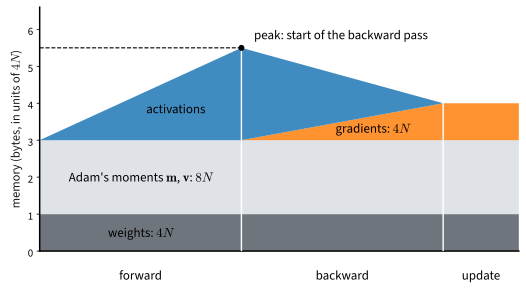

# Memory and Precision
:label:`sec_memory_precision`

The previous sections asked how fast a training step runs. A step that
does not fit in the GPU's memory does not run at all. The models of
earlier chapters fit on one card with room to spare, so we never had to
ask how much memory a step needs. Large language models change that.
Where does the memory of a training step go, and how can a model that
barely fits on a card still train on large minibatches?

Consider a GPT with a billion parameters, trained with Adam in fp32 on an
RTX 4090, which has 24 GiB of memory. The optimizer keeps four numbers for
every parameter: the weight, its gradient, and Adam's two moment
estimates. At four bytes each that is
15 GiB before the model has read a single token. The remaining 9 GiB must
hold everything that the forward pass stores for the backward pass, and
for this model that is several megabytes per token of the minibatch. Only
one to three sequences of 1,024 tokens fit, while language models are
trained on minibatches of half a million tokens or more
:cite:`brown2020language`. A training run that does not fit does not
start, and one that barely fits learns from too few examples per step.

The memory of a step splits into two parts: one
proportional to the number of parameters, fixed by the model and the
optimizer, and one proportional to the number of tokens in the step, the
*activations*. We count both for the billion-parameter GPT and check the
count against a measurement of the peak. Then we study three techniques
that act on the second part. Mixed precision stores activations in 16 bits
and runs faster on tensor cores. Activation checkpointing recomputes
activations instead of storing them, which takes extra time. Gradient
accumulation splits a large minibatch into pieces that fit one at a time.
None of the three reduces the memory per parameter; the sections on
multiple GPUs show how to divide it among devices.

```{.python .input #memory-precision-memory-and-precision}
%%tab pytorch
import math
import numpy as np
import torch
from torch import nn
from torch.nn import functional as F
from d2l import torch as d2l
```

```{.python .input #memory-precision-memory-and-precision}
%%tab jax
import math
import numpy as np
import jax
from jax import numpy as jnp
from flax import nnx
import optax
from d2l import jax as d2l
```

```{.python .input #memory-precision-memory-and-precision-1}
%%tab pytorch
from torch.utils.checkpoint import checkpoint
```

## Memory of a Training Step
:label:`subsec_mp-anatomy`

A training step holds two kinds of tensor. The weights, their gradients, and
the optimizer state exist once per parameter, whatever the minibatch. The
activations exist once per token of the minibatch. We count each kind for the
running example of this chapter, a GPT with a billion parameters, and then
ask how many tokens fit next to it on one card.

### Memory per Parameter

Every parameter of a model that trains with Adam in fp32 carries a weight, a
gradient, and Adam's two moment estimates, four bytes each: 16 bytes per
parameter, as :numref:`subsec_memory_during_training` measured. The count
depends on the optimizer. Plain SGD keeps a weight and a gradient, 8 bytes;
momentum adds a velocity, 12 bytes. The count does not depend on the data: a model
with $N$ parameters holds $16N$ bytes whether it processes one token or a
million. Mixed precision, below, keeps all four numbers in fp32 and adds a
16-bit copy of every weight for the duration of a step, $18N$ bytes in all.
Some systems instead store the weights and gradients in 16 bits and keep an
fp32 copy of the weights next to the moment estimates. ZeRO's analysis counts
that arrangement as $2 + 2 + 12 = 16$ bytes per parameter
:cite:`Rajbhandari.Rasley.Ruwase.ea.2020`: the same total, divided
differently.

The running example is `d2l.GPT`, the decoder-only transformer of
:numref:`sec_gpt`, which stacks pre-norm blocks of causal attention and a
SwiGLU feed-forward network between a token embedding and a tied output
layer. We give it width $d = 2048$, 16 attention heads, 18 blocks, and the
vocabulary of $V = 50{,}257$ tokens and the learned positions of GPT-2. A
block holds about $12d^2 = 50$ million parameters, so the blocks hold 0.9
billion and the embedding table another 0.1 billion. Building the model
without its data, as in :numref:`subsec_count_without_alloc`, confirms the
count without allocating 4 GB of weights:

```{.python .input #memory-precision-memory-per-parameter}
%%tab pytorch
config = dict(vocab_size=50257, num_hiddens=2048, num_heads=16,
              num_blks=18, pos='learned')
with torch.device('meta'):  # Shapes and dtypes only, no data
    model = d2l.GPT(**config)
N = d2l.num_params(model)
print(f'{N / 1e9:.2f} billion parameters, 16N = {16 * N / 2**30:.1f} GiB')
```

```{.python .input #memory-precision-memory-per-parameter}
%%tab jax
config = dict(vocab_size=50257, num_hiddens=2048, num_heads=16,
              num_blks=18, pos='learned')
key = d2l.get_key()
model = nnx.eval_shape(lambda: d2l.GPT(**config, rngs=nnx.Rngs(key)))
N = d2l.num_params(model)
print(f'{N / 1e9:.2f} billion parameters, 16N = {16 * N / 2**30:.1f} GiB')
```

### Memory per Token

Backpropagation needs intermediate results of the forward pass to compute
the gradients, so every layer stores some of its inputs or outputs until the
backward pass has used them. These stored tensors are the activations.
:numref:`fig_memory_anatomy` follows them through one step. They accumulate
during the forward pass and are released one layer at a time during the
backward pass, while the gradients appear. Memory therefore peaks at the
start of the backward pass, when every activation is still stored.


:label:`fig_memory_anatomy`

How much does one block store per token? We count in units of the width
$d$. The normalization before the attention keeps its input and its output,
$2d$ values. The attention keeps the queries, keys, and values, $3d$ values,
and its output, another $d$. The projection after the attention keeps its
own copy of that output, $d$ more, and the normalization before the
feed-forward network keeps $2d$. The SwiGLU network computes a gate and an
up-projection, each of width $\tfrac{8}{3}d$, and multiplies the activated
gate by the up-projection. Its backward pass needs the gate, the
up-projection, the activated gate, and the product: four vectors of width
$\tfrac{8}{3}d$, about $11d$. In all, a block keeps about $20d$ values per
token, 160 KiB in fp32 at $d = 2048$.
:citet:`Korthikanti.Casper.Lym.ea.2022` count the same way for the block of
GPT-3 without dropout and arrive at $16d$ values besides the attention
weights; our feed-forward network keeps more because it has a gate.

Nothing in this count grows with the length $T$ of the sequence, provided
that the attention runs in a fused kernel. The fused attention kernel of
:numref:`sec_attention-at-scale` keeps a single number per head and token,
the logarithm of the softmax normalizer, and recomputes the attention
weights during the backward pass instead of storing them. An attention that
stores its $T \times T$ weights keeps at least another $n_h T$ values per
token for $n_h$ heads: 16,384 at $T = 1024$, or $8d$, 40% of the rest of
the block. An unfused implementation usually stores several such arrays.

The output layer adds a term of its own. The loss needs the log-probability
of every token of the vocabulary at every position, so it keeps $V$ values
per token, in fp32 for numerical safety (:numref:`sec_numerics`): 196 KiB,
more than a whole block.

We check this tally by counting the bytes that the backward pass keeps. The function `saved_bytes` runs the forward pass of a function and
adds up the sizes of the arrays it stores for the backward pass. The
function `gpt_loss` is the cross-entropy of a GPT's predictions; it uses the
input tokens as targets, which avoids loading a dataset and leaves the
memory unchanged.

:begin_tab:`pytorch`
`torch.autograd.graph.saved_tensors_hooks` takes two functions: the first is
called on every tensor that autograd saves for the backward pass, the second
when the backward pass retrieves it. Ours records the size of the memory
block, the *storage*, behind each saved tensor and passes on a detached
alias that shares the storage. Passing on the tensor itself would create a
reference cycle between a saved output and the graph that produced it, and
the graph, with all its tensors, would never be freed. Several saved tensors
can be views of one storage, so we count each storage once.
:end_tab:

:begin_tab:`jax`
`jax.vjp(f, *args)` runs the forward pass of `f` and returns the backward
pass as a function, `f_vjp`. That function is a pytree whose leaves are
the arrays the backward pass needs, so their sizes add up to what
the forward pass stores.
:end_tab:

```{.python .input #memory-precision-memory-per-token-1}
%%tab pytorch
def saved_bytes(f, *args):
    """Bytes of the tensors that autograd keeps for the backward pass of f."""
    storages = {}
    def pack(t):  # Called on every tensor saved for the backward pass
        storages[t.untyped_storage().data_ptr()] = (
            t.untyped_storage().nbytes())
        return t.detach()  # Same storage, no reference back to the graph
    with torch.autograd.graph.saved_tensors_hooks(pack, lambda t: t):
        f(*args)
    return sum(storages.values())

def gpt_loss(model, X, bf16=False):
    """Cross-entropy of a GPT's predictions, with the inputs as targets."""
    with torch.autocast(X.device.type, torch.bfloat16, enabled=bf16):
        return F.cross_entropy(model(X).flatten(0, 1), X.flatten())
```

```{.python .input #memory-precision-memory-per-token-1}
%%tab jax
def saved_bytes(f, *args):
    """Bytes of the arrays that the backward pass of f keeps."""
    _, f_vjp = jax.vjp(f, *args)  # The leaves of f_vjp are the saved arrays
    return sum(x.nbytes for x in jax.tree_util.tree_leaves(f_vjp))

def gpt_loss(model, X):
    """Cross-entropy of a GPT's predictions, with the inputs as targets."""
    logits = model(X).astype(jnp.float32)
    return optax.softmax_cross_entropy_with_integer_labels(logits, X).mean()
```

Two subtractions isolate the terms. The count for a minibatch of two
sequences minus the count for one sequence gives the bytes of one sequence:
the weights, which the backward pass also needs, cancel. The bytes per
sequence of a GPT with two blocks minus those of a GPT with one block give
the bytes of one block. What remains of the one-block model is the
embedding, the output layer, and the loss.

```{.python .input #memory-precision-memory-per-token-2}
%%tab pytorch
def bytes_per_token(config, bf16=False, num_steps=1024):
    """Bytes stored per token by one block, and by the rest of a GPT."""
    gpu, per_token = d2l.try_gpu(), []
    for L in (1, 2):  # GPTs with one and with two blocks
        model = d2l.GPT(**{**config, 'num_blks': L}).to(gpu)
        X1, X2 = (torch.randint(0, config['vocab_size'], (b, num_steps),
                                device=gpu) for b in (1, 2))
        per_token.append((saved_bytes(gpt_loss, model, X2, bf16)
                          - saved_bytes(gpt_loss, model, X1, bf16))
                         / num_steps)
    return per_token[1] - per_token[0], 2 * per_token[0] - per_token[1]

block, head = bytes_per_token(config)
print(f'one block: {block / 2**10:.0f} KiB per token '
      f'({block / (4 * config["num_hiddens"]):.1f} fp32 values of width d)')
print(f'embedding, output layer, and loss: {head / 2**10:.0f} KiB per token')
```

```{.python .input #memory-precision-memory-per-token-2}
%%tab jax
def to_bf16(model):  #@save
    """Make the linear layers of `model` compute in bf16; parameters stay
    fp32."""
    for _, layer in nnx.iter_graph(model):
        if isinstance(layer, nnx.Linear):
            layer.dtype = jnp.bfloat16
    return model

def bytes_per_token(config, bf16=False, num_steps=1024):
    """Bytes stored per token by one block, and by the rest of a GPT."""
    per_token = []
    for L in (1, 2):  # GPTs with one and with two blocks
        model = d2l.GPT(**{**config, 'num_blks': L},
                        rngs=nnx.Rngs(d2l.get_key()))
        model = to_bf16(model) if bf16 else model
        graphdef, params, rest = nnx.split(model, nnx.Param, ...)
        loss = lambda params, X: gpt_loss(nnx.merge(graphdef, params, rest), X)
        X1, X2 = (jax.random.randint(d2l.get_key(), (b, num_steps), 0,
                                     config['vocab_size']) for b in (1, 2))
        per_token.append((saved_bytes(loss, params, X2)
                          - saved_bytes(loss, params, X1)) / num_steps)
    return per_token[1] - per_token[0], 2 * per_token[0] - per_token[1]

block, head = bytes_per_token(config)
print(f'one block: {block / 2**10:.0f} KiB per token '
      f'({block / (4 * config["num_hiddens"]):.1f} fp32 values of width d)')
print(f'embedding, output layer, and loss: {head / 2**10:.0f} KiB per token')
```

A block keeps the tally plus whatever intermediate results its kernels
keep in addition. A normalization or an activation function written
as several operations keeps a few vectors that a fused kernel would not. The
embedding, the output layer, and the loss keep a little more than the
196 KiB of log-probabilities.

:begin_tab:`pytorch`
A block keeps about 19 values of width $d$ per token, close to the tally:
`scaled_dot_product_attention` runs the fused kernel, which stores only the
logarithm of the normalizer, and the normalizations keep little beyond their
inputs and outputs. The embedding, the output layer, and the loss keep about
210 KiB per token.
:end_tab:

:begin_tab:`jax`
A block keeps about 29 values of width $d$ per token, whatever the length
of the sequence. The attention of `d2l.GPT` runs XLA's implementation of
`jax.nn.dot_product_attention` under `jax.checkpoint` (:numref:`sec_gpt`),
so its backward pass keeps only the queries, keys, and values and computes
the $T \times T$ weights again, as the fused kernel does. The block keeps
more than the tally's $20d$ elsewhere. Each `nnx.RMSNorm` keeps four
vectors of width $d$ instead of two, among them the squared input and a
copy of the input, and `jax.nn.silu`, computed as
`x * jax.nn.sigmoid(x)`, keeps three arrays of width $\tfrac{8}{3}d$ where
the tally counts one. The embedding, the output layer, and the loss keep
about 230 KiB per token.
:end_tab:

### The Memory Budget

The two counts give the memory of a training step with $n$ tokens. With $a$
bytes per token for each of the $L$ blocks and $h$ bytes per token for the
rest of the model,

$$
M(n) \approx 16N + n \, (L a + h),
$$
:eqlabel:`eq_mp-budget`

and a step fits on a GPU with $M_\textrm{GPU}$ bytes if $M(n) \leq
M_\textrm{GPU}$. The first term is fixed by the model and the optimizer, the
second grows with the minibatch. The largest minibatch is therefore $n_{\max}
= (M_\textrm{GPU} - 16N) / (L a + h)$.

The equation counts the gradients, $4N$ bytes, as present for the whole
step. That is exact under gradient accumulation (:numref:`subsec_mp-accumulation`), where
the gradients of one micro-batch stay in memory while the next micro-batch
runs its forward pass. A single step that frees its gradients after the
update peaks lower, at $12N$ bytes plus the activations, because its
gradients appear only while the activations are released
(:numref:`fig_memory_anatomy`). Exercise :exref:`ex_mp-peak` locates the
peak in both cases. The budgets of this section are those of a step with
accumulation.

:begin_tab:`pytorch`
`zero_grad(set_to_none=True)` releases the gradients after each update, so a
step without accumulation reaches $12N$ plus the activations. With
accumulation, the gradients are added up in `.grad` and live through every
micro-batch.
:end_tab:

:begin_tab:`jax`
`jax.grad` returns the gradients as outputs of the compiled program, and XLA
allocates the outputs of a program for the whole time that it runs, so a
compiled gradient computation holds them from its first operation on.
:end_tab:

For our GPT, $16N = 15.1$ GiB and the card has 24 GiB, which leaves 8.9 GiB
for the activations.

:begin_tab:`pytorch`
With $a \approx 0.15$ MiB and $h \approx 0.21$ MiB from the count, each
token needs $La + h \approx 2.8$ MiB, which leaves room for about 3,200
tokens, a little over three sequences of 1,024 tokens.
:end_tab:

:begin_tab:`jax`
With $a \approx 0.23$ MiB and $h \approx 0.22$ MiB from the count, each
token needs $La + h \approx 4.3$ MiB, which leaves room for about 2,100
tokens, two sequences of 1,024 tokens.
:end_tab:

These estimates are optimistic: the allocator rounds and fragments its
blocks, and libraries reserve workspace of their own.

### Measured Peak Memory
:label:`subsec_mp-measuring`

A count is a model of what the framework stores, and a model can leave things
out. We check :eqref:`eq_mp-budget` on a GPT that is small enough to measure
on a card with 8 GiB: the width, the vocabulary, and the block of the
running example, but only two blocks. We measure the peak memory of the
forward and backward pass with 1,024, 2,048, and 4,096 tokens per step, in
sequences of 1,024 tokens as in the count, and compare the growth per token
with the count of the previous cell. With few tokens, other parts of the
step can set the peak, so we take the growth between 2,048 and 4,096
tokens.

:begin_tab:`pytorch`
PyTorch's caching allocator counts the bytes in live tensors, and
`max_memory_allocated` reports the highest count since the last
`reset_peak_memory_stats`. `d2l.peak_memory` (:numref:`sec_use_gpu`) reads
the peak of a call relative to the memory allocated before it, which here
holds the weights.
:end_tab:

:begin_tab:`jax`
XLA compiles a step into one program and decides in advance where every
array of the program lives (:numref:`sec_compilation`). The compiled object
reports this plan through `memory_analysis()`: `argument_size_in_bytes` for
the inputs, `output_size_in_bytes` for the results, and `temp_size_in_bytes`
for everything in between, including the activations. Compiling needs only
shapes, so we compile against `jax.ShapeDtypeStruct`s and read the plan
without allocating the model. We take the plan's results and intermediates,
the memory beyond the weights.
:end_tab:

```{.python .input #memory-precision-measuring-memory-1}
%%tab pytorch
gpu, V = d2l.try_gpu(), config['vocab_size']
model = d2l.GPT(**{**config, 'num_blks': 2}).to(gpu)
gpt_loss(model, torch.randint(0, V, (1, 1024), device=gpu)).backward()
peaks = {}  # The step above was a warm-up
for n in (1024, 2048, 4096):  # Tokens per step, in sequences of 1,024
    X = torch.randint(0, V, (n // 1024, 1024), device=gpu)
    model.zero_grad(set_to_none=True)
    peaks[n] = d2l.peak_memory(lambda: gpt_loss(model, X).backward())
    print(f'{n:5d} tokens: peak {peaks[n] / 2**30:.2f} GiB above the weights')
slope = (peaks[4096] - peaks[2048]) / (4096 - 2048)
print(f'measured: {slope / 2**10:.0f} KiB per token; '
      f'counted: {(2 * block + head) / 2**10:.0f} KiB per token')
```

```{.python .input #memory-precision-measuring-memory-3}
%%tab jax
key = d2l.get_key()
model = nnx.eval_shape(
    lambda: d2l.GPT(**{**config, 'num_blks': 2}, rngs=nnx.Rngs(key)))
graphdef, params, rest = nnx.split(model, nnx.Param, ...)
grad_fn = jax.jit(jax.grad(
    lambda params, rest, X: gpt_loss(nnx.merge(graphdef, params, rest), X)))
peaks = {}
for n in (1024, 2048, 4096):  # Tokens per step, in sequences of 1,024
    X = jax.ShapeDtypeStruct((n // 1024, 1024), jnp.int32)
    plan = grad_fn.lower(params, rest, X).compile().memory_analysis()
    peaks[n] = plan.output_size_in_bytes + plan.temp_size_in_bytes
    print(f'{n:5d} tokens: peak {peaks[n] / 2**30:.2f} GiB above the weights')
slope = (peaks[4096] - peaks[2048]) / (4096 - 2048)
print(f'planned: {slope / 2**10:.0f} KiB per token; '
      f'counted: {(2 * block + head) / 2**10:.0f} KiB per token')
```

The peak grows with the number of tokens, as :eqref:`eq_mp-budget`
predicts, but its slope is not the count of stored bytes. The loss adds a
term of its own. At the start of the backward pass, it creates a gradient
for each of the $V$ logits of every token while the log-probabilities are
still stored. It passes through up to two such fp32 arrays, 196 KiB per
token each, before the log-probabilities are released. At the peak, a token
therefore needs up to $8V$ bytes more than the count.

:begin_tab:`pytorch`
The measured slope exceeds the count by 0.38 MiB per token, two fp32
arrays of the size of the log-probabilities. At the peak the
billion-parameter model thus needs about 3.2 MiB per token, which leaves
room for about 2,800 tokens. With 1,024 tokens the peak comes later in
the step, when the gradients of the weights exist, and it lies above the
line through the other two points.
:end_tab:

:begin_tab:`jax`
The plan follows the compiled program, which need not store what the count of
`jax.vjp` reports. XLA fuses elementwise operations into the kernels around
them, and a fused backward kernel can recompute a cheap elementwise result
instead of reading it from memory. The plan also holds the gradient of the
logits and the temporaries of the backward pass, which the count leaves out.
The two effects pull in opposite directions; the plan, not the count, is what
the GPU must hold. The plan is not linear in the number of tokens either:
per token it grows by about 0.4 MiB from 1,024 to 2,048 tokens and by
about 0.7 MiB from 2,048 to 4,096, because for the larger inputs XLA's
program holds more arrays of the size of the logits at once.
:end_tab:

:begin_tab:`pytorch`
The allocator's own record shows the course of
:numref:`fig_memory_anatomy` in a real step. `torch.cuda.memory._record_memory_history()` records every
allocation and release from then on, and `torch.cuda.memory._snapshot()`
returns the record. We record one complete training step with Adam on 4,096
tokens, after a first step has created the moment estimates, and note where
the forward and the backward pass end:
:end_tab:

:begin_tab:`jax`
The plan reports one peak for the whole program. Since XLA runs the step as
a single compiled program, there is no point in between at which Python
could read the allocator; the plan is the place to look.
:end_tab:

```{.python .input #memory-precision-measured-peak-memory-1}
%%tab pytorch
X = torch.randint(0, V, (4, 1024), device=gpu)
opt = torch.optim.Adam(model.parameters())
gpt_loss(model, X).backward()  # A first step creates the moment estimates
opt.step()
opt.zero_grad(set_to_none=True)

events = lambda: torch.cuda.memory._snapshot()['device_traces'][0]
start = torch.cuda.memory_allocated()
torch.cuda.memory._record_memory_history()
loss = gpt_loss(model, X)
forward_end = len(events())
loss.backward()
backward_end = len(events())
opt.step()
opt.zero_grad(set_to_none=True)
trace = events()
torch.cuda.memory._record_memory_history(enabled=None)
```

Adding up the sizes of the allocations and subtracting those of the
releases, starting from the memory allocated before the step, gives the
allocated memory after every event:

```{.python .input #memory-precision-measuring-memory-2}
%%tab pytorch
sign = {'alloc': 1, 'free_completed': -1}
sizes = torch.tensor([sign.get(e['action'], 0) * e['size'] for e in trace])
series = ((start + sizes.cumsum(0)) / 2**30).tolist()
bounds = [0, forward_end, backward_end, len(trace)]
phases = list(zip(bounds[:-1], bounds[1:]))
d2l.plot([list(range(a, b)) for a, b in phases],
         [series[a:b] for a, b in phases], 'allocation event',
         'allocated (GiB)', legend=['forward', 'backward', 'optimizer step'])
```

:begin_tab:`pytorch`
The trace starts at the weights and moment estimates, $12N$. Memory climbs
through the forward pass as the blocks store their activations and jumps when
the output layer computes the logits and their log-probabilities. The peak
comes at the start of the backward pass, with the gradient of the logits.
Then the activations are released while the gradients appear, the optimizer
step briefly allocates temporaries of the size of the gradients, and
`zero_grad` releases the gradients.
:end_tab:

## Mixed Precision
:label:`subsec_mp-mixed`

Mixed-precision training, introduced in :numref:`sec_numerics`, keeps the
weights in fp32 and runs the matrix multiplications of the forward and
backward pass in a 16-bit format, with the loss and other reductions in fp32.
bf16 has the exponent range of fp32, so its gradients do not underflow; fp16
has a narrower range and needs loss scaling (:numref:`subsec_loss_scaling`).
Mixed precision changes both terms of :eqref:`eq_mp-budget`, and it changes
the time of a step. We measure the memory first. The count of the previous
subsection, repeated with bf16 arithmetic, gives the bytes per token:

```{.python .input #memory-precision-mixed-precision-1}
%%tab pytorch
block16, head16 = bytes_per_token(config, bf16=True)
print(f'one block: {block16 / 2**10:.0f} KiB per token in bf16, '
      f'{block16 / block:.2f} of fp32')
print(f'embedding, output layer, and loss: {head16 / 2**10:.0f} KiB per token')
```

```{.python .input #memory-precision-mixed-precision-1}
%%tab jax
block16, head16 = bytes_per_token(config, bf16=True)
print(f'one block: {block16 / 2**10:.0f} KiB per token in bf16, '
      f'{block16 / block:.2f} of fp32')
print(f'embedding, output layer, and loss: {head16 / 2**10:.0f} KiB per token')
```

A block stores well over half of its fp32 bytes, not half. The loss still
keeps its log-probabilities in fp32, so the term $h$ hardly changes. And the
16-bit copies of the weights, $2N$ bytes, stay in memory until the backward
pass has used them. For the billion-parameter GPT the fixed term grows from
$16N = 15.1$ GiB to $18N = 17.0$ GiB, and the room for activations shrinks
from 8.9 to 7.0 GiB. The smaller activations and the added weight copies
largely offset each other, and mixed precision raises the largest minibatch
by a quarter at most.

:begin_tab:`pytorch`
Under `torch.autocast`, the residual stream that connects the blocks stays
in fp32, and so do the normalizations, which autocast runs in fp32 for
accuracy. Each matrix multiplication keeps its own bf16 copy of its input,
next to the fp32 output of the normalization that produced it. A block
stores about 0.6 of its fp32 bytes, and the memory per token at the peak falls
from about 3.2 MiB to 2.0 to 2.2 MiB, depending on how many fp32 arrays of
the size of the logits the loss holds at once. The largest minibatch grows
by 15 to 25%, to 3,200 to 3,500 tokens.
:end_tab:

:begin_tab:`jax`
Flax NNX layers have a storage dtype, `param_dtype`, and a compute dtype,
`dtype` (:numref:`sec_numerics`). `to_bf16`, which `bytes_per_token`
applies, sets the compute dtype of the linear layers to bf16 and leaves the
parameters, the embedding, and the normalizations in fp32. The residual stream between the blocks thus stays in
fp32. The backward pass keeps the fp32 outputs of the normalizations and casts
them to bf16 again where it needs them. The output layer, which reuses the
embedding table, computes in fp32. A block stores about 0.6 of its fp32
bytes. The count per token falls from 4.3 to 2.7 MiB, and the largest
minibatch grows by about a quarter, to some 2,700 tokens.
:end_tab:

Memory is the smaller of the two gains. The larger one is time: the tensor
cores of the RTX 4090 multiply bf16 matrices at twice the rate of fp32 ones
(:numref:`sec_hardware`), and each operand takes half the bytes. Whether a
plain fp32 matrix multiplication uses the tensor cores as tf32, with fp32
range and a 10-bit mantissa, is a framework default (:numref:`sec_numerics`).
A speedup quoted against true fp32 thus mixes two effects. To separate them,
we time one training step of a three-layer MLP of width 8192, on a
minibatch of 2,048 examples, in three configurations: true fp32, tf32, and
bf16.

```{.python .input #memory-precision-mixed-precision}
%%tab pytorch
mlp = nn.Sequential(nn.Linear(64 * 64, 8192, bias=False), nn.ReLU(),
                    nn.Linear(8192, 8192, bias=False), nn.ReLU(),
                    nn.Linear(8192, 10, bias=False)).to(gpu)
for layer in mlp[::2]:  # Weights drawn from N(0, 0.02^2)
    nn.init.normal_(layer.weight, std=0.02)
X_mlp = torch.randn(2048, 64 * 64, device=gpu)
y_mlp = torch.randint(0, 10, (2048,), device=gpu)
opt = torch.optim.SGD(mlp.parameters(), lr=0.01)

def step(bf16):
    with torch.autocast(X_mlp.device.type, torch.bfloat16, enabled=bf16):
        l = F.cross_entropy(mlp(X_mlp), y_mlp)
    l.backward()
    opt.step()
    opt.zero_grad(set_to_none=True)

torch.set_float32_matmul_precision('highest')  # True fp32
print(d2l.Benchmark(lambda: step(False), desc='fp32'))
torch.set_float32_matmul_precision('high')  # fp32 matmuls may use tf32
print(d2l.Benchmark(lambda: step(False), desc='tf32'))
print(d2l.Benchmark(lambda: step(True), desc='bf16'))
```

```{.python .input #memory-precision-mixed-precision}
%%tab jax
def net_fn(params, X, dtype):
    h = X.astype(dtype)
    for W in params[:-1]:
        h = jax.nn.relu(h @ W.astype(dtype))
    return h @ params[-1].astype(dtype)

sizes = [(64 * 64, 8192), (8192, 8192), (8192, 10)]
mlp_params = [jax.random.normal(k, s) * 0.02
              for k, s in zip(jax.random.split(d2l.get_key(), 3), sizes)]
X_mlp = jax.random.normal(d2l.get_key(), (2048, 64 * 64))
y_mlp = jax.random.randint(d2l.get_key(), (2048,), 0, 10)

def loss_fn(params, X, y, dtype):
    logits = net_fn(params, X, dtype).astype(jnp.float32)
    return optax.softmax_cross_entropy_with_integer_labels(logits, y).mean()

def sgd_step(params, X, y, dtype):
    grads = jax.grad(loss_fn)(params, X, y, dtype)
    return [p - 0.01 * g for p, g in zip(params, grads)]

step = jax.jit(sgd_step, static_argnums=3)
args = mlp_params, X_mlp, y_mlp
with jax.default_matmul_precision('highest'):  # True fp32
    print(d2l.Benchmark(lambda: step(*args, jnp.float32), desc='fp32'))
print(d2l.Benchmark(lambda: step(*args, jnp.float32), desc='tf32'))
print(d2l.Benchmark(lambda: step(*args, jnp.bfloat16), desc='bf16'))
```

The step gets faster twice. tf32 runs the fp32 matrix multiplications on
the tensor cores and shortens the step by about a third, without changing a
single stored byte. bf16 then runs about 1.5 to 2 times as fast as tf32,
close to the factor of two in arithmetic rate and bytes. The fair baseline
for a speedup from mixed precision is tf32, not true fp32.

:begin_tab:`pytorch`
For matrix multiplications PyTorch defaults to `'highest'`, true fp32;
`torch.set_float32_matmul_precision('high')` allows tf32. Convolutions
follow a separate switch, `torch.backends.cudnn.allow_tf32`, which is on by
default. The bf16 step needs no `GradScaler`, since bf16 gradients do not
underflow; with fp16, it would (:numref:`subsec_loss_scaling`).
:end_tab:

:begin_tab:`jax`
On GPUs with tensor cores, JAX's default precision for fp32 matrix
multiplications is tf32. The context manager
`jax.default_matmul_precision('highest')` requests true fp32 for the code
traced inside it, and since `jit` traces `step` anew for a new precision, the
first call compiles a separate program. The dtypes are explicit: `net_fn`
casts the inputs and weights to the compute dtype, and the gradients arrive
in the dtype of the fp32 parameters.
:end_tab:

## Activation Checkpointing
:label:`subsec_mp-checkpointing`

Mixed precision leaves the running example at one to three sequences of
1,024 tokens per step. Activation checkpointing
:cite:`Chen.Xu.Zhang.ea.2016`, introduced in
:numref:`subsec_activation_checkpointing`, goes further. It stores only the
inputs of selected segments of the network, and during the backward pass it
reruns the forward computation of each segment to regenerate the activations
that segment needs. Every checkpointed segment thus runs its forward pass
twice. A backward pass takes about twice as long as a forward pass, so a
step then takes about as long as four forward passes instead of three.

A transformer comes in natural segments, its blocks. With one segment per
block, each block stores only its input, $d$ values or $4d$ bytes per token
in fp32, instead of its $a$ bytes of activations. During the backward pass
one block at a time is recomputed, so the activations of a single block
return while it is processed. The memory per token at the peak falls to at
most

$$
L \cdot 4d + a + h + 8V,
$$

the stored inputs of all blocks, one recomputed block, and the output layer
and the loss together with the gradient of the logits. The sum is an upper
bound, because the gradient of the logits is released before the first
block is recomputed. For the billion-parameter GPT in fp32 the first term is
$18 \times 8$ KiB $= 144$ KiB, and the sum is about 1 MiB per token.

:begin_tab:`pytorch`
With $a \approx 150$ KiB and $h \approx 210$ KiB, the sum is 0.9 MiB per
token, and the largest minibatch grows to about 10,000 tokens, more than
three times as many as without checkpointing.
:end_tab:

:begin_tab:`jax`
With $a \approx 230$ KiB and $h \approx 230$ KiB, the sum is 1.0 MiB per
token, and the largest minibatch grows to about 9,300 tokens, more than
four times as many as without checkpointing.
:end_tab:

The output layer and the loss now store more per token than all 18 blocks
together. Computing the loss in chunks of tokens, so that the
log-probabilities of only one chunk exist at a time, removes most of that
term; Exercise :exref:`ex_mp-chunked-loss` builds it.

We measure the effect of checkpointing on a stack of four blocks of the
running example, with two sequences of 1,024 tokens. The cell reports the
bytes stored per token, the peak memory beyond the weights and gradients,
and the time of a forward and backward pass.

```{.python .input #memory-precision-activation-checkpointing}
%%tab pytorch
blocks = d2l.GPT(**{**config, 'num_blks': 4}).to(gpu).blks
def stack(H, remat):
    for blk in blocks:
        H = checkpoint(blk, H, use_reentrant=False) if remat else blk(H)
    return H.square().mean()

d = config['num_hiddens']
H1, H2 = (torch.randn(b, 1024, d, device=gpu, requires_grad=True)
          for b in (1, 2))
for remat in (False, True):
    stored = (saved_bytes(stack, H2, remat)
              - saved_bytes(stack, H1, remat)) / 1024
    stack(H2, remat).backward()  # Warm-up; allocates the gradients
    peak = d2l.peak_memory(lambda: stack(H2, remat).backward())
    t = d2l.Benchmark(lambda: stack(H2, remat).backward()).time
    print(f'checkpointing={remat!s:5}: stores {stored / 2**10:4.0f} KiB per '
          f'token, peak {peak / 2**30:.2f} GiB, {1000 * t:.0f} ms per step')
```

```{.python .input #memory-precision-activation-checkpointing}
%%tab jax
blocks = [nnx.split(blk, nnx.Param, ...) for blk in d2l.GPT(
    **{**config, 'num_blks': 4}, rngs=nnx.Rngs(d2l.get_key())).blks]
blk_params = [p for _, p, _ in blocks]
def stack(params, H, remat):
    def block(graphdef, p, rest, H):  # A block as a function of its weights
        return nnx.merge(graphdef, p, rest)(H)
    if remat:
        block = jax.checkpoint(block, static_argnums=0)
    for (graphdef, _, rest), p in zip(blocks, params):
        H = block(graphdef, p, rest, H)
    return (H ** 2).mean()

d = config['num_hiddens']
H1, H2 = (jax.random.normal(d2l.get_key(), (b, 1024, d)) for b in (1, 2))
for remat in (False, True):
    f = lambda params, H: stack(params, H, remat)
    stored = (saved_bytes(f, blk_params, H2)
              - saved_bytes(f, blk_params, H1)) / 1024
    stack_grad = jax.jit(jax.grad(f))
    peak = d2l.peak_memory(stack_grad, blk_params, H2)
    t = d2l.Benchmark(lambda: stack_grad(blk_params, H2)).time
    print(f'checkpointing={remat!s:5}: stores {stored / 2**10:4.0f} KiB per '
          f'token, peak {peak / 2**30:.2f} GiB, {1000 * t:.0f} ms per step')
```

Checkpointing reduces what four blocks store per token from four blocks'
worth of activations to five vectors of width $d$, 40 KiB: the inputs of
the four blocks and the output that the loss reads. The peak falls by less,
because the backward pass recomputes one block at a time and holds its
activations while it does. The step takes a fifth
to a third longer, within the bound of one extra forward pass. For a fixed
minibatch, checkpointing always adds time; it is the right choice only
when memory, not speed, limits the minibatch.

:begin_tab:`pytorch`
`checkpoint(blk, H, use_reentrant=False)` runs `blk` without storing its
intermediate results and keeps what it needs to rerun it, including the
state of the random number generator, so that dropout draws the same mask
twice. PyTorch recommends `use_reentrant=False`, the implementation shown
here, and warns when the argument is missing. The peak falls by a factor
of about three.
:end_tab:

:begin_tab:`jax`
`jax.checkpoint`, also called `jax.remat`, transforms a function so that its
derivative keeps only the function's inputs and recomputes everything else
during the backward pass. We apply it to each block written as a function of
its weights, as in :numref:`subsec_activation_checkpointing`; the structure of
the block, `graphdef`, is a static argument. When the recomputation runs is
the compiler's decision. XLA's CPU backend schedules for parallelism by
default and runs the recomputations early, so that the recomputed activations
of all four blocks coexist and the saving vanishes; the flag
`--xla_cpu_enable_concurrency_optimized_scheduler=false` in `XLA_FLAGS`
restores it there. In the plan for the GPU the peak falls by a factor of
about 1.6. The plan without checkpointing is already smaller than the
count of `jax.vjp`, because XLA's fused kernels recompute cheap elementwise
results instead of storing them (:numref:`subsec_mp-measuring`).
:end_tab:

Per-block checkpointing recomputes everything in a block, including its
matrix multiplications, which take most of its time. Much of the memory of
a block, in contrast, sits in results that are cheap to compute.
*Selective recomputation* stores the expensive results and recomputes the
cheap ones. :citet:`Korthikanti.Casper.Lym.ea.2022` recompute only the core
of the attention: the scores $\mathbf{Q}\mathbf{K}^\top$, their softmax,
and its product with the values, which store $T \times T$ values per head
but take a small part of the arithmetic. The fused attention kernel does the
same inside one kernel: it keeps the queries, keys, and values and
recomputes the attention weights. Framework policies generalize the idea:
keep the outputs of the matrix multiplications with the weights, and
recompute the elementwise operations. Exercise :exref:`ex_mp-selective`
implements such a policy for our block.

:begin_tab:`pytorch`
In PyTorch, `torch.utils.checkpoint.create_selective_checkpoint_contexts`
turns a policy, a function that decides for each operation whether to keep
its output, into the `context_fn` argument of `checkpoint`.
:end_tab:

:begin_tab:`jax`
In JAX, `jax.checkpoint` takes a `policy` argument. The policy
`jax.checkpoint_policies.dots_with_no_batch_dims_saveable` keeps the outputs
of matrix multiplications with the weights and recomputes everything else,
and `print_saved_residuals` from the module `jax.ad_checkpoint` lists what a
function keeps. The attention of `d2l.GPT` applies `jax.checkpoint` to the
core of the attention alone, which is the selective recomputation of
:citet:`Korthikanti.Casper.Lym.ea.2022`.
:end_tab:

## Gradient Accumulation
:label:`subsec_mp-accumulation`

With checkpointing, the running example fits several thousand tokens per
step, still far fewer than the half a million tokens per minibatch it should
train with. Gradient accumulation, described in :numref:`sec_minibatch_sgd`,
closes the rest of the gap without storing more activations. It splits the
minibatch the optimizer should see, the *global* batch, into $m$
micro-batches, runs the forward and backward pass on each while adding up
their gradients, and takes one optimizer step at the end. Only one
micro-batch's activations are stored at any time, so the peak memory follows
the micro-batch, while the update sees the global batch:
$B_{\textrm{global}} = m \, B_{\textrm{micro}}$. For the running example,
micro-batches of four sequences of 1,024 tokens and $m = 128$ give a global
batch of half a million tokens.

The accumulated gradient must equal the gradient of the global batch. If the
loss averages over the examples of a micro-batch, as the mean squared error
and the cross-entropy do, each micro-batch loss is divided by $m$, so that
the sum of the gradients becomes the average over the global batch. We check
this on a linear model with four micro-batches of 32 examples:

```{.python .input #memory-precision-gradient-accumulation}
%%tab pytorch
net = nn.Linear(1024, 1, bias=False).to(gpu)
X = torch.randn(128, 1024, device=gpu)
y = torch.randn(128, 1, device=gpu)
loss = nn.MSELoss()

net.zero_grad()  # Global batch: one backward pass over all 128 examples
loss(net(X), y).backward()
full = net.weight.grad.clone()

m = 4  # Micro-batches of 128 / m = 32 examples; gradients add up in .grad
net.zero_grad()
for Xb, yb in zip(X.chunk(m), y.chunk(m)):
    (loss(net(Xb), yb) / m).backward()  # / m because MSELoss averages
print(f'max gradient difference: {(full - net.weight.grad).abs().max():.1e}')
```

```{.python .input #memory-precision-gradient-accumulation}
%%tab jax
W = jax.random.normal(d2l.get_key(), (1024, 1)) * 1024 ** -0.5
X = jax.random.normal(d2l.get_key(), (128, 1024))
y = jax.random.normal(d2l.get_key(), (128, 1))

def mse(W, X, y):
    return ((X @ W - y) ** 2).mean()

full = jax.grad(mse)(W, X, y)  # Global batch: all 128 examples at once
m = 4  # Micro-batches of 128 / m = 32 examples
acc = sum(jax.grad(mse)(W, Xb, yb) / m  # / m because mse averages
          for Xb, yb in zip(jnp.split(X, m), jnp.split(y, m)))
print(f'max gradient difference: {jnp.abs(full - acc).max():.1e}')
```

The two gradients agree up to rounding. The equivalence rests on conditions
that this example meets without effort. The loss must add up over examples,
and the micro-batches must have equal sizes, or their losses must be
weighted by their sizes. Layers that couple the examples of a batch, batch
normalization above all, see only the micro-batch. And everything that acts
on the whole gradient, such as clipping and the optimizer step, must wait for
the last micro-batch.

Accumulation leaves the number of arithmetic operations unchanged. It can
slow a step only by lowering efficiency. Each micro-batch reads all the
weights once in the forward and once in the backward pass, and a small
micro-batch does too little arithmetic per byte read to keep the tensor
cores busy (:numref:`sec_perf_model`). A micro-batch of thousands of tokens
is far into the compute-bound regime, where accumulation adds almost no
time. Accumulation never makes a step faster: it changes when the optimizer
steps, not how much work each token needs.

## Choosing a Memory Technique
:label:`subsec_mp-ladder`

The techniques of this section address different terms of
:eqref:`eq_mp-budget`, and each has a drawback.
:numref:`tab_mp-techniques` lists them by the symptom that calls for them,
with the term that each changes and its cost.

:Memory techniques by symptom, with their effect on :eqref:`eq_mp-budget` and their cost.
:label:`tab_mp-techniques`

| symptom | technique | effect on memory | cost |
|---|---|---|---|
| a step is slow and compute-bound | bf16 mixed precision | fewer bytes per activation, though not half; $+2N$ for weight copies | rounding; fp16 also needs loss scaling |
| one sequence barely fits, or not at all | activation checkpointing | stored activations per block from $a$ to $4d$ bytes per token | one more forward pass, a fifth to a third more time |
| the logits dominate the activations | a loss computed in chunks of tokens | $h$ for one chunk at a time | one more pass through the output layer |
| the minibatch is too small for training | gradient accumulation | none; the batch per update grows $m$-fold | efficiency of the smaller micro-batches |
| $16N$ alone fills the card | sharding the weights, gradients, and optimizer state over GPUs | $16N/k$ on each of $k$ GPUs | communication |

For the running example on one RTX 4090 these steps combine into one recipe:
bf16 for speed, checkpointing of every block for micro-batches of four
sequences of 1,024 tokens, and accumulation over 128 micro-batches for a
global batch of half a million tokens. The model then trains, but every step
still holds the 17 GiB of weights, gradients, moment estimates, and bf16
weight copies that none of the three techniques touches. Data parallelism, the
subject of the next section, makes a full copy of them on every GPU. Dividing
them among the GPUs instead is the subject of :numref:`subsec_mgp-fsdp`.

## Summary

The memory of a training step has a part that grows with the parameters,
$16N$ bytes with Adam in fp32, and a part that grows with the tokens of the
minibatch, the activations that the forward pass stores for the backward
pass. Counting the saved tensors gives about $20d$ values per token for a
transformer block with fused attention, more for an attention that stores
its $T \times T$ weights, plus the log-probabilities of the whole vocabulary
for the loss. For a GPT with a billion parameters on a 24 GiB card this
leaves room for one to three sequences of 1,024 tokens per step, and a
measurement of the peak checks the count. Mixed precision shrinks the
activations, though not to half, and speeds up the matrix multiplications,
but adds 16-bit weight copies. Activation checkpointing stores only the
input of each block and recomputes the rest, which fits several times as
many tokens for a fifth to a third more time. Gradient accumulation then
builds a large global batch from micro-batches that fit, and it slows the
step only when those micro-batches are too small to keep the GPU busy.

## Exercises

1. **Where the peak lands.** :numref:`fig_memory_anatomy` places the peak
   of a training step at the start of the backward pass. Consider a stack of
   $n$ identical layers. The parameters of each layer occupy $w$ bytes, and
   its forward pass stores $a$ bytes of activations. Assume that no
   gradients exist when the backward pass starts, and that the backward pass
   of a layer frees the activations of that layer and creates its parameter
   gradient of $w$ bytes. Leave out the parameters and the optimizer
   states, whose sizes stay constant.
    1. Write the bytes held by activations and gradients after the backward
       pass has processed $j$ of the $n$ layers. Show that the peak lies at
       the start of the backward pass when $a > w$ and at its end when
       $a < w$.
    1. A block of the running example holds about $12d^2$ parameters and
       stores about $20d$ fp32 values per token. For how many tokens per
       step does the peak lie at the start of the backward pass? Is that a
       realistic number of tokens for training?
    1. Under gradient accumulation over $m$ micro-batches, the gradients of
       the first micro-batch stay allocated while the later micro-batches
       run. Find the peak with accumulation, and the values of $m$ for which
       accumulation lowers the peak below that of a single step on the full
       batch.
   :exlabel:`ex_mp-peak`

:begin_tab:`pytorch`
2. [code] **Optimizer-step memory.** The trace of
   :numref:`subsec_mp-measuring` shows that the optimizer step allocates
   temporaries of its own. Build the two-block GPT of that subsection three
   times, each with a different `torch.optim.Adam`: with
   `foreach=False`, with the default arguments, and with `fused=True`.
    1. Run two training steps with each optimizer. On the second step,
       record `torch.cuda.memory_allocated()` just before `opt.step()`,
       reset the peak statistics, and record
       `torch.cuda.max_memory_allocated()` after `opt.step()`. Express the
       extra bytes of each update in units of the gradient size $4N$.
    1. The three implementations update one parameter tensor at a time,
       apply each elementwise operation to all parameter tensors at once,
       or run the whole update in one kernel per group of tensors. Explain
       the three measurements from this difference. When does the optimizer
       step, rather than the start of the backward pass, set the peak of a
       training step?
:end_tab:

:begin_tab:`jax`
2. [code] **Optimizer-step memory.** A JAX training step returns new
   parameters and optimizer states instead of updating them in place.
   Extend the compiled gradient of :numref:`subsec_mp-measuring` into a
   full Adam step with `optax.adam`, a function of the parameters, the
   optimizer state, and `X` that returns the updated parameters and the
   updated optimizer state.
    1. Compile the step for 512 tokens and report `argument_size_in_bytes`,
       `output_size_in_bytes`, and `temp_size_in_bytes` of its
       `memory_analysis()` in units of the parameter size $4N$. Estimate
       the peak memory of one step from these numbers.
    1. Compile the step again with `donate_argnums` covering the
       parameters and the optimizer state, and report
       `alias_size_in_bytes` as well. How does the estimated peak change,
       and how does it compare with $16N$?
:end_tab:

3. **Clipping under accumulation.** Gradient clipping to norm $\tau$
   replaces a gradient $\mathbf{g}$ by
   $\mathbf{g} \min(1, \tau / \|\mathbf{g}\|)$. Let
   $\mathbf{g}_1, \ldots, \mathbf{g}_m$ be the micro-batch gradients
   after the scaling by $1/m$ of :numref:`subsec_mp-accumulation`, so that
   their sum $\mathbf{g}$ is the gradient of the global batch.
    1. A training loop clips each $\mathbf{g}_i$ before adding it to the
       accumulator. Find the largest norm that the accumulated gradient can
       reach, and a condition under which the loop gives the same result as
       clipping $\mathbf{g}$ once before the optimizer step.
    1. Under fp16 loss scaling with factor $S$, the accumulator holds
       $S \mathbf{g}$ once the last micro-batch has been added. In which
       order must the loop divide by $S$, clip, and step? What goes wrong
       if it clips before dividing, and what goes wrong if $S$ changes
       before the last micro-batch has been added?

    *Adapted from the PyTorch documentation,
    [Automatic Mixed Precision examples](https://docs.pytorch.org/docs/stable/notes/amp_examples.html),
    sections "Gradient clipping" and "Gradient accumulation".*

:begin_tab:`pytorch`
4. [code] **fp16 gradient window.** ● The 5-bit exponent of fp16 gives it
   normal numbers from $2^{-14}$ to 65,504 and subnormal numbers down to
   $2^{-24}$. Loss scaling :cite:`Micikevicius.Narang.Alben.ea.2018`
   multiplies the loss by a factor $S$ before the backward pass and divides
   the gradients by $S$ afterwards. Use `mlp`, `X_mlp`, and `y_mlp` as
   defined in :numref:`subsec_mp-mixed`, and take as reference the fp32
   parameter gradients computed under
   `torch.set_float32_matmul_precision('highest')`.
    1. Plot a histogram of $\log_2 |g|$ over the nonzero entries $g$ of
       the reference gradients. Which fractions of the entries lie below
       $2^{-14}$ and below $2^{-24}$, and which factors $S$ place 99.9% of
       the scaled entries $S g$ in the normal range of fp16?
    1. For $S = 2^0, 2^2, \ldots, 2^{24}$, compute the gradients of $S$
       times the loss under `torch.autocast('cuda', dtype=torch.float16)`,
       divide them by $S$, and plot their relative error
       $\|\hat{\mathbf{g}} - \mathbf{g}\| / \|\mathbf{g}\|$ with respect
       to the reference $\mathbf{g}$, marking the runs with non-finite
       entries. Repeat the sweep with `torch.bfloat16`. In which range of
       $S$ is fp16 more accurate than bf16, and why is that possible?
    1. `torch.amp.GradScaler` starts at $S = 2^{16}$. Where does this
       factor lie in the window of the previous sub-problem? The gradient
       of the loss with respect to a logit is the difference between the
       predicted and the target probability, divided by the batch size,
       here 2048. How does the window move if the batch grows to 32,768
       examples? Explain why a static loss scale that works for one
       workload can fail for another.
:end_tab:

:begin_tab:`jax`
4. [code] **fp16 gradient window.** ● The 5-bit exponent of fp16 gives it
   normal numbers from $2^{-14}$ to 65,504 and subnormal numbers down to
   $2^{-24}$. Loss scaling :cite:`Micikevicius.Narang.Alben.ea.2018`
   multiplies the loss by a factor $S$ before the backward pass and divides
   the gradients by $S$ afterwards. Use `mlp_params`, `X_mlp`, `y_mlp`, and
   `loss_fn` as defined in :numref:`subsec_mp-mixed`, and take as reference
   the fp32
   gradients computed under `jax.default_matmul_precision('highest')`.
    1. Plot a histogram of $\log_2 |g|$ over the nonzero entries $g$ of
       the reference gradients. Which fractions of the entries lie below
       $2^{-14}$ and below $2^{-24}$, and which factors $S$ place 99.9% of
       the scaled entries $S g$ in the normal range of fp16?
    1. For $S = 2^0, 2^2, \ldots, 2^{24}$, compute the gradients of $S$
       times the loss with `jnp.float16` as the compute dtype, divide them
       by $S$, and plot their relative error
       $\|\hat{\mathbf{g}} - \mathbf{g}\| / \|\mathbf{g}\|$ with respect
       to the reference $\mathbf{g}$, marking the runs with non-finite
       entries. Repeat the sweep with `jnp.bfloat16`. In which range of $S$
       is fp16 more accurate than bf16, and why is that possible?
    1. optax ships no automatic loss scaler. Choose a static factor $S$
       from the window of the previous sub-problem, and justify the choice.
       The gradient of the loss with respect to a logit is the difference
       between the predicted and the target probability, divided by the
       batch size of 2048. How does the window move if the batch grows to
       32,768 examples? Explain why a static loss scale that works for one
       workload can fail for another.
:end_tab:

5. **Checkpoint placement.** ● Consider a stack of $n$ identical residual
   blocks, and measure memory in units of the input of one block. The
   backward pass of one block needs $c$ units of stored tensors, its input
   included. A schedule with segments of $s$ consecutive blocks stores only
   the input of each segment during the forward pass. During the backward
   pass it recomputes one segment at a time, while the stored inputs of the
   earlier segments remain in memory.
    1. Derive the peak activation memory as a function of $s$, and the $s$
       that minimizes it. Take $c = 20$ for a block of the running example
       and $n = 18$ blocks. Compare storing everything, the per-block
       checkpointing of :numref:`subsec_mp-checkpointing`, and the best
       segment length, in memory and in the number of block forward
       evaluations per step.
    1. :citet:`Chen.Xu.Zhang.ea.2016` reduce the memory further by
       recursion. The schedule stores the input of the stack and the input
       of its second half, processes the second half recursively, and then
       processes the first half recursively from its stored input. For $n$
       a power of two, derive the peak memory and the total number of block
       forward evaluations, the original forward pass included. For
       $n = 16$ and $n = 1024$, compare both quantities with those of the
       best segment length.

:begin_tab:`pytorch`
6. [code] **Selective recomputation.** ● Per-block checkpointing stores
   only the input of each block. The function
   `torch.utils.checkpoint.create_selective_checkpoint_contexts`, passed to
   `checkpoint` through its `context_fn` argument, instead caches the
   outputs of chosen operations during the forward pass and recomputes the
   remaining operations. Its policy function receives each operation
   together with its arguments. The linear layers of `d2l.GPT` have no
   biases, and each dispatches to `torch.ops.aten.mm.default`.
    1. For one block of the running example, list the tensors stored
       between the forward and the backward pass, and the matrix
       multiplications that the backward pass recomputes, under three
       policies: per-block checkpointing, caching the outputs of every
       `mm`, and caching all outputs except those of the feed-forward
       network's gate and up-projection.
    1. Implement the last two policies for the stack of four blocks of
       :numref:`subsec_mp-checkpointing`, and measure the stored bytes per
       token, the peak memory, and the step time as that subsection does.
       Which policy would you choose for the running example, and why?
   :exlabel:`ex_mp-selective`
:end_tab:

:begin_tab:`jax`
6. [code] **Selective recomputation.** ● `jax.checkpoint` accepts a
   `policy` argument that names the intermediate values it may keep, and
   `jax.checkpoint_policies.dots_with_no_batch_dims_saveable` keeps the
   outputs of matrix multiplications with the weights and recomputes
   everything else.
    1. For one block of the running example, list the values stored
       between the forward and the backward pass, and the matrix
       multiplications that the backward pass recomputes, under three
       configurations: no checkpointing, `jax.checkpoint` without a
       policy, and `jax.checkpoint` with
       `jax.checkpoint_policies.dots_with_no_batch_dims_saveable`. Check
       your lists with `jax.ad_checkpoint.print_saved_residuals`.
    1. Add the third configuration to the measurement of
       :numref:`subsec_mp-checkpointing`, and compare the stored bytes per
       token, the planned memory, and the step time of all three. Which
       configuration would you choose for the running example, and why?
   :exlabel:`ex_mp-selective`
:end_tab:

7. [code] **Cost of accumulation.** ● Split the global batch of 2048
   examples of the bf16 configuration of :numref:`subsec_mp-mixed` into $m$
   equal micro-batches, and accumulate their gradients, for
   $m = 1, 2, 4, \ldots, 64$.
    1. Let the network have $N$ parameters. A micro-batch of
       $B_{\textrm{micro}}$ examples performs about
       $6 N B_{\textrm{micro}}$ floating-point operations in its forward and
       backward passes, and it moves at least $12N$ bytes: it reads the bf16
       weights in each of the two passes, and it reads and writes the fp32
       gradient accumulator. Ignore the activations. Take from
       :numref:`tab_gpu_specs` the peak arithmetic rate and the memory
       bandwidth of the RTX 4090, predict the time per global batch as a
       function of $m$, and find the $m$ beyond which the micro-batches are
       bandwidth-bound.
    1. Measure the time per global batch for every $m$, and plot it
       together with the prediction. Identify the weight and gradient
       traffic of the bf16 configuration that the count of $12N$ bytes
       leaves out.
    1. Suppose that activation checkpointing let each micro-batch hold four
       times as many examples, with a third more arithmetic.
       Under the model of the first sub-problem, for which $m \geq 4$ of the
       sweep does accumulation over $m/4$ checkpointed micro-batches take
       less time than accumulation over $m$ plain ones?

8. [extended] **The loss in chunks.** ●● Under per-block checkpointing,
   the output layer and the loss of the running example store more per
   token than all 18 blocks together, because the loss keeps $V = 50{,}257$
   log-probabilities per token and the backward pass creates their
   gradient.
    1. Write the output layer and the cross-entropy so that they process the
       tokens of a step in chunks of $n_c$ tokens, and wrap each chunk in a
       checkpoint, so that the log-probabilities of only one chunk exist at
       a time. Check that the loss and the gradients match the unchunked
       version up to rounding.
    1. Using the counts of this section, predict the largest micro-batch of
       the running example on a 24 GiB card, in fp32 with per-block
       checkpointing, with and without the chunked loss, for $n_c = 1024$.
       Which term of :eqref:`eq_mp-budget` limits the micro-batch now?
    1. On the two-block GPT of :numref:`subsec_mp-measuring`, measure the
       growth of the peak memory per token with the chunked loss, as that
       subsection does, and compare it with your prediction. How much time
       does the chunked loss add per step?
   :exlabel:`ex_mp-chunked-loss`

[Discussions](https://d2l.discourse.group/t/36790)

<!-- slides -->

::: {.slide}
::: {.cover}
[Dive into Deep Learning · §13.4]{.kicker}

Memory and Precision<br>
**memory per parameter and per token · the memory budget · mixed precision · checkpointing · accumulation**
:::
:::

::: {.slide title="A 1B-Parameter GPT Fills 15 of 24 GiB before It Reads a Token"}
[The problem]{.kicker}

GPT with $N = 1.01 \times 10^9$ parameters, Adam in fp32, one RTX 4090
(24 GiB).

- Weight, gradient, two Adam moments: $16N$ bytes = **15.1 GiB**.
- The forward pass stores **several MiB per token** for the backward pass.
- The remaining 9 GiB hold **one to three sequences** of 1,024 tokens.
- Language models train on **half a million tokens** per step.

::: {.d2l-note .warn}
A step that does not fit does not run. A step that barely fits learns from
too few tokens.
:::
:::

::: {.slide title="By the End of This Deck You Can"}
[Goals]{.kicker}

- count the bytes per parameter for an optimizer and a precision;
- count the bytes per token that a transformer block stores;
- predict the largest micro-batch that fits on a card, and check it;
- say what bf16, checkpointing, and accumulation each change, and at what
  cost in time.

**The idea:** memory = (fixed per parameter) + (tokens × bytes per token).
**Running example:** a GPT with $d = 2048$, 16 heads, 18 blocks,
$V = 50{,}257$, on one RTX 4090.
:::

::: {.slide title="Memory Decides Whether the Step Runs at All"}
[Where this fits]{.kicker}

::: {.cols .vc}
::: {.col}
| section | adds |
|---|---|
| The Performance Model | roofline, three regimes, timing, profiling |
| Hardware | where peak arithmetic and bandwidth come from |
| Compute Graphs and Compilation | fusion and kernel replay |
| **Memory and Precision** | **what fits: bytes per parameter and per token** |
| Multi-GPU from First Principles | data parallelism by hand, its cost model |
| Multi-GPU in Practice | production data parallelism, sharding |
| Case Study: Optimizing a Transformer | the whole method on one GPT |
:::

::: {.col .narrow}
- **Uses:** 16 bytes per parameter, mixed precision, checkpointing
  (Computation chapter); the GPT; fused attention.
- **Skips:** sharding across GPUs (next sections); fp8 training and
  quantization (Language Models part).
:::
:::
:::

::: {.slide}
::: {.divider}
[01]{.dnum}

[Memory of a Training Step]{.dtitle}

[per parameter · per token · the budget · measurement]{.dsub}
:::
:::

::: {.slide title="Every Parameter Takes 16 Bytes with Adam in fp32"}
[Memory per parameter]{.kicker}

| optimizer and precision | bytes per parameter |
|---|---|
| SGD: weight + gradient | 8 |
| SGD with momentum: + velocity | 12 |
| Adam: + two moment estimates | **16** |
| Adam, mixed precision: + bf16 weight copies | 18 |

@!memory-precision-memory-per-parameter

The count is fixed by model and optimizer, whatever the minibatch.
:::

::: {.slide title="Activations Peak at the Start of the Backward Pass"}
[Memory per token]{.kicker}

{width=78%}

The forward pass stores activations for the backward pass, which releases
them layer by layer while the gradients appear.
:::

::: {.slide title="A Block Stores about 20 Values of Width d per Token"}
[Memory per token]{.kicker}

| stored for the backward pass | values per token |
|---|---|
| two normalizations, input and output | $4d$ |
| queries, keys, values; attention output; its copy | $5d$ |
| SwiGLU: gate, up, activated gate, product | $4 \cdot \tfrac{8}{3}d \approx 11d$ |
| **block** | $\approx 20d$ = **160 KiB** in fp32 |
| loss: log-probabilities of $V$ tokens, fp32 | $V$ = **196 KiB** |

Fused attention recomputes its $T \times T$ weights: nothing grows with $T$.
:::

::: {.slide title="Counting the Saved Tensors Confirms the Tally" only="pytorch"}
[Memory per token]{.kicker}

`saved_tensors_hooks` sees every tensor autograd saves; sum their storages
for one and two sequences, for one and two blocks, and subtract.

@!memory-precision-memory-per-token-2

A block: about $19d$, close to the tally; the fused attention keeps only
the normalizer.
:::

::: {.slide title="Counting the Saved Arrays: About 29 Values of Width d" only="jax"}
[Memory per token]{.kicker}

`jax.vjp` returns the backward pass as a function whose leaves are the saved
arrays; sum them for one and two sequences, for one and two blocks, and
subtract.

@!memory-precision-memory-per-token-2

- Nothing grows with $T$: `jax.checkpoint` around the attention keeps only
  $q$, $k$, $v$ and recomputes the weights.
- RMSNorm and `silu` keep more vectors than the tally counts.
:::

::: {.slide title="The Budget Leaves Room for about 3,200 Tokens" only="pytorch"}
[The memory budget]{.kicker}

$$M(n) \approx 16N + n\,(L a + h) \le M_\textrm{GPU}$$

- $16N$ = 15.1 GiB; $M_\textrm{GPU}$ = 24 GiB: **8.9 GiB** for activations.
- $La + h \approx 18 \times 0.15 + 0.21 \approx$ **2.8 MiB per token**.
- $n_{\max} \approx$ 8.9 GiB / 2.8 MiB $\approx$ **3,200 tokens**.
- $16N$ charges the gradients for the whole step: exact under accumulation.
  Without it, the step peaks at $12N$ + activations.
:::

::: {.slide title="The Budget Leaves Room for about 2,100 Tokens" only="jax"}
[The memory budget]{.kicker}

$$M(n) \approx 16N + n\,(L a + h) \le M_\textrm{GPU}$$

- $16N$ = 15.1 GiB; $M_\textrm{GPU}$ = 24 GiB: **8.9 GiB** for activations.
- $La + h \approx 18 \times 0.23 + 0.22 \approx$ **4.3 MiB per token**.
- $n_{\max} \approx$ 8.9 GiB / 4.3 MiB $\approx$ **2,100 tokens**.
- $16N$ charges the gradients for the whole step: exact under accumulation.
:::

::: {.slide title="Check: Twice as Deep, Does It Still Train?"}
[Check]{.kicker}

The same GPT with 36 blocks instead of 18, on the same 24 GiB card.

. . .

- $N \approx 36 \times 50\textrm{M} + 0.1\textrm{B} \approx 1.9\textrm{B}$.
- $16N \approx 29$ GiB **> 24 GiB**: not one token fits.
- No activation technique helps: among this chapter's tools, only dividing
  the $16N$ among GPUs does.
:::

::: {.slide title="The Allocator Confirms the Slope, plus the Logits' Gradient" only="pytorch"}
[Measured peak memory]{.kicker}

Two-block GPT, peak of forward + backward for 1,024 to 4,096 tokens in
sequences of 1,024:

@!memory-precision-measuring-memory-1

The extra 0.38 MiB per token: two fp32 arrays of the size of the $V$
logits, created while the log-probabilities are still stored.
:::

::: {.slide title="The Compiler's Plan Grows with the Tokens" only="jax"}
[Measured peak memory]{.kicker}

Two-block GPT, XLA's plan for forward + backward, compiled from shapes only:

@!memory-precision-measuring-memory-3

- The plan adds the gradient of the $V$ logits and backward temporaries.
- Fused kernels recompute some elementwise results instead of storing them.
:::

::: {.slide title="The Measured Trace Peaks at the Start of the Backward Pass" only="pytorch"}
[Measured peak memory]{.kicker}

@!memory-precision-measuring-memory-2

Forward: activations, then the logits. Backward: activations out, gradients
in. Step: temporaries, then `zero_grad`.
:::

::: {.slide}
::: {.divider}
[02]{.dnum}

[Three Techniques]{.dtitle}

[mixed precision · activation checkpointing · gradient accumulation]{.dsub}
:::
:::

::: {.slide title="bf16 Stores 0.6 of the Activations but Adds 2N of Weight Copies" only="pytorch"}
[Mixed precision]{.kicker}

@!memory-precision-mixed-precision-1

- Fixed term: $16N \to 18N$, 15.1 to 17.0 GiB.
- Per token at the peak: 3.2 MiB $\to$ 2.0 to 2.2 MiB.
- Largest micro-batch: **only 15 to 25% larger**.
:::

::: {.slide title="bf16 Stores 0.6 of the Activations but Adds 2N of Weight Copies" only="jax"}
[Mixed precision]{.kicker}

@!memory-precision-mixed-precision-1

- Fixed term: $16N \to 18N$, 15.1 to 17.0 GiB.
- Per token in the count: 4.3 $\to$ 2.7 MiB.
- Largest micro-batch: **only about a quarter larger**.
:::

::: {.slide title="bf16 Runs 1.5 to 2 Times as Fast as tf32"}
[Mixed precision]{.kicker}

One SGD step of a 3-layer MLP of width 8192, 2,048 examples:

@!memory-precision-mixed-precision

- fp32 to tf32: same bytes, tensor cores. tf32 to bf16: twice the rate,
  half the bytes.
- bf16 has fp32's exponent range: **no loss scaling**. fp16 needs it.
:::

::: {.slide title="Checkpointing Each Block Stores d Values per Token" only="pytorch"}
[Activation checkpointing]{.kicker}

Store each block's input; recompute the block in the backward pass.

$$L \cdot 4d + a + h + 8V \approx 144 + 150 + 210 + 393\textrm{ KiB}
\approx 0.9\textrm{ MiB per token}$$

- Largest micro-batch: about **10,000 tokens**, more than threefold.
- Cost: one more forward pass, at most a third more compute.
- The loss now dominates: compute it in chunks of tokens.
:::

::: {.slide title="Checkpointing Each Block Stores d Values per Token" only="jax"}
[Activation checkpointing]{.kicker}

Store each block's input; recompute the block in the backward pass.

$$L \cdot 4d + a + h + 8V \approx 144 + 230 + 230 + 393\textrm{ KiB}
\approx 1.0\textrm{ MiB per token}$$

- Largest micro-batch: about **9,300 tokens**, more than fourfold.
- Cost: one more forward pass, at most a third more compute.
- The loss now dominates: compute it in chunks of tokens.
:::

::: {.slide title="Measured on Four Blocks: Stored Bytes down to 5d, a Lower Peak"}
[Activation checkpointing]{.kicker}

Two sequences of 1,024 tokens through four blocks of the running example:

@!memory-precision-activation-checkpointing

The peak keeps one recomputed block. The step takes a fifth to a third
longer.
:::

::: {.slide title="Selective Recomputation Stores the Expensive Results"}
[Activation checkpointing]{.kicker}

- Time sits in a few matrix multiplications; memory in many cheap results.
- Korthikanti et al. recompute only the attention core: $QK^\top$, softmax,
  times $V$. Many bytes ($T \times T$), little arithmetic.
- Fused attention does the same inside one kernel.
- Framework policies generalize: keep matmul outputs, recompute the
  elementwise operations.
:::

::: {.slide title="Accumulation Builds a Batch of 0.5M Tokens from 4K-Token Pieces"}
[Gradient accumulation]{.kicker}

$B_\textrm{global} = m\,B_\textrm{micro}$: run $m$ micro-batches, add the
gradients, step once. $128 \times 4 \times 1024 = 524{,}288$ tokens.

@!memory-precision-gradient-accumulation

- Divide each micro-batch loss by $m$ when the loss averages.
- Clip and step after the last micro-batch; batch norm sees the micro-batch.
:::

::: {.slide title="Check: Two Sequences with m = 256, or Four with m = 128?"}
[Check]{.kicker}

Both give 524,288 tokens per step on the running example. In bf16, two
sequences fit without checkpointing; four need it. Which is faster?

. . .

- Same arithmetic per step; 2,048 tokens per micro-batch is already
  compute-bound.
- Checkpointing adds up to a third. **Two sequences, $m = 256$**, is faster.
- Checkpoint only when memory, not speed, limits the micro-batch.
:::

::: {.slide title="Each Technique Changes One Term at a Cost"}
[Choosing a technique]{.kicker}

| symptom | technique | cost |
|---|---|---|
| slow, compute-bound | bf16 mixed precision | rounding; $+2N$ |
| one sequence barely fits | checkpoint every block | a fifth to a third more time |
| the logits dominate | loss in chunks | one more pass through the head |
| minibatch too small | accumulate $m$ micro-batches | smaller-batch efficiency |
| $16N$ alone fills the card | shard over GPUs | communication |
:::

::: {.slide title="Wrap-up" only="pytorch"}
[Wrap-up]{.kicker}

- Memory = $16N$ (Adam, fp32) + tokens × bytes per token.
- A block stores about $19d$ per token; the loss $V$ more.
- 1B GPT on 24 GiB: 15.1 GiB fixed, about 2,800 tokens per step.
- bf16: 0.6 of the activations, $+2N$, 1.5 to 2 times as fast as tf32.
- Checkpointing: more than three times the tokens for up to a third more time.
- Accumulation: 128 micro-batches of 4K tokens make a 0.5M-token step.

**Next:** data parallelism copies the 17 GiB of the bf16 recipe to every
GPU; sharding divides it.
:::

::: {.slide title="Wrap-up" only="jax"}
[Wrap-up]{.kicker}

- Memory = $16N$ (Adam, fp32) + tokens × bytes per token.
- A block stores about $29d$ per token; the attention recomputes its weights.
- 1B GPT on 24 GiB: 15.1 GiB fixed, about 2,100 tokens per step.
- bf16: 0.6 of the activations, $+2N$, 1.5 to 2 times as fast as tf32.
- Checkpointing: more than four times the tokens for up to a third more time.
- Accumulation: 128 micro-batches of 4K tokens make a 0.5M-token step.

**Next:** data parallelism copies the 17 GiB of the bf16 recipe to every
GPU; sharding divides it.
:::
