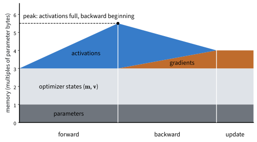

# Memory and Precision
:label:`sec_memory_precision`

The preceding sections focused on execution time. This section considers
device-memory capacity. Parameters, optimizer states, saved activations, and
the minibatch must all fit simultaneously during training. Their sizes can
be estimated before execution and compared with runtime measurements.

We study three methods for reducing the limiting allocation. Lower-precision
formats reduce tensor size and can increase throughput. Activation
checkpointing recomputes selected activations during backpropagation instead
of storing them. Gradient accumulation preserves the effect of a larger
batch while processing smaller microbatches.

*Prerequisites: the format ladder and tensor-core requirement of*
:numref:`sec_hardware`*; the* `d2l.Benchmark` *timer of*
:numref:`sec_perf_model`*; the AdamW optimizer states of*
:numref:`sec_adam`*. This section finally discharges the "gradient
accumulation, returned to in the performance chapter" promise of*
:numref:`sec_minibatch_sgd`*.*

```{.python .input #memory-precision-memory-and-precision}
%%tab pytorch
%matplotlib inline
from d2l import torch as d2l
import torch
from torch import nn

torch.set_float32_matmul_precision('high')
```

```{.python .input #memory-precision-memory-and-precision}
%%tab jax
%matplotlib inline
from d2l import jax as d2l
import jax
from jax import numpy as jnp
import numpy as np
```

## Memory Components of a Training Step
:label:`subsec_mp-anatomy`

A training step holds four kinds of tensor in memory, and knowing their
sizes lets you predict the peak before you run anything
(:numref:`fig_memory_anatomy`). Let the model have $P$ parameters.

* **Parameters** — $P$ values. In mixed-precision training these are kept
  in fp32 (4 bytes) as the master copy: $4P$ bytes.
* **Gradients** — one per parameter, produced during the backward pass:
  another $4P$ bytes.
* **Optimizer states** — Adam keeps a first and second moment per
  parameter (:numref:`sec_adam`), $2 \times 4P = 8P$ bytes; plain SGD
  keeps none.
* **Activations** — every intermediate result the forward pass produces
  that the backward pass will need. Unlike the first three, this scales
  with the *batch* and the *depth*: roughly
  $\textrm{batch} \times \textrm{sequence} \times \textrm{width} \times
  \textrm{depth}$, and it is usually the term that blows up.


:label:`fig_memory_anatomy`

Add the constant terms: training a model with Adam costs about
$4P + 4P + 8P = 16P$ bytes *before a single activation* — sixteen bytes
per parameter, the number to carry in your head. (Mixed precision, below,
nudges this to roughly 18–20 by keeping some tensors in two formats; it
still saves memory overall, because activations, the dominant term,
halve.) The shape of :numref:`fig_memory_anatomy` is the other half of the
lesson: activations *accumulate* through the forward pass and are *freed*
as the backward pass consumes them, so peak memory occurs early in
backward — which is exactly the moment activation checkpointing will
target.

## Measuring Memory
:label:`subsec_mp-measuring`

The frameworks expose this memory allocation differently. PyTorch keeps
running *counters* you query at runtime; JAX lets the compiler *plan*
memory ahead of time and reports the plan. Start with PyTorch's counters,
the numbers the anatomy table predicts:

```{.python .input #memory-precision-measuring-memory-1}
%%tab pytorch
gpu = d2l.try_gpu()
net = nn.Sequential(*[nn.Linear(2048, 2048) for _ in range(6)]).to(gpu)
X = torch.randn(256, 2048, device=gpu)
opt = torch.optim.Adam(net.parameters())

torch.cuda.reset_peak_memory_stats()
opt.zero_grad(set_to_none=True)
net(X).sum().backward()
opt.step()
P = sum(p.numel() for p in net.parameters())
print(f'{P/1e6:.1f}M params  '
      f'predicted states+grads+params: {16 * P / 1e6:.0f} MB')
print(f'measured peak: {torch.cuda.max_memory_allocated() / 1e6:.0f} MB '
      f'allocated, {torch.cuda.max_memory_reserved() / 1e6:.0f} MB reserved')
```

The measured peak overshoots the $16P$ prediction by roughly 30%, and the
gap has an anatomy of its own: this stack's activations (about 13 MB),
autograd bookkeeping and cuBLAS workspaces, temporaries that the fused
optimizer update allocates (about the size of one more gradient set), and
the caching allocator's block rounding. The second printed number is
larger again: `max_memory_allocated` counts bytes inside live tensors,
while `max_memory_reserved` is the caching allocator's high-water mark —
the distinction :numref:`sec_use_gpu` dissects. So read $16P$ as this
*configuration's* floor — fp32 parameters under Adam — rather than as the
whole anatomy. Whether activations dominate the total is
workload-dependent, decided by batch, sequence length, and depth; in the
transformer regime they do.

For a finer picture, PyTorch can record every allocation and free as a
*snapshot*. Rather than embed its interactive viewer, we reconstruct the
one plot that matters — allocated bytes over the step — directly from the
recorded trace, and see the sawtooth of :numref:`fig_memory_anatomy` in
real data:

```{.python .input #memory-precision-measuring-memory-2}
%%tab pytorch
torch.cuda.memory._record_memory_history(max_entries=100000)
for _ in range(3):
    opt.zero_grad(set_to_none=True)
    net(X).sum().backward()
    opt.step()
snapshot = torch.cuda.memory._snapshot()
torch.cuda.memory._record_memory_history(enabled=None)

# Reconstruct cumulative allocated bytes from the allocation trace.
cum, series = 0, []
for ev in snapshot['device_traces'][0]:
    if ev['action'] == 'alloc':
        cum += ev['size']
    elif ev['action'] == 'free_completed':
        cum -= ev['size']
    series.append(cum / 1e6)
d2l.plot(list(range(len(series))), [series],
         'allocation event', 'allocated (MB)')
```

Each cycle is one training step: memory climbs through the forward pass as
activations accumulate, then falls through the backward pass as they are
released — exactly the anatomy, now measured. The JAX side plans instead
of counting. Ahead-of-time compilation (:numref:`sec_compilation`) hands
back an object whose `memory_analysis()` reports what the compiler
*decided* to allocate, before any memory is touched:

```{.python .input #memory-precision-measuring-memory-3}
%%tab jax
def loss_fn(params, X):
    h = X
    for W in params:
        h = jax.nn.relu(h @ W)
    return h.sum()

key = jax.random.PRNGKey(0)
params = [jax.random.normal(k, (2048, 2048)) * 0.02
          for k in jax.random.split(key, 6)]
X = jax.random.normal(key, (256, 2048))

compiled = jax.jit(jax.grad(loss_fn)).lower(params, X).compile()
a = compiled.memory_analysis()
print(f'compiler-planned temp memory: {a.temp_size_in_bytes / 1e6:.0f} MB')
print(f'argument + output: '
      f'{(a.argument_size_in_bytes + a.output_size_in_bytes) / 1e6:.0f} MB')
```

**PyTorch counts allocations as they occur, whereas XLA plans memory at
compile time.** Neither is better; they
reflect the eager-versus-traced split of :numref:`sec_compilation`, and
knowing which mental model your framework uses tells you where to look
when memory surprises you. Just do not compare the two frameworks' digits
head-to-head: a compiler's plan is not an allocator's high-water mark.

## Mixed Precision
:label:`subsec_mp-mixed`

The format comparison in :numref:`sec_hardware` shows that narrower
formats can increase supported tensor-core throughput and reduce stored
bytes. Mixed precision applies these effects selectively during training:
run the
compute-heavy operations (matmuls, convolutions) in bf16, where tensor
cores are fastest and activations are half-size, while keeping a few
numerically delicate things (the master weights, the loss reduction) in
fp32. On our Ada card the arithmetic win is real and robust — but only if
you know what your baseline is running, the lesson :numref:`sec_hardware`
flagged. Whether plain fp32 matmuls use the tensor cores' tf32 path is a
framework default: PyTorch ships with tf32 *off*, so an fp32 baseline that
leaves tf32 disabled understates baseline throughput
and overstates the apparent speedup; JAX on
this card runs tf32-class dot compute *by default*, so its naive baseline
is already fair — but is not the true fp32 it appears to be. We time all
three configurations, once, so the difference is unmistakable:

```{.python .input #memory-precision-mixed-precision}
%%tab pytorch
net = nn.Sequential(nn.Flatten(),
                    nn.Linear(64 * 64, 8192), nn.ReLU(),
                    nn.Linear(8192, 8192), nn.ReLU(),
                    nn.Linear(8192, 10)).to(gpu)
X = torch.randn(2048, 1, 64, 64, device=gpu)
y = torch.randint(0, 10, (2048,), device=gpu)
opt = torch.optim.SGD(net.parameters(), lr=0.01)
loss = nn.CrossEntropyLoss()

def step(autocast, dtype=None):
    opt.zero_grad(set_to_none=True)
    if autocast:
        with torch.autocast('cuda', dtype=dtype):
            l = loss(net(X), y)
    else:
        l = loss(net(X), y)
    l.backward(); opt.step()

torch.set_float32_matmul_precision('highest')  # Unfair baseline: tf32 off
print(d2l.Benchmark(lambda: step(False), desc='fp32 (tf32 off)'))
torch.set_float32_matmul_precision('high')     # Fair baseline: tf32 on
print(d2l.Benchmark(lambda: step(False), desc='tf32'))
print(d2l.Benchmark(lambda: step(True, torch.bfloat16), desc='bf16 autocast'))
```

```{.python .input #memory-precision-mixed-precision}
%%tab jax
def net_fn(params, X, dtype):
    h = X.reshape(X.shape[0], -1).astype(dtype)
    for W in params[:-1]:
        h = jax.nn.relu(h @ W.astype(dtype))
    return h @ params[-1].astype(dtype)

key = jax.random.PRNGKey(0)
sizes = [(64 * 64, 8192), (8192, 8192), (8192, 10)]
params = [jax.random.normal(k, s) * 0.02
          for k, s in zip(jax.random.split(key, 3), sizes)]
X = jax.random.normal(key, (2048, 64 * 64))

def loss_fn(params, dtype):
    return (net_fn(params, X, dtype) ** 2).sum()

grad_fn = jax.jit(jax.grad(loss_fn), static_argnums=1)
with jax.default_matmul_precision('highest'):  # Unfair baseline: tf32 off
    print(d2l.Benchmark(lambda: grad_fn(params, jnp.float32),
                        desc='fp32 (tf32 off)'))
# The default on this card is tf32-class compute -- the fair baseline
print(d2l.Benchmark(lambda: grad_fn(params, jnp.float32), desc='tf32'))
print(d2l.Benchmark(lambda: grad_fn(params, jnp.bfloat16), desc='bf16'))
```

Against the fair tf32 baseline, bf16 runs about one and a half to two
times as fast here — the exact ratio is framework- and shape-dependent —
and the three timings show the same two-step effect in both tabs: moving
true fp32 dots onto the tf32 tensor cores already yields a sizable change,
and bf16 then adds at least as much again. Both are genuine tensor-core
wins, not measurement artifacts.
Note what the PyTorch tab does *not* use: a `GradScaler`. Loss scaling
exists to keep tiny fp16 gradients from underflowing fp16's narrow
5-bit-exponent range; bf16 shares fp32's 8-bit exponent
(:numref:`fig_float_formats`), so its gradients do not underflow and no
scaler is needed. fp16 with `GradScaler` remains relevant for pre-Ampere hardware and is
examined in an exercise. The JAX tab shows that precision is *explicit*: dtypes are passed through
the computation, and `jax.default_matmul_precision` sets how fp32
dots are *computed* (true fp32 versus tf32-class tensor-core compute)
without changing what any tensor *stores*. On this card JAX's default
matches `'high'`, tf32-class, bit for bit — which is why the middle
timing is the fair baseline. PyTorch decides per-operation what to cast;
JAX makes you say it. Both land on the same design point: bf16 halves the
bytes and doubles the tensor-core rate.

## Activation Checkpointing
:label:`subsec_mp-checkpointing`

Mixed precision halves activation memory; activation checkpointing can cut
it much further, by refusing to *store* most activations at all. Recall
from :numref:`fig_memory_anatomy` that activations are held from the
moment the forward pass produces them until the backward pass consumes
them — that storage is the peak. Checkpointing makes a different trade:
store only a few activations (at block boundaries), and when the backward
pass needs the ones in between, *recompute them* by re-running that block's
forward pass. This adds recomputation — at most one extra forward pass — to
avoid holding a large fraction of the activations; the cells below
measure both sides of the trade. This is the same
"recompute rather than store" argument the
Mamba kernel of :numref:`sec_mamba` made one level down in the hardware
:cite:`Chen.Xu.Zhang.ea.2016`.

```{.python .input #memory-precision-activation-checkpointing}
%%tab pytorch
from torch.utils.checkpoint import checkpoint

class Block(nn.Module):
    def __init__(self, d=1024):
        super().__init__()
        self.net = nn.Sequential(nn.Linear(d, d), nn.GELU(), nn.Linear(d, d))
    def forward(self, x):
        return x + self.net(x)

blocks = nn.ModuleList([Block().to(gpu) for _ in range(16)])
X = torch.randn(16384, 1024, device=gpu, requires_grad=True)

def run(use_ckpt):
    h = X
    for blk in blocks:
        # use_reentrant=False is the modern, mandatory-since-2.9 form
        h = checkpoint(blk, h, use_reentrant=False) if use_ckpt else blk(h)
    return h.sum()

for use_ckpt in (False, True):
    for p in blocks.parameters():  # clear grads so the peaks are comparable
        p.grad = None
    X.grad = None
    torch.cuda.reset_peak_memory_stats()
    run(use_ckpt).backward()
    peak = torch.cuda.max_memory_allocated() / 1e6
    t = d2l.Benchmark(lambda: run(use_ckpt).backward()).time
    tag = 'checkpointed' if use_ckpt else 'store all'
    print(f'{tag}: peak {peak:.0f} MB, fwd+bwd {1000 * t:.1f} ms')
```

```{.python .input #memory-precision-activation-checkpointing}
%%tab jax
def block(W1, W2, x):
    return x + jax.nn.gelu(x @ W1) @ W2

key = jax.random.PRNGKey(1)
ks = jax.random.split(key, 32)             # one key per weight matrix
Ws = [(jax.random.normal(ks[2 * i], (1024, 1024)) * 0.02,
       jax.random.normal(ks[2 * i + 1], (1024, 1024)) * 0.02)
      for i in range(16)]
X = jax.random.normal(key, (16384, 1024))

# jax.checkpoint (a.k.a. remat) recomputes the block in the backward pass.
ckpt_block = jax.checkpoint(block)
def forward(Ws, X, blk):
    h = X
    for W1, W2 in Ws:
        h = blk(W1, W2, h)
    return (h ** 2).sum()

for name, blk in [('store all', block), ('checkpointed', ckpt_block)]:
    compiled = jax.jit(jax.grad(forward), static_argnums=2).lower(
        Ws, X, blk).compile()
    mb = compiled.memory_analysis().temp_size_in_bytes / 1e6
    t = d2l.Benchmark(lambda: compiled(Ws, X)).time
    print(f'{name}: compiler temp {mb:.0f} MB, fwd+bwd {1000 * t:.1f} ms')
```

Checkpointing releases about 2 GB of held activations on this 16-block
stack — the measured peak falls by nearly half in the allocator's count
and by more than half in the compiler's plan — and the completion-timed
step runs only about 15–20% longer, comfortably under the one-extra-forward bound, since the
backward pass dominates the step. It is a trade you make when memory is
the binding constraint: checkpointing normally costs time, and its
purpose is memory (the rare configurations where recomputation beats a
cache-hostile stash do not change the rule). JAX exposes the same
mechanism as `jax.checkpoint` (equivalently `jax.remat`), with a nicer
knob: policies like `checkpoint_dots` let you say *which* intermediates to
keep, and `jax.remat`'s companion tools let you *watch* what was saved —
the introspection theme JAX does uniquely well. The trade is identical;
the interface reflects each framework's temperament, imperative versus
declarative.

## Gradient Accumulation
:label:`subsec_mp-accumulation`

The final technique buys the *statistical* effect of a large batch without
its memory cost — and discharges a promise made all the way back in
:numref:`sec_minibatch_sgd`. A large batch improves gradient estimates and
tensor-core utilization (its intensity is higher, :numref:`sec_perf_model`),
but a large batch's activations may not fit. Gradient accumulation splits
the desired *global* batch into $k$ *micro-batches*, runs forward and
backward on each while *summing* the gradients, and only then takes one
optimizer step. The activations of just one micro-batch are live at a
time, so peak memory follows the micro-batch, while the update sees the
full global batch: $B_{\textrm{global}} = B_{\textrm{micro}} \times k$
(times the number of devices, once :numref:`sec_multi_gpu` adds them).
Correctness requires accumulation over $k$ micro-batches to match one
full-batch step, which the following parity check verifies.

```{.python .input #memory-precision-gradient-accumulation}
%%tab pytorch
net = nn.Linear(1024, 1).to(gpu)
X = torch.randn(128, 1024, device=gpu)
y = torch.randn(128, 1, device=gpu)
loss = nn.MSELoss()

# Full batch: one backward over all 128 rows.
net.zero_grad()
loss(net(X), y).backward()
full = net.weight.grad.clone()

# Accumulated: 4 micro-batches of 32, gradients summed, scaled by 1/4.
net.zero_grad()
for i in range(4):
    xb, yb = X[i * 32:(i + 1) * 32], y[i * 32:(i + 1) * 32]
    (loss(net(xb), yb) / 4).backward()   # /4 because MSE already averages
accumulated = net.weight.grad.clone()
print(f'max gradient difference: {(full - accumulated).abs().max():.2e}')
```

```{.python .input #memory-precision-gradient-accumulation}
%%tab jax
W = jax.random.normal(jax.random.PRNGKey(0), (1024, 1))
X = jax.random.normal(jax.random.PRNGKey(1), (128, 1024))
y = jax.random.normal(jax.random.PRNGKey(2), (128, 1))

def mse(W, X, y):
    return ((X @ W - y) ** 2).mean()

full = jax.grad(mse)(W, X, y)
acc = sum(jax.grad(mse)(W, X[i * 32:(i + 1) * 32], y[i * 32:(i + 1) * 32])
          for i in range(4)) / 4
print(f'max gradient difference: {jnp.abs(full - acc).max():.2e}')
```

The gradients match to floating-point noise. The one subtlety is the
averaging: if your loss already averages over the batch (as MSE and
cross-entropy do), each micro-batch gradient must be scaled by $1/k$ so
the sum reproduces the mean. The equivalence also rests on conditions
this tiny example satisfies silently: an additive per-example loss,
equal-size micro-batches (or a properly weighted mean), the same dropout
and RNG draws, no batch-coupled state such as BatchNorm — whose
statistics would be computed per micro-batch — and clipping or optimizer
steps applied only at the global boundary. Accumulation is the right tool
when you are memory-bound and want a bigger *effective* batch; it is the
wrong tool when you want to go faster: the arithmetic is identical but
arrives as more launches over smaller, lower-intensity GEMMs, so by this
chapter's own accounting it is usually slightly *slower* — it only
rearranges *when* the optimizer step happens.

## Choosing a Memory Optimization
:label:`subsec_mp-ladder`

When a model does not fit or runs too slowly, consider the following
interventions in increasing order of cost:

1. **It's slow, bandwidth- or overhead-bound** → compile it
   (:numref:`sec_compilation`). Usually free.
2. **It's slow, compute-bound, or it's tight on memory** → drop to bf16
   (mixed precision). Around $1.5$–$2\times$ speed and half the
   activation bytes.
3. **It still doesn't fit** → checkpoint activations. Large memory saving
   for a modest increase in time.
4. **It still doesn't fit, and you want a bigger effective batch** →
   accumulate gradients. Bigger effective batch at micro-batch memory —
   about the same wall-clock, never faster.
5. **It's still too slow, or genuinely too big for one card** → add
   devices (:numref:`sec_multi_gpu`).

The next section analyzes the additional accounting required when devices
are added.

## Summary

* A training step's memory is parameters ($4P$) + gradients ($4P$) +
  optimizer states (Adam: $8P$) + activations (batch × depth × width, the
  term that explodes). About $16P$ bytes before activations; peak lands
  early in the backward pass.
* PyTorch measures memory with runtime counters and allocation snapshots;
  JAX reports the compiler's ahead-of-time memory *plan*. Counting versus
  planning — the eager-versus-traced split again.
* Mixed-precision bf16 raises tensor-core throughput (1.5–2× over a fair
  tf32 baseline here, framework- and shape-dependent) and halves
  activation bytes; measure it against that *fair* tf32 baseline — the
  frameworks' fp32 defaults differ — and skip the `GradScaler` (bf16
  shares fp32's exponent range — only fp16 needs loss scaling).
* Activation checkpointing recomputes instead of stores: peak memory cut
  roughly in half or better on a deep stack (about 2 GB of activations
  released) for about 15–20% more step time here. It normally costs time; its
  purpose is memory — use it when memory binds.
* Gradient accumulation reaches a large *effective* batch at micro-batch
  memory cost — $B_{\textrm{global}} = B_{\textrm{micro}} \times k$ — at
  the same wall-clock; scale per-micro-batch losses by $1/k$ when the loss
  already averages.

## Exercises

1. **Where the peak lands.** :numref:`fig_memory_anatomy` places the peak
   of a training step early in the backward pass. Consider a stack of $n$
   identical layers. The parameters of each layer occupy $w$ bytes, and its
   forward pass stores $a$ bytes of activations. Assume that no gradients
   exist when the backward pass starts, and that the backward pass of a
   layer frees the activations of that layer and creates its parameter
   gradient of $w$ bytes. Leave out the parameters and the optimizer
   states, whose sizes stay constant.
    1. Write the bytes held by activations and gradients after the backward
       pass has processed $j$ of the $n$ layers. Show that the peak lies at
       the start of the backward pass when $a > w$ and at its end when
       $a < w$.
    1. Count as activations only the input of each linear layer, and ignore
       the biases. Which of the two cases holds for the six-layer stack of
       :numref:`subsec_mp-measuring` at its batch size of 256, and at which
       batch size does the stack switch to the other case?
    1. Under gradient accumulation over $k$ micro-batches, the gradients of
       the first micro-batch stay allocated while the later micro-batches
       run. Find the peak with accumulation, and the values of $k$ for which
       accumulation lowers the peak below that of a single step on the full
       batch.

:begin_tab:`pytorch`
2. [code] **Optimizer-step memory.** :numref:`subsec_mp-measuring`
   attributes part of the 30% gap between the measured peak and $16P$ to
   temporaries of the optimizer update. Rebuild `net`, `X`, and `opt` of
   that subsection three times: with `torch.optim.Adam(net.parameters(),
   foreach=False)`, with the default arguments, and with `fused=True`.
    1. Run two training steps with each optimizer. On the second step,
       record `torch.cuda.memory_allocated()` just before `opt.step()`,
       reset the peak statistics, and record
       `torch.cuda.max_memory_allocated()` after `opt.step()`. Express the
       extra bytes of each update in units of the gradient size $4P$.
    1. The three implementations update one parameter tensor at a time,
       apply each elementwise operation to all parameter tensors at once,
       or run the whole update in one kernel per group of tensors. Explain
       the three measurements from this difference, and state which part of
       the 30% gap they account for.
:end_tab:

:begin_tab:`jax`
2. [code] **Optimizer-step memory.** A JAX training step returns new
   parameters and optimizer states instead of updating them in place.
   Extend the compiled gradient of :numref:`subsec_mp-measuring` into a
   full Adam step, a function of `params`, the optimizer state, and `X`
   that returns the updated parameters and the updated optimizer state.
    1. Compile the step and report `argument_size_in_bytes`,
       `output_size_in_bytes`, and `temp_size_in_bytes` of its
       `memory_analysis()` in units of the parameter size $4P$. Estimate
       the peak memory of one step from these numbers.
    1. Compile the step again with `donate_argnums` covering the
       parameters and the optimizer state, and report
       `alias_size_in_bytes` as well. How does the estimated peak change,
       and how does it compare with $16P$?
:end_tab:

3. [code] **Recomputation overhead.** :numref:`subsec_mp-checkpointing`
   bounds the extra work of per-block checkpointing by one forward pass,
   and it measures about 15–20% more step time on its 16-block stack.
    1. Suppose that a backward pass costs twice the FLOPs of the
       corresponding forward pass and that time is proportional to FLOPs.
       Predict the time overhead if the recomputation repeats the whole
       forward pass of every block.
    1. Time the forward pass of the stack alone and its
       forward-plus-backward step without checkpointing, and predict the
       overhead again from the two measured times. Compare both
       predictions with the measured overhead.
    1. List the tensors that the backward pass of one block reads, and the
       operations of the block that are needed to recompute them. Predict
       the overhead from this count, and explain the measured overhead.

1. **Clipping under accumulation.** Gradient clipping to norm $\tau$
   replaces a gradient $\mathbf{g}$ by
   $\mathbf{g} \min(1, \tau / \|\mathbf{g}\|)$. Let
   $\mathbf{g}_1, \ldots, \mathbf{g}_k$ be the micro-batch gradients
   after the scaling by $1/k$ of :numref:`subsec_mp-accumulation`, so that
   their sum $\mathbf{g}$ is the full-batch gradient.
    1. A training loop clips each $\mathbf{g}_i$ before adding it to the
       accumulator. Find the largest norm that the accumulated gradient can
       reach, and a condition under which the loop gives the same result as
       clipping $\mathbf{g}$ once before the optimizer step.
    1. Under fp16 loss scaling with factor $S$, the accumulator holds
       $S \mathbf{g}$ once the last micro-batch has been added. In which
       order must the loop divide by $S$, clip, and step? What goes wrong
       if it clips before dividing, and what goes wrong if $S$ changes
       before the last micro-batch has been added?

    *Adapted from the PyTorch documentation,
    [Automatic Mixed Precision examples](https://docs.pytorch.org/docs/stable/notes/amp_examples.html),
    sections "Gradient clipping" and "Gradient accumulation".*

1. [code] **Second copy of the weights.** ● Mixed precision keeps some
   tensors in two formats (:numref:`subsec_mp-anatomy`), and its memory
   saving rests on the activations being the dominant term.
    1. For the network of :numref:`subsec_mp-mixed` at its batch size of
       2048, list the tensors that the backward pass keeps in the tf32
       configuration and in the bf16 configuration. Decide for each 16-bit
       copy of a weight matrix whether the backward pass needs it. Predict
       which configuration has the higher peak, and find the batch size
       above which the bf16 configuration has the lower one.
    1. Measure the peak of the computation that :numref:`subsec_mp-mixed`
       times, in both configurations and at batch sizes 2048 and 16384, and
       compare the measurements with your predictions.
    1. A model with $P = 1.3 \times 10^9$ parameters is trained with AdamW
       on a card with $24 \times 10^9$ bytes of memory. Compare the memory
       left for activations under fp32 training, at $16P$ bytes, and under
       mixed precision, at $18P$ bytes. Name two changes to the optimizer
       or to the storage formats that leave more room for activations, and
       state what each change gives up.

:begin_tab:`pytorch`
6. [code] **fp16 gradient window.** ● The 5-bit exponent of fp16
   (:numref:`fig_float_formats`) gives it normal numbers from $2^{-14}$ to
   65,504 and subnormal numbers down to $2^{-24}$. Loss scaling
   :cite:`Micikevicius.Narang.Alben.ea.2018` multiplies the loss by a
   factor $S$ before the backward pass and divides the gradients by $S$
   afterwards. Use `net`, `X`, `y`, and `loss` as defined in
   :numref:`subsec_mp-mixed`, and take as reference the fp32 parameter
   gradients computed under `torch.set_float32_matmul_precision('highest')`.
    1. Plot a histogram of $\log_2 |g|$ over the nonzero entries $g$ of
       the reference gradients. Which fractions of the entries lie below
       $2^{-14}$ and below $2^{-24}$, and which factors $S$ place 99.9% of
       the scaled entries $S g$ in the normal range of fp16?
    1. For $S = 2^0, 2^2, \ldots, 2^{24}$, compute the gradients of $S$
       times the loss under `torch.autocast('cuda', dtype=torch.float16)`,
       divide them by $S$, and plot their relative error
       $\|\hat{\mathbf{g}} - \mathbf{g}\| / \|\mathbf{g}\|$ with respect
       to the reference $\mathbf{g}$, marking the runs with non-finite
       entries. Repeat the sweep with `torch.bfloat16`. In which range of
       $S$ is fp16 more accurate than bf16, and why is that possible?
    1. `torch.amp.GradScaler` starts at $S = 2^{16}$. Where does this
       factor lie in the window of the previous sub-problem? The gradient
       of the loss with respect to a logit is the difference between the
       predicted and the target probability, divided by the batch size of
       2048. How does the window move if the batch grows to 32,768
       examples? Explain why a static loss scale that works for one
       workload can fail for another.
:end_tab:

:begin_tab:`jax`
6. [code] **fp16 gradient window.** ● The 5-bit exponent of fp16
   (:numref:`fig_float_formats`) gives it normal numbers from $2^{-14}$ to
   65,504 and subnormal numbers down to $2^{-24}$. Loss scaling
   :cite:`Micikevicius.Narang.Alben.ea.2018` multiplies the loss by a
   factor $S$ before the backward pass and divides the gradients by $S$
   afterwards. Use `params`, `X`, and `net_fn` as defined in
   :numref:`subsec_mp-mixed`, and draw random integer labels for the 10
   outputs. Replace the loss by $S$ times the mean cross-entropy of the
   logits cast to fp32, as computed by
   `optax.softmax_cross_entropy_with_integer_labels`. Take as reference the
   fp32 gradients computed under `jax.default_matmul_precision('highest')`.
    1. Plot a histogram of $\log_2 |g|$ over the nonzero entries $g$ of
       the reference gradients. Which fractions of the entries lie below
       $2^{-14}$ and below $2^{-24}$, and which factors $S$ place 99.9% of
       the scaled entries $S g$ in the normal range of fp16?
    1. For $S = 2^0, 2^2, \ldots, 2^{24}$, compute the gradients with
       `jnp.float16` as the dtype of `net_fn`, divide them by $S$, and plot
       their relative error
       $\|\hat{\mathbf{g}} - \mathbf{g}\| / \|\mathbf{g}\|$ with respect
       to the reference $\mathbf{g}$, marking the runs with non-finite
       entries. Repeat the sweep with `jnp.bfloat16`. In which range of $S$
       is fp16 more accurate than bf16, and why is that possible?
    1. optax ships no automatic loss scaler. Choose a static factor $S$
       from the window of the previous sub-problem, and justify the choice.
       The gradient of the loss with respect to a logit is the difference
       between the predicted and the target probability, divided by the
       batch size of 2048. How does the window move if the batch grows to
       32,768 examples? Explain why a static loss scale that works for one
       workload can fail for another.
:end_tab:

7. **Checkpoint placement.** ● Consider a stack of $n$ identical residual
   blocks, and measure memory in units of the input of one block. The
   backward pass of one block needs $c$ units of stored tensors, its input
   included. A schedule with segments of $s$ consecutive blocks stores only
   the input of each segment during the forward pass. During the backward
   pass it recomputes one segment at a time, while the stored inputs of the
   earlier segments remain in memory.
    1. Derive the peak activation memory as a function of $s$, and the $s$
       that minimizes it. Count $c$ for the block of
       :numref:`subsec_mp-checkpointing`, which applies a linear layer, a
       GELU, and a second linear layer on a residual connection. For its 16
       blocks, compare storing everything, the per-block checkpointing of
       that subsection, and the best segment length. Check the saving of
       per-block checkpointing against the roughly 2 GB that the subsection
       reports.
    1. :citet:`Chen.Xu.Zhang.ea.2016` reduce the memory further by
       recursion. The schedule stores the input of the stack and the input
       of its second half, processes the second half recursively, and then
       processes the first half recursively from its stored input. For $n$
       a power of two, derive the peak memory and the total number of block
       forward evaluations, the original forward pass included. For
       $n = 16$ and $n = 1024$, compare both quantities with those of the
       best segment length.

:begin_tab:`pytorch`
8. [code] **Selective recomputation.** ● Per-block checkpointing
    stores only the input of each block. The function
    `torch.utils.checkpoint.create_selective_checkpoint_contexts`, passed
    to `checkpoint` through its `context_fn` argument, instead caches the
    outputs of chosen operations during the forward pass and recomputes
    the remaining operations. Its policy function receives each operation
    together with its arguments. Each `nn.Linear` of `Block` dispatches to
    `torch.ops.aten.addmm.default`.
    1. For one `Block`, list the tensors stored between the forward and
       the backward pass, and the matrix multiplications that the backward
       pass recomputes, under four policies: no checkpointing, per-block
       checkpointing, caching the outputs of every `addmm`, and caching
       only the output of the first `addmm`.
    1. Implement the last two policies for the 16-block stack of
       :numref:`subsec_mp-checkpointing`, measure peak memory and step time
       as that subsection does, and compare all four policies with your
       predictions.
:end_tab:

:begin_tab:`jax`
8. [code] **Selective recomputation.** ● `jax.checkpoint` accepts a
    `policy` argument that names the intermediate values it may save, and
    `jax.checkpoint_policies.checkpoint_dots` saves the outputs of matrix
    multiplications and recomputes everything else.
    1. For one call of `block`, list the values stored between the forward
       and the backward pass, and the matrix multiplications that the
       backward pass recomputes, under three configurations: `block`
       itself, `jax.checkpoint(block)`, and `jax.checkpoint(block,
       policy=jax.checkpoint_policies.checkpoint_dots)`.
    1. Add the third configuration to the measurement of
       :numref:`subsec_mp-checkpointing`, and compare the compiler temp
       memory and the step time of all three configurations with your
       predictions.
:end_tab:

9. [code] **Cost of accumulation.** ● Split the global batch of 2048
   examples of the bf16 configuration of :numref:`subsec_mp-mixed` into $k$
   equal micro-batches, and accumulate their gradients, for
   $k = 1, 2, 4, \ldots, 64$.
    1. Let the network have $P$ parameters. A micro-batch of
       $B_{\textrm{micro}}$ examples performs about
       $6 P B_{\textrm{micro}}$ FLOPs in its forward and backward passes,
       and it moves at least $12P$ bytes: it reads the bf16 weights in each
       of the two passes, and it reads and writes the fp32 gradient
       accumulator. Ignore the activations. Write the peak compute of
       :eqref:`eq_roofline` as $F$ here, because $P$ counts parameters, and
       take $F$ and $\beta$ from the RTX 4090 column of
       :numref:`tab_gpu_specs`. Predict the time per global batch as a
       function of $k$, and find the $k$ beyond which the micro-batches are
       bandwidth-bound.
    1. Measure the time per global batch for every $k$, and plot it
       together with the prediction. Identify the weight and gradient
       traffic of the bf16 configuration that the count of $12P$ bytes
       leaves out.
    1. Suppose that activation checkpointing let each micro-batch hold four
       times as many examples, at the price of a third more FLOPs. Under the
       model of the first sub-problem, for which $k \geq 4$ of the sweep
       does accumulation over $k/4$ checkpointed micro-batches take less
       time than accumulation over $k$ plain ones?

1. [extended] **GPT-2 on one card.** ●● The GPT-2 configuration of
   :numref:`subsec_gpt-loading` has width $d = 768$, 12 blocks with
   $n_h = 12$ attention heads, a vocabulary of $V = 50{,}257$ tokens, and
   $P = 124.4$ million parameters. It is trained with AdamW on sequences of
   $T = 1024$ tokens, on a card with $24 \times 10^9$ bytes of memory.
   Following the count of :citet:`Korthikanti.Casper.Lym.ea.2022`, a block
   without dropout stores $16d$ values per token, and an attention that
   materializes its score matrices stores another $n_h T$ values per token.
   These values take 4 bytes each in fp32 training and 2 bytes each under
   mixed precision. In both regimes the cross-entropy loss stores the
   logits as $V$ fp32 values per token.
    1. Compute the activation bytes per sequence of the 12 blocks, with a
       fused and with a materializing attention, in both regimes, and the
       bytes per sequence of the logits. Korthikanti et al. neglect the
       logits for models with tens of billions of parameters. What share of
       the activations do the logits take here, with a fused attention?
    1. Take $16P$ persistent bytes for fp32 training and $18P$ for mixed
       precision, and assume a fused attention. Predict the largest
       micro-batch, in sequences, for fp32 training, for mixed precision,
       and for mixed precision with per-block checkpointing. Per-block
       checkpointing keeps $d$ values per token for each block, plus the
       activations of one block during its recomputation. Which term limits
       the last configuration?
    1. Build `GPT` in this configuration with random weights, and measure
       the peak memory of fp32 training steps at micro-batches of 2, 4, and
       8 sequences. Fit the peak as a linear function of the micro-batch.
       At the start of the backward pass, the cross-entropy creates
       logits-sized gradients while the stored logits are still allocated.
       Count them for your training step, and add them to the bytes per
       sequence of the first sub-problem. Compare the slope with this count
       and the intercept with $16P$, and decide whether the attention
       stores its score matrices.
    1. Compute the output head and the loss in chunks of tokens, and
       checkpoint each chunk so that the logits of only one chunk exist at
       a time. With per-block checkpointing in both runs, find the largest
       fp32 micro-batch with the chunked loss and with the unchunked loss.
       For each run, split a global batch of 512 sequences into equal
       micro-batches no larger than its largest one, and measure the tokens
       per second of both schedules.

<!-- slides -->

::: {.slide title="Memory Components of a Training Step"}
{width=78%}

Params $4P$ + grads $4P$ + Adam states $8P$ = **$16P$ bytes
before activations**. Activations scale with batch×depth×width
and dominate; peak lands early in backward.
:::

::: {.slide title="Measuring: Count vs. Plan"}
@memory-precision-measuring-memory-2@pytorch

The sawtooth *is* the anatomy: grow in forward, shrink in
backward.

. . .

@memory-precision-measuring-memory-3@jax

PyTorch counts at runtime; XLA plans at compile time.
:::

::: {.slide title="Mixed Precision, Fairly Measured"}
@memory-precision-mixed-precision

fp32→tf32 is a config (opposite defaults: PyTorch off, JAX on);
tf32→bf16 adds ~1.5–2× more. No `GradScaler` for bf16 — it
shares fp32's exponent range. Only fp16 underflows and needs
loss scaling.
:::

::: {.slide title="Activation Checkpointing"}
Store a few activations; recompute the rest in backward.

@memory-precision-activation-checkpointing

Peak memory cut roughly in half or better (~2 GB of activations
released) for ~15–20% more time. Same trade as Mamba's recompute-in-kernel
(§12), one level up. It reduces memory at the cost of additional compute;
use it when memory capacity is the limiting resource.
:::

::: {.slide title="Gradient Accumulation"}
$B_{\textrm{global}} = B_{\textrm{micro}} \times k$: split the
batch, sum the gradients, step once.

@memory-precision-gradient-accumulation

Gradients match a full-batch step to noise (scale by $1/k$ for
mean-losses). Big *effective* batch at micro-batch memory —
≈ same wall-clock, never faster.
:::

::: {.slide title="Choosing a Memory Optimization"}
1. slow (bandwidth/overhead) → **compile** (measure compilation overhead)
2. slow (compute) or tight → **bf16** (~1.5–2×, half the bytes)
3. doesn't fit → **checkpoint** (large memory cut, modest time)
4. want a bigger batch → **accumulate** (≈ same wall-clock)
5. still too slow / too big → **more devices** (next)
:::
