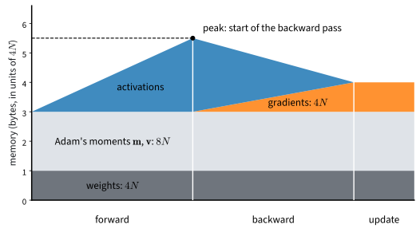

# Memory and Precision
:label:`sec_memory_precision`

The previous sections asked how fast a training step runs; a step that does not
fit in GPU memory does not run at all. Our 1B-parameter GPT trained with Adam
in fp32 stores four fp32 values per parameter—the weight, its gradient, and
Adam's two moment estimates—consuming $16N \approx 15.1$ GiB of a 24 GiB
RTX 4090 before reading a single token. The remaining ~9 GiB must hold the
*activations* saved by the forward pass for backpropagation, which take
several megabytes per token. As a result, only two or three sequences of 1,024
tokens fit on the card, whereas large language models train on global batches
of half a million to several million tokens :cite:`brown2020language`.

The memory of a training step consists of a fixed parameter term proportional
to $N$ and an activation term proportional to the number of tokens $n$. In
this section we count both for our GPT, verify the count against measured peak
memory, and study three techniques that act on the activation term or the
micro-batch size: *mixed precision* (computing in 16 bits), *activation
checkpointing* (recomputing activations during the backward pass instead of
storing them), and *gradient accumulation* (splitting a large global batch
into sequential micro-batches). None of the three shrinks the $16N$ bytes of
parameter state; dividing that state across GPUs is the subject of
:numref:`sec_sharding`.

```{.python .input #memory-precision-memory-and-precision}
%%tab pytorch
import math
import numpy as np
import torch
from torch import nn
from torch.nn import functional as F
from d2l import torch as d2l
```

```{.python .input #memory-precision-memory-and-precision}
%%tab jax
import math
import numpy as np
import jax
from jax import numpy as jnp
from flax import nnx
import optax
from d2l import jax as d2l
```

```{.python .input #memory-precision-memory-and-precision-1}
%%tab jax
import re
```

```{.python .input #memory-precision-memory-and-precision-1}
%%tab pytorch
import os
import re
from torch.utils.checkpoint import checkpoint
# Detach PyTorch's profiler from the GPU when a profile ends; without this,
# every kernel launch after the first profile stays about 30% slower
os.environ['TEARDOWN_CUPTI'] = '1'
```

## Memory of a Training Step
:label:`subsec_mp-anatomy`

### Memory per Parameter

Parameter memory depends on the optimizer: plain fp32 SGD stores a weight and
gradient (8 bytes/parameter), SGD with momentum adds a velocity (12 bytes),
and Adam stores two moment estimates (**16 bytes/parameter**,
:numref:`subsec_memory_during_training`). Mixed-precision training keeps all
four in fp32 and holds a 16-bit weight copy during the step (**18
bytes/parameter**).

Our reference model is `d2l.GPT` (:numref:`sec_gpt`) with width $d = 2048$, 16
heads, $L = 18$ pre-norm SwiGLU blocks, vocabulary $V = 50{,}257$, and learned
positional embeddings. Each block holds ~$12d^2 \approx 50$M parameters
(~0.9B across 18 blocks, plus ~0.1B in the tied token embedding). Inspecting
the model on a meta/shape-only device confirms $N$ without allocating 4 GB of
weights (:numref:`subsec_count_without_alloc`):

```{.python .input #memory-precision-memory-per-parameter}
%%tab pytorch
config = dict(vocab_size=50257, num_hiddens=2048, num_heads=16,
              num_blks=18, pos='learned')
with torch.device('meta'):  # Shapes and dtypes only, no data
    model = d2l.GPT(**config)
N = d2l.num_params(model)
print(f'{N / 1e9:.2f} billion parameters, 16N = {16 * N / 2**30:.1f} GiB')
```

```{.python .input #memory-precision-memory-per-parameter}
%%tab jax
config = dict(vocab_size=50257, num_hiddens=2048, num_heads=16,
              num_blks=18, pos='learned')
key = d2l.get_key()
model = nnx.eval_shape(lambda: d2l.GPT(**config, rngs=nnx.Rngs(key)))
N = d2l.num_params(model)
print(f'{N / 1e9:.2f} billion parameters, 16N = {16 * N / 2**30:.1f} GiB')
```

### Memory per Token

During the forward pass, layers save intermediate activations needed by the
backward pass; during the backward pass, these activations are freed layer by
layer as parameter gradients are produced (:numref:`fig_memory_anatomy`).
Memory therefore peaks at the start of the backward pass.


:label:`fig_memory_anatomy`

Three rules determine what a Transformer block saves for backpropagation:
1. A linear layer $\mathbf{y} = \mathbf{W}\mathbf{x}$ saves its input
   $\mathbf{x}$ (since $\nabla_{\mathbf{W}} = (\nabla_{\mathbf{y}})\mathbf{x}^\top$).
2. An elementwise nonlinearity $f$ saves its input or output.
3. An elementwise product $\mathbf{p} \odot \mathbf{q}$ saves both factors.

Counting per token in units of width $d = 2048$:
* **Attention sublayer:** Pre-attention RMSNorm saves its input ($d$); the QKV
  projection saves the normalized output ($d$); fused causal attention saves
  $\mathbf{Q}, \mathbf{K}, \mathbf{V}$ ($3d$) and its output ($d$, plus only a
  scalar log-normalizer per head and token instead of the $T \times T$ score
  matrix); the output projection saves the attention output ($0$ if aliased, or
  $d$ if copied when merging heads). Total: $6d\text{--}7d$.
* **SwiGLU FFN sublayer:** Pre-FFN RMSNorm saves its input ($d$); the gate and
  up-projections share the normalized output ($d$); $\textrm{SiLU}(\mathbf{g})
  \odot \mathbf{u}$ and the down-projection save the gate $\mathbf{g}$, the
  activated gate $\textrm{SiLU}(\mathbf{g})$, the up-projection $\mathbf{u}$,
  and their product—four vectors of width $\tfrac{8}{3}d \approx 10.7d$.
  Total: ~$12.7d$.

In total, one fused block saves $18.7d\text{--}19.7d \approx \mathbf{20d}$
values per token (**160 KiB** in fp32 at $d = 2048$; compare the $16d$ count
for un-gated GPT-3 blocks in :citet:`Korthikanti.Casper.Lym.ea.2022`). Because
fused attention recomputes its $T \times T$ weights on chip during the
backward pass, nothing in this count grows with sequence length $T$. Finally,
the cross-entropy loss saves $V = 50{,}257$ fp32 log-probabilities per token
(**196 KiB**)—more than an entire Transformer block.

We verify this tally by hooking into autograd (`saved_bytes`) and subtracting
counts across 1 and 2 sequences and across 1 and 2 blocks (so parameter memory
and head/loss memory separate cleanly).

```{.python .input #memory-precision-memory-per-token-1}
%%tab pytorch
def saved_bytes(f, *args):
    """Bytes of the tensors that autograd keeps for the backward pass of f."""
    storages = {}
    def pack(t):  # Called on every tensor saved for the backward pass
        storages[t.untyped_storage().data_ptr()] = (
            t.untyped_storage().nbytes())
        # A detached alias shares the storage. Returning t itself would form
        # a reference cycle between a saved output and the graph that made
        # it, and the graph, with all its tensors, would never be freed
        return t.detach()
    with torch.autograd.graph.saved_tensors_hooks(pack, lambda t: t):
        f(*args)
    return sum(storages.values())

def gpt_loss(model, X, bf16=False):
    """Cross-entropy of a GPT's predictions, with the inputs as targets."""
    with torch.autocast(X.device.type, torch.bfloat16, enabled=bf16):
        return F.cross_entropy(model(X).flatten(0, 1), X.flatten())
```

```{.python .input #memory-precision-memory-per-token-1}
%%tab jax
def saved_bytes(f, *args):
    """Bytes of the arrays that the backward pass of f keeps."""
    _, f_vjp = jax.vjp(f, *args)  # The leaves of f_vjp are the saved arrays
    return sum(x.nbytes for x in jax.tree_util.tree_leaves(f_vjp))

def gpt_loss(model, X):
    """Cross-entropy of a GPT's predictions, with the inputs as targets."""
    logits = model(X).astype(jnp.float32)
    return optax.softmax_cross_entropy_with_integer_labels(logits, X).mean()
```

```{.python .input #memory-precision-memory-per-token-2}
%%tab pytorch
def bytes_per_token(config, bf16=False, num_steps=1024):
    """Bytes stored per token by one block, and by the rest of a GPT."""
    gpu, per_token = d2l.try_gpu(), []
    for L in (1, 2):  # GPTs with one and with two blocks
        model = d2l.GPT(**{**config, 'num_blks': L}).to(gpu)
        X1, X2 = (torch.randint(0, config['vocab_size'], (b, num_steps),
                                device=gpu) for b in (1, 2))
        per_token.append((saved_bytes(gpt_loss, model, X2, bf16)
                          - saved_bytes(gpt_loss, model, X1, bf16))
                         / num_steps)
    return per_token[1] - per_token[0], 2 * per_token[0] - per_token[1]

block, head = bytes_per_token(config)
print(f'one block: {block / 2**10:.0f} KiB per token '
      f'({block / (4 * config["num_hiddens"]):.1f} fp32 values of width d)')
print(f'embedding, output layer, and loss: {head / 2**10:.0f} KiB per token')
```

```{.python .input #memory-precision-memory-per-token-2}
%%tab jax
def to_bf16(model):  #@save
    """Make the linear layers of `model` compute in bf16; parameters stay
    fp32."""
    for _, layer in nnx.iter_graph(model):
        if isinstance(layer, nnx.Linear):
            layer.dtype = jnp.bfloat16
    return model

def bytes_per_token(config, bf16=False, num_steps=1024):
    """Bytes stored per token by one block, and by the rest of a GPT."""
    per_token = []
    for L in (1, 2):  # GPTs with one and with two blocks
        model = d2l.GPT(**{**config, 'num_blks': L},
                        rngs=nnx.Rngs(d2l.get_key()))
        model = to_bf16(model) if bf16 else model
        # The structure, the weights, and the other state of the model;
        # nnx.merge puts them back together, so the loss is a function of
        # the weights
        graphdef, params, rest = nnx.split(model, nnx.Param, ...)
        loss = lambda params, X: gpt_loss(nnx.merge(graphdef, params, rest), X)
        X1, X2 = (jax.random.randint(d2l.get_key(), (b, num_steps), 0,
                                     config['vocab_size']) for b in (1, 2))
        per_token.append((saved_bytes(loss, params, X2)
                          - saved_bytes(loss, params, X1)) / num_steps)
    return per_token[1] - per_token[0], 2 * per_token[0] - per_token[1]

block, head = bytes_per_token(config)
print(f'one block: {block / 2**10:.0f} KiB per token '
      f'({block / (4 * config["num_hiddens"]):.1f} fp32 values of width d)')
print(f'embedding, output layer, and loss: {head / 2**10:.0f} KiB per token')
```

:begin_tab:`pytorch`
Because `scaled_dot_product_attention`, RMSNorm, and SiLU run as single fused
kernels, PyTorch stores exactly the theoretical minimum: $18.7d$ values (149
KiB) per block and 212 KiB for the embedding, output projection, and loss.
:end_tab:

:begin_tab:`jax`
Before XLA compilation, `jax.vjp` records $29.0d$ values (232 KiB) per block
because `nnx.RMSNorm` and `jax.nn.silu` are written as composite elementwise
expressions whose intermediate arrays remain in the raw VJP residuals (XLA's
compiler later fuses and recomputes many of them, as we verify below).
:end_tab:

### The Memory Budget

Combining parameter state ($16N$ bytes when gradients persist across
micro-batches) with $a$ bytes per token per block and $a_\textrm{out}$ bytes
per token for the embedding, output head, and loss yields the step memory
budget for $n$ tokens:

$$
M(n) \approx 16N + n \, (L a + a_\textrm{out}) \;\leq\; M_\textrm{GPU}.
$$
:eqlabel:`eq_mp-budget`

For our 18-block GPT on a 24 GiB card ($16N = 15.1$ GiB, leaving 8.9 GiB for
activations), the raw count predicts $La + a_\textrm{out} \approx 2.8$
MiB/token (~3,200 tokens, or 3 sequences of 1,024) in PyTorch and 4.3
MiB/token (~2,100 tokens, or 2 sequences) in JAX.

### Measured Peak Memory
:label:`subsec_mp-measuring`

To see what the backward pass temporarily allocates on top of saved
activations, we measure peak memory above the weights on a 2-block version of
our GPT across 1,024 to 8,192 tokens.

```{.python .input #memory-precision-measuring-memory-1}
%%tab pytorch
gpu, V = d2l.try_gpu(), config['vocab_size']
model = d2l.GPT(**{**config, 'num_blks': 2}).to(gpu)
gpt_loss(model, torch.randint(0, V, (1, 1024), device=gpu)).backward()
peaks = {}  # The step above was a warm-up
for n in (1024, 2048, 4096, 8192):  # Tokens per step, in sequences of 1,024
    X = torch.randint(0, V, (n // 1024, 1024), device=gpu)
    model.zero_grad(set_to_none=True)
    peaks[n] = d2l.peak_memory(lambda: gpt_loss(model, X).backward())
    print(f'{n:5d} tokens: peak {peaks[n] / 2**30:.2f} GiB above the weights')
for n in (2048, 4096):  # Growth per token from n to 2n tokens
    slope = (peaks[2 * n] - peaks[n]) / n
    print(f'{n:5d} to {2 * n:5d} tokens: measured {slope / 2**10:.0f} KiB '
          f'per token; counted {(2 * block + head) / 2**10:.0f} KiB')
```

```{.python .input #memory-precision-measuring-memory-3}
%%tab jax
key = d2l.get_key()
model = nnx.eval_shape(
    lambda: d2l.GPT(**{**config, 'num_blks': 2}, rngs=nnx.Rngs(key)))
graphdef, params, rest = nnx.split(model, nnx.Param, ...)
grad_fn = jax.jit(jax.grad(
    lambda params, rest, X: gpt_loss(nnx.merge(graphdef, params, rest), X)))
peaks = {}
for n in (1024, 2048, 4096, 8192):  # Tokens per step, in sequences of 1,024
    X = jax.ShapeDtypeStruct((n // 1024, 1024), jnp.int32)
    plan = grad_fn.lower(params, rest, X).compile().memory_analysis()
    peaks[n] = plan.output_size_in_bytes + plan.temp_size_in_bytes
    print(f'{n:5d} tokens: peak {peaks[n] / 2**30:.2f} GiB above the weights')
for n in (2048, 4096):  # Growth per token from n to 2n tokens
    slope = (peaks[2 * n] - peaks[n]) / n
    print(f'{n:5d} to {2 * n:5d} tokens: planned {slope / 2**10:.0f} KiB '
          f'per token; counted {(2 * block + head) / 2**10:.0f} KiB')
```

At the start of the backward pass, while all forward activations are still
live, the cross-entropy backward pass materializes the gradient with respect
to the log-probabilities and the gradient with respect to the logits—two
temporaries of $V = 50{,}257$ fp32 values per token ($8V \approx 393$ KiB/token
above the saved-tensor count).

:begin_tab:`pytorch`
We can visualize the entire allocation timeline of an Adam step on 4,096
tokens using PyTorch's allocator history API:
:end_tab:

```{.python .input #memory-precision-measured-peak-memory-1}
%%tab pytorch
X = torch.randint(0, V, (4, 1024), device=gpu)
opt = torch.optim.Adam(model.parameters())
gpt_loss(model, X).backward()  # A first step creates the moment estimates
opt.step()
opt.zero_grad(set_to_none=True)

# _snapshot, _record_memory_history and the keys of their records are a
# private API of PyTorch 2.11 and may change between versions
events = lambda: torch.cuda.memory._snapshot()['device_traces'][0]
start = torch.cuda.memory_allocated()
torch.cuda.memory._record_memory_history()  # Record from here on
loss = gpt_loss(model, X)
forward_end = len(events())
loss.backward()
backward_end = len(events())
opt.step()
opt.zero_grad(set_to_none=True)
trace = events()
torch.cuda.memory._record_memory_history(enabled=None)
```

```{.python .input #memory-precision-measuring-memory-2}
%%tab pytorch
sign = {'alloc': 1, 'free_completed': -1}  # Other actions change nothing
sizes = torch.tensor([sign.get(e['action'], 0) * e['size'] for e in trace])
series = ((start + sizes.cumsum(0)) / 2**30).tolist()
bounds = [0, forward_end, backward_end, len(trace)]
phases = list(zip(bounds[:-1], bounds[1:]))
d2l.plot([list(range(a, b)) for a, b in phases],
         [series[a:b] for a, b in phases], 'allocation event',
         'allocated (GiB)', legend=['forward', 'backward', 'optimizer step'])
```

:begin_tab:`pytorch`
The trace starts at $12N$ (weights and two Adam moments), climbs linearly
across the blocks during the forward pass, spikes at the logits and the start
of the backward pass, and steps down as activations are freed and gradients
are allocated.
:end_tab:

## Mixed Precision
:label:`subsec_mp-mixed`

Mixed-precision training (:numref:`sec_numerics`) keeps master weights,
gradients, optimizer moments, normalizations, the residual stream, and the
loss in fp32 while running matrix multiplications and intermediate activations
in 16-bit floating point (bf16, which shares fp32's 8-bit exponent range and
needs no loss scaling, or fp16 with loss scaling, :numref:`subsec_loss_scaling`).

Because the two residual-stream inputs to a block's normalizations stay in
fp32 (4 bytes) while the remaining 18 of the ~$20d$ saved values per block
drop to bf16 (2 bytes), a block's saved activations shrink to roughly
$(2 \cdot 4 + 18 \cdot 2) / (20 \cdot 4) = 0.55$ of their fp32 size:

```{.python .input #memory-precision-mixed-precision-1}
%%tab pytorch
block16, head16 = bytes_per_token(config, bf16=True)
print(f'one block: {block16 / 2**10:.0f} KiB per token in bf16, '
      f'{block16 / block:.2f} of fp32')
print(f'embedding, output layer, and loss: {head16 / 2**10:.0f} KiB per token')
```

```{.python .input #memory-precision-mixed-precision-1}
%%tab jax
block16, head16 = bytes_per_token(config, bf16=True)
print(f'one block: {block16 / 2**10:.0f} KiB per token in bf16, '
      f'{block16 / block:.2f} of fp32')
print(f'embedding, output layer, and loss: {head16 / 2**10:.0f} KiB per token')
```

One block drops to $0.58\text{--}0.60$ of its fp32 activation bytes. However,
holding bf16 copies of the weights during the step increases fixed parameter
memory from $16N = 15.1$ GiB to $18N = 17.0$ GiB, leaving only 7.0 GiB for
activations. The activation savings and extra weight copies largely offset
each other, expanding the maximum token capacity on a 24 GiB card by only
15–25%.

The primary benefit of bf16 mixed precision is speed rather than capacity: on
the RTX 4090, bf16 tensor cores run at 165 TFLOP/s, twice the 82.6 TFLOP/s of
tf32 and fp32. To separate the effect of tensor cores (tf32 vs. scalar fp32)
from the effect of 16-bit operands (bf16 vs. tf32), we benchmark one SGD step
of a compute-bound three-layer MLP of width 8,192 on a batch of 2,048 examples
($1.1 \times 10^{12}$ FLOPs/step: roofline floor 13.3 ms at 82.6 TFLOP/s and
6.7 ms at 165 TFLOP/s, plus ~1.3 ms for the bandwidth-bound SGD update).

```{.python .input #memory-precision-mixed-precision-2}
%%tab pytorch
sizes = [(64 * 64, 8192), (8192, 8192), (8192, 10)]  # (inputs, outputs)
mlp = nn.Sequential(nn.Linear(*sizes[0], bias=False), nn.ReLU(),
                    nn.Linear(*sizes[1], bias=False), nn.ReLU(),
                    nn.Linear(*sizes[2], bias=False)).to(gpu)
for layer in mlp[::2]:  # Weights drawn from N(0, 0.02^2)
    nn.init.normal_(layer.weight, std=0.02)
X_mlp = torch.randn(2048, 64 * 64, device=gpu)
y_mlp = torch.randint(0, 10, (2048,), device=gpu)
opt = torch.optim.SGD(mlp.parameters(), lr=0.01)

def step(bf16):
    with torch.autocast(X_mlp.device.type, torch.bfloat16, enabled=bf16):
        l = F.cross_entropy(mlp(X_mlp), y_mlp)
    l.backward()
    opt.step()
    opt.zero_grad(set_to_none=True)
```

```{.python .input #memory-precision-mixed-precision-2}
%%tab jax
def net_fn(params, X, dtype):
    h = X.astype(dtype)
    for W in params[:-1]:
        h = jax.nn.relu(h @ W.astype(dtype))
    return h @ params[-1].astype(dtype)

sizes = [(64 * 64, 8192), (8192, 8192), (8192, 10)]  # (inputs, outputs)
mlp_params = [jax.random.normal(k, s) * 0.02
              for k, s in zip(jax.random.split(d2l.get_key(), 3), sizes)]
X_mlp = jax.random.normal(d2l.get_key(), (2048, 64 * 64))
y_mlp = jax.random.randint(d2l.get_key(), (2048,), 0, 10)

def loss_fn(params, X, y, dtype):
    logits = net_fn(params, X, dtype).astype(jnp.float32)
    return optax.softmax_cross_entropy_with_integer_labels(logits, y).mean()

def sgd_step(params, X, y, dtype):
    grads = jax.grad(loss_fn)(params, X, y, dtype)
    return [p - 0.01 * g for p, g in zip(params, grads)]

step = jax.jit(sgd_step, static_argnums=3)
args = mlp_params, X_mlp, y_mlp
```

```{.python .input #memory-precision-mixed-precision-3}
%%tab pytorch, jax
# Two FLOPs per multiply-add, in the forward pass, the weight gradients, and
# the input gradients of every layer but the first
macs = sum(i * o for i, o in sizes)  # Per example and pass
flops = 2 * len(X_mlp) * (3 * macs - sizes[0][0] * sizes[0][1])
print(f'{flops:.2e} FLOPs per step')

def report(desc, f):
    """Print the time per call of f and the arithmetic rate it achieves."""
    t = d2l.Benchmark(f).time
    print(f'{desc}: {1000 * t:5.2f} ms, {flops / t / 1e12:3.0f} TFLOP/s')
```

```{.python .input #memory-precision-mixed-precision}
%%tab pytorch
torch.set_float32_matmul_precision('highest')  # True fp32
report('fp32', lambda: step(False))
torch.set_float32_matmul_precision('high')  # fp32 matmuls may use tf32
report('tf32', lambda: step(False))
report('bf16', lambda: step(True))
```

```{.python .input #memory-precision-mixed-precision}
%%tab jax
with jax.default_matmul_precision('highest'):  # True fp32
    report('fp32', lambda: step(*args, jnp.float32))
report('tf32', lambda: step(*args, jnp.float32))
report('bf16', lambda: step(*args, jnp.bfloat16))
```

True fp32 on scalar units reaches ~60% of its 82.6 TFLOP/s peak because every
multiply-add and address calculation competes for instruction issue slots;
tf32 on the tensor cores reaches ~90% of the same peak, cutting step time by
a third without changing stored types. Moving from tf32 to bf16 speeds up the
step by another $1.5\text{--}1.75\times$ (close to the $6.7 + 1.3 = 8.0$ ms
floor plus update, since the fp32 SGD update and weight casts do not shrink).

## Activation Checkpointing
:label:`subsec_mp-checkpointing`

To multiply the number of tokens that fit on a card, a step must store fewer
activations. *Activation checkpointing* (:numref:`subsec_activation_checkpointing`,
:cite:`Chen.Xu.Zhang.ea.2016`) saves only the input of each Transformer block
($d$ fp32 values, or $4d$ bytes per token) during the forward pass and
recomputes the block's internal activations one block at a time during the
backward pass. This trades one extra forward pass (~33% more compute, or $8N$
FLOPs/token instead of $6N$) for reducing peak per-token memory across $L$
blocks from $L a + a_\textrm{out} + \Delta$ to at most

$$
L \cdot 4d + a + a_\textrm{out} + \Delta,
$$

where $a$ is the single block currently being recomputed and $\Delta$ is the
backward temporary excess measured in :numref:`subsec_mp-measuring`.

```{.python .input #memory-precision-activation-checkpointing-1}
%%tab pytorch, jax
M_gpu, d, L = 24 * 2**30, config['num_hiddens'], config['num_blks']
slope = (peaks[8192] - peaks[4096]) / 4096  # Growth per token, measured
excess = slope - (2 * block + head)  # Measured peak above the count
budgets = {  # Configuration: (fixed bytes, bytes per token at the peak)
    'fp32, count': (16 * N, L * block + head),
    'fp32, measured': (16 * N, L * block + head + excess),
    'bf16, measured': (18 * N, L * block16 + head16 + excess),
    'fp32, checkpointing': (16 * N, L * 4 * d + block + head + excess),
    'bf16, checkpointing': (18 * N, L * 4 * d + block16 + head16 + excess)}
for name, (fixed, per_token) in budgets.items():  # M(n) <= M_gpu
    print(f'{name:19s}: {per_token / 2**20:.2f} MiB per token, room for '
          f'{(M_gpu - fixed) / per_token:6,.0f} tokens')
```

With per-block checkpointing, the 18 blocks together store only
$18 \times 8 = 144$ KiB/token—less than the output layer and loss alone—raising
the token budget more than threefold (~10,000 tokens in PyTorch, ~15,000 in
JAX). Notice that under checkpointing, bf16 actually fits slightly *fewer*
tokens than fp32 because the extra $2N$ bytes of bf16 weight copies outweigh
the activation savings on the single recomputed block. At that point, the
output logits and cross-entropy loss dominate per-token memory; computing the
output projection and loss in token chunks inside a checkpoint of its own
eliminates that bottleneck for only $2dV / (6N) \approx 3\%$ extra FLOPs
(Exercise :exref:`ex_mp-chunked-loss`).

Let us measure per-block checkpointing on a 4-block stack with two 1,024-token
sequences (which should store $5 \times 4d = 40$ KiB/token across the four
block inputs and final output):

```{.python .input #memory-precision-activation-checkpointing}
%%tab pytorch
blocks = d2l.GPT(**{**config, 'num_blks': 4}).to(gpu).blks
def stack(H, remat):
    for blk in blocks:
        H = checkpoint(blk, H, use_reentrant=False) if remat else blk(H)
    return H.square().mean()

d = config['num_hiddens']
H1, H2 = (torch.randn(b, 1024, d, device=gpu, requires_grad=True)
          for b in (1, 2))
for remat in (False, True):
    stored = (saved_bytes(stack, H2, remat)
              - saved_bytes(stack, H1, remat)) / 1024
    stack(H2, remat).backward()  # Warm-up; allocates the gradients
    peak = d2l.peak_memory(lambda: stack(H2, remat).backward())
    t = d2l.Benchmark(lambda: stack(H2, remat).backward()).time
    print(f'checkpointing={remat!s:5}: stores {stored / 2**10:4.0f} KiB per '
          f'token, peak {peak / 2**30:.2f} GiB, {1000 * t:.0f} ms per step')
```

```{.python .input #memory-precision-activation-checkpointing}
%%tab jax
blocks = [nnx.split(blk, nnx.Param, ...) for blk in d2l.GPT(
    **{**config, 'num_blks': 4}, rngs=nnx.Rngs(d2l.get_key())).blks]
blk_params = [p for _, p, _ in blocks]
def stack(params, H, remat):
    def block(graphdef, p, rest, H):  # A block as a function of its weights
        return nnx.merge(graphdef, p, rest)(H)
    if remat:
        # On a CPU, XLA's default scheduler runs the recomputations early,
        # so that they coexist and the saving vanishes; setting XLA_FLAGS to
        # --xla_cpu_enable_concurrency_optimized_scheduler=false before JAX
        # starts restores it there
        block = jax.checkpoint(block, static_argnums=0)
    for (graphdef, _, rest), p in zip(blocks, params):
        H = block(graphdef, p, rest, H)
    return (H ** 2).mean()

d = config['num_hiddens']
H1, H2 = (jax.random.normal(d2l.get_key(), (b, 1024, d)) for b in (1, 2))
for remat in (False, True):
    f = lambda params, H: stack(params, H, remat)
    stored = (saved_bytes(f, blk_params, H2)
              - saved_bytes(f, blk_params, H1)) / 1024
    stack_grad = jax.jit(jax.grad(f))
    peak = d2l.peak_memory(stack_grad, blk_params, H2)
    t = d2l.Benchmark(lambda: stack_grad(blk_params, H2)).time
    print(f'checkpointing={remat!s:5}: stores {stored / 2**10:4.0f} KiB per '
          f'token, peak {peak / 2**30:.2f} GiB, {1000 * t:.0f} ms per step')
```

Checkpointing reduces the saved tensors to the exact 40 KiB/token predicted,
cuts peak activation memory substantially, and lengthens step time by ~25%
(within the 33% bound of one extra forward pass). Instead of recomputing an
entire block, *selective recomputation* :cite:`Korthikanti.Casper.Lym.ea.2022`
saves the expensive matrix-multiplication outputs and recomputes only cheap
elementwise activations such as the SwiGLU gate product (Exercise
:exref:`ex_mp-selective`).

## Gradient Accumulation
:label:`subsec_mp-accumulation`

To reach a global batch $B_\textrm{global} = m \, B_\textrm{micro}$ of
hundreds of thousands of tokens without storing more activations, *gradient
accumulation* splits the global batch into $m$ sequential micro-batches,
accumulates their gradients (dividing each micro-batch mean loss by $m$), and
runs the optimizer once at the end.

While gradient accumulation performs the same arithmetic as a single large
batch, each micro-batch after the first reads the running gradient accumulator
and the new gradient and writes their sum ($12N$ bytes of memory traffic),
while the micro-batch itself performs $6Nn$ FLOPs on $n$ tokens. Relative to
peak compute time, this accumulator traffic costs

$$
\frac{12N / \beta}{6Nn / P} = \frac{2 I^*}{n},
$$

where $I^* = P/\beta$ is the ridge point (:numref:`sec_perf_model`). For tf32
($I^* = 82$) and micro-batches of $n = 1{,}024$ tokens, that overhead is ~16%
on each of the $m - 1$ accumulating micro-batches; at $n = 4{,}096$ tokens, it
drops to 4%.

We verify both numerical equivalence and memory/time overhead on our 2-block
GPT for 4,096 tokens processed as 1 batch versus $m = 4$ micro-batches of
1,024 tokens:

```{.python .input #memory-precision-accumulated-step}
%%tab pytorch
X = torch.randint(0, V, (4, 1024), device=gpu)  # 4,096 tokens per step

def accumulate(model, X, m):
    """Gradient of the loss on X in .grad, accumulated over m micro-batches."""
    model.zero_grad(set_to_none=True)
    for Xb in X.chunk(m):
        (gpt_loss(model, Xb) / m).backward()  # / m: the loss averages

accumulate(model, X, 1)
full = [p.grad.clone() for p in model.parameters()]  # One-batch gradient
for m in (1, 4):
    model.zero_grad(set_to_none=True)
    peak = d2l.peak_memory(accumulate, model, X, m)
    assert max((p.grad - g).norm() / g.norm()
               for p, g in zip(model.parameters(), full)) < 1e-2
    f = lambda: accumulate(model, X, m)
    times = 1000 * np.array([d2l.Benchmark(f).time for _ in range(5)])  # ms
    kernels = d2l.kernel_times(f)        # Device ms per step, per kernel
    busy = sum(kernels.values())
    products = sum(ms for name, ms in kernels.items()
                   if re.search(d2l.PRODUCT_KERNELS, name, re.I))
    print(f'{m} x {4096 // m:4d} tokens: peak {peak / 2**30:.2f} GiB above '
          f'the weights, {np.median(times):.0f} ms per step '
          f'({times.min():.0f} to {times.max():.0f}), device busy '
          f'{busy:.0f} ms\n{"":16s}matrix products {products:.0f} ms, '
          f'other kernels {busy - products:.0f} ms')
```

```{.python .input #memory-precision-accumulated-step}
%%tab jax
model = d2l.GPT(**{**config, 'num_blks': 2}, rngs=nnx.Rngs(d2l.get_key()))
graphdef, params, rest = nnx.split(model, nnx.Param, ...)
X = jax.random.randint(d2l.get_key(), (4, 1024), 0, config['vocab_size'])

def accumulate(params, rest, X, m):
    """Gradient of the loss on X, accumulated over m micro-batches."""
    loss = lambda params, Xb: gpt_loss(nnx.merge(graphdef, params, rest), Xb)
    def add(g, Xb):  # One micro-batch; / m because the loss averages
        g_b = jax.grad(loss)(params, Xb)
        return jax.tree.map(lambda a, b: a + b / m, g, g_b), None
    zeros = jax.tree.map(jnp.zeros_like, params)
    return jax.lax.scan(add, zeros, X.reshape(m, -1, X.shape[-1]))[0]

accumulate = jax.jit(accumulate, static_argnums=3)
full = accumulate(params, rest, X, 1)  # One-batch gradient
for m in (1, 4):
    plan = accumulate.lower(params, rest, X, m).compile().memory_analysis()
    peak = plan.output_size_in_bytes + plan.temp_size_in_bytes
    assert max(jax.tree.leaves(jax.tree.map(
        lambda a, b: jnp.linalg.norm(a - b) / jnp.linalg.norm(b),
        accumulate(params, rest, X, m), full))) < 1e-2
    f = lambda: accumulate(params, rest, X, m)
    times = 1000 * np.array([d2l.Benchmark(f).time for _ in range(5)])  # ms
    kernels = d2l.kernel_times(f)        # Device ms per step, per kernel
    busy = sum(kernels.values())
    products = sum(ms for name, ms in kernels.items()
                   if re.search(d2l.PRODUCT_KERNELS, name, re.I))
    print(f'{m} x {4096 // m:4d} tokens: peak {peak / 2**30:.2f} GiB above '
          f'the weights, {np.median(times):.0f} ms per step '
          f'({times.min():.0f} to {times.max():.0f}), device busy '
          f'{busy:.0f} ms\n{"":16s}matrix products {products:.0f} ms, '
          f'other kernels {busy - products:.0f} ms')
```

Peak memory above the weights drops by roughly half (since the $4N = 0.77$ GiB
of persistent gradients remain allocated across micro-batches while activation
memory drops fourfold), and step time increases by 10–20% due to accumulator
additions and slightly lower tensor-core efficiency on smaller micro-batches.
The optimal micro-batch is therefore always the largest one that fits in
memory.

## Choosing a Memory Technique
:label:`subsec_mp-ladder`

:numref:`tab_mp-techniques` summarizes the memory techniques by the symptom
that calls for each.

:Memory techniques by symptom, with their effect on :eqref:`eq_mp-budget` and their cost.
:label:`tab_mp-techniques`

| symptom | technique | effect on memory | cost |
|---|---|---|---|
| matrix products dominate step time | bf16 mixed precision | activations $\times 0.6$, fixed state $+2N$ for weight copies | 8-bit mantissa rounding (fp16 also needs loss scaling) |
| a useful micro-batch does not fit | activation checkpointing | stored activations per block from $a$ to $4d$ bytes/token | one extra forward pass (~25–33% more time) |
| output layer and loss dominate | chunked cross-entropy loss | $a_\textrm{out}$ and $\Delta$ for one token chunk at a time | one extra pass through the output projection (~3% FLOPs) |
| global batch exceeds micro-batch capacity | gradient accumulation | none; global batch grows $m$-fold | accumulator traffic $2I^*/n$; repeated weight reads per micro-batch |
| $16N$ parameter state alone fills the card | sharding weights, gradients, and optimizer state (:numref:`sec_sharding`) | $16N/k$ on each of $k$ GPUs | inter-GPU collective communication |

For our 1B-parameter GPT on a single RTX 4090, bf16 mixed precision fits two
sequences of 1,024 tokens without checkpointing, and accumulating 256
micro-batches reaches a global batch of 524,288 tokens. At $6N$ FLOPs/token,
however, one global step requires $3.2 \times 10^{15}$ FLOPs—at least 22 s per
step on one card, or well over a month for 100,000 steps (52B tokens). A
single GPU can hold a step of our GPT, but finishing the run requires multiple
GPUs (:numref:`sec_multi_gpu`).

## Summary

Training step memory splits into a fixed parameter term ($16N$ bytes for fp32
Adam, $18N$ with bf16 weight copies) and a per-token activation term. By three
differentiation rules (linear layers keep inputs, elementwise functions keep
inputs or outputs, products keep both factors), a fused SwiGLU Transformer
block stores ~$20d$ values per token, and the cross-entropy loss stores $V$
log-probabilities plus $2V$ backward temporaries. Mixed precision accelerates
matrix products on tensor cores while leaving total memory capacity nearly
unchanged; activation checkpointing stores only block inputs ($4d$ bytes/token)
at the cost of ~25% extra time; and gradient accumulation builds large global
batches from micro-batches that fit, adding an accumulator traffic fraction of
$2I^*/n$.

## Exercises

1. **Where the peak lands.** :numref:`fig_memory_anatomy` places the peak
   of a training step at the start of the backward pass. Consider a stack of
   $n$ identical layers where each layer's parameters occupy $w$ bytes and
   its forward pass stores $a$ bytes of activations. Assume no gradients
   exist when the backward pass starts, and each layer's backward pass frees
   its $a$ bytes of activations and allocates $w$ bytes of parameter
   gradients.
    1. Write the bytes held by activations and gradients after the backward
       pass has processed $j$ of the $n$ layers. Show that the peak lies at
       the start of the backward pass when $a > w$ and at its end when
       $a < w$.
    1. A block of our GPT holds ~$12d^2$ parameters and stores ~$20d$ fp32
       values per token. Above what token count per step does the peak lie at
       the start of the backward pass?
    1. Under gradient accumulation over $m$ micro-batches, the gradients of
       the first micro-batch remain allocated while later micro-batches run.
       Find the peak with accumulation and the values of $m$ for which
       accumulation lowers the peak below a single full-batch step.
   :exlabel:`ex_mp-peak`

:begin_tab:`pytorch`
2. [code] **Optimizer-step memory.** Build the two-block GPT of
   :numref:`subsec_mp-measuring` with three `torch.optim.Adam` configurations:
   `foreach=False`, the default, and `fused=True`.
    1. Run two steps with each optimizer. On the second step, measure the
       peak extra bytes allocated during `opt.step()` in units of the gradient
       size $4N$.
    1. Explain the three measurements from how each implementation updates
       parameter tensors (one tensor at a time, batched multi-tensor
       elementwise ops, or a single fused kernel). When can the optimizer step
       set the overall peak of a training step?
:end_tab:

:begin_tab:`jax`
2. [code] **Optimizer-step memory.** Extend the compiled gradient of
   :numref:`subsec_mp-measuring` into a full Adam update using `optax.adam`.
    1. Compile the step for 512 tokens and report `argument_size_in_bytes`,
       `output_size_in_bytes`, and `temp_size_in_bytes` from
       `memory_analysis()` in units of $4N$.
    1. Recompile with `donate_argnums` covering the parameters and optimizer
       state, report `alias_size_in_bytes`, and explain how buffer donation
       changes the peak memory.
:end_tab:

3. **Clipping under accumulation.** Gradient clipping to norm $\tau$
   replaces $\mathbf{g}$ by $\mathbf{g} \min(1, \tau / \|\mathbf{g}\|)$. Let
   $\mathbf{g}_1, \ldots, \mathbf{g}_m$ be micro-batch gradients scaled by
   $1/m$ so their sum $\mathbf{g}$ is the global-batch gradient.
    1. If a loop clips each $\mathbf{g}_i$ before adding it to the
       accumulator, what is the maximum norm the accumulated gradient can
       reach, and when does per-micro-batch clipping match global clipping?
    1. Under fp16 loss scaling with factor $S$, the accumulator holds
       $S \mathbf{g}$ after the final micro-batch. In what order must the loop
       unscale by $S$, clip, and step? What goes wrong if $S$ changes between
       micro-batches?

:begin_tab:`pytorch`
4. [code] **fp16 gradient window.** ● The 5-bit exponent of fp16 gives it
   normal numbers from $2^{-14}$ to 65,504 and subnormals down to $2^{-24}$.
   Loss scaling :cite:`Micikevicius.Narang.Alben.ea.2018` multiplies the loss
   by $S$ before `backward()` and divides gradients by $S$ afterward. Using
   `mlp`, `X_mlp`, and `y_mlp` from :numref:`subsec_mp-mixed` with true fp32
   reference gradients:
    1. Plot a histogram of $\log_2 |g|$ over all nonzero reference gradient
       entries and find the scale factors $S$ that place 99.9% of scaled
       entries $Sg$ inside the normal range of fp16.
    1. For $S = 2^0, 2^2, \ldots, 2^{24}$, compute gradients under
       `torch.autocast('cuda', dtype=torch.float16)`, unscale by $S$, and plot
       the relative error $\|\hat{\mathbf{g}} - \mathbf{g}\| / \|\mathbf{g}\|$.
       Repeat with `torch.bfloat16`. In which window of $S$ is fp16 more
       accurate than bf16, and why?
    1. How does the valid window of $S$ shift if the batch size grows from
       2,048 to 32,768?
:end_tab:

:begin_tab:`jax`
4. [code] **fp16 gradient window.** ● The 5-bit exponent of fp16 gives it
   normal numbers from $2^{-14}$ to 65,504 and subnormals down to $2^{-24}$.
   Loss scaling :cite:`Micikevicius.Narang.Alben.ea.2018` multiplies the loss
   by $S$ before differentiation and divides gradients by $S$ afterward. Using
   `mlp_params`, `X_mlp`, `y_mlp`, and `loss_fn` from
   :numref:`subsec_mp-mixed` with true fp32 reference gradients:
    1. Plot a histogram of $\log_2 |g|$ over all nonzero reference gradient
       entries and find the scale factors $S$ that place 99.9% of scaled
       entries $Sg$ inside the normal range of fp16.
    1. For $S = 2^0, 2^2, \ldots, 2^{24}$, compute gradients with
       `jnp.float16`, unscale by $S$, and plot the relative error
       $\|\hat{\mathbf{g}} - \mathbf{g}\| / \|\mathbf{g}\|$. Repeat with
       `jnp.bfloat16`. In which window of $S$ is fp16 more accurate than bf16,
       and why?
    1. How does the valid window of $S$ shift if the batch size grows from
       2,048 to 32,768?
:end_tab:

:begin_tab:`pytorch`
5. [code] **Selective recomputation.** ● Per-block checkpointing stores only
   each block's input. Passing
   `torch.utils.checkpoint.create_selective_checkpoint_contexts` via the
   `context_fn` argument of `checkpoint` caches the outputs of selected ops
   (such as `torch.ops.aten.mm.default`) and recomputes the rest.
    1. For one block of our GPT, list the saved tensors and the recomputed
       matrix products under three policies: full per-block checkpointing,
       caching every `mm` output, and caching all `mm` outputs except the FFN
       gate and up-projection.
    1. Implement the latter two policies on the 4-block stack of
       :numref:`subsec_mp-checkpointing` and compare saved bytes/token, peak
       memory, and step time.
   :exlabel:`ex_mp-selective`
:end_tab:

:begin_tab:`jax`
5. [code] **Selective recomputation.** ● `jax.checkpoint` accepts a `policy`
   argument such as
   `jax.checkpoint_policies.dots_with_no_batch_dims_saveable`, which saves the
   outputs of weight matrix multiplications and recomputes elementwise ops.
    1. For one block of our GPT, list the saved residuals and recomputed
       matrix products under no checkpointing, default `jax.checkpoint`, and
       `dots_with_no_batch_dims_saveable`, verifying with
       `jax.ad_checkpoint.print_saved_residuals`.
    1. Add this policy to the 4-block benchmark of
       :numref:`subsec_mp-checkpointing` and compare saved bytes/token,
       planned peak memory, and step time.
   :exlabel:`ex_mp-selective`
:end_tab:

6. [extended] **The loss in chunks.** ●● Under per-block checkpointing, the
   output layer and cross-entropy loss of our GPT store more memory per token
   than all 18 blocks combined because the loss materializes $V = 50{,}257$
   log-probabilities and their gradients per token.
    1. Write the output projection and cross-entropy loss to process tokens in
       chunks of size $n_c = 1024$, wrapping each chunk in a checkpoint so
       that logits and log-probabilities exist for only one chunk at a time.
       Verify that the loss and gradients match the unchunked version.
    1. Predict the maximum micro-batch size of our 18-block GPT on a 24 GiB
       card with per-block checkpointing and the chunked loss, and measure the
       per-token memory slope and step time on the 2-block GPT.
   :exlabel:`ex_mp-chunked-loss`

[Discussions](https://d2l.discourse.group/t/36790)

<!-- slides -->

::: {.slide}
::: {.cover}
[Dive into Deep Learning · §13.4]{.kicker}

Memory and Precision<br>
**memory per parameter and per token · the memory budget · mixed precision · checkpointing · accumulation**
:::
:::

::: {.slide title="A 1B-Parameter GPT Fills 15 of 24 GiB before It Reads a Token"}
[The problem]{.kicker}

GPT with $N = 1.01 \times 10^9$ parameters, Adam in fp32, one RTX 4090
(24 GiB).

- Weight, gradient, two Adam moments: $16N$ bytes = **15.1 GiB**.
- The forward pass stores **several MiB per token** for the backward pass.
- The remaining 9 GiB hold **two or three sequences** of 1,024 tokens.
- GPT-3 trained on **0.5M to 3.2M tokens** per step.

::: {.d2l-note .warn}
A step that does not fit does not run. A step that barely fits learns from
too few tokens.
:::

[Brown et al. (2020), Table 2.1.]{.small}
:::

::: {.slide title="By the End of This Deck You Can"}
[Goals]{.kicker}

- count the bytes per parameter for an optimizer and a precision;
- count the bytes per token of a transformer block from three rules;
- predict the largest micro-batch that fits, and read a measured peak
  against the prediction;
- predict what bf16, checkpointing, and accumulation change in memory and
  in time, and the time of a step of the whole recipe.

**The idea:** memory = (fixed per parameter) + (tokens × bytes per token).
**Our GPT:** $d = 2048$, 16 heads, 18 blocks,
$V = 50{,}257$, on one RTX 4090.
:::

::: {.slide title="Memory Decides Whether the Step Runs at All"}
[Where this fits]{.kicker}

::: {.cols .vc}
::: {.col}
| section | adds |
|---|---|
| The Performance Model | roofline, three regimes, timing, profiling |
| Hardware | where peak arithmetic and bandwidth come from |
| Computation Graphs and Compilation | fusion and kernel replay |
| **Memory and Precision** | **what fits: bytes per parameter and per token** |
| Multi-GPU from First Principles | data parallelism by hand, its cost model |
| Data Parallelism in Practice | one process per GPU, overlap |
| Sharding the Training State | dividing the $16N$ among GPUs |
| Case Study: Optimizing a Transformer | the whole method on one GPT |
:::

::: {.col .narrow}
- **Uses:** 16 bytes per parameter, checkpointing (Computation chapter);
  the formats bf16 and tf32; the GPT; fused attention; the roofline.
- **Skips:** several GPUs (next sections); fp8 training and quantization
  (Language Models part).
:::
:::
:::

::: {.slide}
::: {.divider}
[01]{.dnum}

[Memory of a Training Step]{.dtitle}

[per parameter · per token · the budget · measurement]{.dsub}
:::
:::

::: {.slide title="Every Parameter Takes 16 Bytes with Adam in fp32"}
[Memory per parameter]{.kicker}

| optimizer and precision | bytes per parameter |
|---|---|
| SGD: weight + gradient | 8 |
| SGD with momentum: + velocity | 12 |
| Adam: + two moment estimates | **16** |
| Adam, mixed precision: + bf16 weight copies | 18 |

@!memory-precision-memory-per-parameter

The count is fixed by model and optimizer, whatever the minibatch.
:::

::: {.slide title="Activations Peak at the Start of the Backward Pass"}
[Memory per token]{.kicker}

{width=78%}

The forward pass stores activations for the backward pass, which releases
them layer by layer while the gradients appear.
:::

::: {.slide title="Three Rules Say What a Layer Keeps for the Backward Pass"}
[Memory per token]{.kicker}

| layer | keeps | because |
|---|---|---|
| linear $\mathbf{y} = \mathbf{W}\mathbf{x}$ | its input $\mathbf{x}$ | weight gradient $= \partial_{\mathbf{y}} \, \mathbf{x}^\top$ |
| elementwise $f$ | its input or its output | $f'$ is written in one of them |
| product $\mathbf{p} \odot \mathbf{q}$ | both factors | the gradient for each is the other |

Example, SwiGLU: SiLU keeps the gate $\mathbf{g}$; the product keeps
$\textrm{SiLU}(\mathbf{g})$ and $\mathbf{u}$; the down-projection keeps the
product. Four vectors of width $\tfrac{8}{3}d$.
:::

::: {.slide title="A Block Stores about 20 Values of Width d per Token"}
[Memory per token]{.kicker}

| stored for the backward pass | values per token |
|---|---|
| inputs of the two normalizations | $2d$ |
| normalized outputs, kept by the projections that read them | $2d$ |
| queries, keys, values; attention output | $4d$ |
| attention output again, if merging the heads copies it | $0$ or $d$ |
| SwiGLU: gate, up, activated gate, product | $4 \cdot \tfrac{8}{3}d \approx 11d$ |
| **block** | $\approx 20d$ = **160 KiB** in fp32 |
| loss: log-probabilities of $V$ tokens, fp32 | $V$ = **196 KiB** |

Fused attention recomputes its $T \times T$ weights: nothing grows with $T$.
:::

::: {.slide title="Fused Kernels Store the Tally: 18.7d per Block" only="pytorch"}
[Memory per token]{.kicker}

Count the saved tensors for 1 and 2 sequences, for 1 and 2 blocks, and
subtract: the weights cancel, then the rest of the model.

@!memory-precision-memory-per-token-2

- RMSNorm, SiLU, and attention are single kernels: they keep what the
  rules ask for.
- 18.7d is the tally without the second copy of the attention output.

::: {.d2l-note}
Without recomputation, the tally is the least a block can store.
:::
:::

::: {.slide title="Unfused Layers Store Half Again the Tally: 29d per Block" only="jax"}
[Memory per token]{.kicker}

Count the saved arrays for 1 and 2 sequences, for 1 and 2 blocks, and
subtract: the weights cancel, then the rest of the model.

@!memory-precision-memory-per-token-2

- `nnx.RMSNorm` keeps 4 vectors of width $d$, not 2; `jax.nn.silu` keeps
  3 arrays of width $\tfrac{8}{3}d$, not 1.
- Gate and up-projection each keep their own copy of their input: $d$ more.

::: {.d2l-note}
Without recomputation, the tally is the least a block can store.
:::
:::

::: {.slide title="The Budget Leaves Room for Two or Three Sequences"}
[The memory budget]{.kicker}

$$M(n) \approx 16N + n\,(L a + a_\textrm{out}) \le M_\textrm{GPU}$$

$a$: bytes per token of a block; $L = 18$ blocks; $a_\textrm{out}$:
embedding, output layer, and loss.

- $16N$ = 15.1 GiB of $M_\textrm{GPU}$ = 24 GiB: **8.9 GiB** for activations.
- $La + a_\textrm{out}$: **about 3 to 4 MiB per token** by the count.
- $n_{\max} = 8.9\textrm{ GiB} / (La + a_\textrm{out})$: **two or three
  sequences** of 1,024 tokens.
- $16N$ charges the gradients for the whole step, as under accumulation;
  a single step peaks at $12N$ + activations.
:::

::: {.slide title="Check: Twice as Deep, Does It Still Train?"}
[Check]{.kicker}

The same GPT with 36 blocks instead of 18, on the same 24 GiB card.

. . .

- $N \approx 36 \times 50\textrm{M} + 0.1\textrm{B} \approx 1.9\textrm{B}$.
- $16N \approx 29$ GiB **> 24 GiB**: not one token fits.
- No activation technique helps: only dividing the $16N$ among GPUs does.
:::

::: {.slide title="The Measured Peak Adds 8V Bytes per Token to the Count" only="pytorch"}
[Measured peak memory]{.kicker}

Two-block GPT, peak of forward + backward, 1,024 to 8,192 tokens:

@!memory-precision-measuring-memory-1

The loss's backward pass creates two fp32 arrays of $V$ values per token,
the gradients for the log-probabilities and for the logits, while the
log-probabilities are still stored: $8V$ bytes = 393 KiB. The first one
marks the one target among 50,257 entries; the other 50,256 are zero.
:::

::: {.slide title="XLA's Plan Grows by the Count between 4,096 and 8,192 Tokens" only="jax"}
[Measured peak memory]{.kicker}

Two-block GPT, XLA's plan for forward + backward, compiled from shapes only:

@!memory-precision-measuring-memory-3

- Fused kernels recompute cheap elementwise results: fewer bytes.
- The plan holds the gradient of the $V$ logits: more bytes.
- From 4,096 to 8,192 tokens the two happen to cancel.

::: {.d2l-note}
The plan, not the count, is what the GPU must hold: read
`memory_analysis()` for the shape you train with.
:::
:::

::: {.slide title="The Measured Trace Peaks at the Start of the Backward Pass" only="pytorch"}
[Measured peak memory]{.kicker}

@!memory-precision-measuring-memory-2

Forward: activations, then the logits. Backward: the loss's two gradients,
then activations out, gradients in. Step: temporaries, then `zero_grad`.
:::

::: {.slide}
::: {.divider}
[02]{.dnum}

[Three Techniques]{.dtitle}

[mixed precision · activation checkpointing · gradient accumulation]{.dsub}
:::
:::

::: {.slide title="bf16 Stores a Little over Half the Activations and Adds 2N"}
[Mixed precision]{.kicker}

Prediction: the residual stream stays fp32, 2 of the 20 values:
$(2 \cdot 4 + 18 \cdot 2)/(20 \cdot 4) = 0.55$.

@!memory-precision-mixed-precision-1

- Fixed term: $16N \to 18N$, 15.1 to 17.0 GiB; room 8.9 to 7.0 GiB.
- The log-probabilities stay fp32: $a_\textrm{out}$ does not shrink.
- Largest micro-batch: **about a quarter larger at best**.
:::

::: {.slide title="bf16 Runs 1.5 to 1.75 Times as Fast as tf32, Not Twice"}
[Mixed precision]{.kicker}

One SGD step, 3-layer MLP of width 8192, 2,048 examples, $1.1 \times
10^{12}$ FLOPs. Floors: **13.3 ms** at 83 TFLOP/s (tf32), **6.7 ms** at
165 (bf16).

@!memory-precision-mixed-precision

- fp32 and tf32 share the 83 TFLOP/s peak: ordinary units reach about
  0.6 of it, the tensor cores about 0.9.
- bf16: floor + update = 6.7 + 1.3 = 8.0 ms. The update and the casts move
  bytes and do not shrink.
- Baseline is tf32, not true fp32. bf16 needs no loss scaling.
:::

::: {.slide title="Checkpointing Each Block Leaves the Loss as the Largest Term"}
[Activation checkpointing]{.kicker}

Store each block's input; recompute the block in the backward pass.

$$L \cdot 4d + a + a_\textrm{out} + \Delta \textrm{ bytes per token}$$

$\Delta$: measured peak minus count.

@!memory-precision-activation-checkpointing-1

- The output layer and the loss now store more than all 18 blocks.
- Under checkpointing, bf16 lowers the room: its $2N$ of weight copies
  outweigh the most it can save, on one recomputed block.
:::

::: {.slide title="Check: What Do Four Checkpointed Blocks Store?"}
[Check]{.kicker}

Four blocks of our GPT, 2,048 tokens, $d = 2048$, fp32. Per token, how
many bytes does checkpointing keep, and how much longer is the step?

. . .

- Four block inputs and the output the loss reads: $5 \times 4d$ bytes
  = **40 KiB**.
- The peak keeps one recomputed block on top of that.
- One more forward pass: **at most a third** more time.
:::

::: {.slide title="Four Blocks: 40 KiB per Token, about a Quarter More Time"}
[Activation checkpointing]{.kicker}

@!memory-precision-activation-checkpointing

- Stored bytes match the prediction; the peak falls by less.
- A compiler decides when the recomputation runs: checkpointing fixes what
  is stored, not where the peak is.
:::

::: {.slide title="Recompute What Is Cheap, Store What Is Expensive"}
[Activation checkpointing]{.kicker}

- Time sits in a few matrix products; memory in many cheap results.
- Selective recomputation (Korthikanti et al.): recompute only
  $QK^\top$, softmax, times $V$: $T \times T$ values per head, little
  arithmetic.
- Fused attention does the same inside one kernel.
- Left in our block: SwiGLU's activated gate and product, about $5d$ of
  the $20d$.
:::

::: {.slide title="A Chunked Loss Removes the Largest Term for 3% More Arithmetic"}
[Activation checkpointing]{.kicker}

Under checkpointing, the output layer and the loss store more per token
than all 18 blocks.

- Run the output layer and the cross-entropy on one chunk of tokens at a
  time, each chunk in its own checkpoint.
- Logits, log-probabilities, and their gradients exist for one chunk only.
- Cost: the logits are recomputed, $2dV$ FLOPs per token, about 3% of a
  step's $6N$.
:::

::: {.slide title="Accumulation Halves the Peak and Costs a Tenth to a Fifth More Time"}
[Gradient accumulation]{.kicker}

$B_\textrm{global} = m\,B_\textrm{micro}$; two-block GPT, 4,096 tokens
as 1 or 4 micro-batches. Predicted:

- peak: activations of 1,024 tokens + $4N$ = 0.77 GiB of gradients;
- time: $12N$ bytes of additions per micro-batch, $2I^*/n$ = 16% at
  $n = 1024$ ($I^* = 82$, tf32), about 7 ms for three micro-batches.

@!memory-precision-accumulated-step

- Device busy for the whole step: the extra time is work, not idle gaps.
- Divide each loss by $m$; clip and step after the last micro-batch.
:::

::: {.slide title="Check: Two Sequences with m = 256, or Four with m = 128?"}
[Check]{.kicker}

Both give 524,288 tokens per step for our GPT in bf16. Two sequences fit
without checkpointing; four need it. Which is faster?

. . .

- Two, $m = 256$: accumulator $2 \times 164 / 2048 \approx 16\%$.
- Four, $m = 128$: accumulator 8%, recomputation about 25%.
- **Two sequences** win: checkpoint only when memory limits the
  micro-batch.
:::

::: {.slide title="Each Technique Changes One Term at a Cost"}
[Choosing a technique]{.kicker}

| symptom | technique | cost |
|---|---|---|
| products set the time | bf16 mixed precision | rounding; $+2N$ |
| one sequence barely fits | checkpoint every block | about a quarter more time |
| the loss dominates | loss in chunks | one more pass through the head |
| minibatch too small | accumulate $m$ micro-batches | $2I^*/n$ of the arithmetic |
| $16N$ alone fills the card | shard over GPUs | communication |
:::

::: {.slide title="One Card Holds a Step of Our GPT and Cannot Finish the Run"}
[Wrap-up]{.kicker}

- Memory = $16N$ (Adam, fp32) + tokens × bytes per token.
- A block: about $20d$ per token by three rules; the loss $V$ more, and
  the peak $8V$ bytes beyond the count where the loss writes its gradients.
- 1B GPT on 24 GiB: 15.1 GiB fixed, two or three sequences per step.
- bf16: 1.5 to 1.75 times as fast as tf32; memory hardly changes.
- Recipe: bf16, 256 micro-batches of 2,048 tokens: $3.2 \times 10^{15}$
  FLOPs, **at least 22 s per step**, a month or more for 100,000 steps.

**Next:** data parallelism shares the work of a step among GPUs but copies
the 17 GiB of state to each; sharding divides it.
:::
