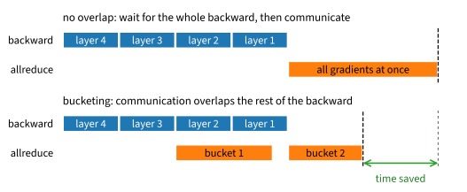
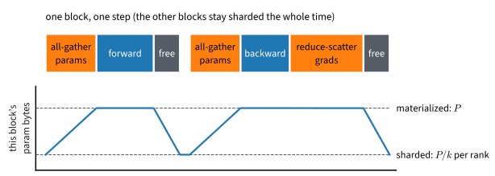

# Multi-GPU in Practice
:label:`sec_multi_gpu_concise`

In :numref:`sec_multi_gpu` a second GPU made the training steps of LeNet
slower: each GPU had too little work to outweigh even a small exchange of
gradients. A ResNet-18 on Fashion-MNIST images enlarged to 64×64 pixels is
a different case. It performs 2.2 billion multiply-adds per image, about
fifty for every byte of its 45 MB of gradients, so the work that a second
GPU takes over is large compared with the gradients that the two GPUs must
exchange. Whether this advantage survives depends on how the exchange is
organized. The hand-written loop of :numref:`sec_multi_gpu` waited for
the whole backward pass before it communicated, although the gradients of
the last layers were ready long before those of the first.

:begin_tab:`pytorch`
It also issued the work of every GPU from one Python thread and routed all
gradients through device 0.
:end_tab:

:begin_tab:`jax`
It also spelled out the communication itself, a `shard_map` with a `psum`
over the flattened gradients, which every new model would need again.
:end_tab:

Data parallelism also leaves one cost untouched: every GPU keeps a full
copy of the training state. The GPT of :numref:`sec_memory_precision` with
36 blocks instead of 18 has 1.9 billion parameters. Its weights, their
gradients, and Adam's moment estimates take 29 GiB, more than the 24 GiB
of an RTX 4090. Data parallelism would place these 29 GiB on every one of
our four GPUs, so four GPUs cannot train this model any more than one can.

This section first replaces the hand-written loop with each framework's
production tool for data parallelism, which starts communicating while the
backward pass is still running. We measure how ResNet-18 then scales on two
and four GPUs, and compare the measurement with the cost model of
:numref:`sec_multi_gpu`. We then divide the training state among the GPUs
instead of copying it, which reduces the memory per GPU but adds
communication.
:numref:`sec_fast_transformer` applies both to a transformer.

```{.python .input #multi-gpu-practice-multi-gpu-in-practice}
%%tab pytorch
%matplotlib inline
from d2l import torch as d2l
import json
import os
import random
import sys
import torch
from torch import nn
```

```{.python .input #multi-gpu-practice-multi-gpu-in-practice}
%%tab jax
%matplotlib inline
import os
# By default, JAX reserves most of every GPU when it starts (here, during
# the import of d2l) and carves every array out of that block. One step
# below needs about 10 GB in one piece after many smaller arrays have come
# and gone, and a later cell starts a second JAX process on the same GPUs.
# The 'vmm' allocator reserves nothing up front and maps the memory of each
# array into one contiguous range, so both succeed
os.environ['XLA_PYTHON_CLIENT_ALLOCATOR'] = 'vmm'
# XLA moves a collective away from the computation around it, so that the
# two overlap, only when its latency-hiding scheduler is on
os.environ['XLA_FLAGS'] = '--xla_gpu_enable_latency_hiding_scheduler=true'
# XLA's NCCL buffer registration fails harmlessly on this machine, whose GPUs
# lack peer-to-peer access; opt out rather than let every collective print a
# warning
os.environ['NCCL_LOCAL_REGISTER'] = '0'
from d2l import jax as d2l
from flax import nnx
import jax
from jax import numpy as jnp
from jax.sharding import NamedSharding, PartitionSpec as P
import json
import math
import numpy as np
import optax
import re
import subprocess
import sys
```

## Production Data Parallelism
:label:`subsec_mgp-production`

Production data parallelism computes what the loop of
:numref:`subsec_mg-byhand` computes. Every GPU holds a copy of the model,
computes the gradient of the loss on its share of each minibatch, and
applies the average of the gradients of all shares. What changes is how the
work is organized, and above all when the communication starts.

:begin_tab:`pytorch`
PyTorch changes two more things. Every GPU gets a process of its own,
and NCCL replaces our star with the ring of :numref:`subsec_mg-ring`,
or with a tree for small messages, so that no device carries the traffic of
all the others.
:end_tab:

:begin_tab:`jax`
Our loop was already one compiled program, and its `psum` already ran
through NCCL, which uses the ring of :numref:`subsec_mg-ring`. Besides the
timing, the change is that we no longer write the communication. There is
no `shard_map` and no `psum`: the placement of the inputs alone makes the
step data-parallel, and the compiler writes the collectives.
:end_tab:

### Overlapping Communication with the Backward Pass

The backward pass computes gradients from the last layer to the first, so
the gradients of the last layers are complete long before those of the
first. Our loop in :numref:`subsec_mg-byhand` nevertheless waited for the
whole backward pass before it started the allreduce, and the links between
the GPUs sat idle in the meantime. The production tools group the
gradients into *buckets* of a few tens of megabytes, in the order in which
the backward pass produces them, and start the allreduce of a bucket as
soon as its last gradient exists :cite:`Li.Zhao.Varma.ea.2020`. While one
bucket travels between the GPUs, the GPUs compute the gradients of the
next (:numref:`fig_ddp_overlap`).


:label:`fig_ddp_overlap`

The size of a bucket is a compromise between the two parts of an
allreduce's time, a fixed cost $\alpha$ per call and the bytes divided by
the bandwidth $\beta$. Small buckets start early but incur $\alpha$ many
times. A single bucket for all gradients incurs $\alpha$ once, but it waits
for the whole backward pass. Whatever the size, the last bucket holds the
gradients of the first layers, which the backward pass computes last. Its
allreduce has nothing left to overlap with, so its time adds to every step.
Overlap therefore shortens the communication of a step, but it cannot
remove it.

:begin_tab:`pytorch`
In PyTorch, `DistributedDataParallel` (DDP) implements bucketing. It
registers a hook on every parameter that marks the parameter's gradient as
ready, and it starts the allreduce of a bucket once all of the bucket's
gradients are ready. A bucket holds up to 25 MiB (the argument
`bucket_cap_mb`), and the buckets are filled in the reverse order of the
model's parameters, which is close to the order of the backward pass.
ResNet-18's 45 MB of gradients form three buckets of about 9, 26, and 9 MB.
The last of them holds the gradients of the first two thirds of the layers,
which have few channels and therefore few weights. The allreduces run on a
CUDA stream of their own, so they proceed while the backward kernels run.
:end_tab:

:begin_tab:`jax`
In JAX, the compiler implements bucketing. `jax.jit` compiles the whole
training step, the forward pass, the backward pass, and the update, into
one program, so XLA knows when each gradient is ready. It merges the many
small gradient allreduces into buffers of up to 30 MiB, its counterpart of
buckets; the flag `--xla_gpu_all_reduce_combine_threshold_bytes` sets this
limit. ResNet-18's 45 MB of gradients thus travel in two allreduces. XLA
also compiles each allreduce as an asynchronous pair of
operations, `all-reduce-start` and `all-reduce-done`, so that the GPU can
run computation that does not need the sum while the sum is in transit.
It schedules the pair apart, with computation in between, only when its
latency-hiding scheduler is on; the first cell of this section turns it
on with `--xla_gpu_enable_latency_hiding_scheduler=true`. Without it, a
profile of the step shows the gradient allreduces running on the stream
of the computation, between two of its kernels.
:end_tab:

### The Execution Model

:begin_tab:`pytorch`
In :numref:`sec_multi_gpu` one Python thread issued the kernels of every
GPU, one GPU after the other. The time that the host spends on a step then
grows with the number of GPUs, and for a model with many small kernels the
host becomes the bottleneck, as it did for LeNet. PyTorch instead starts
one process per GPU. Every process runs an ordinary training script on its
own GPU, so no GPU waits for the host to serve the others. The older
`nn.DataParallel` drives all GPUs from one process, as our loop did, and
PyTorch's documentation recommends DDP even within one machine.

The processes find each other through
`torch.distributed.init_process_group`, which connects them through NCCL,
NVIDIA's library of collective operations, and DDP sends its allreduces
through NCCL. The launcher `torchrun` starts $k$ copies of a script and
tells each copy its *rank*, its index from 0 to $k-1$, through environment
variables. A notebook is a single process, so we write each script as a
string and start it with the following helper. It collects the lines of
JSON that the processes print, process by process in the order of their
ranks.
:end_tab:

:begin_tab:`jax`
JAX runs one process that sees all GPUs, as in :numref:`sec_multi_gpu`.
`jax.jit` compiles a step into a single program, and every GPU of a mesh
runs this program on its own part of the data, so the host dispatches one
program per step however many GPUs take part. This scheme is called
*single program, multiple data* (SPMD).

In :numref:`sec_multi_gpu` the program came from a `shard_map`, in which
we wrote the per-device computation and its `psum`. Now the program is
written for one device. What makes it data-parallel is the placement of
its inputs: the parameters are replicated on every GPU of the mesh
(`P()`), and the minibatch is split along its leading axis
(`P('data')`). The compiler partitions the computation to match this
placement, so every GPU computes the gradient of
its shard. Each parameter, however, is a copy on every GPU, and the
derivative of "copy to every device" is the sum over the devices
(:numref:`sec_multi_gpu`). The compiler therefore sums every parameter's
gradient across the GPUs, which is the allreduce that we wrote by hand.
JAX's partitioner, Shardy, implements the SPMD partitioning of GSPMD
:cite:`Xu.Lee.Chen.ea.2021`.
:end_tab:

```{.python .input #multi-gpu-practice-one-program-per-gpu}
%%tab pytorch
#@save
def torchrun(script, nproc, *args, env=None):
    """Run Python source in nproc processes; return their JSON lines."""
    import glob, subprocess, tempfile
    with tempfile.TemporaryDirectory() as tmp:
        path = os.path.join(tmp, 'script.py')
        with open(path, 'w') as f:
            f.write(script)
        launcher = os.path.join(os.path.dirname(sys.executable), 'torchrun')
        # Each process prints to a file of its own (--redirects 1), so that
        # the lines of different processes cannot interleave
        run = subprocess.run(
            [launcher, '--standalone', f'--nproc-per-node={nproc}',
             '--log-dir', tmp, '--redirects', '1', path, *map(str, args)],
            capture_output=True, text=True, env={**os.environ, **(env or {})})
        if run.returncode != 0:
            raise RuntimeError(run.stderr[-3000:])
        logs = sorted(glob.glob(f'{tmp}/*/attempt_0/*/stdout.log'),
                      key=lambda log: int(log.split(os.sep)[-2]))  # By rank
        return [json.loads(line) for log in logs for line in open(log)
                if line.startswith('{')]
```

### The Training Step

Our model is the ResNet-18 of :numref:`sec_resnet` with a stem for small
images: a 3×3 convolution without max-pooling, followed by four stages of
two residual blocks each. We save it, since later chapters train it on
several GPUs.

```{.python .input #multi-gpu-practice-ddp-really-run-1}
%%tab pytorch
#@save
def resnet18(num_classes, in_channels=1):
    """A slightly modified ResNet-18 model."""
    def resnet_block(in_channels, out_channels, num_residuals,
                     first_block=False):
        blk = []
        for i in range(num_residuals):
            if i == 0 and not first_block:
                blk.append(d2l.Residual(out_channels, use_1x1conv=True, 
                                        strides=2))
            else:
                blk.append(d2l.Residual(out_channels))
        return nn.Sequential(*blk)

    # This model uses a smaller convolution kernel, stride, and padding and
    # removes the max-pooling layer. The stem conv has no bias: the batch
    # normalization after it removes it
    net = nn.Sequential(
        nn.Conv2d(in_channels, 64, kernel_size=3, stride=1, padding=1,
                  bias=False),
        nn.BatchNorm2d(64),
        nn.ReLU())
    net.add_module("resnet_block1", resnet_block(64, 64, 2, first_block=True))
    net.add_module("resnet_block2", resnet_block(64, 128, 2))
    net.add_module("resnet_block3", resnet_block(128, 256, 2))
    net.add_module("resnet_block4", resnet_block(256, 512, 2))
    net.add_module("global_avg_pool", nn.AdaptiveAvgPool2d((1,1)))
    net.add_module("fc", nn.Sequential(nn.Flatten(),
                                       nn.Linear(512, num_classes)))
    return net
```

```{.python .input #multi-gpu-practice-ddp-really-run-1}
%%tab jax
#@save
class ResNet18(nnx.Module):
    """A slightly modified ResNet-18 (small stem, no max-pool)."""
    def __init__(self, num_classes=10, in_channels=1, rngs=None):
        rngs = nnx.Rngs(d2l.get_key()) if rngs is None else rngs
        he = nnx.initializers.variance_scaling(2.0, 'fan_in', 'normal')
        # Stem conv without bias (the batch normalization after it removes
        # it); running averages decay 0.9, two-pass variance
        self.net = nnx.Sequential(
            nnx.Conv(in_channels, 64, (3, 3), (1, 1), padding='same',
                     use_bias=False, kernel_init=he, rngs=rngs),
            nnx.BatchNorm(64, momentum=0.9, use_fast_variance=False,
                          rngs=rngs), nnx.relu,
            d2l.Residual(64, in_channels=64, rngs=rngs),
            d2l.Residual(64, in_channels=64, rngs=rngs),
            d2l.Residual(128, use_1x1conv=True, strides=(2, 2),
                         in_channels=64, rngs=rngs),
            d2l.Residual(128, in_channels=128, rngs=rngs),
            d2l.Residual(256, use_1x1conv=True, strides=(2, 2),
                         in_channels=128, rngs=rngs),
            d2l.Residual(256, in_channels=256, rngs=rngs),
            d2l.Residual(512, use_1x1conv=True, strides=(2, 2),
                         in_channels=256, rngs=rngs),
            d2l.Residual(512, in_channels=512, rngs=rngs),
            lambda x: x.mean(axis=(1, 2)),
            nnx.Linear(512, num_classes, kernel_init=he, rngs=rngs))

    def __call__(self, x):
        return self.net(x)
```

As in :numref:`sec_multi_gpu`, every GPU keeps its own copy of the
training set, here enlarged once to 64×64 pixels, which takes 983 MB in
fp32. The input pipeline then stays out of our measurements, and the only
data that cross between GPUs are gradients. We also count the gradient
bytes $N$ that every step must sum across the GPUs:

```{.python .input #multi-gpu-practice-the-training-step-1}
%%tab pytorch
d2l.FashionMNIST()                   # Download once, before any process runs
net = d2l.resnet18(10)
net(torch.zeros(1, 1, 64, 64))       # Create the lazy parameters
N = 4 * d2l.num_params(net)          # Gradient bytes in fp32
print(f'{d2l.num_params(net) / 1e6:.1f}M parameters, N = {N / 1e6:.0f} MB')
```

```{.python .input #multi-gpu-practice-the-training-step-1}
%%tab jax
data = d2l.FashionMNIST()
X_train = jax.image.resize(data.train[0][..., None] / np.float32(255),
                           (len(data.train[0]), 64, 64, 1), 'bilinear')
y_train = jnp.asarray(data.train[1], jnp.int32)
N = 4 * d2l.num_params(ResNet18())   # Gradient bytes in fp32
print(f'{N / 4e6:.1f}M parameters, N = {N / 1e6:.0f} MB')
```

:begin_tab:`pytorch`
The training script follows. Two parts make it data-parallel:
`init_process_group`, which joins the process to the others, and the `DDP`
wrapper around the model. The rest is a single-GPU training loop. Every
process takes its own slice of each global minibatch of $kb$ examples.
All processes draw the same random permutation, because they share a seed,
and the process of rank $r$ takes the $r$-th of the $k$ slices of $b$
examples. For data that stay in host memory, `DistributedSampler` performs
the same split for a `DataLoader`. The script times its steps with
`d2l.Benchmark` (:numref:`sec_perf_model`) and prints the seconds per step.
:end_tab:

:begin_tab:`jax`
The training step itself contains no parallel code. Its argument `idx`, the
indices of the minibatch's examples, arrives split across the GPUs of the
mesh, so every GPU gathers its own examples from its copy of the training
set, and the compiler takes care of the rest. `setup` builds the model and
the optimizer and replicates them, with the training set, on the first $k$
GPUs; `minibatches` draws random minibatches and splits their indices across
the mesh. The mesh axis is of type `Auto`, which lets the compiler derive
the placement of every intermediate array, here the gathered examples, from
the placement of the inputs.
:end_tab:

```{.python .input #multi-gpu-practice-ddp-really-run-2}
%%tab pytorch
TRAIN_DDP = r'''
import json, os, sys, torch
import torch.distributed as dist
from torch.nn import functional as F
from torch.nn.parallel import DistributedDataParallel as DDP
from d2l import torch as d2l

rank, k = int(os.environ['RANK']), int(os.environ['WORLD_SIZE'])
device = torch.device('cuda', int(os.environ['LOCAL_RANK']))
torch.cuda.set_device(device)
dist.init_process_group('nccl', device_id=device)
torch.backends.cudnn.benchmark = True  # Tune convolutions for fixed shapes
b, num_steps, seed = map(int, sys.argv[1:])  # b examples per GPU and step
torch.manual_seed(seed)                # The same permutations everywhere

data = d2l.FashionMNIST().train        # A copy on every GPU, at 64 x 64
X = F.interpolate(data.data.to(device)[:, None] / 255, 64, mode='bilinear')
y = data.targets.to(device)
model = d2l.resnet18(10).to(device)
model(X[:2])                           # Create the lazy parameters
model = DDP(model, device_ids=[device])
opt = torch.optim.SGD(model.parameters(), lr=0.1)

def minibatches():
    """This process's b examples of every global minibatch of k * b."""
    while True:
        perm = torch.randperm(len(y), device=device)
        for s in range(len(y) // (k * b)):
            yield perm[(s * k + rank) * b:][:b]

def train_step(i):
    opt.zero_grad(set_to_none=True)
    F.cross_entropy(model(X[i]), y[i]).backward()
    opt.step()

batches = minibatches()
t = d2l.Benchmark(lambda: train_step(next(batches)), warmup=10,
                  repeats=num_steps).time
print(json.dumps({'rank': rank, 'step_time': t}))
dist.destroy_process_group()
'''
```

```{.python .input #multi-gpu-practice-jax-annotate-the-layout-the-compiler-writes-the-collectives-1}
%%tab jax
def setup(k, key):
    """ResNet-18 with SGD and the training set, replicated on k GPUs."""
    mesh = jax.make_mesh((k,), ('data',), devices=jax.devices()[:k],
                         axis_types=(jax.sharding.AxisType.Auto,))
    replicated = NamedSharding(mesh, P())
    model = ResNet18(rngs=nnx.Rngs(key))
    opt = nnx.Optimizer(model, optax.sgd(0.1), wrt=nnx.Param)
    for m in (model, opt):
        nnx.update(m, jax.device_put(nnx.state(m), replicated))
    return mesh, model, opt, jax.device_put((X_train, y_train), replicated)

def minibatches(mesh, batch_size):
    """Indices of random minibatches, split across the GPUs of the mesh."""
    rng, n = np.random.default_rng(), len(y_train)
    while True:
        perm = rng.permutation(n)
        for i in range(0, n - batch_size + 1, batch_size):
            yield jax.device_put(perm[i:i + batch_size],
                                 NamedSharding(mesh, P('data')))

@nnx.jit
def train_step(model, opt, X, y, idx):
    """One SGD step on the examples idx, written for a single device."""
    def loss_fn(model):
        return optax.softmax_cross_entropy_with_integer_labels(
            model(X[idx]), y[idx]).mean()
    loss, grads = nnx.value_and_grad(loss_fn)(model)
    opt.update(model, grads)
    return loss
```

### A One-Step Check

Before timing anything, we check, as in :numref:`subsec_mg-byhand`, that a
step on two GPUs computes what we expect. We compare it with steps on one
GPU, from the same initialization and on the same 256 examples, in full
fp32 arithmetic so that rounding differences stay small. The layer to
watch is batch normalization (:numref:`sec_batch_norm`). It normalizes
every channel with the mean and the variance over the minibatch, and when
the minibatch is split across GPUs, these statistics can cover either one
GPU's shard or the whole minibatch.

:begin_tab:`pytorch`
The script below takes one DDP step on $k$ GPUs, each GPU on its half of
256 random images. Process 0 also keeps an unwrapped copy of the model and
takes two reference steps on its GPU: one on all 256 examples at once, and
one that accumulates the gradients of the same two halves before it
updates the parameters.
:end_tab:

:begin_tab:`jax`
We take one step on one GPU and one step on two GPUs, from the same
initialization and on the same 256 examples, and compare the changes of the
parameters.
:end_tab:

```{.python .input #multi-gpu-practice-jax-annotate-the-layout-the-compiler-writes-the-collectives-5}
%%tab pytorch
CHECK_DDP = r'''
import copy, json, os, sys, torch
import torch.distributed as dist
from torch.nn import functional as F
from torch.nn.parallel import DistributedDataParallel as DDP
from d2l import torch as d2l

rank, k = int(os.environ['RANK']), int(os.environ['WORLD_SIZE'])
device = torch.device('cuda', int(os.environ['LOCAL_RANK']))
torch.cuda.set_device(device)
dist.init_process_group('nccl', device_id=device)
torch.backends.cudnn.allow_tf32 = False  # Full fp32 convolutions
torch.manual_seed(int(sys.argv[1]))      # The same model and data everywhere
X = torch.rand(256, 1, 64, 64, device=device)
y = torch.randint(0, 10, (256,), device=device)
model = d2l.resnet18(10).to(device)
model(X[:2])                             # Create the lazy parameters
ref = copy.deepcopy(model)               # An unwrapped copy for one GPU

def update(net, shards):
    """Parameter change of one SGD step on the mean loss over the shards."""
    before = [p.detach().clone() for p in net.parameters()]
    for X_j, y_j in shards:
        (F.cross_entropy(net(X_j), y_j) / len(shards)).backward()
    with torch.no_grad():
        for p, b in zip(net.parameters(), before):
            p -= 0.1 * p.grad
    return [p.detach() - b for p, b in zip(net.parameters(), before)]

ddp = update(DDP(model, device_ids=[device]),
             [(X.chunk(k)[rank], y.chunk(k)[rank])])
if rank == 0:
    gap = lambda u: max((a - b).abs().max().item() for a, b in zip(ddp, u))
    halves = update(copy.deepcopy(ref), list(zip(X.chunk(k), y.chunk(k))))
    print(json.dumps({'largest': max(u.abs().max().item() for u in ddp),
                      'full': gap(update(ref, [(X, y)])),
                      'halves': gap(halves)}))
dist.destroy_process_group()
'''
if d2l.num_gpus() >= 2:
    r = d2l.torchrun(CHECK_DDP, 2, random.getrandbits(32))[0]
    print(f"largest update {r['largest']:.1e}; largest difference from one "
          f"GPU on all 256: {r['full']:.1e}, on two accumulated halves: "
          f"{r['halves']:.1e}")
```

```{.python .input #multi-gpu-practice-jax-annotate-the-layout-the-compiler-writes-the-collectives-5}
%%tab jax
key = d2l.get_key()                   # One initialization for both steps
idx = np.random.default_rng().permutation(len(y_train))[:256]
updates = []
with jax.default_matmul_precision('highest'):  # Full fp32 convolutions
    for k in (1, min(2, jax.device_count())):
        mesh, model, opt, (X, y) = setup(k, key)
        before = jax.tree.map(np.asarray, nnx.state(model, nnx.Param))
        train_step(model, opt, X, y,
                   jax.device_put(idx, NamedSharding(mesh, P('data'))))
        updates.append(jax.tree.map(lambda p, b: np.asarray(p) - b,
                                    nnx.state(model, nnx.Param), before))
u1, u2 = (jax.tree.leaves(u) for u in updates)
print(f'largest update {max(np.abs(u).max() for u in u1):.1e}, largest '
      f'difference {max(np.abs(a - b).max() for a, b in zip(u1, u2)):.1e}')
```

:begin_tab:`pytorch`
The DDP step agrees with the accumulated halves to rounding error, well
under one percent of the largest update, but it differs from the step on
all 256 examples by about a tenth of the largest update. DDP normalizes
each GPU's shard with the statistics of that shard, so it computes what
one GPU computes when it accumulates the gradients of the same shards
(:numref:`subsec_mp-accumulation`). The mean and the variance over 128
examples are already close to those over the whole minibatch. Over a few
examples per GPU they become noisy, and `nn.SyncBatchNorm` then computes
them over the whole minibatch, which adds collectives to every batch
normalization layer (exercise :exref:`ex_mgp-syncbn`).
:end_tab:

:begin_tab:`jax`
The two steps agree to rounding error, well under one percent of the
largest update. Under `jit`, the mean and the variance of a batch
normalization layer are means over an axis that is split across the GPUs,
so the compiler computes them over the whole minibatch and inserts an
allreduce for each. The sharded step therefore
computes the single-GPU step on all 256 examples. Lowering the step and
searching the compiled program for its allreduces shows both kinds:
:end_tab:

```{.python .input #multi-gpu-practice-jax-annotate-the-layout-the-compiler-writes-the-collectives-3}
%%tab jax
mesh, model, opt, (X, y) = setup(jax.device_count(), d2l.get_key())
idx = next(minibatches(mesh, 256 * mesh.size))
hlo = train_step.lower(model, opt, X, y, idx).compile().as_text()
ops = [line for line in hlo.splitlines()
       if re.search(r' all-reduce(-start)?\(', line)]
def megabytes(op):
    """Size of the fp32 arrays that an allreduce instruction returns."""
    result = op.split(' = ')[1].split(' all-reduce')[0]
    return sum(4 * math.prod(map(int, dims.split(','))) for dims in
               re.findall(r'f32\[([\d,]+)\]', result)) / 1e6
mb = sorted(map(megabytes, ops), reverse=True)
big = [m for m in mb if m > 1]       # Gradient buffers, above 1 MB
print(f'{len(ops)} allreduces: {len(big)} of '
      f'{" and ".join(f"{m:.1f}" for m in big)} MB, the other '
      f'{len(ops) - len(big)} of {sum(mb[len(big):]):.2f} MB together')
```

:begin_tab:`jax`
Two large allreduces carry almost all of the 45 MB of gradients: XLA
merged the gradients of the many parameter tensors into two buffers. The
many small allreduces carry the statistics of the batch normalization
layers, each a vector of one number per channel. They are cheap in bytes,
but each of them incurs the fixed cost $\alpha$, and each lies on the path
of the forward or the backward pass, because the next layer needs its
result.
:end_tab:

## Scaling on Four GPUs
:label:`subsec_mgp-scaling`

We measure both conventions of :numref:`subsec_mg-accounting`: weak
scaling, which holds the minibatch per GPU fixed while the number of GPUs
$k$ grows and reports examples per second, and strong scaling, which holds
the global minibatch fixed and reports how much sooner a step finishes. The
function `step_time(k, b)` returns the seconds per step on $k$
GPUs with $b$ examples per GPU, averaged over 50 steps after a warm-up.

```{.python .input #multi-gpu-practice-jax-annotate-the-layout-the-compiler-writes-the-collectives-4}
%%tab pytorch
def step_time(k, b, num_steps=50):
    """Seconds per DDP step on k GPUs with b examples per GPU."""
    ranks = d2l.torchrun(TRAIN_DDP, k, b, num_steps, random.getrandbits(32))
    return max(r['step_time'] for r in ranks)
```

```{.python .input #multi-gpu-practice-jax-annotate-the-layout-the-compiler-writes-the-collectives-4}
%%tab jax
def step_time(k, b, num_steps=50):
    """Seconds per data-parallel step on k GPUs with b examples per GPU."""
    mesh, model, opt, (X, y) = setup(k, d2l.get_key())
    batches = minibatches(mesh, k * b)
    return d2l.Benchmark(lambda: train_step(model, opt, X, y, next(batches)),
                         warmup=10, repeats=num_steps).time
```

Weak scaling first, with 256 examples per GPU:

```{.python .input #multi-gpu-practice-ddp-really-run-3}
%%tab pytorch, jax
ks = [k for k in (1, 2, 4) if k <= d2l.num_gpus()]
weak = {k: step_time(k, 256) for k in ks}
for k in ks:
    print(f'{k} GPU(s): {k * 256 / weak[k]:5.0f} examples/s, speedup '
          f'{k * weak[1] / weak[k]:.2f}, efficiency {weak[1] / weak[k]:.0%}')
```

Two GPUs process about 1.7 times as many examples per second as one, and
four GPUs a little over three times as many. The *efficiency*, the speedup divided
by $k$, falls gradually as GPUs are added. Under weak
scaling every GPU does the same work at every $k$. The efficiency is
therefore the ratio of the single-GPU step time to the step time on $k$
GPUs, and what it loses is the communication that the step does not hide.

Strong scaling holds the global minibatch at 512, so each of the $k$ GPUs
processes $512/k$ examples while the allreduce keeps its size:

```{.python .input #multi-gpu-practice-ddp-really-run-4}
%%tab pytorch, jax
strong = {k: step_time(k, 512 // k) for k in ks}
for k in ks:
    print(f'{k} GPU(s), {512 // k} examples each: speedup '
          f'{strong[1] / strong[k]:.2f}, efficiency '
          f'{strong[1] / strong[k] / k:.0%}')
d2l.plot(ks, [ks, [k * weak[1] / weak[k] for k in ks],
              [strong[1] / strong[k] for k in ks]], 'GPUs', 'speedup',
         legend=['linear', 'weak (256 per GPU)', 'strong (512 in all)'],
         fmts=('k:', '-o', '--s'))
```

At two GPUs the two conventions give about the same speedup, because 256
and 512 examples keep an RTX 4090 about equally busy. At four GPUs they
diverge. Strong scaling leaves each GPU 128 examples per step, so the
step's computation shrinks while its communication does not, and the
efficiency falls well below that of weak scaling. The same mechanism made
LeNet slower on two GPUs; here its effect is much weaker.

### Predicted and Measured Communication

The cost model :eqref:`eq_dp_cost` of :numref:`subsec_mg-accounting`
predicts the time of a step on $k$ GPUs from the compute time of a shard of
$B/k$ examples, the number $m$ of allreduce calls with fixed cost $\alpha$
each, and the gradient bytes $N$ at bandwidth $\beta$:

$$
t_{\textrm{step}}(k) \approx t_{\textrm{compute}}(B/k) + m\,\alpha +
\frac{2N}{\beta}.
$$

Under weak scaling the first term does not change with $k$, so the
difference $t_{\textrm{step}}(2) - t_{\textrm{step}}(1)$ is the
communication that a step exposes. For 45 MB of gradients in a few calls,
the bandwidth term dominates. The model counts the whole allreduce, so
$2N/\beta$ is the exposed time if nothing overlaps. Overlap as in
:numref:`fig_ddp_overlap` lowers the exposed time: only the allreduce of
the last bucket remains exposed, provided that the earlier buckets finish
while the backward pass still runs.

As in :numref:`subsec_mg-accounting`, we define $\beta$ as $2N$ divided by
the time of a large allreduce on two GPUs, so $\beta$ counts the bytes
that leave and enter a GPU together. We measure it with a bare allreduce of
256 MB per GPU, the same size as there, through the library that the
training uses:

:begin_tab:`pytorch`
`ALLREDUCE` times `torch.distributed.all_reduce` through NCCL in every
process of a two-process launch.
:end_tab:

:begin_tab:`jax`
`ALLREDUCE` times the `psum` of :numref:`sec_multi_gpu` on two GPUs. NCCL
reads its configuration once per process, and we will change that
configuration below, so the measurement runs in a fresh Python process of
its own.
:end_tab:

```{.python .input #multi-gpu-practice-communication-predicted-and-measured-1}
%%tab pytorch
ALLREDUCE = r'''
import json, os, torch
import torch.distributed as dist
from d2l import torch as d2l

device = torch.device('cuda', int(os.environ['LOCAL_RANK']))
torch.cuda.set_device(device)
dist.init_process_group('nccl', device_id=device)
x = torch.zeros(2**26, device=device)   # 64M floats: 256 MB
t = d2l.Benchmark(lambda: dist.all_reduce(x), repeats=10).time
print(json.dumps({'beta': 2 * 4 * x.numel() / t}))
dist.destroy_process_group()
'''
def allreduce_beta(env=None):
    """Bandwidth of a bare 256 MB allreduce on two GPUs, in bytes/s."""
    return min(r['beta'] for r in d2l.torchrun(ALLREDUCE, 2, env=env))
```

```{.python .input #multi-gpu-practice-communication-predicted-and-measured-1}
%%tab jax
ALLREDUCE = r'''
import json, jax
from jax import numpy as jnp
from jax.sharding import NamedSharding, PartitionSpec as P
from d2l import jax as d2l

mesh = jax.make_mesh((2,), ('data',), devices=jax.devices()[:2])
x = jnp.zeros((2, 2**26), device=NamedSharding(mesh, P('data')))  # 256 MB
psum = jax.jit(jax.shard_map(lambda x: jax.lax.psum(x, 'data'), mesh=mesh,
                             in_specs=P('data'), out_specs=P('data')))
t = d2l.Benchmark(lambda: psum(x), repeats=10).time
print(json.dumps({'beta': 2 * 4 * 2**26 / t}))
'''
def allreduce_beta(env=None):
    """Bandwidth of a bare 256 MB allreduce on two GPUs, in bytes/s."""
    run = subprocess.run([sys.executable, '-c', ALLREDUCE], check=True,
                         capture_output=True, text=True,
                         env={**os.environ, **(env or {})})
    return json.loads(run.stdout.splitlines()[-1])['beta']
```

```{.python .input #multi-gpu-practice-ddp-really-run-5}
%%tab pytorch, jax
if d2l.num_gpus() >= 2:
    beta = allreduce_beta()
    print(f'beta = {beta / 1e9:.1f} GB/s; k=2: predicted 2N/beta = '
          f'{1e3 * 2 * N / beta:.0f} ms, measured exposed '
          f'{1e3 * (weak[2] - weak[1]):.0f} ms per step')
```

The measured exposed time is close to $2N/\beta$, the time of an
allreduce that nothing overlaps. Overlap hides far less of the
communication on this machine than the bucket model predicts.

:begin_tab:`pytorch`
DDP's last bucket holds 8.7 of the 45 MB of gradients, so with full overlap
a step would expose a fifth of $2N/\beta$, about 4 ms.
:end_tab:

:begin_tab:`jax`
With full overlap a step would expose only the last of XLA's two gradient
allreduces. Their sizes, about 26 and 19 MB, put that bound at about two
fifths or three fifths of $2N/\beta$, depending on which comes last.
:end_tab:

The bucket model makes three assumptions: every allreduce starts as soon
as its bucket is complete, it runs as fast as the bare benchmark, and the
backward kernels beside it run as fast as they do alone. A trace of one
step, which records when every kernel starts and ends, tests them
(exercise :exref:`ex_mgp-buckets`). On this machine the third fails: the
kernels of an allreduce take a share of the GPU's processors and memory
bandwidth, and the backward kernels beside them run more slowly.

:begin_tab:`pytorch`
In a trace of the step on two GPUs, the backward kernels take about a
tenth longer than in the same step without communication, and the
allreduces take more than twice as long as the bare benchmark. Together
they lengthen the step by about 15 ms.
:end_tab:

:begin_tab:`jax`
The first assumption fails as well. A merged buffer is complete only when
the last of its gradients is, so in XLA's schedule of the step on two GPUs
the larger allreduce starts two convolutions before the end of the
backward pass, and the smaller one after it.
:end_tab:

On a machine whose GPUs share an NVLink domain, each GPU exchanges data
with the others at 450 GB/s in each direction on the H100 (NVLink 4) and
at 900 GB/s on the B200 (NVLink 5), hundreds of times the rate measured
here (:numref:`subsec_hw-interconnects`). The allreduce of ResNet-18's
gradients then takes well under a millisecond, and the cost model predicts
near-linear scaling for this model with or without overlap.

### The Collective Transport

At $k = 2$ each GPU sends and receives at $\beta/2$ in each direction,
about 2.5 GB/s. A copy between two of our GPUs, staged through host memory,
can run at up to 23 GB/s (:numref:`subsec_hw-interconnects`), about nine
times as fast. The cause lies in how NCCL moves data between GPUs that lack
peer-to-peer access. It falls back to buffers in host memory, and by
default GPU kernels copy the data into and out of these buffers with
ordinary loads and stores across PCIe. The copy engines, the units that
perform a GPU's memory copies, move the same bytes faster. An undocumented
NCCL parameter, `NCCL_SHM_USE_CUDA_MEMCPY=1`, makes NCCL use them. It
exists in the NCCL versions that our pinned frameworks bundle, and NCCL
2.31 removed it. We measure the bare allreduce with the parameter set:

```{.python .input #multi-gpu-practice-ddp-really-run-6}
%%tab pytorch, jax
if d2l.num_gpus() >= 2:
    beta_ce = allreduce_beta({'NCCL_SHM_USE_CUDA_MEMCPY': '1'})
    print(f'beta = {beta / 1e9:.1f} GB/s by default, '
          f'{beta_ce / 1e9:.1f} GB/s with the copy engines '
          f'({beta_ce / beta:.1f}x)')
```

The bandwidth rises nearly five-fold, and with it the predicted
communication time of ResNet-18 falls from about 18 ms to about 4 ms.

:begin_tab:`pytorch`
PyTorch 2.11 bundles NCCL 2.28.9. On our machine, DDP training with the
parameter set deadlocks within seconds, although the same collectives
complete in the bare benchmark. Exercise :exref:`ex_mgp-transport`
reproduces both outcomes under a time limit. We therefore train with
NCCL's default.
:end_tab:

:begin_tab:`jax`
jaxlib 0.10.2 bundles NCCL 2.30.4. Whether the training step of this
section completes with the parameter set, and how much faster it runs, is
the subject of exercise :exref:`ex_mgp-transport`. We train with NCCL's
default, because the parameter is specific to these NCCL versions and to
machines without peer-to-peer access.
:end_tab:

One environment variable changed $\beta$ nearly five-fold here. Whether such a
setting is safe has to be checked on the training run itself, not only on
a benchmark of bare collectives.

## Sharding the Training State
:label:`subsec_mgp-fsdp`

Data parallelism makes training faster, but it makes no room for a larger
model: every GPU holds all of the weights, the gradients, and the
optimizer state. With Adam in fp32 these take 16 bytes per parameter
(:numref:`subsec_mp-anatomy`), so a 24 GiB card holds at most 1.6 billion
parameters before it stores a single activation. The 36-block GPT from the
start of this section has 1.9 billion parameters. At 16 bytes each they
take 29 GiB, which no single GPU of ours holds, and data parallelism would
need these 29 GiB on every GPU.

### Partitioning the Optimizer State, Gradients, and Weights

Each GPU needs a full copy of the weights only while it computes with them,
and it never needs the full gradient or the full optimizer state. The ZeRO
family of methods :cite:`Rajbhandari.Rasley.Ruwase.ea.2020` removes the
redundant copies in three stages. Stage 1 partitions the optimizer state:
each GPU keeps Adam's moment estimates for $1/k$ of the parameters and
updates only those parameters. Stage 2 also partitions the gradients, and
stage 3 also partitions the weights. :numref:`tab_mgp-zero` lists what each
GPU then holds.

:Training state per GPU with Adam in fp32 on $k$ GPUs, and for the GPT with 36 blocks and 1.9 billion parameters on $k = 4$.
:label:`tab_mgp-zero`

| each GPU holds | weights | gradients | Adam state | bytes per parameter | GPT, $k = 4$ |
|---|---|---|---|---|---|
| data parallelism | all | all | all | 16 | 28.6 GiB |
| ZeRO stage 1 | all | all | $1/k$ | $8 + 8/k$ | 17.9 GiB |
| ZeRO stage 2 | all | $1/k$ | $1/k$ | $4 + 12/k$ | 12.5 GiB |
| ZeRO stage 3 (FSDP) | $1/k$ | $1/k$ | $1/k$ | $16/k$ | 7.1 GiB |

The collectives follow from the identity of :numref:`subsec_mg-ring`: an
allreduce is a reduce-scatter followed by an all-gather. In stages 1 and
2 the reduce-scatter leaves each GPU with the summed gradient of the
parameters it owns, which is all that its optimizer needs. Each GPU then
updates its $1/k$ of the parameters, and an all-gather assembles the
updated parameters on every GPU. The two phases move the same bytes as the
allreduce of data parallelism, now separated by the update. Stages 1 and 2
therefore reduce the memory per GPU at no cost in communication. For our
GPT, stage 1 on four GPUs already brings the training state below the
24 GiB of one card.

Stage 3 is known as *fully sharded data parallelism* (FSDP)
:cite:`Zhao.Gu.Varma.ea.2023`. Each GPU keeps only its shard of every
block's weights, and an all-gather assembles a block's weights just before
the block computes and releases them right after
(:numref:`fig_fsdp_lifecycle`). The backward pass gathers each block's
weights once more, releases them after the block's backward pass, and
reduce-scatters the block's gradients. A step thus performs two all-gathers
and one reduce-scatter of $N$ bytes, three phases where an allreduce has
two, so FSDP communicates 1.5 times as much as data parallelism. No full
copy of a block lives longer than the block's computation, so the memory
per GPU is $16/k$ bytes per parameter plus the activations and one or two
gathered blocks.


:label:`fig_fsdp_lifecycle`

:numref:`tab_collectives` lists the four collectives that data-parallel and
sharded training use.

:The collective operations behind data-parallel and sharded training.
:label:`tab_collectives`

| collective | what every GPU ends with | where it appears |
|---|---|---|
| allreduce | the full sum | gradients in data parallelism |
| reduce-scatter | one part of the sum | gradients in ZeRO and FSDP |
| all-gather | every part, concatenated | weights in ZeRO and FSDP |
| all-to-all | a different part from each GPU | tokens routed to the experts of a mixture of experts (:numref:`sec_moe`) |

:begin_tab:`pytorch`
In PyTorch, `fully_shard` from `torch.distributed.fsdp` applies FSDP to a
module. It is called once for every transformer block and once for the
whole model, so that every block becomes a unit that is gathered and
released on its own. The older `FullyShardedDataParallel` wrapper still
works, and PyTorch's documentation recommends `fully_shard` for new code.
Stage 1 alone is available as
`torch.distributed.optim.ZeroRedundancyOptimizer`. DDP itself needs more
than the first row of :numref:`tab_mgp-zero`: its buckets hold a second
copy of the gradients, 4 more bytes per parameter, unless the argument
`gradient_as_bucket_view=True` makes the gradients views into the buckets.
:end_tab:

:begin_tab:`jax`
In JAX, sharding the training state is a change of placement, as data
parallelism was. Instead of replicating the weights and the optimizer state
with `P()`, we split one axis of each array across the mesh, for example
with `P('data')` on the leading axis. Splitting the weights alone, however,
lets the partitioner choose a different scheme, such as matrix products on
split weights followed by an allreduce of the activations. FSDP's all-gathers and
reduce-scatters appear only when every block's activations are also
constrained to stay split along the batch, with
`jax.lax.with_sharding_constraint(x, P('data'))`.
:end_tab:

### Memory and Communication

Sharding reduces memory and adds communication, and the cost model says
how long the communication takes. For our GPT, the fp32 gradients take
$N$ = 7.7 GB, four bytes per parameter. On $k$ GPUs, a ring allreduce
makes every GPU send $2(k-1)N/k$ bytes and receive as many
(:numref:`subsec_mg-ring`), $1.5N$ in each direction at $k = 4$ against
$N$ at $k = 2$. If every GPU keeps the bandwidth $\beta$ of about 5 GB/s
that we measured on two, one allreduce of data parallelism takes
$3N/\beta$, about 5 s, and the three phases of FSDP take $4.5N/\beta$,
about 7 s.

The computation of a step is much shorter. The forward and the backward
pass take about six floating-point operations per parameter and token
(:numref:`sec_scaling-laws`). Two sequences of 1,024 tokens per GPU, which
fit next to the 7.1 GiB of stage 3 with the activation checkpointing of
:numref:`subsec_mp-checkpointing`, take about
$6 \cdot 1.9 \cdot 10^9 \cdot 2048 \approx 2.4 \times 10^{13}$
operations. At the RTX 4090's full tf32 rate of about 80 TFLOP/s that is
0.3 s, and 0.4 s with the forward pass that checkpointing repeats. On our
machine, sharding lets the model train on four GPUs, at a few percent of
the speed that its computation would allow. Over NVLink 5, at 900 GB/s in
each direction, the same three phases take about 20 ms, and FSDP is the
standard way to train models whose state does not fit on one GPU.

The arithmetic also says when to shard. A model whose training state fits
on one GPU next to its activations trains fastest with data parallelism.
On a 24 GiB card with Adam in fp32 that limit lies at about a billion
parameters, fewer for long sequences. The 18-block GPT of
:numref:`sec_memory_precision` sits at this limit. Stage 3 would shrink
its 15.1 GiB per GPU to 3.8 GiB at $k = 4$ and free 11 GiB for
activations, but on our machine the extra communication would take far
more time than the larger micro-batches save.

Past the limit, ZeRO stages 1 and 2 reduce the memory at no cost in
communication, and stage 3 removes the remaining copies with 1.5 times
the communication. Splitting the weight matrices of every layer across
GPUs instead, *tensor parallelism* (exercise :exref:`ex_mgp-tensor`), and
the forms of parallelism that span several machines belong to the
Language Models part.

We can now train a model on all GPUs of one machine with the tools that
practitioners use, predict from the cost model what a step will cost, and
check the prediction against a measurement. Our measurements also show how
much depends on the connection between the GPUs: when they exchange data
through host memory, communication sets the pace long before the
arithmetic does. :numref:`sec_fast_transformer` applies the method of this
chapter to a transformer, where precision, compilation, and data
parallelism interact.

## Summary

Production data parallelism computes what the hand-written loop computes,
but the framework writes the collectives, and the allreduce of each bucket
of gradients starts while the backward pass is still running. A one-step
check against a single GPU shows what the data-parallel step computes,
including how batch normalization treats a split minibatch. On our four
RTX 4090s ResNet-18 gains from every added GPU, but its exposed
communication is close to the cost model's time for an allreduce that
nothing overlaps: on this machine, overlap hides little of it. ZeRO and
FSDP divide the 16 bytes per parameter of the training state among the
GPUs, stages 1 and 2 at no cost in communication and stage 3 at 1.5 times
the communication of data parallelism.

## Exercises

:begin_tab:`pytorch`
1. [code] **Splitting the data.** In `TRAIN_DDP` every process takes its
   own slice of each global minibatch: all processes draw the same
   permutation, and the process of rank $r$ takes the slice that starts at
   $(sk + r)b$ in step $s$.
    1. Remove the rank from this offset, so that every process takes the
       same $b$ examples. Predict what `step_time` reports at $k = 2$
       relative to the correct script, and which global minibatch the
       averaged gradient corresponds to. Then check, with each process
       printing a checksum of its first minibatch.
    1. Restore the offset and give each process a seed of its own. Which
       property of the split is lost, and does it matter for training?
    1. Name a check that catches the first mistake and is cheap enough to
       run at every launch.
:end_tab:

:begin_tab:`jax`
1. [code] **Splitting the data.** `minibatches` places the indices with
   `P('data')`, which splits them across the GPUs of the mesh.
    1. Place them with `P()` instead, which gives every GPU all indices.
       Predict which collectives the compiled `train_step` then contains
       and how `step_time(2, 256)` compares with `step_time(1, 256)`, and
       check both.
    1. Restore `P('data')` and, inside `train_step`, reshard the gathered
       images `X[idx]` to `P(None, 'data')` with `jax.sharding.reshard`,
       which splits the height of every image across the GPUs. Which values
       must neighboring GPUs exchange for a $3 \times 3$ convolution, and
       which collective does that take? Find it in the compiled
       `train_step`.
:end_tab:

2. **Weak-scaling extrapolation.** Suppose that a step on $k$ GPUs takes
   the single-GPU step time $t_1$ plus an exposed communication time that
   is proportional to the per-GPU ring traffic of
   :numref:`subsec_mg-ring`, $2(k-1)N/k$.
    1. Express the weak-scaling efficiency $E(k)$ through a single
       constant, fit the constant to your measurement at $k = 2$, and
       predict $E(4)$. Compare your prediction with the measured $E(4)$
       and with the prediction of a model in which the exposed time is the
       same for every $k \geq 2$.
    1. Predict $E(8)$ for an eight-GPU machine of the same design as ours,
       on which every transfer between GPUs is staged through host memory
       (:numref:`subsec_hw-interconnects`). How does the total ring traffic
       through host memory grow with $k$, and in which direction should
       this move a measured $E(8)$ relative to your prediction?
    1. With gradient accumulation (:numref:`subsec_mp-accumulation`), each
       GPU runs $a$ micro-batches of 256 examples per optimizer step and
       communicates only after the last one. Starting from your measured
       $E(4)$, find the smallest $a$ that raises the efficiency at $k = 4$
       to 95%. What happens to the global minibatch, and why does that
       matter (:numref:`sec_batch_size`)?

3. **Cost of sharding.** ● Count communication per GPU and step in units
   of $N$, the bytes of one full set of fp32 gradients.
    1. A variant of ZeRO stage 3 keeps every gathered block from its
       forward pass until its backward pass. Which collective does this
       remove, and how much of the memory saving of stage 3 does it give
       up, in bytes per parameter of :numref:`tab_mgp-zero`?
    1. Mixed-precision FSDP gathers the weights in bf16 and reduce-scatters
       the gradients in bf16, while every GPU keeps its shard of the fp32
       weights and of Adam's state. Compare its bytes per step with those
       of data parallelism in fp32, and its memory per parameter with the
       last row of :numref:`tab_mgp-zero`.
    1. For the GPT with 36 blocks and 1.9 billion parameters on our four
       GPUs, and with the $\beta$ that you measured, find the number of
       tokens per GPU and step at which the computation, 6 operations
       per parameter and token at 80 TFLOP/s, takes as long as the communication of
       stage 3. How many sequences of 1,024 tokens is that, and do their
       activations fit next to the training state
       (:numref:`subsec_mp-anatomy`)? How does gradient accumulation
       change the answer when FSDP gathers the weights anew for every
       micro-batch?

:begin_tab:`pytorch`
4. [code] **Bucket size.** ● Model the overlap of :numref:`fig_ddp_overlap`
   as follows. The backward pass takes time $t_b$ and releases the
   gradients in $n$ buckets of equal size, bucket $i$ at time $i\,t_b/n$.
   The allreduces of the buckets run one at a time and in order, and each
   takes $\alpha + \tau/n$, where $\tau = 2N/\beta$ is the communication
   time of all gradients and $\alpha$ is a fixed cost per collective. The
   exposed communication is the time from the end of the backward pass to
   the end of the last allreduce.
    1. Show that the exposed communication is

        $$t_{\text{exposed}}(n) = \max\Bigl(\alpha + \frac{\tau}{n},\;
        n\alpha + \tau - \frac{n-1}{n}\,t_b\Bigr).$$

    1. Find the $n$ that minimizes $t_{\text{exposed}}$ when $\tau$ is well
       below $t_b$, and again when $\tau > t_b$. What does a bucket that is
       too small cost, and what does one that is too large cost?
    1. Pass `bucket_cap_mb` to `DDP` in `TRAIN_DDP`, sweep it from 1 MB to
       100 MB at $k = 2$ with `step_time`, and plot the exposed
       communication against the bucket size. Estimate $t_b$ as two thirds
       of the single-GPU step time and $\tau$ as $2N/\beta$. Is the
       measured optimum consistent with your model, and which $\alpha$ does
       it imply?
    1. At the default buckets, the exposed communication is close to
       $\tau$ rather than to the time of the last bucket. Record a few
       steps at $k = 2$ with `torch.profiler.profile`, once as they are and
       once with the backward pass inside `model.no_sync()`, which skips
       the allreduces. Compare the time from the first to the last backward
       kernel in the two runs, and find when each allreduce kernel starts
       and ends. Which assumption of the model fails on our machine?
   :exlabel:`ex_mgp-buckets`

5. [code] **Transport configuration.** ● `allreduce_beta` compares NCCL's
   default transport with the copy engines that `NCCL_SHM_USE_CUDA_MEMCPY=1`
   selects, at a single payload of 256 MB. The parameter affects only the
   transport through host memory that NCCL uses between GPUs that lack
   peer-to-peer access.
    1. Launch `ALLREDUCE` once with `NCCL_DEBUG=INFO` and find the transport
       that NCCL reports for each channel. Predict whether the parameter can
       change anything on your machine.
    1. Extend the comparison to payloads from 1 MB to 256 MB and plot the
       bandwidth of both transports against the payload. Where does each
       saturate, and does the five-fold gap hold at every size?
    1. Launch `TRAIN_DDP` on two GPUs with the parameter set (the `env`
       argument of `d2l.torchrun`), once with the default buckets and once
       with `bucket_cap_mb` large enough that all gradients form a single
       bucket, each launch under a time limit that also terminates the
       processes. Does the deadlock depend on the
       overlap of communication with the backward pass, and what does the
       outcome tell you about which workloads the bare benchmark validates?
   :exlabel:`ex_mgp-transport`
:end_tab:

:begin_tab:`jax`
4. [code] **Bucket size.** ● Model the overlap of :numref:`fig_ddp_overlap`
   as follows. The backward pass takes time $t_b$ and releases the
   gradients in $n$ buckets of equal size, bucket $i$ at time $i\,t_b/n$.
   The allreduces of the buckets run one at a time and in order, and each
   takes $\alpha + \tau/n$, where $\tau = 2N/\beta$ is the communication
   time of all gradients and $\alpha$ is a fixed cost per collective. The
   exposed communication is the time from the end of the backward pass to
   the end of the last allreduce.
    1. Show that the exposed communication is

        $$t_{\text{exposed}}(n) = \max\Bigl(\alpha + \frac{\tau}{n},\;
        n\alpha + \tau - \frac{n-1}{n}\,t_b\Bigr).$$

    1. Find the $n$ that minimizes $t_{\text{exposed}}$ when $\tau$ is well
       below $t_b$, and again when $\tau > t_b$. What does a bucket that is
       too small cost, and what does one that is too large cost?
    1. XLA merges gradient allreduces up to a byte threshold, which the
       flag `--xla_gpu_all_reduce_combine_threshold_bytes` sets. In fresh
       processes, with `XLA_FLAGS` set before JAX initializes its backend,
       sweep the threshold from 1 MB to 100 MB. For each value, count the
       gradient allreduces in the compiled `train_step` and measure the
       exposed communication `step_time(2, 256) - step_time(1, 256)`.
       Estimate $t_b$ as two thirds of the single-GPU step time and $\tau$
       as $2N/\beta$. Is the measured optimum consistent with your model,
       and which $\alpha$ does it imply?
    1. At the default threshold, the exposed communication is close to
       $\tau$ rather than to the time of the last allreduce. Record a few
       steps at $k = 1$ and $k = 2$ inside `jax.profiler.trace` and open
       the traces in Perfetto. Compare the time from the first to the last
       kernel of the backward pass in the two traces, and find when each
       gradient allreduce starts and ends. Which assumption of the model
       fails on our machine?
   :exlabel:`ex_mgp-buckets`

5. [code] **Transport configuration.** ● XLA runs its collectives through
   NCCL, so the parameter `NCCL_SHM_USE_CUDA_MEMCPY=1` applies to JAX
   programs as well. It affects only the transport through host memory that
   NCCL uses between GPUs that lack peer-to-peer access. NCCL reads its
   configuration once per process, so compare settings in fresh processes,
   as `allreduce_beta` does.
    1. Run `ALLREDUCE` once with `NCCL_DEBUG=INFO`, find the transport that
       NCCL reports for each channel, and predict whether the parameter can
       change anything on your machine.
    1. Time the `psum` for payloads from 1 MB to 256 MB under both settings
       and plot the bandwidth against the payload. Where does each
       saturate, and does the five-fold gap hold at every size?
    1. Write the training of this section into a script and run it on two
       GPUs in a fresh process with the parameter set, under a time limit.
       Does training complete, and at what speed relative to the default
       transport?
    1. Read the sizes of the allreduces in the compiled `train_step`. At
       which of them does the parameter change the bandwidth?
   :exlabel:`ex_mgp-transport`
:end_tab:

:begin_tab:`pytorch`
6. [extended] **Sharded optimizer state.** ● Implement ZeRO stage 1
    :cite:`Rajbhandari.Rasley.Ruwase.ea.2020` by hand and measure what it
    saves. Start from `TRAIN_DDP` with `torch.optim.Adam` in place of SGD.
    1. Assign every parameter tensor to one owner process, so that the
       processes own nearly equal numbers of values, and give each process
       an Adam optimizer over its own tensors only. After the backward pass
       and the owners' steps, send each tensor from its owner to all
       processes with `dist.broadcast`. Check that after a few steps the
       parameters match those of DDP with a full Adam from the same
       initialization, and compare with
       `torch.distributed.optim.ZeroRedundancyOptimizer`.
    1. Read `torch.cuda.memory_allocated` after initialization, before the
       first optimizer step, and after it, with and without sharding at
       $k = 2$ and $k = 4$, and account for the differences with
       :numref:`tab_mgp-zero`; then read `torch.cuda.max_memory_allocated`
       after the second step and compare its change under sharding with
       the change in live memory.
    1. Measure the step time with and without sharding. DDP's allreduce
       hands every process the full summed gradient, of which stage 1 uses
       only the part that the process owns. Count the bytes per GPU that the
       allreduce and the broadcasts of your implementation send together,
       and compare them with the reduce-scatter and all-gather of stage 1
       in :numref:`subsec_mgp-fsdp`.

    *Adapted from Stanford CS336,
    [Assignment 2 (Systems)](https://github.com/stanford-cs336/assignment2-systems),
    Problems optimizer_state_sharding and
    optimizer_state_sharding_accounting.*

7. [code] **Synchronized batch normalization.** ● The one-step check of
   :numref:`subsec_mgp-production` shows that DDP normalizes each GPU's
   shard with the statistics of that shard.
    1. Convert the model in `CHECK_DDP` with
       `nn.SyncBatchNorm.convert_sync_batchnorm` after creating its
       parameters and before wrapping it in `DDP`, and repeat the check.
       Which of the two references does the DDP step now match?
    1. How many collectives per step does the conversion add to
       `resnet18`? Measure `step_time` with the converted model at $k = 2$
       and $k = 4$ under weak scaling, and compare the added time with the
       time that the added bytes take at bandwidth $\beta$. Which
       properties of these collectives, other than their size, set their
       cost?
   :exlabel:`ex_mgp-syncbn`

8. [code] **Tensor versus data parallelism.** ● Consider the MLP block
    $\mathbf{Y} = \phi(\mathbf{X}\mathbf{W}_1)\mathbf{W}_2$ with
    $\mathbf{X} \in \mathbb{R}^{n \times d}$ holding the $n$ tokens of one
    step, $\mathbf{W}_1 \in \mathbb{R}^{d \times 4d}$,
    $\mathbf{W}_2 \in \mathbb{R}^{4d \times d}$, and an elementwise
    activation $\phi$, on $k$ devices. Tensor
    parallelism (:numref:`fig_splitting`) splits $\mathbf{W}_1$ by columns and
    $\mathbf{W}_2$ by rows :cite:`shoeybi2019megatron`.
    1. Show that each device can compute, without communication, an
       $n \times d$ partial result from its columns of $\mathbf{W}_1$ and
       its rows of $\mathbf{W}_2$, and that $\mathbf{Y}$ is the sum of the
       $k$ partial results. Which collective forms that sum, and which
       collective does the backward pass need for the gradient with
       respect to $\mathbf{X}$?
    1. Data parallelism on the same $k$ devices allreduces the gradients
       of $\mathbf{W}_1$ and $\mathbf{W}_2$ once per step. Count the values
       that each scheme sends per device and step, and find the number of
       tokens $n$ below which tensor parallelism sends less.
    1. Tensor parallelism is in practice confined to the GPUs of one NVLink
       domain even where it sends less. Explain why, using when each
       scheme's communication happens relative to the computation that
       needs its result.
    1. In a script launched with `d2l.torchrun`, apply `parallelize_module`
       to `nn.Sequential(nn.Linear(d, 4 * d), nn.GELU(), nn.Linear(4 * d, d))`
       on `init_device_mesh("cuda", (k,))`, with `ColwiseParallel()` for
       submodule `"0"` and `RowwiseParallel()` for submodule `"2"`. Count
       the collectives of the forward and the backward pass with
       `CommDebugMode` from `torch.distributed.tensor.debug`, once for an
       input with `requires_grad=True` and once without, and explain the
       difference.

    *Adapted from Stanford CS336,
    [Assignment 2 (Systems)](https://github.com/stanford-cs336/assignment2-systems),
    Problems data_parallel_calcs and tp_calcs.*
   :exlabel:`ex_mgp-tensor`
:end_tab:

:begin_tab:`jax`
6. [extended] **Sharded optimizer state.** ● Implement ZeRO stage 1
    :cite:`Rajbhandari.Rasley.Ruwase.ea.2020` declaratively and measure
    what it saves. Use `optax.adam` in `nnx.Optimizer` instead of SGD, keep
    the model replicated, and place every leaf of `nnx.state(opt)` with a
    `NamedSharding` that splits the first of its axes whose length is
    divisible by $k$, replicating the leaves that have no such axis.
    1. Run `train_step` once and show the layout of a weight afterwards.
       Stage 1 needs replicated parameters at the start of every step; if
       the compiler did not keep them replicated, restore the layout inside
       the step with `jax.sharding.reshard` and a replicated
       `NamedSharding`. Check that after a few steps the parameters match
       those of replicated Adam from the same initialization.
    1. Read the collectives of the compiled step. Which collective is new
       compared with the replicated step, and is the gradient sum an
       allreduce or a reduce-scatter? Compare the bytes per GPU of the
       compiled step with the reduce-scatter and all-gather that stage 1
       needs (:numref:`subsec_mgp-fsdp`).
    1. In fresh processes, read `'bytes_in_use'` and `'peak_bytes_in_use'`
       from `jax.devices()[0].memory_stats()` after a completed step, and
       measure the step time, with and without sharding at $k = 2$ and
       $k = 4$. Account for the differences in live memory with
       :numref:`tab_mgp-zero`, and compare them with the change in the
       peak.

    *Adapted from Stanford CS336,
    [Assignment 2 (Systems)](https://github.com/stanford-cs336/assignment2-systems),
    Problems optimizer_state_sharding and
    optimizer_state_sharding_accounting.*

7. [code] **Batch-norm statistics.** ● The one-step check of
   :numref:`subsec_mgp-production` shows that under `jit` the statistics
   of batch normalization are computed over the global minibatch, as on a
   single GPU.
    1. Count the small allreduces in the compiled `train_step`, and account
       for their number from the `BatchNorm` layers of `ResNet18` and the
       passes in which their statistics are needed. What does each of them
       carry?
    1. Call `model.eval()` before compiling, so that every `BatchNorm`
       normalizes with its running averages, and count the allreduces
       again. Measure `step_time` with and without this change at $k = 1$,
       $k = 2$ and $k = 4$. Separate what making the statistics global
       costs per step from what computing batch statistics costs on a
       single GPU, and compare the cost of global statistics with the time
       that the added bytes take at bandwidth $\beta$. Which properties of
       these collectives, other than their size, set their cost?
   :exlabel:`ex_mgp-syncbn`

8. [code] **Tensor versus data parallelism.** ● Consider the MLP block
    $\mathbf{Y} = \phi(\mathbf{X}\mathbf{W}_1)\mathbf{W}_2$ with
    $\mathbf{X} \in \mathbb{R}^{n \times d}$ holding the $n$ tokens of one
    step, $\mathbf{W}_1 \in \mathbb{R}^{d \times 4d}$,
    $\mathbf{W}_2 \in \mathbb{R}^{4d \times d}$, and an elementwise
    activation $\phi$, on $k$ devices. Tensor
    parallelism (:numref:`fig_splitting`) splits $\mathbf{W}_1$ by columns and
    $\mathbf{W}_2$ by rows :cite:`shoeybi2019megatron`.
    1. Show that each device can compute, without communication, an
       $n \times d$ partial result from its columns of $\mathbf{W}_1$ and
       its rows of $\mathbf{W}_2$, and that $\mathbf{Y}$ is the sum of the
       $k$ partial results. Which collective forms that sum, and which
       collective does the backward pass need for the gradient with
       respect to $\mathbf{X}$?
    1. Data parallelism on the same $k$ devices allreduces the gradients
       of $\mathbf{W}_1$ and $\mathbf{W}_2$ once per step. Count the values
       that each scheme sends per device and step, and find the number of
       tokens $n$ below which tensor parallelism sends less.
    1. Tensor parallelism is in practice confined to the GPUs of one NVLink
       domain even where it sends less. Explain why, using when each
       scheme's communication happens relative to the computation that
       needs its result.
    1. Build the mesh with `jax.make_mesh` and
       `axis_types=(jax.sharding.AxisType.Auto,)`, so that the compiler
       chooses the layout of each product. Place $\mathbf{W}_1$ with
       `P(None, 'data')`, $\mathbf{W}_2$ with `P('data', None)`, and
       $\mathbf{X}$ replicated, and show the layout of $\mathbf{W}_1$ with
       `jax.debug.visualize_array_sharding`. Then `jit` the block and its
       gradient with respect to all three inputs, and find the collectives
       of the first sub-problem in the compiled programs.

    *Adapted from Stanford CS336,
    [Assignment 2 (Systems)](https://github.com/stanford-cs336/assignment2-systems),
    Problems data_parallel_calcs and tp_calcs.*
   :exlabel:`ex_mgp-tensor`
:end_tab:

[Discussions](https://d2l.discourse.group/t/36792)

<!-- slides -->

::: {.slide}
::: {.cover}
[Dive into Deep Learning · §13.6]{.kicker}

Multi-GPU in Practice<br>**bucketing and overlap · the execution model · scaling and communication time · the collective transport · ZeRO and FSDP**
:::
:::

::: {.slide title="ResNet-18 Has the Work That LeNet Lacked; the Exchange Still Costs" only="pytorch"}
[The problem]{.kicker}

- LeNet: a second GPU made each step slower (previous deck).
- ResNet-18, 64×64 Fashion-MNIST: 2.2 G multiply-adds per image,
  45 MB of fp32 gradients, about 50 multiply-adds per gradient byte.
- Our loop: allreduce after the whole backward, one Python thread for
  all GPUs, a star through device 0.
- GPT with 36 blocks, 1.9B parameters, Adam in fp32: 29 GiB of state.

::: {.d2l-note .warn}
How close to $k\times$ does DDP get, and how do we train a model that
fits on no single card?
:::
:::

::: {.slide title="ResNet-18 Has the Work That LeNet Lacked; the Exchange Still Costs" only="jax"}
[The problem]{.kicker}

- LeNet: a second GPU made each step slower (previous deck).
- ResNet-18, 64×64 Fashion-MNIST: 2.2 G multiply-adds per image,
  45 MB of fp32 gradients, about 50 multiply-adds per gradient byte.
- Our loop: one `psum` after the whole backward, and a hand-written
  `shard_map` for every model.
- GPT with 36 blocks, 1.9B parameters, Adam in fp32: 29 GiB of state.

::: {.d2l-note .warn}
How close to $k\times$ does `jit` with placement get, and how do we
train a model that fits on no single card?
:::
:::

::: {.slide title="By the End of This Deck You Can"}
[Goals]{.kicker}

- explain how buckets overlap the allreduce with the backward pass;
- train with production data parallelism, checked against one GPU;
- predict the exposed communication from $2N/\beta$ and test it;
- size the memory and communication of ZeRO stages 1–3.

**Running example:** ResNet-18 on our four RTX 4090s; the 36-block GPT
(1.9B parameters) for sharding.
:::

::: {.slide title="Production Tools, Then Sharding"}
[Where this fits]{.kicker}

::: {.cols .vc}
::: {.col}
| section | adds |
|---|---|
| The Performance Model | roofline, three regimes, timing, profiling |
| Hardware | where peak arithmetic and bandwidth come from |
| Compute Graphs and Compilation | fusion and kernel replay |
| Memory and Precision | what fits: bytes per parameter and per token |
| Multi-GPU from First Principles | data parallelism by hand, its cost model |
| **Multi-GPU in Practice** | **production data parallelism, sharding** |
| Case Study: Optimizing a Transformer | the whole method on one GPT |
:::

::: {.col .narrow}
- **Uses:** the ring allreduce, the cost model, 16 bytes per
  parameter.
- **Skips:** tensor, pipeline, and expert parallelism; several machines
  (Language Models part).
:::
:::
:::

::: {.slide title="Same Algorithm, Organized Differently" only="pytorch"}
[Production data parallelism]{.kicker}

| | hand-written loop | DDP |
|---|---|---|
| allreduce starts | after the whole backward | per bucket, during the backward |
| work issued by | one Python thread for all GPUs | one process per GPU |
| allreduce algorithm | star through device 0 | ring or tree (NCCL) |

Each GPU still: full model copy, its shard of the minibatch, the average
gradient, the same update.
:::

::: {.slide title="Same Algorithm, Organized Differently" only="jax"}
[Production data parallelism]{.kicker}

| | hand-written loop | `jit` with placement |
|---|---|---|
| allreduce starts | after the whole backward | per combined buffer, scheduled by XLA |
| collectives written by | us: `shard_map` and `psum` | the compiler |
| unchanged | one jitted program, NCCL's ring | one jitted program, NCCL's ring |

Each GPU still: full model copy, its shard of the minibatch, the average
gradient, the same update.
:::

::: {.slide title="Buckets Let the Allreduce Run During the Backward Pass"}
[Overlap]{.kicker}

{width=86%}

Gradients appear last layer first. A bucket of tens of MB starts its
allreduce as soon as its last gradient exists.
:::

::: {.slide title="The Last Bucket Never Overlaps"}
[Overlap]{.kicker}

- Small buckets start early, but each allreduce costs a fixed $\alpha$.
- One bucket costs $\alpha$ once, but waits for the whole backward.
- The last bucket holds the first layers' gradients, computed last:
  nothing is left to hide it.

::: {.d2l-note .rule}
Overlap shortens the communication of a step; it cannot remove it.
:::
:::

::: {.slide title="DDP: One Process per GPU, Launched by torchrun" only="pytorch"}
[One process per GPU]{.kicker}

```{.python #multi-gpu-practice-exercises-1}
dist.init_process_group('nccl', device_id=device)
model = d2l.resnet18(10).to(device); model(X[:2])  # lazy parameters
model = DDP(model, device_ids=[device])
for s in range(len(y) // (k * b)):        # this rank's slice of a
    i = perm[(s * k + rank) * b:][:b]     # global minibatch of k * b
    F.cross_entropy(model(X[i]), y[i]).backward()  # hooks: allreduce
    opt.step(); opt.zero_grad()
```

- `torchrun --nproc-per-node=k` starts $k$ processes, rank $0 \ldots k-1$.
- Buckets of up to 25 MiB: ResNet-18's 45 MB form three.
:::

::: {.slide title="JAX: Place the Inputs, and jit Writes the Allreduce" only="jax"}
[Placement]{.kicker}

```{.python #multi-gpu-practice-exercises-2}
replicated = NamedSharding(mesh, P())      # parameters, data: copies
split = NamedSharding(mesh, P('data'))     # minibatch indices: shards

@nnx.jit
def train_step(model, opt, X, y, idx):     # written for one device
    def loss_fn(model):
        return softmax_cross_entropy(model(X[idx]), y[idx]).mean()
    loss, grads = nnx.value_and_grad(loss_fn)(model)
    opt.update(model, grads)               # grads summed across GPUs
```

A replicated parameter's gradient is the sum over the GPUs: the compiler
inserts the allreduce.
:::

::: {.slide title="DDP Equals One GPU Accumulating Over the Same Shards" only="pytorch"}
[A one-step check]{.kicker}

Same initialization, same 256 images, full fp32; DDP on two GPUs against
two single-GPU references:

@!multi-gpu-practice-jax-annotate-the-layout-the-compiler-writes-the-collectives-5

- Each GPU normalizes its shard with its own batch-norm statistics.
- `nn.SyncBatchNorm`: global statistics, extra collectives per layer.
:::

::: {.slide title="The Sharded Step Equals the Single-GPU Step" only="jax"}
[A one-step check]{.kicker}

Same initialization, same 256 images, full fp32; one GPU against two:

@!multi-gpu-practice-jax-annotate-the-layout-the-compiler-writes-the-collectives-5

- Batch-norm means over the split batch axis span all GPUs: the compiler
  computes global statistics, as one GPU would.
:::

::: {.slide title="Two Large Allreduces Carry the Gradients; Many Small Ones the Statistics" only="jax"}
[Where the collectives are]{.kicker}

@!multi-gpu-practice-jax-annotate-the-layout-the-compiler-writes-the-collectives-3

- XLA merges gradients into buffers of up to 30 MiB: 45 MB in two.
- Each batch-norm allreduce is tiny, but costs $\alpha$ and sits on the
  forward or backward path.
:::

::: {.slide title="Check: Forget the Rank in the Slice" only="pytorch"}
[Check]{.kicker}

Every GPU takes the same $b$ examples instead of its own slice. What do
the throughput and the gradient report, and what is wrong?

::: {.fragment .fade-up}
::: {.d2l-note}
**Answer.** Throughput looks unchanged: $k$ GPUs, $kb$ examples counted
per step. But the average gradient is that of $b$ examples, not $kb$: the
effective minibatch is $k$ times smaller, and no error is raised.
:::
:::
:::

::: {.slide title="Check: Replicate the Indices" only="jax"}
[Check]{.kicker}

The minibatch indices are placed with `P()` instead of `P('data')`, so
every GPU receives all of them. Is the step still correct, and what does
the second GPU contribute?

::: {.fragment .fade-up}
::: {.d2l-note}
**Answer.** Correct: every GPU computes the gradient of the whole
minibatch, so no allreduce is needed. But every GPU does all the work:
the step takes as long as on one GPU, and the speedup is 1.
:::
:::
:::

::: {.slide title="Weak Scaling: About 1.7× on Two GPUs, over 3× on Four"}
[Scaling]{.kicker}

256 examples per GPU, the global minibatch grows with $k$:

@!multi-gpu-practice-ddp-really-run-3

Efficiency $= t_{\textrm{step}}(1)/t_{\textrm{step}}(k)$: what it loses is
the communication that the step does not hide.
:::

::: {.slide title="Strong Scaling: The Global Minibatch Stays at 512"}
[Scaling]{.kicker}

@!multi-gpu-practice-ddp-really-run-4

At $k = 4$, 128 examples per GPU: compute shrinks, the allreduce does not.
:::

::: {.slide title="The Exposed Time Is Close to an Allreduce with No Overlap"}
[Predicted and measured]{.kicker}

$t_{\textrm{step}}(k) \approx t_{\textrm{compute}}(B/k) + m\,\alpha +
2N/\beta$. Weak scaling keeps the first term, so
$t_{\textrm{step}}(2) - t_{\textrm{step}}(1)$ is the exposed communication.
No overlap: $2N/\beta$. Full overlap: the last bucket only.

@!multi-gpu-practice-ddp-really-run-5

::: {.d2l-note .warn}
Overlap hides far less here than the bucket model predicts.
:::
:::

::: {.slide title="Check: The Same Step on an NVLink Machine"}
[Check]{.kicker}

$N$ = 45 MB. On our machine each GPU sends at about 2.5 GB/s; NVLink 5
moves 900 GB/s per direction. What happens to the allreduce and to the
weak-scaling efficiency?

::: {.fragment .fade-up}
::: {.d2l-note}
**Answer.** The allreduce falls from about 18 ms to well under 1 ms,
against a step of about 100 ms: the efficiency approaches 100%, with or
without overlap. Same model, same cost model, a different $\beta$.
:::
:::
:::

::: {.slide title="One Undocumented NCCL Parameter Changes β Nearly Five-Fold"}
[The collective transport]{.kicker}

No peer-to-peer access: NCCL stages through host memory, copying with
GPU kernels by default. `NCCL_SHM_USE_CUDA_MEMCPY=1` uses the copy
engines instead:

@!multi-gpu-practice-ddp-really-run-6

::: {.d2l-note .warn}
Undocumented, removed in NCCL 2.31. We train with the default: validate
a setting on the workload, not only on the benchmark.
:::
:::

::: {.slide title="Data Parallelism Keeps k Copies of 16 Bytes per Parameter"}
[Sharding the training state]{.kicker}

Per GPU, Adam in fp32, $k$ GPUs; the 36-block GPT (1.9B) on $k = 4$:

| each GPU holds | weights | grads | Adam | bytes/param | GPT |
|---|---|---|---|---|---|
| data parallel | all | all | all | 16 | 28.6 GiB |
| ZeRO-1 | all | all | $1/k$ | $8 + 8/k$ | 17.9 GiB |
| ZeRO-2 | all | $1/k$ | $1/k$ | $4 + 12/k$ | 12.5 GiB |
| ZeRO-3 (FSDP) | $1/k$ | $1/k$ | $1/k$ | $16/k$ | 7.1 GiB |

::: {.d2l-note .rule}
On a 24 GiB card, data parallelism cannot train it; ZeRO-1 already can.
:::
:::

::: {.slide title="ZeRO-1 and ZeRO-2 Move the Same Bytes as an Allreduce"}
[Sharding the training state]{.kicker}

allreduce = reduce-scatter + all-gather. Split them:

1. reduce-scatter: each GPU gets the summed gradient of the parameters it
   owns;
2. each GPU updates its $1/k$ with its $1/k$ of Adam's state;
3. all-gather: the updated weights reach every GPU.

::: {.d2l-note .rule}
Same two phases, same bytes: less memory at no cost in communication.
:::
:::

::: {.slide title="FSDP Gathers Each Block Twice: 1.5× the Communication"}
[Sharding the training state]{.kicker}

{width=80%}

All-gather (forward), all-gather (backward), reduce-scatter: three phases
where an allreduce has two. Memory: $16/k$ bytes per parameter plus a gathered block or two.
:::

::: {.slide title="Check: The 36-Block GPT with FSDP on Our Four GPUs"}
[Check]{.kicker}

1.9B parameters, gradients $N$ = 7.7 GB, $k = 4$, $\beta \approx$ 5 GB/s
(measured on two GPUs), 6 operations per parameter and token at 80 TFLOP/s, 2,048
tokens per GPU and step. Communication and computation per step?

::: {.fragment .fade-up}
::: {.d2l-note}
**Answer.** Ring at $k = 4$: $1.5N$ each way per GPU, so an allreduce
takes $3N/\beta$ and FSDP $4.5N/\beta \approx 7$ s. Compute:
$6 \cdot 1.9 \cdot 10^9 \cdot 2048 / 8 \cdot 10^{13} \approx 0.3$ s. It
trains, at a few percent of its compute speed; NVLink 5: about 20 ms.
:::
:::
:::

::: {.slide title="Wrap-up" only="pytorch"}
[Wrap-up]{.kicker}

- Buckets overlap allreduces with the backward; the last stays exposed.
- DDP: one process per GPU, NCCL's ring instead of our star.
- One-step check: DDP equals one GPU accumulating over the shards.
- ResNet-18, weak scaling: about 1.7× on two GPUs, over 3× on four.
- Exposed time near $2N/\beta$: overlap hides little through host memory.
- One NCCL variable: $\beta$ nearly five-fold, but DDP training deadlocks.
- ZeRO-1/2: less memory, same bytes; FSDP: $16/k$ bytes per parameter, 1.5× the traffic.

**Next:** the method of this chapter applied to a transformer, in Case
Study: Optimizing a Transformer.
:::

::: {.slide title="Wrap-up" only="jax"}
[Wrap-up]{.kicker}

- Buckets overlap allreduces with the backward; the last stays exposed.
- `jit` with placement: the compiler writes and combines the allreduces.
- One-step check: the sharded step equals the single-GPU step.
- ResNet-18, weak scaling: about 1.7× on two GPUs, over 3× on four.
- Exposed time near $2N/\beta$: overlap hides little through host memory.
- One NCCL variable: $\beta$ nearly five-fold; validate it on the training run.
- ZeRO-1/2: less memory, same bytes; FSDP: $16/k$ bytes per parameter, 1.5× the traffic.

**Next:** the method of this chapter applied to a transformer, in Case
Study: Optimizing a Transformer.
:::
