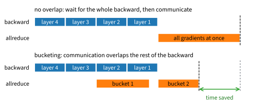

# Data Parallelism in Practice
:label:`sec_multi_gpu_concise`

In :numref:`sec_multi_gpu` we wrote data parallelism by hand, and a second
GPU made LeNet's steps slower. The exchange of gradients was not the main
cost. One Python thread issued the work of both GPUs, and LeNet's steps
were so short that the GPUs spent most of their time waiting for it. Our
loop had a second weakness, which those tiny steps never exposed. It
waited for the whole backward pass before it sent a single gradient,
although the gradients of the last layers are ready long before those of
the first.

The frameworks' own tools for data parallelism organize the host's work
for several GPUs, and they start the exchange while the backward pass is
still running. How the host's work is organized matters for steps as
short as LeNet's. To see what the early exchange is worth, we need a
model with enough work to share. A ResNet-18 on Fashion-MNIST images
enlarged to 64×64 pixels performs 2.2 billion multiply-adds per image,
about fifty for every byte of its 45 MB of gradients, where LeNet managed
fewer than two. A step on 256 such images keeps an RTX 4090 busy for
about a tenth of a second, which is plenty of time for any host. How
close does this model come to $k$ times the throughput of one GPU when it
trains on $k$ of them, and how much of the exchange can be hidden behind
the backward pass?

We first look at the two ways in which the tools drive several GPUs and at
how they overlap communication with computation. A one-step check against
a single GPU then tells us what the parallel step computes, and we measure
ResNet-18 on one, two, and four GPUs against the cost model of
:numref:`sec_multi_gpu`. The cells that time need two GPUs and the scaling
study four. The outputs shown come from our four RTX 4090s, which have no
peer-to-peer access (:numref:`subsec_hw-interconnects`), so every byte
that one of them sends to another passes through host memory.

```{.python .input #multi-gpu-practice-setup}
%%tab jax
# JAX and NCCL read these settings once, when they start, so this cell runs
# before the imports. XLA overlaps a collective with computation only when
# its latency-hiding scheduler is on. The 'vmm' allocator reserves nothing
# up front and maps each array into one contiguous range, where JAX's
# default allocator reserves most of every GPU at start-up and carves every
# array out of that block: one step below needs about 10 GB in one piece
# after many smaller arrays have come and gone, and a later cell starts a
# second JAX process on the same GPUs.
# On GPUs without peer-to-peer access, such as ours, set
# NCCL_LOCAL_REGISTER=0 in the environment before starting: NCCL's buffer
# registration fails there and prints a warning at every collective.
import os
os.environ.setdefault('XLA_PYTHON_CLIENT_ALLOCATOR', 'vmm')
os.environ['XLA_FLAGS'] = (os.environ.get('XLA_FLAGS', '') +
                           ' --xla_gpu_enable_latency_hiding_scheduler=true')
```

```{.python .input #multi-gpu-practice-multi-gpu-in-practice}
%%tab pytorch
import math
import numpy as np
import torch
from torch import nn
from torch.nn import functional as F
from d2l import torch as d2l
```

```{.python .input #multi-gpu-practice-multi-gpu-in-practice}
%%tab jax
import math
import numpy as np
import jax
from jax import numpy as jnp
from flax import nnx
import optax
from d2l import jax as d2l
```

```{.python .input #multi-gpu-practice-multi-gpu-in-practice-1}
%%tab jax
import json
import re
import subprocess
import sys
from jax.sharding import NamedSharding, PartitionSpec as P
```

```{.python .input #multi-gpu-practice-multi-gpu-in-practice-1}
%%tab pytorch
import json
import os
import random
import sys
```

## Production Data Parallelism
:label:`subsec_mgp-production`

Production data parallelism computes what the loop of
:numref:`subsec_mg-byhand` computes. Every GPU holds a copy of the model,
computes the gradient of the loss on its share of each minibatch, and
applies the average of the gradients of all shares. What the tools
change is everything around this algorithm: how the host's work is
organized, who writes the communication, and when it starts.

:begin_tab:`pytorch`
PyTorch also replaces our star through device 0 with the ring of
:numref:`subsec_mg-ring`, or with a tree for small messages, so that no
device carries the traffic of all the others. The collectives run in
NCCL, NVIDIA's library of collective operations.
:end_tab:

:begin_tab:`jax`
Our JAX loop already ran its `psum` through the ring of
:numref:`subsec_mg-ring` in NCCL, NVIDIA's library of collective
operations. What we drop is the communication code itself: the
`shard_map` and the `psum`, which every new model would have needed again.
:end_tab:

### The Execution Model

There are two ways to make $k$ GPUs train one model, and every current
system takes one of them. The first runs $k$ copies of an ordinary
program, one per GPU, which meet in a library of collective operations.
Each copy has a host thread of its own, so no GPU waits while the host
serves another, and any Python code may run in it. The communication is
explicit: a call to the library, or a wrapper around the model that makes
the calls. A *launcher* starts the $k$ copies and tells each one which it
is. The second way writes the step once, for a single device, and lets a
compiler partition it across the GPUs. Both ways run the same program on
different data, a scheme called *single program, multiple data* (SPMD);
they differ in who does the partitioning. Because the compiler sees the
whole step, it inserts the collectives itself and decides when each one
runs. The cost is that shapes must be static, and that we have to trust
the compiler's choices.

:begin_tab:`pytorch`
PyTorch takes the first way. `DistributedDataParallel` (DDP) wraps the
model and sends its allreduces through NCCL, and the launcher `torchrun`
starts $k$ copies of a script and gives each its *rank*, an index from 0
to $k-1$, in an environment variable. The older `nn.DataParallel` drives
all GPUs from one process, as our loop did; PyTorch recommends DDP even
within one machine.

A notebook is a single process, so we write each script as a string and
start it with the helper below, which collects the lines of JSON that the
processes print, in the order of their ranks. Each string is a complete
script: saved to a file, it runs from a shell as
`torchrun --standalone --nproc-per-node=2 script.py`, followed by its
arguments, which is how DDP is used outside a notebook. Every script
begins with `init_distributed`, which pins its process to the GPU that
`torchrun` assigned to it and joins the others.
:end_tab:

:begin_tab:`jax`
JAX takes the second way. `jax.jit` compiles a step, written for one
device, into one program, and the placement of its inputs decides how the
program is partitioned: the parameters are replicated on every GPU of a
mesh (`P()`), and the minibatch is split along its leading axis
(`P('data')`). Every GPU then computes the gradient of its shard. The
gradient of a parameter that is copied to every device is the sum of the
per-device gradients (:numref:`subsec_mg-byhand`), so the compiler inserts
the allreduce that we wrote by hand. JAX's partitioner, Shardy, propagates
the placements through the whole program in the manner of GSPMD
:cite:`Xu.Lee.Chen.ea.2021`.
:end_tab:

```{.python .input #multi-gpu-practice-one-program-per-gpu}
%%tab pytorch
#@save
import glob
import subprocess
import tempfile

def torchrun(script, nproc, *args, env=None):  #@save
    """Run Python source in nproc processes; return their JSON lines."""
    with tempfile.TemporaryDirectory() as tmp:
        path = os.path.join(tmp, 'script.py')
        with open(path, 'w') as f:
            f.write(script)
        launcher = os.path.join(os.path.dirname(sys.executable), 'torchrun')
        # Each process prints to a file of its own (--redirects 1), so that
        # the lines of different processes cannot interleave
        run = subprocess.run(
            [launcher, '--standalone', f'--nproc-per-node={nproc}',
             '--log-dir', tmp, '--redirects', '1', path, *map(str, args)],
            capture_output=True, text=True, env={**os.environ, **(env or {})})
        if run.returncode != 0:
            raise RuntimeError(run.stderr[-3000:])
        logs = sorted(glob.glob(f'{tmp}/*/attempt_0/*/stdout.log'),
                      key=lambda log: int(log.split(os.sep)[-2]))  # By rank
        return [json.loads(line) for log in logs for line in open(log)
                if line.startswith('{')]

def init_distributed():  #@save
    """Join the process group of torchrun; return the rank, the number of
    processes, and the GPU of this process."""
    device = torch.device('cuda', int(os.environ['LOCAL_RANK']))
    torch.cuda.set_device(device)
    torch.distributed.init_process_group('nccl', device_id=device)
    return (torch.distributed.get_rank(), torch.distributed.get_world_size(),
            device)
```

### Overlapping Communication with the Backward Pass

The production tools group the gradients into *buckets* of a few tens of
megabytes, in the order in which the backward pass produces them, last
layer first. They start the allreduce of a bucket as soon as its last
gradient exists :cite:`Li.Zhao.Varma.ea.2020`. While one bucket travels
between the GPUs, the GPUs compute the gradients of the next
(:numref:`fig_ddp_overlap`).


:label:`fig_ddp_overlap`

The size of a bucket is a compromise between the two parts of an
allreduce's time in :numref:`subsec_mg-accounting`: a fixed cost $\alpha$
per call, and a time $\beta_\textrm{link}$ for every byte sent.
Small buckets start early but incur $\alpha$ many times. A single bucket
for all gradients incurs $\alpha$ once, but it waits for the whole
backward pass. Whatever the size, the last bucket holds the gradients of
the first layers, which the backward pass computes last. Nothing is left
to overlap with it, so its time adds to every step.

The earlier buckets are hidden only if the links keep up. When an
allreduce takes longer than the backward pass needs to fill the next
bucket, the allreduces queue behind one another and run on after the
backward pass has ended. Overlap can shorten the communication of a step,
at best down to the last bucket, and only where the links are fast
enough. It cannot remove it. We call this account, in which every
allreduce but the last runs unseen beside the backward pass, the *bucket
model* of overlap, and we will test it.

:begin_tab:`pytorch`
In PyTorch, DDP registers a hook on every parameter that marks the
parameter's gradient as ready, and it starts the allreduce of a bucket
once all of the bucket's gradients are ready. The allreduces run on a CUDA
stream of their own, beside the backward kernels. A bucket is closed as
soon as it reaches its cap, 25 MiB (26.2 MB) by default (the argument
`bucket_cap_mb`), so it can exceed the cap by the tensor that crossed it.
DDP also caps the first bucket at 1 MiB, so that communication starts
early. ResNet-18's 45 MB of gradients form buckets of about 9, 26, and
9 MB: the first large gradient to arrive, a 9 MB convolution weight of
the last stage, overshoots the small cap on its own. The last bucket holds
the gradients of the first two thirds of the layers, which have few
channels and therefore few weights. (DDP builds these buckets only after
its first step, in the order in which the gradients became ready; this
detail can be forgotten once it has explained the sizes.)
:end_tab:

:begin_tab:`jax`
In JAX, the compiler does the bucketing. `jax.jit` compiles the whole
training step into one program, so XLA knows when each gradient is ready.
It merges the many small gradient allreduces into buffers of up to 30 MiB,
its counterpart of buckets (the flag
`--xla_gpu_all_reduce_combine_threshold_bytes` sets the limit), so
ResNet-18's 45 MB of gradients travel in two allreduces. Each allreduce
becomes an asynchronous pair of operations, `all-reduce-start` and
`all-reduce-done`, and XLA schedules computation between the two only when
its latency-hiding scheduler is on, which the first cell of this section
does.
:end_tab:

### The Training Step

Our model is the ResNet-18 of :numref:`sec_resnet` with a stem for small
images: a 3×3 convolution without max-pooling, followed by four stages of
two residual blocks each, with He initialization as in
:numref:`sec_resnet`. We save it, since the Image Models part
(:numref:`chap_cv`) trains it on several GPUs.

```{.python .input #multi-gpu-practice-ddp-really-run-1}
%%tab pytorch
def resnet18(num_classes, in_channels=1):  #@save
    """ResNet-18 for small images: a 3x3 stem without max-pooling, He
    initialization."""
    def stage(num_channels, first=False):
        return [d2l.Residual(num_channels, use_1x1conv=not first,
                             strides=1 if first else 2),
                d2l.Residual(num_channels)]
    net = nn.Sequential(
        # No stem bias: the batch normalization after the conv removes it
        nn.Conv2d(in_channels, 64, kernel_size=3, padding=1, bias=False),
        nn.BatchNorm2d(64), nn.ReLU(),
        *stage(64, first=True), *stage(128), *stage(256), *stage(512),
        nn.AdaptiveAvgPool2d(1), nn.Flatten(), nn.Linear(512, num_classes))
    with torch.no_grad():  # Create the lazy parameters of the blocks
        net.eval()(torch.zeros(1, in_channels, 32, 32))
    for m in net.modules():  # He initialization, zero biases
        if isinstance(m, (nn.Conv2d, nn.Linear)):
            nn.init.kaiming_normal_(m.weight, nonlinearity='relu')
            if m.bias is not None:
                nn.init.zeros_(m.bias)
    return net.train()
```

```{.python .input #multi-gpu-practice-ddp-really-run-1}
%%tab jax
def resnet18(num_classes, in_channels=1, *, rngs):  #@save
    """ResNet-18 for small images: a 3x3 stem without max-pooling, He
    initialization."""
    he = nnx.initializers.variance_scaling(2.0, 'fan_in', 'normal')
    def stage(num_channels, in_channels, first=False):
        return [d2l.Residual(num_channels, use_1x1conv=not first,
                             strides=1 if first else 2,
                             in_channels=in_channels, rngs=rngs),
                d2l.Residual(num_channels, in_channels=num_channels,
                             rngs=rngs)]
    return nnx.Sequential(
        # No stem bias: the batch normalization after the conv removes it.
        # Running averages decay 0.9, two-pass variance
        nnx.Conv(in_channels, 64, (3, 3), padding='same', use_bias=False,
                 kernel_init=he, rngs=rngs),
        nnx.BatchNorm(64, momentum=0.9, use_fast_variance=False, rngs=rngs),
        nnx.relu,
        *stage(64, 64, first=True), *stage(128, 64), *stage(256, 128),
        *stage(512, 256),
        lambda X: X.mean(axis=(1, 2)),  # Global average pooling
        nnx.Linear(512, num_classes, kernel_init=he, rngs=rngs))
```

As in :numref:`sec_multi_gpu`, every GPU keeps its own copy of the
training set, here enlarged once to 64×64 pixels, which takes 983 MB in
fp32. The input pipeline then stays out of our measurements, and the only
data that cross between GPUs are gradients. We also count the gradient
bytes $S$ that every step must sum across the GPUs:

```{.python .input #multi-gpu-practice-the-training-step-1}
%%tab pytorch
d2l.FashionMNIST()                   # Download once, before any process runs
num_params = d2l.num_params(resnet18(10))
S = 4 * num_params                   # Gradient bytes in fp32
print(f'{num_params / 1e6:.1f}M parameters, S = {S / 1e6:.0f} MB')
```

```{.python .input #multi-gpu-practice-the-training-step-1}
%%tab jax
data = d2l.FashionMNIST()
X_train = jax.image.resize(data.train[0][..., None] / np.float32(255),
                           (len(data.train[0]), 64, 64, 1), 'bilinear')
y_train = jnp.asarray(data.train[1], jnp.int32)
num_params = d2l.num_params(resnet18(10, rngs=nnx.Rngs(d2l.get_key())))
S = 4 * num_params                   # Gradient bytes in fp32
print(f'{num_params / 1e6:.1f}M parameters, S = {S / 1e6:.0f} MB')
```

:begin_tab:`pytorch`
The training script follows. Only two parts of it are data-parallel:
`init_distributed`, which joins the process to the others, and the `DDP`
wrapper around the model. The rest is a single-GPU training loop. Every
process takes its own slice of each global minibatch of $kb$ examples:
all processes draw the same random permutation, because they share a
seed, and the process of rank $r$ takes the $r$-th of the $k$ slices of
$b$ examples. (For data that stay in host memory, `DistributedSampler`
performs the same split for a `DataLoader`.) The script prints the
seconds per step, timed with `d2l.Benchmark` (:numref:`sec_perf_model`);
its arguments `sync` and `profile` serve the last measurement of this
section.
:end_tab:

:begin_tab:`jax`
The training step itself contains no parallel code. Its argument `idx`,
the indices of the minibatch's examples, arrives split across the GPUs of
the mesh, so every GPU gathers its own examples from its copy of the
training set, and the compiler takes care of the rest. `setup` builds the
model and the optimizer and replicates them, with the training set, on the
first $k$ GPUs; `minibatches` draws random minibatches and splits their
indices across the mesh. The mesh axis is of type `Auto`, which lets the
compiler derive the placement of every intermediate array, here the
gathered examples, from the placement of the inputs.
:end_tab:

```{.python .input #multi-gpu-practice-ddp-really-run-2}
%%tab pytorch
TRAIN_DDP = r'''
import contextlib, json, sys, torch
import torch.distributed as dist
from torch.nn import functional as F
from torch.nn.parallel import DistributedDataParallel as DDP
from d2l import torch as d2l

rank, k, device = d2l.init_distributed()
torch.backends.cudnn.benchmark = True  # Tune convolutions for fixed shapes
# b examples per GPU and step; sync=0 skips the gradient allreduce, and
# profile=1 also reports the device time per step of NCCL and other kernels
b, num_steps, seed, sync, profile = map(int, sys.argv[1:])
torch.manual_seed(seed)                # The same permutations everywhere

data = d2l.FashionMNIST().train        # A copy on every GPU, at 64 x 64
X = F.interpolate(data.data.to(device)[:, None] / 255, 64, mode='bilinear')
y = data.targets.to(device)
model = DDP(d2l.resnet18(10).to(device), device_ids=[device])
opt = torch.optim.SGD(model.parameters(), lr=0.1)

def minibatches():
    """This process's b examples of every global minibatch of k * b."""
    while True:
        perm = torch.randperm(len(y), device=device)
        for s in range(len(y) // (k * b)):
            yield perm[(s * k + rank) * b:][:b]

def train_step(i):
    opt.zero_grad(set_to_none=True)
    # Under no_sync, which must enclose the forward pass as well, each GPU
    # keeps its own gradient
    with model.no_sync() if not sync else contextlib.nullcontext():
        F.cross_entropy(model(X[i]), y[i]).backward()
    opt.step()

batches = minibatches()
t = d2l.Benchmark(lambda: train_step(next(batches)), warmup=10,
                  repeats=num_steps).time
result = {'rank': rank, 'step_time': t}
if profile:
    kernels = d2l.kernel_times(lambda: train_step(next(batches)))
    result['comm'] = sum(ms for name, ms in kernels.items() if 'nccl' in name)
    result['compute'] = sum(kernels.values()) - result['comm']
print(json.dumps(result))
dist.destroy_process_group()
'''
```

```{.python .input #multi-gpu-practice-jax-annotate-the-layout-the-compiler-writes-the-collectives-1}
%%tab jax
def setup(k, key):
    """ResNet-18 with SGD and the training set, replicated on k GPUs."""
    mesh = jax.make_mesh((k,), ('data',), devices=jax.devices()[:k],
                         axis_types=(jax.sharding.AxisType.Auto,))
    replicated = NamedSharding(mesh, P())
    model = resnet18(10, rngs=nnx.Rngs(key))
    opt = nnx.Optimizer(model, optax.sgd(0.1), wrt=nnx.Param)
    for m in (model, opt):
        nnx.update(m, jax.device_put(nnx.state(m), replicated))
    return mesh, model, opt, jax.device_put((X_train, y_train), replicated)

def minibatches(mesh, batch_size):
    """Indices of random minibatches, split across the GPUs of the mesh."""
    rng, n = np.random.default_rng(), len(y_train)
    while True:
        perm = rng.permutation(n)
        for i in range(0, n - batch_size + 1, batch_size):
            yield jax.device_put(perm[i:i + batch_size],
                                 NamedSharding(mesh, P('data')))

@nnx.jit
def train_step(model, opt, X, y, idx):
    """One SGD step on the examples idx, written for a single device."""
    def loss_fn(model):
        return optax.softmax_cross_entropy_with_integer_labels(
            model(X[idx]), y[idx]).mean()
    loss, grads = nnx.value_and_grad(loss_fn)(model)
    opt.update(model, grads)
    return loss
```

### A One-Step Check

Before timing anything, we check, as in :numref:`subsec_mg-byhand`, that
a step on two GPUs computes what we expect. The reference is one GPU, from
the same initialization and on the same 256 examples, in full fp32
arithmetic so that rounding differences stay small. The layer to watch is
batch normalization (:numref:`sec_batch_norm`), which normalizes every
channel with the mean and the variance over the minibatch. Once the
minibatch is split across GPUs, that definition is ambiguous. Each GPU can
normalize its shard with the statistics of the shard, which costs no
communication but no longer computes the single-GPU step on the whole
minibatch. Or the GPUs can compute the statistics of the whole minibatch
together, which reproduces the single-GPU step but needs small allreduces
in every normalization layer, in the forward and in the backward pass.
An implementation has to choose, and it does not announce its choice at
run time. A comparison with one GPU finds it out.

:begin_tab:`pytorch`
The script below takes one DDP step on $k$ GPUs, each GPU on its half of
256 random images. Process 0 also keeps an unwrapped copy of the model and
takes two reference steps on its GPU: one on all 256 examples at once, and
one that accumulates the gradients of the same two halves before it
updates the parameters.
:end_tab:

:begin_tab:`jax`
`update(k, idx)` returns the change of the parameters in one step on $k$
GPUs, always from the same initialization. We take this step on two GPUs
and compare it with two references on one GPU: one step on all 256
examples, and the mean of the steps on the two halves. For plain SGD
from one starting point, that mean is the step on the accumulated
gradients of the halves (:numref:`subsec_mp-accumulation`).
:end_tab:

```{.python .input #multi-gpu-practice-jax-annotate-the-layout-the-compiler-writes-the-collectives-5}
%%tab pytorch
CHECK_DDP = r'''
import copy, json, sys, torch
import torch.distributed as dist
from torch.nn import functional as F
from torch.nn.parallel import DistributedDataParallel as DDP
from d2l import torch as d2l

rank, k, device = d2l.init_distributed()
torch.backends.cudnn.allow_tf32 = False  # Full fp32 convolutions
torch.manual_seed(int(sys.argv[1]))      # The same model and data everywhere
X = torch.rand(256, 1, 64, 64, device=device)
y = torch.randint(0, 10, (256,), device=device)
model = d2l.resnet18(10).to(device)
ref = copy.deepcopy(model)               # An unwrapped copy for one GPU

def update(net, shards):
    """Parameter change of one SGD step on the mean loss over the shards."""
    before = [p.detach().clone() for p in net.parameters()]
    for X_j, y_j in shards:
        (F.cross_entropy(net(X_j), y_j) / len(shards)).backward()
    with torch.no_grad():
        for p, b in zip(net.parameters(), before):
            p -= 0.1 * p.grad
    return [p.detach() - b for p, b in zip(net.parameters(), before)]

ddp = update(DDP(model, device_ids=[device]),
             [(X.chunk(k)[rank], y.chunk(k)[rank])])
if rank == 0:
    gap = lambda u: max((a - b).abs().max().item() for a, b in zip(ddp, u))
    halves = update(copy.deepcopy(ref), list(zip(X.chunk(k), y.chunk(k))))
    print(json.dumps({'largest': max(u.abs().max().item() for u in ddp),
                      'full': gap(update(ref, [(X, y)])),
                      'halves': gap(halves)}))
dist.destroy_process_group()
'''
if d2l.num_gpus() >= 2:
    r = d2l.torchrun(CHECK_DDP, 2, random.getrandbits(32))[0]
    print(f"largest update {r['largest']:.1e}\n"
          f"largest difference from one GPU on all 256: {r['full']:.1e}\n"
          f"largest difference from one GPU on two accumulated halves: "
          f"{r['halves']:.1e}")
```

```{.python .input #multi-gpu-practice-jax-annotate-the-layout-the-compiler-writes-the-collectives-5}
%%tab jax
key = d2l.get_key()                   # One initialization for every step
idx = np.random.default_rng().permutation(len(y_train))[:256]

def update(k, idx):
    """Parameter change of one step on k GPUs on the examples idx."""
    mesh, model, opt, (X, y) = setup(k, key)
    before = jax.tree.map(np.asarray, nnx.state(model, nnx.Param))
    train_step(model, opt, X, y,
               jax.device_put(idx, NamedSharding(mesh, P('data'))))
    return jax.tree.leaves(jax.tree.map(lambda p, b: np.asarray(p) - b,
                                        nnx.state(model, nnx.Param), before))

with jax.default_matmul_precision('highest'):  # Full fp32 convolutions
    two = update(min(2, jax.device_count()), idx)
    full = update(1, idx)
    # For SGD, the mean of the steps on the two halves is the step on
    # their accumulated gradients
    halves = [(a + b) / 2 for a, b in zip(*(update(1, half)
                                            for half in np.split(idx, 2)))]
gap = lambda u: max(np.abs(a - b).max() for a, b in zip(two, u))
print(f'largest update {max(np.abs(u).max() for u in two):.1e}\n'
      f'largest difference from one GPU on all 256: {gap(full):.1e}\n'
      f'largest difference from one GPU on two accumulated halves: '
      f'{gap(halves):.1e}')
```

:begin_tab:`pytorch`
The DDP step agrees with the accumulated halves to about $10^{-7}$, which
is rounding error, but it differs from the step on all 256 examples by a
few hundredths to a tenth of the largest update, depending on the run. DDP
normalizes each GPU's shard with the statistics of that shard. It computes
what one GPU computes when it accumulates the gradients of the same shards
(:numref:`subsec_mp-accumulation`), not the step on the whole minibatch,
and nothing warns us of the difference. A gap of this size sounds
alarming, yet both steps are legitimate batch normalization, one with
statistics over 128 examples and one with statistics over 256. The choice
starts to matter when a GPU holds only a few examples, whose mean and
variance are noisy. `nn.SyncBatchNorm` then computes the statistics over
the whole minibatch, with the added collectives (exercise
:exref:`ex_mgp-syncbn`).
:end_tab:

:begin_tab:`jax`
The check settles the question by itself. The two-GPU step differs from
one GPU on all 256 examples by $10^{-4}$ or less, about two orders of
magnitude less than from the accumulated halves, which miss by a tenth of
the largest update or more. The first gap is of the size that summing
the same numbers in a different order produces in this network: on two
GPUs, every weight gradient and every batch-norm statistic is summed in
two parts, one per GPU, before the parts are added. The second gap is
what per-shard statistics would cost. So the sharded step is the step on
the whole minibatch.

The reason lies in the program. Under `jit`, the mean and the variance of
a batch normalization layer are means over an axis that is split across
the GPUs, so the compiler computes them over the whole minibatch and
inserts allreduces for them, exactly as it does for the gradients. We can
find these allreduces in the compiled program. `allreduce_megabytes`
reads every allreduce instruction in its text and adds up the sizes of
the fp32 arrays that it returns.
:end_tab:

```{.python .input #multi-gpu-practice-a-one-step-check-1}
%%tab jax
def allreduce_megabytes(compiled):  #@save
    """Megabytes of fp32 results of each allreduce in a compiled program,
    largest first."""
    sizes = []
    for line in compiled.as_text().splitlines():
        # A synchronous all-reduce, or the -done half of an asynchronous
        # pair, whose result type lists the summed arrays only
        if re.search(r' all-reduce(-done)?\(', line):
            result = line.split(' = ')[1].split(' all-reduce')[0]
            sizes.append(sum(4 * math.prod(map(int, dims.split(',')))
                             for dims in re.findall(r'f32\[([\d,]+)\]',
                                                    result)) / 1e6)
    return sorted(sizes, reverse=True)
```

```{.python .input #multi-gpu-practice-jax-annotate-the-layout-the-compiler-writes-the-collectives-3}
%%tab jax
mesh, model, opt, (X, y) = setup(jax.device_count(), d2l.get_key())
idx = next(minibatches(mesh, 256 * mesh.size))
compiled = train_step.lower(model, opt, X, y, idx).compile()
sizes = allreduce_megabytes(compiled)  # One entry per allreduce
big = [m for m in sizes if m > 1]      # Gradient buffers, above 1 MB
print(f'{len(sizes)} allreduces: {len(big)} of '
      f'{" and ".join(f"{m:.1f}" for m in big)} MB, the other '
      f'{len(sizes) - len(big)} of {sum(sizes) - sum(big):.2f} MB together')
```

:begin_tab:`jax`
Two large allreduces carry almost all of the 45 MB of gradients: XLA
merged the gradients of the many parameter tensors into two buffers. The
74 small ones carry vectors of one number per channel, a few per call,
most of them the statistics of the batch normalization layers. Their
presence confirms that the statistics are global. They are cheap in
bytes, but each of them incurs the fixed cost $\alpha$, and each lies on
the path of the forward or the backward pass, because the next layer
needs its result.
:end_tab:

## Scaling on Four GPUs
:label:`subsec_mgp-scaling`

We measure both conventions of :numref:`subsec_mg-accounting`. Weak
scaling holds the minibatch per GPU fixed while the number of GPUs $k$
grows, and reports examples per second. It is the flattering convention,
since the global minibatch grows with $k$, and a larger minibatch changes
the optimization (:numref:`sec_batch_size`). Strong scaling holds the
global minibatch fixed and reports how much sooner a step finishes, which
is what a training run with a tuned minibatch sees. The function
`step_time(k, b)` returns the seconds per step on $k$ GPUs with $b$
examples per GPU, averaged over 50 steps after a warm-up.

```{.python .input #multi-gpu-practice-jax-annotate-the-layout-the-compiler-writes-the-collectives-4}
%%tab pytorch
def step_time(k, b, num_steps=50):
    """Seconds per DDP step on k GPUs with b examples per GPU."""
    ranks = d2l.torchrun(TRAIN_DDP, k, b, num_steps, random.getrandbits(32),
                         1, 0)          # Allreduce the gradients, no profile
    return max(r['step_time'] for r in ranks)
```

```{.python .input #multi-gpu-practice-jax-annotate-the-layout-the-compiler-writes-the-collectives-4}
%%tab jax
def stepper(k, b):
    """One data-parallel step on k GPUs with b examples per GPU, as a
    function without arguments."""
    mesh, model, opt, (X, y) = setup(k, d2l.get_key())
    batches = minibatches(mesh, k * b)
    return lambda: train_step(model, opt, X, y, next(batches))

def step_time(k, b, num_steps=50):
    """Seconds per data-parallel step on k GPUs with b examples per GPU."""
    return d2l.Benchmark(stepper(k, b), warmup=10, repeats=num_steps).time
```

Weak scaling first, with 256 examples per GPU:

```{.python .input #multi-gpu-practice-ddp-really-run-3}
%%tab pytorch, jax
ks = [k for k in (1, 2, 4) if k <= d2l.num_gpus()]
weak = {k: step_time(k, 256) for k in ks}
for k in ks:
    print(f'{k} GPU(s): {k * 256 / weak[k]:5.0f} examples/s, speedup '
          f'{k * weak[1] / weak[k]:.2f}, efficiency {weak[1] / weak[k]:.0%}')
```

Two GPUs process somewhat less than twice as many examples per second as
one, and four GPUs a little over three times as many. The *efficiency*,
the speedup divided by $k$, falls gradually as GPUs are added. Under weak
scaling every GPU does the same work at every $k$, so the efficiency is
the ratio of the single-GPU step time to the step time on $k$ GPUs. What
it loses is the communication that the step does not hide.

:begin_tab:`pytorch`
Here the efficiency is 88% on two GPUs and 83% on four. Four GPUs give 3.3
times the throughput of one, so a sixth of the machine goes to moving
45 MB per step through host memory. On two GPUs a step takes about 15 ms
longer than on one (127 against 112 ms), and the next subsection asks where
those milliseconds go.
:end_tab:

:begin_tab:`jax`
Here the efficiency is 84% on two GPUs and 77% on four. Four GPUs give 3.1
times the throughput of one, so almost a quarter of the machine goes to
communication. On two GPUs a step takes about 19 ms longer than on one
(119 against 100 ms), and the next subsection asks where those
milliseconds go.
:end_tab:

Four GPUs, in other words, do the work of a little over three. For a model
that sends 45 MB through host memory at every step this is respectable,
and at the end of this section the cost model predicts that the same model
on GPUs with a direct link would lose almost nothing.

Strong scaling holds the global minibatch at 512, so each of the $k$ GPUs
processes $512/k$ examples while the allreduce keeps its size:

```{.python .input #multi-gpu-practice-ddp-really-run-4}
%%tab pytorch, jax
strong = {k: step_time(k, 512 // k) for k in ks}
for k in ks:
    print(f'{k} GPU(s), {512 // k} examples each: speedup '
          f'{strong[1] / strong[k]:.2f}, efficiency '
          f'{strong[1] / strong[k] / k:.0%}')
d2l.plot(ks, [ks, [k * weak[1] / weak[k] for k in ks],
              [strong[1] / strong[k] for k in ks]], 'GPUs', 'speedup',
         legend=['linear', 'weak (256 per GPU)', 'strong (512 in all)'],
         fmts=('k:', '-o', '--s'))
```

At two GPUs the two conventions time the same run, 256 examples per GPU.
They differ only in the one-GPU reference, 256 or 512 examples, and one
RTX 4090 processes both at about the same rate per example, so the
speedups agree. At four GPUs they part. Strong scaling leaves each GPU
128 examples per step, so the step's computation shrinks while its
communication does not, and the efficiency falls well below that of weak
scaling. A training run with a fixed
minibatch finishes less than three times sooner on four GPUs.

### Predicted and Measured Communication

Under weak scaling the computation on each GPU does not change with $k$,
so the difference $t_{\textrm{step}}(k) - t_{\textrm{step}}(1)$ is the
communication that a step exposes. The cost model :eqref:`eq_dp_cost` of
:numref:`subsec_mg-accounting` charges this communication two terms: $c$
fixed costs $\alpha$, one per allreduce call, and the time for every GPU
to send $2(k-1)/k$ times the $S$ gradient bytes, $\beta_\textrm{link}$
per byte. For the large
allreduces that carry the gradients, the fixed costs are small next to
the bytes.

If nothing overlaps, the whole allreduce is exposed: $S\,\beta_\textrm{link}$
at $k = 2$. The bucket model makes a bolder prediction. Only the
allreduce of the last bucket remains exposed, provided that the earlier
ones finish while the backward pass still runs.

:begin_tab:`pytorch`
DDP sends the gradients in three buckets, and the statistics of batch
normalization stay on each GPU, so the step makes three allreduce calls,
plus a small broadcast of the batch normalization running averages from
rank 0 before every forward pass.
:end_tab:

:begin_tab:`jax`
XLA sends the gradients in two buffers. The 74 small allreduces of the
batch normalization statistics add 74 fixed costs, which the prediction
below leaves out; exercise :exref:`ex_mgp-syncbn` measures them.
:end_tab:

We measure $\beta_\textrm{link}$ as in :numref:`subsec_mg-accounting`,
with a bare allreduce of 256 MB per GPU on two GPUs, through the library
that the training uses:

:begin_tab:`pytorch`
`ALLREDUCE` times `torch.distributed.all_reduce` through NCCL in every
process of a two-process launch.
:end_tab:

:begin_tab:`jax`
`ALLREDUCE` times the `psum` of :numref:`sec_multi_gpu` on two GPUs. NCCL
reads its configuration once per process, and we will change that
configuration below, so the measurement runs in a fresh Python process of
its own.
:end_tab:

```{.python .input #multi-gpu-practice-communication-predicted-and-measured-1}
%%tab pytorch
ALLREDUCE = r'''
import json, torch
import torch.distributed as dist
from d2l import torch as d2l

_, _, device = d2l.init_distributed()
x = torch.zeros(2**26, device=device)   # 64M floats: 256 MB
t = d2l.Benchmark(lambda: dist.all_reduce(x), repeats=10).time
print(json.dumps({'beta_link': t / x.nbytes}))  # Each GPU sends S at k = 2
dist.destroy_process_group()
'''
def allreduce_beta(env=None):
    """beta_link of a bare 256 MB allreduce on two GPUs: the seconds
    per byte that each GPU sends."""
    return max(r['beta_link'] for r in d2l.torchrun(ALLREDUCE, 2, env=env))
```

```{.python .input #multi-gpu-practice-communication-predicted-and-measured-1}
%%tab jax
ALLREDUCE = r'''
import json, jax
from jax import numpy as jnp
from jax.sharding import NamedSharding, PartitionSpec as P
from d2l import jax as d2l

mesh = jax.make_mesh((2,), ('data',), devices=jax.devices()[:2])
x = jnp.zeros((2, 2**26), device=NamedSharding(mesh, P('data')))  # 256 MB
psum = jax.jit(jax.shard_map(lambda x: jax.lax.psum(x, 'data'), mesh=mesh,
                             in_specs=P('data'), out_specs=P('data')))
t = d2l.Benchmark(lambda: psum(x), repeats=10).time
print(json.dumps({'beta_link': t / (x.nbytes / mesh.size)}))  # S per GPU
'''
def allreduce_beta(env=None):
    """beta_link of a bare 256 MB allreduce on two GPUs: the seconds
    per byte that each GPU sends."""
    run = subprocess.run([sys.executable, '-c', ALLREDUCE], check=True,
                         capture_output=True, text=True,
                         env={**os.environ, **(env or {})})
    return json.loads(run.stdout.splitlines()[-1])['beta_link']
```

```{.python .input #multi-gpu-practice-ddp-really-run-5}
%%tab pytorch, jax
if d2l.num_gpus() >= 2:
    beta_link = allreduce_beta()
    print(f'bus bandwidth = {1e-9 / beta_link:.2f} GB/s '
          f'(beta_link = {1e9 * beta_link:.2f} ns/byte)')
    for k in ks[1:]:
        ring = 2 * (k - 1) / k     # Bytes that each GPU sends, per byte of S
        print(f'k={k}: predicted {ring:.1f} S beta_link = '
              f'{1e3 * ring * S * beta_link:.0f} ms, measured exposed '
              f'{1e3 * (weak[k] - weak[1]):.0f} ms per step')
```

Each GPU sends at about 2.4 GB/s. An allreduce of ResNet-18's gradients
that nothing overlaps takes about 18.5 ms on two GPUs and, with the ring
factor of 1.5, about 28 ms on four. The measured exposed times are close
to these numbers, and from two GPUs to four they grow by about half, as
the ring factor predicts. The cost model gets the bytes right. Overlap
hides far less of the communication on this machine than the bucket
model predicts.

:begin_tab:`pytorch`
DDP's last bucket holds 8.7 of the 45 MB of gradients, so with full overlap
a step would expose a fifth of $S\,\beta_\textrm{link}$, about 4 ms, not the
15 ms measured.
:end_tab:

:begin_tab:`jax`
With full overlap a step would expose only the last of XLA's two gradient
buffers. Their sizes, about 26 and 19 MB, put that bound at 8 to 11 ms,
depending on which comes last, against the 19 ms measured.
:end_tab:

The bucket model makes three assumptions: every allreduce starts as soon
as its bucket is complete, it runs as fast as the bare benchmark, and the
backward kernels beside it run as fast as they do alone. Which of the
three fails? To find out, we time one more configuration, two GPUs that
skip the communication and step each on its own shard's gradient. Its
difference from the one-GPU step is what two GPUs cost each other. Its
difference from the full two-GPU step is what the communication costs,
including any slowdown of the kernels beside it.

For each configuration `profile_step` also profiles ten steps on GPU 0, as
in :numref:`sec_perf_model`, and splits the device time per step into
NCCL's kernels and all others. If the bucket model held, the step without
communication would match the one-GPU step, NCCL's kernels would run for
about $S\,\beta_\textrm{link}$, 18.5 ms, and the other kernels would take as
long as on one GPU.

:begin_tab:`pytorch`
Without communication, the forward and the backward pass run inside DDP's
`no_sync()`. It must enclose the forward pass as well, because DDP decides
during the forward pass whether the coming backward pass synchronizes.
:end_tab:

:begin_tab:`jax`
Without communication, `train_step` runs inside a `shard_map` with
`check_vma=False`, so autodiff adds no sum over the GPUs and the compiled
step contains no collective. The step with communication also runs the
small allreduces of the batch normalization statistics, and the step
without it normalizes each shard with its own statistics. The time of
NCCL's kernels below therefore includes those collectives as well as the
two gradient buffers.
:end_tab:

```{.python .input #multi-gpu-practice-predicted-and-measured-communication-2}
%%tab pytorch
def profile_step(k, b, communicate=True):
    """Seconds per DDP step on k GPUs with b examples per GPU, and device
    milliseconds per step on GPU 0 of computation and of NCCL's kernels;
    without communication, every GPU steps on its own shard's gradient."""
    ranks = d2l.torchrun(TRAIN_DDP, k, b, 50, random.getrandbits(32),
                         int(communicate), 1)
    return (max(r['step_time'] for r in ranks), ranks[0]['compute'],
            ranks[0]['comm'])
```

```{.python .input #multi-gpu-practice-predicted-and-measured-communication-2}
%%tab jax
def local_stepper(k, b):
    """The step of `stepper` without communication: inside shard_map every
    GPU sees only its shard, normalizes it with the shard's own batch
    statistics, and steps on its own shard's gradient."""
    mesh, model, opt, (X, y) = setup(k, d2l.get_key())
    batches = minibatches(mesh, k * b)
    graphdef, state = nnx.split((model, opt))
    def local(state, X, y, idx):
        model, opt = nnx.merge(graphdef, state)
        train_step(model, opt, X, y, idx)
        return nnx.state((model, opt))
    # With check_vma=False autodiff adds no sum over the GPUs, and the
    # copies, which then drift apart, are returned as if they were equal
    local = jax.jit(jax.shard_map(local, mesh=mesh, check_vma=False,
                                  in_specs=(P(), P(), P(), P('data')),
                                  out_specs=P()))
    def step():
        nonlocal state
        state = local(state, X, y, next(batches))
        return state
    return step

def profile_step(k, b, communicate=True):
    """Seconds per step on k GPUs with b examples per GPU, and device
    milliseconds per step on GPU 0 of computation and of NCCL's kernels:
    the two gradient allreduces and the small allreduces of the batch
    normalization statistics."""
    step = stepper(k, b) if communicate else local_stepper(k, b)
    t = d2l.Benchmark(step, warmup=10, repeats=50).time
    kernels = d2l.kernel_times(step)
    comm = sum(ms for name, ms in kernels.items() if 'nccl' in name.lower())
    return t, sum(kernels.values()) - comm, comm
```

```{.python .input #multi-gpu-practice-predicted-and-measured-communication-1}
%%tab pytorch, jax
if d2l.num_gpus() >= 2:
    for k, communicate in ((1, True), (2, False), (2, True)):
        t, compute, comm = profile_step(k, 256, communicate)
        name = f'{k} GPU' + ('s' if k > 1 else '') + (
            '' if communicate else ' without communication')
        print(f'{name + ":":30s}{1e3 * t:6.1f} ms per step; GPU 0 computes '
              f'{compute:6.1f} ms, communicates {comm:5.1f} ms')
```

The first two lines agree to within half a millisecond: two GPUs that do
not communicate step as fast as one. The host, which held LeNet back in
:numref:`sec_multi_gpu`, plays no part here. With about a tenth of a
second of device work per step, even one Python thread would keep two
GPUs fed, so how the tools organize the host costs nothing and gains
nothing for this model. All of the extra time is communication.

NCCL's kernels run for 20 to 22 ms per step, close to the 18.5 ms of the
bare benchmark, so the allreduces run about as fast as they do alone and
the second assumption holds. What fails is the third: the computation
kernels take longer when an allreduce runs beside them. Between our GPUs,
NCCL moves the bytes through host memory with GPU kernels of its own,
which most likely hold some of the GPU's processors for as long as an
allreduce runs, leaving fewer for the backward pass. This is the main
result of the section, and the bucket model has no term for it. Overlap
hides communication only by running it beside computation, and on this
machine the time it hides comes back, for the most part, as slower
computation.

:begin_tab:`pytorch`
The step is hardly longer than its computation kernels (127 against
125 ms), so little of the allreduce runs alone, as the buckets intend.
The two numbers come from different measurements, the wall clock of 50
steps and the kernel time of ten, so their difference is not precise to
a millisecond. But the computation kernels now take 125 ms instead of
112 ms. Overlap works, and about 13 of the 18 ms that it hides come back
as slower computation.
:end_tab:

:begin_tab:`jax`
For about 11 ms of the step GPU 0 only communicates (about 119 against
108 ms of computation). These 11 ms hold the last gradient buffer,
which full overlap would leave exposed (8 to 11 ms), and some of the small
allreduces of the statistics, which nothing can hide. The other 10 ms of
NCCL's kernels run beside the computation, which takes 8 ms longer than
without communication. Most of what overlap hides comes back as slower
computation.
:end_tab:

Why is the bus bandwidth so low in the first place? A copy between two
of our GPUs, staged through host memory, can run at up to about 23 GB/s,
the rate of a pinned copy from host memory
(:numref:`subsec_hw-interconnects`). That is ten times the 2.4 GB/s at
which each GPU sends during the allreduce. Between GPUs without
peer-to-peer access, NCCL by default copies the data into and out of
buffers in host memory with its own GPU kernels, the kernels that we just
saw compete with the computation. The *copy engines*, the units that
perform a GPU's memory copies, move the same bytes faster.

:begin_tab:`pytorch`
We have seen them at work already. Our star of :numref:`sec_multi_gpu`
reached a bus bandwidth of about 9.5 GB/s between the same two
GPUs, two copies one after the other at about 19 GB/s each, because its
copies were driver-managed copies, which run on the copy engines. On this
machine the production library, at its default settings, sends bytes four
times more slowly than our hand-written star.
:end_tab:

The NCCL setting `NCCL_SHM_USE_CUDA_MEMCPY=1` makes NCCL use the copy
engines. It is not part of NCCL's documented configuration, and later
versions removed it. We measure the bare allreduce with it:

```{.python .input #multi-gpu-practice-ddp-really-run-6}
%%tab pytorch, jax
if d2l.num_gpus() >= 2:
    # An undocumented parameter of NCCL's transport through host memory. It
    # exists in NCCL 2.28.9 (bundled with PyTorch 2.11) and 2.30.4 (with
    # jaxlib 0.12); the library of NCCL 2.31.2 no longer contains it
    beta_ce = allreduce_beta({'NCCL_SHM_USE_CUDA_MEMCPY': '1'})
    print(f'bus bandwidth {1e-9 / beta_link:.2f} GB/s by default, '
          f'{1e-9 / beta_ce:.2f} GB/s with the copy engines '
          f'({beta_link / beta_ce:.1f}x)')
```

The bare allreduce runs four to five times faster, and the predicted
communication of ResNet-18 falls from about 18.5 ms to about 4 ms. It is
tempting to switch it on and declare victory. The setting helps only on
machines whose GPUs lack peer-to-peer access, only with the NCCL versions
that still contain it, and only if the training run survives it.

:begin_tab:`pytorch`
On our machine, DDP training with the setting deadlocks within seconds,
although the same collectives complete in the bare benchmark (exercise
:exref:`ex_mgp-transport`).
:end_tab:

:begin_tab:`jax`
On our machine the training step of this section completes with the
setting, in a run outside this notebook. One run gives no range, so how
much faster it trains is left to exercise :exref:`ex_mgp-transport`,
which measures it with repeats.
:end_tab:

We train with NCCL's default. A setting that is not documented, and that
later versions removed, is no basis for a training run, and one that
speeds up a benchmark of bare collectives has to be checked on the
training run itself.

On a machine whose GPUs share an NVLink domain, each GPU exchanges data
with the others at 450 GB/s in each direction on the H100 (NVLink 4) and
at 900 GB/s on the B200 (NVLink 5), hundreds of times the rate measured
here (:numref:`subsec_hw-interconnects`). The allreduce of ResNet-18's
gradients then takes well under a millisecond, and the cost model predicts
near-linear scaling for this model with or without overlap. How well a
model scales is decided as much by the wires between the GPUs as by the
GPUs themselves.

Data parallelism, however well organized, leaves a full copy of the
training state on every GPU, 16 bytes per parameter for Adam in fp32
(:numref:`sec_memory_precision`), so it makes no room for a larger model;
:numref:`sec_sharding` divides that state among the GPUs.

## Summary

Production data parallelism computes what the hand-written loop computes.
It drives $k$ GPUs either as $k$ copies of a program that meet in a
library of collective operations or as one program that a compiler
partitions, and it groups the gradients into buckets whose allreduces
start while the backward pass is still running. A one-step check against
one GPU shows what the parallel step computes; under batch normalization
an implementation must choose between per-shard and global statistics,
and the check, set against both references, tells which.
On our four RTX 4090s, which exchange gradients through host memory,
four GPUs do the work of a little over three for ResNet-18, and two GPUs
that do not communicate step as fast as one. The exposed communication is
close to the cost model's time for an allreduce that nothing overlaps,
because the computation beside an allreduce slows down by most of the
time that overlap hides. Over NVLink the cost model predicts that the
same model would lose almost nothing.

## Exercises

:begin_tab:`pytorch`
1. [code] **Splitting the data.** In `TRAIN_DDP` every process takes its
   own slice of each global minibatch: all processes draw the same
   permutation, and the process of rank $r$ takes the slice that starts at
   $(sk + r)b$ in step $s$.
    1. Remove the rank from this offset, so that every process takes the
       same $b$ examples. Predict what `step_time` reports at $k = 2$
       relative to the correct script, and which global minibatch the
       averaged gradient corresponds to. Then check, with each process
       printing a checksum of its first minibatch.
    1. Restore the offset and give each process a seed of its own. Which
       property of the split is lost, and does it matter for training?
    1. Name a check that catches the first mistake and is cheap enough to
       run at every launch.
:end_tab:

:begin_tab:`jax`
1. [code] **Splitting the data.** `minibatches` places the indices with
   `P('data')`, which splits them across the GPUs of the mesh.
    1. Place them with `P()` instead, which gives every GPU all indices.
       Predict which collectives the compiled `train_step` then contains
       and how `step_time(2, 256)` compares with `step_time(1, 256)`, and
       check both.
    1. Restore `P('data')` and, inside `train_step`, constrain the gathered
       images `X[idx]` to `NamedSharding(mesh, P(None, 'data'))` with
       `jax.lax.with_sharding_constraint`, with `mesh` taken from the
       enclosing scope, which splits the height of every image across the
       GPUs. Which values
       must neighboring GPUs exchange for a $3 \times 3$ convolution, and
       which collective does that take? Find it in the compiled
       `train_step`.
:end_tab:

2. **Weak-scaling extrapolation.** Suppose that a step on $k$ GPUs takes
   the single-GPU step time $t_1$ plus an exposed communication time that
   is proportional to the per-GPU ring traffic of
   :numref:`subsec_mg-ring`, $2(k-1)S/k$. If you cannot run the cells, use
   the efficiencies printed in :numref:`subsec_mgp-scaling`.
    1. Express the weak-scaling efficiency $E(k)$ through a single
       constant, fit the constant to the efficiency at $k = 2$, and
       predict $E(4)$. Compare your prediction with the measured $E(4)$
       and with the prediction of a model in which the exposed time is the
       same for every $k \geq 2$.
    1. Predict $E(8)$ for an eight-GPU machine of the same design as ours,
       on which every transfer between GPUs is staged through host memory
       (:numref:`subsec_hw-interconnects`). How does the total ring traffic
       through host memory grow with $k$, and in which direction should
       this move a measured $E(8)$ relative to your prediction?
    1. With gradient accumulation (:numref:`subsec_mp-accumulation`), each
       GPU runs $a$ micro-batches of 256 examples per optimizer step and
       communicates only after the last one. Starting from the measured
       $E(4)$, find the smallest $a$ that raises the efficiency at $k = 4$
       to 95%. What happens to the global minibatch, and why does that
       matter (:numref:`sec_batch_size`)?

:begin_tab:`pytorch`
3. [code] **Bucket size.** ● Model the overlap of :numref:`fig_ddp_overlap`
   as follows. The backward pass takes time $t_b$ and releases the
   gradients in $n$ buckets of equal size, bucket $i$ at time $i\,t_b/n$.
   The allreduces of the buckets run one at a time and in order, and each
   takes $\alpha + \tau/n$, where $\tau = S\,\beta_\textrm{link}$ is the
   communication time of all gradients at $k = 2$ and $\alpha$ is a fixed
   cost per collective. The exposed communication is the time from the end
   of the backward pass to the end of the last allreduce.
    1. Show that the exposed communication is

        $$t_{\textrm{exposed}}(n) = \max\Bigl(\alpha + \frac{\tau}{n},\;
        n\alpha + \tau - \frac{n-1}{n}\,t_b\Bigr).$$

    1. Find the $n$ that minimizes $t_{\textrm{exposed}}$ when $\tau$ is well
       below $t_b$, and again when $\tau > t_b$. What does a bucket that is
       too small cost, and what does one that is too large cost?
    1. Pass `bucket_cap_mb` to `DDP` in `TRAIN_DDP`, sweep it from 1 MB to
       100 MB at $k = 2$ with `step_time`, and plot the exposed
       communication against the bucket size. Estimate $t_b$ as two thirds
       of the single-GPU step time and $\tau$ as $S\,\beta_\textrm{link}$.
       Is the measured optimum consistent with your model, and which
       $\alpha$ does it imply?
    1. The measurement with `profile_step` shows that the computation
       kernels slow down while an allreduce runs beside them. Record a few
       steps at $k = 2$ with `torch.profiler.profile`, once as they are and
       once with the forward and the backward pass inside
       `model.no_sync()`, which skips the allreduces. Find when each
       allreduce kernel starts and ends, and which backward kernels slow
       down most. How would you change the model of part 1 to include the
       slowdown?
   :exlabel:`ex_mgp-buckets`

4. [code] **Transport configuration.** ● `allreduce_beta` compares NCCL's
   default transport with the copy engines that `NCCL_SHM_USE_CUDA_MEMCPY=1`
   selects, at a single payload of 256 MB. The setting affects only the
   transport through host memory that NCCL uses between GPUs that lack
   peer-to-peer access.
    1. Launch `ALLREDUCE` once with `NCCL_DEBUG=INFO` and find the transport
       that NCCL reports for each channel (`d2l.torchrun` keeps only the
       JSON lines, so set `NCCL_DEBUG_FILE` to a path of your own, or run
       the script with `torchrun` from a shell). Predict whether the
       setting can change anything on your machine.
    1. Extend the comparison to payloads from 1 MB to 256 MB and plot
       the bus bandwidth of both transports against the payload. Where
       does each saturate, and does the gap measured at 256 MB hold at
       every size?
    1. Launch `TRAIN_DDP` on two GPUs with the setting (the `env` argument
       of `d2l.torchrun`), once with the default buckets and once with
       `bucket_cap_mb` large enough that all gradients form a single
       bucket, each launch under a time limit that also terminates the
       processes. Does the deadlock depend on the overlap of communication
       with the backward pass, and what does the outcome tell you about
       which workloads the bare benchmark validates?
   :exlabel:`ex_mgp-transport`
:end_tab:

:begin_tab:`jax`
3. [code] **Bucket size.** ● Model the overlap of :numref:`fig_ddp_overlap`
   as follows. The backward pass takes time $t_b$ and releases the
   gradients in $n$ buckets of equal size, bucket $i$ at time $i\,t_b/n$.
   The allreduces of the buckets run one at a time and in order, and each
   takes $\alpha + \tau/n$, where $\tau = S\,\beta_\textrm{link}$ is the
   communication time of all gradients at $k = 2$ and $\alpha$ is a fixed
   cost per collective. The exposed communication is the time from the end
   of the backward pass to the end of the last allreduce.
    1. Show that the exposed communication is

        $$t_{\textrm{exposed}}(n) = \max\Bigl(\alpha + \frac{\tau}{n},\;
        n\alpha + \tau - \frac{n-1}{n}\,t_b\Bigr).$$

    1. Find the $n$ that minimizes $t_{\textrm{exposed}}$ when $\tau$ is well
       below $t_b$, and again when $\tau > t_b$. What does a bucket that is
       too small cost, and what does one that is too large cost?
    1. XLA merges gradient allreduces up to a byte threshold, which the
       flag `--xla_gpu_all_reduce_combine_threshold_bytes` sets. In fresh
       processes, with `XLA_FLAGS` set before JAX initializes its backend,
       sweep the threshold from 1 MB to 100 MB. For each value, count the
       gradient allreduces in the compiled `train_step` and measure the
       exposed communication `step_time(2, 256) - step_time(1, 256)`.
       Estimate $t_b$ as two thirds of the single-GPU step time and $\tau$
       as $S\,\beta_\textrm{link}$. Is the measured optimum consistent with
       your model, and which $\alpha$ does it imply?
    1. The measurement with `profile_step` shows that the computation
       kernels slow down while an allreduce runs beside them. Record a few
       steps at $k = 1$ and $k = 2$ inside `jax.profiler.trace` and open
       the traces in Perfetto. Find when each gradient allreduce starts and
       ends relative to the backward pass, and which kernels of the
       backward pass slow down most. How would you change the model of
       part 1 to include the slowdown?
   :exlabel:`ex_mgp-buckets`

4. [code] **Transport configuration.** ● XLA runs its collectives through
   NCCL, so the setting `NCCL_SHM_USE_CUDA_MEMCPY=1` applies to JAX
   programs as well. It affects only the transport through host memory that
   NCCL uses between GPUs that lack peer-to-peer access. NCCL reads its
   configuration once per process, so compare settings in fresh processes,
   as `allreduce_beta` does.
    1. Run `ALLREDUCE` once with `NCCL_DEBUG=INFO`, find the transport that
       NCCL reports for each channel (read the `stdout` and `stderr` of the
       subprocess directly, since `allreduce_beta` parses only its last
       line), and predict whether the setting can change anything on your
       machine.
    1. Time the `psum` for payloads from 1 MB to 256 MB under both settings
       and plot the bus bandwidth against the payload. Where does each
       saturate, and does the gap measured at 256 MB hold at every size?
    1. Write the training of this section into a script and run it on two
       GPUs in a fresh process with the setting, under a time limit.
       Does training complete on your machine? Time a few hundred steps
       under each transport, in several fresh processes each, and decide
       whether the difference in speed is larger than the spread between
       runs.
    1. Read the sizes of the allreduces in the compiled `train_step`. At
       which of them does the setting change the bandwidth?
   :exlabel:`ex_mgp-transport`
:end_tab:

:begin_tab:`pytorch`
5. [code] **Synchronized batch normalization.** ● The one-step check of
   :numref:`subsec_mgp-production` shows that DDP normalizes each GPU's
   shard with the statistics of that shard.
    1. Convert `model` (not `ref`) in `CHECK_DDP` with
       `nn.SyncBatchNorm.convert_sync_batchnorm` after the copy `ref` is
       made and before `model` is wrapped in `DDP`, and repeat the check.
       Why would converting before the copy hang the run? Which of the two
       references does the DDP step now match?
    1. How many collectives per step does the conversion add to `resnet18`?
       Measure `step_time` with the converted model at $k = 2$ and $k = 4$
       under weak scaling, and compare the added time with the time that the
       added bytes take at $\beta_\textrm{link}$ per byte. Which properties of
       these collectives, other than their size, set their cost?
   :exlabel:`ex_mgp-syncbn`
:end_tab:

:begin_tab:`jax`
5. [code] **Batch-norm statistics.** ● The one-step check of
   :numref:`subsec_mgp-production` shows that under `jit` the statistics
   of batch normalization are computed over the global minibatch, as on a
   single GPU.
    1. Count the small allreduces in the compiled `train_step`, and account
       for their number from the `BatchNorm` layers of `resnet18` and the
       passes in which their statistics are needed. Count the per-channel
       vectors they carry as well as the calls. What does each of them
       carry?
    1. Call `model.eval()` before compiling, so that every `BatchNorm`
       normalizes with its running averages, and count the allreduces again.
       Measure `step_time` with and without this change at $k = 1$, $k = 2$ and
       $k = 4$. Separate what making the statistics global costs per step from
       what computing batch statistics costs on a single GPU, and compare the
       cost of global statistics with the time that the added bytes take at
       $\beta_\textrm{link}$ per byte. Which properties of these collectives,
       other than their size, set their cost?
   :exlabel:`ex_mgp-syncbn`
:end_tab:

[Discussions](https://d2l.discourse.group/t/36792)

<!-- slides -->

::: {.slide}
::: {.cover}
[Dive into Deep Learning · §13.6]{.kicker}

Data Parallelism in Practice<br>**one process or one program · buckets and overlap · a one-step check · scaling on four GPUs · where the time goes**
:::
:::

::: {.slide title="LeNet Lost on Two GPUs; ResNet-18 Has About 30 Times Its Work per Gradient Byte"}
[The problem]{.kicker}

- LeNet (previous deck): a second GPU slowed each step, because one
  Python thread fed both GPUs and the steps were tiny.
- Our loop sent no gradient before the whole backward pass ended.
- ResNet-18 at 64×64: 2.2 G multiply-adds per image, $S$ = 45 MB of
  gradients, about 50 per byte (LeNet: under 2).
- A step on 256 images keeps an RTX 4090 busy for about 0.1 s: plenty
  of time for any host.

::: {.d2l-note .warn}
How close to $k\times$ the throughput do the production tools get, and
how much of the exchange does overlap hide?
:::
:::

::: {.slide title="By the End of This Deck You Can"}
[Goals]{.kicker}

- name the two ways to drive $k$ GPUs, what each needs, and when the
  host's organization matters;
- explain how buckets overlap the allreduce with the backward pass, and
  when they cannot;
- check a data-parallel step against one GPU, batch norm included;
- predict the exposed communication from $S\,\beta_\textrm{link}$
  ($\beta_\textrm{link}$: the time per byte that each GPU sends in an
  allreduce), and split the measured time into its causes.

**Running example:** ResNet-18 on our four RTX 4090s, which have no
peer-to-peer access. Its 45 MB of gradients are small enough to study
overlap; the chapter's GPT returns in the next deck.
:::

::: {.slide title="The Hand-Written Loop, Now with Production Tools"}
[Where this fits]{.kicker}

::: {.cols .vc}
::: {.col}
| section | adds |
|---|---|
| The Performance Model | roofline, regimes, timing, profiles |
| Hardware | where peak arithmetic and bandwidth come from |
| Computation Graphs and Compilation | fusion and kernel replay |
| Memory and Precision | bytes per parameter and per token |
| Multi-GPU from First Principles | data parallelism by hand, cost model |
| **Data Parallelism in Practice** | **production tools on four GPUs** |
| Sharding the Training State | training state split across GPUs |
| Case Study: Optimizing a Transformer | the whole method on one GPT |
:::

::: {.col .narrow}
- **Uses:** the ring allreduce; $\alpha$ and $\beta_\textrm{link}$;
  batch normalization.
- **Skips:** sharding (next deck); tensor, pipeline, and expert
  parallelism; several machines (Language Models part).
:::
:::
:::

::: {.slide title="DDP Runs Our Algorithm with a Process per GPU and Early Allreduces" only="pytorch"}
[Production data parallelism]{.kicker}

| | hand-written loop | DDP |
|---|---|---|
| work issued by | one Python thread for all GPUs | one process per GPU |
| allreduce starts | after the whole backward | per bucket, during the backward |
| allreduce algorithm | star through device 0 | ring or tree (NCCL) |

::: {.d2l-note .rule}
Each GPU still holds a full model copy, takes its shard of the
minibatch, and applies the average gradient.
:::
:::

::: {.slide title="jit with Placement Runs Our Algorithm, and the Compiler Writes the Collectives" only="jax"}
[Production data parallelism]{.kicker}

| | hand-written loop | `jit` with placement |
|---|---|---|
| collectives written by | us: `shard_map` and `psum` | the compiler |
| allreduce starts | after the whole backward | per combined buffer, scheduled by XLA |
| unchanged | one jitted program, NCCL's ring | one jitted program, NCCL's ring |

::: {.d2l-note .rule}
Each GPU still holds a full model copy, takes its shard of the
minibatch, and applies the average gradient.
:::
:::

::: {.slide title="Two Ways to Drive k GPUs: k Copies of a Program, or One Partitioned Program"}
[The execution model]{.kicker}

| | $k$ copies + collective library | one program, compiler-partitioned |
|---|---|---|
| host | one thread per GPU | one dispatch per step |
| code | any Python | traced, static shapes |
| communication | explicit calls, or a wrapper | inserted and scheduled by the compiler |
| started by | a launcher that assigns ranks | one process that sees all GPUs |

Both are *single program, multiple data* (SPMD).

::: {.d2l-note .rule}
They differ in who partitions the program and writes the communication.
:::
:::

::: {.slide title="DDP: One Process per GPU, Launched by torchrun" only="pytorch"}
[One process per GPU]{.kicker}

```{.python #multi-gpu-practice-exercises-1}
rank, k, device = d2l.init_distributed()   # join the process group
model = d2l.resnet18(10).to(device)
model = DDP(model, device_ids=[device])
for s in range(len(y) // (k * b)):        # this rank's slice of a
    i = perm[(s * k + rank) * b:][:b]     # global minibatch of k * b
    F.cross_entropy(model(X[i]), y[i]).backward()  # hooks: allreduce
    opt.step(); opt.zero_grad()
```

::: {.d2l-note .rule}
`torchrun --nproc-per-node=k script.py` starts $k$ processes, ranks
$0 \ldots k-1$; each script string in the notebook runs this way.
:::
:::

::: {.slide title="JAX: Place the Inputs, and jit Writes the Allreduce" only="jax"}
[Placement]{.kicker}

```{.python #multi-gpu-practice-exercises-2}
replicated = NamedSharding(mesh, P())      # parameters, data: copies
split = NamedSharding(mesh, P('data'))     # minibatch indices: shards

@nnx.jit
def train_step(model, opt, X, y, idx):     # written for one device
    def loss_fn(model):
        return optax.softmax_cross_entropy_with_integer_labels(
            model(X[idx]), y[idx]).mean()
    loss, grads = nnx.value_and_grad(loss_fn)(model)
    opt.update(model, grads)               # grads summed across GPUs
```

::: {.d2l-note .rule}
A replicated parameter's gradient is the sum over the GPUs, so the
compiler inserts the allreduce.
:::
:::

::: {.slide title="Buckets Let the Allreduce Run During the Backward Pass"}
[Overlap]{.kicker}

{width=86%}

::: {.d2l-note .rule}
Gradients appear last layer first. A bucket of tens of MB starts its
allreduce as soon as its last gradient exists.
:::
:::

::: {.slide title="Overlap Hides All but the Last Bucket, and Only If the Links Keep Up"}
[Overlap]{.kicker}

- Small buckets start early, but each allreduce costs a fixed $\alpha$.
- One bucket costs $\alpha$ once, but waits for the whole backward.
- The last bucket holds the first layers' gradients, computed last.
- Slow links: allreduces queue up and run on after the backward ends.

The *bucket model*: every allreduce but the last runs unseen beside the
backward pass.

::: {.d2l-note .rule}
Overlap shortens the communication of a step; it cannot remove it.
:::
:::

::: {.slide title="DDP's Last Bucket Holds the First Two Thirds of the Layers, 9 MB" only="pytorch"}
[Overlap in DDP]{.kicker}

- Caps: 1 MiB for the first bucket, 25 MiB (26.2 MB) for the rest; a
  bucket closes once it reaches its cap, so it can overshoot by one
  tensor.
- ResNet-18: 9, 26, 9 MB. A 9 MB convolution weight overshoots the first
  cap on its own.
- The allreduces run on a CUDA stream of their own.

::: {.d2l-note .rule}
With full overlap, only the last 9 MB would be exposed: about 4 ms here.
:::
:::

::: {.slide title="XLA Merges the Gradients into Two Buffers of up to 30 MiB" only="jax"}
[Overlap in XLA]{.kicker}

- One compiled step: XLA knows when each gradient is ready.
- Small allreduces merged up to 30 MiB: ResNet-18's 45 MB in two.
- Each allreduce is a `start`/`done` pair; the latency-hiding scheduler
  places computation between them.

::: {.d2l-note .rule}
With full overlap, only the last buffer would be exposed: 8 to 11 ms
here.
:::
:::

::: {.slide title="DDP Normalizes Each GPU's Shard with Its Own Statistics" only="pytorch"}
[A one-step check]{.kicker}

Same initialization, same 256 images, full fp32; DDP on two GPUs against
two single-GPU references:

@!multi-gpu-practice-jax-annotate-the-layout-the-compiler-writes-the-collectives-5

- DDP = one GPU accumulating the two halves: shard statistics.
- `nn.SyncBatchNorm`: global statistics, extra collectives per layer.

::: {.d2l-note .rule}
Both are valid batch normalization; nothing warns you which one you got.
:::
:::

::: {.slide title="Under jit, Batch Norm Uses Global Statistics" only="jax"}
[A one-step check]{.kicker}

Same initialization, same 256 images, full fp32; two GPUs against two
single-GPU references:

@!multi-gpu-practice-jax-annotate-the-layout-the-compiler-writes-the-collectives-5

- Matches one GPU on all 256 to the size of a change in summation order;
  per-shard statistics would miss by a tenth of the update or more.
- Why: batch-norm means over the split batch axis span all GPUs, so the
  compiler inserts allreduces for them.

::: {.d2l-note .rule}
The compiled program, on the next slide, shows those allreduces.
:::
:::

::: {.slide title="Two Large Allreduces Carry the Gradients; Many Small Ones the Statistics" only="jax"}
[Where the collectives are]{.kicker}

@!multi-gpu-practice-jax-annotate-the-layout-the-compiler-writes-the-collectives-3

- Two buffers: almost all of the 45 MB of gradients.
- 74 small calls: per-channel vectors, a few per call, mostly batch-norm
  statistics. Their presence shows that the statistics are global.

::: {.d2l-note .rule}
Each batch-norm allreduce is tiny, but costs $\alpha$ and sits on the
forward or backward path.
:::
:::

::: {.slide title="Check: Forget the Rank in the Slice" only="pytorch"}
[Check]{.kicker}

Every GPU takes the same $b$ examples instead of its own slice. What do
the throughput and the gradient report, and what is wrong?

::: {.fragment .fade-up}
::: {.d2l-note}
**Answer.** Throughput looks unchanged: $k$ GPUs, $kb$ examples counted
per step. But the average gradient is that of $b$ examples, not $kb$: the
effective minibatch is $k$ times smaller, and no error is raised.
:::
:::
:::

::: {.slide title="Check: Replicate the Indices" only="jax"}
[Check]{.kicker}

The minibatch indices are placed with `P()` instead of `P('data')`, so
every GPU receives all of them. Is the step still correct, and what does
the second GPU contribute?

::: {.fragment .fade-up}
::: {.d2l-note}
**Answer.** Correct: every GPU computes the gradient of the whole
minibatch, so no allreduce is needed. But every GPU does all the work:
the step takes as long as one GPU takes on the whole minibatch, and the
weak-scaling speedup is 1.
:::
:::
:::

::: {.slide title="Weak Scaling: Four GPUs Do the Work of a Little Over Three"}
[Scaling]{.kicker}

256 examples per GPU, the global minibatch grows with $k$:

@!multi-gpu-practice-ddp-really-run-3

::: {.d2l-note .rule}
Efficiency $= t_{\textrm{step}}(1)/t_{\textrm{step}}(k)$: what it loses is
the communication that the step does not hide.
:::
:::

::: {.slide title="Strong Scaling: A Run with a Fixed Minibatch of 512 Finishes Less Than 3× Sooner"}
[Scaling]{.kicker}

@!multi-gpu-practice-ddp-really-run-4

::: {.d2l-note .rule}
At $k = 4$, 128 examples per GPU: the computation shrinks, the allreduce
does not.
:::
:::

::: {.slide title="Check: Predict the Exposed Time with No Overlap"}
[Check]{.kicker}

$S$ = 44.7 MB of gradients. Each GPU sends $2(k-1)/k \cdot S$ in a ring,
at a bus bandwidth of about 2.4 GB/s on our machine. How long is the
allreduce at $k = 2$ and at $k = 4$, if nothing overlaps?

::: {.fragment .fade-up}
::: {.d2l-note}
**Answer.** $44.7/2.4 \approx 18.6$ ms at $k = 2$; $1.5 \times 18.6
\approx 28$ ms at $k = 4$. With full overlap, only the last bucket's
share.
:::
:::
:::

::: {.slide title="The Exposed Time Is Close to an Allreduce with No Overlap"}
[Predicted and measured]{.kicker}

Weak scaling keeps the computation per GPU, so
$t_{\textrm{step}}(k) - t_{\textrm{step}}(1)$ is the exposed
communication. No overlap: $\frac{2(k-1)}{k} S\,\beta_\textrm{link}$.

@!multi-gpu-practice-ddp-really-run-5

::: {.d2l-note .warn}
Overlap hides far less here than the bucket model predicts.
:::
:::

::: {.slide title="Two GPUs Cost Nothing by Themselves; Computation Slows Beside an Allreduce"}
[Where the time goes]{.kicker}

One GPU; two GPUs that skip the allreduce; two GPUs. Device time on GPU 0:

@!multi-gpu-practice-predicted-and-measured-communication-1

- NCCL's kernels: about $S\,\beta_\textrm{link}$, as predicted.
- The kernels beside them run slower: NCCL copies through host memory with
  GPU kernels of its own.

::: {.d2l-note .rule}
The time that overlap hides comes back, mostly, as slower computation.
:::
:::

::: {.slide title="A Workaround Is Not a Fix"}
[The collective transport]{.kicker}

No peer-to-peer access: NCCL stages through host memory, copying with GPU
kernels. `NCCL_SHM_USE_CUDA_MEMCPY=1` uses the copy engines instead:

@!multi-gpu-practice-ddp-really-run-6

::: {.d2l-note .warn}
Undocumented and since removed. A setting that speeds up a bare
benchmark must be checked on the training run.
:::
:::

::: {.slide title="Check: The Same Step on an NVLink Machine"}
[Check]{.kicker}

$S$ = 45 MB. On our machine each GPU sends at about 2.4 GB/s; NVLink 5
moves 900 GB/s per direction. What happens to the allreduce and to the
weak-scaling efficiency?

::: {.fragment .fade-up}
::: {.d2l-note}
**Answer.** The allreduce falls from about 18 ms to well under 1 ms,
against a step of about 100 ms: the cost model predicts an efficiency
near 100%, with or without overlap. Same model, same cost model, a
different $\beta_\textrm{link}$.
:::
:::
:::

::: {.slide title="Wrap-up" only="pytorch"}
[Wrap-up]{.kicker}

- DDP: one process per GPU, NCCL's ring instead of our star.
- Buckets overlap allreduces with the backward; the last stays exposed.
- One-step check: DDP equals one GPU accumulating over the shards.
- ResNet-18, weak scaling: 1.8× on two GPUs, 3.3× on four.
- Exposed time near $S\,\beta_\textrm{link}$: the allreduce overlaps,
  but the computation beside it slows down.
- Copy engines: bus bandwidth four to five times higher, but
  DDP training deadlocks.

**Next:** every GPU still holds the whole training state, 16 bytes per
parameter for Adam in fp32. Sharding the Training State divides it among
the GPUs.
:::

::: {.slide title="Wrap-up" only="jax"}
[Wrap-up]{.kicker}

- `jit` with placement: one program; the compiler writes and merges the
  allreduces.
- Buckets overlap allreduces with the backward; the last stays exposed.
- One-step check and compiled program: global batch-norm statistics.
- ResNet-18, weak scaling: 1.7× on two GPUs, 3.1× on four.
- Exposed time near $S\,\beta_\textrm{link}$: half of it runs alone, and
  the computation beside the rest slows down.
- Copy engines: bus bandwidth four to five times higher; check
  it on the training run.

**Next:** every GPU still holds the whole training state, 16 bytes per
parameter for Adam in fp32. Sharding the Training State divides it among
the GPUs.
:::
