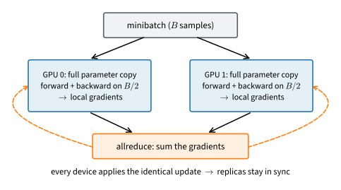
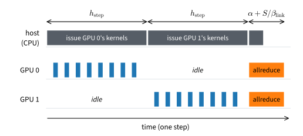

# Multi-GPU from First Principles
:label:`sec_multi_gpu`

Every training run so far has used one GPU, even though our build workstation
holds four. The simplest way to use all $k$ GPUs is *data parallelism*: give
every GPU a full replica of the model and $1/k$ of each minibatch, sum the
resulting gradients across GPUs with an *allreduce*, and apply the same
parameter update on every card.

On our workstation, inter-GPU communication travels over PCIe 4.0 staged
through host DRAM (:numref:`subsec_hw-interconnects`), capping each link at a
nominal 32 GB/s—roughly $30\times$ slower than a card's 1 TB/s on-board
memory. A second GPU can shorten a step only if the computation it takes over
lasts longer than the gradient exchange (and host dispatch overhead) it adds.
In this section we build data parallelism by hand, derive the *ring allreduce*
algorithm used by collective communication libraries, and construct a cost
model that predicts multi-GPU step times from individually measured constants.
We test our model on LeNet on Fashion-MNIST, whose tiny steps expose fixed
host and communication overheads starkly.

```{.python .input #multiple-gpus-multi-gpu-from-first-principles}
%%tab pytorch
import math
import numpy as np
import torch
from torch import nn
from torch.nn import functional as F
from d2l import torch as d2l
```

```{.python .input #multiple-gpus-multi-gpu-from-first-principles}
%%tab jax
import math
import numpy as np
import jax
from jax import numpy as jnp
from flax import nnx
import optax
from d2l import jax as d2l
```

```{.python .input #multiple-gpus-multi-gpu-from-first-principles-1}
%%tab pytorch
import os
import time
# Detach PyTorch's profiler from the GPU when a profile ends; without this,
# every kernel launch after the first profile stays about 30% slower
os.environ['TEARDOWN_CUPTI'] = '1'
```

```{.python .input #multiple-gpus-multi-gpu-from-first-principles-1}
%%tab jax
import time
from functools import partial
from jax.flatten_util import ravel_pytree
from jax.sharding import NamedSharding, PartitionSpec as P
```

```{.python .input #multiple-gpus-multi-gpu-from-first-principles-2}
%%tab pytorch
torch.set_float32_matmul_precision('high')
torch.backends.cudnn.benchmark = True  # Time convolution algorithms per shape
```

## Three Ways to Split
:label:`subsec_mg-splitting`

A model and its minibatch can be partitioned across devices in three basic ways
(:numref:`fig_splitting`):

* **Data parallelism** replicates the model on every device, splits the
  minibatch across devices, and sums gradients once per step. It works for any
  model that fits on a single GPU, though every device still holds all $16N$
  bytes of fp32 Adam training state (:numref:`sec_memory_precision`).
* **Pipeline parallelism** splits the layer stack across devices, passing
  activations forward and gradients backward at stage boundaries
  (Exercise :exref:`ex_mg-pipeline`).
* **Tensor parallelism** splits individual weight matrices across devices
  (like AlexNet across two 3 GB GPUs in 2012
  :cite:`Krizhevsky.Sutskever.Hinton.2012`), communicating several times per
  layer (Exercise :exref:`ex_mgp-tensor` in :numref:`sec_sharding`).


:label:`fig_splitting`

## Data Parallelism by Hand
:label:`subsec_mg-byhand`

One data-parallel step on $k$ devices has four stages
(:numref:`fig_data_parallel`): split the minibatch into $k$ equal shards;
compute each shard's gradient on its own device; sum the $k$ gradients via an
allreduce so every device holds the sum; and apply the identical parameter
update on every device. Because all replicas start from identical parameters
and apply identical updates, they remain synchronized without ever re-copying
weights.


:label:`fig_data_parallel`

### The Model and the Data

We write LeNet (:numref:`sec_lenet`, with ReLU activations and He
initialization) as a function of an explicit list of parameter tensors so
every cross-device copy is visible. Its 61,706 fp32 parameters occupy 247 KB,
and the 60,000 Fashion-MNIST training images occupy 188 MB—small enough to
keep a copy of the dataset on each GPU so host data loading never enters our
timings.

```{.python .input #multiple-gpus-data-parallelism-by-hand-1}
%%tab pytorch
def new_params():
    """LeNet's parameters on the CPU: He-initialized weights, zero biases."""
    params = []
    for shape in [(6, 1, 5, 5), (16, 6, 5, 5), (120, 400), (84, 120),
                  (10, 84)]:
        fan_in = math.prod(shape[1:])
        params += [torch.randn(shape) * math.sqrt(2 / fan_in),
                   torch.zeros(shape[0])]
    return params

def lenet(params, X):
    W1, b1, W2, b2, W3, b3, W4, b4, W5, b5 = params
    H = F.avg_pool2d(F.relu(F.conv2d(X, W1, b1, padding=2)), 2)
    H = F.avg_pool2d(F.relu(F.conv2d(H, W2, b2)), 2).flatten(1)
    H = F.relu(F.linear(H, W3, b3))
    H = F.relu(F.linear(H, W4, b4))
    return F.linear(H, W5, b5)

def to_device(split, device):
    """A whole Fashion-MNIST split on `device`: images in [0, 1], labels."""
    return split.data.to(device).unsqueeze(1) / 255, split.targets.to(device)
```

```{.python .input #multiple-gpus-data-parallelism-by-hand-1}
%%tab jax
def new_params(key):
    """LeNet's parameters: He-initialized weights, zero biases."""
    shapes = [(5, 5, 1, 6), (5, 5, 6, 16), (400, 120), (120, 84), (84, 10)]
    params = []
    for key, shape in zip(jax.random.split(key, len(shapes)), shapes):
        fan_in = math.prod(shape[:-1])
        params += [jax.random.normal(key, shape) * math.sqrt(2 / fan_in),
                   jnp.zeros(shape[-1])]
    return params

def lenet(params, X):
    W1, b1, W2, b2, W3, b3, W4, b4, W5, b5 = params
    conv = lambda X, W, padding: jax.lax.conv_general_dilated(
        X, W, (1, 1), padding, dimension_numbers=('NHWC', 'HWIO', 'NHWC'))
    pool = lambda X: nnx.avg_pool(X, (2, 2), strides=(2, 2))
    H = pool(jax.nn.relu(conv(X, W1, ((2, 2), (2, 2))) + b1))
    H = pool(jax.nn.relu(conv(H, W2, 'VALID') + b2)).reshape(X.shape[0], -1)
    H = jax.nn.relu(H @ W3 + b3)
    H = jax.nn.relu(H @ W4 + b4)
    return H @ W5 + b5

def to_device(split, sharding):
    """A whole Fashion-MNIST split placed by `sharding`: images in [0, 1],
    labels."""
    X, y = split
    return jax.device_put((X[..., None] / np.float32(255),
                           y.astype(np.int32)), sharding)
```

```{.python .input #multiple-gpus-the-model-and-the-data-1}
%%tab pytorch
assert d2l.num_gpus() >= 2, 'This section needs two GPUs'
data = d2l.FashionMNIST()
devices = [d2l.try_gpu(i) for i in range(2)]
train_data = [to_device(data.train, d) for d in devices]  # A copy each
test_data = to_device(data.val, devices[0])
base = new_params()          # One initialization for every run below
print(f'{sum(p.numel() for p in base)} parameters in {len(base)} tensors; '
      f'images {tuple(train_data[0][0].shape)} on each of 2 devices')
```

```{.python .input #multiple-gpus-the-model-and-the-data-1}
%%tab jax
assert jax.device_count() >= 2, 'This section needs two GPUs'
data = d2l.FashionMNIST()
meshes = [jax.make_mesh((k,), ('data',), devices=jax.devices()[:k])
          for k in (1, 2)]
train_data = [to_device(data.train, NamedSharding(mesh, P()))
              for mesh in meshes]  # A copy on every device of each mesh
test_data = (data.val[0][..., None] / np.float32(255),
             data.val[1].astype(np.int32))
base = new_params(d2l.get_key())  # One initialization for every run
print(f'{sum(p.size for p in base)} parameters in {len(base)} tensors; '
      f'images {train_data[1][0].shape} on each of 2 devices')
```

:begin_tab:`jax`
In JAX, multi-device arrays are placed on a named device *mesh* via
`NamedSharding` and `PartitionSpec` (`P('data')` shards the leading axis
across the `'data'` mesh axis; `P()` replicates the full array on every
device).
:end_tab:

### Broadcast and Allreduce

*Broadcast* copies initial parameters to every device once; *allreduce* sums
one tensor per device and leaves the total on every device. In PyTorch we
write a simple *star* allreduce (device 0 gathers and sums all tensors, then
copies the sum back); in JAX we use `jax.shard_map` with `jax.lax.psum`
(which delegates to NCCL).

```{.python .input #multiple-gpus-data-parallelism-by-hand-2}
%%tab pytorch
def broadcast(params, device):
    """A copy of every tensor in `params` on `device`, ready for autograd."""
    return [p.to(device, copy=True).requires_grad_() for p in params]

def allreduce(data):
    """Sum the tensors in `data`, one per device, onto every device."""
    for i in range(1, len(data)):    # Star: collect and add on device 0 ...
        data[0] += data[i].to(data[0].device)
    for i in range(1, len(data)):    # ... then copy the sum back
        data[i].copy_(data[0])
```

```{.python .input #multiple-gpus-data-parallelism-by-hand-2}
%%tab jax
def broadcast(params, mesh):
    """A copy of every array in `params` on every device of `mesh`."""
    return jax.device_put(params, NamedSharding(mesh, P()))

@partial(jax.jit, static_argnames='mesh')
def allreduce(x, mesh):
    """Sum the rows of `x` (row j on device j); every device gets the sum."""
    return jax.shard_map(lambda x_j: jax.lax.psum(x_j, 'data'), mesh=mesh,
                         in_specs=P('data'), out_specs=P('data'))(x)
```

```{.python .input #multiple-gpus-data-parallelism-by-hand-3}
%%tab pytorch
x = [torch.full((1, 2), i + 1.0, device=d) for i, d in enumerate(devices)]
print('before:', [x_j.tolist() for x_j in x])
allreduce(x)
print('after: ', [x_j.tolist() for x_j in x])
```

```{.python .input #multiple-gpus-data-parallelism-by-hand-3}
%%tab jax
x = jax.device_put(jnp.array([[1.0, 1.0], [2.0, 2.0]]),
                   NamedSharding(meshes[1], P('data')))
print('before:', x.tolist())
print('after: ', allreduce(x, meshes[1]).tolist())
```

### The Data-Parallel Step

With $k$ equal-sized shards, the average of the $k$ per-shard mean-loss
gradients equals the full-minibatch gradient (Exercise
:exref:`ex_mg-normalization`). Because every allreduce call incurs a fixed
latency regardless of message size, we concatenate LeNet's 10 gradient tensors
into a single flat vector and perform one allreduce per step. Passing
`communicate=False` skips the allreduce so we can time pure device computation.

```{.python .input #multiple-gpus-data-parallelism-by-hand-4}
%%tab pytorch
def shard_grads(params, data, idx):
    """Gradient of the mean loss on each device's share of the minibatch
    `idx` (example indices), as one flat vector per device."""
    grads = []
    for ps, (X, y), i in zip(params, data, idx.chunk(len(params))):
        i = i.to(X.device, non_blocking=True)  # Don't wait for the device
        F.cross_entropy(lenet(ps, X[i]), y[i]).backward()
        grads.append(torch.cat([p.grad.flatten() for p in ps]))
        for p in ps:
            p.grad = None              # The next backward starts from zero
    return grads

def train_step(params, data, idx, lr, communicate=True):
    """One data-parallel SGD step on the minibatch `idx`; without
    communication, every device steps on its own shard's gradient."""
    grads = shard_grads(params, data, idx)
    if communicate:
        allreduce(grads)               # One message per device and step
    with torch.no_grad():
        for ps, g in zip(params, grads):
            for p, g_p in zip(ps, g.split([p.numel() for p in ps])):
                p -= lr / len(params) * g_p.view_as(p)  # Mean of k grads
```

```{.python .input #multiple-gpus-data-parallelism-by-hand-4}
%%tab jax
def shard_grad(params, X, y, i):
    """Inside shard_map: the gradient of the mean loss on this device's
    share `i` of the minibatch, as one flat vector."""
    def loss(p):
        return optax.softmax_cross_entropy_with_integer_labels(
            lenet(p, X[i]), y[i]).mean()
    own = jax.lax.pcast(params, 'data', to='varying')  # This device's copy
    return ravel_pytree(jax.grad(loss)(own))[0]

@partial(jax.jit, static_argnames=('mesh', 'communicate'))
def train_step(params, data, idx, lr, mesh, communicate=True):
    """One data-parallel SGD step on the minibatch `idx`; without
    communication, every device steps on its own shard's gradient."""
    unravel = ravel_pytree(params)[1]
    def step(params, X, y, i):
        g = shard_grad(params, X, y, i)
        if communicate:
            g = jax.lax.psum(g, 'data')              # Allreduce
        k = jax.lax.axis_size('data')
        return jax.tree.map(lambda p, g_p: p - lr / k * g_p, params,
                            unravel(g))
    out = P() if communicate else P('data')  # Copies differ without the sum
    return jax.shard_map(step, mesh=mesh, in_specs=(P(), P(), P(), P('data')),
                         out_specs=out)(params, *data, idx)
```

### A One-Step Check

Before timing anything, we verify that one data-parallel step on two GPUs
produces the same parameter update as one step on a single GPU over the same
256 examples (using strict fp32 arithmetic so convolution algorithm differences
under tf32 do not mask bugs such as forgetting to divide by $k$).

```{.python .input #multiple-gpus-data-parallelism-by-hand-7}
%%tab pytorch
idx = torch.randperm(len(data.train))[:256]
updates = []
torch.set_float32_matmul_precision('highest')  # True fp32 in matmuls ...
with torch.backends.cudnn.flags(enabled=True, allow_tf32=False):  # ... convs
    for k in (1, 2):
        params = [broadcast(base, d) for d in devices[:k]]
        train_step(params, train_data[:k], idx, lr=0.2)
        updates.append([p.detach().cpu() - b
                        for p, b in zip(params[0], base)])
torch.set_float32_matmul_precision('high')
largest = max(u.abs().max() for u in updates[0])
diff = max((u1 - u2).abs().max() for u1, u2 in zip(*updates))
print(f'largest update {largest:.1e}, largest difference {diff:.1e}')
```

```{.python .input #multiple-gpus-data-parallelism-by-hand-7}
%%tab jax
idx = np.random.default_rng().permutation(len(data.train[1]))[:256]
updates = []
with jax.default_matmul_precision('highest'):  # True fp32
    for mesh, data_k in zip(meshes, train_data):
        i = jax.device_put(idx, NamedSharding(mesh, P('data')))
        params = train_step(broadcast(base, mesh), data_k, i, 0.2, mesh)
        updates.append([np.asarray(p) - np.asarray(b)
                        for p, b in zip(params, base)])
largest = max(np.abs(u).max() for u in updates[0])
diff = max(np.abs(u1 - u2).max() for u1, u2 in zip(*updates))
print(f'largest update {largest:.1e}, largest difference {diff:.1e}')
```

The single-GPU and two-GPU updates agree to fp32 rounding error (~$10^{-7}$).

## Ring Allreduce
:label:`subsec_mg-ring`

A star allreduce routes all traffic through device 0, forcing the hub to send
and receive $(k-1)S$ bytes for a gradient of size $S$. *Ring allreduce*
:cite:`Patarasuk.Yuan.2009,Sergeev.Del-Balso.2018` distributes traffic evenly
across all $k$ devices arranged in a logical ring, splitting each device's
$S$-byte gradient into $k$ chunks of $S/k$ bytes and running two phases of
$k - 1$ steps each (:numref:`fig_ring_allreduce`):

1. **Reduce-scatter:** In each of $k - 1$ steps, every device sends one chunk
   to its successor and adds the chunk received from its predecessor into its
   local copy. After $k - 1$ steps, each device holds the complete sum for one
   distinct chunk.
2. **All-gather:** Over another $k - 1$ steps, the finished chunks circulate
   around the ring until every device holds all $k$ summed chunks.

Each device sends $(k-1)S/k$ bytes per phase, or in total

$$
\frac{2(k-1)}{k}\, S \quad\textrm{bytes per device.}
$$
:eqlabel:`eq_ring_traffic`

Per-device traffic is $S$ at $k = 2$ and stays strictly below $2S$ no matter
how many devices join the ring. Moreover, the two phases are useful
independently: sharded training (:numref:`sec_sharding`) uses reduce-scatter
to partition summed gradients and all-gather to assemble sharded weights.


:label:`fig_ring_allreduce`

We verify the ring indexing and byte count in a NumPy simulation across
$k \in \{2, 4, 8, 16\}$:

```{.python .input #multiple-gpus-ring-allreduce-1}
%%tab pytorch, jax
def ring_allreduce(xs):
    """Ring allreduce of the vectors xs, one per device; returns every
    device's result and the bytes that each device sent."""
    k = len(xs)
    chunks = [np.array_split(x.copy(), k) for x in xs]  # chunks[j][c]
    sent = 0
    for s in range(k - 1):  # Reduce-scatter: add the received chunk
        msgs = [chunks[j][(j - s) % k].copy() for j in range(k)]
        for j, msg in enumerate(msgs):
            chunks[(j + 1) % k][(j - s) % k] += msg
        sent += msgs[0].nbytes
    for s in range(k - 1):  # All-gather: replace by the received chunk
        msgs = [chunks[j][(j + 1 - s) % k].copy() for j in range(k)]
        for j, msg in enumerate(msgs):
            chunks[(j + 1) % k][(j + 1 - s) % k] = msg
        sent += msgs[0].nbytes
    return [np.concatenate(c) for c in chunks], sent
```

```{.python .input #multiple-gpus-ring-allreduce-2}
%%tab pytorch, jax
rng = np.random.default_rng()
for k in (2, 4, 8, 16):
    xs = [rng.standard_normal(1024, dtype=np.float32) for _ in range(k)]
    results, sent = ring_allreduce(xs)
    correct = all(np.allclose(r, sum(xs), atol=1e-5) for r in results)
    print(f'k = {k:2d}: every device holds the sum: {correct}; '
          f'sent per device: {sent / xs[0].nbytes:.2f} S')
```

While per-device bytes stay bounded by $2S$, a ring executes $2(k-1)$
sequential hops, each paying per-hop start-up latency. For small messages on
many GPUs, collective libraries switch to $\log_2 k$-depth tree algorithms
(Exercise :exref:`ex_mg-latency`).

## Communication Cost and Scaling
:label:`subsec_mg-accounting`

### A Cost Model for One Step

Using the latency–bandwidth model :cite:`Hockney.1994,Thakur.Rabenseifner.Gropp.2005`,
each allreduce call pays a fixed start-up latency $\alpha$ plus a time
$\beta_{\textrm{link}}$ per byte sent by each device (the inverse of the
allreduce *bus bandwidth*). Without overlap, a step on $k$ devices with global
batch $B$ and $c$ allreduce calls takes

$$
t_{\textrm{step}}(k) \approx t_{\textrm{compute}}(B/k) + c\,\alpha +
\frac{2(k-1)}{k}\,S\,\beta_{\textrm{link}},
$$
:eqlabel:`eq_dp_cost`

where $c = 0$ at $k = 1$. A second device shortens the step only if
$t_{\textrm{compute}}(B) - t_{\textrm{compute}}(B/2) > c\alpha + S\,\beta_{\textrm{link}}$.

### Latency and Bandwidth of the Allreduce

We measure $\alpha$ with a 1-float allreduce and $\beta_{\textrm{link}}$ with
a $2^{26}$-float (268 MB) allreduce on two GPUs:

```{.python .input #multiple-gpus-the-accounting}
%%tab pytorch
def allreduce_time(n, devices, calls):
    """Seconds per allreduce of n floats per device."""
    x = [torch.zeros(n, device=d) for d in devices]
    return d2l.Benchmark(lambda: allreduce(x), warmup=10 * calls,
                         repeats=3 * calls, devices=devices).time

alpha = allreduce_time(1, devices, calls=100)  # Our star: two copies in turn
n = 2**26                                # 64M floats ...
S = 4 * n                                # ... 268 MB (256 MiB) per device
beta_link = (allreduce_time(n, devices, calls=3) - alpha) / S  # s per byte
print(f'alpha = {1e6 * alpha:.0f} us, beta_link = {1e9 * beta_link:.2f} '
      f'ns/byte (bus bandwidth {1e-9 / beta_link:.1f} GB/s)')
```

```{.python .input #multiple-gpus-the-accounting}
%%tab jax
def allreduce_time(n, mesh, calls):
    """Seconds per allreduce of n floats per device."""
    x = jnp.zeros((mesh.size, n), device=NamedSharding(mesh, P('data')))
    return d2l.Benchmark(lambda: allreduce(x, mesh), repeats=calls).time

def program_time(m, mesh, calls=300):
    """Seconds per call of one compiled program that makes m allreduces of
    one float, each on the result of the one before."""
    def chain(x):
        for _ in range(m):               # Each allreduce waits for the last
            x = jax.lax.pmean(x, 'data')
        return x
    f = jax.jit(jax.shard_map(chain, mesh=mesh, in_specs=P('data'),
                              out_specs=P('data')))
    x = jnp.zeros((mesh.size, 1), device=NamedSharding(mesh, P('data')))
    return d2l.Benchmark(lambda: f(x), warmup=10, repeats=calls).time

# The training step's psum runs inside a program that is dispatched anyway,
# so alpha is what each further allreduce adds to one program
alpha = (program_time(10, meshes[1]) - program_time(1, meshes[1])) / 9
n = 2**26                                # 64M floats ...
S = 4 * n                                # ... 268 MB (256 MiB) per device
# Both calls dispatch a program of their own; their difference is the bytes
beta_link = (allreduce_time(n, meshes[1], calls=3)
             - allreduce_time(1, meshes[1], calls=100)) / S  # s per byte
print(f'alpha = {1e6 * alpha:.0f} us, beta_link = {1e9 * beta_link:.2f} '
      f'ns/byte (bus bandwidth {1e-9 / beta_link:.1f} GB/s)')
```

To test whether :eqref:`eq_dp_cost` predicts the benefit of gradient fusion, we
allreduce LeNet's 10 gradient tensors ($S = 247$ KB total) separately
($c = 10$) versus concatenated into a single flat vector ($c = 1$), which
should differ by $9\alpha$:

```{.python .input #multiple-gpus-latency-and-bandwidth-of-the-allreduce-1}
%%tab pytorch
grads = [[torch.zeros_like(p, device=d) for p in base] for d in devices]
flat = [torch.cat([g.flatten() for g in G]) for G in grads]
def separately():
    for g in zip(*grads):              # One allreduce per tensor
        allreduce(list(g))
n_bytes, c = flat[0].nbytes, len(base)
for name, f, calls in (('separately', separately, c),
                       ('at once', lambda: allreduce(flat), 1)):
    t = d2l.Benchmark(f, warmup=1000, repeats=300, devices=devices).time
    print(f'{name:10s}: {1e6 * t:4.0f} us measured, '
          f'{1e6 * (calls * alpha + n_bytes * beta_link):4.0f} us predicted')
```

```{.python .input #multiple-gpus-latency-and-bandwidth-of-the-allreduce-1}
%%tab jax
mesh = meshes[1]
sizes = [p.size for p in base]
flat = jnp.zeros((mesh.size, sum(sizes)), device=NamedSharding(mesh, P('data')))
n_bytes, c = flat.nbytes // mesh.size, len(base)  # Bytes per device

def separately(g):
    """One psum per gradient tensor, each after the one before; without the
    barrier, XLA would merge the ten into one allreduce."""
    out = []
    for g_i in jnp.split(g, np.cumsum(sizes)[:-1], axis=1):
        if out:
            g_i, _ = jax.lax.optimization_barrier((g_i, out[-1]))
        out.append(jax.lax.psum(g_i, 'data'))
    return jnp.concatenate(out, axis=1)

t = {}
for name, f in (('separately', separately),
                ('at once', lambda g: jax.lax.psum(g, 'data'))):
    f = jax.jit(jax.shard_map(f, mesh=mesh, in_specs=P('data'),
                              out_specs=P('data')))
    t[name] = d2l.Benchmark(lambda: f(flat), warmup=10, repeats=300).time
    print(f'{name:10s}: {1e6 * t[name]:4.0f} us measured')
# Both programs are dispatched once and move the same bytes
print(f'difference: {1e6 * (t["separately"] - t["at once"]):4.0f} us '
      f'measured, {1e6 * (c - 1) * alpha:4.0f} us predicted by {c - 1} alpha')
```

For a 247 KB gradient, nine extra message envelopes ($9\alpha$) cost more than
all the bytes inside them—which is why production data-parallel libraries pack
small gradients into large buckets before communicating
(:numref:`sec_multi_gpu_concise`).

### LeNet on One and Two GPUs

Before running LeNet on two GPUs, let us profile its local work on one GPU for
a minibatch of 256 examples:

```{.python .input #multiple-gpus-lenet-on-one-and-two-gpus-2}
%%tab pytorch
params = [broadcast(base, devices[0])]
step = lambda: train_step(params, train_data[:1], idx, 0.2, communicate=False)
t = d2l.Benchmark(step, warmup=500, repeats=150, devices=devices[:1]).time
d2l.show_profile(d2l.kernel_times(step, steps=100), 1e3 * t, rows=4)
```

```{.python .input #multiple-gpus-lenet-on-one-and-two-gpus-2}
%%tab jax
mesh, params = meshes[0], broadcast(base, meshes[0])
i = jax.device_put(idx, NamedSharding(mesh, P('data')))
step = lambda: train_step(params, train_data[0], i, 0.2, mesh,
                          communicate=False)
t = d2l.Benchmark(step, repeats=500).time
d2l.show_profile(d2l.kernel_times(step, steps=100), 1e3 * t, rows=4)
```

The GPU is idle for most of the step: LeNet at batch size 256 is
overhead-bound, so its step time equals the host dispatch time
$h_{\textrm{step}}$. Consequently, halving the batch from 256 to 128 on one
GPU barely changes the step time, whereas driving two GPUs from one host thread
takes roughly $2 h_{\textrm{step}}$ (:numref:`fig_one_launcher`):

```{.python .input #multiple-gpus-lenet-on-one-and-two-gpus-1}
%%tab pytorch
params, t_local = [broadcast(base, d) for d in devices], {}
for k, b in ((1, 256), (1, 128), (2, 128)):
    t_local[k, b] = d2l.Benchmark(
        lambda: train_step(params[:k], train_data[:k], idx[:k * b], 0.2,
                           communicate=False),
        warmup=500, repeats=150, devices=devices[:k]).time
    print(f'{k} GPU(s), {b} examples each: {1e3 * t_local[k, b]:.2f} ms')
```

```{.python .input #multiple-gpus-lenet-on-one-and-two-gpus-1}
%%tab jax
t_local = {}
for k, b in ((1, 256), (1, 128), (2, 128)):
    mesh, data_k = meshes[k - 1], train_data[k - 1]
    params = broadcast(base, mesh)
    i = jax.device_put(idx[:k * b], NamedSharding(mesh, P('data')))
    t_local[k, b] = d2l.Benchmark(lambda: train_step(
        params, data_k, i, 0.2, mesh, communicate=False), repeats=500).time
    print(f'{k} GPU(s), {b} examples each: {1e3 * t_local[k, b]:.2f} ms')
```

Incorporating the single-host dispatch floor $k\,h_{\textrm{step}}$ alongside
the device compute time $t_{\textrm{dev}}(B/k)$ refines :eqref:`eq_dp_cost` to

$$
t_{\textrm{step}}(k) \approx \max\bigl(k\,h_{\textrm{step}},\;
t_{\textrm{dev}}(B/k)\bigr) + c\,\alpha +
\frac{2(k-1)}{k}\,S\,\beta_{\textrm{link}}.
$$
:eqlabel:`eq_dp_one-launcher`


:label:`fig_one_launcher`

We test both predictions over a 5-epoch training run at global batch size 256
on 1 and 2 GPUs:

```{.python .input #multiple-gpus-data-parallelism-by-hand-5}
%%tab pytorch
def train(params, train_data, test_data, orders, batch_size=256, lr=0.2):
    """Data-parallel SGD on the devices that hold `params` and `train_data`,
    one epoch per example order; returns seconds per step, test accuracy."""
    devices = [X.device for X, _ in train_data]
    times = []
    for order in orders:
        t0 = time.perf_counter()
        for idx in order.split(batch_size):
            train_step(params, train_data, idx, lr)
        for d in devices:  # Wait until every device has finished
            torch.cuda.synchronize(d)
        times.append((time.perf_counter() - t0)
                     / math.ceil(len(order) / batch_size))
    X, y = test_data
    with torch.no_grad():
        acc = (lenet(params[0], X).argmax(1) == y).float().mean().item()
    return sum(times[1:]) / (len(times) - 1), acc
```

```{.python .input #multiple-gpus-data-parallelism-by-hand-5}
%%tab jax
def train(params, train_data, test_data, mesh, orders, batch_size=256,
          lr=0.2):
    """Data-parallel SGD on the devices of `mesh`, one epoch per example
    order; returns seconds per step, test accuracy."""
    times = []
    for order in orders:
        starts = range(0, len(order), batch_size)
        batches = jax.device_put(  # The epoch's minibatches, in one call
            [order[s:s + batch_size] for s in starts],
            NamedSharding(mesh, P('data')))
        t0 = time.perf_counter()
        for idx in batches:
            params = train_step(params, train_data, idx, lr, mesh)
        jax.block_until_ready(params)
        times.append((time.perf_counter() - t0) / len(batches))
    X, y = test_data
    acc = float((jax.jit(lenet)(params, X).argmax(1) == y).mean())
    return sum(times[1:]) / (len(times) - 1), acc
```

```{.python .input #multiple-gpus-data-parallelism-by-hand-6}
%%tab pytorch
orders, t_step = [torch.randperm(len(data.train)) for _ in range(5)], {}
for k in (1, 2):
    params = [broadcast(base, d) for d in devices[:k]]
    t_step[k], acc = train(params, train_data[:k], test_data, orders)
    print(f'{k} GPU(s): {1e3 * t_step[k]:.2f} ms per step, '
          f'test accuracy {acc:.2f}')
exchange = alpha + n_bytes * beta_link    # One allreduce of the gradient
print(f'2 GPUs predicted: {1e3 * (t_local[1, 128] + exchange):.2f} ms per '
      f'step by eq_dp_cost, {1e3 * (2 * t_step[1] + exchange):.2f} ms with '
      f'one launcher')
```

```{.python .input #multiple-gpus-data-parallelism-by-hand-6}
%%tab jax
rng = np.random.default_rng()
orders, t_step = [rng.permutation(len(data.train[1])) for _ in range(5)], {}
for k, mesh, data_k in zip((1, 2), meshes, train_data):
    t_step[k], acc = train(broadcast(base, mesh), data_k, test_data, mesh,
                           orders)
    print(f'{k} GPU(s): {1e3 * t_step[k]:.2f} ms per step, '
          f'test accuracy {acc:.2f}')
exchange = alpha + n_bytes * beta_link    # One allreduce of the gradient
print(f'2 GPUs predicted: {1e3 * (t_local[1, 128] + exchange):.2f} ms per '
      f'step by eq_dp_cost, {1e3 * (2 * t_step[1] + exchange):.2f} ms with '
      f'one launcher')
```

Both runs reach the same test accuracy, and :eqref:`eq_dp_one-launcher`
accurately predicts the two-GPU slowdown: at batch 256, LeNet's gradient
exchange is tiny (~0.1 ms), and the bottleneck is feeding two GPUs from a
single host launcher.

### Strong and Weak Scaling, and Larger Minibatches

Multi-GPU benchmarks follow one of two conventions: *strong scaling* holds the
global batch $B$ fixed as $k$ grows (aiming to finish the same step faster),
whereas *weak scaling* holds the per-GPU batch $b$ fixed so the global batch
grows as $kb$ (aiming for $k\times$ throughput in examples/s, though larger
global batches alter optimization dynamics, :numref:`sec_batch_size`).

By :eqref:`eq_dp_one-launcher`, a second GPU improves weak-scaling throughput
($2\,t(1)/t(2) > 1$) when

$$
\max\bigl(2h_{\textrm{step}},\; t_{\textrm{dev}}(b)\bigr) + \alpha +
S\,\beta_{\textrm{link}} \;<\;
2\max\bigl(h_{\textrm{step}},\; t_{\textrm{dev}}(b)\bigr).
$$

A second GPU never helps when $t_{\textrm{dev}}(b) \le h_{\textrm{step}}$; once
$t_{\textrm{dev}}(b)$ outgrows $2h_{\textrm{step}}$ and the exchange time, the
speedup approaches 2. We test this across $b \in \{256, 4096, 32768\}$
examples per GPU:

```{.python .input #multiple-gpus-larger-minibatches}
%%tab pytorch
for b in (256, 4096, 32768):                # Examples per GPU
    batch = torch.randint(len(data.train), (2 * b,))  # With replacement
    steps = [lambda k=k: train_step(params[:k], train_data[:k],
                                    batch[:k * b], 0.2) for k in (1, 2)]
    times = [[], []]                        # Three timed windows per k,
    for w in range(3):                      # taken in turn for k = 1 and 2
        for k in (1, 2):
            params = [broadcast(base, d) for d in devices]  # Equal replicas
            times[k - 1].append(d2l.Benchmark(
                steps[k - 1], warmup=10 if w == 0 else 0,
                repeats=max(20, 2**18 // b), devices=devices[:k]).time)
    t = np.median(times, axis=1)
    t_dev = sum(d2l.kernel_times(steps[0]).values()) / 1e3
    if b == 256:              # The host sets this step's time (profile above)
        h_step = t[0]
    predicted = 2 * t[0] / (max(2 * h_step, t_dev) + exchange)
    speedups = 2 * np.array(times[0]) / np.array(times[1])
    print(f'b = {b:5d}: 1 GPU {1e3 * t[0]:6.2f} ms (device busy '
          f'{1e3 * t_dev:5.2f} ms), 2 GPUs {1e3 * t[1]:6.2f} ms\n'
          f'           speedup {predicted:.2f} predicted, '
          f'{2 * t[0] / t[1]:.2f} measured '
          f'(windows {speedups.min():.2f} to {speedups.max():.2f})')
```

```{.python .input #multiple-gpus-larger-minibatches}
%%tab jax
rng = np.random.default_rng()
for b in (256, 4096, 32768):                # Examples per GPU
    batch = rng.integers(len(data.train[1]), size=2 * b)  # With replacement
    steps = []
    for k, mesh, data_k in zip((1, 2), meshes, train_data):
        params = broadcast(base, mesh)
        i = jax.device_put(batch[:k * b], NamedSharding(mesh, P('data')))
        steps.append(partial(train_step, params, data_k, i, 0.2, mesh))
    times = [[], []]                        # Three timed windows per k,
    for w in range(3):                      # taken in turn for k = 1 and 2
        for j, step in enumerate(steps):
            times[j].append(d2l.Benchmark(
                step, warmup=10 if w == 0 else 0,
                repeats=max(20, 2**18 // b)).time)
    t = np.median(times, axis=1)
    t_dev = sum(d2l.kernel_times(steps[0]).values()) / 1e3
    if b == 256:              # The host sets this step's time (profile above)
        h_step = t[0]
    predicted = 2 * t[0] / (max(2 * h_step, t_dev) + exchange)
    speedups = 2 * np.array(times[0]) / np.array(times[1])
    print(f'b = {b:5d}: 1 GPU {1e3 * t[0]:6.2f} ms (device busy '
          f'{1e3 * t_dev:5.2f} ms), 2 GPUs {1e3 * t[1]:6.2f} ms\n'
          f'           speedup {predicted:.2f} predicted, '
          f'{2 * t[0] / t[1]:.2f} measured '
          f'(windows {speedups.min():.2f} to {speedups.max():.2f})')
```

At $b = 256$ the second GPU gives no speedup; at $b = 32{,}768$ device work
far exceeds $2h_{\textrm{step}}$ and the 247 KB gradient exchange, nearly
doubling throughput as predicted.

## Summary

Data parallelism replicates the model on $k$ devices, computes gradients on
$1/k$ of the minibatch per device, and sums gradients via an allreduce before
updating. Ring allreduce decomposes the sum into a reduce-scatter followed by
an all-gather, sending $2(k-1)S/k < 2S$ bytes per device across $2(k-1)$ hops.
Our step cost model :eqref:`eq_dp_one-launcher` combines device compute time,
single-host dispatch overhead $k\,h_{\textrm{step}}$, per-call latency
$c\alpha$, and bandwidth cost $2(k-1)S\beta_{\textrm{link}}/k$, explaining why
concatenating small gradient tensors saves $9\alpha$ and why a second GPU only
speeds up training once per-GPU device compute outlasts both host dispatch and
communication.

## Exercises

1. **Data versus pipeline parallelism.** Consider a stack of $L$ bias-free
   linear layers of width $d$ in fp32 trained on two GPUs with batch size $B$.
   Data parallelism allreduces all weight gradients; two-stage pipeline
   parallelism (:numref:`fig_splitting`) places $L/2$ layers on each GPU and
   sends $B \times d$ activations forward and gradients backward across the
   cut.
    1. Count the bytes transferred per step in each scheme, evaluate both for
       $L = 32, d = 4096, B = 256$, and find the condition on $(B, L, d)$ for
       data parallelism to move fewer bytes.
    1. When the batch is split into $m$ pipeline micro-batches
       :cite:`Huang.Cheng.Bapna.ea.2019`, derive the bubble (idle) fraction of
       each GPU in a two-stage pipeline and evaluate it for $m = 1$ and
       $m = 8$.
   :exlabel:`ex_mg-pipeline`

2. **Gradient normalization.** Compare two data-parallel gradient recipes over
   $k$ shards of a batch of $B$ examples: Recipe A sums per-example losses on
   each device, sums gradients across devices, and divides by $B$; Recipe B
   averages per-example losses on each device and averages the $k$ device
   gradients.
    1. Show that both yield the exact full-batch mean gradient when all shards
       hold $B/k$ examples.
    1. For a language model averaging loss over tokens, suppose two shards hold
       3,000 and 1,000 tokens. Find the relative weight Recipe B assigns to a
       token in each shard, and modify Recipe B so it is exact for unequal
       token counts.
   :exlabel:`ex_mg-normalization`

3. **Strong-scaling speedup.** Model shard compute time as
   $t_{\textrm{compute}}(s) = t_0 + s\,t_1$ and neglect $\alpha$, so by
   :eqref:`eq_dp_cost` at fixed global batch $B$:
   $$t_{\textrm{step}}(k) = t_0 + \frac{B\,t_1}{k} + \frac{2(k-1)}{k}\,S\,\beta_{\textrm{link}}.$$
    1. Show that the strong-scaling speedup $R(k) = t_{\textrm{step}}(1) /
       t_{\textrm{step}}(k) > 1$ holds for one $k > 1$ if and only if it holds
       for all $k > 1$, and find $\lim_{k \to \infty} R(k)$.
    1. For $N = 11.2$M fp32 parameters, $t_0 = 2$ ms, $t_1 = 0.2$ ms/example,
       and $B = 256$, evaluate $R(2)$, $R(4)$, and $\lim_{k \to \infty} R(k)$
       at bus bandwidths of 20 GB/s and 5 GB/s, and find the minimum bus
       bandwidth for any speedup.
    1. Recompute $R(4)$ and $\lim_{k \to \infty} R(k)$ at 5 GB/s when gradients
       are communicated in bf16 ($S$ halved).

:begin_tab:`pytorch`
4. [code] **Ring allreduce by hand.** ●
    1. For $k$ devices holding $S$ bytes each, compare the total bytes moved
       and the bytes sent/received by the busiest device for star versus ring
       allreduce. Predict the ratio of their times when all $k$ bidirectional
       links operate concurrently versus when all transfers share one single
       bus sequentially.
    1. Implement `ring_allreduce(data)` in PyTorch using `chunk` and explicit
       `.to()` copies, verify it against `allreduce` for $k \in \{2, 3, 4\}$,
       and benchmark both on 64M floats per device at $k = 2$ and $k = 4$.
:end_tab:

:begin_tab:`jax`
4. [code] **Ring allreduce by hand.** ●
    1. For $k$ devices holding $S$ bytes each, compare the total bytes moved
       and the bytes sent/received by the busiest device for star versus ring
       allreduce. Predict the ratio of their times when all $k$ bidirectional
       links operate concurrently versus when all transfers share one single
       bus sequentially.
    1. Implement `ring_allreduce` inside `jax.shard_map` using
       `jax.lax.ppermute` and `jax.lax.axis_index`, verify it against
       `jax.lax.psum` for $k \in \{2, 4\}$, and benchmark it on 64M floats per
       device.
:end_tab:

5. **Latency in the allreduce.** ● If one hop of $n$ bytes takes
   $\alpha_{\textrm{hop}} + n\,\beta_{\textrm{link}}$, a $2(k-1)$-step ring
   allreduce takes
   $$t_{\textrm{ring}} = 2(k-1)\left(\alpha_{\textrm{hop}} + \frac{S}{k}\,\beta_{\textrm{link}}\right),$$
   whereas a binary-tree allreduce (sum up, broadcast down in $2\log_2 k$
   steps of $S$ bytes) takes
   $$t_{\textrm{tree}} = 2\log_2 k \left(\alpha_{\textrm{hop}} + S\,\beta_{\textrm{link}}\right).$$
    1. Compare how the latency and bandwidth terms of each algorithm scale with
       $k$. For $k = 8$, $\alpha_{\textrm{hop}} = 10$ µs, and bus bandwidth
       20 GB/s, find the crossover message size $S$ below which the tree is
       faster.
    1. At $k = 2$, express the half-performance message size $S_{1/2}$ (where
       fixed latency equals transfer time) in terms of $\alpha$ and
       $\beta_{\textrm{link}}$, evaluate it from your measurements in
       :numref:`subsec_mg-accounting`, and compare it with PyTorch DDP's 25 MB
       default bucket size.
   :exlabel:`ex_mg-latency`

[Discussions](https://d2l.discourse.group/t/36791)

<!-- slides -->

::: {.slide}
::: {.cover}
[Dive into Deep Learning · §13.5]{.kicker}

Multi-GPU from First Principles<br>**data parallelism by hand · allreduce · ring allreduce · a cost model for one step · one host, two GPUs · strong and weak scaling**
:::
:::

::: {.slide title="A Second GPU Adds Arithmetic and a Gradient Exchange"}
[The problem]{.kicker}

- One RTX 4090 reads its own memory at 1 TB/s. Our machine has four.
- Data parallelism gives each GPU a copy of the model and a share of
  every minibatch; the copies sum their gradients after every step.
- Our cards cannot address each other: every byte crosses PCIe through
  host memory, 32 GB/s per direction at best, 30× slower than memory.

::: {.d2l-note .warn}
Does the computation a second GPU takes over outlast the exchange it
adds? And is that enough?
:::
:::

::: {.slide title="By the End of This Deck You Can"}
[Goals]{.kicker}

- name three ways to split training over devices, and what each costs;
- write a data-parallel step with broadcast and allreduce, and check it;
- derive the bytes a ring allreduce moves per device;
- predict a step's time from separate measurements, the host included;
- tell strong from weak scaling in a reported speedup.

**Running example:** LeNet (61,706 parameters, 247 KB of fp32 gradients)
on Fashion-MNIST, on two of our four RTX 4090s; a 1B-parameter GPT for
the estimates.
:::

::: {.slide title="One Copy per GPU, One Gradient Sum per Step"}
[Where this fits]{.kicker}

::: {.cols .vc}
::: {.col}
| section | adds |
|---|---|
| The Performance Model | roofline, three regimes, host time, profiling |
| Hardware | where peak arithmetic and bandwidth come from |
| Computation Graphs and Compilation | fusion and kernel replay |
| Memory and Precision | bytes per parameter and per token |
| **Multi-GPU from First Principles** | **data parallelism by hand, its cost model** |
| Data Parallelism in Practice | the frameworks' tools, overlapped exchange |
| Sharding the Training State | 16 bytes per parameter divided among GPUs |
| Case Study: Optimizing a Transformer | the whole method on one GPT |
:::

::: {.col .narrow}
- **Uses:** LeNet, Fashion-MNIST, the overhead-bound regime, the
  profiler, the PCIe topology of our machine.
- **Skips:** pipeline and tensor parallelism (Language Models part),
  production libraries (next deck), several machines.
:::
:::
:::

::: {.slide title="Copy the Model, Cut Its Depth, or Cut Its Width"}
[Three ways to split]{.kicker}

{width=90%}

- Data parallel: any model that fits on one GPU; one exchange per step.
  Every device still holds 16 bytes per parameter (fp32 Adam).
- Pipeline and tensor parallel: for models too large for one GPU.
:::

::: {.slide title="Split, Compute, Sum, Update: The Copies Stay Equal"}
[Data parallelism by hand]{.kicker}

{width=60%}

Equal start and equal update: the copies never need to be compared.
The only exchange is the gradient sum.
:::

::: {.slide title="Allreduce Leaves the Sum on Every Device"}
[Data parallelism by hand]{.kicker}

@!multiple-gpus-data-parallelism-by-hand-3

- **Star:** device 0 collects every tensor, adds, sends the sum back.
- **Broadcast:** copy the initial parameters to every device, once.
:::

::: {.slide title="Average k Shard Gradients, Sent as One Vector"}
[Data parallelism by hand]{.kicker}

Device $j$ averages the losses $\ell_i$ of the $B/k$ examples in its
shard $\mathcal{B}_j$ and differentiates with respect to the parameters
$\boldsymbol{\theta}$; then every device takes the same SGD step with
learning rate $\eta$:

$$
\mathbf{g}_j = \nabla_{\boldsymbol{\theta}} \frac{k}{B}
\sum_{i \in \mathcal{B}_j} \ell_i, \qquad
\boldsymbol{\theta} \leftarrow \boldsymbol{\theta} -
\frac{\eta}{k} \sum_{j=1}^{k} \mathbf{g}_j .
$$

- The average of the $\mathbf{g}_j$ is the full-minibatch gradient.
- Chain rule: a parameter copied to $k$ devices gets the sum of the $k$
  gradients. That sum is all an allreduce computes.
- LeNet's 10 gradient tensors go as one flat vector: one allreduce.
:::

::: {.slide title="One Step on Two GPUs Matches One Step on One"}
[Data parallelism by hand]{.kicker}

Same initialization, same 256 examples, one SGD step each, in true fp32:

@!multiple-gpus-data-parallelism-by-hand-7

::: {.d2l-note .rule}
Differences at the level of fp32 rounding. Check this before reading any
timing: a wrong normalization still trains, but with the wrong learning
rate.
:::
:::

::: {.slide title="Check: Forget to Divide by k"}
[Check]{.kicker}

Two GPUs each average their loss over 128 examples; the allreduce sums
the two gradients; the update forgets the factor $1/k$. What learning rate
does the step really use?

::: {.fragment .fade-up}
::: {.d2l-note}
**Answer.** $2\eta$: the sum of two averages is twice the average. On $k$
devices, $k\eta$. Training may still converge, so an accuracy curve may
not show it; the one-step check does.
:::
:::
:::

::: {.slide title="A Star Sends (k − 1)S Bytes Through Device 0"}
[Ring allreduce]{.kicker}

Gradient of $S$ bytes on each of $k$ devices:

| | busiest device sends | as $k$ grows |
|---|---|---|
| star (hub = device 0) | $(k-1)S$ | grows linearly |
| ring | $2(k-1)S/k$ | stays below $2S$ |

Our 1B-parameter GPT, $S$ = 4 GB of fp32 gradients, $k = 4$: the hub
sends 12 GB and receives as much; each device of a ring sends 6 GB.
:::

::: {.slide title="Ring Allreduce: Reduce-Scatter, Then All-Gather"}
[Ring allreduce]{.kicker}

{width=88%}

$k-1$ steps per phase, one chunk of $S/k$ bytes per device and step:
$\frac{2(k-1)}{k}S$ bytes per device, at most $2S$ for any $k$.
:::

::: {.slide title="Bytes per Device Approach 2S; the Hops Grow with k"}
[Ring allreduce]{.kicker}

Simulated ring, 1,024 floats per device:

@!multiple-gpus-ring-allreduce-2

- $2(k-1)$ hops in sequence, each with a fixed start-up time.
- Small messages: libraries switch to trees, $2\log_2 k$ hops.
- On our machine every hop goes GPU → host memory → GPU.

::: {.d2l-note}
The byte count says how much moves; the machine decides how fast.
:::
:::

::: {.slide title="Step Time = Shard Compute + Fixed Costs + Bytes over the Link"}
[Cost model]{.kicker}

$$
t_{\textrm{step}}(k) \approx t_{\textrm{compute}}(B/k) + c\,\alpha +
\frac{2(k-1)}{k}\,S\,\beta_{\textrm{link}}
$$

- $t_{\textrm{compute}}(b)$: forward, backward, and update on $b$
  examples;
- $c$ allreduce calls per step, each with fixed cost $\alpha$ (for a
  ring, $2(k-1)$ start-up times);
- $S$ gradient bytes per device; $\beta_{\textrm{link}}$: time per byte that a
  device sends during a large allreduce, the inverse of the bus
  bandwidth.

::: {.d2l-note .rule}
Only the first term shrinks with $k$; the bytes grow toward $2S$. A second
GPU helps only if
$t_{\textrm{compute}}(B) - t_{\textrm{compute}}(B/2) > c\alpha + S\,\beta_{\textrm{link}}$.
:::
:::

::: {.slide title="Measured on Two RTX 4090s: α and β_link"}
[Cost model]{.kicker}

Small allreduces give the fixed cost $\alpha$ of one more call; one of
$2^{26}$ floats (268 MB) gives $\beta_{\textrm{link}}$, the extra time
per byte:

@!multiple-gpus-the-accounting

- Bus bandwidth far below PCIe's 32 GB/s: every byte is copied into
  host memory and out again.
- LeNet's 247 KB: $S\,\beta_{\textrm{link}}$ is at most about 0.1 ms;
  ten messages pay $10\alpha$, more than that.
- The value belongs to one allreduce, one pair of GPUs, and the path
  between them.
:::

::: {.slide title="Ten Small Allreduces Cost Nine α More Than One"}
[Cost model]{.kicker}

LeNet's 10 gradient tensors, sent one by one or concatenated: the same
bytes, so the model predicts a difference of $9\alpha$:

@!multiple-gpus-latency-and-bandwidth-of-the-allreduce-1

::: {.d2l-note .rule}
For small gradients nine more messages cost more than all the bytes: the
price is set by the envelopes. Data-parallel tools pack gradients into
large buffers before sending.
:::
:::

::: {.slide title="The Device Idles for Most of LeNet's Step"}
[LeNet on one and two GPUs]{.kicker}

Profile of one GPU's local work on 256 examples:

@!multiple-gpus-lenet-on-one-and-two-gpus-2

::: {.d2l-note}
The step's time is the host time $h_{\textrm{step}}$ to issue its
kernels, whatever the batch: half a minibatch saves little.
:::
:::

::: {.slide title="Check: Is LeNet's Step Faster on Two GPUs?"}
[Check]{.kicker}

One GPU's step is host time $h_{\textrm{step}}$. The host must issue the
work of both GPUs, and serving two takes it about twice as long as
serving one. The exchange $\alpha + S\,\beta_{\textrm{link}}$ is a fraction
of a millisecond. Predict the two-GPU step.

::: {.fragment .fade-up}
::: {.d2l-note}
**Answer.** About $2h_{\textrm{step}} + \alpha + S\,\beta_{\textrm{link}}$:
twice the one-GPU step. Each GPU waits while the host serves the other,
so the second GPU makes the step slower, whatever the exchange costs.
:::
:::
:::

::: {.slide title="One Host Feeds Two GPUs: The Local Work Doubles"}
[LeNet on one and two GPUs]{.kicker}

{width=50%}

Local work only, without the allreduce:

@!multiple-gpus-lenet-on-one-and-two-gpus-1

::: {.d2l-note}
Half the minibatch saves little; two GPUs at 128 examples each take about
twice as long as one. The host's work adds up over the devices it feeds.
:::
:::

::: {.slide title="Training: The Model with the Host Term Predicts the Slowdown"}
[LeNet on one and two GPUs]{.kicker}

$$
t_{\textrm{step}}(k) \approx \max\bigl(k\,h_{\textrm{step}},\,
t_{\textrm{dev}}(B/k)\bigr) + c\,\alpha +
\frac{2(k-1)}{k}\,S\,\beta_{\textrm{link}}
$$

Five epochs at minibatch 256, predicted from one-GPU step times and the
measured exchange:

@!multiple-gpus-data-parallelism-by-hand-6

::: {.d2l-note .warn}
The exchange is a small part of the step. Two GPUs are harder to keep
fed than one.
:::
:::

::: {.slide title="A Second GPU Helps Only When the Host Keeps Up and the Work Outlasts the Exchange"}
[When it helps]{.kicker}

$b$ examples per GPU; one step on two GPUs against two steps on one:

$$
\max(2h_{\textrm{step}}, t_{\textrm{dev}}(b)) + \alpha +
S\,\beta_{\textrm{link}} < 2\max(h_{\textrm{step}}, t_{\textrm{dev}}(b))
$$

- $t_{\textrm{dev}}(b)$: device-busy time for $b$ examples.
- $t_{\textrm{dev}}(b) \le h_{\textrm{step}}$: never true.
- $h_{\textrm{step}} < t_{\textrm{dev}}(b) < 2h_{\textrm{step}}$: a gain
  below two at best.
- $t_{\textrm{dev}}(b) \ge 2h_{\textrm{step}}$: true iff
  $t_{\textrm{dev}}(b) > \alpha + S\,\beta_{\textrm{link}}$.
:::

::: {.slide title="At 32,768 Images per GPU, Two GPUs Nearly Double the Throughput"}
[When it helps]{.kicker}

The same LeNet step, $b$ examples per GPU:

@!multiple-gpus-larger-minibatches

- 256: host-bound, no gain.
- 4,096: the device time, set against one host time and two, decides
  which case the row is in and what the second GPU gains.
- 32,768: the device outlasts the host time of both GPUs and the
  247 KB exchange; close to two, and close to the prediction.
:::

::: {.slide title="Check: A 1B-Parameter GPT on Two RTX 4090s"}
[Check]{.kicker}

Training costs about 6 FLOPs per parameter and token. One step: 32,768
tokens (micro-batches of about 2,000 tokens, gradients accumulated, one
allreduce; the 16 GB of fp32 Adam state fits on each 24 GB card); about
35 TFLOP/s achieved per GPU in bf16; $S$ = 4 GB of fp32 gradients.
Predict the speedup of two GPUs over one for a bus bandwidth of
10 GB/s and of 2.5 GB/s.

::: {.fragment .fade-up}
::: {.d2l-note}
**Answer.** One GPU:
$6 \cdot 10^9 \cdot 32{,}768 / (3.5 \cdot 10^{13}) \approx 5.6$ s.
Two: $2.8$ s of compute plus $S\,\beta_{\textrm{link}}$:
$5.6 / 3.2 \approx 1.75\times$ at 10 GB/s, $5.6 / 4.4 \approx 1.3\times$
at 2.5 GB/s. The host is no limit: every kernel is long.
:::
:::
:::

::: {.slide title="Strong Scaling Fixes the Global Batch; Weak Scaling the Per-Device Batch"}
[Scaling]{.kicker}

- **Strong:** global minibatch $B$ fixed, $t_{\textrm{compute}}(B/k)$
  shrinks: the same work, sooner. LeNet's training run.
- **Weak:** per-device batch $b$ fixed, global batch $kb$: more examples
  per second. The larger-minibatch run.
- A larger global batch changes the optimization: more examples per
  second is not the same as less time to a given loss.

::: {.d2l-note .warn}
Read every speedup with its convention.
:::
:::

::: {.slide title="Wrap-up"}
- Data parallelism: a copy per device, a share of every minibatch, one
  gradient allreduce per step; the one-step check matches to fp32 rounding.
- Ring allreduce: $2(k-1)S/k < 2S$ bytes per device, $2(k-1)$ hops.
- $t_{\textrm{step}}(k) \approx t_{\textrm{compute}}(B/k) + c\alpha + \frac{2(k-1)}{k}S\,\beta_{\textrm{link}}$;
  for LeNet, ten messages cost nine $\alpha$ more than one.
- One host feeding two GPUs doubles LeNet's host-bound step; the
  exchange is a small part.
- At 32,768 images per GPU: nearly twice the throughput of one GPU.

**Next:** the frameworks' own tools and an exchange that overlaps the
backward pass, in Data Parallelism in Practice.
:::
