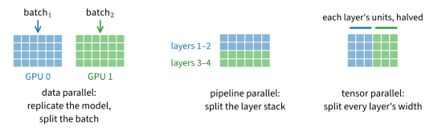
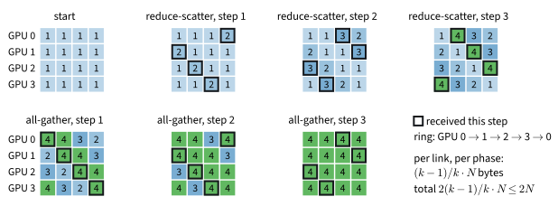

# Multi-GPU from First Principles
:label:`sec_multi_gpu`

Every training run so far has used one GPU, although this book's build
machine holds four. A run on one of them leaves three quarters of the machine's
arithmetic idle. The simplest way to use all four is to give every GPU a
copy of the model and a quarter of each minibatch. The copies must then
agree after every step, so the GPUs exchange their gradients, and the
exchange takes time that a single GPU never spends. When does a second GPU
shorten a step, and when does the exchange cost more than it saves?

On our machine the exchange looks expensive. Each RTX 4090 reads its own
memory at 1 TB/s. Gradients travel between the cards over PCIe and through
host memory, because the cards cannot address each other directly
(:numref:`subsec_hw-interconnects`). A PCIe 4.0 link carries a nominal
32 GB/s in each direction, about thirty times less than a GPU reads from
its own memory. A second GPU can only shorten training if the computation
it takes over lasts longer than the exchange it adds.

This section builds the scheme, called *data parallelism*, by hand. We
split each minibatch, compute gradients on every device, sum them with a
collective operation called an *allreduce*, and apply the same update
everywhere. We then derive the allreduce algorithm that collective
libraries use, and a cost model that predicts the time of a step from
quantities that we measure one at a time. Our test case is LeNet on
Fashion-MNIST. Its steps are so short that fixed costs dominate them,
which makes it the hardest case for data parallelism and the easiest one
to take apart. The cells from the data onward need two GPUs; the ring
simulation and most of the exercises need none.

```{.python .input #multiple-gpus-multi-gpu-from-first-principles}
%%tab pytorch
import math
import numpy as np
import torch
from torch import nn
from torch.nn import functional as F
from d2l import torch as d2l
```

```{.python .input #multiple-gpus-multi-gpu-from-first-principles}
%%tab jax
import math
import numpy as np
import jax
from jax import numpy as jnp
from flax import nnx
import optax
from d2l import jax as d2l
```

```{.python .input #multiple-gpus-multi-gpu-from-first-principles-1}
%%tab pytorch
import time
```

```{.python .input #multiple-gpus-multi-gpu-from-first-principles-1}
%%tab jax
import time
from functools import partial
from jax.flatten_util import ravel_pytree
from jax.sharding import NamedSharding, PartitionSpec as P
```

```{.python .input #multiple-gpus-multi-gpu-from-first-principles-2}
%%tab pytorch
torch.set_float32_matmul_precision('high')
torch.backends.cudnn.benchmark = True  # Time convolution algorithms per shape
```

## Three Ways to Split
:label:`subsec_mg-splitting`

A model and its minibatch can be divided among devices in three ways
(:numref:`fig_splitting`).


:label:`fig_splitting`

Data parallelism gives every device a full copy of the model and a
different slice of the minibatch. Each device runs the whole network on
its slice, the devices sum their gradients, and every copy takes the same
optimizer step. It works for any model that fits on one GPU, and the
devices communicate once per step. *Pipeline parallelism* splits the stack of
layers: each device holds a few consecutive layers and passes its
activations to the next device. *Tensor parallelism* splits every layer:
each device holds a slice of each weight matrix and computes a slice of
each layer's output, so the devices communicate several times per layer.
The last two let a model that is too large for one GPU run at all.
AlexNet used such a split in 2012: each of its layers was divided between
two GPUs, because the network did not fit into one card's 3 GB
:cite:`Krizhevsky.Sutskever.Hinton.2012`. Today pipeline and tensor
parallelism matter at the scale of the models in the Language Models part,
and we leave them to it. Two exercises give a first look: exercise
:exref:`ex_mg-pipeline` counts the bytes that a two-stage pipeline sends,
and exercise :exref:`ex_mgp-tensor` of :numref:`sec_sharding` compares
tensor and data parallelism on the MLP block of a transformer.

Data parallelism does not let us train a larger model. Every device holds
a full copy of the parameters, the gradients, and the optimizer state,
which take 16 bytes per parameter for fp32 training with Adam
(:numref:`sec_memory_precision`). A model that does not fit on one GPU
therefore does not fit on two. What data parallelism offers is speed: $k$
devices share the work of each minibatch.

## Data Parallelism by Hand
:label:`subsec_mg-byhand`

A data-parallel step on $k$ devices has four parts
(:numref:`fig_data_parallel`). We split the minibatch into $k$ equal
shards. Each device computes the gradient of the loss on its shard,
starting from its own copy of the parameters. The devices then sum their
$k$ gradients, so that every device holds the total. Finally, every device
applies the same update. Since all copies start equal and receive the same
update, they stay equal without ever being compared.


:label:`fig_data_parallel`

We build each part with explicit tensor operations, so that every byte that
moves between devices appears in the code.

### The Model and the Data

We use the LeNet of :numref:`sec_lenet`: two convolutional layers with
average pooling, followed by three fully connected layers. We make two of the
changes that :numref:`chap_modern_cnn` makes to it on the way to modern
networks: ReLU activations in place of sigmoids, and He initialization
(:numref:`subsec_he_init`) in place of Xavier initialization.
Instead of a module, we write the network as a function of a list of
parameter tensors. The parameters, and later their gradients, are then
plain tensors that we can copy from device to device.

```{.python .input #multiple-gpus-data-parallelism-by-hand-1}
%%tab pytorch
def new_params():
    """LeNet's parameters on the CPU: He-initialized weights, zero biases."""
    params = []
    for shape in [(6, 1, 5, 5), (16, 6, 5, 5), (120, 400), (84, 120),
                  (10, 84)]:
        fan_in = math.prod(shape[1:])
        params += [torch.randn(shape) * math.sqrt(2 / fan_in),
                   torch.zeros(shape[0])]
    return params

def lenet(params, X):
    W1, b1, W2, b2, W3, b3, W4, b4, W5, b5 = params
    H = F.avg_pool2d(F.relu(F.conv2d(X, W1, b1, padding=2)), 2)
    H = F.avg_pool2d(F.relu(F.conv2d(H, W2, b2)), 2).flatten(1)
    H = F.relu(F.linear(H, W3, b3))
    H = F.relu(F.linear(H, W4, b4))
    return F.linear(H, W5, b5)

def to_device(split, device):
    """A whole Fashion-MNIST split on `device`: images in [0, 1], labels."""
    return split.data.to(device).unsqueeze(1) / 255, split.targets.to(device)
```

```{.python .input #multiple-gpus-data-parallelism-by-hand-1}
%%tab jax
def new_params(key):
    """LeNet's parameters: He-initialized weights, zero biases."""
    shapes = [(5, 5, 1, 6), (5, 5, 6, 16), (400, 120), (120, 84), (84, 10)]
    params = []
    for key, shape in zip(jax.random.split(key, len(shapes)), shapes):
        fan_in = math.prod(shape[:-1])
        params += [jax.random.normal(key, shape) * math.sqrt(2 / fan_in),
                   jnp.zeros(shape[-1])]
    return params

def lenet(params, X):
    W1, b1, W2, b2, W3, b3, W4, b4, W5, b5 = params
    conv = lambda X, W, padding: jax.lax.conv_general_dilated(
        X, W, (1, 1), padding, dimension_numbers=('NHWC', 'HWIO', 'NHWC'))
    pool = lambda X: nnx.avg_pool(X, (2, 2), strides=(2, 2))
    H = pool(jax.nn.relu(conv(X, W1, ((2, 2), (2, 2))) + b1))
    H = pool(jax.nn.relu(conv(H, W2, 'VALID') + b2)).reshape(X.shape[0], -1)
    H = jax.nn.relu(H @ W3 + b3)
    H = jax.nn.relu(H @ W4 + b4)
    return H @ W5 + b5

def to_device(split, sharding):
    """A whole Fashion-MNIST split placed by `sharding`: images in [0, 1],
    labels."""
    X, y = split
    return jax.device_put((X[..., None] / np.float32(255),
                           y.astype(np.int32)), sharding)
```

LeNet is small. Its 61,706 parameters in ten tensors take 247 KB in fp32.
The 60,000 training images take 188 MB as floats, little enough to keep a
copy on every GPU. A copy on every GPU takes the input pipeline out of the
measurements below: each device reads its share of a minibatch from
its own copy, and the only data that cross between devices are gradients.
A data set too large for this must be fed to each GPU from host memory,
over the PCIe path of :numref:`sec_hardware`.

```{.python .input #multiple-gpus-the-model-and-the-data-1}
%%tab pytorch
assert d2l.num_gpus() >= 2, 'This section needs two GPUs'
data = d2l.FashionMNIST()
devices = [d2l.try_gpu(i) for i in range(2)]
train_data = [to_device(data.train, d) for d in devices]  # A copy each
test_data = to_device(data.val, devices[0])
base = new_params()          # One initialization for every run below
print(f'{sum(p.numel() for p in base)} parameters in {len(base)} tensors; '
      f'images {tuple(train_data[0][0].shape)} on each of 2 devices')
```

```{.python .input #multiple-gpus-the-model-and-the-data-1}
%%tab jax
assert jax.device_count() >= 2, 'This section needs two GPUs'
data = d2l.FashionMNIST()
meshes = [jax.make_mesh((k,), ('data',), devices=jax.devices()[:k])
          for k in (1, 2)]
train_data = [to_device(data.train, NamedSharding(mesh, P()))
              for mesh in meshes]  # A copy on every device of each mesh
test_data = (data.val[0][..., None] / np.float32(255),
             data.val[1].astype(np.int32))
base = new_params(d2l.get_key())  # One initialization for every run
print(f'{sum(p.size for p in base)} parameters in {len(base)} tensors; '
      f'images {train_data[1][0].shape} on each of 2 devices')
```

:begin_tab:`jax`
A JAX computation on several devices is laid out on a *mesh*, a grid of
devices whose axes carry names; ours is a row of $k$ devices along an axis
called `'data'`. A `NamedSharding` places an array on a mesh. Its
`PartitionSpec` says which array axis is cut along which mesh axis:
`P('data')` gives each device one slice of the leading axis, and the empty
`P()` gives every device a full copy. We keep one mesh for $k = 1$ and one
for $k = 2$, each with its own copy of the training set.
:end_tab:

### Broadcast and Allreduce

Two operations make the step parallel. *Broadcast* copies one set of
tensors to every device; we need it once, to give every device the same
initial parameters. Allreduce takes one tensor per device, sums
them, and leaves the sum on every device; we need it once per step, for
the gradients. The simplest allreduce is a *star*: device 0 collects the
tensors of all other devices and adds them up, then sends the sum back.

```{.python .input #multiple-gpus-data-parallelism-by-hand-2}
%%tab pytorch
def broadcast(params, device):
    """A copy of every tensor in `params` on `device`, ready for autograd."""
    return [p.to(device, copy=True).requires_grad_() for p in params]

def allreduce(data):
    """Sum the tensors in `data`, one per device, onto every device."""
    for i in range(1, len(data)):    # Star: collect and add on device 0 ...
        data[0] += data[i].to(data[0].device)
    for i in range(1, len(data)):    # ... then copy the sum back
        data[i].copy_(data[0])
```

```{.python .input #multiple-gpus-data-parallelism-by-hand-2}
%%tab jax
def broadcast(params, mesh):
    """A copy of every array in `params` on every device of `mesh`."""
    return jax.device_put(params, NamedSharding(mesh, P()))

@partial(jax.jit, static_argnames='mesh')
def allreduce(x, mesh):
    """Sum the rows of `x` (row j on device j); every device gets the sum."""
    return jax.shard_map(lambda x_j: jax.lax.psum(x_j, 'data'), mesh=mesh,
                         in_specs=P('data'), out_specs=P('data'))(x)
```

:begin_tab:`pytorch`
`.to(device)` copies a tensor from one device to another; the copy and the
addition on device 0 are the whole algorithm.
:end_tab:

:begin_tab:`jax`
`jax.shard_map` runs a function on every device of a mesh. Each device
receives the slices that the `in_specs` assign to it, here one row of `x`,
and `jax.lax.psum` over the axis `'data'` sums a value across the
devices of that axis. On GPUs, XLA hands the sum to NCCL, NVIDIA's
library of collective operations, which picks its own algorithm.
:end_tab:

Two vectors, one on each GPU, show what an allreduce leaves behind:

```{.python .input #multiple-gpus-data-parallelism-by-hand-3}
%%tab pytorch
x = [torch.full((1, 2), i + 1.0, device=d) for i, d in enumerate(devices)]
print('before:', [x_j.tolist() for x_j in x])
allreduce(x)
print('after: ', [x_j.tolist() for x_j in x])
```

```{.python .input #multiple-gpus-data-parallelism-by-hand-3}
%%tab jax
x = jax.device_put(jnp.array([[1.0, 1.0], [2.0, 2.0]]),
                   NamedSharding(meshes[1], P('data')))
print('before:', x.tolist())
print('after: ', allreduce(x, meshes[1]).tolist())
```

Each device now holds $1 + 2 = 3$ in every entry.

### The Data-Parallel Step

Each device computes the gradient of the mean loss over its own shard.
With $k$ shards of equal size, the average of the $k$ shard gradients is
the gradient of the mean loss over the whole minibatch. An allreduce
followed by a division by $k$ therefore gives every device the full-batch
gradient. Exercise :exref:`ex_mg-normalization` asks what changes when
the shards differ in size.

The sum has a second reading, on which :numref:`sec_multi_gpu_concise`
relies. Regard the $k$ copies of a parameter as one parameter that has
been copied to every device, and the sum of the $k$ shard losses as one
loss. By the chain rule, the gradient of that loss with respect to the
one parameter is the sum of the gradients with respect to the $k$ copies:
the derivative of "copy to every device" is "sum over the devices". This
sum is all that an allreduce computes.

LeNet's gradient consists of ten tensors, and we could allreduce them one
at a time. Every allreduce has a fixed cost, however few bytes it moves,
so we instead concatenate each device's gradients into one flat vector and
make a single allreduce per step. :numref:`subsec_mg-accounting` measures
how much this saves. The training step computes every device's gradient on
its shard, sums the gradients with one allreduce, and applies the update.
Its argument `communicate=False` skips the allreduce, so that every device
updates its own copy from its own shard alone. The result is not a
training step, but it lets us time the work that the devices do without
communicating.

```{.python .input #multiple-gpus-data-parallelism-by-hand-4}
%%tab pytorch
def shard_grads(params, data, idx):
    """Gradient of the mean loss on each device's share of the minibatch
    `idx` (example indices), as one flat vector per device."""
    grads = []
    for ps, (X, y), i in zip(params, data, idx.chunk(len(params))):
        i = i.to(X.device, non_blocking=True)  # Don't wait for the device
        F.cross_entropy(lenet(ps, X[i]), y[i]).backward()
        grads.append(torch.cat([p.grad.flatten() for p in ps]))
        for p in ps:
            p.grad = None              # The next backward starts from zero
    return grads

def train_step(params, data, idx, lr, communicate=True):
    """One data-parallel SGD step on the minibatch `idx`; without
    communication, every device steps on its own shard's gradient."""
    grads = shard_grads(params, data, idx)
    if communicate:
        allreduce(grads)               # One message per device and step
    with torch.no_grad():
        for ps, g in zip(params, grads):
            for p, g_p in zip(ps, g.split([p.numel() for p in ps])):
                p -= lr / len(params) * g_p.view_as(p)  # Mean of k grads
```

```{.python .input #multiple-gpus-data-parallelism-by-hand-4}
%%tab jax
def shard_grad(params, X, y, i):
    """Inside shard_map: the gradient of the mean loss on this device's
    share `i` of the minibatch, as one flat vector."""
    def loss(p):
        return optax.softmax_cross_entropy_with_integer_labels(
            lenet(p, X[i]), y[i]).mean()
    own = jax.lax.pcast(params, 'data', to='varying')  # This device's copy
    return ravel_pytree(jax.grad(loss)(own))[0]

@partial(jax.jit, static_argnames=('mesh', 'communicate'))
def train_step(params, data, idx, lr, mesh, communicate=True):
    """One data-parallel SGD step on the minibatch `idx`; without
    communication, every device steps on its own shard's gradient."""
    unravel = ravel_pytree(params)[1]
    def step(params, X, y, i):
        g = shard_grad(params, X, y, i)
        if communicate:
            g = jax.lax.psum(g, 'data')              # Allreduce
        k = jax.lax.axis_size('data')
        return jax.tree.map(lambda p, g_p: p - lr / k * g_p, params,
                            unravel(g))
    out = P() if communicate else P('data')  # Copies differ without the sum
    return jax.shard_map(step, mesh=mesh, in_specs=(P(), P(), P(), P('data')),
                         out_specs=out)(params, *data, idx)
```

:begin_tab:`pytorch`
`shard_grads` computes the gradient on every device in turn and flattens
it. It then clears `p.grad`, because `backward` adds to the gradients that
are already stored. The step runs in a single Python process, which drives
all devices in turn: it issues the forward and backward pass for device 0,
then for device 1, then the copies of the allreduce. The kernels of
different devices can still run at the same time, because each GPU works
through its own queue while Python fills the next one, as long as the GPUs
take longer to empty their queues than Python takes to fill them. Whether
they do, we measure in :numref:`subsec_mg-accounting`.
:end_tab:

:begin_tab:`jax`
The parameters enter `shard_map` replicated (`P()`), so JAX's autodiff
applies the rule above by itself and inserts the sum over the devices.
Our explicit `psum` would then count each contribution $k$ times. The
`pcast(..., to='varying')` declares each device's copy its own, so that
`jax.grad` returns this device's shard gradient and the `psum` in our code
is the only allreduce. `jax.jit` compiles the gradient, the allreduce, and
the update into one program that runs on all devices of the mesh at once.
Without the `psum` the copies differ, so the step returns them all, one
after another along the leading axis (`P('data')`).
:end_tab:

### A One-Step Check

A data-parallel step should update the parameters as a step on one device
with the same minibatch does. We check this once, before
reading any timing. The check is cheap, and it catches errors that an
accuracy curve hides. A step that sums the shard gradients instead of
averaging them trains with a learning rate $k$ times too large, and it
may still reach a plausible accuracy. From one random initialization, we take
one step on one GPU and one step on two GPUs, on the same 256 examples.

```{.python .input #multiple-gpus-data-parallelism-by-hand-7}
%%tab pytorch
idx = torch.randperm(len(data.train))[:256]
updates = []
torch.set_float32_matmul_precision('highest')  # True fp32 in matmuls ...
with torch.backends.cudnn.flags(enabled=True, allow_tf32=False):  # ... convs
    for k in (1, 2):
        params = [broadcast(base, d) for d in devices[:k]]
        train_step(params, train_data[:k], idx, lr=0.2)
        updates.append([p.detach().cpu() - b
                        for p, b in zip(params[0], base)])
torch.set_float32_matmul_precision('high')
largest = max(u.abs().max() for u in updates[0])
diff = max((u1 - u2).abs().max() for u1, u2 in zip(*updates))
print(f'largest update {largest:.1e}, largest difference {diff:.1e}')
```

```{.python .input #multiple-gpus-data-parallelism-by-hand-7}
%%tab jax
idx = np.random.default_rng().permutation(len(data.train[1]))[:256]
updates = []
with jax.default_matmul_precision('highest'):  # True fp32
    for mesh, data_k in zip(meshes, train_data):
        i = jax.device_put(idx, NamedSharding(mesh, P('data')))
        params = train_step(broadcast(base, mesh), data_k, i, 0.2, mesh)
        updates.append([np.asarray(p) - np.asarray(b)
                        for p, b in zip(params, base)])
largest = max(np.abs(u).max() for u in updates[0])
diff = max(np.abs(u1 - u2).max() for u1, u2 in zip(*updates))
print(f'largest update {largest:.1e}, largest difference {diff:.1e}')
```

The two updates differ by less than a millionth of the largest update. That
is fp32 rounding, because the two steps add the same numbers in a
different order. We ran the check in true fp32 on purpose. In tf32, which
the tensor cores use elsewhere in this section (:numref:`subsec_mp-mixed`),
the two minibatch sizes may get different convolution algorithms, whose
rounding errors are far larger than the difference we want to see. The
parallel step computes what the single-device step computes, so any
difference in speed that we measure below comes from how the work is
spread over the devices.

## Ring Allreduce
:label:`subsec_mg-ring`

A star allreduce routes everything through device 0. For a gradient of
$S$ bytes on $k$ devices, the hub's link carries $(k-1)S$ bytes in each
direction, while the links of the other devices carry $S$ bytes each way
and then sit idle. The time of the star therefore grows linearly in $k$.
*Ring allreduce* :cite:`Patarasuk.Yuan.2009` spreads the traffic evenly
over all devices. It comes from high-performance computing and entered
deep learning in 2017, when tools such as Horovod
:cite:`Sergeev.Del-Balso.2018` used it to train one model on many GPUs.

Arrange the $k$ devices in a ring in which each sends only to its
successor, and split every device's gradient vector into $k$ chunks of
$S/k$ bytes. The allreduce runs in two phases
(:numref:`fig_ring_allreduce`). In the first phase, called
*reduce-scatter*, each device sends one chunk to its successor and adds
the chunk it receives from its predecessor to its own copy of that chunk.
After $k-1$ such steps, every device owns one chunk that holds the sum
over all devices, a different chunk on each device. In the second phase,
called *all-gather*, the finished chunks travel around the ring for
another $k-1$ steps until every device has all of them. At every step
every device sends one chunk and receives one chunk, so each device sends
$(k-1)S/k$ bytes per phase, and the two phases together send

$$
\frac{2(k-1)}{k}\, S \quad\textrm{bytes per device.}
$$
:eqlabel:`eq_ring_traffic`

The traffic per device is thus bounded: it is $S$ at $k = 2$ and stays
below $2S$ however many devices join. For the 4 GB of fp32
gradients of our 1B-parameter GPT on four GPUs, each device of a ring
sends 6 GB, where the hub of a star would send 12 GB and receive as much.
The two phases are also useful on their own. Reduce-scatter leaves each
device with the sum of one part of the gradient, and all-gather assembles
a vector from parts held on different devices. Sharded training
(:numref:`sec_sharding`) uses them separately.


:label:`fig_ring_allreduce`

The indices are easy to get wrong, so we check them in a simulation.
Each NumPy vector stands for the gradient on one device, and one step of
the ring copies every message before any device adds or stores what it
receives, since all devices send at once. In reduce-scatter, device $j$
sends chunk $j - s$ in step $s$, so device $j$ ends with the finished
chunk $j + 1$, which it sends first in all-gather.

```{.python .input #multiple-gpus-ring-allreduce-1}
%%tab pytorch, jax
def ring_allreduce(xs):
    """Ring allreduce of the vectors xs, one per device; returns every
    device's result and the bytes that each device sent."""
    k = len(xs)
    chunks = [np.array_split(x.copy(), k) for x in xs]  # chunks[j][c]
    sent = 0
    for s in range(k - 1):  # Reduce-scatter: add the received chunk
        msgs = [chunks[j][(j - s) % k].copy() for j in range(k)]
        for j, msg in enumerate(msgs):
            chunks[(j + 1) % k][(j - s) % k] += msg
        sent += msgs[0].nbytes
    for s in range(k - 1):  # All-gather: replace by the received chunk
        msgs = [chunks[j][(j + 1 - s) % k].copy() for j in range(k)]
        for j, msg in enumerate(msgs):
            chunks[(j + 1) % k][(j + 1 - s) % k] = msg
        sent += msgs[0].nbytes
    return [np.concatenate(c) for c in chunks], sent
```

We run the ring on 2, 4, 8, and 16 devices, each holding 1,024 floats,
so $S = 4{,}096$ bytes. By :eqref:`eq_ring_traffic`, each device should
send $1$, $3/2$, $7/4$, and $15/8$ times $S$:

```{.python .input #multiple-gpus-ring-allreduce-2}
%%tab pytorch, jax
rng = np.random.default_rng()
for k in (2, 4, 8, 16):
    xs = [rng.standard_normal(1024, dtype=np.float32) for _ in range(k)]
    results, sent = ring_allreduce(xs)
    correct = all(np.allclose(r, sum(xs), atol=1e-5) for r in results)
    print(f'k = {k:2d}: every device holds the sum: {correct}; '
          f'sent per device: {sent / xs[0].nbytes:.2f} S')
```

Every device ends with the sum, and the bytes per device creep toward
$2S$: each doubling of the ring adds less traffic per device than the one
before.

The byte count does not determine the time on its own. The ring takes
$2(k-1)$ steps one after another, and each step includes the fixed time of
a transfer, so the fixed cost of a ring allreduce grows linearly in $k$
while its bytes stay below $2S$. For small messages, where the fixed cost dominates,
collective libraries switch to algorithms with fewer sequential steps,
such as trees, whose depth grows only like $\log_2 k$; exercise
:exref:`ex_mg-latency` derives where the crossover lies. On our machine
the ring also has fewer independent links than its picture suggests.
Every hop passes through host memory, so all hops share the host's memory
system and two PCIe host bridges (:numref:`fig_pcie_topology`).
:eqref:`eq_ring_traffic` says how many
bytes each device must move. How fast they move is a property of the
machine that we have to measure.

## Communication Cost and Scaling
:label:`subsec_mg-accounting`

We can now return to the question of the opening: does a second GPU
shorten a step?

### A Cost Model for One Step

On one device, a step on a minibatch of $B$ examples takes time
$t_{\textrm{compute}}(B)$ for the device's local work: the forward and
backward pass and the update. On $k$ devices, each device does this work
for $B/k$ examples, and the step also waits for the allreduce of the $S$
gradient bytes that every device holds. We charge an allreduce as the
latency-bandwidth model charges a single message :cite:`Hockney.1994`: a
fixed cost $\alpha$ that every call pays however few bytes move, plus the
bytes that each device sends divided by a rate $\beta_{\textrm{link}}$. The subscript keeps the link
apart from $\beta$, the memory bandwidth of the GPU in the roofline of
:numref:`sec_perf_model`; on our machine the two differ by orders of
magnitude.

For $\beta_{\textrm{link}}$ we take the rate at which one device sends
while a large allreduce runs, which collective benchmarks report as the
*bus bandwidth*. Each device of a ring sends the bytes of
:eqref:`eq_ring_traffic`, so the step time on $k$ devices is approximately

$$
t_{\textrm{step}}(k) \approx t_{\textrm{compute}}(B/k) + c\,\alpha +
\frac{2(k-1)}{k}\,\frac{S}{\beta_{\textrm{link}}},
$$
:eqlabel:`eq_dp_cost`

where $c$ is the number of allreduce calls per step. At $k = 1$ there is
no allreduce, so $c = 0$, and the last term vanishes too. At $k = 2$ the
last term is simply $S/\beta_{\textrm{link}}$. As devices are added, only
the first term shrinks. The bytes per device grow from $S$ toward $2S$,
and $\alpha$ grows as well: a ring allreduce makes $2(k-1)$ transfers one
after another, and each pays its own start-up time, so for a ring $\alpha$
grows linearly in $k$. A second device therefore shortens the step only
if $t_{\textrm{compute}}(B) - t_{\textrm{compute}}(B/2)$, the
computation it takes over, exceeds $c\alpha + S/\beta_{\textrm{link}}$,
the communication it adds. The three quantities $t_{\textrm{compute}}$,
$\alpha$, and $\beta_{\textrm{link}}$ can each be measured on their own,
and we do so for LeNet.

### Latency and Bandwidth of the Allreduce

Let us measure the two constants with two allreduces at the extremes. An
allreduce of a single number moves almost no bytes, so its time is
$\alpha$. An allreduce of $2^{26}$ floats, about 268 MB per device, takes
so long that $\alpha$ hardly matters, and on two devices
$\beta_{\textrm{link}}$ is those bytes divided by $t - \alpha$, where $t$
is its time. A training loop does not wait for the devices after each
allreduce; the next kernels queue behind it. We therefore time many calls in a row and wait
once at the end, since a wait after every call would add its own delay to
$\alpha$.

```{.python .input #multiple-gpus-the-accounting}
%%tab pytorch
def allreduce_time(n, devices, calls):
    """Seconds per allreduce of n floats per device."""
    x = [torch.zeros(n, device=d) for d in devices]
    return d2l.Benchmark(lambda: allreduce(x), warmup=10 * calls,
                         repeats=3 * calls, devices=devices).time

alpha = allreduce_time(1, devices, calls=100)  # Our star: two copies in turn
n = 2**26                                # 64M floats ...
S = 4 * n                                # ... 268 MB (256 MiB) per device
beta_link = S / (allreduce_time(n, devices, calls=3) - alpha)
print(f'alpha = {1e6 * alpha:.0f} us, '
      f'beta_link = {beta_link / 1e9:.1f} GB/s')
```

```{.python .input #multiple-gpus-the-accounting}
%%tab jax
def allreduce_time(n, mesh, calls):
    """Seconds per allreduce of n floats per device."""
    x = jnp.zeros((mesh.size, n), device=NamedSharding(mesh, P('data')))
    return d2l.Benchmark(lambda: allreduce(x, mesh), repeats=calls).time

alpha = allreduce_time(1, meshes[1], calls=100)  # XLA's psum, run by NCCL
n = 2**26                                # 64M floats ...
S = 4 * n                                # ... 268 MB (256 MiB) per device
beta_link = S / (allreduce_time(n, meshes[1], calls=3) - alpha)
print(f'alpha = {1e6 * alpha:.0f} us, '
      f'beta_link = {beta_link / 1e9:.1f} GB/s')
```

:begin_tab:`pytorch`
`d2l.Benchmark` waits for every device in `devices` before it starts and
before it stops the clock. It warms up with more than three times as many
calls as it times (ten rounds of `calls` against three), because the first
few hundred allreduces of a run can be slower than the rest, which would
inflate $\alpha$. This cell times the star that we wrote, which on two
devices is two copies of all the bytes, one after the other. On our
machine $\beta_{\textrm{link}}$ is about 9.5 GB/s, so each copy runs at
about 19 GB/s, a little below the 23 GB/s that a pinned copy from host
memory reached in :numref:`sec_hardware`. The fixed cost $\alpha$ is that
of two driver-managed copies.
:end_tab:

:begin_tab:`jax`
`d2l.Benchmark` already makes its calls in a row and waits once, for the
last result. This cell times `psum`, which XLA hands to NCCL; on our
machine $\beta_{\textrm{link}}$ is about 2.5 GB/s. On the path through
host memory between our GPUs, NCCL falls back to a transport that moves
fewer bytes per second than the PCIe links carry; :numref:`sec_multi_gpu_concise`
measures this transport and a workaround for it. Each call of `allreduce`
dispatches a compiled program of its own, so $\alpha$ includes the time of
that dispatch.
:end_tab:

A measured $\beta_{\textrm{link}}$ describes the allreduce that moved the
bytes, the two GPUs that took part, and the path between them
(:numref:`fig_pcie_topology`). It is not a constant of the machine, and
ours comes from GPUs 0 and 1.

At these rates, moving LeNet's 247 KB of gradients takes
$S/\beta_{\textrm{link}}$, at most about a tenth of a millisecond and less
than $\alpha$. For a gradient this small, then, the fixed cost should
matter more than the bandwidth of the link. If so, it matters a great deal
whether the gradients travel as one message or as ten. We allreduce
LeNet's ten gradient tensors first one at a time, then all at once as one
concatenated vector, and print both times next to the predictions of
:eqref:`eq_dp_cost` with $c = 10$ and $c = 1$. Neither time was used to
obtain $\alpha$ or $\beta_{\textrm{link}}$, so this is the experiment
that tests them.

```{.python .input #multiple-gpus-latency-and-bandwidth-of-the-allreduce-1}
%%tab pytorch
grads = [[torch.zeros_like(p, device=d) for p in base] for d in devices]
flat = [torch.cat([g.flatten() for g in G]) for G in grads]
def separately():
    for g in zip(*grads):              # One allreduce per tensor
        allreduce(list(g))
n_bytes, c = flat[0].nbytes, len(base)
for name, f, calls in (('separately', separately, c),
                       ('at once', lambda: allreduce(flat), 1)):
    t = d2l.Benchmark(f, warmup=1000, repeats=300, devices=devices).time
    print(f'{name:10s}: {1e6 * t:4.0f} us measured, '
          f'{1e6 * (calls * alpha + n_bytes / beta_link):4.0f} us predicted')
```

```{.python .input #multiple-gpus-latency-and-bandwidth-of-the-allreduce-1}
%%tab jax
mesh = meshes[1]
grads = [jnp.zeros((mesh.size, p.size), device=NamedSharding(mesh, P('data')))
         for p in base]
flat = jnp.concatenate(grads, axis=1)
n_bytes, c = flat.nbytes // mesh.size, len(base)  # Bytes per device
for name, f, calls in (
        ('separately', lambda: [allreduce(g, mesh) for g in grads], c),
        ('at once', lambda: allreduce(flat, mesh), 1)):
    t = d2l.Benchmark(f, repeats=100).time
    print(f'{name:10s}: {1e6 * t:4.0f} us measured, '
          f'{1e6 * (calls * alpha + n_bytes / beta_link):4.0f} us predicted')
```

Ten calls take seven to ten times as long as one call that moves the same
bytes, and for ten calls the two constants predict the time to within a
few percent.

:begin_tab:`pytorch`
The single call is predicted as well.
:end_tab:

:begin_tab:`jax`
The single call takes less than its prediction, about as long as
$\alpha$ alone. Each call costs the host about $\alpha$ to dispatch, and
the transfer of one call runs while the host dispatches the next.
:eqref:`eq_dp_cost` adds the two terms, so it overestimates a call whose
transfer is shorter than its dispatch.
:end_tab:

For a gradient this small, the number of messages decides the
communication time, and the bytes hardly matter. An allreduce of LeNet's
gradient is priced like a letter: by the envelope, not by the weight of
what is inside. This is why the data-parallel tools of
:numref:`sec_multi_gpu_concise` pack many small gradient tensors into a few
large buffers before they send them, as our training step does by hand.

### LeNet on One and Two GPUs

A step on two GPUs spends $\alpha + S/\beta_{\textrm{link}}$ on one
allreduce. What it saves depends on how the time of the local work
depends on the batch, and the profiler of :numref:`subsec_perf-profiler`
can tell us before we run anything on two GPUs. Recall from
:numref:`sec_perf_model` that each call queued behind the others takes the
longer of the host time $h$ to issue it and the device time to run it. If
the device is busy for only a small fraction of a step, the step takes the
host time of all its calls, which we write $h_{\textrm{step}}$, however
many examples each kernel processes. We profile the local work of a
one-GPU step on 256 examples:

```{.python .input #multiple-gpus-lenet-on-one-and-two-gpus-2}
%%tab pytorch
params = [broadcast(base, devices[0])]
step = lambda: train_step(params, train_data[:1], idx, 0.2, communicate=False)
t = d2l.Benchmark(step, warmup=500, repeats=150, devices=devices[:1]).time
d2l.show_profile(d2l.kernel_times(step, steps=100), 1e3 * t, rows=4)
```

```{.python .input #multiple-gpus-lenet-on-one-and-two-gpus-2}
%%tab jax
mesh, params = meshes[0], broadcast(base, meshes[0])
i = jax.device_put(idx, NamedSharding(mesh, P('data')))
step = lambda: train_step(params, train_data[0], i, 0.2, mesh,
                          communicate=False)
t = d2l.Benchmark(step, repeats=500).time
d2l.show_profile(d2l.kernel_times(step, steps=100), 1e3 * t, rows=4)
```

The device sits idle for most of the step, so the step is overhead-bound
and its time is $h_{\textrm{step}}$.

:begin_tab:`pytorch`
The device is busy for 0.30 ms of a step of 2.8 ms, about a tenth. Its
largest kernels, the convolutions and their gradients, take a few
hundredths of a millisecond each. If you run this notebook yourself, set
`TEARDOWN_CUPTI=1` in the environment before you start it, as we did for
our outputs. It detaches the profiler from the GPU when a profile ends.
Without it, every later kernel launch of the process stays slower, by
about 30% on our machine, and so does every host-bound timing below this
cell.
:end_tab:

:begin_tab:`jax`
The device is busy for 0.17 ms of a step of 0.46 ms, about a third, and
waits for the host the rest of the time.
:end_tab:

Halving the minibatch should then leave the local work about as long. We
time it at 256 and at 128 examples on one GPU, and on two GPUs at once with
128 examples each, which is the data-parallel step without its allreduce:

```{.python .input #multiple-gpus-lenet-on-one-and-two-gpus-1}
%%tab pytorch
params, t_local = [broadcast(base, d) for d in devices], {}
for k, b in ((1, 256), (1, 128), (2, 128)):
    t_local[k, b] = d2l.Benchmark(
        lambda: train_step(params[:k], train_data[:k], idx[:k * b], 0.2,
                           communicate=False),
        warmup=500, repeats=150, devices=devices[:k]).time
    print(f'{k} GPU(s), {b} examples each: {1e3 * t_local[k, b]:.2f} ms')
```

```{.python .input #multiple-gpus-lenet-on-one-and-two-gpus-1}
%%tab jax
t_local = {}
for k, b in ((1, 256), (1, 128), (2, 128)):
    mesh, data_k = meshes[k - 1], train_data[k - 1]
    params = broadcast(base, mesh)
    i = jax.device_put(idx[:k * b], NamedSharding(mesh, P('data')))
    t_local[k, b] = d2l.Benchmark(lambda: train_step(
        params, data_k, i, 0.2, mesh, communicate=False), repeats=500).time
    print(f'{k} GPU(s), {b} examples each: {1e3 * t_local[k, b]:.2f} ms')
```

Halving the minibatch indeed leaves the local work about as long. On two
GPUs, it takes about twice as long as on one GPU with the same 128
examples. The one-launcher prediction below takes the one-GPU step from
the training run that it predicts, so that the prediction and the
measurement come from the same run.

:begin_tab:`jax`
The step at 256 examples takes 0.41 ms here and 0.46 ms in the profile,
although the code is the same: the host time of a step differs by about a
tenth from one cell to the next.
:end_tab:

Why twice? The host must prepare and issue the work of every device it
feeds, and on our machine the work for two devices takes it about twice as
long as the work for one. Each GPU finishes its short kernels and then
waits for more, so the host time of a step on $k$ devices is about
$k\,h_{\textrm{step}}$ (:numref:`fig_one_launcher`).

To put this into the cost model, split the local work into its two parts.
On one device, a shard of $b$ examples takes
$t_{\textrm{compute}}(b) \approx \max\bigl(h_{\textrm{step}},
t_{\textrm{dev}}(b)\bigr)$, where $t_{\textrm{dev}}(b)$ is the time the
device is busy with it, the "device busy" of the profile; this is the
$\max(h, \cdot)$ of the overhead-bound regime. :eqref:`eq_dp_cost` puts
this one-device time into its first term, as if every device were fed as
fast as it would be on its own. A data-parallel step whose host serves
$k$ devices takes about

$$
t_{\textrm{step}}(k) \approx \max\bigl(k\,h_{\textrm{step}},\;
t_{\textrm{dev}}(B/k)\bigr) + c\,\alpha +
\frac{2(k-1)}{k}\,\frac{S}{\beta_{\textrm{link}}}.
$$
:eqlabel:`eq_dp_one-launcher`

The first term is the same $\max(h, \cdot)$, applied to a host that serves
$k$ devices. For a device-bound step it is
$t_{\textrm{dev}}(B/k) = t_{\textrm{compute}}(B/k)$, and
:eqref:`eq_dp_cost` is recovered; for LeNet it is $k\,h_{\textrm{step}}$.


:label:`fig_one_launcher`

:begin_tab:`pytorch`
In PyTorch the picture is literal: one Python thread issues the kernels of
GPU 0, then those of GPU 1, and only then the copies of the allreduce.
:end_tab:

:begin_tab:`jax`
The jitted step is one program, and XLA's runtime launches it on each
device from a thread of its own while the Python thread waits until every
launch has been issued. On our machine the two launches together still
take about twice as long as one, as the doubling of the local work shows.
This section measures that cost; it does not take it apart.
:end_tab:

Both models predict the two-GPU training step from one-GPU step times and
the measured exchange. :eqref:`eq_dp_cost` charges the local work on 128
examples plus one exchange. :eqref:`eq_dp_one-launcher` charges twice the
one-GPU step (a host-bound step, so $2h_{\textrm{step}}$) plus one
exchange. A real training run tests both: it times the full step,
allreduce included, over nearly a thousand steps, and it shows whether two
GPUs learn what one does. We train for five epochs on one GPU and on two,
from the same initialization `base`, with minibatches of 256 examples.
Both runs visit the training set in the same five random orders, drawn
once, so that they differ only in rounding. The function `train` takes the
list of orders, one per epoch. It returns the average time per step over
all epochs but the first, which includes start-up costs, and then the test
accuracy:

```{.python .input #multiple-gpus-data-parallelism-by-hand-5}
%%tab pytorch
def train(params, train_data, test_data, orders, batch_size=256, lr=0.2):
    """Data-parallel SGD on the devices that hold `params` and `train_data`,
    one epoch per example order; returns seconds per step, test accuracy."""
    devices = [X.device for X, _ in train_data]
    times = []
    for order in orders:
        t0 = time.perf_counter()
        for idx in order.split(batch_size):
            train_step(params, train_data, idx, lr)
        for d in devices:  # Wait until every device has finished
            torch.cuda.synchronize(d)
        times.append((time.perf_counter() - t0)
                     / math.ceil(len(order) / batch_size))
    X, y = test_data
    with torch.no_grad():
        acc = (lenet(params[0], X).argmax(1) == y).float().mean().item()
    return sum(times[1:]) / (len(times) - 1), acc
```

```{.python .input #multiple-gpus-data-parallelism-by-hand-5}
%%tab jax
def train(params, train_data, test_data, mesh, orders, batch_size=256,
          lr=0.2):
    """Data-parallel SGD on the devices of `mesh`, one epoch per example
    order; returns seconds per step, test accuracy."""
    times = []
    for order in orders:
        starts = range(0, len(order), batch_size)
        batches = jax.device_put(  # The epoch's minibatches, in one call
            [order[s:s + batch_size] for s in starts],
            NamedSharding(mesh, P('data')))
        t0 = time.perf_counter()
        for idx in batches:
            params = train_step(params, train_data, idx, lr, mesh)
        jax.block_until_ready(params)
        times.append((time.perf_counter() - t0) / len(batches))
    X, y = test_data
    acc = float((jax.jit(lenet)(params, X).argmax(1) == y).mean())
    return sum(times[1:]) / (len(times) - 1), acc
```

:begin_tab:`jax`
Placing an array on the devices takes time on the host. `train`
therefore places all minibatches of an epoch with one `jax.device_put`
before the clock starts, as we placed the training set before any timing,
so that the clock measures the steps alone. Placed inside the loop, the
transfers would add a cost to every step that no term of
:eqref:`eq_dp_one-launcher` contains.
:end_tab:

```{.python .input #multiple-gpus-data-parallelism-by-hand-6}
%%tab pytorch
orders, t_step = [torch.randperm(len(data.train)) for _ in range(5)], {}
for k in (1, 2):
    params = [broadcast(base, d) for d in devices[:k]]
    t_step[k], acc = train(params, train_data[:k], test_data, orders)
    print(f'{k} GPU(s): {1e3 * t_step[k]:.2f} ms per step, '
          f'test accuracy {acc:.2f}')
exchange = alpha + n_bytes / beta_link    # One allreduce of the gradient
print(f'2 GPUs predicted: {1e3 * (t_local[1, 128] + exchange):.2f} ms per '
      f'step by eq_dp_cost, {1e3 * (2 * t_step[1] + exchange):.2f} ms with '
      f'one launcher')
```

```{.python .input #multiple-gpus-data-parallelism-by-hand-6}
%%tab jax
rng = np.random.default_rng()
orders, t_step = [rng.permutation(len(data.train[1])) for _ in range(5)], {}
for k, mesh, data_k in zip((1, 2), meshes, train_data):
    t_step[k], acc = train(broadcast(base, mesh), data_k, test_data, mesh,
                           orders)
    print(f'{k} GPU(s): {1e3 * t_step[k]:.2f} ms per step, '
          f'test accuracy {acc:.2f}')
exchange = alpha + n_bytes / beta_link    # One allreduce of the gradient
print(f'2 GPUs predicted: {1e3 * (t_local[1, 128] + exchange):.2f} ms per '
      f'step by eq_dp_cost, {1e3 * (2 * t_step[1] + exchange):.2f} ms with '
      f'one launcher')
```

The step on two GPUs takes about twice as long as the step on one, or
longer.
:eqref:`eq_dp_cost` predicts a shorter step than we measure, while
:eqref:`eq_dp_one-launcher`, which knows only the one-GPU step and the
exchange, predicts the slowdown.

:begin_tab:`pytorch`
:eqref:`eq_dp_cost` predicts 2.8 ms, the time of one GPU, and the step
takes 5.6 ms, within a few percent of the one-launcher prediction. The
exchange, $\alpha + S/\beta_{\textrm{link}}$, is 0.08 ms, about one percent
of the step.
:end_tab:

:begin_tab:`jax`
Here :eqref:`eq_dp_cost` already predicts a slower step than on one GPU,
but for a reason the training step does not share. Almost half of its
prediction is the exchange, and most of that is $\alpha$, which contains
the dispatch of a separate program for every allreduce. The training
step's `psum` runs inside the program that the step dispatches anyway.
The same $\alpha$ puts the one-launcher prediction above the measurement,
by about a sixth.
:end_tab:

This is not the result that the opening prepared us for. Twice the
one-GPU step accounts for most of the two-GPU step, so the exchange can
account for no more than the rest. The exchange of gradients, which we
were led to fear, takes a small part of the step. What hurts is that two
GPUs are harder to keep fed than one.

Both runs reach the same test accuracy to within a point. Their only
difference is rounding, which a thousand steps of SGD amplify.

### Strong and Weak Scaling

Every reported speedup holds something fixed, and two conventions are
common. :eqref:`eq_dp_cost` holds the global minibatch $B$ fixed while $k$
grows: the same work, finished sooner if all goes well. This is *strong
scaling*, and it is what we measured for LeNet's training run. The
alternative holds the per-device batch $b$ fixed, so that the global
minibatch grows to $kb$: more work per unit of time. This is *weak
scaling*, and its speedups are quoted as throughput, examples per second.
Weak scaling is the easier test, because $t_{\textrm{compute}}$ per device
does not shrink and only the communication has to stay small next to it.
A larger global minibatch, however, changes the optimization itself
(:numref:`sec_batch_size`), so a gain in examples per second under weak
scaling is not a gain of the same size in the time it takes to reach a
given loss.

### Larger Minibatches

LeNet failed on two GPUs because its device had too little to do in each
step. The cure for overhead in :numref:`sec_perf_model` works here too:
give every kernel more data. We keep the model and the hand-written step
and raise the number of examples per GPU, $b$, which makes the comparison
one of weak scaling. Two GPUs process $2b$ examples in a step of time
$t(2)$ and one GPU processes $b$ in $t(1)$, so the second GPU raises the
throughput by the factor $2\,t(1)/t(2)$. By :eqref:`eq_dp_one-launcher`
with one allreduce, it helps when

$$
\max\bigl(2h_{\textrm{step}},\; t_{\textrm{dev}}(b)\bigr) + \alpha +
\frac{S}{\beta_{\textrm{link}}} \;<\;
2\max\bigl(h_{\textrm{step}},\; t_{\textrm{dev}}(b)\bigr).
$$

The left side is one step on two GPUs, the right side two steps on one.
If the one-GPU step is host-bound, $t_{\textrm{dev}}(b) \le
h_{\textrm{step}}$, the left side exceeds $2h_{\textrm{step}}$ and the
right side equals it: no exchange, however fast, can help. If the device
works long enough for the host to feed both GPUs,
$t_{\textrm{dev}}(b) \ge 2h_{\textrm{step}}$, the condition becomes
$t_{\textrm{dev}}(b) > \alpha + S/\beta_{\textrm{link}}$: the device time
that the second GPU takes over must exceed the exchange. In between, for
$h_{\textrm{step}} < t_{\textrm{dev}}(b) < 2h_{\textrm{step}}$, the
condition reads
$t_{\textrm{dev}}(b) > h_{\textrm{step}} + (\alpha +
S/\beta_{\textrm{link}})/2$, and the gain, if any, stays below two. In
short, a second GPU never helps a host-bound step, and it helps once the
host can feed both devices and the work it takes over outlasts the
exchange it adds. For LeNet's 247 KB the exchange is a fraction of a
millisecond, so the host is the condition that binds.

We try $b = 256$, 4,096, and 32,768, drawing indices with replacement,
since two GPUs at the largest size need more images than the training set
holds. At 256 we expect no gain. At 32,768, with 128 times the examples
of the profiled step, the device should be busy for many milliseconds,
much longer than twice the host time, and we expect a factor close to
two. The cell measures $t_{\textrm{dev}}$ with the profiler, takes
$h_{\textrm{step}}$ from the step at 256, and prints the predicted and the
measured gain, with the spread of the measured gain over three timed
windows. Since $h_{\textrm{step}}$ comes from the row at 256, the
prediction there is calibrated on the row it predicts; only the other two
rows test it.

```{.python .input #multiple-gpus-larger-minibatches}
%%tab pytorch
for b in (256, 4096, 32768):                # Examples per GPU
    batch = torch.randint(len(data.train), (2 * b,))  # With replacement
    steps = [lambda k=k: train_step(params[:k], train_data[:k],
                                    batch[:k * b], 0.2) for k in (1, 2)]
    times = [[], []]                        # Three timed windows per k,
    for w in range(3):                      # taken in turn for k = 1 and 2
        for k in (1, 2):
            params = [broadcast(base, d) for d in devices]  # Equal replicas
            times[k - 1].append(d2l.Benchmark(
                steps[k - 1], warmup=10 if w == 0 else 0,
                repeats=max(20, 2**18 // b), devices=devices[:k]).time)
    t = np.median(times, axis=1)
    t_dev = sum(d2l.kernel_times(steps[0]).values()) / 1e3
    if b == 256:              # The host sets this step's time (profile above)
        h_step = t[0]
    predicted = 2 * t[0] / (max(2 * h_step, t_dev) + exchange)
    speedups = 2 * np.array(times[0]) / np.array(times[1])
    print(f'b = {b:5d}: 1 GPU {1e3 * t[0]:6.2f} ms (device busy '
          f'{1e3 * t_dev:5.2f} ms), 2 GPUs {1e3 * t[1]:6.2f} ms\n'
          f'           speedup {predicted:.2f} predicted, '
          f'{2 * t[0] / t[1]:.2f} measured '
          f'(windows {speedups.min():.2f} to {speedups.max():.2f})')
```

```{.python .input #multiple-gpus-larger-minibatches}
%%tab jax
rng = np.random.default_rng()
for b in (256, 4096, 32768):                # Examples per GPU
    batch = rng.integers(len(data.train[1]), size=2 * b)  # With replacement
    steps = []
    for k, mesh, data_k in zip((1, 2), meshes, train_data):
        params = broadcast(base, mesh)
        i = jax.device_put(batch[:k * b], NamedSharding(mesh, P('data')))
        steps.append(partial(train_step, params, data_k, i, 0.2, mesh))
    times = [[], []]                        # Three timed windows per k,
    for w in range(3):                      # taken in turn for k = 1 and 2
        for j, step in enumerate(steps):
            times[j].append(d2l.Benchmark(
                step, warmup=10 if w == 0 else 0,
                repeats=max(20, 2**18 // b)).time)
    t = np.median(times, axis=1)
    t_dev = sum(d2l.kernel_times(steps[0]).values()) / 1e3
    if b == 256:              # The host sets this step's time (profile above)
        h_step = t[0]
    predicted = 2 * t[0] / (max(2 * h_step, t_dev) + exchange)
    speedups = 2 * np.array(times[0]) / np.array(times[1])
    print(f'b = {b:5d}: 1 GPU {1e3 * t[0]:6.2f} ms (device busy '
          f'{1e3 * t_dev:5.2f} ms), 2 GPUs {1e3 * t[1]:6.2f} ms\n'
          f'           speedup {predicted:.2f} predicted, '
          f'{2 * t[0] / t[1]:.2f} measured '
          f'(windows {speedups.min():.2f} to {speedups.max():.2f})')
```

At 256 examples per GPU, two GPUs process no more examples per second than
one, as predicted. At 32,768 they nearly double the throughput, to within
a few percent of two and of the prediction. The device then works for
longer than the host needs to feed both GPUs, and the 247 KB exchange is
lost in a step of many milliseconds. The middle row sits near the
boundary, and which of the three cases it falls into depends on how the
device time at 4,096 examples compares with the host time of one step and
of two.

:begin_tab:`pytorch`
At 4,096 examples the device is busy for nearly all of a 3.0 ms step,
a little longer than the 2.8 ms of host time at 256: the step has just
left the host-bound case for the middle one. Feeding two GPUs takes the
host about 5.6 ms, longer than the 3 ms of work that each GPU does, and
the model predicts a gain of 6%. The measurement shows none. The step on
two GPUs takes 6.0 ms, a few tenths of a millisecond more than the model
says, and at the boundary a few tenths decide the row.
:end_tab:

:begin_tab:`jax`
At 4,096 examples the device works for 1.7 ms of a 1.8 ms step, more than
twice the host time of 0.45 ms, so the step is in the device-bound case,
and the second GPU raises the throughput by about 1.8. The prediction is
lower, 1.67, and at 256 it is lower too, 0.71 against 0.90. The $\alpha$
in the prediction again contains the dispatch of a separate program,
which the `psum` inside the step does not pay.
:end_tab:

Data parallelism thus works, even for LeNet, once each GPU has enough to
do that the host can keep both busy. The frameworks' own tools
(:numref:`sec_multi_gpu_concise`) change how the host drives the GPUs and
start the exchange while the backward pass is still running. Neither lets
us train a model larger than one GPU can hold, since every GPU still keeps
all 16 bytes per parameter.

## Summary

Data parallelism trains a copy of the model on every device, each on its
share of the minibatch, and an allreduce of the gradients before every
update keeps the copies equal. A ring allreduce, a reduce-scatter followed
by an all-gather, makes each device send $2(k-1)S/k$ bytes, never more
than $2S$, in $2(k-1)$ sequential steps. The cost of a step follows from
:eqref:`eq_dp_cost`, whose terms can each be measured; for LeNet's small
gradient the number of messages, not the bytes, sets the time of the
exchange. When one host feeds $k$ devices, a host-bound step takes about
$k$ times its host time, a term that :eqref:`eq_dp_one-launcher` adds to
the cost model. A second GPU never helps while the one-GPU step is
host-bound, and it helps once the device work per step outlasts both the
host time of feeding two GPUs and the exchange: LeNet gains nothing at 256
examples per GPU and nearly doubles its throughput at 32,768. A reported
speedup must say whether it holds the global minibatch fixed (strong
scaling) or the per-device batch (weak scaling).

## Exercises

1. **Data versus pipeline parallelism.** Consider a stack of $L$ fully
   connected layers of width $d$, with fp32 weights and no biases, trained
   on two GPUs with minibatch size $B$. Data parallelism allreduces the
   gradients of all weights. Two-stage pipeline
   parallelism (:numref:`fig_splitting`) places the first $L/2$ layers on one GPU and
   the rest on the other, so the forward pass sends the $B \times d$
   activations at the cut to the second GPU and the backward pass returns
   their gradient.
    1. Count the bytes that cross between the two GPUs per step in each
       scheme, and evaluate both for $L = 32$, $d = 4096$, and $B = 256$.
       For which relation between $B$, $L$, and $d$ does data parallelism
       move fewer bytes?
    1. In the pipeline, each GPU idles while the other computes. To
       shorten the idle time, split the minibatch into $m$ micro-batches
       :cite:`Huang.Cheng.Bapna.ea.2019`. In the forward phase, the first
       GPU hands each micro-batch to the second as soon as it is done, so
       that the second GPU works on micro-batch $j$ while the first works
       on micro-batch $j+1$. The backward phase starts after the last
       forward pass and runs the same schedule from the second GPU to the
       first. Assume that every micro-batch takes the same time on each
       stage. Derive the fraction of the step during which each GPU idles,
       and evaluate it for $m = 1$ and $m = 8$.
   :exlabel:`ex_mg-pipeline`

1. **Gradient normalization.** Two recipes compute a data-parallel
   gradient from $k$ shards of a minibatch of $B$ examples. In recipe A,
   each device sums its per-example losses, the devices sum their
   gradients, and the update divides by $B$. In recipe B, which our
   training step uses, each device averages its per-example losses, and
   the devices average their gradients.
    1. Show that both recipes yield the gradient of the full-batch mean
       loss when every shard holds $B/k$ examples.
    1. A language model averages its loss over tokens. Two shards with the
       same number of sequences hold 3000 and 1000 tokens. Find the weight
       that recipe B gives a token on each shard, relative to the weight
       the token has in the full-batch token mean.
    1. Modify recipe B so that it is exact for any shard sizes, and
       identify the extra quantity that the devices must communicate
       before the update.
   :exlabel:`ex_mg-normalization`

1. **Strong-scaling speedup.** Model the compute time of a shard of $s$
   examples as $t_{\textrm{compute}}(s) = t_0 + s\,t_1$, where $t_0$ does
   not shrink with the shard and $t_1$ is the time per example. Neglect
   the fixed cost of the one allreduce per step. By :eqref:`eq_dp_cost`,
   one step at a fixed global batch $B$ then takes
   $$t_{\textrm{step}}(k) = t_0 + \frac{B\,t_1}{k} + \frac{2(k-1)}{k}\,\frac{S}{\beta_{\textrm{link}}},$$
   with no communication at $k = 1$. The strong-scaling speedup is
   $R(k) = t_{\textrm{step}}(1) / t_{\textrm{step}}(k)$.
    1. Show that $R(k) > 1$ holds for one $k > 1$ exactly when it holds
       for every $k > 1$, and find the condition. Find the limit of $R(k)$
       as $k \to \infty$.
    1. A model with 11.2 million fp32 parameters has $t_0 = 2$ ms and
       $t_1 = 0.2$ ms per example, and it is trained with $B = 256$.
       Compute $R(2)$, $R(4)$, and the limit for
       $\beta_{\textrm{link}} = 20$ GB/s and for
       $\beta_{\textrm{link}} = 5$ GB/s. Find the rate
       $\beta_{\textrm{link}}$ below which no number of GPUs speeds up
       this model.
    1. Sending the gradients in bf16 instead of fp32 halves $S$. For
       $\beta_{\textrm{link}} = 5$ GB/s, recompute $R(4)$ and the limit of
       $R(k)$, and state which of the two gains more from the halving.

1. **Parameter servers and the ring.** Before collective libraries became
   standard, distributed training often summed gradients through
   *parameter servers* :cite:`Li.Andersen.Park.ea.2014`: $r$ server
   machines each hold a slice of $S/r$ bytes of the parameters. In every
   step, each of $k$ workers pushes its gradient for each slice to that
   slice's server, the server adds up the $k$ contributions and updates
   its slice, and every worker pulls the updated slices back.
    1. Count the bytes that each worker and each server send and receive
       per step. Find the number of servers at which a server's link is no
       busier than a worker's.
    1. Now let the $k$ workers act as the servers, each holding $1/k$ of
       the parameters. Show that the traffic of each device equals
       :eqref:`eq_ring_traffic`, and match the push and pull phases to the
       two phases of ring allreduce.

:begin_tab:`pytorch`
5. [code] **Ring allreduce by hand.** ● Parts 2 and 3 need four GPUs;
    part 1 is on paper. The star pattern routes all traffic through
    device 0, while the ring of :numref:`fig_ring_allreduce` spreads it
    over all $k$ devices.
    1. For $k$ devices holding $S$ bytes each, count the bytes that the
       star and the ring move in total, and the bytes that the busiest
       device sends and receives. The star starts its broadcast only after
       its sum is complete. Predict the ratio of their times under two
       assumptions. In the first, each device has one link that carries
       $\beta_{\textrm{link}}$ bytes per second in each direction at the
       same time, and all links work concurrently. In the second, the
       machine runs one transfer at a time at $\beta_{\textrm{link}}$
       bytes per second.
    1. Write `ring_allreduce(data)` with the interface of `allreduce`:
       split each tensor into $k$ chunks with `chunk`, and implement
       reduce-scatter and all-gather with explicit `.to()` copies. Check it
       against `allreduce` for $k \in \{2, 3, 4\}$, guarding with
       `d2l.num_gpus()`.
    1. Time both functions with `d2l.Benchmark` on 64M floats per device
       at $k = 2$ and $k = 4$, and decide which assumption of the first
       part describes your machine.
:end_tab:

:begin_tab:`jax`
5. [code] **Ring allreduce by hand.** ● Parts 2 and 3 need four GPUs;
    part 1 is on paper. The star pattern routes all traffic through
    device 0, while the ring of :numref:`fig_ring_allreduce` spreads it
    over all $k$ devices.
    1. For $k$ devices holding $S$ bytes each, count the bytes that the
       star and the ring move in total, and the bytes that the busiest
       device sends and receives. The star starts its broadcast only after
       its sum is complete. Predict the ratio of their times under two
       assumptions. In the first, each device has one link that carries
       $\beta_{\textrm{link}}$ bytes per second in each direction at the
       same time, and all links work concurrently. In the second, the
       machine runs one transfer at a time at $\beta_{\textrm{link}}$
       bytes per second.
    1. Write `ring_allreduce` as a function under `jax.shard_map` that
       passes chunks to the neighboring device with `jax.lax.ppermute` and
       selects them with `jax.lax.axis_index`. Check it against
       `jax.lax.psum` for $k \in \{2, 4\}$, and count the
       collective-permute operations in its compiled HLO.
    1. Time it on 64M floats per device at $k = 2$ and $k = 4$. Predict
       the ratio of the two times under each assumption of the first part,
       decide which assumption describes your machine, and compare both
       times with those of the `psum` of :numref:`subsec_mg-accounting`.
:end_tab:

6. [code] **Gradients in bf16.** ● Sending gradients in bf16
   halves their bytes but rounds them. In a ring, each reduce-scatter hop
   adds the incoming partial sum to the local chunk, so a bf16 ring
   rounds the partial sum to bf16 once per hop. The shards can be computed
   one after another on a single device, so this exercise needs one GPU
   or none.
    1. At the parameters returned by `new_params`, compute the gradients
       of `lenet` on $k$ disjoint Fashion-MNIST shards of 128 examples
       each, and flatten each shard's gradients into one vector. Add the
       vectors one after another, rounding to bf16 after every
       addition, and measure the relative error of the result against an
       fp32 sum for $k \in \{2, 8, 64\}$. Repeat with each vector rounded
       to bf16 once and the sum accumulated in fp32. Explain how each
       error depends on $k$.
    1. Compare the error at $k = 8$ with the relative difference between
       the gradients of two shards, and decide whether the rounding matters
       for SGD.

1. **Latency in the allreduce.** ● The byte count of
   :eqref:`eq_ring_traffic` ignores the fixed cost of starting a transfer.
   Let one transfer of $n$ bytes over a link take
   $\alpha_{\textrm{hop}} + n/\beta_{\textrm{link}}$, where
   $\beta_{\textrm{link}}$ is the rate of one link in one direction; in a
   ring every device sends at that rate, so it is also the bus bandwidth
   of :eqref:`eq_dp_cost`. A ring allreduce of $S$ bytes on $k$ devices
   makes $2(k-1)$ transfers of $S/k$ bytes one after another, so
   $$t_{\textrm{ring}} = 2(k-1)\left(\alpha_{\textrm{hop}} + \frac{S}{k\,\beta_{\textrm{link}}}\right).$$
    1. A binary-tree allreduce sums up the tree and broadcasts back down.
       It takes $2\log_2 k$ steps, each of which sends the full $S$ bytes,
       so
       $$t_{\textrm{tree}} = 2\log_2 k \left(\alpha_{\textrm{hop}} + \frac{S}{\beta_{\textrm{link}}}\right).$$
       Describe how the fixed and the byte term of each algorithm grow
       with $k$. For $k = 8$, $\alpha_{\textrm{hop}} = 10\ \mu\textrm{s}$,
       and $\beta_{\textrm{link}} = 20$ GB/s, find the message size below
       which the tree is faster than the ring.
    1. The $\alpha$ of :eqref:`eq_dp_cost` is the fixed cost of a whole
       allreduce, $2(k-1)\alpha_{\textrm{hop}}$ for a ring. At $k = 2$
       one allreduce takes $\alpha + S/\beta_{\textrm{link}}$. The message
       size $S_{1/2}$ at which it spends half of its time on the fixed cost
       is called its half-performance length. Express $S_{1/2}$ in
       $\alpha$ and $\beta_{\textrm{link}}$, and compute it from the
       values that you measured in :numref:`subsec_mg-accounting`. How
       many copies of LeNet's gradient would one message have to carry to
       reach it?
       Production data-parallel libraries pack gradients into buffers of
       tens of megabytes (25 MB by default in PyTorch's
       `DistributedDataParallel`); judge that size against your
       $S_{1/2}$.
   :exlabel:`ex_mg-latency`

1. [extended] **Where data parallelism helps.** ● The section gave each
   GPU more work by enlarging the minibatch. Enlarge LeNet instead, timing
   `train_step` with `communicate=False` on one and on two GPUs to measure
   $t_{\textrm{compute}}(b)$, and find out which terms of
   :eqref:`eq_dp_one-launcher` the width changes.
    1. Generalize `new_params` and `lenet` so that the channel counts of
       both convolutions and the widths of the two hidden dense layers
       scale with a factor $w$. Compute the gradient bytes $S(w)$ and the
       forward-pass multiply-adds per example, and show how their ratio
       depends on $w$.
    1. For $w \in \{1, 2, 4, 8, 16\}$, measure the time per step of
       `train` at $k = 1$ and $k = 2$ with global batch 256, and plot the
       speedup against $w$.
    1. Overlay the speedups that :eqref:`eq_dp_cost` and
       :eqref:`eq_dp_one-launcher` predict from your one-GPU measurements
       and from the $\alpha$ and $\beta_{\textrm{link}}$ that you measured
       in :numref:`subsec_mg-accounting`. Find the speedup that the
       predictions approach as $w$ grows. Find the achieved compute rate
       in FLOP/s below which the second GPU helps at large $w$.
    1. Repeat the prediction and the measurement at $w = 16$ with global
       batch 1024, and explain why the batch size raises the limit of the
       previous part while the width does not.

[Discussions](https://d2l.discourse.group/t/36791)

<!-- slides -->

::: {.slide}
::: {.cover}
[Dive into Deep Learning · §13.5]{.kicker}

Multi-GPU from First Principles<br>**data parallelism by hand · allreduce · ring allreduce · a cost model for one step · one host, two GPUs · strong and weak scaling**
:::
:::

::: {.slide title="A Second GPU Adds Arithmetic and a Gradient Exchange"}
[The problem]{.kicker}

- One RTX 4090 reads its own memory at 1 TB/s. Our machine has four.
- Data parallelism gives each GPU a copy of the model and a share of
  every minibatch; the copies sum their gradients after every step.
- Our cards cannot address each other: every byte crosses PCIe through
  host memory, 32 GB/s per direction at best, 30× slower than memory.

::: {.d2l-note .warn}
Does the computation a second GPU takes over outlast the exchange it
adds? And is that enough?
:::
:::

::: {.slide title="By the End of This Deck You Can"}
[Goals]{.kicker}

- name three ways to split training over devices, and what each costs;
- write a data-parallel step with broadcast and allreduce, and check it;
- derive the bytes a ring allreduce moves per device;
- predict a step's time from separate measurements, the host included;
- tell strong from weak scaling in a reported speedup.

**Running example:** LeNet (61,706 parameters, 247 KB of fp32 gradients)
on Fashion-MNIST, on two of our four RTX 4090s; a 1B-parameter GPT for
the estimates.
:::

::: {.slide title="One Copy per GPU, One Gradient Sum per Step"}
[Where this fits]{.kicker}

::: {.cols .vc}
::: {.col}
| section | adds |
|---|---|
| The Performance Model | roofline, three regimes, host time, profiling |
| Hardware | where peak arithmetic and bandwidth come from |
| Compute Graphs and Compilation | fusion and kernel replay |
| Memory and Precision | bytes per parameter and per token |
| **Multi-GPU from First Principles** | **data parallelism by hand, its cost model** |
| Data Parallelism in Practice | the frameworks' tools, overlapped exchange |
| Sharding the Training State | 16 bytes per parameter divided among GPUs |
| Case Study: Optimizing a Transformer | the whole method on one GPT |
:::

::: {.col .narrow}
- **Uses:** LeNet, Fashion-MNIST, the overhead-bound regime, the
  profiler, the PCIe topology of our machine.
- **Skips:** pipeline and tensor parallelism (Language Models part),
  production libraries (next deck), several machines.
:::
:::
:::

::: {.slide title="Copy the Model, Cut Its Depth, or Cut Its Width"}
[Three ways to split]{.kicker}

{width=90%}

- Data parallel: any model that fits on one GPU; one exchange per step.
  Every device still holds 16 bytes per parameter (fp32 Adam).
- Pipeline and tensor parallel: for models too large for one GPU.
:::

::: {.slide title="Split, Compute, Sum, Update: The Copies Stay Equal"}
[Data parallelism by hand]{.kicker}

{width=60%}

Equal start and equal update: the copies never need to be compared.
The only exchange is the gradient sum.
:::

::: {.slide title="Allreduce Leaves the Sum on Every Device"}
[Data parallelism by hand]{.kicker}

@!multiple-gpus-data-parallelism-by-hand-3

- **Star:** device 0 collects every tensor, adds, sends the sum back.
- **Broadcast:** copy the initial parameters to every device, once.
:::

::: {.slide title="Average k Shard Gradients, Sent as One Vector"}
[Data parallelism by hand]{.kicker}

Device $j$ averages the losses $\ell_i$ of the $B/k$ examples in its
shard $\mathcal{B}_j$ and differentiates with respect to the parameters
$\boldsymbol{\theta}$; then every device takes the same SGD step with
learning rate $\eta$:

$$
\mathbf{g}_j = \nabla_{\boldsymbol{\theta}} \frac{k}{B}
\sum_{i \in \mathcal{B}_j} \ell_i, \qquad
\boldsymbol{\theta} \leftarrow \boldsymbol{\theta} -
\frac{\eta}{k} \sum_{j=1}^{k} \mathbf{g}_j .
$$

- The average of the $\mathbf{g}_j$ is the full-minibatch gradient.
- Chain rule: a parameter copied to $k$ devices gets the sum of the $k$
  gradients. That sum is all an allreduce computes.
- LeNet's 10 gradient tensors go as one flat vector: one allreduce.
:::

::: {.slide title="One Step on Two GPUs Matches One Step on One"}
[Data parallelism by hand]{.kicker}

Same initialization, same 256 examples, one SGD step each, in true fp32:

@!multiple-gpus-data-parallelism-by-hand-7

::: {.d2l-note .rule}
Differences at the level of fp32 rounding. Check this before reading any
timing: a wrong normalization still trains, but with the wrong learning
rate.
:::
:::

::: {.slide title="Check: Forget to Divide by k"}
[Check]{.kicker}

Two GPUs each average their loss over 128 examples; the allreduce sums
the two gradients; the update forgets the factor $1/k$. What learning rate
does the step really use?

::: {.fragment .fade-up}
::: {.d2l-note}
**Answer.** $2\eta$: the sum of two averages is twice the average. On $k$
devices, $k\eta$. Training may still converge, so an accuracy curve may
not show it; the one-step check does.
:::
:::
:::

::: {.slide title="A Star Sends (k − 1)S Bytes Through Device 0"}
[Ring allreduce]{.kicker}

Gradient of $S$ bytes on each of $k$ devices:

| | busiest device sends | as $k$ grows |
|---|---|---|
| star (hub = device 0) | $(k-1)S$ | grows linearly |
| ring | $2(k-1)S/k$ | stays below $2S$ |

Our 1B-parameter GPT, $S$ = 4 GB of fp32 gradients, $k = 4$: the hub
sends 12 GB and receives as much; each device of a ring sends 6 GB.
:::

::: {.slide title="Ring Allreduce: Reduce-Scatter, Then All-Gather"}
[Ring allreduce]{.kicker}

{width=88%}

$k-1$ steps per phase, one chunk of $S/k$ bytes per device and step:
$\frac{2(k-1)}{k}S$ bytes per device, at most $2S$ for any $k$.
:::

::: {.slide title="Bytes per Device Approach 2S; the Hops Grow with k"}
[Ring allreduce]{.kicker}

Simulated ring, 1,024 floats per device:

@!multiple-gpus-ring-allreduce-2

- $2(k-1)$ hops in sequence, each with a fixed start-up time.
- Small messages: libraries switch to trees, $2\log_2 k$ hops.
- On our machine every hop goes GPU → host memory → GPU.

::: {.d2l-note}
The byte count says how much moves; the machine decides how fast.
:::
:::

::: {.slide title="Step Time = Shard Compute + Fixed Costs + Bytes over the Link"}
[Cost model]{.kicker}

$$
t_{\textrm{step}}(k) \approx t_{\textrm{compute}}(B/k) + c\,\alpha +
\frac{2(k-1)}{k}\,\frac{S}{\beta_{\textrm{link}}}
$$

- $t_{\textrm{compute}}(b)$: forward, backward, and update on $b$
  examples;
- $c$ allreduce calls per step, each with fixed cost $\alpha$ (for a
  ring, $2(k-1)$ start-up times);
- $S$ gradient bytes per device; $\beta_{\textrm{link}}$: rate at which a
  device sends during a large allreduce (bus bandwidth).

::: {.d2l-note .rule}
Only the first term shrinks with $k$; the bytes grow toward $2S$. A second
GPU helps only if
$t_{\textrm{compute}}(B) - t_{\textrm{compute}}(B/2) > c\alpha + S/\beta_{\textrm{link}}$.
:::
:::

::: {.slide title="Measured on Two RTX 4090s: α and β_link"}
[Cost model]{.kicker}

An allreduce of one float gives $\alpha$; one of $2^{26}$ floats
(268 MB) gives $\beta_{\textrm{link}}$ = bytes $/ (t - \alpha)$:

@!multiple-gpus-the-accounting

- Far below PCIe's 32 GB/s: every byte is copied into host memory and
  out again.
- LeNet's 247 KB: $S/\beta_{\textrm{link}}$ is at most about 0.1 ms, less
  than $\alpha$.
- The rate belongs to one allreduce, one pair of GPUs, and the path
  between them.
:::

::: {.slide title="Ten Small Allreduces Take Seven to Ten Times as Long as One"}
[Cost model]{.kicker}

LeNet's 10 gradient tensors, sent one by one or concatenated; predicted
as $c\,\alpha + S/\beta_{\textrm{link}}$ with $c = 10$ and $c = 1$:

@!multiple-gpus-latency-and-bandwidth-of-the-allreduce-1

::: {.d2l-note .rule}
For small gradients the number of messages sets the time: priced by the
envelope, not by the weight. Data-parallel tools pack gradients into
large buffers before sending.
:::
:::

::: {.slide title="The Device Idles for Most of LeNet's Step"}
[LeNet on one and two GPUs]{.kicker}

Profile of one GPU's local work on 256 examples:

@!multiple-gpus-lenet-on-one-and-two-gpus-2

::: {.d2l-note}
The step's time is the host time $h_{\textrm{step}}$ to issue its
kernels, whatever the batch: half a minibatch saves little.
:::
:::

::: {.slide title="Check: Is LeNet's Step Faster on Two GPUs?"}
[Check]{.kicker}

One GPU's step is host time $h_{\textrm{step}}$. The host must issue the
work of both GPUs, and serving two takes it about twice as long as
serving one. The exchange $\alpha + S/\beta_{\textrm{link}}$ is a fraction
of a millisecond. Predict the two-GPU step.

::: {.fragment .fade-up}
::: {.d2l-note}
**Answer.** About $2h_{\textrm{step}} + \alpha + S/\beta_{\textrm{link}}$:
twice the one-GPU step. Each GPU waits while the host serves the other,
so the second GPU makes the step slower, whatever the exchange costs.
:::
:::
:::

::: {.slide title="One Host Feeds Two GPUs: The Local Work Doubles"}
[LeNet on one and two GPUs]{.kicker}

{width=50%}

Local work only, without the allreduce:

@!multiple-gpus-lenet-on-one-and-two-gpus-1

::: {.d2l-note}
Half the minibatch saves little; two GPUs at 128 examples each take about
twice as long as one. The host's work adds up over the devices it feeds.
:::
:::

::: {.slide title="Training: The Model with the Host Term Predicts the Slowdown"}
[LeNet on one and two GPUs]{.kicker}

$$
t_{\textrm{step}}(k) \approx \max\bigl(k\,h_{\textrm{step}},\,
t_{\textrm{dev}}(B/k)\bigr) + c\,\alpha +
\frac{2(k-1)}{k}\,\frac{S}{\beta_{\textrm{link}}}
$$

Five epochs at minibatch 256, predicted from one-GPU step times and the
measured exchange:

@!multiple-gpus-data-parallelism-by-hand-6

::: {.d2l-note .warn}
The exchange is a small part of the step. Two GPUs are harder to keep
fed than one.
:::
:::

::: {.slide title="A Second GPU Helps Only When the Host Keeps Up and the Work Outlasts the Exchange"}
[When it helps]{.kicker}

$b$ examples per GPU; one step on two GPUs against two steps on one:

$$
\max(2h_{\textrm{step}}, t_{\textrm{dev}}(b)) + \alpha +
\frac{S}{\beta_{\textrm{link}}} < 2\max(h_{\textrm{step}}, t_{\textrm{dev}}(b))
$$

- $t_{\textrm{dev}}(b)$: device-busy time for $b$ examples.
- $t_{\textrm{dev}}(b) \le h_{\textrm{step}}$: never true.
- $h_{\textrm{step}} < t_{\textrm{dev}}(b) < 2h_{\textrm{step}}$: a gain
  below two at best.
- $t_{\textrm{dev}}(b) \ge 2h_{\textrm{step}}$: true iff
  $t_{\textrm{dev}}(b) > \alpha + S/\beta_{\textrm{link}}$.
:::

::: {.slide title="At 32,768 Images per GPU, Two GPUs Nearly Double the Throughput"}
[When it helps]{.kicker}

The same LeNet step, $b$ examples per GPU:

@!multiple-gpus-larger-minibatches

- 256: host-bound, no gain.
- 4,096: the device time, set against one host time and two, decides
  which case the row is in and what the second GPU gains.
- 32,768: the device outlasts the host time of both GPUs and the
  247 KB exchange; close to two, and close to the prediction.
:::

::: {.slide title="Check: A 1B-Parameter GPT on Two RTX 4090s"}
[Check]{.kicker}

Training costs about 6 FLOPs per parameter and token. One step: 32,768
tokens (micro-batches of about 2,000 tokens, gradients accumulated, one
allreduce; the 16 GB of fp32 Adam state fits on each 24 GB card); about
35 TFLOP/s achieved per GPU in bf16; $S$ = 4 GB of fp32 gradients.
Predict the speedup of two GPUs over one for $\beta_{\textrm{link}}$ =
10 GB/s and for 2.5 GB/s.

::: {.fragment .fade-up}
::: {.d2l-note}
**Answer.** One GPU:
$6 \cdot 10^9 \cdot 32{,}768 / (3.5 \cdot 10^{13}) \approx 5.6$ s.
Two: $2.8$ s of compute plus $S/\beta_{\textrm{link}}$:
$5.6 / 3.2 \approx 1.75\times$ at 10 GB/s, $5.6 / 4.4 \approx 1.3\times$
at 2.5 GB/s. The host is no limit: every kernel is long.
:::
:::
:::

::: {.slide title="Strong Scaling Fixes the Global Batch; Weak Scaling the Per-Device Batch"}
[Scaling]{.kicker}

- **Strong:** global minibatch $B$ fixed, $t_{\textrm{compute}}(B/k)$
  shrinks: the same work, sooner. LeNet's training run.
- **Weak:** per-device batch $b$ fixed, global batch $kb$: more examples
  per second. The larger-minibatch run.
- A larger global batch changes the optimization: more examples per
  second is not the same as less time to a given loss.

::: {.d2l-note .warn}
Read every speedup with its convention.
:::
:::

::: {.slide title="Wrap-up"}
- Data parallelism: a copy per device, a share of every minibatch, one
  gradient allreduce per step; the one-step check matches to fp32 rounding.
- Ring allreduce: $2(k-1)S/k < 2S$ bytes per device, $2(k-1)$ hops.
- $t_{\textrm{step}}(k) \approx t_{\textrm{compute}}(B/k) + c\alpha + \frac{2(k-1)}{k}\frac{S}{\beta_{\textrm{link}}}$;
  for LeNet, ten messages cost seven to ten times one.
- One host feeding two GPUs doubles LeNet's host-bound step; the
  exchange is a small part.
- At 32,768 images per GPU: nearly twice the throughput of one GPU.

**Next:** the frameworks' own tools and an exchange that overlaps the
backward pass, in Data Parallelism in Practice.
:::
