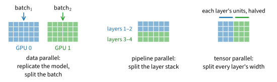
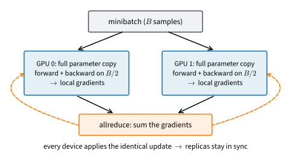
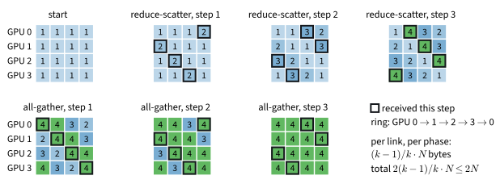

# Multi-GPU from First Principles
:label:`sec_multi_gpu`

Our machine holds four RTX 4090 GPUs. Each performs about 83 trillion fp32
operations per second and reads its own memory at 1 TB/s. A training run
on one of them leaves three quarters of the machine's arithmetic idle. The
simplest way to use all four is to give every GPU a
copy of the model and a quarter of each minibatch. The copies must then
agree after every step, which means that the GPUs exchange their
gradients. On this machine that exchange travels over PCIe and through
host memory, because the cards cannot address each other directly
(:numref:`subsec_hw-interconnects`). A PCIe 4.0 link carries a nominal
32 GB/s in each direction, about thirty times less than a GPU reads from
its own memory. A second GPU shortens training only if the computation it
takes over lasts longer than the exchange it adds.

This section builds the scheme, called *data parallelism*, by hand. We
split each minibatch, compute gradients on every device, sum them with a
collective operation called an *allreduce*, and apply the same update
everywhere. We then derive the allreduce algorithm that collective
libraries use. Finally, a cost model predicts the time of a step from
three quantities that we measure: the time a device needs for its share
of the minibatch, the fixed cost of one allreduce, and the bandwidth
between devices. Our test case is LeNet on Fashion-MNIST. Its steps are
so short that fixed costs dominate them, which makes it the hardest case
for data parallelism and the easiest one to take apart.

```{.python .input #multiple-gpus-multi-gpu-from-first-principles}
%%tab pytorch
from d2l import torch as d2l
import math
import time
import torch
from torch.nn import functional as F

torch.set_float32_matmul_precision('high')
```

```{.python .input #multiple-gpus-multi-gpu-from-first-principles}
%%tab jax
from d2l import jax as d2l
from functools import partial
import jax
from jax import numpy as jnp
from jax.flatten_util import ravel_pytree
from jax.sharding import NamedSharding, PartitionSpec as P
import math
import numpy as np
import optax
import random
import time
```

## Three Ways to Split
:label:`subsec_mg-splitting`

A model and its minibatch can be divided among devices in three ways
(:numref:`fig_splitting`).


:label:`fig_splitting`

Data parallelism gives every device a full copy of the model and a
different slice of the minibatch. Each device runs the whole network on
its slice, the devices sum their gradients, and every copy takes the same
optimizer step. It works for any model that fits on one GPU, and the
devices communicate once per step. *Pipeline parallelism* splits the stack of
layers: each device holds a few consecutive layers and passes its
activations to the next device. *Tensor parallelism* splits every layer:
each device holds a slice of each weight matrix and computes a slice of
each layer's output, so the devices communicate several times per layer.
The last two let a model that is too large for one GPU run at all.
AlexNet used such a split in 2012: each of its layers was divided between
two GPUs, because the network did not fit into one card's 3 GB
:cite:`Krizhevsky.Sutskever.Hinton.2012`. Today pipeline and tensor
parallelism matter at the scale of the models in the Language Models part,
and we leave them to it.

Data parallelism does not let us train a larger model. Every device holds
a full copy of the parameters, the gradients, and the optimizer state,
which take 16 bytes per parameter for fp32 training with Adam
(:numref:`sec_memory_precision`). A model that does not fit on one GPU
therefore does not fit on two. What data parallelism offers is speed: $k$
devices share the work of each minibatch.

## Data Parallelism by Hand
:label:`subsec_mg-byhand`

A data-parallel step on $k$ devices has four parts
(:numref:`fig_data_parallel`). We split the minibatch into $k$ equal
shards. Each device computes the gradient of the loss on its shard,
starting from its own copy of the parameters. The devices then sum their
$k$ gradients, so that every device holds the total. Finally, every device
applies the same update. Since all copies start equal and receive the same
update, they stay equal without ever being compared.


:label:`fig_data_parallel`

We build each part with explicit tensor operations, so that every byte that
moves between devices appears in the code.

### The Model and the Data

We use the LeNet of :numref:`sec_lenet`: two convolutional layers with
average pooling, followed by three fully connected layers. We make two of the
substitutions that :numref:`tab_lenet_modern` lists for modern networks:
ReLU activations in place of sigmoids, and He initialization
(:numref:`subsec_he_init`) in place of Xavier initialization.
Instead of a module, we write the network as a function of a list of
parameter tensors. The parameters, and later their gradients, are then
plain tensors that we can copy from device to device.

```{.python .input #multiple-gpus-data-parallelism-by-hand-1}
%%tab pytorch
def new_params():
    """LeNet's parameters on the CPU: He-initialized weights, zero biases."""
    params = []
    for shape in [(6, 1, 5, 5), (16, 6, 5, 5), (120, 400), (84, 120),
                  (10, 84)]:
        fan_in = math.prod(shape[1:])
        params += [torch.randn(shape) * math.sqrt(2 / fan_in),
                   torch.zeros(shape[0])]
    return params

def lenet(params, X):
    W1, b1, W2, b2, W3, b3, W4, b4, W5, b5 = params
    H = F.avg_pool2d(F.relu(F.conv2d(X, W1, b1, padding=2)), 2)
    H = F.avg_pool2d(F.relu(F.conv2d(H, W2, b2)), 2).flatten(1)
    H = F.relu(F.linear(H, W3, b3))
    H = F.relu(F.linear(H, W4, b4))
    return F.linear(H, W5, b5)

def to_device(split, device):
    """A whole Fashion-MNIST split on `device`: images in [0, 1], labels."""
    return split.data.to(device).unsqueeze(1) / 255, split.targets.to(device)
```

```{.python .input #multiple-gpus-data-parallelism-by-hand-1}
%%tab jax
def new_params(key):
    """LeNet's parameters: He-initialized weights, zero biases."""
    shapes = [(5, 5, 1, 6), (5, 5, 6, 16), (400, 120), (120, 84), (84, 10)]
    params = []
    for key, shape in zip(jax.random.split(key, len(shapes)), shapes):
        fan_in = math.prod(shape[:-1])
        params += [jax.random.normal(key, shape) * math.sqrt(2 / fan_in),
                   jnp.zeros(shape[-1])]
    return params

def lenet(params, X):
    W1, b1, W2, b2, W3, b3, W4, b4, W5, b5 = params
    conv = lambda X, W, padding: jax.lax.conv_general_dilated(
        X, W, (1, 1), padding, dimension_numbers=('NHWC', 'HWIO', 'NHWC'))
    pool = lambda X: jax.lax.reduce_window(
        X, 0.0, jax.lax.add, (1, 2, 2, 1), (1, 2, 2, 1), 'VALID') / 4
    H = pool(jax.nn.relu(conv(X, W1, ((2, 2), (2, 2))) + b1))
    H = pool(jax.nn.relu(conv(H, W2, 'VALID') + b2)).reshape(X.shape[0], -1)
    H = jax.nn.relu(H @ W3 + b3)
    H = jax.nn.relu(H @ W4 + b4)
    return H @ W5 + b5

def to_device(split, sharding):
    """A whole Fashion-MNIST split placed by `sharding`: images in [0, 1],
    labels."""
    X, y = split
    return jax.device_put((X[..., None] / np.float32(255),
                           y.astype(np.int32)), sharding)
```

LeNet is small. Its 61,706 parameters in ten tensors take 247 KB in fp32.
The 60,000 training images take 188 MB as floats, little enough to keep a
copy on every GPU. A copy on every GPU takes the input pipeline out of the
measurements below: each device reads its share of a minibatch from
its own copy, and the only data that cross between devices are gradients.

```{.python .input #multiple-gpus-the-model-and-the-data-1}
%%tab pytorch
assert d2l.num_gpus() >= 2, 'This section needs two GPUs'
data = d2l.FashionMNIST()
devices = [d2l.try_gpu(i) for i in range(2)]
train_data = [to_device(data.train, d) for d in devices]  # A copy each
test_data = to_device(data.val, devices[0])
base = new_params()          # One initialization for every run below
print(f'{sum(p.numel() for p in base)} parameters in {len(base)} tensors; '
      f'images {tuple(train_data[0][0].shape)} on each of 2 devices')
```

```{.python .input #multiple-gpus-the-model-and-the-data-1}
%%tab jax
assert jax.device_count() >= 2, 'This section needs two GPUs'
data = d2l.FashionMNIST()
meshes = [jax.make_mesh((k,), ('data',), devices=jax.devices()[:k])
          for k in (1, 2)]
train_data = [to_device(data.train, NamedSharding(mesh, P()))
              for mesh in meshes]  # A copy on every device of each mesh
test_data = (data.val[0][..., None] / np.float32(255),
             data.val[1].astype(np.int32))
base = new_params(jax.random.key(random.getrandbits(32)))  # For every run
print(f'{sum(p.size for p in base)} parameters in {len(base)} tensors; '
      f'images {train_data[1][0].shape} on each of 2 devices')
```

:begin_tab:`jax`
A JAX computation on several devices is laid out on a *mesh*, a grid of
devices whose axes carry names; ours is a row of $k$ devices along an axis
called `'data'`. A `NamedSharding` places an array on a mesh. Its
`PartitionSpec` says which array axis is cut along which mesh axis:
`P('data')` gives each device one slice of the leading axis, and the empty
`P()` gives every device a full copy. We keep one mesh for $k = 1$ and one
for $k = 2$, each with its own copy of the training set.
:end_tab:

### Broadcast and Allreduce

Two operations make the step parallel. *Broadcast* copies one device's
tensors to every other device; we need it once, to give every device the
same initial parameters. Allreduce takes one tensor per device, sums
them, and leaves the sum on every device; we need it once per step, for
the gradients. The simplest allreduce is a *star*: device 0 collects the
tensors of all other devices and adds them up, then sends the sum back.

```{.python .input #multiple-gpus-data-parallelism-by-hand-2}
%%tab pytorch
def broadcast(params, device):
    """A copy of every tensor in `params` on `device`, ready for autograd."""
    return [p.to(device, copy=True).requires_grad_() for p in params]

def allreduce(data):
    """Sum the tensors in `data`, one per device, onto every device."""
    for i in range(1, len(data)):    # Star: collect and add on device 0 ...
        data[0] += data[i].to(data[0].device)
    for i in range(1, len(data)):    # ... then copy the sum back
        data[i].copy_(data[0])

def synchronize(devices):
    """Wait until every device has finished the work queued on it."""
    for d in devices:
        torch.cuda.synchronize(d)
```

```{.python .input #multiple-gpus-data-parallelism-by-hand-2}
%%tab jax
def broadcast(params, mesh):
    """A copy of every array in `params` on every device of `mesh`."""
    return jax.device_put(params, NamedSharding(mesh, P()))

@partial(jax.jit, static_argnames='mesh')
def allreduce(x, mesh):
    """Sum the rows of `x` (row j on device j); every device gets the sum."""
    return jax.shard_map(lambda x_j: jax.lax.psum(x_j, 'data'), mesh=mesh,
                         in_specs=P('data'), out_specs=P('data'))(x)
```

:begin_tab:`pytorch`
`.to(device)` copies a tensor from one device to another; the copy and the
addition on device 0 are the whole algorithm. Since a GPU works through
its queue asynchronously, a timer must wait for every device involved, not
only for the current one, which is what `synchronize` does.
:end_tab:

:begin_tab:`jax`
`jax.shard_map` runs a function on every device of a mesh. Each device
receives the slices that the `in_specs` assign to it, here one row of `x`,
and `jax.lax.psum` over the axis `'data'` sums a value across the
devices of that axis. On GPUs, XLA hands the sum to NCCL, NVIDIA's
library of collective operations, which picks its own algorithm.
:end_tab:

Two vectors, one on each GPU, show what an allreduce leaves behind:

```{.python .input #multiple-gpus-data-parallelism-by-hand-3}
%%tab pytorch
x = [torch.full((1, 2), i + 1.0, device=d) for i, d in enumerate(devices)]
print('before:', [x_j.tolist() for x_j in x])
allreduce(x)
print('after: ', [x_j.tolist() for x_j in x])
```

```{.python .input #multiple-gpus-data-parallelism-by-hand-3}
%%tab jax
x = jax.device_put(jnp.array([[1.0, 1.0], [2.0, 2.0]]),
                   NamedSharding(meshes[1], P('data')))
print('before:', x.tolist())
print('after: ', allreduce(x, meshes[1]).tolist())
```

Each device now holds $1 + 2 = 3$ in every entry.

### The Data-Parallel Step

Each device computes the gradient of the mean loss over its own shard.
With $k$ shards of equal size, the average of the $k$ shard gradients is
the gradient of the mean loss over the whole minibatch. An allreduce
followed by a division by $k$ therefore gives every device the full-batch
gradient.
(The exercises ask what changes when the shards differ in size.)

LeNet's gradient consists of ten tensors, and we could allreduce them one
at a time. Every allreduce has a fixed cost, however few bytes it moves,
so we instead concatenate each device's gradients into one flat vector and
make a single allreduce per step. :numref:`subsec_mg-accounting` measures
how much this saves. The training step computes every device's gradient on
its shard, sums the gradients with one allreduce, and applies the update.
Its argument `communicate=False` skips the allreduce, so that every device
updates its own copy from its own shard alone. The result is not a
training step, but it lets us time the work that the devices do without
communicating.

```{.python .input #multiple-gpus-data-parallelism-by-hand-4}
%%tab pytorch
def shard_grads(params, data, idx):
    """Gradient of the mean loss on each device's share of the minibatch
    `idx` (example indices), as one flat vector per device."""
    grads = []
    for ps, (X, y), i in zip(params, data, idx.chunk(len(params))):
        i = i.to(X.device, non_blocking=True)  # Don't wait for the device
        F.cross_entropy(lenet(ps, X[i]), y[i]).backward()
        grads.append(torch.cat([p.grad.flatten() for p in ps]))
        for p in ps:
            p.grad = None              # The next backward starts from zero
    return grads

def train_step(params, data, idx, lr, communicate=True):
    """One data-parallel SGD step on the minibatch `idx`; without
    communication, every device steps on its own shard's gradient."""
    grads = shard_grads(params, data, idx)
    if communicate:
        allreduce(grads)               # One message per device and step
    with torch.no_grad():
        for ps, g in zip(params, grads):
            for p, g_p in zip(ps, g.split([p.numel() for p in ps])):
                p -= lr / len(params) * g_p.view_as(p)  # Mean of k grads
```

```{.python .input #multiple-gpus-data-parallelism-by-hand-4}
%%tab jax
def shard_grad(params, X, y, i):
    """Inside shard_map: the gradient of the mean loss on this device's
    share `i` of the minibatch, as one flat vector."""
    def loss(p):
        return optax.softmax_cross_entropy_with_integer_labels(
            lenet(p, X[i]), y[i]).mean()
    own = jax.lax.pcast(params, 'data', to='varying')  # This device's copy
    return ravel_pytree(jax.grad(loss)(own))[0]

@partial(jax.jit, static_argnames=('lr', 'mesh', 'communicate'))
def train_step(params, data, idx, lr, mesh, communicate=True):
    """One data-parallel SGD step on the minibatch `idx`; without
    communication, every device steps on its own shard's gradient."""
    unravel = ravel_pytree(params)[1]
    def step(params, X, y, i):
        g = shard_grad(params, X, y, i)
        if communicate:
            g = jax.lax.psum(g, 'data')              # Allreduce
        k = jax.lax.axis_size('data')
        return jax.tree.map(lambda p, g_p: p - lr / k * g_p, params,
                            unravel(g))
    out = P() if communicate else P('data')  # Copies differ without the sum
    return jax.shard_map(step, mesh=mesh, in_specs=(P(), P(), P(), P('data')),
                         out_specs=out)(params, *data, idx)
```

:begin_tab:`pytorch`
`shard_grads` computes the gradient on every device in turn and flattens
it. It then clears `p.grad`, because `backward` adds to the gradients that
are already stored. The step runs in a single Python process, which drives
all devices in turn: it issues the forward and backward pass for device 0,
then for device 1, then the copies of the allreduce. The kernels of
different devices can still run at the same time, because each GPU works
through its own queue while Python fills the next one.
:end_tab:

:begin_tab:`jax`
The parameters enter `shard_map` replicated (`P()`). If we differentiated
the replicated copy directly, JAX's autodiff would insert a sum over the
devices by itself: adding up every device's contribution is what the
derivative of "copy to every device" requires. Our explicit `psum` would
then count each contribution $k$ times. The `pcast(..., to='varying')`
declares each device's copy its own, so that `jax.grad` returns this
device's shard gradient and the `psum` in our code is the only allreduce.
`jax.jit` compiles the gradient, the allreduce, and the update into one
program that runs on all devices of the mesh at once. Without the `psum`,
every device's copy differs from the others, so the step returns them all,
one after another along the leading axis (`P('data')`).
:end_tab:

### A One-Step Check

A data-parallel step should update the parameters as a step on one device
with the same minibatch does. We check this once, before
reading any timing. The check is cheap, and it catches errors that an
accuracy curve hides. A step that sums the shard gradients instead of
averaging them trains with a learning rate $k$ times too large, and it
may still reach a plausible accuracy. From one random initialization, we take
one step on one GPU and one step on two GPUs, on the same 256 examples.

The check runs in true fp32. Elsewhere in this section the GPU's tensor
cores multiply fp32 operands in tf32, with a 10-bit mantissa
(:numref:`subsec_mp-mixed`). A minibatch of 256 and one of 128 can select
different convolution algorithms, and their tf32 rounding errors would
hide the small difference that we look for.

```{.python .input #multiple-gpus-data-parallelism-by-hand-7}
%%tab pytorch
idx = torch.randperm(len(data.train))[:256]
updates = []
torch.set_float32_matmul_precision('highest')  # True fp32 in matmuls ...
with torch.backends.cudnn.flags(enabled=True, allow_tf32=False):  # ... convs
    for k in (1, 2):
        params = [broadcast(base, d) for d in devices[:k]]
        train_step(params, train_data[:k], idx, lr=0.2)
        updates.append([p.detach().cpu() - b
                        for p, b in zip(params[0], base)])
torch.set_float32_matmul_precision('high')
largest = max(u.abs().max() for u in updates[0])
diff = max((u1 - u2).abs().max() for u1, u2 in zip(*updates))
print(f'largest update {largest:.1e}, largest difference {diff:.1e}')
```

```{.python .input #multiple-gpus-data-parallelism-by-hand-7}
%%tab jax
idx = np.random.default_rng().permutation(len(data.train[1]))[:256]
updates = []
with jax.default_matmul_precision('highest'):  # True fp32
    for mesh, data_k in zip(meshes, train_data):
        i = jax.device_put(idx, NamedSharding(mesh, P('data')))
        params = train_step(broadcast(base, mesh), data_k, i, 0.2, mesh)
        updates.append([np.asarray(p) - np.asarray(b)
                        for p, b in zip(params, base)])
largest = max(np.abs(u).max() for u in updates[0])
diff = max(np.abs(u1 - u2).max() for u1, u2 in zip(*updates))
print(f'largest update {largest:.1e}, largest difference {diff:.1e}')
```

The two updates differ by less than a hundred-thousandth of the largest
update. That is fp32 rounding, because the two steps add the same numbers
in a different order. The parallel step computes what the single-device step
computes, so any difference in speed that we measure below comes from how
the work is spread over the devices.

## Ring Allreduce
:label:`subsec_mg-ring`

A star allreduce routes everything through device 0. For a gradient of
$N$ bytes on $k$ devices, device 0 receives $(k-1)N$ bytes and sends
$(k-1)N$ bytes, while the links of the other devices carry $N$ bytes each
way and then sit idle. The time of the star therefore grows linearly
in $k$. *Ring allreduce* :cite:`Patarasuk.Yuan.2009` spreads the traffic
evenly over all devices.

Arrange the $k$ devices in a ring in which each sends only to its
successor, and split every device's gradient vector into $k$ chunks of
$N/k$ bytes. The allreduce runs in two phases
(:numref:`fig_ring_allreduce`). In the first phase, called
*reduce-scatter*, each device sends one chunk to its successor and adds
the chunk it receives from its predecessor to its own copy of that chunk.
After $k-1$ such steps, every device owns one chunk that holds the sum
over all devices, a different chunk on each device. In the second phase,
called *all-gather*, the finished chunks travel around the ring for
another $k-1$ steps until every device has all of them. At every step
every device sends one chunk and receives one chunk, so each device sends
$(k-1)N/k$ bytes per phase, and the two phases together send

$$
\frac{2(k-1)}{k}\, N \quad\textrm{bytes per device.}
$$
:eqlabel:`eq_ring_traffic`

The traffic per device thus does not grow with $k$: it is $N$ bytes at
$k = 2$ and approaches $2N$ from below as $k$ grows. For a ResNet-18,
with 45 MB of fp32 gradients, on four GPUs each device sends 67 MB, where
the hub of a star would send 134 MB and receive as much. The two phases
are also useful on their own. Reduce-scatter leaves each device with the
sum of one part of the gradient, and all-gather assembles a vector from
parts held on different devices. The sharded training of the next section
uses them separately.


:label:`fig_ring_allreduce`

The byte count does not determine the time on its own. The ring takes
$2(k-1)$ steps one after another, and each step includes the fixed time of
a transfer, so the fixed cost of a ring allreduce grows linearly in $k$
while its bytes do not. For small messages, where the fixed cost dominates, collective
libraries switch to algorithms with fewer sequential steps, such as
trees, whose depth grows only like $\log_2 k$; an exercise derives where
the crossover lies. On our machine, the ring also has fewer independent links
to spread its traffic over than its picture suggests. Without peer-to-peer
access, a transfer from one GPU to its neighbor goes up one PCIe link
into host memory and down another (:numref:`subsec_hw-interconnects`),
so all hops share the host's memory system and two PCIe host bridges.
:eqref:`eq_ring_traffic` says how many bytes each device must move. How
fast they move is a property of the machine that we have to measure.

## Communication Cost and Scaling
:label:`subsec_mg-accounting`

We can now ask the question of the opening: does a second GPU shorten a
step? The answer comes from comparing the computation that moves to the
new device with the communication that it adds.

### A Cost Model for One Step

On one device, a step on a minibatch of $B$ examples takes time
$t_{\textrm{compute}}(B)$ for the device's local work: the forward and
backward pass and the update. On $k$ devices, each device does this work
for $B/k$ examples, and the step also waits for the allreduce of the $N$
gradient bytes that every device holds. A transfer of $n$ bytes takes time
$\alpha + n/\beta$, a fixed cost $\alpha$ plus the bytes divided by a
bandwidth $\beta$ :cite:`Hockney.1994`.

We apply this model to the allreduce as a whole and write its time as $\alpha + 2N/\beta$, which
defines $\beta$ by measurement: $2N/\beta$ is the time of an allreduce so
large that its fixed cost does not matter. On two devices, every allreduce
makes each device send $N$ bytes and receive $N$, so $\beta$ counts the
bytes that leave and enter a device together. For our star, whose two
copies run one after the other, $\beta$ is the bandwidth of one copy. The
step time on $k$ devices is then approximately

$$
t_{\textrm{step}}(k) \approx t_{\textrm{compute}}(B/k) + m\,\alpha +
\frac{2N}{\beta},
$$
:eqlabel:`eq_dp_cost`

where $m$ is the number of allreduce calls per step, each with the fixed
cost $\alpha$. At $k = 1$ both communication terms vanish. Only the first
term shrinks as devices are added; the other two stay. A second device
therefore shortens the step only if
$t_{\textrm{compute}}(B) - t_{\textrm{compute}}(B/2)$, the computation it
takes over, exceeds $m\alpha + 2N/\beta$, the communication it adds. The
three quantities $t_{\textrm{compute}}$, $\alpha$, and $\beta$
can each be measured on their own, and we do so for LeNet.

### Latency and Bandwidth of the Allreduce

An allreduce of a single number moves almost no bytes, so its time is
$\alpha$. An allreduce of 64M floats, 256 MB per device, takes so long
that $\alpha$ hardly matters, and $\beta = 2N/(t - \alpha)$ follows from
its time $t$. We measure both on two GPUs. A training loop does not wait
for the devices after each allreduce; the next kernels queue behind
it. We therefore time many calls in a row and wait once at the end, since
a wait after every call would add its own delay to $\alpha$.

```{.python .input #multiple-gpus-the-accounting}
%%tab pytorch
def time_calls(f, devices, calls):
    """Seconds per call of f, for `calls` calls in a row and one wait."""
    def run():
        for _ in range(calls):
            f()
        synchronize(devices)
    return d2l.Benchmark(run, warmup=1, repeats=3).time / calls

def allreduce_time(n, devices, calls):
    """Seconds per allreduce of n floats per device."""
    x = [torch.zeros(n, device=d) for d in devices]
    return time_calls(lambda: allreduce(x), devices, calls)

alpha = allreduce_time(1, devices, calls=100)
N = 4 * 2**26                            # 64M floats: 256 MB
beta = 2 * N / (allreduce_time(N // 4, devices, calls=3) - alpha)
print(f'alpha = {1e6 * alpha:.0f} us, beta = {beta / 1e9:.1f} GB/s')
```

```{.python .input #multiple-gpus-the-accounting}
%%tab jax
def allreduce_time(n, mesh, calls):
    """Seconds per allreduce of n floats per device."""
    x = jnp.zeros((mesh.size, n), device=NamedSharding(mesh, P('data')))
    return d2l.Benchmark(lambda: allreduce(x, mesh), repeats=calls).time

alpha = allreduce_time(1, meshes[1], calls=100)
N = 4 * 2**26                            # 64M floats: 256 MB
beta = 2 * N / (allreduce_time(N // 4, meshes[1], calls=3) - alpha)
print(f'alpha = {1e6 * alpha:.0f} us, beta = {beta / 1e9:.1f} GB/s')
```

:begin_tab:`pytorch`
`d2l.Benchmark` waits only for the current device, so `time_calls` ends
its calls with a wait for both. The star allreduce reaches about 20 GB/s.
On two devices it consists of two copies of $N$ bytes, one after the
other, so each copy runs at about 20 GB/s as well. The GPUs' copy engines
move the bytes over PCIe and through host memory, and this is about what
one PCIe 4.0 link carries in one direction after that detour. The fixed
cost $\alpha$ is that of two driver-managed copies.
:end_tab:

:begin_tab:`jax`
`d2l.Benchmark` already makes its calls in a row and waits once, for the
last result. The `psum` moves well under 10 GB/s per device. Without
peer-to-peer access, NCCL falls back to a transport that moves fewer bytes
per second than the PCIe links carry; :numref:`sec_multi_gpu_concise`
measures this transport and a workaround for it. Its rate also depends on
which two GPUs take part (:numref:`fig_pcie_topology`). On our machine,
$\beta$ is 4.9 GB/s for GPUs 0 and 1, 6.2 GB/s for GPUs 2 and 3, the other
pair behind one host bridge, and 7.3–7.4 GB/s for two GPUs behind
different bridges. A measured $\beta$ thus describes a pair of GPUs, not
the machine; ours is GPUs 0 and 1. Each call of `allreduce`
dispatches a compiled program of its own, so $\alpha$ includes the time of
that dispatch.
:end_tab:

At these bandwidths, moving LeNet's 247 KB of gradients takes
$2N/\beta$, at most about a tenth of a millisecond. Does it matter whether
they travel as one message or as ten? We allreduce LeNet's ten gradient
tensors first one at a time, then all at once as one concatenated vector.
The cell prints both times next to the predictions of
:eqref:`eq_dp_cost`:

```{.python .input #multiple-gpus-latency-and-bandwidth-of-the-allreduce-1}
%%tab pytorch
grads = [[torch.zeros_like(p, device=d) for p in base] for d in devices]
flat = [torch.cat([g.flatten() for g in G]) for G in grads]
def separately():
    for g in zip(*grads):              # One allreduce per tensor
        allreduce(list(g))
n_bytes, m = 4 * flat[0].numel(), len(base)
for name, f, calls in (('separately', separately, m),
                       ('at once', lambda: allreduce(flat), 1)):
    t = time_calls(f, devices, calls=100)
    print(f'{name:10s}: {1e6 * t:4.0f} us measured, '
          f'{1e6 * (calls * alpha + 2 * n_bytes / beta):4.0f} us predicted')
```

```{.python .input #multiple-gpus-latency-and-bandwidth-of-the-allreduce-1}
%%tab jax
mesh = meshes[1]
grads = [jnp.zeros((mesh.size, p.size), device=NamedSharding(mesh, P('data')))
         for p in base]
flat = jnp.concatenate(grads, axis=1)
n_bytes, m = 4 * flat.shape[1], len(base)
for name, f, calls in (
        ('separately', lambda: [allreduce(g, mesh) for g in grads], m),
        ('at once', lambda: allreduce(flat, mesh), 1)):
    t = d2l.Benchmark(f, repeats=100).time
    print(f'{name:10s}: {1e6 * t:4.0f} us measured, '
          f'{1e6 * (calls * alpha + 2 * n_bytes / beta):4.0f} us predicted')
```

Ten calls take several times as long as one call that moves the same
bytes, and the two constants predict both times. For a gradient this
small, the number of messages decides the communication time, and the
bytes hardly matter. This is why collective libraries pack many small
gradient tensors into a few large buffers before they send them, as our
training step does by hand.

### LeNet on One and Two GPUs

A step on two GPUs spends $\alpha + 2N/\beta$ on one allreduce. What it
saves is the difference between $t_{\textrm{compute}}(256)$, the time of
one device's local work on a minibatch of 256 examples, and
$t_{\textrm{compute}}(128)$, the time of the same work on half of it. We
measure both on one GPU with `communicate=False`. A third measurement runs
the local work on two GPUs at once, 128 examples each, which is what the
data-parallel step does before its allreduce:

```{.python .input #multiple-gpus-lenet-on-one-and-two-gpus-1}
%%tab pytorch
params, t_local = [broadcast(base, d) for d in devices], {}
for k, b in ((1, 256), (1, 128), (2, 128)):
    t_local[k, b] = time_calls(
        lambda: train_step(params[:k], train_data[:k], idx[:k * b], 0.2,
                           communicate=False), devices[:k], calls=50)
    print(f'{k} GPU(s), {b} examples each: {1e3 * t_local[k, b]:.2f} ms')
```

```{.python .input #multiple-gpus-lenet-on-one-and-two-gpus-1}
%%tab jax
t_local = {}
for k, b in ((1, 256), (1, 128), (2, 128)):
    mesh, data_k = meshes[k - 1], train_data[k - 1]
    params = broadcast(base, mesh)
    i = jax.device_put(idx[:k * b], NamedSharding(mesh, P('data')))
    t_local[k, b] = d2l.Benchmark(lambda: train_step(
        params, data_k, i, 0.2, mesh, communicate=False), repeats=50).time
    print(f'{k} GPU(s), {b} examples each: {1e3 * t_local[k, b]:.2f} ms')
```

On one GPU, 128 examples take about as long as 256. A LeNet layer applied
to a few hundred small images is far too little work to occupy an RTX
4090, so each kernel finishes before the next one is ready to start. The
step is in the overhead-bound regime of :numref:`subsec_perf-regimes`:
its time is set by the number of kernels launched rather than by the
arithmetic inside them, and halving the minibatch leaves the number of
kernels unchanged.

:begin_tab:`pytorch`
On two GPUs, the local work takes about twice as long as on one GPU with
the same 128 examples. One Python thread launches the kernels of both
devices, one device after the other, so twice as many launches wait for a
single interpreter, and each GPU idles while Python serves the other.
:eqref:`eq_dp_cost` assumes that the devices work independently; here
they share one launcher.
:end_tab:

:begin_tab:`jax`
On two GPUs, the local work takes about as long as on one GPU with the
same 128 examples. The jitted `shard_map` is a single program, launched
once, which both devices run side by side.
:end_tab:

The second GPU thus saves almost no local time, while the allreduce adds
$\alpha + 2N/\beta$, and :eqref:`eq_dp_cost` predicts that a step on two
GPUs takes longer than a step on one. The predicted step time is the
one-GPU step, plus the difference between the local work on two GPUs and
on one, plus $\alpha + 2N/\beta$. To test the prediction, we train for
five epochs on one GPU and on two, from the same initialization `base`,
with minibatches of 256 examples. Both runs visit the training set in the
same five random orders, drawn once, so that they differ only in rounding.
The function `train` takes the list of orders, one per epoch. It returns
the average time per step over all epochs but the first, which includes
start-up costs, and then the test accuracy:

```{.python .input #multiple-gpus-data-parallelism-by-hand-5}
%%tab pytorch
def train(params, train_data, test_data, orders, batch_size=256, lr=0.2):
    """Data-parallel SGD on the devices that hold `params` and `train_data`,
    one epoch per example order; returns seconds per step, test accuracy."""
    devices = [X.device for X, _ in train_data]
    times = []
    for order in orders:
        t0 = time.perf_counter()
        for idx in order.split(batch_size):
            train_step(params, train_data, idx, lr)
        synchronize(devices)
        times.append((time.perf_counter() - t0)
                     / math.ceil(len(order) / batch_size))
    X, y = test_data
    with torch.no_grad():
        acc = (lenet(params[0], X).argmax(1) == y).float().mean().item()
    return sum(times[1:]) / (len(times) - 1), acc
```

```{.python .input #multiple-gpus-data-parallelism-by-hand-5}
%%tab jax
def train(params, train_data, test_data, mesh, orders, batch_size=256,
          lr=0.2):
    """Data-parallel SGD on the devices of `mesh`, one epoch per example
    order; returns seconds per step, test accuracy."""
    times = []
    for order in orders:
        starts = range(0, len(order), batch_size)
        batches = jax.device_put(  # The epoch's minibatches, in one call
            [order[s:s + batch_size] for s in starts],
            NamedSharding(mesh, P('data')))
        t0 = time.perf_counter()
        for idx in batches:
            params = train_step(params, train_data, idx, lr, mesh)
        jax.block_until_ready(params)
        times.append((time.perf_counter() - t0) / len(batches))
    X, y = test_data
    acc = float((jax.jit(lenet)(params, X).argmax(1) == y).mean())
    return sum(times[1:]) / (len(times) - 1), acc
```

:begin_tab:`jax`
Placing an array on the devices takes time on the host, more than a
tenth of a millisecond for one minibatch of indices. `train` therefore
places all minibatches of an epoch with one `jax.device_put` before the
clock starts, as we placed the training set before any timing, so that
the clock measures the steps alone. Placed inside the loop, the transfers
would lengthen every step by about 0.2 ms per GPU, a cost that no term
of :eqref:`eq_dp_cost` contains.
:end_tab:

```{.python .input #multiple-gpus-data-parallelism-by-hand-6}
%%tab pytorch
orders, t_step = [torch.randperm(len(data.train)) for _ in range(5)], {}
for k in (1, 2):
    params = [broadcast(base, d) for d in devices[:k]]
    t_step[k], acc = train(params, train_data[:k], test_data, orders)
    print(f'{k} GPU(s): {1e3 * t_step[k]:.2f} ms per step, '
          f'test accuracy {acc:.2f}')
predicted = (t_step[1] + t_local[2, 128] - t_local[1, 256]
             + alpha + 2 * n_bytes / beta)
print(f'2 GPUs predicted: {1e3 * predicted:.2f} ms per step')
```

```{.python .input #multiple-gpus-data-parallelism-by-hand-6}
%%tab jax
rng = np.random.default_rng()
orders, t_step = [rng.permutation(len(data.train[1])) for _ in range(5)], {}
for k, mesh, data_k in zip((1, 2), meshes, train_data):
    t_step[k], acc = train(broadcast(base, mesh), data_k, test_data, mesh,
                           orders)
    print(f'{k} GPU(s): {1e3 * t_step[k]:.2f} ms per step, '
          f'test accuracy {acc:.2f}')
predicted = (t_step[1] + t_local[2, 128] - t_local[1, 256]
             + alpha + 2 * n_bytes / beta)
print(f'2 GPUs predicted: {1e3 * predicted:.2f} ms per step')
```

The step on two GPUs is slower than the step on one, close to the
prediction from the separately measured terms. For LeNet, a second GPU
makes training slower. Both runs reach the same test accuracy to within
a point or two. They start from the same parameters and see the examples
in the same order, so they differ only in rounding, which a thousand
steps of SGD amplify. Two runs on one GPU differ about as much, because a
GPU does not always add the same numbers in the same order.

LeNet is too small for data parallelism. A second device shortens a step
when the computation on each shard is long compared with
$m\alpha + 2N/\beta$, and that requires two things. The per-device batch
must be large enough to keep each GPU busy, so that
$t_{\textrm{compute}}(B/k)$ is close to $t_{\textrm{compute}}(B)/k$. And the
model must perform many operations per byte of gradient, so that the
computation it moves outweighs the exchange it adds. LeNet performs 0.4
million multiply-adds per image, under two per byte of its gradient. A
ResNet-18 on Fashion-MNIST images enlarged to 64×64 pixels performs 2.2
billion multiply-adds per image with 45 MB of gradients, about fifty per
byte.

### Strong and Weak Scaling

Every reported speedup holds something fixed, and two conventions are
common. :eqref:`eq_dp_cost` holds the global minibatch $B$ fixed while $k$
grows: the same work, finished sooner if all goes well. This is *strong
scaling*, and it is what we measured for LeNet. The alternative holds the
per-device batch fixed, so that the global minibatch grows to
$kB_{\textrm{device}}$: more work per unit of time. This is *weak
scaling*, and its speedups are quoted as throughput, examples per second.
Weak scaling is the easier test, because $t_{\textrm{compute}}$ per device
does not shrink and only the communication has to stay small next to it.
A larger global minibatch, however, changes the optimization itself
(:numref:`sec_batch_size`), so a gain in examples per second under weak
scaling is not a gain of the same size in the time it takes to reach a
given loss.

We can now predict from three measurements whether more GPUs shorten a
step, and we have seen why they do not for LeNet. Our hand-written
version also leaves room for improvement. It waits for the whole backward
pass before it communicates, although the gradients of the last layers
are ready long before those of the first.

:begin_tab:`pytorch`
It also drives every device from one Python thread, and its star routes
all traffic through device 0 instead of a ring.
:end_tab:

:numref:`sec_multi_gpu_concise` replaces our version with the frameworks'
production tools and measures them on a model large enough to gain from
more GPUs.

## Summary

Data parallelism trains a copy of the model on every device, each on its
share of the minibatch. The copies stay equal because an allreduce sums
their gradients before every update, and a one-step check confirms that
the parallel step computes what one device computes. A ring
allreduce, a reduce-scatter followed by an all-gather, moves
$2(k-1)N/k$ bytes per device, at most $2N$ however many devices take
part. Whether another device shortens a step follows from
$t_{\textrm{step}}(k) \approx t_{\textrm{compute}}(B/k) + m\alpha + 2N/\beta$,
whose terms can each be measured. For LeNet, the fixed cost $\alpha$ of
an allreduce outweighs its bytes, which is why gradients travel as one
message. Halving LeNet's minibatch does not halve its computation either,
so a second GPU makes each step slower. Data parallelism shortens steps
for models whose per-device computation is long compared with the
exchange of their gradients. A reported speedup must say whether it holds
the global or the per-device batch fixed.

## Exercises

1. **Data versus pipeline parallelism.** Consider a stack of $L$ fully
   connected layers of width $d$, with fp32 weights and no biases, trained
   on two GPUs with minibatch size $B$. Data parallelism allreduces the
   gradients of all weights. Two-stage pipeline
   parallelism (:numref:`fig_splitting`) places the first $L/2$ layers on one GPU and
   the rest on the other, so the forward pass sends the $B \times d$
   activations at the cut to the second GPU and the backward pass returns
   their gradient.
    1. Count the bytes that cross between the two GPUs per step in each
       scheme, and evaluate both for $L = 32$, $d = 4096$, and $B = 256$.
       For which relation between $B$, $L$, and $d$ does data parallelism
       move fewer bytes?
    1. In the pipeline, each GPU idles while the other computes. To
       shorten the idle time, split the minibatch into $m$ micro-batches
       :cite:`Huang.Cheng.Bapna.ea.2019`. In the forward phase, the first
       GPU hands each micro-batch to the second as soon as it is done, so
       that the second GPU works on micro-batch $j$ while the first works
       on micro-batch $j+1$. The backward phase starts after the last
       forward pass and runs the same schedule from the second GPU to the
       first. Assume that every micro-batch takes the same time on each
       stage. Derive the fraction of the step during which each GPU idles,
       and evaluate it for $m = 1$ and $m = 8$.

1. **Gradient normalization.** Two recipes compute a data-parallel
   gradient from $k$ shards of a minibatch of $B$ examples. In recipe A,
   each device sums its per-example losses, the devices sum their
   gradients, and the update divides by $B$. In recipe B, which our
   training step uses, each device averages its per-example losses, and
   the devices average their gradients.
    1. Show that both recipes yield the gradient of the full-batch mean
       loss when every shard holds $B/k$ examples.
    1. A language model averages its loss over tokens. Two shards with the
       same number of sequences hold 3000 and 1000 tokens. Find the weight
       that recipe B gives a token on each shard, relative to the weight
       the token has in the full-batch token mean.
    1. Modify recipe B so that it is exact for any shard sizes, and
       identify the extra quantity that the devices must communicate
       before the update.

1. **Strong-scaling speedup.** Model the compute time of a shard of $s$
   examples as $t_{\textrm{compute}}(s) = t_0 + c\,s$, where $t_0$ does not
   shrink with the shard. Let each device send $b$ bytes per second over
   its link, while it receives at the same rate. This per-direction rate
   $b$ is not the $\beta$ of :eqref:`eq_dp_cost`, which counts the bytes
   in both directions. By :eqref:`eq_ring_traffic`, one step at a fixed
   global batch $B$ takes
   $$t_{\textrm{step}}(k) = t_0 + \frac{c\,B}{k} + \frac{2(k-1)}{k}\,\frac{N}{b},$$
   with no communication at $k = 1$. The strong-scaling speedup is
   $S(k) = t_{\textrm{step}}(1) / t_{\textrm{step}}(k)$.
    1. Show that $S(k) > 1$ holds for one $k > 1$ exactly when it holds
       for every $k > 1$, and find the condition. Find the limit of $S(k)$
       as $k \to \infty$.
    1. A model with 11.2 million fp32 parameters has $t_0 = 2$ ms and
       $c = 0.2$ ms per example, and it is trained with $B = 256$. Compute
       $S(2)$, $S(4)$, and the limit for $b = 20$ GB/s and for
       $b = 5$ GB/s. Find the rate $b$ below which no number of GPUs
       speeds up this model.
    1. Sending the gradients in bf16 instead of fp32 halves $N$. For
       $b = 5$ GB/s, recompute $S(4)$ and the limit of $S(k)$, and
       state which of the two gains more from the halving.

1. **Parameter servers and the ring.** Before collective libraries became
   standard, distributed training often summed gradients through
   *parameter servers* :cite:`Li.Andersen.Park.ea.2014`: $s$ server
   machines each hold a slice of $N/s$ bytes of the parameters. In every
   step, each of $k$ workers pushes its gradient for each slice to that
   slice's server, the server adds up the $k$ contributions and updates
   its slice, and every worker pulls the updated slices back.
    1. Count the bytes that each worker and each server send and receive
       per step. Find the number of servers at which a server's link is no
       busier than a worker's.
    1. Now let the $k$ workers act as the servers, each holding $1/k$ of
       the parameters. Show that the traffic of each device equals
       :eqref:`eq_ring_traffic`, and match the push and pull phases to the
       two phases of ring allreduce.

:begin_tab:`pytorch`
5. [code] **Ring allreduce by hand.** ● This exercise needs four GPUs.
    The star pattern routes all traffic through device 0, while the ring
    of :numref:`fig_ring_allreduce` spreads it over all $k$ devices.
    1. For $k$ devices holding $N$ bytes each, count the bytes that the
       star and the ring move in total, and the bytes that the busiest
       device sends and receives. The star starts its broadcast only after
       its sum is complete. Predict the ratio of their times under two
       assumptions. In the first, each device has one link that carries
       $b$ bytes per second in each direction at the same time, and all
       links work concurrently. In the second, the machine runs one
       transfer at a time at $b$ bytes per second.
    1. Write `ring_allreduce(data)` with the interface of `allreduce`:
       split each tensor into $k$ chunks with `chunk`, and implement
       reduce-scatter and all-gather with explicit `.to()` copies. Check it
       against `allreduce` for $k \in \{2, 3, 4\}$, guarding with
       `d2l.num_gpus()`.
    1. Time both functions with `d2l.Benchmark` on 64M floats per device
       at $k = 2$ and $k = 4$, and decide which assumption of the first
       part describes your machine.
:end_tab:

:begin_tab:`jax`
5. [code] **Ring allreduce by hand.** ● This exercise needs four GPUs.
    The star pattern routes all traffic through device 0, while the ring
    of :numref:`fig_ring_allreduce` spreads it over all $k$ devices.
    1. For $k$ devices holding $N$ bytes each, count the bytes that the
       star and the ring move in total, and the bytes that the busiest
       device sends and receives. The star starts its broadcast only after
       its sum is complete. Predict the ratio of their times under two
       assumptions. In the first, each device has one link that carries
       $b$ bytes per second in each direction at the same time, and all
       links work concurrently. In the second, the machine runs one
       transfer at a time at $b$ bytes per second.
    1. Write `ring_allreduce` as a function under `jax.shard_map` that
       passes chunks to the neighboring device with `jax.lax.ppermute` and
       selects them with `jax.lax.axis_index`. Check it against
       `jax.lax.psum` for $k \in \{2, 4\}$, and count the
       collective-permute operations in its compiled HLO.
    1. Time it on 64M floats per device at $k = 2$ and $k = 4$. Predict
       the ratio of the two times under each assumption of the first part,
       decide which assumption describes your machine, and compare both
       times with those of the `psum` of :numref:`subsec_mg-accounting`.
:end_tab:

6. [code] **Gradients in bf16.** ● Sending gradients in bf16
   halves their bytes but rounds them. In a ring, each reduce-scatter hop
   adds the incoming partial sum to the local chunk, so a bf16 ring
   rounds the partial sum to bf16 once per hop.
    1. At the parameters returned by `new_params`, compute the gradients
       of `lenet` on $k$ disjoint Fashion-MNIST shards of 128 examples
       each, and flatten each shard's gradients into one vector. Add the
       vectors one after another, rounding to bf16 after every
       addition, and measure the relative error of the result against an
       fp32 sum for $k \in \{2, 8, 64\}$. Repeat with each vector rounded
       to bf16 once and the sum accumulated in fp32. Explain how each
       error depends on $k$.
    1. Compare the error at $k = 8$ with the relative difference between
       the gradients of two shards, and decide whether the rounding matters
       for SGD.

1. **Latency in the allreduce.** ● The byte count of
   :eqref:`eq_ring_traffic` ignores the fixed cost of starting a transfer.
   Let one transfer of $n$ bytes over a link take $\alpha + n/b$, where
   $b$ is the rate of one link in one direction.
    1. Derive the time $t_{\textrm{ring}}$ of a ring allreduce of $N$ bytes
       on $k$ devices, and describe how each of its two terms behaves as
       $k$ grows.
    1. A binary-tree allreduce sums up the tree and broadcasts back down.
       It takes $2\log_2 k$ steps, each of which sends the full $N$ bytes,
       so
       $$t_{\textrm{tree}} = 2\log_2 k \left(\alpha + \frac{N}{b}\right).$$
       For $k = 8$, $\alpha = 10\ \mu\textrm{s}$, and
       $b = 20$ GB/s, find the message size below which the tree is
       faster than the ring.
    1. The allreduce of :eqref:`eq_dp_cost` takes $\alpha + 2N/\beta$.
       The gradient size $N_{1/2}$ at which it spends half of its time on
       the fixed cost is called its half-performance length. Express
       $N_{1/2}$ in $\alpha$ and $\beta$, and compute it from the values
       that you measured in :numref:`subsec_mg-accounting`. How many
       copies of LeNet's gradient would one message have to carry to reach
       it? Production data-parallel libraries pack gradients into buffers
       of tens of megabytes (25 MB by default in PyTorch's
       `DistributedDataParallel`); judge that size against your
       $N_{1/2}$.

1. [extended] **Where data parallelism helps.** ● LeNet is too small for a
   second GPU to help. Widen it, timing `train_step` with
   `communicate=False` on one and on two GPUs to measure
   $t_{\textrm{compute}}(b)$, and find out which terms of
   :eqref:`eq_dp_cost` the width changes.
    1. Generalize `new_params` and `lenet` so that the channel counts of
       both convolutions and the widths of the two hidden dense layers
       scale with a factor $w$. Compute the gradient bytes $N(w)$ and the
       forward-pass multiply-adds per example, and show how their ratio
       depends on $w$.
    1. For $w \in \{1, 2, 4, 8, 16\}$, measure the time per step of
       `train` at $k = 1$ and $k = 2$ with global batch 256, and plot the
       speedup against $w$.
    1. Overlay the speedup that :eqref:`eq_dp_cost` predicts from your
       measured $t_{\textrm{compute}}(128)$ and $t_{\textrm{compute}}(256)$
       and from the $\alpha$ and $\beta$ measured in the allreduce
       experiment of :numref:`subsec_mg-accounting`. Find the speedup that
       the prediction approaches as $w$ grows. Find the achieved compute rate
       in FLOP/s below which the second GPU helps at large $w$.
    1. Repeat the prediction and the measurement at $w = 16$ with global
       batch 1024, and explain why the batch size raises the limit of the
       previous part while the width does not.

[Discussions](https://d2l.discourse.group/t/36791)

<!-- slides -->

::: {.slide}
::: {.cover}
[Dive into Deep Learning · §13.5]{.kicker}

Multi-GPU from First Principles<br>**data parallelism by hand · allreduce · ring allreduce · a cost model for one step · strong and weak scaling**
:::
:::

::: {.slide title="A Second GPU Adds Arithmetic and a Gradient Exchange"}
[The problem]{.kicker}

- One RTX 4090: 83 TFLOP/s in fp32, memory read at 1 TB/s.
- Our machine has four. Data parallelism gives each a copy of the model
  and a share of every minibatch.
- The copies must sum their gradients after every step.
- Our cards cannot address each other: every byte goes over PCIe through
  host memory, 32 GB/s per direction at best, 30× slower than memory.

::: {.d2l-note .warn}
Does the computation a second GPU takes over outlast the exchange it
adds?
:::
:::

::: {.slide title="By the End of This Deck You Can"}
[Goals]{.kicker}

- name three ways to split training over devices, and what each costs;
- write a data-parallel step with broadcast and allreduce;
- derive the bytes a ring allreduce moves per device;
- predict a step's time from three measured quantities;
- tell strong from weak scaling in a reported speedup.

**Running example:** LeNet (61,706 parameters, 247 KB of fp32 gradients)
on Fashion-MNIST, on two of our four RTX 4090s; a 1B-parameter GPT for
the estimates.
:::

::: {.slide title="One Copy per GPU, One Gradient Sum per Step"}
[Where this fits]{.kicker}

::: {.cols .vc}
::: {.col}
| section | adds |
|---|---|
| The Performance Model | roofline, three regimes, timing, profiling |
| Hardware | where peak arithmetic and bandwidth come from |
| Compute Graphs and Compilation | fusion and kernel replay |
| Memory and Precision | what fits: bytes per parameter and per token |
| **Multi-GPU from First Principles** | **data parallelism by hand, its cost model** |
| Multi-GPU in Practice | production data parallelism, sharding |
| Case Study: Optimizing a Transformer | the whole method on one GPT |
:::

::: {.col .narrow}
- **Uses:** LeNet, Fashion-MNIST, the overhead-bound regime, the PCIe
  topology of our machine.
- **Skips:** pipeline and tensor parallelism (Language Models part),
  production libraries (next deck), several machines.
:::
:::
:::

::: {.slide title="Copy the Model, Cut Its Depth, or Cut Its Width"}
[Three ways to split]{.kicker}

{width=90%}

- Data parallel: any model that fits on one GPU; one exchange per step.
  Every device still holds 16 bytes per parameter (fp32 Adam).
- Pipeline and tensor parallel: for models too large for one GPU.
:::

::: {.slide title="Split, Compute, Sum, Update: The Copies Stay Equal"}
[Data parallelism by hand]{.kicker}

{width=60%}

Equal start and equal update: the copies never need to be compared.
The only exchange is the gradient sum.
:::

::: {.slide title="Allreduce Leaves the Sum on Every Device"}
[Data parallelism by hand]{.kicker}

@!multiple-gpus-data-parallelism-by-hand-3

- **Star:** device 0 collects every tensor, adds, sends the sum back.
- **Broadcast:** copy the initial parameters to every device, once.
:::

::: {.slide title="Average k Shard Gradients, Sent as One Vector"}
[Data parallelism by hand]{.kicker}

Device $j$ averages the losses $\ell_i$ of the $B/k$ examples in its
shard $S_j$ and differentiates with respect to the parameters
$\boldsymbol{\theta}$; then every device takes the same SGD step:

$$
\mathbf{g}_j = \nabla_{\boldsymbol{\theta}} \frac{k}{B}
\sum_{i \in S_j} \ell_i, \qquad
\boldsymbol{\theta} \leftarrow \boldsymbol{\theta} -
\frac{\eta}{k} \sum_{j=1}^{k} \mathbf{g}_j .
$$

- The average of the $\mathbf{g}_j$ is the full-minibatch gradient.
- LeNet's 10 gradient tensors are concatenated into one flat vector:
  one allreduce per step, not ten.
:::

::: {.slide title="One Step on Two GPUs Matches One Step on One"}
[Data parallelism by hand]{.kicker}

Same initialization, same 256 examples, one SGD step each:

@!multiple-gpus-data-parallelism-by-hand-7

::: {.d2l-note .rule}
Differences at the level of fp32 rounding. Check this before reading any
timing: a wrong normalization still trains, but with the wrong learning
rate.
:::
:::

::: {.slide title="Check: Forget to Divide by k"}
[Check]{.kicker}

Two GPUs each average their loss over 128 examples; the allreduce sums
the two gradients; the update forgets the factor $1/k$. What learning rate
does the step really use?

::: {.fragment .fade-up}
::: {.d2l-note}
**Answer.** $2\eta$: the sum of two averages is twice the average. On $k$
devices, $k\eta$. Training may still converge, so only the one-step check
exposes it.
:::
:::
:::

::: {.slide title="A Star Sends (k − 1)N Bytes Through Device 0"}
[Ring allreduce]{.kicker}

Gradient of $N$ bytes on each of $k$ devices:

| | busiest device sends | grows with $k$? |
|---|---|---|
| star (hub = device 0) | $(k-1)N$ | linearly |
| ring | $2(k-1)N/k < 2N$ | no |

ResNet-18, $N$ = 45 MB, $k = 4$: the hub sends 134 MB and receives as much;
each device of a ring sends 67 MB.
:::

::: {.slide title="Ring Allreduce: Reduce-Scatter, Then All-Gather"}
[Ring allreduce]{.kicker}

{width=88%}

$k-1$ steps per phase, one chunk of $N/k$ bytes per device and step:
$\frac{2(k-1)}{k}N$ bytes per device, at most $2N$ for any $k$.
:::

::: {.slide title="A Ring Has 2(k − 1) Hops, So Its Fixed Cost Grows with k"}
[Ring allreduce]{.kicker}

- Bytes per device: bounded by $2N$.
- Hops in sequence: $2(k-1)$, each with a fixed start-up time.
- Small messages: libraries switch to trees, $2\log_2 k$ hops.
- On our machine every hop goes GPU → host memory → GPU; all hops share
  the host's memory system.

::: {.d2l-note}
The byte count says how much moves; the machine decides how fast.
Measure it.
:::
:::

::: {.slide title="Step Time = Shard Compute + Fixed Costs + Bytes over Bandwidth"}
[Cost model]{.kicker}

$$
t_{\textrm{step}}(k) \approx t_{\textrm{compute}}(B/k) + m\,\alpha +
\frac{2N}{\beta}
$$

- $t_{\textrm{compute}}(b)$: forward, backward, and update on $b$
  examples;
- $m$ allreduce calls per step, each with fixed cost $\alpha$;
- $N$ gradient bytes per device; $2N/\beta$ is the time of a large
  allreduce (at $k = 2$: $N$ sent plus $N$ received per device).

::: {.d2l-note .rule}
Only the first term shrinks with $k$. A second GPU helps iff
$t_{\textrm{compute}}(B) - t_{\textrm{compute}}(B/2) > m\alpha + 2N/\beta$.
:::
:::

::: {.slide title="Measured on Two RTX 4090s: α and β"}
[Cost model]{.kicker}

An allreduce of one float gives $\alpha$; one of 64M floats (256 MB)
gives $\beta$:

@!multiple-gpus-the-accounting

LeNet's 247 KB: $2N/\beta$ takes at most about 0.1 ms at these rates.
:::

::: {.slide title="Ten Small Allreduces Cost Several Times One Large One"}
[Cost model]{.kicker}

LeNet's 10 gradient tensors, sent one by one or concatenated:

@!multiple-gpus-latency-and-bandwidth-of-the-allreduce-1

::: {.d2l-note .rule}
For small gradients the number of messages sets the time. Libraries
pack gradients into large buffers before sending.
:::
:::

::: {.slide title="Half a Minibatch Takes About as Long as a Whole One"}
[LeNet on one and two GPUs]{.kicker}

Local work only (forward, backward, update), no communication:

@!multiple-gpus-lenet-on-one-and-two-gpus-1

- One GPU: 128 examples take about as long as 256. LeNet on a few
  hundred images is too little work for an RTX 4090.
- Overhead-bound: the number of kernels, not their arithmetic, sets the
  time, and halving the batch keeps the number of kernels.
- The last row is the local work of a two-GPU step.
:::

::: {.slide title="Check: Is LeNet's Step Faster on Two GPUs?"}
[Check]{.kicker}

Use the measurements: the local work on two GPUs, the local work on one
GPU with all 256 examples, and $\alpha + 2N/\beta$.

::: {.fragment .fade-up}
::: {.d2l-note}
**Answer.** No. The second GPU saves almost no local time and adds an
allreduce, so the step gets slower: by the difference of the two local
times plus $\alpha + 2N/\beta$.
:::
:::
:::

::: {.slide title="Measured: Two GPUs Make LeNet's Step Slower"}
[LeNet on one and two GPUs]{.kicker}

Five epochs, minibatch 256, same initialization, same example order:

@!multiple-gpus-data-parallelism-by-hand-6

- Slower, as predicted from the separately measured terms.
- Test accuracy equal to within a point or two: the two runs differ only
  in rounding.
:::

::: {.slide title="Data Parallelism Needs Long Shard Computations"}
[When it helps]{.kicker}

| | multiply-adds per image | gradient | per gradient byte |
|---|---|---|---|
| LeNet, 28×28 | 0.4 M | 247 KB | < 2 |
| ResNet-18, 64×64 | 2.2 G | 45 MB | ≈ 50 |

- Per-device batch large enough to fill the GPU:
  $t_{\textrm{compute}}(B/k) \approx t_{\textrm{compute}}(B)/k$.
- Many operations per gradient byte; few, large messages.
:::

::: {.slide title="Check: A 1B-Parameter GPT on Two RTX 4090s"}
[Check]{.kicker}

Training costs about 6 FLOPs per parameter and token. One step: 32,768
tokens (micro-batches of about 2,000 tokens, gradients accumulated, one
allreduce); about 35 TFLOP/s achieved per GPU in bf16; 4 GB of fp32
gradients. Predict the speedup of two GPUs over one for
$\beta$ = 20 GB/s and for $\beta$ = 7 GB/s.

::: {.fragment .fade-up}
::: {.d2l-note}
**Answer.** One GPU:
$6 \cdot 10^9 \cdot 32{,}768 / (3.5 \cdot 10^{13}) \approx 5.6$ s.
Two: $2.8$ s of compute plus $2 \cdot 4\,\textrm{GB}/\beta$:
$5.6 / 3.2 \approx 1.75\times$ at 20 GB/s, $5.6 / 3.9 \approx 1.4\times$
at 7 GB/s.
:::
:::
:::

::: {.slide title="Strong Scaling Fixes the Global Batch; Weak Scaling the Per-Device Batch"}
[Scaling]{.kicker}

- **Strong:** global minibatch $B$ fixed, $t_{\textrm{compute}}(B/k)$
  shrinks: the same work, sooner. Our LeNet experiment.
- **Weak:** per-device batch fixed, global batch $kB_{\textrm{device}}$:
  more examples per second; only communication must keep up.
- A larger global batch changes the optimization: more examples per
  second is not the same as less time to a given loss.

::: {.d2l-note .warn}
Read every speedup with its convention.
:::
:::

::: {.slide title="Wrap-up"}
- Data parallelism: a copy per device, a share of every minibatch, one
  gradient allreduce per step; the one-step check matches to fp32 rounding.
- Ring allreduce: $2(k-1)N/k \le 2N$ bytes per device, $2(k-1)$ hops.
- $t_{\textrm{step}}(k) \approx t_{\textrm{compute}}(B/k) + m\alpha + 2N/\beta$,
  with every term measured.
- LeNet: ten messages cost several times one; half a batch is no faster;
  two GPUs make the step slower.
- A 1B GPT on two RTX 4090s: 1.4× to 1.75× by the same cost model,
  depending on $\beta$.

**Next:** production data parallelism, which overlaps communication with
the backward pass, in Multi-GPU in Practice.
:::
