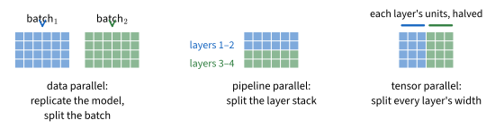
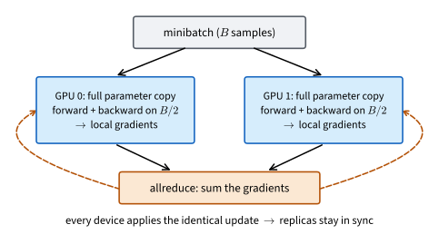
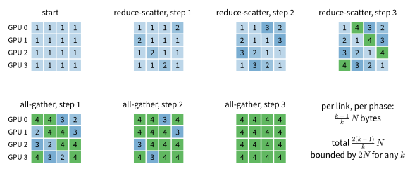

# Multi-GPU from First Principles
:label:`sec_multi_gpu`

Adding GPUs increases aggregate arithmetic and memory capacity. This
section builds data-parallel training explicitly, with device-to-device
copies and a hand-written gradient sum, so that the production mechanisms
in :numref:`sec_multi_gpu_concise` are clear. We derive ring allreduce and
its communication cost. Because the build machine has no fast inter-GPU
fabric, the experiments also show when communication or reduced per-device
utilization prevents speedup.

The experimental machine has neither NVLink nor peer-to-peer transfer
(:numref:`sec_hardware`). A faster fabric reduces the communication term
but does not remove it. Since the derivation treats the number of devices as
a variable, the same cost model applies beyond this machine.

*Prerequisites: minibatch SGD and the effect of batch size on the gradient
estimate (*:numref:`sec_minibatch_sgd`*); LeNet (*:numref:`sec_lenet`*); the
interconnect measurements of* :numref:`subsec_hw-interconnects`*.*

```{.python .input #multiple-gpus-multi-gpu-from-first-principles}
%%tab pytorch
%matplotlib inline
from d2l import torch as d2l
import torch
from torch import nn
from torch.nn import functional as F

torch.set_float32_matmul_precision('high')
```

```{.python .input #multiple-gpus-multi-gpu-from-first-principles}
%%tab jax
%matplotlib inline
from d2l import jax as d2l
import jax
from jax import numpy as jnp
import numpy as np
import optax
import os
from functools import partial

# XLA's NCCL buffer registration fails harmlessly on this P2P-less box;
# opt out rather than let every collective print the warning.
os.environ.setdefault('NCCL_LOCAL_REGISTER', '0')
```

## Three Ways to Split
:label:`subsec_mg-splitting`

Given more than one GPU and a model to train, there are three ways to
divide the work (:numref:`fig_splitting`).


:label:`fig_splitting`

**Data parallelism** replicates the whole model on every GPU and splits the
*batch*: each device runs the full network on a different slice of the
minibatch, then the devices sum their gradients so every replica takes the
same optimizer step. It is the simplest, works for any model that fits on
one GPU, and needs communication only once per step — so it is what this
chapter builds. **Pipeline parallelism** splits the *layer stack* across
devices, each holding a few consecutive layers; it lets a model too deep
for one GPU fit, at the cost of tight inter-stage synchronization.
**Tensor parallelism** splits *within* each layer — each device holds a
slice of every weight matrix — and communicates several times per layer.
The latter two matter only at scales this part defers to the Language
Models chapters, which have models large enough to warrant them; a single
historical note is that the very first of them appeared in 2012, when
AlexNet was split across two GPUs because its weights did not fit
in one card's 3 GB :cite:`Krizhevsky.Sutskever.Hinton.2012`. Data
parallelism is our subject, and it does *not* let you train a bigger
model, a warning that :numref:`sec_memory_precision` already made: every
GPU still holds a full copy.

## Data Parallelism by Hand
:label:`subsec_mg-byhand`

Data-parallel training on $k$ GPUs is five steps per minibatch: split the
batch into $k$ shards; run forward and backward on each shard against that
device's copy of the parameters; sum the $k$ gradient sets so all devices
agree; and let every device apply the same update
(:numref:`fig_data_parallel`). We build each piece for a small LeNet, then
run it — and watch the second GPU buy us nothing.


:label:`fig_data_parallel`

We define LeNet from raw tensors (not a module) so that parameters,
gradients, and their movement between devices are fully visible:

```{.python .input #multiple-gpus-data-parallelism-by-hand-1}
%%tab pytorch
scale = 0.01
def new_params(device):
    def p(*shape):
        return (torch.randn(*shape, device=device) * scale).requires_grad_()
    return [p(20, 1, 3, 3), torch.zeros(20, device=device, requires_grad=True),
            p(50, 20, 5, 5), torch.zeros(50, device=device, requires_grad=True),
            p(800, 128), torch.zeros(128, device=device, requires_grad=True),
            p(128, 10), torch.zeros(10, device=device, requires_grad=True)]

def lenet(X, params):
    h1 = F.avg_pool2d(F.relu(F.conv2d(X, params[0], params[1])), 2, 2)
    h2 = F.avg_pool2d(F.relu(F.conv2d(h1, params[2], params[3])), 2, 2)
    h2 = h2.reshape(h2.shape[0], -1)
    h3 = F.relu(torch.mm(h2, params[4]) + params[5])
    return torch.mm(h3, params[6]) + params[7]

loss = nn.CrossEntropyLoss(reduction='none')
```

```{.python .input #multiple-gpus-data-parallelism-by-hand-1}
%%tab jax
scale = 0.01
def new_params(key):
    ks = jax.random.split(key, 4)
    return [jax.random.normal(ks[0], (20, 1, 3, 3)) * scale, jnp.zeros(20),
            jax.random.normal(ks[1], (50, 20, 5, 5)) * scale, jnp.zeros(50),
            jax.random.normal(ks[2], (800, 128)) * scale, jnp.zeros(128),
            jax.random.normal(ks[3], (128, 10)) * scale, jnp.zeros(10)]

def lenet(params, X):
    conv = lambda x, W: jax.lax.conv_general_dilated(
        x, W, (1, 1), 'VALID', dimension_numbers=('NCHW', 'OIHW', 'NCHW'))
    pool = lambda x: jax.lax.reduce_window(
        x, 0.0, jax.lax.add, (1, 1, 2, 2), (1, 1, 2, 2), 'VALID') / 4.0
    h1 = pool(jax.nn.relu(conv(X, params[0]) + params[1].reshape(1, -1, 1, 1)))
    h2 = pool(jax.nn.relu(conv(h1, params[2]) + params[3].reshape(1, -1, 1, 1)))
    h2 = h2.reshape(h2.shape[0], -1)
    h3 = jax.nn.relu(jnp.dot(h2, params[4]) + params[5])
    return jnp.dot(h3, params[6]) + params[7]
```

The two operations that make it parallel are *broadcasting* parameters to
each device and *summing* gradients across them. We build the PyTorch
version by hand, because the hand-rolled version is the lesson; the
`#@save`d `split_batch` (which chops a minibatch into per-device shards)
rounds out the toolkit:

```{.python .input #multiple-gpus-data-parallelism-by-hand-2}
%%tab pytorch
def get_params(params, device):
    return [p.clone().to(device).detach().requires_grad_() for p in params]

def allreduce(data):
    # Star pattern: sum everything onto device 0, then broadcast back.
    for i in range(1, len(data)):
        data[0][:] += data[i].to(data[0].device)
    for i in range(1, len(data)):
        data[i][:] = data[0].to(data[i].device)

def split_batch(X, y, devices):  #@save
    """Split `X` and `y` into multiple devices."""
    assert X.shape[0] == y.shape[0]
    return (nn.parallel.scatter(X, devices),
            nn.parallel.scatter(y, devices))
```

```{.python .input #multiple-gpus-data-parallelism-by-hand-2}
%%tab jax
def get_params(params, num_devices):
    """Data parallelism replicates the full parameter set on every device;
    shard_map's P() in-spec (below) broadcasts one copy to each."""
    return params

def split_batch(X, y, num_devices):  #@save
    """Reshape `X` and `y` onto a leading device axis of size num_devices."""
    assert X.shape[0] % num_devices == 0
    reshape = lambda a: a.reshape(num_devices, -1, *a.shape[1:])
    return reshape(X), reshape(y)
```

`allreduce` is the central operation. The implementation above uses a
simple star topology: it gathers every device's gradient onto device 0,
sums there, and broadcasts back, with device 0 as a
hub that handles all $k-1$ inbound and $k-1$ outbound transfers. Watch it
work on two vectors living on two GPUs:

```{.python .input #multiple-gpus-data-parallelism-by-hand-3}
%%tab pytorch
data = [torch.ones((1, 2), device=d2l.try_gpu(i)) * (i + 1)
        for i in range(min(2, d2l.num_gpus()))]
print('before:', [d.cpu().numpy().tolist() for d in data])
allreduce(data)
print('after: ', [d.cpu().numpy().tolist() for d in data])
```

```{.python .input #multiple-gpus-data-parallelism-by-hand-3}
%%tab jax
# JAX writes the same allreduce as a collective inside shard_map (below,
# a pmean: the sum divided by k); here we show the summed result it is
# built on.
data = jnp.stack([jnp.ones((1, 2)) * (i + 1)
                  for i in range(min(2, jax.local_device_count()))])
print('before:', data.tolist())
print('summed:', jnp.broadcast_to(data.sum(0), data.shape).tolist())
```

The training step assembles the pieces. Each device computes its shard's
gradient; we allreduce parameter by parameter; each device applies plain
SGD. This implementation runs in one Python process because it moves tensors
explicitly:

```{.python .input #multiple-gpus-data-parallelism-by-hand-4}
%%tab pytorch
def train_batch(X, y, device_params, devices, lr):
    X_shards, y_shards = split_batch(X, y, devices)
    ls = [loss(lenet(Xs, dev_W), ys).sum()
          for Xs, ys, dev_W in zip(X_shards, y_shards, device_params)]
    for l in ls:
        l.backward()
    with torch.no_grad():
        for i in range(len(device_params[0])):
            allreduce([device_params[c][i].grad for c in range(len(devices))])
        for param in device_params:
            d2l.sgd(param, lr, X.shape[0])
            for p in param:
                p.grad = None
```

```{.python .input #multiple-gpus-data-parallelism-by-hand-4}
%%tab jax
@partial(jax.jit, static_argnames=('lr', 'mesh'))
def train_step(params, X, y, lr, mesh):
    """One data-parallel step: shard_map makes the pmean collective explicit.
    `X`, `y` arrive with the batch sharded across devices (P('data')) and
    `params` replicated (P()) -- see `train` below; shard_map hands each device
    the full parameter replica and its own batch shard. pcast marks the replica
    as this device's own local copy, so the gradient below is the shard's own;
    pmean then averages the shard gradients across devices."""
    P = jax.sharding.PartitionSpec

    def per_device(params, X, y):
        def loss_fn(p):
            logits = lenet(p, X[0])   # X[0]: strip the size-1 sharded axis
            return optax.softmax_cross_entropy_with_integer_labels(
                logits, y[0]).mean()
        local = jax.lax.pcast(params, 'data', to='varying')  # my own copy
        grads = jax.grad(loss_fn)(local)        # my shard's mean-loss gradient
        grads = jax.lax.pmean(grads, 'data')    # The allreduce, in one line
        return jax.tree.map(lambda p, g: p - lr * g, params, grads)

    step = jax.shard_map(per_device, mesh=mesh,
                         in_specs=(P(), P('data'), P('data')),
                         out_specs=P())
    return step(params, X, y)
```

The two tabs make the same computation visible in two idioms. PyTorch
moves gradients between devices with explicit `.to(device)` copies inside
`allreduce`; JAX writes the collective as a single `jax.lax.pmean` inside
a `jax.shard_map`, where the `PartitionSpec('data')` annotation tells XLA
that the leading axis is sharded across devices. (Note the top-level
`jax.shard_map` — the older `jax.pmap` is a compatibility shim as of JAX
0.8 and we do not use it.) The JAX tab requires one additional distinction:
under `shard_map` the parameters arrive *replicated*, and differentiating
a replicated tensor makes JAX's autodiff insert a gradient *sum* of its
own — the transpose of "broadcast to every device" is "add up every
device's contribution", and a further explicit `psum` on top would then
double-count. The `pcast(..., to='varying')` line opts out by declaring
each replica device-local, so the code owns the collective: every device
takes its shard's mean-loss gradient, and `pmean` averages them into
exactly the gradient one device would compute on the whole batch. The
collective is visible in both tabs, which is the purpose of this manual
implementation.

Both tabs claim that $k$ devices take *the same* step as one device. The
following parity check verifies this claim. From the same initialization and
minibatch, one step on
two GPUs must move the parameters exactly where one step on one GPU does.
The test is cheap, and it catches normalization bugs that no accuracy
curve reliably reveals, such as a summed instead of averaged gradient
acting as an accidental $k\times$ learning rate:

```{.python .input #multiple-gpus-data-parallelism-by-hand-7}
%%tab pytorch
X, y = torch.randn(256, 1, 28, 28), torch.randint(0, 10, (256,))
base = new_params(d2l.try_gpu(0))
deltas = []
for k in (1, min(2, d2l.num_gpus())):
    devices = [d2l.try_gpu(i) for i in range(k)]
    device_params = [get_params(base, d) for d in devices]
    train_batch(X, y, device_params, devices, lr=0.2)
    deltas.append([(p - b).detach().cpu()
                   for p, b in zip(device_params[0], base)])
print('max update difference, k=1 vs k=2: '
      f'{max((a - b).abs().max() for a, b in zip(*deltas)):.2e}')
```

```{.python .input #multiple-gpus-data-parallelism-by-hand-7}
%%tab jax
P = jax.sharding.PartitionSpec
X = jax.random.normal(jax.random.PRNGKey(1), (256, 1, 28, 28))
y = jax.random.randint(jax.random.PRNGKey(2), (256,), 0, 10)
base = new_params(jax.random.PRNGKey(0))
deltas = []
for k in (1, min(2, jax.local_device_count())):
    mesh = jax.make_mesh((k,), ('data',))
    place = lambda a, spec: jax.device_put(
        a, jax.sharding.NamedSharding(mesh, spec))
    params = jax.tree.map(lambda p: place(p, P()), base)
    Xs, ys = split_batch(X, y, k)
    new = train_step(params, place(Xs, P('data')), place(ys, P('data')),
                     0.2, mesh)
    deltas.append([np.asarray(n - b) for n, b in zip(new, base)])
print('max update difference, k=1 vs k=2: '
      f'{max(np.abs(a - b).max() for a, b in zip(*deltas)):.2e}')
```

The parameter updates agree to floating-point noise — around $10^{-9}$,
against update magnitudes near $10^{-2}$. "Mathematically identical" is
now a measurement, not a slogan. With correctness established, the
training loop that wraps `train_batch`/`train_step` is the multi-GPU
cousin of :numref:`sec_lenet`'s. First, one GPU:

```{.python .input #multiple-gpus-data-parallelism-by-hand-5}
%%tab pytorch
def train(num_gpus, batch_size, lr):
    train_iter, test_iter = d2l.load_data_fashion_mnist(batch_size)
    devices = [d2l.try_gpu(i) for i in range(num_gpus)]
    base = new_params(devices[0])
    device_params = [get_params(base, d) for d in devices]
    timer, num_epochs = d2l.Timer(), 5
    for epoch in range(num_epochs):
        timer.start()
        for X, y in train_iter:
            train_batch(X, y, device_params, devices, lr)
        for d in devices:   # completion timing: sync before stopping the clock
            torch.cuda.synchronize(d)
        timer.stop()
    acc = d2l.evaluate_accuracy_gpu(
        lambda x: lenet(x, device_params[0]), test_iter, devices[0])
    print(f'test acc {acc:.2f}, {timer.avg():.2f} sec/epoch on {num_gpus} GPU(s)')

train(num_gpus=1, batch_size=256, lr=0.2)
```

```{.python .input #multiple-gpus-data-parallelism-by-hand-5}
%%tab jax
def train(num_gpus, batch_size, lr):
    P = jax.sharding.PartitionSpec
    data = d2l.FashionMNIST(batch_size=batch_size)
    train_iter = data.get_dataloader(train=True)
    mesh = jax.make_mesh((num_gpus,), ('data',))
    place = lambda a, spec: jax.device_put(
        a, jax.sharding.NamedSharding(mesh, spec))
    params = get_params(new_params(jax.random.PRNGKey(0)), num_gpus)
    params = jax.tree.map(lambda p: place(p, P()), params)  # a replica per device
    timer, num_epochs = d2l.Timer(), 5
    for epoch in range(num_epochs):
        timer.start()
        for X, y in train_iter:
            X = jnp.array(X).transpose(0, 3, 1, 2)
            if X.shape[0] % num_gpus:       # drop a ragged final batch
                continue
            Xs, ys = split_batch(X, jnp.array(y), num_gpus)
            Xs, ys = place(Xs, P('data')), place(ys, P('data'))  # shard the batch
            params = train_step(params, Xs, ys, lr, mesh)
        jax.block_until_ready(params)
        timer.stop()
    apply_fn, hits, total = jax.jit(lenet), 0, 0
    p0 = jax.tree.map(lambda p: jax.device_put(p, jax.devices()[0]), params)
    for X, y in data.get_dataloader(train=False):
        X = jnp.array(X).transpose(0, 3, 1, 2)
        hits += int((apply_fn(p0, X).argmax(axis=1) == jnp.array(y)).sum())
        total += len(y)
    print(f'test acc {hits / total:.2f}, {timer.avg():.2f} sec/epoch '
          f'on {num_gpus} GPU(s)')

train(num_gpus=1, batch_size=256, lr=0.2)
```

Now two GPUs, same batch size and learning rate. The optimization is
mathematically identical, as the one-step check just proved — any
accuracy gap between these short runs is run-to-run noise from
initialization and rounding, not the parallelism — but the wall-clock is
**no better**:

```{.python .input #multiple-gpus-data-parallelism-by-hand-6}
%%tab pytorch
train(num_gpus=min(2, d2l.num_gpus()), batch_size=256, lr=0.2)
```

```{.python .input #multiple-gpus-data-parallelism-by-hand-6}
%%tab jax
train(num_gpus=min(2, jax.local_device_count()), batch_size=256, lr=0.2)
```

The second GPU buys **no speedup** — on our box the two-GPU run is at
best on par with one GPU and is slower in JAX, as expected when each device
is underutilized.
The reason is *not* slow communication: LeNet's parameters are tiny — the
whole gradient set is about half a megabyte — so its allreduce is
negligible, and we measure the transport directly below. LeNet is too small
for data parallelism to improve throughput. Splitting a 256-example batch
into two 128-example shards
underfeeds each GPU — a convolution on half the batch does not run at half
the time, because a small batch never filled the device to begin with —
and the Python orchestration and per-step dispatch are not amortized
by microsecond-scale compute. The technique is not wrong; the *regime* is
wrong. This tiny model is the worst case for data parallelism, and
diagnosing exactly why is the next two subsections' work: separating the
communication cost, which is small here, from the underutilization cost,
which is not.

## Ring Allreduce
:label:`subsec_mg-ring`

Our star `allreduce` uses device 0 as a hub for all transfers. It moves
$(k-1)N$ bytes in and $(k-1)N$ out for a
parameter set of $N$ bytes, and the other devices' links sit idle while it
works. *Ring allreduce* :cite:`Patarasuk.Yuan.2009` removes this hub. Its two
phases also provide the basis for FSDP in
:numref:`sec_multi_gpu_concise`.

Arrange the $k$ devices in a ring, each talking only to its neighbor.
Split each device's gradient vector into $k$ equal chunks. The allreduce
runs in two phases (:numref:`fig_ring_allreduce`). In **reduce-scatter**,
over $k-1$ steps, device $i$ sends one chunk to its neighbor while
receiving and accumulating another; after the phase, each device owns one
fully-summed chunk (a different chunk per device). In **all-gather**,
another $k-1$ steps pass those finished chunks around the ring until every
device has all $k$. At every step, every link carries exactly one chunk of
size $N/k$, so each device sends $(k-1) \cdot N/k$ bytes per phase, and
both phases together move

$$
\frac{2(k-1)}{k}\, N \quad\text{bytes per device,}
$$
:eqlabel:`eq_ring_traffic`

which is **nearly constant in $k$**: it rises from $N$ at $k=2$ toward
its bound of $2N$ and never exceeds it, however many devices join the
ring. The star pattern's hub moved $(k-1)N$ — linear in $k$; the ring
moves at most $2N$. That is why production collective libraries are built
on rings and trees, chosen per message size and topology, alongside
hardware-specific schemes; for messages small enough that per-hop
*latency* dominates the byte count, trees win — a term this byte-only
accounting deliberately ignores.


:label:`fig_ring_allreduce`

The $2(k-1)/k$ byte count does not determine the transfer rate. On the
build machine, peer-to-peer transfer is unavailable, so each nominal
peer-to-peer transfer, every "neighbor to neighbor" hop is really a
round trip through host memory (:numref:`subsec_hw-interconnects`), so the
ring hop is staged through host memory (:numref:`subsec_hw-interconnects`).
The resulting transport bandwidth largely removes the ring's theoretical
advantage over a star. NCCL may still select a ring or tree by message
size, but measured link bandwidth supplies the constant in the cost model.

## Communication Cost and Scaling
:label:`subsec_mg-accounting`

We can now estimate whether another device reduces step time. One step on $k$
GPUs takes roughly

$$
t_{\text{step}}(k) \;\approx\;
\underbrace{t_{\text{compute}}(B/k)}_{\text{forward+backward on a shard}}
\;+\;
\underbrace{t_{\text{comm}}}_{\approx\, 2N / \beta},
$$
:eqlabel:`eq_dp_cost`

where $B$ is the global batch, $N$ the bytes of gradients to reduce, and
$\beta$ the achievable allreduce bandwidth (:eqref:`eq_ring_traffic` gives
the $2N$; the per-device traffic is bounded by it for any $k$). The
compute term *shrinks* with more GPUs (each does less of the batch); the
communication term does not. Parallelism pays exactly when the compute
you offload exceeds the communication you take on — models with high
compute per byte of gradient traffic, large per-device batches, and fast
links all push in your favor; a tiny model on a slow link, like LeNet on
the build machine, is a case where the second device does not improve time.

Two scaling conventions deserve names here, because every published
speedup quietly picks one. :eqref:`eq_dp_cost` holds the global batch $B$
fixed while $k$ grows — *strong scaling*: the same work, hopefully
finishing sooner. The alternative holds the *per-device* batch fixed, so
the global batch grows to $kB_{\textrm{device}}$ — *weak scaling*: more
work per unit time, quoted as throughput. The throughput sweep of
:numref:`sec_multi_gpu_concise` holds the per-rank batch fixed and must
be read under the weak-scaling convention — and remember that a grown
global batch changes the optimization trajectory itself
(:numref:`sec_batch_size`).

Let's plug in real numbers by measuring $\beta$ directly. One bookkeeping
convention first, so the numbers below are comparable: we quote *bytes
moved per device per allreduce* ($\approx 2N$ for the ring) divided by
wall-clock time — an effective bandwidth. NCCL's benchmark "busbw"
normalizes differently, so its figures are not directly comparable to
ours. Here is the effective bandwidth of the allreduce each tab actually
runs — the hand-rolled star in PyTorch, XLA's `psum` collective in JAX:

```{.python .input #multiple-gpus-the-accounting}
%%tab pytorch
if d2l.num_gpus() >= 2:
    N = 64 * 1024 * 1024  # 64M floats = 256 MB per replica
    data = [torch.randn(N, device=d2l.try_gpu(i)) for i in range(2)]
    t = d2l.Benchmark(lambda: allreduce(data), warmup=2, repeats=5).time
    # Per-device traffic is ~2N bytes; report effective bandwidth
    print(f'allreduce {2 * N * 4 / t / 1e9:.2f} GB/s effective '
          f'over {1000 * t:.1f} ms')
else:
    print('needs 2 GPUs')
```

```{.python .input #multiple-gpus-the-accounting}
%%tab jax
if jax.local_device_count() >= 2:
    mesh = jax.make_mesh((2,), ('data',))
    P = jax.sharding.PartitionSpec
    N = 64 * 1024 * 1024
    x = jax.device_put(jnp.ones((2, N)),
                       jax.sharding.NamedSharding(mesh, P('data')))
    psum = jax.jit(jax.shard_map(
        lambda a: jax.lax.psum(a, 'data'), mesh=mesh,
        in_specs=P('data'), out_specs=P('data')))
    t = d2l.Benchmark(lambda: psum(x), warmup=2, repeats=5).time
    print(f'psum {2 * N * 4 / t / 1e9:.2f} GB/s effective over {1000*t:.1f} ms')
else:
    print('needs 2 GPUs')
```

:begin_tab:`pytorch`
The hand-rolled copy sustains roughly twenty GB/s — this is a plain PCIe
transfer, staged through host memory, running near the bus limit, and
two orders of magnitude below an NVLink domain's ~1.8 TB/s per GPU
(:numref:`tab_gpu_specs`). This result also shows that a *collective library*
such as NCCL, whose ring/tree chunking is tuned for
peer-to-peer fabrics, extracts noticeably *less* effective bandwidth than
this naive one-shot copy on our P2P-less box — its busbw here is only a
couple of GB/s. The physical link is not limiting: our copy and NCCL cross
the same PCIe links. The difference is *how* the bytes move. With
peer-to-peer unavailable, NCCL falls back to a shared-memory transport
whose default mode drives the transfer with a GPU kernel issuing
load/store instructions across the bus — a latency-bound path — while
our `.to()` copy rides the GPU's DMA copy engines, built for exactly
this. One environment variable (`NCCL_SHM_USE_CUDA_MEMCPY=1`) switches
NCCL's fallback onto those same copy engines and recovers most of the
gap on this box — a workaround for what is best read as a
platform-specific performance bug, not a setting to copy blindly:
:numref:`sec_multi_gpu_concise` measures the roughly five-fold recovery —
and shows why its training runs nonetheless keep the library's defaults.
The diagnosis is
this chapter's method in miniature: the ceiling was not the algorithm
and not the wire but one stage of the transport — and you find the
binding stage by measuring, not by trusting the library.
:end_tab:

:begin_tab:`jax`
The measured `psum` sustains well under ten GB/s in our convention —
more than two orders of magnitude below an NVLink domain's ~1.8 TB/s per
GPU (:numref:`tab_gpu_specs`). That number is itself a theory-versus-practice
lesson: XLA hands the collective to NCCL, whose ring/tree chunking is
tuned for peer-to-peer fabrics, and on our P2P-less box every "neighbor"
hop stages through host memory — so the tuned library lands well *below*
the roughly twenty GB/s a naive one-shot `.to()` copy achieves (the
PyTorch tab measures it). The physical link is not limiting — both paths cross
the same PCIe links. The gap is in *how* the fallback transport moves
bytes (a latency-bound GPU-kernel copy by default, rather than the DMA
copy engines), and a single NCCL environment switch recovers most of it
in bare collectives (the PyTorch tab takes this apart, and
:numref:`sec_multi_gpu_concise` measures the workaround — and its
limits). The ceiling
was one stage of the transport — found, as always in this chapter, by
measuring.
:end_tab:

Now read the cost model against what we measured. LeNet's
parameters are tiny, so $2N/\beta$ is a fraction of a millisecond — the
communication term is *not* what denies the speedup. The limiting factor is the
other term: $t_{\text{compute}}(B/k)$ does not actually fall like $1/k$
for a small model, because halving an already-small batch leaves each GPU
underutilized, so $t_{\text{compute}}(B/2) \approx t_{\text{compute}}(B)$
and the second GPU provides no wall-clock reduction. Multiple devices improve
throughput only when compute time decreases with the per-device batch — for
a
compute-dense network with a large per-device batch, where
$t_{\text{compute}}(B/k) \approx t_{\text{compute}}(B)/k$ dominates the
small $t_{\text{comm}}$. :numref:`sec_multi_gpu_concise` tests this regime.

A closing word of history, because it names the lineage. Before
synchronous ring allreduce won for dense training, large-scale learning
organized this same communication through *parameter servers*: dedicated
storage nodes exposed a `push` (accumulate my gradient) and `pull`
(give me the current sum) interface, sharding the parameters across
servers so aggregation bandwidth scaled with the fleet
:cite:`Li.Andersen.Park.ea.2014`. That push/pull abstraction is the
authors' own lineage, and it lives on today in recommender-system
embedding tables (the territory of :numref:`chap_recsys`), where the
parameters are too large and too sparse for every worker to hold a full
replica — and, more broadly, wherever sparse or asynchronous state
dominates the traffic. For dense training, collectives won; the modern
production map is :numref:`sec_training_systems`.

## Summary

* Data parallelism replicates the model, splits the batch, sums gradients
  with an allreduce, and applies the identical update on every device.
  It is the simplest form of multi-GPU training and does not enlarge the
  model that fits.
* Built by hand, the gradient sum is a star: device 0 is a hub moving
  $(k-1)N$ bytes each way. Ring allreduce removes the hub — reduce-scatter
  then all-gather — moving $2(k-1)/k \cdot N$ bytes per device: nearly
  constant, bounded by $2N$ however many devices join. That identity
  reappears as the basis of FSDP.
* The cost model $t_{\text{step}}(k) \approx t_{\text{compute}}(B/k) +
  2N/\beta$ decides whether a GPU pays — but only when compute genuinely
  scales with the batch. It is a *strong-scaling* statement (fixed global
  batch); *weak scaling* fixes the per-device batch instead, and every
  quoted speedup picks one convention. LeNet is the deliberate worst
  case: its gradients
  are tiny (communication negligible), yet a second GPU buys no speedup
  because halving an already-small batch underutilizes each device, so
  $t_{\text{compute}}(B/k)$ does not fall. A one-step k=1-versus-k=2
  equality check *proves* the parallel step is the same mathematics before
  any timing is read. Inter-GPU bandwidth on this P2P-less box is
  PCIe-limited (tens of GB/s for a raw copy; far less through NCCL's
  fallback transport at its defaults — a documented switch recovers most
  of it in bare collectives, and :numref:`sec_multi_gpu_concise`
  measures both the workaround and its limits) — two to three orders of
  magnitude below an NVLink domain.
* Parameter servers (push/pull) organized this communication for the
  asynchronous, multi-machine era; synchronous collectives won for dense
  training, and the pattern survives in recsys embedding systems and
  wherever sparse or asynchronous state dominates.

## Exercises

1. **Data versus pipeline parallelism.** Consider a stack of $L$ fully
   connected layers of width $d$, with fp32 weights and no biases, trained
   on two GPUs with minibatch size $B$. Data parallelism allreduces the
   gradients of all weights. Two-stage pipeline parallelism
   (:numref:`fig_splitting`) places the first $L/2$ layers on one GPU and
   the rest on the other, so the forward pass sends the $B \times d$
   activations at the cut to the second GPU and the backward pass returns
   their gradient.
    1. Count the bytes that cross between the two GPUs per step in each
       scheme, and evaluate both for $L = 32$, $d = 4096$, and $B = 256$.
       For which relation between $B$, $L$, and $d$ does data parallelism
       move fewer bytes?
    1. In the pipeline, each GPU idles while the other computes. To
       shorten the idle time, split the minibatch into $m$ micro-batches
       :cite:`Huang.Cheng.Bapna.ea.2019`. In the forward phase, the first
       GPU hands each micro-batch to the second as soon as it is done, so
       that the second GPU works on micro-batch $j$ while the first works
       on micro-batch $j+1$. The backward phase starts after the last
       forward pass and runs the same schedule from the second GPU to the
       first. Assume that every micro-batch takes the same time on each
       stage. Derive the fraction of the step during which each GPU idles,
       and evaluate it for $m = 1$ and $m = 8$.
1. **Gradient normalization.** Two recipes compute a data-parallel
   gradient from $k$ shards of a minibatch of $B$ examples. In recipe A,
   each device sums its per-example losses, the devices sum their
   gradients, and the update divides by $B$. In recipe B, each device
   averages its per-example losses, and the devices average their
   gradients.
    1. Show that both recipes yield the gradient of the full-batch mean
       loss when every shard holds $B/k$ examples.
    1. A language model averages its loss over tokens. Two shards with the
       same number of sequences hold 3000 and 1000 tokens. Find the weight
       that recipe B gives a token on each shard, relative to the weight
       the token has in the full-batch token mean.
    1. Modify recipe B so that it is exact for any shard sizes, and
       identify the extra quantity that the devices must communicate
       before the update.
1. **Batch normalization across shards.** Suppose that `lenet` applied
   batch normalization (:numref:`sec_batch_norm`) in training mode after
   each of its two convolutions and after its hidden dense layer, and that
   each device normalized with the statistics of its own shard.
    1. Decide whether the parity check of :numref:`subsec_mg-byhand` would
       still pass. Justify the decision by listing the quantities that each
       device computes from its own shard and checking for each of them
       whether the two-device step reproduces its one-device value.
    1. Find the per-channel quantities that the devices must exchange in
       the forward pass to reproduce the one-device statistics exactly.
       Count their bytes per step and compare them with the 0.5 MB of
       LeNet's gradients.
1. **Latency in the allreduce.** ● The byte count of
   :eqref:`eq_ring_traffic` ignores the fixed cost of starting a transfer.
   Let one transfer of $m$ bytes over a link take $\alpha + m/\beta$.
    1. Derive the time $t_{\text{ring}}$ of a ring allreduce of $N$ bytes
       on $k$ devices, and describe how each of its two terms behaves as
       $k$ grows.
    1. A binary-tree allreduce sums up the tree and broadcasts back down.
       It takes $2\log_2 k$ steps, each of which sends the full $N$ bytes,
       so
       $$t_{\text{tree}} = 2\log_2 k \left(\alpha + \frac{N}{\beta}\right).$$
       For $k = 8$, $\alpha = 10\ \mu\textrm{s}$, and
       $\beta = 20$ GB/s, find the message size below which the tree is
       faster than the ring.
    1. A data-parallel LeNet step that allreduces each of its eight
       parameter tensors separately, with the star pattern at $k = 2$,
       makes 16 transfers. With the same $\alpha$ and $\beta$, estimate its
       communication time per step and the share of that time due to
       $\alpha$. Repeat the estimate for a single allreduce of all
       gradients concatenated into one buffer.
1. **Parameter servers and the ring.** In the parameter-server design
   described at the end of :numref:`subsec_mg-accounting`, $s$ server
   nodes each hold $N/s$ bytes of the parameters
   :cite:`Li.Andersen.Park.ea.2014`. In every step, each of $k$ workers
   pushes its gradient for each slice to that slice's server and then
   pulls the updated slice back.
    1. Count the bytes that each worker and each server send and receive
       per step. Find the number of servers at which a server's link is no
       busier than a worker's.
    1. Now let the $k$ workers act as the servers, each holding $1/k$ of
       the parameters. Show that the traffic of each device equals
       :eqref:`eq_ring_traffic`, and match the push and pull phases to the
       two phases of ring allreduce.
1. **Bandwidth conventions.** The measurement in
   :numref:`subsec_mg-accounting` reports $2N/t$ for an allreduce of $N$
   bytes per device that takes time $t$. The NCCL benchmarks report the
   algorithm bandwidth $S/t$ for a message of $S$ bytes and the bus
   bandwidth
   $$\textrm{busbw} = \frac{S}{t} \cdot \frac{2(k-1)}{k}.$$
    1. List the copies that the star pattern makes at $k = 2$, and explain
       why $2N/t$ is then the rate at which bytes cross the link.
    1. Express $2N/t$ in terms of busbw, for $k = 2$ and for general $k$.
    1. A benchmark reports a busbw of 400 GB/s for an allreduce on eight
       GPUs. Predict the time to allreduce 1 GB of gradients, and find the
       relative error made by inserting the busbw as $\beta$ into
       :eqref:`eq_dp_cost`.

    *Adapted from NVIDIA, [Performance reported by NCCL tests](https://github.com/NVIDIA/nccl-tests/blob/master/doc/PERFORMANCE.md), section "Bus bandwidth".*

1. **Strong-scaling speedup.** Model the compute time of a shard of $b$
   examples as $t_{\text{compute}}(b) = t_0 + c\,b$, where $t_0$ does not
   shrink with the shard. Let each device send at bandwidth $\beta$, so
   that by :eqref:`eq_ring_traffic` one step at a fixed global batch $B$
   takes
   $$t_{\text{step}}(k) = t_0 + \frac{c\,B}{k} + \frac{2(k-1)}{k}\,\frac{N}{\beta},$$
   with no communication at $k = 1$. The strong-scaling speedup is
   $S(k) = t_{\text{step}}(1) / t_{\text{step}}(k)$.
    1. Show that $S(k) > 1$ holds for one $k > 1$ exactly when it holds
       for every $k > 1$, and find the condition. Find the limit of $S(k)$
       as $k \to \infty$.
    1. A model with 11.2 million fp32 parameters has $t_0 = 2$ ms and
       $c = 0.2$ ms per example, and it is trained with $B = 256$. Compute
       $S(2)$, $S(4)$, and the limit for $\beta = 20$ GB/s and for
       $\beta = 5$ GB/s. Find the bandwidth below which no number of GPUs
       speeds up this model.
    1. Sending the gradients in bf16 instead of fp32 halves $N$. For
       $\beta = 5$ GB/s, recompute $S(4)$ and the limit of $S(k)$, and
       state which of the two gains more from the halving.
1. [code] **Gradients in bf16.** ● Sending gradients in bf16
   halves their bytes but rounds them. In a ring, each reduce-scatter hop
   adds the incoming partial sum to the local chunk, so a bf16 ring
   rounds the partial sum to bf16 once per hop.
    1. At the parameters returned by `new_params`, compute the gradients
       of `lenet` on $k$ disjoint Fashion-MNIST shards of 128 examples
       each, and flatten each shard's gradients into one vector. Add the
       vectors one after another, rounding to bf16 after every
       addition, and measure the relative error of the result against an
       fp32 sum for $k \in \{2, 8, 64\}$. Repeat with each vector rounded
       to bf16 once and the sum accumulated in fp32. Explain how each
       error depends on $k$.
    1. Compare the error at $k = 8$ with the relative difference between
       the gradients of two shards, and decide whether the rounding matters
       for SGD.
1. [code] **Strong and weak scaling of LeNet.** ●
   :numref:`subsec_mg-accounting` attributes LeNet's missing speedup to
   $t_{\text{compute}}(B/k)$ not falling with $k$. Run this problem on a
   machine with four GPUs.
    1. Time one forward and backward pass of `lenet` on one GPU with
       `d2l.Benchmark` for shard sizes $b \in \{32, 64, \ldots, 1024\}$,
       and fit $t_{\text{compute}}(b) \approx t_0 + c\,b$.
    1. From the fit and :eqref:`eq_dp_cost`, with the communication term
       neglected, predict the epoch time of `train` at $k \in \{1, 2, 4\}$
       with global batch 256. Measure it, and identify what the prediction
       omits where the two disagree.
    1. Repeat the prediction and the measurement with the global batch
       growing as $256k$, so that every shard keeps 256 examples. Compare
       the test accuracies at learning rate 0.2 and at the rate that the
       linear rule of :eqref:`eq_lr-rules` prescribes, and explain the
       difference.
1. [extended] **Where data parallelism pays.** ● LeNet is too small for a
   second GPU to help. Widen it, using the timing method of the previous
   problem, and find out which terms of :eqref:`eq_dp_cost` the width
   changes.
    1. Generalize `new_params` and `lenet` so that the channel counts of
       both convolutions and the width of the hidden dense layer scale with
       a factor $w$. Compute the gradient bytes $N(w)$ and the forward-pass
       multiply-adds per example, and show how their ratio depends on $w$.
    1. For $w \in \{1, 2, 4, 8, 16\}$, measure the epoch time of `train`
       at $k = 1$ and $k = 2$ with global batch 256, and plot the speedup
       against $w$.
    1. Overlay the speedup that :eqref:`eq_dp_cost` predicts from your
       measured $t_{\text{compute}}(b)$ at $b = 128$ and $b = 256$ and from
       the bandwidth measured in :numref:`subsec_mg-accounting`. Find the
       speedup that the prediction approaches as $w$ grows. Find the
       achieved compute rate in FLOP/s below which the second GPU pays at
       large $w$.
    1. Repeat the prediction and the measurement at $w = 16$ with global
       batch 1024, and explain why the batch size raises the limit of the
       previous part while the width does not.

:begin_tab:`pytorch`
11. [code] **Ring allreduce by hand.** ● The star pattern routes all
    traffic through device 0, while the ring of
    :numref:`fig_ring_allreduce` spreads it over all $k$ devices.
    1. For $k$ devices holding $N$ bytes each, count the bytes that the
       star and the ring move in total, and the bytes that the busiest
       device sends and receives. The star starts its broadcast only after
       its sum is complete. Predict the ratio of their times under two
       assumptions. In the first, each device has one link that carries
       $\beta$ in each direction at the same time, and all links work
       concurrently. In the second, the machine runs one transfer at a time
       at bandwidth $\beta$.
    1. Write `ring_allreduce(data)` with the interface of `allreduce`:
       split each tensor into $k$ chunks with `chunk`, and implement
       reduce-scatter and all-gather with explicit `.to()` copies. Check it
       against `allreduce` for $k \in \{2, 3, 4\}$, guarding with
       `d2l.num_gpus()`.
    1. Time both functions with `d2l.Benchmark` on 64M floats per device
       at $k = 2$ and $k = 4$, and decide which assumption of the first
       part describes your machine.
:end_tab:

:begin_tab:`jax`
11. [code] **Ring allreduce by hand.** ● The star pattern routes all
    traffic through device 0, while the ring of
    :numref:`fig_ring_allreduce` spreads it over all $k$ devices.
    1. For $k$ devices holding $N$ bytes each, count the bytes that the
       star and the ring move in total, and the bytes that the busiest
       device sends and receives. The star starts its broadcast only after
       its sum is complete. Predict the ratio of their times under two
       assumptions. In the first, each device has one link that carries
       $\beta$ in each direction at the same time, and all links work
       concurrently. In the second, the machine runs one transfer at a time
       at bandwidth $\beta$.
    1. Write `ring_allreduce` as a function under `jax.shard_map` that
       passes chunks to the neighboring device with `jax.lax.ppermute` and
       selects them with `jax.lax.axis_index`. Check it against
       `jax.lax.psum` for $k \in \{2, 4\}$, and count the
       collective-permute operations in its compiled HLO.
    1. Time it on 64M floats per device at $k = 2$ and $k = 4$. Predict
       the ratio of the two times under each assumption of the first part,
       decide which assumption describes your machine, and compare both
       times with those of the `psum` of :numref:`subsec_mg-accounting`.
12. [code] **Autodiff across replicas.** The parameters enter
    `train_step` replicated, and the transpose of a broadcast to every
    device is a sum over the devices.
    1. Delete the `jax.lax.pcast` line, so that `jax.grad` differentiates
       the replicated parameters directly. Predict the factor by which the
       $k$-device update then differs from the one-device update, and
       check the prediction with the parity check of
       :numref:`subsec_mg-byhand` at $k = 2$ and $k = 4$.
    1. Write a version of `per_device` with neither `pcast` nor an
       explicit collective that passes the parity check. Find the
       allreduce in its compiled HLO, obtained with
       `train_step.lower(...).compile().as_text()`.
:end_tab:

<!-- slides -->

::: {.slide title="Adding a GPU"}
Additional GPUs provide both compute and memory, subject to the following
constraint:
communication has a measurable cost, especially on a machine without
NVLink.

Plan: build data parallelism by hand, derive the collective
the professionals use, then *measure* what a second GPU costs —
and predict, before running, whether it pays.
:::

::: {.slide title="Three Ways to Split"}
{width=95%}

Data parallel is our subject: simplest, one sync per step,
works for any model that fits. Pipeline and tensor parallel
wait for the Language Models part.
:::

::: {.slide title="Data Parallelism by Hand"}
{width=62%}

Split batch → forward/backward per replica → **allreduce
gradients** → identical update. One process; tensors moved
explicitly.

@multiple-gpus-data-parallelism-by-hand-4
:::

::: {.slide title="Two GPUs, No Speedup"}
@multiple-gpus-data-parallelism-by-hand-6

LeNet is too small for effective data parallelism: halving a small
batch underutilizes each GPU. *Not* a bandwidth problem — the
whole gradient set is about half a megabyte. Wrong regime, not
wrong technique.
:::

::: {.slide title="Ring Allreduce"}
{width=95%}

Star: hub moves $(k-1)N$. Ring (reduce-scatter + all-gather):
$\frac{2(k-1)}{k}N$ per device — **nearly constant, bounded by
$2N$ for any $k$**. The identity that becomes FSDP.
:::

::: {.slide title="Communication Cost and Scaling"}
$$t_{\text{step}}(k) \approx t_{\text{compute}}(B/k) + 2N/\beta$$

@multiple-gpus-the-accounting

Raw copies sustain tens of GB/s (PCIe-limited); NCCL's fallback
transport achieves lower bandwidth because one stage limits it; §13.6
measures the env-switch workaround, and its limits. So LeNet's no-speedup isn't
communication — it's $t_{\text{compute}}(B/k)$ *not* shrinking
when a small batch is halved. A larger model and batch can use the
second GPU effectively, as the next section demonstrates.
:::

::: {.slide title="Lineage"}
- **Parameter servers** (push/pull): the asynchronous,
  multi-machine era; alive in recsys embeddings and other
  sparse, asynchronous state.
- **Synchronous collectives** (ring allreduce): won for dense
  training; what DDP runs.

Production map → the Tools appendix. Next: let the library
run the ring for us.
:::
