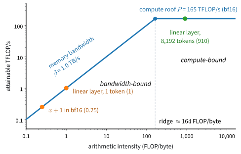
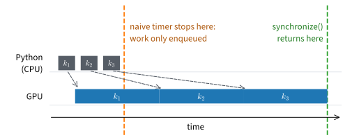
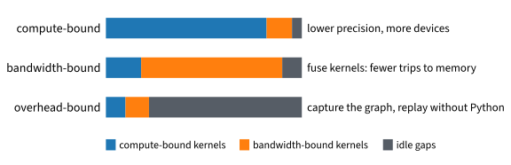

# The Performance Model
:label:`sec_perf_model`

Every network we have trained so far spends most of its arithmetic in
matrix products, and we have assumed that a GPU computes them at the rate
its specification states. The assumption is often wrong. On the RTX 4090
that runs this book's notebooks, a product of two $8192 \times 8192$
matrices in bf16 comes close to the 165 TFLOP/s that the specification
promises. A product of two $256 \times 256$ matrices reaches less than two
percent of it, although the operation and the chip are the same and both
products are timed correctly. A training step is a long sequence of
operations, many of them small. If most of them run at a few percent of the
peak, a faster GPU or a second one changes little, because the time goes to
waiting rather than to computing. Why does the same operation run at such
different speeds, and how do we tell which case a program is in?

This section explains the gap. Every operation on a GPU is limited by one of
three resources: the arithmetic units, the memory bandwidth that supplies
them with data, or the fixed cost of issuing the operation from Python. A
single number computed from the shapes of an operation, its arithmetic
intensity, tells which of the first two applies. Only measurement reveals
the third. Together they give a method in four steps, which the rest of
this chapter follows. We **measure** what a program does, **classify** which
resource limits it, **fix** that resource with the matching technique, and
**re-measure**, because each fix moves the bottleneck somewhere else.

```{.python .input #performance-model-the-performance-model}
%%tab pytorch
import math
import numpy as np
import torch
from torch import nn
from torch.nn import functional as F
from d2l import torch as d2l
```

```{.python .input #performance-model-the-performance-model}
%%tab jax
import math
import numpy as np
import jax
from jax import numpy as jnp
from flax import nnx
import optax
from d2l import jax as d2l
```

```{.python .input #performance-model-the-performance-model-1}
%%tab pytorch, jax
import re
import time
```

```{.python .input #performance-model-the-performance-model-2}
%%tab pytorch
# Run fp32 matrix products on the tf32 tensor cores (PyTorch's default is
# full fp32). The bf16 products below are unaffected.
torch.set_float32_matmul_precision('high')
```

## Arithmetic Intensity and the Roofline
:label:`subsec_perf-counting`

Before we time anything, we can predict from the shapes of an operation
which resource should limit it. The prediction needs two counts: the
arithmetic the operation performs and the bytes it moves.

### Counting FLOPs and Bytes

Every tensor operation makes two demands on a GPU. It performs arithmetic,
which we count in *floating-point operations* (FLOPs), one addition or one
multiplication each. And it moves bytes: its inputs come from the GPU's
memory, and its outputs go back there. The GPU has a separate budget for
each demand. The RTX 4090 performs at most $P = 165 \times 10^{12}$ FLOP/s
in bf16 on its tensor cores, and its memory delivers at most
$\beta = 1.008 \times 10^{12}$ bytes/s. Which budget runs out first depends
on the ratio of the two demands, the *arithmetic intensity*

$$
I \;=\; \frac{\textrm{FLOPs performed}}{\textrm{bytes moved}}.
$$

An operation of high intensity performs many FLOPs on each byte it
fetches. An operation of low intensity performs only a few, or less than
one.

The most important operation in deep learning is the matrix product
$\mathbf{X}\mathbf{W}$ with $\mathbf{X} \in \mathbb{R}^{B \times D}$ and
$\mathbf{W} \in \mathbb{R}^{D \times F}$, a linear layer applied to a
minibatch of $B$ examples. It performs $2BDF$ FLOPs, one multiplication and
one addition for each of the $BDF$ terms of the sums. At best it reads
$\mathbf{X}$ and $\mathbf{W}$ once and writes the result once, which moves
$BD + DF + BF$ numbers. With $b$ bytes per number, its intensity is

$$
\frac{2BDF}{b\,(BD + DF + BF)}
\;=\; \frac{2}{b}\left(\frac{1}{F} + \frac{1}{B} + \frac{1}{D}\right)^{-1}
\;\approx\; \frac{2B}{b} \quad \textrm{for } B \ll D, F.
$$
:eqlabel:`eq_matmul_intensity`

The middle form shows that the smallest of the three dimensions limits the
intensity. The approximation covers the common case of a minibatch that is
narrower than the layer. There the intensity grows linearly with the batch
size, because every weight fetched from memory is used once for each row of
the batch. A batch of one uses each weight once and discards it.

A GPT with about a billion parameters has attention projections of width
$D = F = 2048$. In training, a minibatch of 8 sequences of 1,024 tokens
gives $B = 8192$, and the exact form of :eqref:`eq_matmul_intensity` gives
about 910 FLOP/byte in bf16 ($b = 2$). Here the width, not the batch, is the
smallest dimension. When the same model generates text one token at a time,
$B = 1$ and the intensity is about 1 FLOP/byte. The same layer, with the
same weights, spans a factor of about a thousand in intensity between the
two uses.

An elementwise operation lies at the low extreme. The operation
$y_i = x_i + 1$ performs one FLOP per element and moves $2b$ bytes, since it
reads $x_i$ and writes $y_i$. Its intensity is $1/(2b)$, or 0.25 FLOP/byte
in bf16, however large the tensor.

### The Roofline Model

The *roofline model* :cite:`Williams.Waterman.Patterson.2009` turns
intensity into a bound on speed. An operation cannot run faster than the
arithmetic units allow, and it cannot run faster than memory delivers its
bytes, which caps it at $I \beta$ FLOP/s. The attainable throughput is
therefore

$$
\textrm{performance} \;\leq\; \min(P,\; I \beta).
$$
:eqlabel:`eq_roofline`

On log–log axes the bound is a sloped line that meets a flat roof
(:numref:`fig_roofline`). The two meet at the *ridge point*
$I^* = P/\beta$. An operation of intensity below $I^*$ is
*bandwidth-bound*: memory cannot deliver bytes fast enough to keep the
arithmetic units busy, so additional arithmetic on each byte costs no time.
An operation above $I^*$ is *compute-bound*: the arithmetic units are
saturated, and moving fewer bytes would not make it faster.
The elementwise operation $x + 1$ in bf16 has an intensity of
0.25 FLOP/byte, so it runs at most at $0.25\beta$, about a quarter of a
trillion FLOP/s. That is less than a six-hundredth of the compute roof.


:label:`fig_roofline`

### The Ridge Point of the RTX 4090

The peak throughput of the tensor cores cannot be queried from the device,
so we take $P$ and $\beta$ from the specification sheet and print the name
of the GPU that the code runs on. On another GPU, replace the two constants
with the values from its specification.

```{.python .input #performance-model-the-ridge-point-of-the-rtx-4090-1}
%%tab pytorch
print(torch.cuda.get_device_name())
```

```{.python .input #performance-model-the-ridge-point-of-the-rtx-4090-1}
%%tab jax
print(jax.devices()[0].device_kind)
```

```{.python .input #performance-model-counting-flops-bytes-and-arithmetic-intensity}
%%tab pytorch, jax
peak_tflops = 165.2    # RTX 4090: dense bf16 on the tensor cores
bandwidth_tbs = 1.008  # RTX 4090: GDDR6X memory
print(f'ridge point = {peak_tflops / bandwidth_tbs:.0f} FLOP/byte')
```

A ridge point of 164 FLOP/byte means that an operation must perform about
164 FLOPs for every byte it moves before the arithmetic units, rather than
memory, set its speed. On other current GPUs the ridge lies at about
120 FLOP/byte (RTX 5090) or about 300 (H100, B200). Only large matrix
products reach these values. Elementwise operations, normalizations, and
the generation of text one token at a time all lie far below the ridge,
and most of this chapter is therefore about moving fewer bytes.

For a square product with $B = D = F = n$ in bf16 the intensity is $n/3$,
so the roofline model declares every such product with $n$ above about 500
compute-bound. To see whether the GPU agrees, we first need a way to
measure it.

## Timing GPU Code
:label:`subsec_perf-measuring`

Python does not wait for the GPU. As :numref:`subsec_async_dispatch` showed,
each operation is placed in the device's queue and Python moves on: 32
products of $4096 \times 4096$ matrices are issued in a small fraction of
the time the GPU needs to compute them. A clock read right after a call
therefore measures how long Python took to queue the work, not how long the
GPU took to do it (:numref:`fig_async_timeline`). A correct measurement
runs the operation once before timing it, waits for the device before it
starts and before it stops the clock, and divides the time of many
repetitions by their number.


:label:`fig_async_timeline`

### Synchronization Points

Python waits for the device only when it needs a value that the device
computes: to convert it into a Python number or a NumPy array, to print it,
or to branch on it, as in `if loss < 0.1:`. Each such *synchronization
point* drains the queue up to that value. One kind is easy to miss: an
operation whose output *shape* depends on the data, such as selecting the
positive entries `x[x > 0]`, waits because Python must learn the shape of
the result before it can continue.

After a synchronization point the device sits idle until Python sends more
work. A training loop that reads its loss on every step therefore drains
the queue once per step. To see what this costs, we time two loops of 1,000
steps. Each step multiplies a $1024 \times 1024$ matrix by itself and adds
the sum of the result to a running total on the device. This work takes
the GPU some tens of microseconds, comparable to the time Python needs to
issue it. The two loops differ only in when they read the total: the first
converts it into a Python number after every step, the second once at the
end.

```{.python .input #performance-model-measuring-without-lying-2}
%%tab pytorch
x = torch.ones(1024, 1024, device=d2l.try_gpu())
s = torch.zeros((), device=x.device)
s += (x @ x).sum()
float(s)                          # Warm up: load the kernels

torch.cuda.synchronize()
t0 = time.perf_counter()
for _ in range(1000):
    s += (x @ x).sum()
    total = float(s)              # Reads the value: a barrier every step
read_every = time.perf_counter() - t0

torch.cuda.synchronize()
t0 = time.perf_counter()
for _ in range(1000):
    s += (x @ x).sum()            # Stays on the device: no barrier
total = float(s)                  # One read at the end
read_once = time.perf_counter() - t0
print(f'read every step: {read_every:.3f} s   read once: {read_once:.3f} s')
```

```{.python .input #performance-model-measuring-without-lying-2}
%%tab jax
x = jnp.ones((1024, 1024))
step = jax.jit(lambda s, x: s + (x @ x).sum())
s = step(jnp.zeros(()), x)
float(s)                          # Warm up: compile the step

t0 = time.perf_counter()
for _ in range(1000):
    s = step(s, x)
    total = float(s)              # Reads the value: a barrier every step
read_every = time.perf_counter() - t0

t0 = time.perf_counter()
for _ in range(1000):
    s = step(s, x)                # Stays on the device: no barrier
total = float(s)                  # One read at the end
read_once = time.perf_counter() - t0
print(f'read every step: {read_every:.3f} s   read once: {read_once:.3f} s')
```

:begin_tab:`pytorch`
`torch.cuda.synchronize()` waits until the device has finished all queued
work, so that each loop starts on an idle device. `float(s)` converts a
tensor with one element into a Python number, which waits for its value.
:end_tab:

:begin_tab:`jax`
`step` is compiled with `jax.jit`, so each step is a single call to the
device. The first call of a compiled function compiles it, which is why the
cell calls `step` once before the clock starts. A read waits only for the
array it reads, and `float(s)` reads the running total.
:end_tab:

Reading the value on every step makes the loop slower, although the
device does the same work. Without reads, host and device work at the same
time: while the GPU computes one step, Python issues the next, and each
step costs the longer of the two times. A read on every step makes them
take turns. The device idles while the host waits for the value and then
issues the next step, and the host idles while the device computes. Each
step then costs the host time plus the device time plus the latency of the
round trip.

:begin_tab:`pytorch`
Here the reads make the loop about one and a half times as slow.
:end_tab:

:begin_tab:`jax`
Here the reads make the loop about five times as slow. Without them a step
costs about a tenth of a millisecond, the time that the host needs to
issue it (:numref:`subsec_perf-sweep`). The round trip of a read costs
several times as much: the read waits for the step, copies the value into
host memory, and only then returns it to Python.
:end_tab:

A training loop should therefore read values from the device once per
logging interval, not once per step, and keep running sums on the device.
The `d2l.Trainer` follows this rule: its training and validation steps return
losses as device arrays, which it adds up on the device and converts into
Python numbers once per epoch.

### A Benchmark Helper

Every timing in this chapter follows the same rules, which `d2l.Benchmark`
of :numref:`subsec_async_dispatch` packages. It calls a function a few times
to warm up, which excludes one-time costs such as loading kernels, selecting
algorithms, and compiling. It then waits for the device, times `repeats`
further calls, waits again, and stores the average time per call.

:begin_tab:`pytorch`
On a machine without a GPU, PyTorch runs operations synchronously, and
`Benchmark` needs no barrier.
:end_tab:

:begin_tab:`jax`
JAX waits for specific arrays rather than for a whole device, so
`Benchmark` waits for the value returned by the last call, and the timed
function must return what it computes.
:end_tab:

We time the product of two $4096 \times 4096$ matrices in bf16.

```{.python .input #performance-model-measuring-without-lying-4}
%%tab pytorch
a = torch.randn(4096, 4096, device=d2l.try_gpu(), dtype=torch.bfloat16)
d2l.Benchmark(lambda: torch.mm(a, a), desc='4096 x 4096 product')
```

```{.python .input #performance-model-measuring-without-lying-4}
%%tab jax
matmul = jax.jit(jnp.dot)
a = jax.random.normal(d2l.get_key(), (4096, 4096), dtype=jnp.bfloat16)
d2l.Benchmark(lambda: matmul(a, a), desc='4096 x 4096 product')
```

:begin_tab:`jax`
`matmul` is the compiled form of `jnp.dot`, so each call dispatches one
compiled program. It is compiled once for each new shape, during the
warm-up calls of `Benchmark`.
:end_tab:

Each product takes a little under a millisecond. It performs
$2 \cdot 4096^3 \approx 1.4 \times 10^{11}$ FLOPs, so the GPU computes at
more than 150 TFLOP/s, over 90% of its specification.

## Three Regimes
:label:`subsec_perf-regimes`

The time of a GPU program divides among compute-bound kernels,
bandwidth-bound kernels, and idle gaps in which the device waits for Python
to send work :cite:`He.2022`. Whichever part dominates names the
program's *regime*. Two experiments locate the three regimes on the
RTX 4090: matrix products of growing size, and elementwise operations on a
large tensor.

### Matrix Products across Sizes
:label:`subsec_perf-sweep`

Does a square product reach the roof as soon as the roofline says it
should, near $n = 500$? We time products in bf16 from $n = 256$ to
$n = 8192$. Each size runs a hundred times, so that the latency of the final
wait is spread over many calls.

```{.python .input #performance-model-the-sweep-mapping-our-gpu}
%%tab pytorch
sizes = [256, 512, 1024, 2048, 4096, 8192]
times = []
for n in sizes:
    a = torch.randn(n, n, device=d2l.try_gpu(), dtype=torch.bfloat16)
    times.append(d2l.Benchmark(lambda: torch.mm(a, a), repeats=100).time)
```

```{.python .input #performance-model-the-sweep-mapping-our-gpu}
%%tab jax
sizes = [256, 512, 1024, 2048, 4096, 8192]
times = []
for n in sizes:
    a = jax.random.normal(d2l.get_key(), (n, n), dtype=jnp.bfloat16)
    times.append(d2l.Benchmark(lambda: matmul(a, a), repeats=100).time)
```

We convert each time into TFLOP/s and plot it against the intensity $n/3$,
together with the roofline bound :eqref:`eq_roofline`, which has its corner
at the ridge point.

```{.python .input #performance-model-matrix-products-across-sizes-1}
%%tab pytorch, jax
measured = [2 * n**3 / t / 1e12 for n, t in zip(sizes, times)]
intensity = [n / 3 for n in sizes]  # FLOP/byte of a square bf16 product
ridge = peak_tflops / bandwidth_tbs
roof_x = [intensity[0], ridge, intensity[-1]]
roof_y = [min(peak_tflops, bandwidth_tbs * i) for i in roof_x]
d2l.plot([roof_x, intensity], [roof_y, measured],
         'arithmetic intensity (FLOP/byte)', 'TFLOP/s',
         legend=['roofline bound', 'measured'],
         xscale='log', yscale='log', fmts=('-', 'o'))
```

Printing the time per call of each size shows where the measurements fall
short of the bound.

```{.python .input #performance-model-matrix-products-across-sizes-2}
%%tab pytorch, jax
for n, t, tf in zip(sizes, times, measured):
    print(f'n = {n:4d}: {1e6 * t:7.1f} us per call, {tf:5.1f} TFLOP/s')
```

The roofline bound is flat from $n = 512$ on, but the measurements reach it
only at the largest sizes. From $n = 2048$ on, the GPU computes within about
15% of its specification: these products are compute-bound in fact as well
as in the model. A measurement slightly above the specification is
possible, because the specification assumes the card's rated clock of
2.52 GHz and the card often runs faster.

The small sizes behave differently. From $n = 256$ to $n = 1024$ the work
grows 64-fold, but the time per call changes by less than a factor of two,
and each doubling of $n$ multiplies the throughput by five to ten. A time
per call that barely depends on the size cannot be spent on arithmetic. It is the time $h$ that the host needs to issue one call:
Python, the framework, and the driver that launches the kernel. When calls
are queued back to back, host and device work at the same time, and each
call takes the longer of the two:

$$
t_\textrm{call} \;\approx\; \max\left(h,\; \frac{2n^3}{P}\right).
$$

For small $n$ the device finishes each product before the host has issued
the next one, and the throughput $2n^3/h$ rises with the cube of $n$. This
is the third regime, *overhead-bound*. The knee of the curve lies where the
device time of a product overtakes the host time,
$n \approx (hP/2)^{1/3}$: for $h = 20\,\mu\textrm{s}$ and the peak of the
RTX 4090, near $n = 1200$. The time per call at the smallest sizes in the
output above is the value of $h$ for this framework and this machine.

:begin_tab:`jax`
In JAX the floor lies between about 60 microseconds and a tenth of a
millisecond, depending on how busy the host's CPU is, and it does not
depend on the product. A compiled function that only adds one to a small
array takes about as long per call:
:end_tab:

```{.python .input #performance-model-matrix-products-across-sizes-3}
%%tab jax
add_one = jax.jit(lambda x: x + 1)
small = jnp.zeros((256, 256), dtype=jnp.bfloat16)
d2l.Benchmark(lambda: add_one(small), repeats=100, desc='x + 1 on 256 x 256')
```

:begin_tab:`jax`
Every call of a compiled function passes through XLA's runtime. The
runtime allocates the outputs, launches the kernels, and asks the driver to
run a callback when they have finished, so that it learns when the arrays
may be released. On our machine this bookkeeping takes tens of
microseconds per call, several times the launch of a single kernel. A
training step compiled into one function pays it once for hundreds of
kernels.
:end_tab:

The roofline has no term for overhead. It is a ceiling, and the measured
points meet it only for operations large enough that the host time per call
is negligible. The faster the GPU, the larger an operation must be to get
there: $n \approx (hP/2)^{1/3}$ grows with $P$.

A product can also fall short of the roof for a reason inside the device.
A GPU executes a kernel on its *streaming multiprocessors* (SMs), the
independent processors of the chip; the RTX 4090 has 128 of them
(:numref:`subsec_hw-gpu`). A matrix-product kernel splits the output into
tiles and gives each SM one tile at a time. A product whose output has
fewer tiles than the GPU has SMs leaves some SMs idle, however fast the
host issues it. The share of the peak that it can reach is then at most
the share of SMs that hold a tile.

### Elementwise Operations

Products large enough to escape the overhead regime lie above the ridge
point, so the sweep never shows the bandwidth-bound regime. To see it, we
apply single elementwise operations of very different arithmetic cost to a
tensor of $8192 \times 8192$ numbers in fp32, 256 MiB: an addition, a
multiplication, a sine, and a sigmoid. Each reads the tensor once and
writes a result of the same size.

```{.python .input #performance-model-three-regimes-1}
%%tab pytorch
x = torch.randn(8192, 8192, device=d2l.try_gpu())  # 256 MiB in fp32
for desc, f in [('add', lambda x: x + 1), ('mul', lambda x: x * 1.5),
                ('sin', torch.sin), ('sigmoid', torch.sigmoid)]:
    print(d2l.Benchmark(lambda: f(x), desc=desc))
```

```{.python .input #performance-model-three-regimes-1}
%%tab jax
x = jax.random.normal(d2l.get_key(), (8192, 8192))  # 256 MiB in fp32
for desc, f in [('add', lambda x: x + 1), ('mul', lambda x: x * 1.5),
                ('sin', jnp.sin), ('sigmoid', jax.nn.sigmoid)]:
    f = jax.jit(f)
    print(d2l.Benchmark(lambda: f(x), desc=desc))
```

All four operations take the same time, a little over half a millisecond.
Each moves 512 MiB, $5.4 \times 10^8$ bytes, which amounts to about
0.9 TB/s, close to the 1.008 TB/s of the specification. A sine costs many
more FLOPs than an addition, yet it runs no slower, because the bytes each
kernel moves set its time. This is the defining behavior of a
bandwidth-bound operation: additional arithmetic costs no time until the
intensity approaches the ridge point.

Activation functions and normalization layers chain several elementwise
operations. The function below is the tanh approximation of the GELU
activation $z\,\Phi(z)$ (:numref:`subsec_activation-functions`) with
rounded constants, and it applies eight elementwise operations to its
input. Executed one operation at a time, each operation is a kernel of its
own, which reads its inputs from memory and writes its result back.

```{.python .input #performance-model-three-regimes-2}
%%tab pytorch
def gelu_ish(x):  #@save
    """The tanh approximation of GELU with rounded constants: a chain of
    eight elementwise operations."""
    return 0.5 * x * (1 + torch.tanh(0.8 * (x + 0.04 * x**3)))

print(d2l.Benchmark(lambda: x + 1, desc='1 op'))
print(d2l.Benchmark(lambda: gelu_ish(x), desc='chain'))  # Eager: 8 kernels
```

```{.python .input #performance-model-three-regimes-2}
%%tab jax
def gelu_ish(x):  #@save
    """The tanh approximation of GELU with rounded constants: a chain of
    eight elementwise operations."""
    return 0.5 * x * (1 + jnp.tanh(0.8 * (x + 0.04 * x**3)))

print(d2l.Benchmark(lambda: x + 1, desc='1 op'))
print(d2l.Benchmark(lambda: gelu_ish(x), desc='chain'))  # No jit: 8 kernels
```

The chain takes eight to nine times as long as the single addition, and
the bytes explain the factor. The addition reads one tensor and writes one. The
eight operations of the chain read and write 18 tensors of the same size
between them. Each of the six operations with one tensor input moves two;
the sum $x + 0.04x^3$ and the final product combine two tensors and move
three each. One kernel that read `x` once and wrote the result once would
move 2 tensors instead of 18. Merging operations into such a kernel is
called *fusion*, and a compiler can do it automatically.

### Diagnosis and Fixes

The experiments have located the three regimes on one GPU
(:numref:`fig_regimes`). Each regime has a symptom by which we recognize it
and a standard fix, summarized in :numref:`tab_perf_regimes`. The later
sections of this chapter develop each fix.


:label:`fig_regimes`

:Symptoms and standard fixes of the three regimes.
:label:`tab_perf_regimes`

| regime | symptom | standard fix |
|---|---|---|
| compute-bound | device busy; intensity above the ridge; time grows with the FLOPs | a format with faster tensor cores; more devices |
| bandwidth-bound | device busy; intensity below the ridge; time grows with the bytes moved | fusion; recomputation instead of storage; algorithms that reuse data on chip |
| overhead-bound | device idle between kernels; time per call independent of size | fewer and larger calls; capturing the whole program and replaying it without Python |

The FlashAttention kernel of :numref:`sec_attention-at-scale` is an example
of the third fix for bandwidth: it computes attention in tiles held on the
chip, so the $T \times T$ matrix of attention scores never reaches memory. A
wrong diagnosis wastes effort. More FLOP/s do not speed up a bandwidth-bound
operation, and a faster GPU does not help a program whose device sits idle.

## Profiling a Training Step
:label:`subsec_perf-profiler`

A training step runs hundreds of kernels from all three regimes. A
*profiler* records every kernel the device runs, with its duration, so that
we can add up where the time of a step goes: how much each kernel takes,
and how long the device sits idle.

### Recording the Kernels

We profile one SGD step of an MLP with two hidden layers of width 4096 on
a minibatch of 1,024 examples, in fp32, with the matrix products on the
tf32 tensor cores. First we measure the
wall-clock time per step with `Benchmark`.

```{.python .input #performance-model-profiling-a-training-step-1}
%%tab pytorch
net = nn.Sequential(nn.Linear(4096, 4096), nn.ReLU(),
                    nn.Linear(4096, 4096), nn.ReLU(),
                    nn.Linear(4096, 10)).to(d2l.try_gpu())
X = torch.randn(1024, 4096, device=d2l.try_gpu())
opt = torch.optim.SGD(net.parameters(), lr=0.01)

def step():
    opt.zero_grad()
    net(X).mean().backward()
    opt.step()

wall = d2l.Benchmark(step).time
```

```{.python .input #performance-model-profiling-a-training-step-1}
%%tab jax
def mlp(params, X):
    for W, b in params[:-1]:
        X = jax.nn.relu(X @ W + b)
    W, b = params[-1]
    return X @ W + b

@jax.jit
def step(params, X):
    grads = jax.grad(lambda p: mlp(p, X).mean())(params)
    return jax.tree.map(lambda p, g: p - 0.01 * g, params, grads)

widths = [4096, 4096, 4096, 10]
params = [(jax.random.normal(d2l.get_key(), (m, n)) / m**0.5, jnp.zeros(n))
          for m, n in zip(widths[:-1], widths[1:])]
X = jax.random.normal(d2l.get_key(), (1024, 4096))
wall = d2l.Benchmark(lambda: step(params, X)).time
```

:begin_tab:`jax`
JAX's default precision for fp32 matrix products on a GPU with tensor cores
is tf32. `jax.tree.map` applies the SGD update to every weight and bias in
the nested list of parameters.
:end_tab:

`kernel_times` runs a function ten times under the profiler and returns
the device time per call of every kernel that the function launched. We
save it, and the printout below, for the case study at the end of the
chapter.

```{.python .input #performance-model-the-profiler}
%%tab pytorch
def kernel_times(f, steps=10):  #@save
    """Device milliseconds per call of f, for every kernel that f runs."""
    with torch.profiler.profile(
            activities=[torch.profiler.ProfilerActivity.CUDA],
            acc_events=True) as prof:
        for _ in range(steps):
            f()
        torch.cuda.synchronize()
    return {e.key: e.device_time_total / 1e3 / steps
            for e in prof.key_averages()
            if e.device_type == torch.autograd.DeviceType.CUDA}
```

```{.python .input #performance-model-the-profiler}
%%tab jax
#@save
import collections
import glob
import tempfile

def kernel_times(f, steps=10):  #@save
    """Device milliseconds per call of f, for every kernel that f runs."""
    trace_dir = tempfile.mkdtemp()
    with jax.profiler.trace(trace_dir):
        for _ in range(steps):
            out = f()
        jax.block_until_ready(out)
    xspace = glob.glob(f'{trace_dir}/**/*.xplane.pb', recursive=True)[0]
    gpu = jax.profiler.ProfileData.from_file(xspace).find_plane_with_name(
        '/device:GPU:0')
    kernels = collections.Counter()
    for line in gpu.lines:
        if line.name.startswith('Stream'):  # One line per CUDA stream
            for e in line.events:
                kernels[e.name] += e.duration_ns / 1e6 / steps
    return kernels
```

:begin_tab:`pytorch`
`prof.key_averages()` groups the recorded events by name. Kernels are the
events that ran on the device; the other events, such as the calls that
launch kernels, ran on the CPU. `prof.export_chrome_trace('trace.json')`
writes the full timeline, which <https://ui.perfetto.dev> displays.
:end_tab:

:begin_tab:`jax`
`jax.profiler.trace` writes the trace into a directory, and
`jax.profiler.ProfileData` reads it back: one *plane* per device, one
*line* per CUDA stream, one *event* per kernel. The same directory opens as
a timeline in <https://ui.perfetto.dev> or in TensorBoard. `kernel_times`
waits for the result of the last call, so `f` must return what it computes.
:end_tab:

### Reading the Profile

`show_profile` prints the device time per step against the wall-clock
time, the share of the matrix products, and the kernels that take the most
device time. It strips the return type, the namespaces, and the argument
list from the C++ names of the kernels.

```{.python .input #performance-model-reading-the-profile-1}
%%tab pytorch, jax
def show_profile(kernels, step_ms, rows=6):  #@save
    """Busy device time against the wall-clock time step_ms of a step, the
    share of the matrix products, and the kernels with the most time."""
    busy = sum(kernels.values())
    products = sum(ms for name, ms in kernels.items()
                   if re.search('gemm|xmma|cutlass|matmul|sdpa', name, re.I))
    print(f'wall clock {step_ms:.2f} ms per step, device busy {busy:.2f} ms '
          f'({busy / step_ms:.0%}), matrix products {products / busy:.0%}')
    for name, ms in sorted(kernels.items(), key=lambda kv: -kv[1])[:rows]:
        name = re.sub(r'^void |\(anonymous namespace\)::|\w+::|\(.*', '', name)
        print(f'{ms:6.2f} ms {ms / busy:4.0%}  {name[:52]}')
```

We profile the training step:

```{.python .input #performance-model-profiling-a-training-step-2}
%%tab pytorch
show_profile(kernel_times(step), 1000 * wall)
```

```{.python .input #performance-model-profiling-a-training-step-2}
%%tab jax
show_profile(kernel_times(lambda: step(params, X)), 1000 * wall)
```

The device is busy for almost all of the wall-clock time, so the step is
not overhead-bound. Three quarters or more of the device time goes to a
handful of matrix-product kernels; their names contain *gemm*, the
traditional name for a general matrix product. These kernels are
compute-bound: a product of shapes $1024 \times 4096$ and
$4096 \times 4096$ has an intensity of about 340 FLOP/byte in fp32, against
a ridge point of about 82 for tf32 (82.6 TFLOP/s over 1.008 TB/s).

The remaining kernels are elementwise kernels and reductions: the ReLUs, the
bias gradients, which sum over the batch, and the SGD update. The update
reads every weight and its gradient and writes the weight back, 12 bytes
for two FLOPs. As a kernel of its own it is bandwidth-bound, and its time
does not depend on the batch size, so at small batch sizes it can take a
large share of the step.

:begin_tab:`pytorch`
The update is the `multi_tensor_apply_kernel` line, about a sixth of the
device time. It moves 12 bytes for each of the 34 million weights, 0.4 GB,
which takes 0.4 ms at the card's bandwidth.
:end_tab:

:begin_tab:`jax`
The update has no kernel of its own. XLA fuses it into the products that
compute the weight gradients: `gemm_fusion_dot` and `gemm_fusion_dot_1`
each compute the gradient of one large weight matrix and subtract its
scaled value from the weight before writing the result, so the gradient
never travels to memory and back.
:end_tab:

The four steps of the method can now be stated with their tools.
**Measure** with `Benchmark` and a profiler. **Classify**: a busy device
dominated by matrix products is compute-bound; a busy device dominated by
elementwise and memory-bound kernels is bandwidth-bound; a device idle
between kernels is overhead-bound. **Fix** what limits the program: faster
formats and more devices for compute, fusion and recomputation for
bandwidth, larger calls and graph capture for overhead. **Re-measure**,
because each fix moves the bottleneck. We can now place any operation or
program in its regime. We cannot yet say where $P$ and $\beta$ come from, or
why the ridge point has risen over the hardware generations;
:numref:`sec_hardware` answers both questions.

## Summary

An operation on a GPU is limited by arithmetic, by memory bandwidth, or by
the fixed cost of issuing it from the host. Its arithmetic intensity, the
FLOPs it performs per byte it moves, decides between the first two through
the roofline bound $\min(P, I\beta)$. Below the ridge point $P/\beta$,
about 164 FLOP/byte on the RTX 4090, memory sets the time; the intensity of
a linear layer grows with the batch size. The third limit shows only in
measurement: an operation whose device time is shorter than the host's time
per call runs at the host's pace, so a $256 \times 256$ product reaches
less than two percent of the peak. Correct timing waits for the asynchronous
device before starting and before stopping the clock, keeps synchronization
points out of loops, and averages many calls, as `d2l.Benchmark` does. The
rest of the chapter applies one method, with a profiler to account for every
kernel of a program: measure, classify the regime, fix it, and measure
again.

## Exercises

1. **The smallest dimension.** The exact expression for the intensity of
   the product $\mathbf{X}\mathbf{W}$ in :eqref:`eq_matmul_intensity`, the
   one before the approximation, holds for all shapes, not only for
   $B \ll D, F$. Let $m = \min(B, D, F)$.
    1. Show that the intensity lies between $2m/(3b)$ and $2m/b$. Conclude
       that in bf16, on a GPU whose ridge point is 164 FLOP/byte, every
       matrix product with a dimension below 164 is bandwidth-bound in the
       roofline model.
    1. Apply the bound to three bf16 products: the final layer of the MLP
       of :numref:`subsec_perf-profiler`, which maps width 4096 to ten
       outputs, on a batch of 4096 examples; the attention scores
       $\mathbf{Q}\mathbf{K}^\top$ of one head with
       $\mathbf{Q}, \mathbf{K} \in \mathbb{R}^{T \times 64}$ for a context of
       $T$ tokens; and a $1 \times 1$ convolution (:numref:`subsec_1x1`) from
       64 to 64 channels on a batch of 128 images of $32 \times 32$ pixels.
       For each product, name the dimensions that would have to grow for
       it to reach the ridge point, and state whether a practitioner
       controls them.
    1. A multi-head attention layer computes the scores of all its heads in
       one batched kernel. Does batching the heads change the intensity of
       the scores? State what your answer implies for an attention
       implementation that writes the $T \times T$ scores to memory.

1. [code] **Batch size and the ridge.** Consider the product
   $\mathbf{X}\mathbf{W}$ with $\mathbf{X} \in \mathbb{R}^{B \times 8192}$
   and $\mathbf{W} \in \mathbb{R}^{8192 \times 8192}$ in bf16.
    1. Using :eqref:`eq_matmul_intensity` without the approximation, find
       the batch size at which the product reaches the ridge point of your
       GPU. Compare it with the batch size that the approximation gives.
    1. Predict the roofline bound on the throughput for
       $B \in \{1, 8, 64, 512, 4096\}$. Measure the achieved TFLOP/s with
       `Benchmark`, and plot the bound and the measurements against $B$ on
       log-log axes. At $B = 1$, also convert the measured time into an
       achieved memory bandwidth, and compare it with the specification.
    1. When a language model generates text one token at a time, each of
       its linear layers runs a product of this kind with $B$ equal to the
       number of sequences served together. What does your plot imply about
       the time per step of serving 64 sequences instead of one?

:begin_tab:`pytorch`
3. [code] **Hidden barriers.** Each of the following lines runs once per
    step of a training loop, where `x` and `g` are tensors on the GPU and
    `c` is a Python float: `x[x > 0].sum()`, `print(x.shape)`,
    `x.argmax()`, `if g.norm() > c: g *= c / g.norm()`, and
    `x * torch.tensor(0.5, device=x.device)`.
    1. Decide which of the lines make the host wait for the device, and
       justify each decision.
    1. Rewrite every line that waits so that it computes the same result
       without a barrier.
    1. Call `torch.cuda.set_sync_debug_mode('warn')` before the loop, which
       makes PyTorch warn at every operation that synchronizes with the
       device, and check both answers.
:end_tab:

:begin_tab:`jax`
3. [code] **Hidden barriers.** Each of the following lines runs once per
    step of a training loop, where `x` and `g` are arrays on the GPU and `c`
    is a Python float: `x[x > 0].sum()`, `print(x.shape)`,
    `jnp.argmax(x)`,
    `if jnp.linalg.norm(g) > c: g = g * c / jnp.linalg.norm(g)`, and
    `x * jnp.asarray(0.5)`.
    1. Decide which of the lines make the host wait for the device, and
       justify each decision.
    1. Rewrite every line that waits so that it computes the same result
       without a barrier.
    1. Run the loop inside
       `with jax.transfer_guard_device_to_host('disallow'):`, which raises
       an error at every implicit transfer of a value from the device to the
       host, and check both answers.
:end_tab:

4. **Diagnosis from timings.** Suppose that `Benchmark` reports the
   following times per call for four operations of a bf16 program on the
   RTX 4090 ($P = 165$ TFLOP/s, $\beta = 1.008$ TB/s). Operation A
   multiplies two $8192 \times 8192$ matrices in 7.4 ms. Operation B
   applies a softmax to the rows of an $8192 \times 8192$ matrix in
   0.30 ms; it reads and writes the matrix once and performs about five
   FLOPs per element. Operation C multiplies two $256 \times 256$ matrices
   in 10 µs. Operation D multiplies two $1024 \times 1024$ matrices in
   40 µs.
    1. For each operation, compute its arithmetic intensity and the
       fractions of $P$ and of $\beta$ that it achieves. Classify each
       operation twice: once by comparing its intensity with the ridge
       point, and once by the roof that it is close to. On which operations
       do the two classifications disagree?
    1. For each operation that is close to neither roof, name the most
       likely of the causes given in :numref:`subsec_perf-sweep`, and
       describe what a profiler timeline of the repeated calls would show
       that confirms it.

1. **Idle time in a profile.** Suppose that two programs keep the GPU busy
   for only a fifth of their wall-clock time. Program A trains a small MLP
   with many narrow layers and launches every operation from Python.
   Program B trains a large convolutional network, and its data loader
   decodes and resizes every image in the main Python process.
    1. Describe where the idle gaps of each program appear in a timeline.
       For each program, state whether one of the fixes of the method at the
       end of :numref:`subsec_perf-profiler` removes its gaps, and name that
       fix where one does.
    1. Describe an experiment that confirms the diagnosis of program B
       without a profiler.
    1. A third program keeps the GPU busy with large matrix products but
       converts its loss to a Python float after every step, and its
       profile attributes most of the host time to that conversion. Explain
       what the host and the device do during that time, and why that time
       is not overhead in the sense of the overhead-bound regime.

1. [code] **A pipeline model of dispatch.** ● Model one call of a GPU
   operation by three durations: the host needs $h$ to enqueue the call,
   the device needs $d$ to execute it, and a barrier adds a latency
   $\sigma$ after the queue drains. The device executes calls in the order
   in which they were enqueued, and it is idle when the first call is
   enqueued.
    1. Show that $R$ calls enqueued back to back and followed by one barrier
       take

        $$R \max(h, d) + \min(h, d) + \sigma.$$

       What does `Benchmark` therefore report for an operation with
       $d < h$? Explain why its result for `x + 1` on a $256 \times 256$
       tensor says nothing about the memory bandwidth of the kernel.
    1. Treat one step of the loops of :numref:`subsec_perf-measuring` as one
       call. The loop that converts the running total into a Python number
       on every step waits at a barrier after each step. Express the ratio
       of its time to the time of the loop that reads the total once in
       terms of $h$, $d$, and $\sigma$.
    1. Run both loops with `x` of side 256, 512, 1024, 2048, and 4096. From
       the ten timings, estimate $h$ and $\sigma$, which do not depend on
       the size, and $d$ for each size, and check that the model reproduces
       the measured ratios. Above which device time per step does reading a
       value on every step cost less than ten percent?

1. [code] **Tiles and waves.** ● Model a matrix-product kernel on a GPU
   with $S$ SMs as follows; the RTX 4090 has $S = 128$. The kernel splits the $n \times n$ output
   into $128 \times 128$ tiles. Each SM computes one tile at a time at
   $1/S$ of the peak, and the tiles run in waves of at most $S$.
    1. Derive the fraction of the peak that this model allows as a function
       of $n$ and $S$, and evaluate it with the $S$ of your GPU for the
       sizes of the sweep in :numref:`subsec_perf-sweep`. Compare the result
       with the fractions of the peak that your run of the sweep measures,
       and name the sizes at which the host time per call, not the tiles,
       limits the measurement.
    1. Predict the fraction for $n = 2176$, 2304, 2432, and 2560, all
       multiples of 128, relative to the fraction at $n = 2048$. Measure the
       five sizes with `Benchmark`, and explain where the measured pattern
       departs from the predicted one.
    1. Describe two ways in which a kernel can split the product at
       $n = 512$ into more pieces of work, so that all SMs take part, and
       state the cost that each way adds.

    *Adapted from NVIDIA, [Matrix Multiplication Background User's
    Guide](https://docs.nvidia.com/deeplearning/performance/dl-performance-matrix-multiplication/index.html),
    Section 3.2, Wave Quantization.*

1. [extended] **Roofline of a ResNet step.** ● Train `ResNet18` of
   :numref:`sec_resnet` on Fashion-MNIST at $96 \times 96$ pixels with batch
   size 128, as in that section, and map one training step onto the
   roofline of your GPU.
    1. For every convolution of the forward pass and for the final dense
       layer, compute the FLOPs and the bytes, counting the input, the
       weights, and the output once each. Do the same for one batch
       normalization and one ReLU of each stage. Mark every operation at its
       intensity on a roofline plot of your GPU.
    1. Profile one training step. Split its device time among convolutions,
       normalizations and activations, and all other kernels, add the idle
       time between kernels, and report the share of each in the
       wall-clock time of the step.
    1. Apply the fix of the method that targets the largest share outside
       the compute-bound regime, measure again, and report which share
       dominates afterward.

[Discussions](https://d2l.discourse.group/t/36787)

<!-- slides -->

::: {.slide}
::: {.cover}
[Dive into Deep Learning · §13.1]{.kicker}

The Performance Model<br>
**arithmetic intensity · the roofline · GPU timing · three regimes · profiling**
:::
:::

::: {.slide title="The Same Product Runs Below 2% or Near 100% of the Peak"}
[The problem]{.kicker}

RTX 4090, bf16 tensor cores, specified peak $P$ = 165 TFLOP/s.

- $256 \times 256$ times $256 \times 256$: under 2% of $P$.
- $8192 \times 8192$ times $8192 \times 8192$: close to 100% of $P$.

Same operation, same chip, timed correctly.

::: {.d2l-note}
A training step is thousands of such operations. **What limits the small
one, and how do we tell from measurements?**
:::
:::

::: {.slide title="By the End of This Deck You Can"}
[Goals]{.kicker}

- compute the arithmetic intensity of a matrix product and of an
  elementwise operation;
- bound an operation's speed with the roofline $\min(P, I\beta)$;
- time GPU code correctly and find hidden synchronization points;
- tell compute-, bandwidth-, and overhead-bound operations apart and name
  each fix;
- read a kernel profile of a training step.

**Running example:** one RTX 4090 ($P$ = 165 TFLOP/s in bf16,
$\beta$ = 1.008 TB/s) and the width-2048 linear layers of a 1B-parameter
GPT.
:::

::: {.slide title="The Performance Model Opens the Chapter"}
[Where this fits]{.kicker}

::: {.cols .vc}
::: {.col}
| section | adds |
|---|---|
| **The Performance Model** | **roofline, three regimes, timing, profiling** |
| Hardware | where peak arithmetic and bandwidth come from |
| Compute Graphs and Compilation | fusion and kernel replay |
| Memory and Precision | what fits: bytes per parameter and per token |
| Multi-GPU from First Principles | data parallelism by hand, its cost model |
| Multi-GPU in Practice | production data parallelism, sharding |
| Case Study: Optimizing a Transformer | the whole method on one GPT |
:::

::: {.col .narrow}
- **Uses:** matrix products, bf16, the GPU's asynchronous queue.
- **Skips:** writing GPU kernels; machines with more than one node.
:::
:::
:::

::: {.slide title="Intensity Is FLOPs per Byte Moved"}
$$I = \frac{\textrm{FLOPs performed}}{\textrm{bytes moved}}$$

Product $\mathbf{X}\mathbf{W}$, $\mathbf{X}$: $B \times D$, $\mathbf{W}$:
$D \times F$, $b$ bytes per number:

$$I = \frac{2BDF}{b\,(BD + DF + BF)} \;\approx\; \frac{2B}{b}
\quad \textrm{for } B \ll D, F$$

Elementwise $y_i = x_i + 1$: one FLOP per $2b$ bytes, $I = 0.25$ in bf16.

::: {.d2l-note}
Each weight fetched from memory is used once per row of the batch.
:::
:::

::: {.slide title="One GPT Layer Spans a Factor of a Thousand in Intensity"}
Linear layer of width $D = F = 2048$, bf16 ($b = 2$):

| use | rows $B$ | intensity |
|---|---|---|
| training, 8 sequences of 1,024 tokens | 8,192 | $\approx 910$ FLOP/byte |
| generating text, one token | 1 | $\approx 1$ FLOP/byte |

- Training: the width, not the batch, is the smallest dimension.
- Generation: every weight is read to be used once.
:::

::: {.slide title="The Roofline Caps Throughput at min(P, Iβ)"}
{width=72%}

Ridge point $I^* = P/\beta$. Below it: **bandwidth-bound**, extra
arithmetic costs no time. Above it: **compute-bound**, fewer bytes do not help.
:::

::: {.slide title="The RTX 4090 Needs 164 FLOPs per Byte"}
@performance-model-counting-flops-bytes-and-arithmetic-intensity

- Other current GPUs: about 120 (RTX 5090), about 300 (H100, B200).
- Square bf16 product, $B = D = F = n$: $I = n/3$, compute-bound from
  $n \approx 500$, on paper.
:::

::: {.slide title="Check: Bound the Time of Each Operation"}
[Check]{.kicker}

RTX 4090, bf16, ridge 164 FLOP/byte. Bound the time of each operation.

1. $x + 1$ on $10^8$ elements.
2. The width-2048 layer applied to one token.
3. A product of two $4096 \times 4096$ matrices.

::: {.fragment .fade-up}
1. $I = 0.25$: moves $4 \times 10^8$ bytes, at least 0.4 ms.
2. $I \approx 1$: reads 8.4 MB of weights, at least 8 µs.
3. $I \approx 1365$: $1.4 \times 10^{11}$ FLOPs at 165 TFLOP/s, at least
   0.83 ms.
:::
:::

::: {.slide title="A Clock Without a Barrier Measures the Enqueue"}
{width=82%}

- Python queues kernels and moves on; the GPU runs them behind it.
- Correct timing: warm up, wait for the device before starting and before
  stopping, average many calls.
:::

::: {.slide title="Reading a Value Every Step Stalls the Queue"}
Synchronization points: `float(x)`, `print(x)`, `if loss < 0.1:`,
data-dependent shapes such as `x[x > 0]`.

1,000 steps of a $1024 \times 1024$ product, total read every step
versus once at the end:

@!performance-model-measuring-without-lying-2

- No reads: host and device overlap, a step costs the longer of the two.
- A read every step: host time + device time + round trip.

::: {.d2l-note}
Keep running sums on the device; read them once per logging interval.
:::
:::

::: {.slide title="Benchmark Packages the Timing Rules"}
```{.python #performance-model-benchmark-rules}
for _ in range(warmup):       # load kernels, compile
    f()
wait_for_device()
t0 = time.perf_counter()
for _ in range(repeats):
    f()
wait_for_device()
seconds_per_call = (time.perf_counter() - t0) / repeats
```

@!performance-model-measuring-without-lying-4

$2 \cdot 4096^3 = 1.4 \times 10^{11}$ FLOPs in under 1 ms: over 150 TFLOP/s.
:::

::: {.slide title="Small Products Run at the Host's Pace"}
@!performance-model-matrix-products-across-sizes-1

Up to $n = 1024$ the time per call grows far less than the work; beyond,
the products approach the roof.
:::

::: {.slide title="The Knee Lies Where Device Time Overtakes Host Time"}
Host time per call $h$ (Python, framework, kernel launch), queued back to
back:

$$t_\textrm{call} \approx \max\left(h,\; \frac{2n^3}{P}\right)$$

- Below the knee: throughput $2n^3/h$, eight times per doubling of $n$.
- Knee at $n \approx (hP/2)^{1/3}$: for $h$ = 20 µs, $n \approx 1200$.
- The roofline has no term for $h$: it is a ceiling, not a prediction.
- Inside the GPU: fewer output tiles than SMs (128 on the RTX 4090) leave
  SMs idle.
:::

::: {.slide title="Check: Faster GPUs Need Larger Operations"}
[Check]{.kicker}

Where is the knee $n \approx (hP/2)^{1/3}$ of a square bf16 product?

1. RTX 4090 ($P$ = 165 TFLOP/s) with a host time of $h$ = 5 µs.
2. B200 ($P$ = 2,250 TFLOP/s) with the same $h$ = 5 µs.

::: {.fragment .fade-up}
1. $(5 \times 10^{-6} \cdot 1.65 \times 10^{14} / 2)^{1/3} \approx 740$.
2. $(5 \times 10^{-6} \cdot 2.25 \times 10^{15} / 2)^{1/3} \approx 1800$.

With the same host, a 14 times faster GPU needs products
$14^{1/3} \approx 2.4$ times wider to stay busy.
:::
:::

::: {.slide title="Elementwise Kernels Run at Memory Speed, Whatever They Compute"}
$8192 \times 8192$ fp32: 256 MiB in, 256 MiB out, per kernel.

@!performance-model-three-regimes-1

- $5.4 \times 10^8$ bytes in about 0.6 ms: about 0.9 TB/s, near $\beta$.
- A sine costs far more FLOPs than an addition and runs no slower.
:::

::: {.slide title="An Unfused Chain Moves Nine Times the Bytes"}
```{.python #performance-model-gelu-chain}
0.5 * x * (1 + tanh(0.8 * (x + 0.04 * x**3)))   # 8 operations
```

@!performance-model-three-regimes-2

- 8 kernels read and write 18 tensors of 256 MiB; a single addition moves 2.
- One fused kernel would move 2 tensors instead of 18.
:::

::: {.slide title="Each Regime Has One Standard Fix"}
{width=85%}

| regime | symptom | fix |
|---|---|---|
| compute | device busy, $I$ above the ridge | faster format, more devices |
| bandwidth | device busy, $I$ below the ridge | fusion, recomputation |
| overhead | device idle, time independent of size | larger calls, graph capture |
:::

::: {.slide title="A Profile Splits a Training Step by Kernel"}
MLP $4096 \to 4096 \to 4096 \to 10$, minibatch 1,024, fp32 with tf32
products, one SGD step:

@!performance-model-profiling-a-training-step-2

- *gemm* kernels: compute-bound ($I \approx 340$ against a tf32 ridge of 82).
- SGD update: 12 bytes for 2 FLOPs per weight, bandwidth-bound.
:::

::: {.slide title="Check: Name the Regime"}
[Check]{.kicker}

Suppose these times per call on the RTX 4090. Which regime limits each?

1. A $4096 \times 4096$ bf16 product: 0.89 ms.
2. $x + 1$ on $8192 \times 8192$ fp32: 0.6 ms.
3. A $256 \times 256$ bf16 product: 15 µs.

::: {.fragment .fade-up}
1. 154 TFLOP/s, 93% of $P$: compute-bound.
2. 537 MB in 0.6 ms, 0.9 TB/s: bandwidth-bound.
3. The device needs 0.2 µs at the peak: overhead-bound.
:::
:::

::: {.slide title="Measure, Classify, Fix, Re-measure"}
- **Measure** with `Benchmark` and a profiler.
- **Classify**: busy with matrix products, compute; busy with elementwise
  kernels, bandwidth; idle between kernels, overhead.
- **Fix**: faster formats or more devices; fusion or recomputation; larger
  calls or graph capture.
- **Re-measure**: each fix moves the bottleneck.

::: {.d2l-note}
The rest of the chapter is this loop, applied.
:::
:::

::: {.slide title="Wrap-up"}
[Wrap-up]{.kicker}

- Roofline: performance $\leq \min(P, I\beta)$; the RTX 4090's ridge is
  164 FLOP/byte.
- A width-2048 GPT layer: $I \approx 910$ in training, $\approx 1$ when
  generating one token.
- Small products run at the host's pace: $t_\textrm{call} \approx
  \max(h, 2n^3/P)$, under 2% of the peak at $n = 256$.
- Elementwise kernels run at about 0.9 TB/s whatever they compute; an
  unfused chain of 8 moves 9 times the bytes of one.
- Time with warm-up, barriers, and many calls; keep reads out of loops.

**Next:** where $P$ and $\beta$ come from: the hardware.
:::
