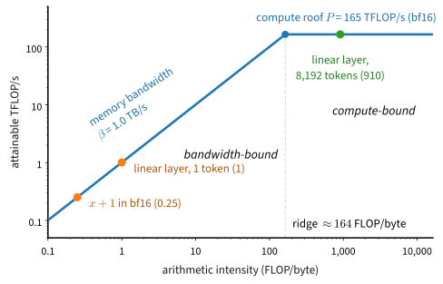
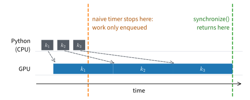
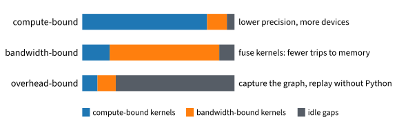

# The Performance Model
:label:`sec_perf_model`

Every network we have trained so far spends most of its arithmetic in
matrix products, and we have implicitly assumed that a GPU computes them near
its peak rate. That assumption is often wrong. On the RTX 4090 that runs this
book's notebooks, a bf16 product of two $8192 \times 8192$ matrices runs
within a few percent of the 165 TFLOP/s hardware peak, whereas a
$256 \times 256$ product reaches less than two percent of it—same operation,
same chip, timed properly. A training step is a sequence of many operations,
some of them small. When most of them run at a fraction of peak, a faster GPU
or a second card changes little because the time goes to waiting rather than
computing.

Every operation on a GPU is limited by one of three resources: the arithmetic
units, the memory bandwidth that feeds them, or the fixed host cost of issuing
the operation from Python. Two paper counts—the FLOPs an operation performs
and the bytes it moves—decide between the first two. Adding one measured
constant, the host time $h$ to issue a call, lets us predict the third as
well. Our method throughout the chapter is to count FLOPs and bytes, predict
the time, measure it, and explain the difference.

```{.python .input #performance-model-the-performance-model}
%%tab pytorch
import math
import numpy as np
import torch
from torch import nn
from torch.nn import functional as F
from d2l import torch as d2l
```

```{.python .input #performance-model-the-performance-model}
%%tab jax
import math
import numpy as np
import jax
from jax import numpy as jnp
from flax import nnx
import optax
from d2l import jax as d2l
```

```{.python .input #performance-model-the-performance-model-1}
%%tab pytorch
import os
import re
import time
# Detach PyTorch's profiler from the GPU when a profile ends; without this,
# every kernel launch after the first profile stays about 30% slower
os.environ['TEARDOWN_CUPTI'] = '1'
```

```{.python .input #performance-model-the-performance-model-1}
%%tab jax
import collections
import re
import time
```

```{.python .input #performance-model-the-performance-model-2}
%%tab pytorch
# Run fp32 matrix products on the tf32 tensor cores (PyTorch's default is
# full fp32). The bf16 products below are unaffected.
torch.set_float32_matmul_precision('high')
```

## Arithmetic Intensity and the Roofline
:label:`subsec_perf-counting`

Before timing anything, we can predict from an operation's shapes which
resource limits it. We used this idea briefly in
:numref:`subsec_kv-cache-prefill-decode` to explain why prefill processes
tokens much faster than autoregressive decoding; here we develop it in full.

### Counting FLOPs and Bytes

Every tensor operation makes two demands on a GPU: it performs arithmetic,
counted in *floating-point operations* (FLOPs, one addition or multiplication
each), and it moves bytes between the GPU's main memory and its on-chip
processors.

The GPU has a separate budget for each. The main memory of the RTX 4090
delivers at most $\beta = 1.008 \times 10^{12}$ bytes/s (~1 TB/s). Its peak
arithmetic rate $P$ depends on the number format and unit: bf16 matrix
products on the tensor cores reach $P = 165 \times 10^{12}$ FLOP/s, while tf32
matrix products and standard fp32 arithmetic run at half that rate (82.6
TFLOP/s) at the rated 2.52 GHz boost clock.

Which budget runs out first depends on their ratio, the *arithmetic intensity*

$$
I \;=\; \frac{\textrm{FLOPs performed}}{\textrm{bytes moved}}.
$$

Consider the matrix product $\mathbf{X}\mathbf{W}$ with
$\mathbf{X} \in \mathbb{R}^{B \times D}$ and
$\mathbf{W} \in \mathbb{R}^{D \times F}$, a linear layer applied to a batch
of $B$ rows. It performs $2BDF$ FLOPs (one multiply and one add per inner-product
term) and at best reads $\mathbf{X}$ and $\mathbf{W}$ once and writes the
output once ($BD + DF + BF$ numbers). With $b$ bytes per number, its
intensity is

$$
\frac{2BDF}{b\,(BD + DF + BF)}
\;=\; \frac{2}{b}\left(\frac{1}{F} + \frac{1}{B} + \frac{1}{D}\right)^{-1}
\;\approx\; \frac{2B}{b} \quad \textrm{for } B \ll D, F.
$$
:eqlabel:`eq_matmul_intensity`

The middle expression shows that the smallest of $(B, D, F)$ governs the
intensity. When the batch size $B$ is much smaller than the layer dimensions,
intensity grows linearly with $B$ because every weight fetched from memory is
reused across all $B$ rows.

For a 1B-parameter GPT with width $D = F = 2048$ in bf16 ($b = 2$), a training
minibatch of 8 sequences of 1,024 tokens has $B = 8192$ rows, giving
$I \approx 910$ FLOP/byte by :eqref:`eq_matmul_intensity` (limited by the
width $D$). During single-sequence autoregressive generation, $B = 1$ and
$I \approx 1$ FLOP/byte. The same layer spans nearly three orders of
magnitude in intensity between training and decoding. At the bottom end lies
an elementwise operation such as $y_i = x_i + 1$, which performs 1 FLOP per
$2b$ bytes moved ($I = 0.25$ FLOP/byte in bf16), regardless of tensor size.

### The Roofline Model

The *roofline model* :cite:`Williams.Waterman.Patterson.2009` turns intensity
into an upper bound on throughput: an operation runs no faster than the
compute roof $P$ and no faster than memory supplies data at rate $I\beta$:

$$
\textrm{performance} \;\leq\; \min(P,\; I \beta).
$$
:eqlabel:`eq_roofline`

On log–log axes, the bound is a sloped bandwidth line meeting a flat compute
roof at the *ridge point* $I^* = P/\beta$ (:numref:`fig_roofline`). Below
$I^*$ an operation is *bandwidth-bound*: memory cannot keep the arithmetic
units fed, so extra arithmetic on data already on chip is free. Above $I^*$ it
is *compute-bound*: the arithmetic units are saturated, and moving fewer bytes
does not speed it up. Throughout this chapter, $\beta$ denotes main-memory
(DRAM) bandwidth; operands small enough to reside in the 72 MB on-chip L2
cache can exceed this roof.


:label:`fig_roofline`

### The Ridge Point

For bf16 tensor-core products on the RTX 4090, the ridge point is
$I^* = 165.2 / 1.008 \approx 164$ FLOP/byte; for tf32 products ($P = 82.6$
TFLOP/s), it is $I^* \approx 82$ FLOP/byte. Modern data-center GPUs have even
higher ridge points (around 280–300 FLOP/byte) because tensor-core FLOP/s has
grown faster than HBM bandwidth. Only large matrix products clear these
thresholds; elementwise ops, normalizations, and single-token decoding all sit
far below the ridge.

For a square bf16 matrix product ($B = D = F = n$), $I = n / 3$, so the
roofline predicts that every product with $n \gtrsim 500$ is compute-bound.
Testing that prediction requires accurate GPU timing.

## Timing GPU Code
:label:`subsec_perf-measuring`

Because GPU dispatch is asynchronous (:numref:`subsec_async_dispatch`), Python
queues kernels and moves on immediately. Reading a wall clock around a kernel
call without synchronization measures how long Python took to enqueue the
work, not how long the GPU took to execute it. Accurate timing warms up the
device, synchronizes before starting and stopping the clock, and averages over
many repeats, as `d2l.Benchmark` does.

### Synchronization Points

Python blocks on the GPU only when it requests a value residing on the device:
converting a tensor to a Python scalar or NumPy array, printing it, branching
on it (`if loss < 0.1:`), or running an operation whose output shape depends
on tensor values (such as boolean masking `x[x > 0]`).

If the host takes time $h$ to issue a step and the GPU takes $t_\textrm{dev}$
to execute it, an unsynchronized loop overlaps host dispatch with device
execution, whereas reading a scalar every step serializes them and adds a
device-to-host round-trip latency $\sigma$:

$$
t_\textrm{once} \;\approx\; \max(h,\, t_\textrm{dev}),
\qquad
t_\textrm{every} \;\lesssim\; h + t_\textrm{dev} + \sigma.
$$

We compare two 1,000-step loops that multiply a $1024 \times 1024$ matrix by
itself and accumulate the sum on the GPU: one converts the running total to a
Python `float` every step, and the other reads it once at the end.

```{.python .input #performance-model-measuring-without-lying-2}
%%tab pytorch
x = torch.ones(1024, 1024, device=d2l.try_gpu())
s = torch.zeros((), device=x.device)
s += (x @ x).sum()
float(s)                          # Warm up: load the kernels

torch.cuda.synchronize()
t0 = time.perf_counter()
for _ in range(1000):
    s += (x @ x).sum()
    total = float(s)              # Reads the value: a barrier every step
read_every = time.perf_counter() - t0

torch.cuda.synchronize()
t0 = time.perf_counter()
for _ in range(1000):
    s += (x @ x).sum()            # Stays on the device: no barrier
total = float(s)                  # One read at the end
read_once = time.perf_counter() - t0
print(f'read every step: {read_every:.3f} s   read once: {read_once:.3f} s')
```

```{.python .input #performance-model-measuring-without-lying-2}
%%tab jax
x = jnp.ones((1024, 1024))
step = jax.jit(lambda s, x: s + (x @ x).sum())
s = step(jnp.zeros(()), x)
float(s)                          # Warm up: compile the step

t0 = time.perf_counter()
for _ in range(1000):
    s = step(s, x)
    total = float(s)              # Reads the value: a barrier every step
read_every = time.perf_counter() - t0

t0 = time.perf_counter()
for _ in range(1000):
    s = step(s, x)                # Stays on the device: no barrier
total = float(s)                  # One read at the end
read_once = time.perf_counter() - t0
print(f'read every step: {read_every:.3f} s   read once: {read_once:.3f} s')
```

:begin_tab:`pytorch`
Without per-step reads, the three calls per step take ~40 µs of host dispatch
time (longer than the ~26 µs of tf32 device work), so the GPU runs behind the
host. Reading `float(s)` every step forces host and device to take turns,
slowing the loop by ~1.6×.
:end_tab:

:begin_tab:`jax`
Without per-step reads, each jitted call takes ~0.1 ms of host dispatch time.
Reading `float(s)` every step adds the device-to-host round-trip $\sigma$ on
every iteration, making the loop more than three times slower.
:end_tab:

Training loops should therefore accumulate metrics on the device and read them
only at logging intervals.

### A Benchmark Helper

From here on we time operations with `d2l.Benchmark`, which runs warm-up calls
to absorb compilation and kernel-loading overhead, then times `repeats` calls
between two device barriers. As a first check, a $4096 \times 4096$ bf16
product has intensity $I \approx 1365$ FLOP/byte, well above the ridge, so the
roofline predicts $2 \cdot 4096^3 / P \approx 0.83$ ms.

```{.python .input #performance-model-measuring-without-lying-4}
%%tab pytorch
a = torch.randn(4096, 4096, device=d2l.try_gpu(), dtype=torch.bfloat16)
d2l.Benchmark(lambda: torch.mm(a, a), desc='4096 x 4096 product')
```

```{.python .input #performance-model-measuring-without-lying-4}
%%tab jax
matmul = jax.jit(jnp.dot)
a = jax.random.normal(d2l.get_key(), (4096, 4096), dtype=jnp.bfloat16)
d2l.Benchmark(lambda: matmul(a, a), desc='4096 x 4096 product')
```

The measured time is within about 10% of the 0.83 ms prediction.

## Three Regimes
:label:`subsec_perf-regimes`

The wall-clock time of a GPU program divides into compute-bound kernels,
bandwidth-bound kernels, and idle gaps where the device waits for the host
:cite:`He.2022`. Three experiments isolate each regime.

### The Bandwidth Roof and the Compute Roof
:label:`subsec_perf-roofline-test`

First, we multiply an activation matrix of $B$ rows by a $d \times d$ bf16
weight matrix with $d = 16{,}384$ (512 MiB). By :eqref:`eq_matmul_intensity`,
its intensity is approximately $B$, crossing the ridge near $B = 164$. Below
the ridge, every call must stream 512 MiB of weights (~0.53 ms at
1.008 TB/s) regardless of $B$; above the ridge, the $2Bd^2$ FLOPs govern the
time, scaling linearly with $B$ (0.83 ms at $B = 256$, 3.32 ms at
$B = 1024$).

```{.python .input #hardware-batched-decoding}
%%tab pytorch
peak_tflops = 165.2    # RTX 4090: dense bf16 on the tensor cores
bandwidth_tbs = 1.008  # RTX 4090: GDDR6X memory
print(f'{torch.cuda.get_device_name()}: ridge point '
      f'{peak_tflops / bandwidth_tbs:.0f} FLOP/byte')
d, b = 16384, 2  # Width and bytes per bf16 number
W = torch.randn(d, d, dtype=torch.bfloat16, device=d2l.try_gpu())  # 0.54 GB
for B in (1, 4, 16, 64, 128, 256, 1024):
    X = torch.randn(B, d, dtype=torch.bfloat16, device=W.device)
    t = d2l.Benchmark(lambda: X @ W).time
    flops, nbytes = 2 * B * d * d, b * (B * d + d * d + B * d)
    t_mem, t_comp = nbytes / bandwidth_tbs / 1e12, flops / peak_tflops / 1e12
    roof = 'memory' if t_mem > t_comp else 'compute'
    print(f'B = {B:4d}: bound {1e3 * max(t_mem, t_comp):4.2f} ms ({roof:7s}), '
          f'measured {1e3 * t:4.2f} ms, {flops / t / 1e12:5.1f} TFLOP/s')
```

```{.python .input #hardware-batched-decoding}
%%tab jax
peak_tflops = 165.2    # RTX 4090: dense bf16 on the tensor cores
bandwidth_tbs = 1.008  # RTX 4090: GDDR6X memory
print(f'{jax.devices()[0].device_kind}: ridge point '
      f'{peak_tflops / bandwidth_tbs:.0f} FLOP/byte')
d, b = 16384, 2  # Width and bytes per bf16 number
W = jax.random.normal(d2l.get_key(), (d, d), dtype=jnp.bfloat16)  # 0.54 GB
for B in (1, 4, 16, 64, 128, 256, 1024):
    X = jax.random.normal(d2l.get_key(), (B, d), dtype=jnp.bfloat16)
    t = d2l.Benchmark(lambda: matmul(X, W)).time
    flops, nbytes = 2 * B * d * d, b * (B * d + d * d + B * d)
    t_mem, t_comp = nbytes / bandwidth_tbs / 1e12, flops / peak_tflops / 1e12
    roof = 'memory' if t_mem > t_comp else 'compute'
    print(f'B = {B:4d}: bound {1e3 * max(t_mem, t_comp):4.2f} ms ({roof:7s}), '
          f'measured {1e3 * t:4.2f} ms, {flops / t / 1e12:5.1f} TFLOP/s')
```

One weight matrix reaches both roofs: from $B = 1$ to $B = 128$ the time stays
flat near 0.6 ms despite $128\times$ more arithmetic, and from $B = 256$
upward it grows linearly with $B$ near the compute roof. Serving 1,024 tokens
at once performs $1{,}024\times$ the arithmetic of serving one token in less
than $6\times$ the time.

### Elementwise Operations

Next, we stay far below the ridge and vary the arithmetic per element on an
$8192 \times 8192$ fp32 tensor (256 MiB): addition, multiplication, sine, and
sigmoid. Each reads 256 MiB and writes 256 MiB (512 MiB total, or 0.53 ms at
1.008 TB/s).

```{.python .input #performance-model-three-regimes-1}
%%tab pytorch
x = torch.randn(8192, 8192, device=d2l.try_gpu())  # 256 MiB in fp32
for desc, f in [('add', lambda x: x + 1), ('mul', lambda x: x * 1.5),
                ('sin', torch.sin), ('sigmoid', torch.sigmoid)]:
    print(d2l.Benchmark(lambda: f(x), desc=desc))
```

```{.python .input #performance-model-three-regimes-1}
%%tab jax
x = jax.random.normal(d2l.get_key(), (8192, 8192))  # 256 MiB in fp32
for desc, f in [('add', lambda x: x + 1), ('mul', lambda x: x * 1.5),
                ('sin', jnp.sin), ('sigmoid', jax.nn.sigmoid)]:
    f = jax.jit(f)
    print(d2l.Benchmark(lambda: f(x), desc=desc))
```

All four take ~0.6 ms, achieving ~0.9 TB/s of effective memory bandwidth:
because memory traffic sets the time, transcendental arithmetic (`sin`,
`sigmoid`) costs no more time than `x + 1`.

In eager execution, chaining elementwise operations compounds this memory
traffic. The tanh approximation to GELU below (`gelu_ish`) chains 8
elementwise operations. Six unary operations each read and write one tensor
(12 tensors), and two binary operations (`x + 0.04 * x**3` and the outer
product with `x`) each read two tensors and write one (6 tensors), moving 18
tensors of 256 MiB in total—$9\times$ the bytes of a single addition.

```{.python .input #performance-model-three-regimes-2}
%%tab pytorch
def gelu_ish(x):  #@save
    """The tanh approximation of GELU with rounded constants: a chain of
    eight elementwise operations."""
    return 0.5 * x * (1 + torch.tanh(0.8 * (x + 0.04 * x**3)))

print(d2l.Benchmark(lambda: x + 1, desc='1 op'))
print(d2l.Benchmark(lambda: gelu_ish(x), desc='chain'))  # Eager: 8 kernels
```

```{.python .input #performance-model-three-regimes-2}
%%tab jax
def gelu_ish(x):  #@save
    """The tanh approximation of GELU with rounded constants: a chain of
    eight elementwise operations."""
    return 0.5 * x * (1 + jnp.tanh(0.8 * (x + 0.04 * x**3)))

print(d2l.Benchmark(lambda: x + 1, desc='1 op'))
print(d2l.Benchmark(lambda: gelu_ish(x), desc='chain'))  # No jit: 8 kernels
```

As predicted, the unfused chain takes $8\times$ to $9\times$ as long as `x + 1`.
*Kernel fusion* (:numref:`sec_compilation`) merges the chain into a single
kernel that reads `x` once and writes the output once.

### Matrix Products across Sizes
:label:`subsec_perf-sweep`

Does a square bf16 product reach the compute roof as soon as $I = n / 3$
crosses 164 near $n = 500$? Let us sweep $n$ from 256 to 8,192.

```{.python .input #performance-model-the-sweep-mapping-our-gpu}
%%tab pytorch
sizes = [256, 512, 1024, 2048, 4096, 8192]
times = []
for n in sizes:
    a = torch.randn(n, n, device=d2l.try_gpu(), dtype=torch.bfloat16)
    times.append(d2l.Benchmark(lambda: torch.mm(a, a), repeats=100).time)
```

```{.python .input #performance-model-the-sweep-mapping-our-gpu}
%%tab jax
sizes = [256, 512, 1024, 2048, 4096, 8192]
times = []
for n in sizes:
    a = jax.random.normal(d2l.get_key(), (n, n), dtype=jnp.bfloat16)
    times.append(d2l.Benchmark(lambda: matmul(a, a), repeats=100).time)
```

We plot the achieved TFLOP/s against the arithmetic intensity $n / 3$
alongside the roofline bound :eqref:`eq_roofline`.

```{.python .input #performance-model-matrix-products-across-sizes-1}
%%tab pytorch, jax
measured = [2 * n**3 / t / 1e12 for n, t in zip(sizes, times)]
intensity = [n / 3 for n in sizes]  # FLOP/byte of a square bf16 product
ridge = peak_tflops / bandwidth_tbs
roof_x = [intensity[0], ridge, intensity[-1]]
roof_y = [min(peak_tflops, bandwidth_tbs * i) for i in roof_x]
d2l.plot([roof_x, intensity], [roof_y, measured],
         'arithmetic intensity (FLOP/byte)', 'TFLOP/s',
         legend=['roofline bound', 'measured'],
         xscale='log', yscale='log', fmts=('-', 'o'))
```

```{.python .input #performance-model-matrix-products-across-sizes-2}
%%tab pytorch, jax
for n, t, tf in zip(sizes, times, measured):
    print(f'n = {n:4d}: {1e6 * t:7.1f} us per call, {tf:5.1f} TFLOP/s')
```

At $n = 4096$ and $8192$ the product runs near the 165 TFLOP/s peak. At small
sizes, however, the points lie far below the roofline and climb with a log–log
slope of 3—the signature of a constant time per call while work scales as
$n^3$. From $n = 256$ to $1024$ the work grows $64\times$, yet the time per
call changes by less than $2\times$.

To see whether that constant time is spent on the host or the device, we time
a $256 \times 256$ product alongside `x + 1` of the same shape, and use the
profiler helper `d2l.kernel_times` (which we construct below in :numref:`subsec_perf-profiler`) to measure how
long the GPU itself is busy per call.

```{.python .input #performance-model-matrix-products-across-sizes-3}
%%tab pytorch
a = torch.randn(256, 256, device=d2l.try_gpu(), dtype=torch.bfloat16)
for desc, f in [('256 x 256 product', lambda: torch.mm(a, a)),
                ('x + 1 on 256 x 256', lambda: a + 1)]:
    wall = d2l.Benchmark(f, repeats=100).time
    busy = sum(d2l.kernel_times(f, steps=100).values()) / 1e3  # Seconds
    print(f'{desc:18s}: {1e6 * wall:5.1f} us per call, '
          f'device busy {1e6 * busy:4.1f} us')
```

```{.python .input #performance-model-matrix-products-across-sizes-3}
%%tab jax
add_one = jax.jit(lambda x: x + 1)
a = jax.random.normal(d2l.get_key(), (256, 256), dtype=jnp.bfloat16)
for desc, f in [('256 x 256 product', lambda: matmul(a, a)),
                ('x + 1 on 256 x 256', lambda: add_one(a))]:
    wall = d2l.Benchmark(f, repeats=100).time
    busy = sum(d2l.kernel_times(f, steps=100).values()) / 1e3  # Seconds
    print(f'{desc:18s}: {1e6 * wall:5.1f} us per call, '
          f'device busy {1e6 * busy:4.1f} us')
```

In both cases the GPU works for only a few microseconds; the rest is the host
dispatch time $h$ (Python, framework, and driver). For a $256 \times 256$
matrix multiplication, the most expensive part of the operation is the line
of Python that asks for it. When calls are queued back-to-back, host and
device overlap and each call takes $\max(h, 2n^3/P)$. For small $n$, the
device finishes before the host issues the next call, placing the program in
the *overhead-bound* regime. The knee where compute overtakes dispatch lies
at $n \approx (hP/2)^{1/3}$: near $n = 1{,}000$ in PyTorch ($h \approx 13$ µs)
and near $n = 1{,}600\text{--}2{,}000$ for single-op JAX dispatch
($h \approx 50\text{--}100$ µs, paid once for an entire jitted training step).

Combining all three floors gives our fundamental time bound for a single
dispatched operation:

$$
t \;\gtrsim\; \max\left(h,\; \frac{\textrm{FLOPs}}{P},\;
\frac{\textrm{bytes}}{\beta}\right).
$$
:eqlabel:`eq_perf-time`

With $h = 10$ µs, any operation with fewer than $hP \approx 1.6 \times 10^9$
FLOPs and fewer than $h\beta \approx 10$ MB moved takes the time of its launch
alone. Moreover, the knee $n \approx (hP/2)^{1/3}$ grows with $P$: faster GPUs
require larger operations to avoid becoming overhead-bound.

### Diagnosis and Fixes

In a full training step the three regimes mix, and the dominant share names
the step's regime (:numref:`fig_regimes`). :numref:`tab_perf_regimes`
summarizes the symptom and standard remedies for each regime.


:label:`fig_regimes`

:Symptoms and standard fixes of the three regimes.
:label:`tab_perf_regimes`

| regime | symptom | standard fix |
|---|---|---|
| compute-bound | device busy; intensity above the ridge; time grows with the FLOPs | less arithmetic; a format with faster tensor cores; more devices |
| bandwidth-bound | device busy; intensity below the ridge; time grows with the bytes moved | a larger batch, which raises the intensity of the products; a narrower format; fusion; recomputation instead of storage; algorithms that reuse data on the chip |
| overhead-bound | device idle between kernels; time per call independent of size | a larger batch, which means fewer calls per example; capturing the whole program and replaying it without Python |

## Profiling a Training Step
:label:`subsec_perf-profiler`

A *profiler* records the duration of every GPU kernel so we can compare busy
device time against wall-clock time and break down device time by kernel type.
Before profiling, let us predict the time of one SGD step of an MLP
($4096 \to 4096 \to 4096 \to 10$) on a minibatch of 1,024 examples in fp32
with tf32 matrix products ($P = 82.6$ TFLOP/s).

### Predicting the Step

Each of the two $4096 \times 4096$ layers performs
$2 \cdot 1024 \cdot 4096^2 \approx 3.44 \times 10^{10}$ FLOPs per forward
product. A training step runs five such products (two forward, two weight-gradient,
and one input-gradient for the second hidden layer). At $I \approx 340$
FLOP/byte (above the tf32 ridge of 82), each product takes
$3.44 \times 10^{10} / (82.6 \times 10^{12}) \approx 0.42$ ms. The SGD update
reads each of the 33.6M fp32 weights and its gradient and writes the new
weight ($12 \times 33.6 \times 10^6 \approx 0.40$ GB), taking ~0.40 ms at
1 TB/s. Neglecting the small final layer and ReLUs, the step should take

$$
5 \times 0.42 \textrm{ ms} + 0.40 \textrm{ ms} \;\approx\; 2.5 \textrm{ ms}.
$$

```{.python .input #performance-model-profiling-a-training-step-1}
%%tab pytorch
net = nn.Sequential(nn.Linear(4096, 4096), nn.ReLU(),
                    nn.Linear(4096, 4096), nn.ReLU(),
                    nn.Linear(4096, 10)).to(d2l.try_gpu())
X = torch.randn(1024, 4096, device=d2l.try_gpu())
opt = torch.optim.SGD(net.parameters(), lr=0.01)

def step():
    opt.zero_grad()
    net(X).mean().backward()
    opt.step()

wall = d2l.Benchmark(step).time
```

```{.python .input #performance-model-profiling-a-training-step-1}
%%tab jax
def mlp(params, X):
    for W, b in params[:-1]:
        X = jax.nn.relu(X @ W + b)
    W, b = params[-1]
    return X @ W + b

@jax.jit
def step(params, X):
    grads = jax.grad(lambda p: mlp(p, X).mean())(params)
    return jax.tree.map(lambda p, g: p - 0.01 * g, params, grads)

widths = [4096, 4096, 4096, 10]
params = [(jax.random.normal(d2l.get_key(), (m, n)) / m**0.5, jnp.zeros(n))
          for m, n in zip(widths[:-1], widths[1:])]
X = jax.random.normal(d2l.get_key(), (1024, 4096))
wall = d2l.Benchmark(lambda: step(params, X)).time
```

`kernel_times` runs a function `steps` times under the framework profiler and
returns the average device milliseconds per call for every kernel launched.

```{.python .input #performance-model-the-profiler}
%%tab pytorch
def kernel_times(f, steps=10):  #@save
    """Device milliseconds per call of f, for every kernel that f runs."""
    with torch.profiler.profile(
            activities=[torch.profiler.ProfilerActivity.CUDA],
            acc_events=True) as prof:
        for _ in range(steps):
            f()
        torch.cuda.synchronize()
    return {e.key: e.device_time_total / 1e3 / steps
            for e in prof.key_averages()
            if e.device_type == torch.autograd.DeviceType.CUDA}
```

```{.python .input #performance-model-the-profiler}
%%tab jax
#@save
import glob
import tempfile

def kernel_times(f, steps=10):  #@save
    """Device milliseconds per call of f, for every kernel that f runs."""
    kernels = collections.Counter()
    with tempfile.TemporaryDirectory() as trace_dir:  # Removed afterwards
        with jax.profiler.trace(trace_dir):
            for _ in range(steps):
                out = f()
            jax.block_until_ready(out)
        xspace = glob.glob(f'{trace_dir}/**/*.xplane.pb', recursive=True)[0]
        gpu = jax.profiler.ProfileData.from_file(
            xspace).find_plane_with_name('/device:GPU:0')
        for line in gpu.lines:
            if line.name.startswith('Stream'):  # One line per CUDA stream
                for e in line.events:
                    kernels[e.name] += e.duration_ns / 1e6 / steps
    return kernels
```

Both profilers can also export timeline traces (`prof.export_chrome_trace` in
PyTorch; `jax.profiler.trace` directories in JAX) viewable at
<https://ui.perfetto.dev>.

### Reading the Profile

`show_profile` compares busy device time against wall-clock step time, computes
the share spent in matrix-product kernels, and lists the top kernels.

```{.python .input #performance-model-reading-the-profile-1}
%%tab pytorch, jax
PRODUCT_KERNELS = 'gemm|xmma|cutlass|matmul|sdpa'  #@save
# Kernel names that mark a matrix product: cuBLAS and CUTLASS kernels (gemm,
# xmma, cutlass, which also names PyTorch's fused attention), XLA's fused
# products (gemm_fusion_dot), and matmul or sdpa kernels

def show_profile(kernels, step_ms, rows=6):  #@save
    """Busy device time against the wall-clock time step_ms of a step, the
    share of the matrix products, and the kernels with the most time."""
    busy = sum(kernels.values())
    products = sum(ms for name, ms in kernels.items()
                   if re.search(PRODUCT_KERNELS, name, re.I))
    print(f'wall clock {step_ms:.2f} ms per step, device busy {busy:.2f} ms '
          f'({busy / step_ms:.0%}), matrix products {products / busy:.0%}')
    for name, ms in sorted(kernels.items(), key=lambda kv: -kv[1])[:rows]:
        name = re.sub(r'^void |\(anonymous namespace\)::|\w+::|\(.*', '', name)
        print(f'{ms:6.2f} ms {ms / busy:4.0%}  {name[:52]}')
```

```{.python .input #performance-model-profiling-a-training-step-2}
%%tab pytorch
show_profile(kernel_times(step), 1000 * wall)
```

```{.python .input #performance-model-profiling-a-training-step-2}
%%tab jax
show_profile(kernel_times(lambda: step(params, X)), 1000 * wall)
```

The measured step comes within ~10% of the predicted 2.5 ms, with the GPU busy
for nearly the entire step. Matrix products (*gemm* kernels) account for over
three quarters of the device time.

:begin_tab:`pytorch`
The three `gemm` lines aggregate the five large matrix products, and
`multi_tensor_apply_kernel` is the batched SGD update at the predicted 0.4 ms.
:end_tab:

:begin_tab:`jax`
XLA fuses the SGD update directly into the weight-gradient products
(`gemm_fusion_dot`), subtracting the scaled gradient before writing the
updated weight so the gradient never makes a separate round trip to memory.
:end_tab:

Notice that an unfused optimizer update takes a fixed time independent of
batch size: at batch size 128, the five products shrink eightfold to ~0.07 ms
each, leaving the 0.4 ms update larger than all five products combined.

## Summary

A GPU operation is bounded by
$t \gtrsim \max(h,\, \textrm{FLOPs}/P,\, \textrm{bytes}/\beta)$, where $h$ is
host dispatch overhead, $P$ is peak arithmetic throughput, and $\beta$ is
memory bandwidth. Arithmetic intensity $I = \textrm{FLOPs}/\textrm{bytes}$
compares the last two: below the ridge point $I^* = P/\beta$ (~164 FLOP/byte
for bf16 on the RTX 4090), an operation is bandwidth-bound; above it,
compute-bound. For a linear layer, intensity scales with batch size from ~1
FLOP/byte during single-token decoding to hundreds of FLOP/byte during
training. Accurate benchmarking requires device synchronization outside loops
and warm-up runs (`d2l.Benchmark`), while `d2l.kernel_times` and
`d2l.show_profile` verify paper predictions kernel by kernel.

## Exercises

1. **The smallest dimension.** The exact expression for the intensity of
   the product $\mathbf{X}\mathbf{W}$ in :eqref:`eq_matmul_intensity`, before
   the $B \ll D, F$ approximation, holds for all shapes. Let
   $m = \min(B, D, F)$.
    1. Show that the intensity lies between $2m/(3b)$ and $2m/b$. Conclude
       that in bf16, on a GPU with ridge point 164 FLOP/byte, every matrix
       product with a dimension below 164 is bandwidth-bound in the roofline
       model.
    1. Apply the bound to three bf16 products: the final layer of the MLP
       of :numref:`subsec_perf-profiler` ($4096 \to 10$ on a batch of 4,096);
       the attention scores $\mathbf{Q}\mathbf{K}^\top$ of one head with
       $\mathbf{Q}, \mathbf{K} \in \mathbb{R}^{T \times 64}$; and a
       $1 \times 1$ convolution (:numref:`subsec_1x1`) from 64 to 64 channels
       on a batch of 128 images of $32 \times 32$ pixels. Which dimensions
       would have to grow for each to reach the ridge point?
    1. A multi-head attention layer computes the scores of all its heads in
       one batched kernel. Does batching the heads change the intensity of
       the scores?

2. [code] **Batch size and the ridge.** Consider the product
   $\mathbf{X}\mathbf{W}$ with $\mathbf{X} \in \mathbb{R}^{B \times 8192}$
   and $\mathbf{W} \in \mathbb{R}^{8192 \times 8192}$ in bf16.
    1. Using the exact expression in :eqref:`eq_matmul_intensity`, find the
       batch size at which the product reaches the ridge point of your GPU,
       and compare it with the small-$B$ approximation.
    1. Predict from :eqref:`eq_perf-time` the time of the product for $B = 1$
       and $B = 64$ concurrent decoding sequences, measure both with
       `d2l.Benchmark`, and determine up to what batch size serving more
       sequences costs almost no extra time per step.

:begin_tab:`pytorch`
3. [code] **Hidden barriers.** Each of the following lines runs once per
    step of a training loop, where `x` and `g` are GPU tensors and `c` is a
    Python float: `x[x > 0].sum()`, `print(x.shape)`, `x.argmax()`,
    `if g.norm() > c: g *= c / g.norm()`, and
    `x * torch.tensor(0.5, device=x.device)`.
    1. Decide which lines make the host wait for the device, and justify each.
    1. Rewrite every synchronizing line so that it computes the same result
       without a host barrier.
    1. Check your answers with `torch.cuda.set_sync_debug_mode('warn')`.
:end_tab:

:begin_tab:`jax`
3. [code] **Hidden barriers.** Each of the following lines runs once per
    step of a training loop, where `x` and `g` are GPU arrays and `c` is a
    Python float: `x[x > 0].sum()`, `print(x.shape)`, `jnp.argmax(x)`,
    `if jnp.linalg.norm(g) > c: g = g * c / jnp.linalg.norm(g)`, and
    `x * jnp.asarray(0.5)`.
    1. Decide which lines make the host wait for the device, and justify each.
    1. Rewrite every synchronizing line so that it computes the same result
       without a host barrier.
    1. Check your answers inside
       `with jax.transfer_guard_device_to_host('disallow'):`.
:end_tab:

4. **Diagnosis from timings.** Suppose `d2l.Benchmark` reports the following
   times per call for four bf16 operations on the RTX 4090 ($P = 165$ TFLOP/s,
   $\beta = 1.008$ TB/s): Operation A multiplies two $8192 \times 8192$
   matrices in 7.4 ms; Operation B applies row-wise softmax to an
   $8192 \times 8192$ matrix in 0.30 ms (~5 FLOPs/element, one read and one
   write); Operation C multiplies two $256 \times 256$ matrices in 10 µs;
   Operation D multiplies two $1536 \times 1536$ matrices in 0.10 ms.
    1. For each operation, compute its arithmetic intensity and the fractions
       of $P$ and $\beta$ it achieves. Classify each operation by its
       intensity relative to the ridge point and by the roof it approaches.
       Where do the two classifications disagree?
    1. For each operation close to neither roof, distinguish between host
       dispatch latency $h$ and insufficient thread-block tiles to occupy all
       streaming multiprocessors, and state what a profiler timeline would show
       for each.

5. [code] **A pipeline model of dispatch.** ● Model one GPU call by three
   durations: host enqueue time $h$, device execution time $t_\textrm{dev}$,
   and final barrier latency $\sigma$.
    1. Show that $R$ calls enqueued back-to-back followed by one barrier take
       $R \max(h, t_\textrm{dev}) + \min(h, t_\textrm{dev}) + \sigma$. What
       does `d2l.Benchmark` report when $t_\textrm{dev} < h$?
    1. For the loops of :numref:`subsec_perf-measuring`, derive the ratio of
       the per-step-read loop time to the single-read loop time in terms of
       $h$, $t_\textrm{dev}$, and $\sigma$.
    1. Run both loops for matrix sides $256, 512, 1024, 2048, 4096$, estimate
       $h$, $\sigma$, and $t_\textrm{dev}$, and determine above what device
       time per step reading a scalar every step costs less than 10%.

6. [code] **Tiles and waves.** ● A GPU consists of $n_\textrm{SM}$ streaming
   multiprocessors ($n_\textrm{SM} = 128$ on the RTX 4090). Suppose a matrix-product
   kernel partitions an $n \times n$ output into $128 \times 128$ tiles, each
   SM computes one tile at a time at rate $P / n_\textrm{SM}$, and tiles run
   in waves of at most $n_\textrm{SM}$.
    1. Derive the fraction of peak throughput this model allows as a function
       of $n$ and $n_\textrm{SM}$, and compare it with your sweep measurements
       in :numref:`subsec_perf-sweep`.
    1. Predict and measure the fraction of peak for $n = 2048, 2176, 2304,
       2432, 2560$ (consecutive multiples of 128), and explain where the
       measurements depart from the simple wave model.
    1. Describe two ways a kernel can split an $n = 512$ product into more work
       items so all SMs participate, and state the overhead each adds.

[Discussions](https://d2l.discourse.group/t/36787)

<!-- slides -->

::: {.slide}
::: {.cover}
[Dive into Deep Learning · §13.1]{.kicker}

The Roofline Model: Compute, Bandwidth, and Overhead Regimes<br>**arithmetic intensity · roofline bound · ridge point · asynchronous timing · kernel profiling**
:::
:::

::: {.slide title="Why Do Matrix Products Run at 2% or 100% of Peak?"}
[Motivation]{.kicker}

On an RTX 4090 (`bfloat16` Tensor Core peak $P = 165.2\text{ TFLOP/s}$), two calls to the exact same matrix-multiplication primitive behave completely differently:

- **Large square product ($8192 \times 8192$):** Sustains nearly $100\%$ of the $165.2\text{ TFLOP/s}$ hardware peak.
- **Small square product ($256 \times 256$):** Achieves **less than $2\%$ of peak**—over $50\times$ lower hardware utilization on the same chip.
- **Implication for training:** Because a training step executes hundreds of operations of varying sizes, buying a faster GPU or adding a second card helps only if we know whether **arithmetic**, **memory bandwidth**, or **host dispatch overhead** limits the step.

::: {.d2l-note}
Two paper counts—**FLOPs performed** and **bytes moved**—plus one measured constant, the **host launch time $h$**, determine which regime governs any operation.
:::
:::

::: {.slide title="Counting FLOPs, Bytes, and Arithmetic Intensity"}
[Arithmetic Intensity]{.kicker}

Every tensor operation draws from two hardware budgets: peak arithmetic throughput $P$ ($\text{FLOP/s}$) and main-memory bandwidth $\beta$ ($\text{bytes/s}$; $\beta = 1.008\text{ TB/s}$ on the RTX 4090).

$$I \;=\; \frac{\textrm{FLOPs performed}}{\textrm{bytes moved between off-chip DRAM and on-chip processors}}$$

- **Why the ratio matters:** While moving $1\text{ byte}$ from DRAM takes $1/\beta \approx 1\text{ ps}$, the Tensor Cores can execute $P/\beta \approx 164\text{ FLOPs}$ in that same picosecond.
- **Elementwise benchmark ($y_i = x_i + 1$):** Performs $1\text{ FLOP}$ per element while reading $b$ bytes and writing $b$ bytes ($2b$ bytes total), yielding $I = \frac{1}{2b} = 0.25\text{ FLOP/byte}$ in `bfloat16` ($b = 2$) regardless of tensor size.
:::

::: {.slide title="Arithmetic Intensity of a Linear Layer Matmul"}
[Matrix Multiplication]{.kicker}

Multiplying an activation batch $\mathbf{X} \in \mathbb{R}^{B \times D}$ by a weight matrix $\mathbf{W} \in \mathbb{R}^{D \times F}$ performs $2BDF$ FLOPs (one multiply and one add per inner-product term) and transfers at least $b(BD + DF + BF)$ bytes:

$$I \;=\; \frac{2BDF}{b\,(BD + DF + BF)} \;=\; \frac{2}{b}\left(\frac{1}{F} + \frac{1}{B} + \frac{1}{D}\right)^{-1} \;\approx\; \frac{2B}{b} \quad (\textrm{for } B \ll D, F)$$

- **The smallest dimension governs intensity:** The harmonic-sum form shows that whichever of $(B, D, F)$ is smallest bottlenecks data reuse.
- **Batch reuse of weights:** When $B \ll D, F$, fetching the weight matrix ($bDF$ bytes) dominates memory traffic, and every weight fetched from DRAM is reused across all $B$ rows of the batch.
:::

::: {.slide title="One GPT Layer Spans a Factor of 1,000 in Intensity"}
[Training vs. Decoding]{.kicker}

Consider a linear projection of width $D = F = 2048$ inside a 1B-parameter GPT in `bfloat16` ($b = 2\text{ B}$):

| Workload Regime | Token Rows $B$ | FLOPs ($2BD^2$) | Minimum DRAM Traffic | Arithmetic Intensity $I$ |
| :--- | :---: | :---: | :---: | :---: |
| **Elementwise ($x + 1$)** | Any $n$ | $n$ | $4n\text{ B}$ | **$0.25\text{ FLOP/byte}$** |
| **Single-token decode** | $B = 1$ | $8.4 \times 10^6$ | $8.4\text{ MB}$ (weights) | **$\approx 1.0\text{ FLOP/byte}$** |
| **Batched decoding** | $B = 64$ | $5.4 \times 10^8$ | $8.9\text{ MB}$ | **$\approx 60\text{ FLOP/byte}$** |
| **Training step ($8 \times 1024$)** | $B = 8192$ | $6.9 \times 10^{10}$ | $75.5\text{ MB}$ | **$\approx 910\text{ FLOP/byte}$** |

::: {.d2l-note}
During autoregressive decoding ($B = 1$), the GPU streams $8.4\text{ MB}$ of weights just to use each weight once ($I \approx 1$); during training ($B = 8192$), the layer width $D = 2048$ becomes the smallest dimension ($I \approx 910$).
:::
:::

::: {.slide title="The Roofline Bound and the Ridge Point"}
[The Roofline Model]{.kicker}

::: {.cols .vc}
::: {.col}
- An operation with arithmetic intensity $I$ runs no faster than memory delivers operands ($I\beta$) and no faster than the compute units execute arithmetic ($P$):
  $$\textrm{Throughput} \;\leq\; \min(P,\; I \beta)$$
- **Below the ridge ($I < I^*$):** The kernel is **bandwidth-bound**; arithmetic units wait for DRAM, so fusing extra math onto loaded registers is nearly free.
- **Above the ridge ($I > I^*$):** The kernel is **compute-bound**; arithmetic units are saturated, and only faster math formats or fewer FLOPs help.
:::

::: {.col .fig}
{width=100%}
:::
:::
:::

::: {.slide title="Ridge Point on the RTX 4090: 164 FLOP/Byte in bf16"}
[Hardware Thresholds]{.kicker}

The **ridge point** $I^* = P/\beta$ is the minimum arithmetic intensity required to reach peak compute throughput:

$$I^*_{\textrm{bf16}} \;=\; \frac{165.2\textrm{ TFLOP/s}}{1.008\textrm{ TB/s}} \;\approx\; 164\textrm{ FLOP/byte}, \qquad I^*_{\textrm{tf32}} \;=\; \frac{82.6\textrm{ TFLOP/s}}{1.008\textrm{ TB/s}} \;\approx\; 82\textrm{ FLOP/byte}$$

- **Data-center accelerators have even higher ridge points:** On an H100 ($P = 989\text{ TFLOP/s}$, $\beta = 3.35\text{ TB/s}$), $I^* \approx 295\text{ FLOP/byte}$ because Tensor Core FLOP/s has scaled faster than HBM bandwidth.
- **Square matrix multiplication ($B = D = F = n$ in `bf16`):** Since $I = \frac{2n^3}{2(3n^2)} = \frac{n}{3}$, the roofline model predicts that square products become compute-bound once $n \gtrsim 3 I^* \approx 500$.
- **Cache caveat:** Here $\beta$ is off-chip DRAM bandwidth; operands small enough to stay inside the $72\text{ MB}$ on-die L2 cache can exceed the DRAM bandwidth roof.
:::

::: {.slide title="Asynchronous Dispatch and the GPU Timing Trap"}
[Accurate Benchmarking]{.kicker}

{width=80%}

- **Asynchronous execution:** Python enqueues kernel descriptors into the GPU driver queue and immediately advances to the next Python statement while the GPU works behind it.
- **Why naive timers lie:** Starting and stopping `time.perf_counter()` around an unsynchronized kernel call measures only the CPU enqueue time $h$ ($\sim 10\,\mu\text{s}$), not the GPU execution time $t_{\textrm{dev}}$.
:::

::: {.slide title="Hidden Host-Device Barriers Serialize Execution"}
[Synchronization Hazards]{.kicker}

When Python requests a tensor value living on the GPU, the host blocks until all queued kernels finish, adding a device-to-host transfer latency $\sigma$ and destroying host–device overlap:

$$t_{\textrm{once}} \;\approx\; \max(h,\, t_{\textrm{dev}}), \qquad t_{\textrm{every}} \;\lesssim\; h + t_{\textrm{dev}} + \sigma$$

@!performance-model-measuring-without-lying-2

::: {.d2l-note .warn}
**Hidden barriers in training loops:** `float(loss)`, `loss.item()`, `print(x)`, host branches `if loss < 0.1:`, and data-dependent shapes (`x[x > 0]`). Always accumulate metrics on the GPU and synchronize only at logging intervals.
:::
:::

::: {.slide title="Benchmarking Properly with Warm-Up and Barriers"}
[Benchmarking Discipline]{.kicker}

::: {.cols .vc}
::: {.col}
- `d2l.Benchmark` runs **warm-up iterations** first to absorb JIT compilation, cuBLAS handle creation, and kernel loading.
- It then places explicit **device barriers** before starting and before stopping the clock across `repeats` calls.
- **Verification ($4096 \times 4096$ `bf16` matmul):** Intensity $I = 4096/3 \approx 1365 \gg 164$, so the roofline predicts $2 \cdot 4096^3 / P \approx 0.83\text{ ms}$, matching measurement within $\sim 10\%$.
:::

::: {.col .fig}
```{.python #performance-model-benchmark-rules}
for _ in range(warmup):       # load kernels, compile
    f()
wait_for_device()
t0 = time.perf_counter()
for _ in range(repeats):
    f()
wait_for_device()
seconds_per_call = (time.perf_counter() - t0) / repeats
```

@!performance-model-measuring-without-lying-4
:::
:::
:::

::: {.slide title="Crossing the Ridge: One Matrix Reaches Both Roofs"}
[Bandwidth vs. Compute Roof]{.kicker}

Multiplying $B$ activation rows by a $16384 \times 16384$ `bfloat16` weight matrix ($512\text{ MiB}$) gives intensity $I \approx B$, crossing the ridge $I^* = 164$ between $B = 128$ and $B = 256$:

@!hardware-batched-decoding

::: {.d2l-note}
From $B = 1$ to $B = 128$, execution time stays flat near $0.6\text{ ms}$ (the time to stream $512\text{ MiB}$ at $\sim 0.9\text{ TB/s}$) despite $128\times$ more arithmetic; above $B = 256$, time grows linearly with $B$ along the compute roof.
:::
:::

::: {.slide title="Elementwise Kernels Run at the Bandwidth Roof"}
[Bandwidth-Bound Regime]{.kicker}

On an $8192 \times 8192$ `float32` matrix ($256\text{ MiB}$), unary operations (`x + 1`, `x * 1.5`, `sin(x)`, `sigmoid(x)`) each read $256\text{ MiB}$ and write $256\text{ MiB}$ ($512\text{ MiB}$ total, or $0.53\text{ ms}$ at $1.008\text{ TB/s}$):

@!performance-model-three-regimes-1

- **Arithmetic is free under the bandwidth roof:** Because $I \le 1 \ll 82\text{ FLOP/byte}$, transcendental operations (`sin`, `sigmoid`) take the exact same $\sim 0.6\text{ ms}$ ($\sim 0.9\text{ TB/s}$) as simple addition.
:::

::: {.slide title="Eager Elementwise Chains Multiply Memory Traffic"}
[Unfused Chains]{.kicker}

In eager execution, each operation in the 8-op GELU approximation `gelu_ish` launches a separate kernel that reads its inputs from DRAM and writes its output back to DRAM:

```{.python #performance-model-gelu-chain}
0.5 * x * (1 + tanh(0.8 * (x + 0.04 * x**3)))   # 6 unary + 2 binary = 8 ops
```

@!performance-model-three-regimes-2

::: {.d2l-note}
Six unary ops move $6 \times 2 = 12$ tensors and two binary ops move $2 \times 3 = 6$ tensors ($18$ array transfers vs. $2$ for `x + 1`), making the eager chain **$8\text{--}9\times$ slower** until a compiler fuses it into one kernel (§13.3).
:::
:::

::: {.slide title="Small Matrix Products Fall Far Below the Roofline"}
[Size Sweep]{.kicker}

::: {.cols .vc}
::: {.col}
- Sweeping square `bfloat16` products from $n = 256$ to $8192$ tests whether compute saturation begins at the paper threshold $n \approx 500$ ($I = n/3 = 164$).
- At $n = 4096$ and $8192$, measured throughput approaches the $165\text{ TFLOP/s}$ roof.
- For $n \le 1024$, however, throughput falls far below the bandwidth line and climbs with a **log–log slope of $3$**—the signature of a constant time per call while FLOPs scale as $2n^3$.
:::

::: {.col .fig}
@!performance-model-matrix-products-across-sizes-1
:::
:::
:::

::: {.slide title="Host Dispatch Latency Dominates Small Operations"}
[Overhead-Bound Regime]{.kicker}

Comparing wall-clock time per call (`d2l.Benchmark`) against actual GPU kernel execution time (`d2l.kernel_times`) on a $256 \times 256$ `bfloat16` tensor exposes where the constant time goes:

@!performance-model-matrix-products-across-sizes-3

::: {.d2l-note}
The GPU finishes either operation in $\sim 2\,\mu\text{s}$; the remaining $10\text{--}100\,\mu\text{s}$ is **host dispatch latency $h$** (Python interpreter, framework dispatcher, and CUDA driver launch). For a $256 \times 256$ product, the most expensive part is the line of Python that asks for it.
:::
:::

::: {.slide title="The Three-Floor Time Bound and Crossover Knee"}
[Unified Time Model]{.kicker}

Combining host dispatch latency $h$, arithmetic throughput $P$, and memory bandwidth $\beta$ yields the fundamental lower bound for a single dispatched operation:

$$t \;\gtrsim\; \max\!\left(h,\; \frac{\textrm{FLOPs}}{P},\; \frac{\textrm{bytes}}{\beta}\right)$$

- **The dominant floor names the regime:** **Overhead-bound** ($h$), **compute-bound** ($\textrm{FLOPs}/P$), or **bandwidth-bound** ($\textrm{bytes}/\beta$).
- **Overhead crossover knee for square matmuls:** Compute time $2n^3/P$ overtakes host dispatch $h$ at $n^* \approx (hP/2)^{1/3}$ ($n^* \approx 1{,}000$ for PyTorch at $h \approx 13\,\mu\text{s}$; $n^* \approx 1{,}800$ for single-op JAX dispatch at $h \approx 70\,\mu\text{s}$).
- **Why faster GPUs are harder to keep fed:** Because $n^* \propto P^{1/3}$, increasing $P$ by $14\times$ (from an RTX 4090 to a B200) requires matrix dimensions $14^{1/3} \approx 2.4\times$ wider to avoid becoming overhead-bound at the same host latency $h$.
:::

::: {.slide title="Diagnosing and Fixing the Three Performance Regimes"}
[Diagnosis & Remedies]{.kicker}

{width=68%}

| Regime | Profiler & Timing Symptom | Standard Systems Remedies |
| :--- | :--- | :--- |
| **Compute-bound** | GPU busy $\approx 100\%$; $I > I^*$; time $\propto \textrm{FLOPs}$ | Narrower precision (`bf16`/`fp8`), fewer FLOPs, more GPUs |
| **Bandwidth-bound** | GPU busy $\approx 100\%$; $I < I^*$; time $\propto \textrm{bytes}$ | Operator fusion, larger batch $B$, narrower types, on-chip tiling |
| **Overhead-bound** | GPU idle between kernels; time $\approx h$ independent of size | Compile whole step (`jax.jit`), CUDA graph replay, larger batches |
:::

::: {.slide title="Predicting and Profiling a Complete MLP Training Step"}
[Step Accounting]{.kicker}

Consider one SGD step of a 3-layer MLP ($4096 \to 4096 \to 4096 \to 10$) on batch $B = 1024$ in `float32` using `tf32` Tensor Cores ($P = 82.6\text{ TFLOP/s}$, $I^* = 82\text{ FLOP/byte}$):

- **Paper prediction ($2.5\text{ ms}$):** Five large $1024 \times 4096 \times 4096$ matmuls (2 forward, 2 weight-grad, 1 input-grad) at $I \approx 340 > 82$ take $5 \times \frac{2 \cdot 1024 \cdot 4096^2}{82.6 \times 10^{12}} = 5 \times 0.42 = 2.1\text{ ms}$, plus $0.40\text{ ms}$ to stream $12\text{ B} \times 33.6\text{M} = 0.40\text{ GB}$ in the SGD update.

@!performance-model-profiling-a-training-step-2

::: {.d2l-note}
The profile matches our $2.5\text{ ms}$ paper prediction within $10\%$: the GPU is busy nearly $100\%$ of the step, and `gemm` kernels account for $> 75\%$ of device time (with XLA fusing the SGD update directly into the backward matmuls in JAX).
:::
:::

::: {.slide title="Concept Check: Roofline Bounds and Overhead Knees"}
[Check Your Understanding]{.kicker}

On an RTX 4090 (`bfloat16` peak $P = 165\text{ TFLOP/s}$, bandwidth $\beta = 1.0\text{ TB/s}$, ridge $I^* = 164\text{ FLOP/byte}$, host launch $h = 10\,\mu\text{s}$), predict the binding floor and minimum time for each `bfloat16` operation:

1. Elementwise addition `x + 1` on $10^8$ numbers ($200\text{ MB}$ read + $200\text{ MB}$ write).
2. Applying a $2048 \times 2048$ linear layer ($8.4\text{ MB}$ of weights) to a single token ($B = 1$).
3. Multiplying two $4096 \times 4096$ matrices ($1.37 \times 10^{11}\text{ FLOPs}$, $100\text{ MB}$ total traffic).

::: {.d2l-note .fragment .fade-up}
**Answers:**

1. **Bandwidth-bound ($I = 0.25 < 164$):** Moves $4 \times 10^8\text{ B}$ at $1.0\text{ TB/s}$ $\to$ **$t \ge 0.40\text{ ms}$** ($\gg h = 10\,\mu\text{s}$).
2. **Overhead-bound ($h > \textrm{bytes}/\beta > \textrm{FLOPs}/P$):** Streaming $8.4\text{ MB}$ takes $8.4\,\mu\text{s}$ and compute takes $0.05\,\mu\text{s}$, so host dispatch $h$ binds $\to$ **$t \ge 10\,\mu\text{s}$**.
3. **Compute-bound ($I = 1365 > 164$):** $1.37 \times 10^{11}\text{ FLOPs}$ at $165\text{ TFLOP/s}$ $\to$ **$t \ge 0.83\text{ ms}$** (vs. $0.10\text{ ms}$ memory floor).
:::
:::

::: {.slide title="Summary: The Roofline and Three-Regime Model"}
[Key Takeaways]{.kicker}

| Concept / Quantity | Formula / Definition | Value on RTX 4090 | Systems Role in Deep Learning |
| :--- | :--- | :--- | :--- |
| **Arithmetic Intensity ($I$)** | $\textrm{FLOPs} / \textrm{bytes moved}$ | $0.25$ (add) to $> 10^3$ (GEMM) | Separates memory-starved ops from math-saturated ops |
| **Matmul Intensity ($\mathbf{X}\mathbf{W}$)** | $\approx 2B/b$ for $B \ll D, F$ | $\sim 1$ ($B=1$) to $910$ ($B=8192$) | Explains why batching speeds up linear layers |
| **Roofline Bound** | $\textrm{Throughput} \le \min(P, I\beta)$ | $P = 165\text{ TF/s}$, $\beta = 1\text{ TB/s}$ | Upper bound on achievable FLOP/s at intensity $I$ |
| **Ridge Point ($I^*$)** | $P / \beta$ | $164\text{ FLOP/B}$ (`bf16`), $82$ (`tf32`) | Minimum intensity required to saturate Tensor Cores |
| **Three-Floor Step Bound** | $t \gtrsim \max(h, \textrm{FLOPs}/P, \textrm{bytes}/\beta)$ | $h \approx 13\text{--}100\,\mu\text{s}$ | Diagnoses overhead-, compute-, and bandwidth-bound ops |
| **Synchronization Rule** | Warm up + barrier outside loop | `d2l.Benchmark`, `kernel_times` | Prevents host–device serialization and enqueue-only timing |
:::
