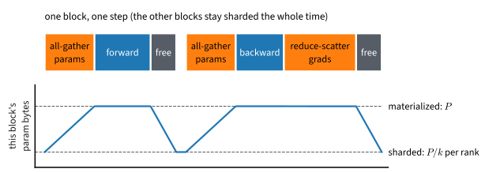

# Sharding the Training State
:label:`sec_sharding`

In :numref:`sec_memory_precision`, we saw that training with Adam in fp32
stores 16 bytes per parameter—four bytes each for the weight, its gradient,
and Adam's two moment estimates. For our 18-block, 1B-parameter GPT, that
fixed state fills 15.1 GiB of a 24 GiB card before reading a single token, and
data parallelism (:numref:`sec_multi_gpu`, :numref:`sec_multi_gpu_concise`)
replicates all 16 bytes on every GPU. If we double the depth of our GPT to 36
blocks (1.92B parameters, 28.6 GiB of state), data parallelism on four 24 GiB
GPUs cannot train it any more than one GPU can.

Can $k$ GPUs train a model that no single card can hold? They can, because a
GPU needs the full weights of a block only while computing that block's
forward or backward pass, and it never needs the full gradient or full
optimizer state at all. Each of the $k$ GPUs can therefore store $1/k$ of the
weights, gradients, and optimizer moments, gather each block's weights on the
fly just before the block runs, and reduce-scatter each block's gradients as
soon as they are produced.

```{.python .input #sharding-setup}
%%tab jax
# XLA reads its flags once, when JAX starts, so this cell runs before the
# imports. The latency-hiding scheduler orders the step with its memory in
# view; without it, the sharded step needs more memory than JAX may
# allocate by default (see the note on stage 2). On GPUs without
# peer-to-peer access, such as ours, set NCCL_LOCAL_REGISTER=0 in the
# environment before starting: NCCL's buffer registration fails there and
# prints a warning at every collective.
import os
os.environ['XLA_FLAGS'] = (os.environ.get('XLA_FLAGS', '') +
                           ' --xla_gpu_enable_latency_hiding_scheduler=true')
```

```{.python .input #sharding-sharding-the-training-state}
%%tab pytorch
import math
import numpy as np
import torch
from torch import nn
from torch.nn import functional as F
from d2l import torch as d2l
```

```{.python .input #sharding-sharding-the-training-state}
%%tab jax
import math
import numpy as np
import jax
from jax import numpy as jnp
from flax import nnx
import optax
from d2l import jax as d2l
```

```{.python .input #sharding-sharding-the-training-state-1}
%%tab pytorch
import json
```

```{.python .input #sharding-sharding-the-training-state-1}
%%tab jax
import collections
import re
from jax.sharding import NamedSharding, PartitionSpec as P
```

We first verify on a meta/shape-only device that the 36-block GPT's $16N$
bytes of training state exceed the 24 GiB capacity of a single RTX 4090:

```{.python .input #sharding-sharding-the-training-state-2}
%%tab pytorch
config = dict(vocab_size=50257, num_hiddens=2048, num_heads=16,
              num_blks=36, pos='learned')
k = 2                       # GPUs, from the all-gather below on
with torch.device('meta'):  # Shapes and dtypes only, no data
    N = d2l.num_params(d2l.GPT(**config))
print(f'{N / 1e9:.2f} billion parameters, 16N = {16 * N / 2**30:.1f} GiB')
if d2l.num_gpus():
    total = torch.cuda.mem_get_info()[1]
    print(f'one GPU holds {total / 2**30:.1f} GiB')
```

```{.python .input #sharding-sharding-the-training-state-2}
%%tab jax
config = dict(vocab_size=50257, num_hiddens=2048, num_heads=16,
              num_blks=36, pos='learned')
k = 2                       # GPUs, from the all-gather below on
key = d2l.get_key()
N = d2l.num_params(nnx.eval_shape(lambda: d2l.GPT(**config,
                                                  rngs=nnx.Rngs(key))))
print(f'{N / 1e9:.2f} billion parameters, 16N = {16 * N / 2**30:.1f} GiB')
if jax.default_backend() == 'gpu':
    limit = jax.devices()[0].memory_stats()['bytes_limit']
    print(f'JAX may allocate {limit / 2**30:.1f} GiB of one GPU')
```

## Partitioning the Optimizer State, Gradients, and Weights
:label:`subsec_mgp-fsdp`

In standard data parallelism, all $k$ GPUs hold identical copies of Adam's
moment estimates and perform identical optimizer updates. The *ZeRO*
(*Zero Redundancy Optimizer*) family :cite:`Rajbhandari.Rasley.Ruwase.ea.2020`
eliminates this redundancy in three cumulative stages (:numref:`tab_mgp-zero`):
* **ZeRO Stage 1** partitions only the optimizer state: each GPU holds Adam's
  two moments for $1/k$ of the parameters ($8 + 8/k$ bytes/parameter). Instead
  of an allreduce ($=\text{reduce-scatter} + \text{all-gather}$,
  :numref:`subsec_mg-ring`), the GPUs reduce-scatter the gradients so each GPU
  receives the summed gradient for its $1/k$ shard, updates its own parameters,
  and all-gathers the updated weights—moving the exact same bytes as data
  parallelism.
* **ZeRO Stage 2** also partitions the gradients ($4 + 12/k$ bytes/parameter):
  as each gradient bucket fills during the backward pass, it is immediately
  reduce-scattered and the non-owned $1 - 1/k$ gradient shards are freed,
  again at zero extra byte cost over data parallelism.
* **ZeRO Stage 3**, or *Fully Sharded Data Parallelism* (FSDP)
  :cite:`Zhao.Gu.Varma.ea.2023`, shards the weights as well ($16/k$
  bytes/parameter). Before a block runs in the forward or backward pass, an
  all-gather assembles its full weights; immediately after the block finishes,
  the non-owned weight shards are freed, and the block's gradients are
  reduce-scattered (:numref:`fig_fsdp_lifecycle`).

:Training state per GPU at the end of the backward pass, with Adam in fp32 on $k$ GPUs, and for the GPT with 36 blocks and 1.92 billion parameters on $k = 2$.
:label:`tab_mgp-zero`

| each GPU holds | weights | gradients | Adam state | bytes per parameter | GPT, $k = 2$ |
|---|---|---|---|---|---|
| data parallelism | all | all | all | 16 | 28.6 GiB |
| ZeRO stage 1 | all | all | $1/k$ | $8 + 8/k$ | 21.4 GiB |
| ZeRO stage 2 | all | $1/k$ | $1/k$ | $4 + 12/k$ | 17.9 GiB |
| ZeRO stage 3 (FSDP) | $1/k$ | $1/k$ | $1/k$ | $16/k$ | 14.3 GiB |


:label:`fig_fsdp_lifecycle`

Because FSDP performs two all-gathers (forward and backward) and one
reduce-scatter of $S = 4N$ bytes per step—three collective phases where a ring
allreduce performs two—it moves **$1.5\times$ the communication volume of data
parallelism**. :numref:`tab_collectives` summarizes the four primary
collectives used across parallel training.

:The collective operations behind data-parallel and sharded training.
:label:`tab_collectives`

| collective | what every GPU ends with | where it appears |
|---|---|---|
| allreduce | the full sum | gradients in data parallelism |
| reduce-scatter | one $1/k$ shard of the sum | gradients in ZeRO and FSDP |
| all-gather | every shard, concatenated | weights in ZeRO and FSDP |
| all-to-all | a distinct slice from each GPU | token routing in mixtures of experts (:numref:`sec_moe`) |

## Memory and Communication

Let us predict the peak memory and step time of our 36-block GPT under FSDP on
$k = 2$ GPUs, with 2 sequences of 1,024 tokens per GPU and per-block activation
checkpointing (:numref:`subsec_mp-checkpointing`).

* **Memory:** The sharded training state takes $16N/2 = 14.3$ GiB per GPU.
  Checkpointed activations take ~1 MiB/token (~2 GiB for 2,048 tokens), and one
  or two currently gathered blocks (~0.2 GB each) bring peak memory to at most
  **~17 GiB** per GPU—comfortably below 24 GiB.
* **Communication:** Each of the three collective phases sends $(k-1)S/k$
  bytes per GPU, giving a total communication time of

  $$
  t_\textrm{comm} = \frac{3(k-1)}{k}\,S\,\beta_\textrm{link}.
  $$
  :eqlabel:`eq_fsdp_comm`

  Notice the key scaling property of FSDP: **adding more GPUs divides the
  state memory per GPU by $k$, but the bytes each GPU sends per step grow from
  $1.5S$ (at $k = 2$) toward $3S$ (at large $k$)**. Only processing more tokens
  per GPU or using a faster interconnect reduces the communication share of a
  step.

We measure $\beta_\textrm{link}$ for an all-gather of 256 MiB across two GPUs
and evaluate our paper predictions for memory, communication time, and compute
time ($8N$ FLOPs/token with checkpointing at 82.6 TFLOP/s in tf32):

```{.python .input #sharding-memory-and-communication-1}
%%tab pytorch
GATHER = r'''
import json, torch
import torch.distributed as dist
from d2l import torch as d2l

_, k, device = d2l.init_distributed()
x = torch.zeros(2**26 // k, device=device)  # This GPU's part
y = torch.empty(2**26, device=device)       # 256 MiB, gathered
t = d2l.Benchmark(lambda: dist.all_gather_into_tensor(y, x), repeats=10).time
print(json.dumps({'beta_link': t / ((k - 1) / k * y.nbytes)}))  # Per byte sent
dist.destroy_process_group()
'''
assert d2l.num_gpus() >= k, 'The cells from here on need two GPUs'
beta_link = max(r['beta_link'] for r in d2l.torchrun(GATHER, k))
print(f'bus bandwidth = {1e-9 / beta_link:.1f} GB/s in an all-gather on {k} '
      f'GPUs (beta_link = {1e9 * beta_link:.2f} ns/byte)')
```

```{.python .input #sharding-memory-and-communication-1}
%%tab jax
assert jax.device_count() >= k, 'The cells from here on need two GPUs'
mesh = jax.make_mesh((k,), ('data',), devices=jax.devices()[:k],
                     axis_types=(jax.sharding.AxisType.Auto,))
x = jnp.zeros(2**26, device=NamedSharding(mesh, P('data')))  # 256 MiB
# Asking for the result on every GPU makes the compiler gather the parts
gather = jax.jit(lambda x: x, out_shardings=NamedSharding(mesh, P()))
t = d2l.Benchmark(lambda: gather(x), repeats=10).time
beta_link = t / ((k - 1) / k * x.nbytes)  # Seconds per byte sent per GPU
del x                       # Frees its memory before the training step
print(f'bus bandwidth = {1e-9 / beta_link:.1f} GB/s in an all-gather on {k} '
      f'GPUs (beta_link = {1e9 * beta_link:.2f} ns/byte)')
```

```{.python .input #sharding-memory-and-communication-2}
%%tab pytorch, jax
b, T = 2, 1024        # Sequences of T tokens per GPU and step
S = 4 * N             # Bytes of the fp32 weights, and of the gradients
peak_flops = 82.6e12  # tf32 FLOP/s of the RTX 4090
print(f'state per GPU, 16N/k: {16 * N / k / 2**30:.1f} GiB')
print(f'communication, 3(k-1)S beta_link/k: '
      f'{3 * (k - 1) / k * S * beta_link:.1f} s per step')
print(f'arithmetic at the peak, 8N bT/P: '
      f'{8 * N * b * T / peak_flops:.2f} s per step')
```

At ~2.2 GB/s bus bandwidth over host memory, moving $1.5S = 11.5$ GB per step
takes ~5 s, whereas the 2,048 tokens of arithmetic take only ~0.4 s. Because
0.4 s of compute cannot hide 5 s of communication, the step should take ~5 s.

## Sharded Training on Two GPUs

Now we run the sharded 36-block GPT step on two GPUs, constructing the model
so that no single GPU ever materializes the full 28.6 GiB state at once.

:begin_tab:`pytorch`
In PyTorch, we construct the model on the `'meta'` device, wrap each
checkpointed block and the top-level model with `fully_shard` from
`torch.distributed.fsdp`, materialize only this rank's shards via
`model.to_empty(device=device)`, and initialize them in place.
:end_tab:

```{.python .input #sharding-memory-and-communication-3}
%%tab pytorch
TRAIN_FSDP = r'''
import json, sys, torch
import torch.distributed as dist
from torch import nn
from torch.nn import functional as F
from torch.distributed.fsdp import fully_shard
from torch.utils.checkpoint import checkpoint
from d2l import torch as d2l

class Checkpointed(nn.Module):
    """A block whose activations the backward pass recomputes."""
    def __init__(self, blk):
        super().__init__()
        self.blk = blk

    def forward(self, X, **kwargs):
        return checkpoint(self.blk, X, use_reentrant=False, **kwargs)

config, b, T = json.loads(sys.argv[1]), int(sys.argv[2]), int(sys.argv[3])
_, k, device = d2l.init_distributed()
torch.set_float32_matmul_precision('high')  # fp32 products on tf32 cores
torch.manual_seed(0)        # The same seed in every process
with torch.device('meta'):  # Shapes only: no GPU holds the whole model
    model = d2l.GPT(**config)
model.blks = nn.ModuleList(Checkpointed(blk) for blk in model.blks)
for blk in model.blks:      # Each block is gathered and released on its own
    fully_shard(blk)
fully_shard(model)          # The rest: the embeddings and the final norm
model.to_empty(device=device)  # This GPU's shards, not yet initialized
with torch.no_grad():       # Initialize the shards as d2l.GPT does
    for m in model.modules():
        if isinstance(m, nn.RMSNorm):
            m.reset_parameters()
    for emb in (model.token_emb, model.pos_emb):
        nn.init.normal_(emb.weight, std=0.02)
    model.init_weights()
opt = torch.optim.Adam(model.parameters(), lr=1e-4, fused=True)
# The same tokens on every GPU: they only set the shapes of the step
X = torch.randint(0, config['vocab_size'], (b, T), device=device)

def step():
    loss = F.cross_entropy(model(X).flatten(0, 1), X.flatten())
    loss.backward()
    opt.step()
    opt.zero_grad()

step()                      # Warm-up; creates Adam's moment estimates
times = [d2l.Benchmark(step, warmup=0, repeats=1).time for _ in range(3)]
kernels = d2l.kernel_times(step, steps=1)
comm = sum(ms for name, ms in kernels.items() if 'nccl' in name.lower())
print(json.dumps({'peak': torch.cuda.max_memory_allocated(), 'times': times,
                  'comm': comm / 1e3}))
dist.destroy_process_group()
'''
```

```{.python .input #sharding-memory-and-communication-4}
%%tab pytorch
ranks = d2l.torchrun(TRAIN_FSDP, k, json.dumps(config), b, T)
peak_bytes = max(r['peak'] for r in ranks)
times, comm = ranks[0]['times'], ranks[0]['comm']  # GPU 0
```

:begin_tab:`jax`
In JAX, `fsdp_sharding` shards each parameter tensor along its first axis
divisible by $k$ (`P('data')`), and constraining each block's activation
output to remain batch-sharded (`data`) causes XLA to emit FSDP's
all-gathers and reduce-scatters automatically:
:end_tab:

```{.python .input #sharding-memory-and-communication-5}
%%tab jax
def fsdp_sharding(x):
    """Split the first axis of x whose length k divides across the GPUs;
    replicate x if there is none."""
    for i, n in enumerate(x.shape):
        if n % k == 0:
            return NamedSharding(mesh, P(*[None] * i, 'data'))
    return NamedSharding(mesh, P())

@nnx.jit
def create(key):
    # The key is an argument: XLA would fold a constant key into the program,
    # together with every weight drawn from it, as large constants
    model = d2l.GPT(**config, rngs=nnx.Rngs(key))
    opt = nnx.Optimizer(model, optax.adam(1e-4), wrt=nnx.Param)
    state = nnx.state((model, opt))
    nnx.update((model, opt), jax.lax.with_sharding_constraint(
        state, jax.tree.map(fsdp_sharding, state)))
    return model, opt

model, opt = create(d2l.get_key())  # Each GPU computes only its shards
```

```{.python .input #sharding-memory-and-communication-6}
%%tab jax
data = NamedSharding(mesh, P('data'))     # Split along the batch
block = nnx.remat(lambda blk, H: blk(H))  # Recomputed in the backward pass

def loss_fn(model, X):
    H = model.token_emb(X) + model.pos_emb(jnp.arange(X.shape[1]))
    for blk in model.blks:  # Every block's output stays split by batch
        H = jax.lax.with_sharding_constraint(block(blk, H), data)
    logits = model.token_emb.attend(model.norm(H))
    return optax.softmax_cross_entropy_with_integer_labels(logits, X).mean()

# Donated, the old weights and moment estimates make room for the new ones
@nnx.jit(donate_argnums=(0, 1))
def train_step(model, opt, X):
    loss, grads = nnx.value_and_grad(loss_fn)(model, X)
    opt.update(model, grads)
    return loss
```

```{.python .input #sharding-memory-and-communication-7}
%%tab jax
X = jax.device_put(jax.random.randint(d2l.get_key(), (k * b, T), 0,
                                      config['vocab_size']), data)
compiled = train_step.lower(model, opt, X).compile()
mem = compiled.memory_analysis()  # Bytes per GPU
print(f'per GPU: weights and moments '
      f'{mem.argument_size_in_bytes / 2**30:.1f} GiB (donated: '
      f'{mem.alias_size_in_bytes / 2**30:.1f} GiB), temporaries '
      f'{mem.temp_size_in_bytes / 2**30:.1f} GiB')
```

```{.python .input #sharding-memory-and-communication-8}
%%tab jax
def collective_megabytes(compiled):
    """Megabytes of the results of each kind of collective in a compiled
    program, on one GPU."""
    sizes = collections.Counter()
    for line in compiled.as_text().splitlines():
        # A synchronous collective, or the -done half of an asynchronous
        # pair, whose result type lists only the arrays that it returns
        op = re.search(r' = (.*?) (all-gather|reduce-scatter|all-reduce|'
                       r'all-to-all|collective-permute)(-done)?\(', line)
        for bits, dims in re.findall(r'[a-z]+(\d+)\[([\d,]*)\]',
                                     op[1] if op else ''):
            n = math.prod(int(d) for d in dims.split(',') if d)
            sizes[op[2]] += int(bits) // 8 * n / 1e6
    return dict(sizes)
```

```{.python .input #sharding-memory-and-communication-9}
%%tab jax
for kind, mb in sorted(collective_megabytes(compiled).items(),
                       key=lambda kv: -kv[1]):
    print(f'{kind}: {mb / 1e3:.2f} GB')
```

```{.python .input #sharding-memory-and-communication-10}
%%tab jax
train_step(model, opt, X).block_until_ready()  # Warm-up, finished
times = [d2l.Benchmark(lambda: train_step(model, opt, X), warmup=0,
                       repeats=1).time for _ in range(3)]
kernels = d2l.kernel_times(lambda: train_step(model, opt, X), steps=1)
comm = sum(ms for name, ms in kernels.items() if 'nccl' in name.lower()) / 1e3
peak_bytes = jax.devices()[0].memory_stats()['peak_bytes_in_use']
```

```{.python .input #sharding-memory-and-communication-11}
%%tab pytorch, jax
print(f'per GPU: peak memory {peak_bytes / 2**30:.1f} GiB; '
      f'{np.median(times):.2f} s per step ({min(times):.2f} to '
      f'{max(times):.2f})\nof each step, GPU 0 spends {comm:.2f} s in '
      f'communication kernels')
```

Both GPUs hold the 36-block model at a peak of ~16 GiB per card (under our 17
GiB bound), and each step takes ~5.5 s, with GPU 0 spending over 90% of the
step in NCCL communication kernels—within a sixth of our 5 s paper prediction.
Over NVLink 5 (900 GB/s per direction), the same 11.5 GB of collectives takes
only ~13 ms, less than a thirtieth of the 0.4 s compute time.

This comparison also shows *when* to shard: a model whose training state fits
on a single GPU alongside a reasonable micro-batch (such as our 18-block GPT)
trains much faster with data parallelism and gradient accumulation (which
communicates once per global step) than with FSDP over PCIe (which re-gathers
the weights twice on every micro-batch).

## Summary

Data parallelism replicates all $16N$ bytes of fp32 Adam state on every GPU.
ZeRO partitions this state across $k$ GPUs: Stage 1 shards the optimizer
moments ($8 + 8/k$ bytes/parameter) and Stage 2 also shards the gradients
($4 + 12/k$ bytes/parameter), both moving the exact same $2(k-1)S/k$ bytes per
step as a ring allreduce. Stage 3 (FSDP) shards the weights as well ($16/k$
bytes/parameter), gathering each block's weights for the forward and backward
pass and reduce-scattering gradients at $1.5\times$ the communication volume
of data parallelism ($3(k-1)S/k$ bytes per GPU). Sharding enables two 24 GiB
GPUs to train a 36-block GPT whose 28.6 GiB state fits on neither card alone.

## Exercises

1. **Cost of sharding.** ● Count communication per GPU and step in units
   of $S = 4N$, the bytes of one full set of fp32 weights or gradients.
    1. A variant of ZeRO Stage 3 keeps every gathered block in memory from its
       forward pass until its backward pass finishes. Which collective does
       this eliminate, and how much memory saving from :numref:`tab_mgp-zero`
       does it give up?
    1. Mixed-precision FSDP all-gathers weights in bf16 and reduce-scatters gradients in bf16 while keeping each GPU's master weight and Adam shards in fp32. Compare its bytes transferred per step with fp32 data parallelism, and its memory per parameter with the last row of :numref:`tab_mgp-zero`.
    1. For the 36-block GPT on $k = 2$ GPUs at the measured
       $\beta_\textrm{link}$, how many tokens per GPU would a step need for
       checkpointed compute ($8N$ FLOPs/token at 83 TFLOP/s) to match the
       communication time :eqref:`eq_fsdp_comm`? Do those activations fit on
       the card, and why does gradient accumulation not help when FSDP
       re-gathers weights on every micro-batch?

:begin_tab:`pytorch`
2. [extended] **Sharded optimizer state.** ● Implement ZeRO Stage 1
    :cite:`Rajbhandari.Rasley.Ruwase.ea.2020` by hand starting from
    `TRAIN_DDP` (:numref:`sec_multi_gpu_concise`) with `torch.optim.Adam`.
    1. Partition the parameter tensors across ranks so each rank owns roughly
       $1/k$ of the parameters and runs Adam only on its owned tensors, then
       broadcast each updated tensor from its owner with `dist.broadcast`.
       Verify that the parameters match full DDP Adam after several steps, and
       compare with `torch.distributed.optim.ZeroRedundancyOptimizer`.
    1. Measure allocated and peak GPU memory at $k = 2$ and $k = 4$ with and
       without sharding, and compare the total bytes sent by DDP allreduce plus
       owner broadcasts against Stage 1's reduce-scatter plus all-gather.

3. [code] **Tensor versus data parallelism.** ● Consider the MLP block
    $\mathbf{Y} = \phi(\mathbf{X}\mathbf{W}_1)\mathbf{W}_2$ with
    $\mathbf{X} \in \mathbb{R}^{n \times d}$,
    $\mathbf{W}_1 \in \mathbb{R}^{d \times 4d}$, and
    $\mathbf{W}_2 \in \mathbb{R}^{4d \times d}$ across $k$ devices. Tensor
    parallelism (:numref:`fig_splitting`, :cite:`shoeybi2019megatron`) splits
    $\mathbf{W}_1$ column-wise and $\mathbf{W}_2$ row-wise.
    1. Show that each device can compute a partial $n \times d$ output without
       communication and that summing the $k$ partial outputs gives
       $\mathbf{Y}$. Which collective does the forward pass need, and which
       does the backward pass need for $\nabla_{\mathbf{X}}$?
    1. Compare the values sent per device and step under tensor parallelism
       versus data parallelism, and find the token count $n$ below which
       tensor parallelism sends less data. Why is tensor parallelism
       nevertheless restricted to fast intra-node NVLink domains?
    1. Using `parallelize_module` with `ColwiseParallel()` and
       `RowwiseParallel()` on a 1D `DeviceMesh`, count the forward and
       backward collectives with `CommDebugMode`.
   :exlabel:`ex_mgp-tensor`
:end_tab:

:begin_tab:`jax`
2. [extended] **Sharded optimizer state.** ● Implement ZeRO Stage 1
    :cite:`Rajbhandari.Rasley.Ruwase.ea.2020` declaratively starting from
    `train_step` (:numref:`sec_multi_gpu_concise`) with `optax.adam`. Keep the
    model parameters replicated (`P()`), and place the leaves of
    `nnx.state(opt)` with `fsdp_sharding`.
    1. Ensure parameters remain replicated at the end of `train_step` via
       `jax.sharding.reshard` if needed, and verify that multi-step parameter
       updates match replicated Adam.
    1. Inspect the compiled step with `collective_megabytes` and compare its collectives and live/peak memory at $k = 2$ and $k = 4$ against :numref:`tab_mgp-zero`.

3. [code] **Tensor versus data parallelism.** ● Consider the MLP block
    $\mathbf{Y} = \phi(\mathbf{X}\mathbf{W}_1)\mathbf{W}_2$ with
    $\mathbf{X} \in \mathbb{R}^{n \times d}$,
    $\mathbf{W}_1 \in \mathbb{R}^{d \times 4d}$, and
    $\mathbf{W}_2 \in \mathbb{R}^{4d \times d}$ across $k$ devices. Tensor
    parallelism (:numref:`fig_splitting`, :cite:`shoeybi2019megatron`) splits
    $\mathbf{W}_1$ column-wise (`P(None, 'data')`) and $\mathbf{W}_2$ row-wise
    (`P('data', None)`).
    1. Show that each device can compute a partial $n \times d$ output without
       communication and that summing the $k$ partial outputs gives
       $\mathbf{Y}$. Which collective does the forward pass need, and which
       does the backward pass need for $\nabla_{\mathbf{X}}$?
    1. Compare the values sent per device and step under tensor parallelism
       versus data parallelism, and find the token count $n$ below which
       tensor parallelism sends less data. Why is tensor parallelism
       nevertheless restricted to fast intra-node NVLink domains?
    1. Place $\mathbf{W}_1$ with `P(None, 'data')`, $\mathbf{W}_2$ with
       `P('data', None)`, and $\mathbf{X}$ replicated on an `Auto` mesh, jit
       the forward and backward pass, and inspect the emitted collectives.
   :exlabel:`ex_mgp-tensor`
:end_tab:

4. **Prefetching the next block.** In the forward pass under FSDP, let $g$ be
   the all-gather time of one block and $c$ its compute time. Without overlap,
   $L$ blocks take $L(g + c)$; prefetching issues the all-gather of block
   $l + 1$ while block $l$ computes.
    1. Show that prefetching reduces the forward pass time to
       $g + (L-1)\max(g, c) + c$, and explain why no schedule can do better
       than $L\max(g, c)$.
    1. Evaluate $g$ and $c$ for one block of the 36-block GPT ($50$M
       parameters, 2,048 tokens/GPU, 83 TFLOP/s) on our PCIe link versus
       NVLink 5 (900 GB/s), and state how much prefetching saves on each
       interconnect.

[Discussions](https://d2l.discourse.group/)

<!-- slides -->

::: {.slide}
::: {.cover}
[Dive into Deep Learning · §13.7]{.kicker}

Sharding the Training State<br>**ZeRO stages 1–3 · FSDP · a model no card holds, run on two GPUs**
:::
:::

::: {.slide title="29 GiB of State, 24 GiB per Card"}
[The problem]{.kicker}

@!sharding-sharding-the-training-state-2

- The 1B GPT made twice as deep: 36 blocks, width 2,048.
- Adam in fp32: weight, gradient, two moments, 16 bytes per parameter.
- Data parallelism puts all 16 bytes on every GPU.

::: {.d2l-note .warn}
Can $k$ GPUs train a model that none of them holds?
:::
:::

::: {.slide title="By the End of This Deck You Can"}
[Goals]{.kicker}

- size the memory per GPU of ZeRO stages 1, 2, and 3;
- explain how stage 2 avoids ever holding the full gradient;
- count the bytes that FSDP sends per step, and how they change with $k$;
- predict a sharded step's memory and seconds, and check them;
- decide when sharding is worth its communication.

**Running example:** the 36-block GPT, $N = 1.92$ billion parameters, on
two RTX 4090s that exchange data through host memory.
:::

::: {.slide title="Data Parallelism Copied the State; Now We Divide It"}
[Where this fits]{.kicker}

::: {.cols .vc}
::: {.col}
| section | adds |
|---|---|
| The Performance Model | roofline, three regimes, timing, profiling |
| Hardware | where peak arithmetic and bandwidth come from |
| Computation Graphs and Compilation | fusion and kernel replay |
| Memory and Precision | 16 bytes per parameter, activations, checkpointing |
| Multi-GPU from First Principles | the ring allreduce, its cost model |
| Data Parallelism in Practice | one process per GPU, buckets, scaling |
| **Sharding the Training State** | **ZeRO and FSDP, measured** |
| Case Study: Optimizing a Transformer | the whole method on one GPT |
:::

::: {.col .narrow}
- **Uses:** reduce-scatter and all-gather, $\beta_\textrm{link}$,
  checkpointing.
- **Skips:** tensor, pipeline, and expert parallelism; several machines.
:::
:::
:::

::: {.slide title="A GPU Needs Each Part of Its State Only Briefly"}
[The idea]{.kicker}

| state | bytes per parameter | needed |
|---|---|---|
| weights | 4 | in its block's forward and backward pass |
| gradients | 4 | once, by the optimizer |
| Adam's two moments | 8 | only inside the update |

All $k$ GPUs of data parallelism run the same update: $k$ identical
copies.

::: {.d2l-note .rule}
Keep $1/k$ of each; gather a block when it computes, scatter each gradient
as soon as it exists.
:::
:::

::: {.slide title="Each ZeRO Stage Divides One More Kind of State by k"}
[ZeRO stages]{.kicker}

Per GPU at the end of the backward pass, Adam in fp32, $k$ GPUs:

| each GPU holds | weights | grads | Adam | bytes/param | GPT, $k = 2$ |
|---|---|---|---|---|---|
| data parallel | all | all | all | 16 | 28.6 GiB |
| ZeRO-1 | all | all | $1/k$ | $8 + 8/k$ | 21.4 GiB |
| ZeRO-2 | all | $1/k$ | $1/k$ | $4 + 12/k$ | 17.9 GiB |
| ZeRO-3 (FSDP) | $1/k$ | $1/k$ | $1/k$ | $16/k$ | 14.3 GiB |

::: {.d2l-note .rule}
On 24 GiB cards, ZeRO-1 leaves under 3 GiB free; ZeRO-3 almost 10.
:::
:::

::: {.slide title="Stage 1 Moves the Same Bytes as an Allreduce"}
[ZeRO stage 1]{.kicker}

allreduce = reduce-scatter + all-gather. Split them:

1. reduce-scatter: each GPU gets the summed gradient of the parameters
   it owns;
2. each GPU updates its $1/k$ with its $1/k$ of Adam's state;
3. all-gather: the updated weights reach every GPU.

::: {.d2l-note .rule}
Same bytes, less memory. The all-gather sits between the update and the
next forward pass, and adds to the step unless it is overlapped.
:::
:::

::: {.slide title="Stage 2 Scatters Each Bucket as Soon as It Exists"}
[ZeRO stage 2]{.kicker}

- Every GPU's backward pass produces every gradient.
- Gradients leave in buckets, as soon as the backward pass makes them.
- Reduce-scatter each bucket: keep the summed $1/k$ that this GPU owns,
  free the rest.

::: {.d2l-note .rule}
The full gradient never exists at once: one bucket at a time. The
collectives, and the bytes, are those of stage 1.
:::
:::

::: {.slide title="FSDP Gathers Each Block Twice: 1.5× the Communication"}
[ZeRO stage 3]{.kicker}

{width=70%}

Per step: two all-gathers and one reduce-scatter of $S = 4N$ bytes. With
$\beta_\textrm{link}$ the time per byte that each GPU sends in a large
collective:

$$t_\textrm{comm} = \frac{3(k-1)}{k}\,S\,\beta_\textrm{link}$$

::: {.d2l-note .rule}
From $1.5S$ per GPU at $k = 2$ towards $3S$: more GPUs divide the memory,
not the bytes each one sends.
:::
:::

::: {.slide title="Check: Predict Memory and Time on Two GPUs"}
[Check]{.kicker}

$N = 1.92$ B, $S = 4N = 7.7$ GB, $k = 2$, a bus bandwidth of
2.2 to 2.3 GB/s per GPU, 2,048 tokens per GPU, checkpointing at about
1 MiB per token, $8N$ FLOPs per token at 83 TFLOP/s. Peak memory,
communication, arithmetic?

::: {.fragment .fade-up}
::: {.d2l-note}
**Answer.** $16N/2 = 14.3$ GiB, plus 2 GiB of activations and a block or
two: at most 17 GiB. Each phase sends $S/2$, so $1.5S = 11.5$ GB
take about 5 s. Arithmetic:
$8 \cdot 1.92 \cdot 10^9 \cdot 2048 / (8.3 \cdot 10^{13}) \approx 0.4$ s.
:::
:::
:::

::: {.slide title="The Step Runs at About 7% of Its Arithmetic Speed"}
[Measured]{.kicker}

@!sharding-memory-and-communication-11

- Peak about 16 GiB per GPU, under the predicted 17.
- About 5.5 s per step, a little over the predicted 5 s.
- Nearly all of it in communication kernels; the 0.4 s of arithmetic adds
  little.

::: {.d2l-note .rule}
A compute-optimal run, 20 tokens per parameter: about 600 days on these two
cards, six weeks for their arithmetic alone.
:::
:::

::: {.slide title="fully_shard per Block Makes Each Block a Unit" only="pytorch"}
[FSDP in PyTorch]{.kicker}

```{.python #sharding-exercises-1}
with torch.device('meta'):      # shapes only, no memory
    model = d2l.GPT(**config)
for blk in model.blks:          # each block gathered on its own
    fully_shard(blk)
fully_shard(model)              # embeddings and final norm
model.to_empty(device=device)   # this GPU's shards only
...                             # initialize them as d2l.GPT does
opt = torch.optim.Adam(model.parameters(), lr=1e-4, fused=True)
```

- One process per GPU, started by `torchrun`.
- `fused=True`: no Adam temporaries as large as the gradients.
:::

::: {.slide title="Keep Activations Split, and XLA Writes FSDP's Collectives" only="jax"}
[FSDP in JAX]{.kicker}

::: {.cols .vc}
::: {.col}
```{.python #sharding-exercises-2}
def fsdp_sharding(x):  # first axis that k divides
    for i, n in enumerate(x.shape):
        if n % k == 0:
            return NamedSharding(
                mesh, P(*[None] * i, 'data'))
    return NamedSharding(mesh, P())
```

Every block's output constrained to stay split by batch.
:::

::: {.col}
@!sharding-memory-and-communication-9

- Sizes are results: weights gathered twice, gradient shard $S/2$.
- Sent per GPU: $7.5 + 3.8 = 11.3$ GB, against $1.5S = 11.5$ GB.
:::
:::
:::

::: {.slide title="Shard Only When the State Does Not Fit"}
[When to shard]{.kicker}

- Fits next to its activations: data parallelism is fastest.
- 24 GiB card, Adam in fp32: the limit is about 1B parameters.
- 18-block GPT: ZeRO-3 on two GPUs cuts 15.1 GiB to 7.5 GiB per GPU.
- Larger micro-batches would save at most 8% of the arithmetic in
  accumulator traffic, about 0.01 s per micro-batch.
- FSDP gathers the weights twice per micro-batch, about 2 s on our link;
  data parallelism with accumulation exchanges once per step.

::: {.d2l-note}
On our machine: shard the 36-block GPT, not the 18-block one.
:::
:::

::: {.slide title="Check: The Same Step over NVLink"}
[Check]{.kicker}

The same 11.5 GB per GPU and step, $k = 2$, over NVLink 5 at 900 GB/s
per direction. How long is the communication, and what limits the step?

::: {.fragment .fade-up}
::: {.d2l-note}
**Answer.** $11.5 / 900 \approx 13$ ms, a thirtieth of the 0.4 s of
arithmetic.

| link | bus bandwidth | communication per step |
|---|---|---|
| ours: PCIe through host memory | 2.2 to 2.3 GB/s | about 5 s |
| NVLink 5 | 900 GB/s | 13 ms |

The arithmetic limits the step; on such links FSDP costs little.
:::
:::
:::

::: {.slide title="Divide the State by k; Every Step Gathers It Back"}
[Recap]{.kicker}

- Data parallelism: 16 bytes per parameter on every GPU; 28.6 GiB does
  not fit.
- ZeRO-1 and ZeRO-2: optimizer state, then gradients, at no cost in
  bytes.
- FSDP: also the weights, 14.3 GiB per GPU at $k = 2$, at 1.5× the
  communication; more GPUs do not cut the bytes each one sends.
- Measured: about 16 GiB and 5.5 s per step, 7% of the arithmetic speed.

**Next:** one GPU again, and a GPT step whose causes of slowness act all at once.
:::
