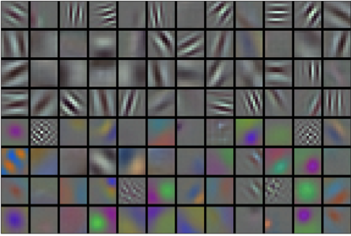
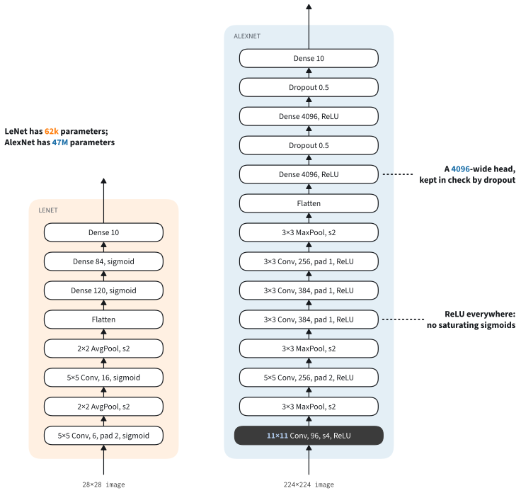

```{.python .input  n=1}
%load_ext d2lbook.tab
tab.interact_select('mxnet', 'pytorch', 'tensorflow', 'jax')
```

# AlexNet and Learned Image Representations
:label:`sec_alexnet`

In :numref:`sec_lenet`, LeNet trained every stage of its pipeline—both convolutional filters and final classifier—end to end from raw pixels. Yet for two decades after LeCun's 1989 results, mainstream computer vision split feature extraction from classification: hand-engineered descriptors such as SIFT :cite:`Lowe.2004`, SURF :cite:`Bay.Tuytelaars.Van-Gool.2006`, HOG :cite:`Dalal.Triggs.2005`, and bags of visual words :cite:`Sivic.Zisserman.2003` mapped pixels into fixed feature vectors that fed a linear or kernel classifier. Because the training loss updated only the classifier and never the features, progress relied on human feature engineering.

The watershed came at the 2012 ImageNet challenge (1,000 object categories evaluated by *top-5 error*, the fraction of validation images whose true label falls outside the model's top five predictions). *AlexNet* :cite:`Krizhevsky.Sutskever.Hinton.2012` trained a single eight-layer convolutional network end to end on raw pixels, slashing top-5 error from 26.2% (for the best hand-engineered pipeline) to 15.3% in a single leap. Architecturally, AlexNet is LeNet scaled up, so its sudden triumph points straight to three catalysts that converged in 2012: a million-image labeled dataset (ImageNet), GPUs fast enough to train tens of millions of weights in days rather than months, and key modeling practices—ReLU activations, dropout, and data augmentation—that made deep networks trainable and resistant to memorization.

```{.python .input #alexnet-deep-convolutional-neural-networks-alexnet  n=2}
%%tab mxnet
import math
import numpy as np
from mxnet import autograd, gluon, init, np as mnp, npx
from mxnet.gluon import nn
from d2l import mxnet as d2l
npx.set_np()
```

```{.python .input #alexnet-deep-convolutional-neural-networks-alexnet  n=3}
%%tab pytorch
import math
import numpy as np
import torch
from torch import nn
from torch.nn import functional as F
from d2l import torch as d2l
```

```{.python .input #alexnet-deep-convolutional-neural-networks-alexnet  n=4}
%%tab tensorflow
import math
import numpy as np
import tensorflow as tf
from d2l import tensorflow as d2l
```

```{.python .input #alexnet-deep-convolutional-neural-networks-alexnet}
%%tab jax
import math
import numpy as np
import jax
from jax import numpy as jnp
from flax import nnx
import optax
from d2l import jax as d2l
```

## Learned Features, Data, and Hardware

What did backpropagation discover on ImageNet that hand-crafted descriptors missed? :numref:`fig_filters` shows the 96 learned $11 \times 11$ kernels of AlexNet's first convolutional layer: oriented edge and frequency detectors alongside color-opponent blobs, found purely by minimizing classification loss and composed by deeper layers into textures, parts, and object categories.


:width:`400px`
:label:`fig_filters`

### Data and Hardware

Models with 60 million parameters quickly memorize small benchmarks such as PASCAL VOC (~$10^4$ images). The 2012 ImageNet training split :cite:`Deng.Dong.Socher.ea.2009,russakovsky2015imagenet` supplied 1.2 million labeled photographs across 1,000 categories, and AlexNet multiplied effective sample diversity via data augmentation—extracting random $224 \times 224$ crops and horizontal reflections from $256 \times 226$ images (up to $32 \cdot 32 \cdot 2 = 2{,}048$ views per photograph).

Hardware supplied the second half of the breakthrough. Convolving a filter across every spatial location and channel executes millions of independent multiply-adds—the exact workload graphics processing units (GPUs) were built to run across hundreds of parallel cores connected to high-bandwidth memory. Each of the two NVIDIA GTX 580 GPUs used for AlexNet delivered ~1.6 TFLOPS and 192 GB/s of memory bandwidth, versus ~0.2 TFLOPS and 20 GB/s for a contemporary quad-core CPU. One forward pass of AlexNet on a $224 \times 224$ RGB image costs ~$10^9$ multiply-adds; counting a backward pass at twice the forward pass and 2 FLOPs per multiply-add, 90 epochs over 1.2 million images require

$$10^9 \cdot 3 \cdot 2 \cdot 1.2 \times 10^6 \cdot 90 \approx 6.5 \times 10^{17} \text{ FLOPs}$$

—five to six days on two GTX 580s using Krizhevsky's custom CUDA kernels ([cuda-convnet](https://code.google.com/archive/p/cuda-convnet/)), compared with well over a month on a CPU.

## The AlexNet Architecture

:numref:`fig_alexnet` compares LeNet (:numref:`sec_lenet`) side by side with
the AlexNet variant we train on Fashion-MNIST below. Both follow the same
high-level design—a stack of convolutional stages feeding into a dense
classification head—but AlexNet scales up every dimension and modernizes three
critical components: the activation function, pooling, and regularization.


:label:`fig_alexnet`

### Depth, Width, ReLU, and Dropout

AlexNet expands LeNet from five parameterized layers to eight—five convolutions and three dense layers (:numref:`fig_alexnet`). Because $224 \times 224$ inputs are eight times wider than $28 \times 28$ thumbnails, layer 1 uses an $11 \times 11$ kernel with stride 4, layer 2 uses a $5 \times 5$ kernel, and layers 3--5 use $3 \times 3$ kernels, with overlapping $3 \times 3$ stride-2 max-pooling after the first, second, and fifth convolutions. Channel widths grow from 96 to 384 (vs. 6 and 16 in LeNet), and the two hidden dense layers widen to 4096 units each (vs. 120 and 84). Our implementation omits two historical 2012 artifacts: splitting layers across two 3 GB GPUs and local response normalization (superseded by batch normalization in :numref:`sec_batch_norm`).

Three modeling choices made this larger network effective:

1. **ReLU activations:** Replacing saturating sigmoids (whose derivative $\le 1/4$ attenuates deep gradients by $4^{-K}$) with $\textrm{ReLU}(x) = \max(x, 0)$ keeps derivatives at 1 on active units, reaching 25% CIFAR-10 training error six times faster than $\tanh$ :cite:`Krizhevsky.Sutskever.Hinton.2012`.
2. **Dropout and augmentation:** Applying dropout ($p = 0.5$, :numref:`sec_dropout`) after both 4096-unit dense layers prevents the classifier head from memorizing the training set.
3. **He initialization:** Because ReLU zeroes out roughly half its inputs, we draw weights from $\mathcal{N}(0, 2/n_{\textrm{in}})$ (:numref:`subsec_he_init`, with $n_{\textrm{in}} = c_{\textrm{i}} k^2$ for convolutions) and initialize biases to zero.

:begin_tab:`mxnet`
`init.MSRAPrelu('in', 0)` draws normal weights with variance
$2/n_\textrm{in}$, He initialization for a ReLU (a PReLU with slope 0).
The network is a `HybridSequential`, and `hybridize()` compiles it into a
single graph.
:end_tab:

:begin_tab:`pytorch`
The lazy layers have no weights until the first minibatch fixes their shapes.
As for LeNet, the `Trainer` then calls the model's `weight_init` on every
layer.
:end_tab:

:begin_tab:`tensorflow`
Every layer receives its own initializer, since an unseeded Keras initializer
returns the same values on every call.
:end_tab:

:begin_tab:`jax`
NNX layers draw their weights in the constructor, so every layer receives the
initializer.
:end_tab:

```{.python .input #alexnet-capacity-control-and-preprocessing-1  n=5}
%%tab mxnet
class AlexNet(d2l.Classifier):
    def __init__(self, lr=0.1, num_steps=4690, num_classes=10):
        super().__init__()
        self.save_hyperparameters()
        self.net = nn.HybridSequential()
        self.net.add(
            nn.Conv2D(96, kernel_size=11, strides=4, activation='relu'),
            nn.MaxPool2D(pool_size=3, strides=2),
            nn.Conv2D(256, kernel_size=5, padding=2, activation='relu'),
            nn.MaxPool2D(pool_size=3, strides=2),
            nn.Conv2D(384, kernel_size=3, padding=1, activation='relu'),
            nn.Conv2D(384, kernel_size=3, padding=1, activation='relu'),
            nn.Conv2D(256, kernel_size=3, padding=1, activation='relu'),
            nn.MaxPool2D(pool_size=3, strides=2),
            nn.Dense(4096, activation='relu'), nn.Dropout(0.5),
            nn.Dense(4096, activation='relu'), nn.Dropout(0.5),
            nn.Dense(num_classes))
        self.net.initialize(init.MSRAPrelu('in', 0))
        self.net.hybridize()  # Compile the network into one graph
```

```{.python .input #alexnet-capacity-control-and-preprocessing-1  n=5}
%%tab pytorch
class AlexNet(d2l.Classifier):
    def __init__(self, lr=0.1, num_steps=4690, num_classes=10):
        super().__init__()
        self.save_hyperparameters()
        self.net = nn.Sequential(
            nn.LazyConv2d(96, kernel_size=11, stride=4), nn.ReLU(),
            nn.MaxPool2d(kernel_size=3, stride=2),
            nn.LazyConv2d(256, kernel_size=5, padding=2), nn.ReLU(),
            nn.MaxPool2d(kernel_size=3, stride=2),
            nn.LazyConv2d(384, kernel_size=3, padding=1), nn.ReLU(),
            nn.LazyConv2d(384, kernel_size=3, padding=1), nn.ReLU(),
            nn.LazyConv2d(256, kernel_size=3, padding=1), nn.ReLU(),
            nn.MaxPool2d(kernel_size=3, stride=2), nn.Flatten(),
            nn.LazyLinear(4096), nn.ReLU(), nn.Dropout(p=0.5),
            nn.LazyLinear(4096), nn.ReLU(), nn.Dropout(p=0.5),
            nn.LazyLinear(num_classes))

    def weight_init(self, module):
        # The Trainer calls this after the first minibatch fixed the shapes
        if type(module) in (nn.Linear, nn.Conv2d):
            nn.init.kaiming_normal_(module.weight, nonlinearity='relu')
            nn.init.zeros_(module.bias)
```

```{.python .input #alexnet-capacity-control-and-preprocessing-1  n=5}
%%tab tensorflow
class AlexNet(d2l.Classifier):
    def __init__(self, lr=0.1, num_steps=4690, num_classes=10):
        super().__init__()
        self.save_hyperparameters()
        layers = tf.keras.layers

        def he():  # A new He-normal initializer for each layer
            init = tf.keras.initializers.VarianceScaling(
                2.0, 'fan_in', 'untruncated_normal')
            return dict(kernel_initializer=init)

        self.net = tf.keras.models.Sequential([
            layers.Conv2D(96, kernel_size=11, strides=4, activation='relu',
                          **he()),
            layers.MaxPool2D(pool_size=3, strides=2),
            layers.Conv2D(256, kernel_size=5, padding='same',
                          activation='relu', **he()),
            layers.MaxPool2D(pool_size=3, strides=2),
            layers.Conv2D(384, kernel_size=3, padding='same',
                          activation='relu', **he()),
            layers.Conv2D(384, kernel_size=3, padding='same',
                          activation='relu', **he()),
            layers.Conv2D(256, kernel_size=3, padding='same',
                          activation='relu', **he()),
            layers.MaxPool2D(pool_size=3, strides=2), layers.Flatten(),
            layers.Dense(4096, activation='relu', **he()), layers.Dropout(0.5),
            layers.Dense(4096, activation='relu', **he()), layers.Dropout(0.5),
            layers.Dense(num_classes, **he())])
```

```{.python .input #alexnet-capacity-control-and-preprocessing-1}
%%tab jax
class AlexNet(d2l.Classifier):
    def __init__(self, lr=0.1, num_steps=4690, num_classes=10,
                 rngs=None):
        super().__init__()
        self.save_hyperparameters(ignore=['rngs'])
        rngs = (nnx.Rngs(params=d2l.get_key(), dropout=d2l.get_key())
                if rngs is None else rngs)
        he = nnx.initializers.variance_scaling(2.0, 'fan_in', 'normal')
        init = dict(kernel_init=he, rngs=rngs)

        def max_pool(x):  # 3x3 windows, stride 2
            return nnx.max_pool(x, window_shape=(3, 3), strides=(2, 2))

        def flatten(x):  # One vector per example
            return x.reshape((x.shape[0], -1))

        self.net = nnx.Sequential(
            nnx.Conv(1, 96, kernel_size=(11, 11), strides=4, padding='VALID',
                     **init), nnx.relu, max_pool,
            nnx.Conv(96, 256, kernel_size=(5, 5), **init), nnx.relu,
            max_pool,
            nnx.Conv(256, 384, kernel_size=(3, 3), **init), nnx.relu,
            nnx.Conv(384, 384, kernel_size=(3, 3), **init), nnx.relu,
            nnx.Conv(384, 256, kernel_size=(3, 3), **init), nnx.relu,
            max_pool,
            flatten,  # 5 x 5 x 256 values per image
            nnx.Linear(5 * 5 * 256, 4096, **init), nnx.relu,
            nnx.Dropout(0.5, rngs=rngs),
            nnx.Linear(4096, 4096, **init), nnx.relu,
            nnx.Dropout(0.5, rngs=rngs),
            nnx.Linear(4096, num_classes, **init))
```

To verify that our code matches :numref:`fig_alexnet`, we feed a single-channel
$224 \times 224$ dummy image through `layer_summary` and inspect each output
tensor shape.

```{.python .input #alexnet-capacity-control-and-preprocessing-2  n=6}
%%tab mxnet, pytorch
AlexNet().layer_summary((1, 1, 224, 224))
```

```{.python .input #alexnet-capacity-control-and-preprocessing-2  n=7}
%%tab tensorflow, jax
AlexNet().layer_summary((1, 224, 224, 1))
```

Every dimension matches the formulas of :numref:`sec_padding`. The initial
stride-4 convolution maps 224 to $\lfloor (224 - 11)/4 \rfloor + 1 = 54$, and
each overlapping $3 \times 3$ max-pooling layer with stride 2 maps $n$ to
$\lfloor (n - 3)/2 \rfloor + 1$ ($54 \to 26 \to 12 \to 5$). Because the
intermediate padded convolutions preserve spatial dimensions, the final
convolutional stage flattens into a $256 \times 5 \times 5 = 6400$-element
vector for the dense classifier head.

### Parameters and Multiply-Adds

With the layer shapes confirmed, we can tally parameters and arithmetic cost
just as we did for LeNet (:numref:`sec_lenet`): a convolutional layer reuses
each of its $c_\textrm{i} c_\textrm{o} k^2$ weights at every spatial output
position, whereas a fully connected layer multiplies each weight once per
example. :numref:`tab_alexnet_cost` summarizes the results for our
single-channel, ten-class AlexNet.

:Parameters and multiply-adds per example of the layers of AlexNet, for one single-channel $224 \times 224$ image and ten classes. Pooling, activation, and dropout layers have no parameters.
:label:`tab_alexnet_cost`

| layer | output | parameters | multiply-adds |
|:--|:--|--:|--:|
| $11\times11$ convolution, 1 to 96, stride 4 | 96@54×54 | $11{,}712$ | $33.9$M |
| $5\times5$ convolution, 96 to 256 | 256@26×26 | $614{,}656$ | $415.3$M |
| $3\times3$ convolution, 256 to 384 | 384@12×12 | $885{,}120$ | $127.4$M |
| $3\times3$ convolution, 384 to 384 | 384@12×12 | $1{,}327{,}488$ | $191.1$M |
| $3\times3$ convolution, 384 to 256 | 256@12×12 | $884{,}992$ | $127.4$M |
| fully connected, 6400 to 4096 | 4096 | $26{,}218{,}496$ | $26.2$M |
| fully connected, 4096 to 4096 | 4096 | $16{,}781{,}312$ | $16.8$M |
| fully connected, 4096 to 10 | 10 | $40{,}970$ | $0.04$M |
| total | | $46{,}764{,}746$ | $938.1$M |

The split between parameters and computation is even more lopsided than in
LeNet. The five convolutional layers account for only 8% of AlexNet's 47
million parameters yet execute 95% of its multiply-adds. Meanwhile, the three
fully connected layers consume 92% of the parameters—roughly 170 MB in 32-bit
floating point—while performing just 5% of the arithmetic. Compared with
LeNet's 61,706 parameters and 416,520 multiply-adds per image, AlexNet scales
parameters up by roughly $760\times$ and arithmetic by $2{,}250\times$. On
ImageNet (3 RGB channels and 1000 classes), the full model reaches roughly 60
million parameters, still heavily concentrated in the same dense layers.

## Training on Fashion-MNIST

Because training AlexNet on ImageNet takes days even on modern GPUs, we train
it on Fashion-MNIST to keep experiments interactive. Since Fashion-MNIST's
native $28 \times 28$ images are too small to survive an $11 \times 11$
stride-4 first layer and three pooling stages, we upsample them to
$224 \times 224$ via the `resize` argument of `d2l.FashionMNIST`. In real
applications, upsampling 64-fold adds zero visual information while
multiplying compute; here we accept that overhead solely so we can run the
unmodified AlexNet architecture.

We train with minibatch SGD for 10 epochs (a third of LeNet's 30) using a
batch size of 128. Thanks to ReLU activations, gradients flow without sigmoid
attenuation, so a much smaller learning rate than LeNet's 2.0 works cleanly.

### Learning-Rate Schedule

A fixed learning rate is rarely optimal at both ends of training. Early on,
when weights are random, an overly aggressive step can destabilize
optimization; near the end, a large step keeps the parameters bouncing around
a minimum rather than settling into it. AlexNet's original authors handled
decay manually, dividing the learning rate by 10 whenever validation error
plateaued. Instead, we adopt a smooth, hands-free schedule that has become a
modern standard—and we reuse this exact schedule throughout the rest of the
chapter so all models can be compared cleanly. Specifically, a linear *warmup*
ramps the learning rate from 0 to its peak $\eta_0$ over the first
$t_\textrm{w}$ steps, followed by a half-cosine decay back to 0 at the final
step $T$:

$$
\eta_t = \frac{\eta_0}{2} \left(1 + \cos \frac{\pi (t - t_{\textrm{w}})}{T - t_{\textrm{w}}}\right)
\quad \textrm{for } t \geq t_{\textrm{w}}.
$$
:eqlabel:`eq_cosine_warmup`

At $t = t_\textrm{w}$, the cosine term equals 1 and $\eta_t = \eta_0$; halfway
through the decay it drops to $\eta_0/2$; and at $t = T$ it reaches 0.
Warming up gently allows us to use a higher peak learning rate than would be
safe from step 1. Here we train AlexNet with peak rate $\eta_0 = 0.03$ (each
architecture in :numref:`sec_blocks` likewise uses the highest peak rate at
which it trains reliably). Below, `cosine_warmup` computes the multiplicative
schedule factor at step $t$; we save it in `d2l` for reuse across the chapter
and study learning-rate schedules systematically in :numref:`sec_scheduler`.

```{.python .input #alexnet-training-on-fashion-mnist-1}
%%tab mxnet, pytorch
def cosine_warmup(t, num_steps, warmup_steps):  #@save
    """Learning-rate factor: linear warmup from 0, then a half-cosine to 0."""
    if t < warmup_steps:
        return t / warmup_steps
    progress = min((t - warmup_steps) / (num_steps - warmup_steps), 1)
    return 0.5 * (1 + math.cos(math.pi * progress))
```

```{.python .input #alexnet-training-on-fashion-mnist-1}
%%tab tensorflow
def cosine_warmup(t, num_steps, warmup_steps):  #@save
    """Learning-rate factor: linear warmup from 0, then a half-cosine to 0."""
    t = tf.cast(t, tf.float32)  # Also works on the step counter of a graph
    warmup = tf.where(t < warmup_steps, t / warmup_steps, 1.0)
    progress = tf.clip_by_value(
        (t - warmup_steps) / (num_steps - warmup_steps), 0.0, 1.0)
    return warmup * 0.5 * (1 + tf.cos(math.pi * progress))
```

```{.python .input #alexnet-training-on-fashion-mnist-1}
%%tab jax
def cosine_warmup(t, num_steps, warmup_steps):  #@save
    """Learning-rate factor: linear warmup from 0, then a half-cosine to 0."""
    t = jnp.asarray(t, jnp.float32)  # Arguments may be traced arrays
    warmup = jnp.where(t < warmup_steps, t / warmup_steps, 1.0)
    progress = jnp.clip((t - warmup_steps) / (num_steps - warmup_steps), 0, 1)
    return warmup * 0.5 * (1 + jnp.cos(jnp.pi * progress))
```

`AlexNet` updates this schedule after every minibatch: `num_steps` specifies
the total step count $T$ across the run, and warmup spans the first tenth of
training (one epoch out of ten).

```{.python .input #alexnet-training-on-fashion-mnist-2}
%%tab mxnet
@d2l.add_to_class(AlexNet)
def configure_optimizers(self):
    schedule = lambda t: self.lr * cosine_warmup(  # MXNet counts from 1
        t - 1, self.num_steps, self.num_steps // 10)
    return gluon.Trainer(self.collect_params(), 'sgd', {
        'learning_rate': None, 'lr_scheduler': schedule})
```

```{.python .input #alexnet-training-on-fashion-mnist-2}
%%tab pytorch
@d2l.add_to_class(AlexNet)
def configure_optimizers(self):
    optim = torch.optim.SGD(self.parameters(), lr=self.lr)
    schedule = torch.optim.lr_scheduler.LambdaLR(optim, lambda t: (
        cosine_warmup(t, self.num_steps, self.num_steps // 10)))
    return optim, schedule  # The Trainer steps it after every minibatch
```

```{.python .input #alexnet-training-on-fashion-mnist-2}
%%tab tensorflow
@d2l.add_to_class(AlexNet)
def configure_optimizers(self):
    schedule = lambda: self.lr * cosine_warmup(
        optim.iterations, self.num_steps, self.num_steps // 10)
    optim = tf.keras.optimizers.SGD(schedule)
    return optim
```

```{.python .input #alexnet-training-on-fashion-mnist-2}
%%tab jax
@d2l.add_to_class(AlexNet)
def configure_optimizers(self):
    return optax.sgd(lambda t: self.lr * cosine_warmup(
        t, self.num_steps, self.num_steps // 10))
```

### Comparison with LeNet

Before running the training loop, it helps to calibrate expectations.
Fashion-MNIST has neither the dataset scale nor the visual complexity needed
to exercise AlexNet's 47 million parameters, so we should expect only a modest
accuracy gain over LeNet—the point here is to verify the implementation,
inspect its compute profile, and examine what the first layer learns. To make
that inspection possible, we snapshot the initial 96 first-layer kernels
before training begins so we can measure exactly how optimization modifies
them.

```{.python .input #alexnet-comparison-with-lenet-1}
%%tab mxnet
def first_kernels(model):
    """The 96 kernels of 11 x 11 weights of the first layer, as NumPy."""
    return d2l.numpy(model.net[0].weight.data())[:, 0]

data = d2l.FashionMNIST(batch_size=128, resize=(224, 224))
model = AlexNet(lr=0.03, num_steps=10 * len(data.train_dataloader()))
model(next(iter(data.train_dataloader()))[0][:1])  # Create the weights now
K0 = first_kernels(model)
```

```{.python .input #alexnet-comparison-with-lenet-1}
%%tab pytorch
def first_kernels(model):
    """The 96 kernels of 11 x 11 weights of the first layer, as NumPy."""
    return d2l.numpy(model.net[0].weight)[:, 0]

data = d2l.FashionMNIST(batch_size=128, resize=(224, 224))
model = AlexNet(lr=0.03, num_steps=10 * len(data.train_dataloader()))
model.apply_init([next(iter(data.train_dataloader()))[0][:1]],
                 model.weight_init)  # Create the weights now
K0 = first_kernels(model)
```

```{.python .input #alexnet-comparison-with-lenet-1}
%%tab tensorflow
def first_kernels(model):
    """The 96 kernels of 11 x 11 weights of the first layer, as NumPy."""
    kernel = d2l.numpy(model.net.layers[0].kernel)  # (11, 11, 1, 96)
    return kernel[:, :, 0].transpose(2, 0, 1)

data = d2l.FashionMNIST(batch_size=128, resize=(224, 224))
model = AlexNet(lr=0.03, num_steps=10 * len(data.train_dataloader()))
model(next(iter(data.train_dataloader()))[0][:1])  # Create the weights now
K0 = first_kernels(model)
```

```{.python .input #alexnet-comparison-with-lenet-1}
%%tab jax
def first_kernels(model):
    """The 96 kernels of 11 x 11 weights of the first layer, as NumPy."""
    kernel = d2l.numpy(model.net.layers[0].kernel[...])  # (11, 11, 1, 96)
    return kernel[:, :, 0].transpose(2, 0, 1)

data = d2l.FashionMNIST(batch_size=128, resize=(224, 224))
model = AlexNet(lr=0.03, num_steps=10 * len(data.train_dataloader()))
K0 = first_kernels(model)
```

With the initial $11 \times 11$ kernels recorded in `K0`, we now fit `AlexNet`
on the resized Fashion-MNIST dataset `data` for 10 epochs.

```{.python .input #alexnet-training  n=8}
trainer = d2l.Trainer(max_epochs=10, num_gpus=1)
trainer.fit(model, data)
```

After 10 epochs, AlexNet reaches roughly 91% validation accuracy, with a
training loss near 0.22 and a validation loss near 0.25. Because the cosine
schedule anneals the learning rate toward zero over the final epochs, accuracy
fluctuates by less than a percentage point at the end, making the final epoch
a reliable summary of the run. Compared with LeNet's ~88--90% after 30 epochs,
AlexNet edges ahead by one or two percentage points in a third as many epochs,
at the price of $2{,}250\times$ more arithmetic per image—and even that modest
gain reflects its ReLU activations, He initialization, and learning-rate
schedule as much as its larger capacity.

### The Learned First Layer

Whereas LeNet's $5 \times 5$ kernels were too tiny to read visually
(:numref:`sec_lenet`), AlexNet's 96 kernels of size $11 \times 11$ are large
enough to interpret directly as small images, as we saw on ImageNet in
:numref:`fig_filters`. To see what our model learned on Fashion-MNIST, we
subtract the initial random weights `K0` from the trained first-layer kernels
and plot each weight difference on its own grayscale range.

```{.python .input #alexnet-what-the-first-layer-learned-1}
change = first_kernels(model) - K0
d2l.show_images(change, 6, 16, scale=0.6, cmap='gray')
print(f'mean size of the change: {np.abs(change).mean() / np.abs(K0).mean():.3f}'
      ' of the mean size of the initial weights')
```

Ten epochs shift the first-layer weights by only about 4% of their initial
magnitude, so plotting the raw trained kernels would still look mostly like
initial random noise. The *weight updates* themselves, however, are distinctly
structured: smooth brightness gradients and broad oriented bars—low-frequency
counterparts of the crisp ImageNet edge filters in :numref:`fig_filters`. Both
missing ingredients (fine high-frequency edges and color blobs) follow
directly from the input data: our images are grayscale, and eightfold
upsampling leaves no genuine detail finer than roughly eight pixels, which an
$11 \times 11$ kernel perceives as a gentle gradient. In short, the first
layer adapts faithfully to the spatial statistics of its dataset.

Finally, recall from :numref:`tab_alexnet_cost` that 92% of AlexNet's
parameters reside in its massive fully connected head, which contributes
little arithmetic yet requires heavy dropout to curb memorization. In the next
section, we ask how to build deep architectures systematically from reusable
blocks—and whether that giant dense head is needed at all.

## Summary

End-to-end learned visual representations surpassed hand-crafted feature
pipelines when three factors aligned in 2012: large-scale labeled datasets
(ImageNet), massively parallel GPUs capable of training tens of millions of
parameters in days, and modern training components (ReLU activations, dropout,
and data augmentation). Scaling up LeNet's basic template with these tools,
AlexNet slashed ImageNet top-5 error from 26.2% to 15.3%. Accounting for its
layers reveals a stark asymmetry: the convolutional trunk executes 95% of the
arithmetic while the dense head holds 92% of the parameters. On Fashion-MNIST,
which cannot utilize such vast capacity, AlexNet surpasses LeNet by one to two
percentage points in a third of the epochs, at roughly $2{,}250\times$ the
arithmetic per image.

## Exercises

1. **Memory and compute ledger.** Extend :numref:`tab_alexnet_cost` to the memory that `AlexNet` needs in 32-bit floating point.
    1. Compute the number of activations that the forward pass of one $224 \times 224$ image stores, layer by layer, counting the output of every convolutional, pooling, and fully connected layer. Where is activation memory concentrated, and where is parameter memory concentrated?
    1. During training, parameters, their gradients, and stored activations for a whole minibatch must fit in memory. At what batch size does activation memory exceed the memory for parameters and gradients?
    1. Repeat the parameter count of :numref:`tab_alexnet_cost` for the ImageNet version (3 input channels, 1000 classes, $227 \times 227$ inputs so the final convolutional stage is $6 \times 6$ instead of $5 \times 5$), and compare your total against the 60 million parameters reported by :citet:`Krizhevsky.Sutskever.Hinton.2012`.
   :exlabel:`ex_alexnet-memory-compute-ledger`

1. **Receptive fields of the early layers.** A stack of layers with kernel sizes $k_i$ and strides $s_i$ gives its top unit a receptive field of side $r = 1 + \sum_{i} (k_i - 1) \prod_{j<i} s_j$ (:numref:`sec_padding`). Counting each max-pooling layer with its own kernel size and stride, compute the receptive field of one unit after each of the five convolutional layers of `AlexNet`. What fraction of the $224 \times 224$ input side does each receptive field span, and at which layer does a unit first see the entire image?

1. **Arithmetic intensity.** ● The *arithmetic intensity* of a layer is the number of multiply-adds it performs per byte of parameters read from memory. Using :numref:`tab_alexnet_cost`:
    1. Compute the arithmetic intensity of every layer of `AlexNet` for a batch of 1 image and for a batch of 128 images (assuming each parameter is read once per batch).
    1. Consider an accelerator that performs 10 multiply-adds in the time it reads one byte from memory, where each layer takes the maximum of its compute time and parameter-read time. Does doubling compute throughput or doubling memory bandwidth speed up single-image inference ($B = 1$) more? Which speeds up training at $B = 128$ more?

1. [code] **Batch size, throughput, and memory.** ● Train `AlexNet` as in this section while varying only the batch size.
    1. Using problem :exref:`ex_alexnet-memory-compute-ledger`, predict the largest training batch size that fits in your GPU's memory.
    1. Starting from batch size 32 and doubling, find the largest batch size that trains without running out of memory and explain the main source of any gap against your prediction.
    1. Measure training throughput (images/second) across at least four batch sizes up to that limit. Beyond which batch size does throughput plateau, and why?

:begin_tab:`mxnet`
[Discussions](https://d2l.discourse.group/t/75)
:end_tab:

:begin_tab:`pytorch`
[Discussions](https://d2l.discourse.group/t/76)
:end_tab:

:begin_tab:`tensorflow`
[Discussions](https://d2l.discourse.group/t/276)
:end_tab:

:begin_tab:`jax`
[Discussions](https://d2l.discourse.group/t/18001)
:end_tab:

<!-- slides -->

::: {.slide}
::: {.cover}
[Dive into Deep Learning · §7.1]{.kicker}

AlexNet and Learned Image Representations<br>**end-to-end features · data & GPUs · ReLU & dropout · parameter vs. compute ledger · cosine warmup**
:::
:::

::: {.slide title="Hand-Crafted Vision Pipelines Stalled on ImageNet"}
[Motivation & Historical Bottleneck]{.kicker}

::: {.cols .vc}
::: {.col}
- **Static descriptors (1990s–2011):** SIFT/HOG + SVM updated only the linear classifier, freezing features and plateauing at **26.2% top-5 error** on ImageNet.
- **2012 AlexNet breakthrough:** Trained 8 layers end-to-end from pixels across 1.2M images, slashing top-5 error to **15.3%**.
- **Three catalysts:** Million-image data, GPU parallelism, and non-saturating ReLU optimization.
:::

::: {.col .fig .big}
@fig:ch07-mcnn-handcrafted-vs-e2e
:::
:::
:::

::: {.slide title="Backpropagation Discovers Oriented Edges and Color Blobs"}
[Learned Representations]{.kicker}

Minimizing cross-entropy loss alone forces early convolutional layers to learn spatial filters that mirror biological vision and classical wavelets:

::: {.cols .vc}
::: {.col}
- **First-layer filters ($11\times 11$):** The 96 learned kernels split naturally into oriented Gabor-like edge/frequency detectors and color-opponent blobs.
- **Hierarchical composition:** Deeper layers compose these local primitives into textures (layer 2), object parts (layers 3–4), and whole category templates (layer 5).
- **Task-adaptive features:** Unlike SIFT, every filter weight adapts jointly with the classifier to separate the dataset's specific class boundaries.
:::

::: {.col .fig}
{.nostretch width=85%}
:::
:::
:::

::: {.slide title="Catalyst 1: ImageNet Scale and On-the-Fly Augmentation"}
[Data vs. Capacity]{.kicker}

::: {.cols .vc}
::: {.col}
- **ILSVRC-2012 scale:** $1.2 \times 10^6$ training images across $1{,}000$ categories ($\sim 1{,}200$ per class).
- **Geometric augmentation:** Random $224 \times 224$ crops and horizontal flips from $256 \times 256$ images generate $32^2 \times 2 = 2{,}048$ views per image.
- **Photometric PCA jitter:** Perturbs RGB intensities along dataset eigenvectors for illumination invariance.
:::

::: {.col .fig .big}
@fig:ch07-mcnn-imagenet-augmentation
:::
:::
:::

::: {.slide title="Catalyst 2: GPU Throughput and Arithmetic Budget"}
[Hardware Scaling]{.kicker}

::: {.cols .vc}
::: {.col}
- **Per-image cost:** One $224 \times 224$ forward pass executes $\approx 10^9$ MACs ($2 \times 10^9$ FLOPs).
- **90-epoch training budget:** Counting backward passes ($3\times$ forward) over $1.2\textrm{M}$ images totals $\approx 6.5 \times 10^{17}$ FLOPs.
- **CPU vs. GPU:** Two GTX 580 GPUs ($1.6\textrm{ TFLOPS}$, $192\textrm{ GB/s}$ each) cut a $>45$-day CPU run down to **5–6 days**.
:::

::: {.col .fig .big}
@fig:ch07-mcnn-gpu-vs-cpu-budget
:::
:::
:::

::: {.slide title="Comparing LeNet and AlexNet Side by Side"}
[Macro Architecture]{.kicker}

AlexNet preserves LeNet's macro template—a convolutional feature trunk feeding a fully connected classifier head—while scaling depth, width, and input resolution:

::: {.cols .vc}
::: {.col}
- **Aggressive early downsampling:** Because $224\times 224$ inputs have $64\times$ more pixels than $28\times 28$ thumbnails, layer 1 uses an $11\times 11$ kernel with stride 4, followed by $3\times 3$ stride-2 max-pooling.
- **Three-convolution body:** A $5\times 5$ convolution and second max-pool feed three consecutive padded $3\times 3$ convolutions (384 $\to$ 384 $\to$ 256 channels) before a final max-pool.
- **Wide classifier head:** Flattened $256\times 5\times 5$ features feed two 4096-unit dense layers with dropout ($p=0.5$).
:::

::: {.col .fig}
{.nostretch width=58%}
:::
:::
:::

::: {.slide title="LeNet vs. AlexNet: Architectural Comparison"}
[Structural Upgrades]{.kicker}

::: {.cols .vc}
::: {.col}
- **Scale jump:** Input resolution grows $64\times$ ($28^2 \to 224^2$), parameters grow $760\times$ ($61.7\textrm{K} \to 46.8\textrm{M}$), and MACs grow $2{,}250\times$ ($0.42\textrm{M} \to 938\textrm{M}$).
- **Modernized primitives:** Overlapping $3 \times 3$ stride-2 MaxPool replaces AvgPool; non-saturating **ReLU** replaces Sigmoid; **Dropout ($p=0.5$)** regularizes the two 4096-unit dense layers.
:::

::: {.col .fig .big}
@fig:ch07-mcnn-lenet-vs-alexnet-scale
:::
:::
:::

::: {.slide title="Catalyst 3: ReLU, He Initialization, and Dropout"}
[Optimization & Regularization]{.kicker}

::: {.cols .vc}
::: {.col}
- **1. Non-saturating ReLU:** Active slope $\textrm{ReLU}'(x) = 1$ for $x>0$ eliminates the $4^{-K}$ sigmoid attenuation ($6\times$ faster convergence).
- **2. He variance scaling:** Drawing $W \sim \mathcal{N}(0, 2/(c_\textrm{i} k^2))$ compensates for ReLU zeroing half of activations.
- **3. Dropout ($p=0.5$):** Zeroes half of the 4096 dense units during training (scaling survivors by $2\times$).
:::

::: {.col .fig .big}
@fig:ch07-mcnn-relu-he-dropout-triad
:::
:::
:::

::: {.slide title="Implementing AlexNet in Code"}
[Model Definition]{.kicker}

Five conv layers, three overlapping max-pools, and two dropout-regularized dense layers:

@alexnet-capacity-control-and-preprocessing-1
:::

::: {.slide title="Tracing Spatial Shapes Through the Encoder" layout="tall-output"}
[Shape Verification]{.kicker}

Passing a dummy $(1, 1, 224, 224)$ tensor through `layer_summary` confirms how spatial dimensions contract while channels expand:

::: {.cols}
::: {.col}
- **Stride-4 stem:** Maps $224 \to \lfloor(224 - 11)/4\rfloor + 1 = 54$, producing $96 \times 54 \times 54$.
- **Overlapping $3\times 3$ stride-2 pools:** Each pool maps side $n \to \lfloor(n - 3)/2\rfloor + 1$, stepping resolution down via $54$ $\to$ $26$ $\to$ $12$ $\to$ $5$.
- **Padded convolutions:** Padding $p = (k-1)/2$ ($p=2$ for $5\times 5$, $p=1$ for $3\times 3$) preserves spatial dimensions between pools.
- **Flatten boundary:** The final $256 \times 5 \times 5$ map flattens into $6{,}400$ features per image.
:::

::: {.col .fig}
@!alexnet-capacity-control-and-preprocessing-2
:::
:::
:::

::: {.slide title="Layer-by-Layer Parameter and Compute Ledger"}
[Resource Accounting]{.kicker}

A convolutional layer reuses each of its $c_{\textrm{i}} c_{\textrm{o}} k^2$ weights across all $h_{\textrm{o}} w_{\textrm{o}}$ output pixels, whereas a dense layer uses each weight only once per image:

| Layer | Output Shape | Parameters ($c_{\textrm{i}} c_{\textrm{o}} k^2 + c_{\textrm{o}}$) | Multiply-Adds ($h_{\textrm{o}} w_{\textrm{o}} c_{\textrm{i}} c_{\textrm{o}} k^2$) |
|:--|:--|--:|--:|
| Conv1 ($11\times 11$, $1\to 96$, $s=4$) | $96 \times 54 \times 54$ | $11{,}712$ | $33.9\text{M}$ |
| Conv2 ($5\times 5$, $96\to 256$, $p=2$) | $256 \times 26 \times 26$ | $614{,}656$ | $415.3\text{M}$ |
| Conv3 ($3\times 3$, $256\to 384$, $p=1$) | $384 \times 12 \times 12$ | $885{,}120$ | $127.4\text{M}$ |
| Conv4 ($3\times 3$, $384\to 384$, $p=1$) | $384 \times 12 \times 12$ | $1{,}327{,}488$ | $191.1\text{M}$ |
| Conv5 ($3\times 3$, $384\to 256$, $p=1$) | $256 \times 12 \times 12$ | $884{,}992$ | $127.4\text{M}$ |
| Dense1 ($6400 \to 4096$) + Dense2 ($4096 \to 4096$) | $4096 \to 4096$ | $26.22\text{M} + 16.78\text{M}$ | $26.2\text{M} + 16.8\text{M}$ |
| Dense3 ($4096 \to 10$) | $10$ | $40{,}970$ | $0.04\text{M}$ |
| **Total** | | **$46{,}764{,}746$** | **$938.1\text{M}$** |
:::

::: {.slide title="The Stark Parameter vs. Compute Asymmetry"}
[Systems Bottleneck]{.kicker}

::: {.cols .vc}
::: {.col}
- **Convolutions (8% params, 95.4% MACs):** Five conv layers hold $3.72\textrm{M}$ weights ($15\textrm{ MB}$) yet execute $895.1\textrm{M}$ MACs.
- **Dense head (92% params, 4.6% MACs):** Holds $43.04\textrm{M}$ weights ($172\textrm{ MB}$) for just $43.0\textrm{M}$ MACs ($0.25$ MACs/byte at $B=1$, severely memory-bandwidth bound).
:::

::: {.col .fig .big}
@fig:ch07-mcnn-alexnet-param-mac-split
:::
:::
:::

::: {.slide title="Cosine Learning-Rate Schedule with Linear Warmup"}
[Optimization Schedule]{.kicker}

::: {.cols .vc}
::: {.col}
@alexnet-training-on-fashion-mnist-1

- **Warmup ($t < t_\textrm{w}$):** Linearly ramps $0 \to \eta_0$ over $T/10$ steps.
- **Half-cosine decay:** Smoothly anneals $\eta_t \to 0$ at step $T$.
:::

::: {.col .fig}
@fig:ch07-mcnn-cosine-warmup-curve
:::
:::
:::

::: {.slide title="Stepping the Schedule per Minibatch"}
[Optimizer Configuration]{.kicker}

We update $\eta_t$ after every minibatch step ($T = 10 \times 469 = 4{,}690$ steps for 10 epochs at batch size 128) with peak learning rate $\eta_0 = 0.03$:

@alexnet-training-on-fashion-mnist-2

::: {.d2l-note}
Because ReLU avoids the $4^{-K}$ gradient attenuation of LeNet's sigmoids, AlexNet trains smoothly at peak rate $\eta_0 = 0.03$ instead of requiring LeNet's aggressive $\eta = 2.0$.
:::
:::

::: {.slide title="Training AlexNet on Upsampled Fashion-MNIST"}
[Experimental Evidence]{.kicker}

We upsample $28\times 28$ Fashion-MNIST images to $224\times 224$ so they survive the stride-4 stem and three pooling stages, then train for 10 epochs:

::: {.cols .vc}
::: {.col}
- **Faster convergence than LeNet:** AlexNet reaches $\approx 91\%$ validation accuracy in 10 epochs (a third of LeNet's 30 epochs), with training loss $\approx 0.22$ and validation loss $\approx 0.25$.
- **Why upsampling is a diagnostic convenience:** Upsampling $64\times$ adds zero visual information while multiplying compute $2{,}250\times$ over LeNet; on a simple 10-class dataset, the 1–2 point accuracy edge comes from ReLU, He initialization, and cosine decay as much as model capacity.
:::

::: {.col .fig}
@!alexnet-training
:::
:::
:::

::: {.slide title="What the First Layer Learned on Fashion-MNIST"}
[Inspecting Weight Updates]{.kicker}

Subtracting the initial random weights `K0` from the trained $11\times 11$ first-layer filters reveals how the representation adapts to dataset statistics:

::: {.cols .vc}
::: {.col}
- **Small relative displacement:** Ten epochs shift the first-layer weights by only $\approx 4\%$ of their initial He-normal magnitude, so raw weight plots still look noisy.
- **Structured low-frequency updates:** The differences $\mathbf{K}_{\text{trained}} - \mathbf{K}_0$ form smooth brightness ramps and broad oriented bars.
- **Resolution matches the data:** Because $8\times$ upsampling of $28\times 28$ grayscale images contains no true detail finer than 8 pixels, $11\times 11$ filters learn gentle gradients rather than sharp ImageNet edges.
:::

::: {.col .fig}
@!alexnet-what-the-first-layer-learned-1
:::
:::
:::

::: {.slide title="Concept Check: Receptive Fields & Memory Ledger"}
[Concept Check]{.kicker}

Work out these two systems and architectural questions:

1. **First-layer arithmetic intensity:** Conv1 has $11{,}712$ float32 parameters ($46.8\text{ KB}$) and performs $33.9\text{M}$ multiply-adds per image; Dense1 has $26.22\text{M}$ float32 parameters ($104.9\text{ MB}$) and performs $26.22\text{M}$ multiply-adds. What is the ratio of multiply-adds per byte of weights read for Conv1 vs. Dense1 at batch size $B=1$?
2. **Spatial output calculation:** If we fed a $227\times 227$ RGB image (as in full ImageNet AlexNet) into Conv1 ($11\times 11$, stride 4, padding 0), what spatial grid enters the first max-pooling layer, and what is the flattened vector size after the third max-pooling layer?

::: {.d2l-note .fragment .fade-up}
**Answers:**

1. **Conv1:** $33.9\text{M} / 46.8\text{ KB} \approx 724$ MACs/byte (heavily compute-bound). **Dense1:** $26.22\text{M} / 104.9\text{ MB} = 0.25$ MACs/byte (nearly $2{,}900\times$ lower arithmetic intensity, heavily memory-bandwidth bound).
2. Conv1 maps $227 \to \lfloor(227 - 11)/4\rfloor + 1 = 55$. Subsequent stride-2 $3\times 3$ pools map $55$ $\to$ $27$ $\to$ $13$ $\to$ $6$, so the final $256\times 6\times 6$ feature map flattens to $9{,}216$ units (making Dense1 $9216 \times 4096 = 37.7\text{M}$ weights).
:::
:::

::: {.slide title="Summary: Key Takeaways from AlexNet"}
[Summary]{.kicker}

| Concept / Component | Mathematical / Structural Form | Role & Systems Takeaway |
|:--|:--|:--|
| **End-to-end representation learning** | Backprop updates Conv1–Conv5 jointly with Dense1–3 | Slashed ImageNet top-5 error from 26.2% to 15.3%, replacing SIFT/HOG |
| **ReLU + He initialization** | $\max(x, 0)$ with $W \sim \mathcal{N}(0, 2/(c_{\textrm{i}}k^2))$ | Derivative $1$ on active units prevents $4^{-K}$ sigmoid gradient decay |
| **Overlapping max-pooling** | $3\times 3$ window, stride $2$: $n \mapsto \lfloor(n-3)/2\rfloor + 1$ | Downsamples $224$ $\to$ $54$ $\to$ $26$ $\to$ $12$ $\to$ $5$ while keeping strongest activations |
| **Compute vs. parameter split** | Convs: 3.7M params (8%), 895M MACs (95%)<br>Dense head: 43.0M params (92%), 43M MACs (5%) | Convolutions reuse weights spatially; dense head bloats memory and requires Dropout($0.5$) |
| **Cosine warmup schedule** | Linear ramp to $\eta_0$ over $t_{\textrm{w}}$, then $\frac{\eta_0}{2}(1 + \cos\frac{\pi(t-t_{\textrm{w}})}{T-t_{\textrm{w}}})$ | Stabilizes random early weights and lets final iterates settle cleanly |
:::

