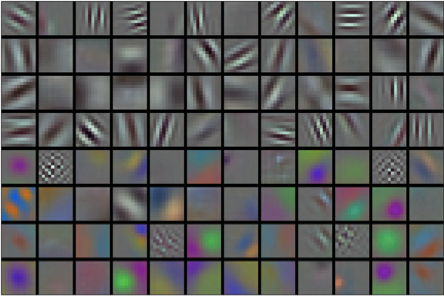

```{.python .input  n=1}
%load_ext d2lbook.tab
tab.interact_select('mxnet', 'pytorch', 'tensorflow', 'jax')
```

# AlexNet and Learned Image Representations
:label:`sec_alexnet`

The ImageNet challenge of 2012 asked a system to sort photographs into 1000
categories and scored it by its *top-5 error*, the fraction of test images
whose correct label is not among the system's five best guesses. The winners
of the two previous years had top-5 errors of about 28% and 26%. Like most
vision systems of the time, they separated representation from prediction:
hand-designed operators such as SIFT :cite:`Lowe.2004`, SURF
:cite:`Bay.Tuytelaars.Van-Gool.2006`, HOG :cite:`Dalal.Triggs.2005`, and bags
of visual words :cite:`Sivic.Zisserman.2003` turned pixels into feature
vectors, and a linear or kernel method learned a classifier on top. The
training loss could improve the classifier but never the features, so
progress depended on people inventing better features.

AlexNet :cite:`Krizhevsky.Sutskever.Hinton.2012` replaced the whole pipeline
with one deep convolutional network trained end to end, and reached a top-5
error of 15.3%, against 26.2% for the next-best entry. Its architecture is
the template of LeNet (:numref:`sec_lenet`) scaled up: convolutional stages
that shrink the resolution and grow the number of channels, followed by fully
connected layers. Three things made the scale-up work in 2012 when it had not
before: a labeled dataset large enough for tens of millions of parameters,
GPUs fast enough to train them in days, and techniques (ReLU activations,
dropout, data augmentation) that kept a network of this size trainable and
kept it from overfitting.

This section explains why each of the three mattered, builds AlexNet, counts
where its parameters and its arithmetic sit, and trains it on Fashion-MNIST.
The count exposes the cost that the next section removes: almost all of
AlexNet's parameters sit in two fully connected layers.

```{.python .input #alexnet-deep-convolutional-neural-networks-alexnet  n=2}
%%tab mxnet
from d2l import mxnet as d2l
from mxnet import init, npx
from mxnet.gluon import nn
npx.set_np()
```

```{.python .input #alexnet-deep-convolutional-neural-networks-alexnet  n=3}
%%tab pytorch
from d2l import torch as d2l
import torch
from torch import nn
```

```{.python .input #alexnet-deep-convolutional-neural-networks-alexnet  n=4}
%%tab tensorflow
from d2l import tensorflow as d2l
import tensorflow as tf
```

```{.python .input #alexnet-deep-convolutional-neural-networks-alexnet}
%%tab jax
from d2l import jax as d2l
from flax import nnx
from jax import numpy as jnp
```

## Learned Features, Data, and Hardware

A representation is learned when the loss decides what the features compute.
The idea is old: LeNet learned its convolution kernels from examples, and
sparse coding learned image filters without labels
:cite:`olshausen1996emergence`. Until 2012, however, learned features had not
beaten engineered ones on a large benchmark. AlexNet's did, and its first
layer shows what the network chose to compute. :numref:`fig_filters` displays
its 96 learned kernels of $11 \times 11$ pixels: oriented edges at several
frequencies and patches of color, close to the oriented-gradient operators
that SIFT and HOG compute by design. The network found these operators
because they reduce the classification loss, and it found the operators of
its higher layers the same way, where no designer had a good guess to offer.


:width:`400px`
:label:`fig_filters`

LeNet and AlexNet share most of their design, and LeNet was trained end to
end in 1989. The two decades in between supplied what a network of tens of
millions of parameters needs: data to constrain its parameters and hardware
to compute its gradients.

### Data

A model with tens of millions of parameters, fitted to a few thousand images,
memorizes them. The PASCAL VOC benchmark of the same years had about ten
thousand images in 20 classes. The ImageNet dataset
:cite:`Deng.Dong.Socher.ea.2009` changed the scale: its 2012 challenge
:cite:`russakovsky2015imagenet` supplied about 1.2 million training images in
1000 categories, collected by web image search for the categories of WordNet
:cite:`Miller.1995` and verified by workers on Amazon Mechanical Turk. The
images came at varying resolutions, and AlexNet trained on random
$224 \times 224$ crops of images rescaled to $256 \times 256$, and on their
mirror images. A crop can start at any of about $32 \times 32$ offsets and
can be mirrored or not, so each image yields about
$32 \cdot 32 \cdot 2 = 2{,}048$ different inputs, the factor the paper
counts. Even with this much data the network overfit without
dropout :cite:`Krizhevsky.Sutskever.Hinton.2012`.

### Hardware

Training a deep network repeats the same small computations at enormous
scale. A convolution applies one kernel at every output position and every
channel, and each of these products is independent of the others. A
*graphics processing unit* (GPU) is built for such work: instead of a few
fast cores with branch predictors, speculative execution, and large caches,
it has hundreds or thousands of simple cores and a much wider memory bus.
In the mid-2000s, NVIDIA and ATI began to make these chips programmable
for general computation :cite:`Fernando.2004`. Each of the two NVIDIA GTX 580s
on which AlexNet was trained performs about 1.6 trillion floating-point
operations per second (TFLOPS) in single precision and reads 192 GB of memory
per second; a quad-core desktop CPU of 2011 peaked at about 0.2 TFLOPS and
20 GB/s.

A short calculation shows why this mattered. A network of AlexNet's size
needs about a billion multiply-adds to classify one $224 \times 224$ color
image, and a training step costs about three times as
many, for the forward pass and the two products of the backward pass. With
two floating-point operations per multiply-add, the 90 passes over 1.2
million images used in the paper take about $10^9 \cdot 3 \cdot 2 \cdot 1.2
\times 10^6 \cdot 90 \approx 6.5 \times 10^{17}$ operations. The two GPUs
need two to three days for that at their peak, and the actual run took five
to six days. A CPU at its peak would have needed more than a month. Alex
Krizhevsky wrote the convolution kernels for the GPUs himself; his
[cuda-convnet](https://code.google.com/archive/p/cuda-convnet/) code remained
in wide use for several years, until frameworks made the same network a
dozen lines of code, as below.

## The AlexNet Architecture

:numref:`fig_alexnet` places AlexNet beside the LeNet of
:numref:`sec_lenet`, both in the versions that this book trains on
Fashion-MNIST. Both consist of convolutional stages followed by a fully
connected head; AlexNet changes the size of every part and three of its
components.


:label:`fig_alexnet`

### Depth and Width

AlexNet has eight layers with weights: five convolutional layers and three
fully connected layers, against LeNet's two and three. Its images are eight
times wider and taller than Fashion-MNIST's, so the first layer uses an
$11 \times 11$ kernel with stride 4 to cover a large patch of the image at
once and to reduce the resolution early. The second layer uses
$5 \times 5$ kernels and the last three $3 \times 3$ kernels. Max-pooling
with $3 \times 3$ windows and stride 2 follows the first, second, and fifth
convolutional layers. The convolutional layers have 96 to 384 channels,
where LeNet's have 6 and 16, and the two hidden fully connected layers have
4096 units each, where LeNet's have 120 and 84.

Our version simplifies the network of the paper in two ways. The paper split
every layer between two GPUs of 3 GB each, which could not hold the whole
model, and restricted some layers to their own GPU's half of the channels; a
single GPU now holds the model, so our version has no split. The paper also
normalized each activation by the activations of neighboring channels, a
step that later networks dropped.

### ReLU Activations

LeNet uses saturating activations: the sigmoid in our version, a scaled
$\tanh$ in the original of 1998. The derivative of the sigmoid,
$\sigma'(x) = \sigma(x)(1 - \sigma(x))$, is at most $1/4$. Each sigmoid that
the gradient passes on its way back to the first layer multiplies it by this
derivative, so the sigmoids contribute a factor of at most $1/4$ each
(:numref:`sec_lenet`). This is
why LeNet needed a learning rate of 2.0. AlexNet uses the ReLU,
$\textrm{ReLU}(x) = \max(x, 0)$ (:numref:`subsec_activation-functions`),
whose derivative is 1 for every positive input, so the gradient passes the
active units of a layer unchanged, however many layers lie in between. The
ReLU is also cheaper to compute, since it needs no exponential. On a small
convolutional network for CIFAR-10, :citet:`Krizhevsky.Sutskever.Hinton.2012`
reached a training error of 25% six times faster with ReLUs than with
$\tanh$.

### Dropout and Augmentation

The two fully connected layers of 4096 units hold most of the parameters and
are where the model can memorize the training set. AlexNet applies dropout
with probability 0.5 to their outputs (:numref:`sec_dropout`), whereas LeNet
has no explicit regularizer. The crops and mirror images described above,
together with random changes of color, add variation to the input. Data
augmentation has since become a large part of how convolutional networks are
trained; :numref:`sec_training_recipes` returns to it.

### Implementation

The code mirrors :numref:`fig_alexnet` from bottom to top. We initialize the
weights explicitly instead of relying on the library's defaults. LeNet's
Xavier initialization keeps the variance of the activations constant through
linear layers; a ReLU sets about half of its inputs to zero and halves the
second moment of what passes through it. *He initialization*
(:numref:`subsec_he_init`) compensates by doubling the variance: every weight
of a layer with $n_\textrm{in}$ inputs per output is drawn from a normal
distribution with mean zero and variance $2/n_\textrm{in}$, where
$n_\textrm{in} = c_\textrm{i} k^2$ for a convolution. All biases start at
zero.

:begin_tab:`mxnet`
`init.MSRAPrelu('in', 0)` draws normal weights with variance
$2/n_\textrm{in}$, He initialization for a ReLU (a PReLU with slope 0);
Gluon initializes biases to zero. The network is a `HybridSequential`, and
`hybridize()` compiles it into a single graph, which MXNet executes several
times faster than one operator at a time.
:end_tab:

:begin_tab:`pytorch`
The lazy layers have no weights until the first minibatch fixes their shapes.
As for LeNet, the `Trainer` then calls the model's `weight_init` on every
layer.
:end_tab:

:begin_tab:`tensorflow`
Every layer receives its own initializer, since an unseeded Keras initializer
returns the same values on every call; Keras initializes biases to zero.
:end_tab:

:begin_tab:`jax`
NNX layers draw their weights in the constructor, so every layer receives the
initializer; Flax initializes biases to zero.
:end_tab:

```{.python .input #alexnet-capacity-control-and-preprocessing-1  n=5}
%%tab mxnet
class AlexNet(d2l.Classifier):
    def __init__(self, lr=0.1, num_classes=10):
        super().__init__()
        self.save_hyperparameters()
        self.net = nn.HybridSequential()
        self.net.add(
            nn.Conv2D(96, kernel_size=11, strides=4, activation='relu'),
            nn.MaxPool2D(pool_size=3, strides=2),
            nn.Conv2D(256, kernel_size=5, padding=2, activation='relu'),
            nn.MaxPool2D(pool_size=3, strides=2),
            nn.Conv2D(384, kernel_size=3, padding=1, activation='relu'),
            nn.Conv2D(384, kernel_size=3, padding=1, activation='relu'),
            nn.Conv2D(256, kernel_size=3, padding=1, activation='relu'),
            nn.MaxPool2D(pool_size=3, strides=2),
            nn.Dense(4096, activation='relu'), nn.Dropout(0.5),
            nn.Dense(4096, activation='relu'), nn.Dropout(0.5),
            nn.Dense(num_classes))
        self.net.initialize(init.MSRAPrelu('in', 0))
        self.net.hybridize()  # Compile the network into one graph
```

```{.python .input #alexnet-capacity-control-and-preprocessing-1  n=5}
%%tab pytorch
class AlexNet(d2l.Classifier):
    def __init__(self, lr=0.1, num_classes=10):
        super().__init__()
        self.save_hyperparameters()
        self.net = nn.Sequential(
            nn.LazyConv2d(96, kernel_size=11, stride=4), nn.ReLU(),
            nn.MaxPool2d(kernel_size=3, stride=2),
            nn.LazyConv2d(256, kernel_size=5, padding=2), nn.ReLU(),
            nn.MaxPool2d(kernel_size=3, stride=2),
            nn.LazyConv2d(384, kernel_size=3, padding=1), nn.ReLU(),
            nn.LazyConv2d(384, kernel_size=3, padding=1), nn.ReLU(),
            nn.LazyConv2d(256, kernel_size=3, padding=1), nn.ReLU(),
            nn.MaxPool2d(kernel_size=3, stride=2), nn.Flatten(),
            nn.LazyLinear(4096), nn.ReLU(), nn.Dropout(p=0.5),
            nn.LazyLinear(4096), nn.ReLU(), nn.Dropout(p=0.5),
            nn.LazyLinear(num_classes))

    def weight_init(self, module):
        # The Trainer calls this after the first minibatch fixed the shapes
        if type(module) in (nn.Linear, nn.Conv2d):
            nn.init.kaiming_normal_(module.weight, nonlinearity='relu')
            nn.init.zeros_(module.bias)
```

```{.python .input #alexnet-capacity-control-and-preprocessing-1  n=5}
%%tab tensorflow
class AlexNet(d2l.Classifier):
    def __init__(self, lr=0.1, num_classes=10):
        super().__init__()
        self.save_hyperparameters()
        layers = tf.keras.layers

        def he():  # A new He-normal initializer for each layer
            init = tf.keras.initializers.VarianceScaling(
                2.0, 'fan_in', 'untruncated_normal')
            return dict(kernel_initializer=init)

        self.net = tf.keras.models.Sequential([
            layers.Conv2D(96, kernel_size=11, strides=4, activation='relu',
                          **he()),
            layers.MaxPool2D(pool_size=3, strides=2),
            layers.Conv2D(256, kernel_size=5, padding='same',
                          activation='relu', **he()),
            layers.MaxPool2D(pool_size=3, strides=2),
            layers.Conv2D(384, kernel_size=3, padding='same',
                          activation='relu', **he()),
            layers.Conv2D(384, kernel_size=3, padding='same',
                          activation='relu', **he()),
            layers.Conv2D(256, kernel_size=3, padding='same',
                          activation='relu', **he()),
            layers.MaxPool2D(pool_size=3, strides=2), layers.Flatten(),
            layers.Dense(4096, activation='relu', **he()), layers.Dropout(0.5),
            layers.Dense(4096, activation='relu', **he()), layers.Dropout(0.5),
            layers.Dense(num_classes, **he())])
```

```{.python .input #alexnet-capacity-control-and-preprocessing-1}
%%tab jax
class AlexNet(d2l.Classifier):
    def __init__(self, lr=0.1, num_classes=10, rngs=None):
        super().__init__()
        self.save_hyperparameters(ignore=['rngs'])
        rngs = (nnx.Rngs(params=d2l.get_key(), dropout=d2l.get_key())
                if rngs is None else rngs)
        he = nnx.initializers.variance_scaling(2.0, 'fan_in', 'normal')
        init = dict(kernel_init=he, rngs=rngs)

        def max_pool(x):  # 3x3 windows, stride 2
            return nnx.max_pool(x, window_shape=(3, 3), strides=(2, 2))

        def flatten(x):  # One vector per example
            return x.reshape((x.shape[0], -1))

        self.net = nnx.Sequential(
            nnx.Conv(1, 96, kernel_size=(11, 11), strides=4, padding='VALID',
                     **init), nnx.relu, max_pool,
            nnx.Conv(96, 256, kernel_size=(5, 5), **init), nnx.relu,
            max_pool,
            nnx.Conv(256, 384, kernel_size=(3, 3), **init), nnx.relu,
            nnx.Conv(384, 384, kernel_size=(3, 3), **init), nnx.relu,
            nnx.Conv(384, 256, kernel_size=(3, 3), **init), nnx.relu,
            max_pool,
            flatten,  # 5 x 5 x 256 values per image
            nnx.Linear(5 * 5 * 256, 4096, **init), nnx.relu,
            nnx.Dropout(0.5, rngs=rngs),
            nnx.Linear(4096, 4096, **init), nnx.relu,
            nnx.Dropout(0.5, rngs=rngs),
            nnx.Linear(4096, num_classes, **init))
```

To check the code against :numref:`fig_alexnet`, we pass a single-channel
$224 \times 224$ image through the network and print the output shape of each
layer.

```{.python .input #alexnet-capacity-control-and-preprocessing-2  n=6}
%%tab mxnet, pytorch
AlexNet().layer_summary((1, 1, 224, 224))
```

```{.python .input #alexnet-capacity-control-and-preprocessing-2  n=7}
%%tab tensorflow, jax
AlexNet().layer_summary((1, 224, 224, 1))
```

The shapes follow the rules of :numref:`sec_padding`. The first convolution
maps 224 to $\lfloor (224 - 11)/4 \rfloor + 1 = 54$, and each $3 \times 3$
pooling with stride 2 maps $n$ to $\lfloor (n - 3)/2 \rfloor + 1$: 54 to 26,
26 to 12, and 12 to 5. The padded convolutions in between keep the
resolution, so the last convolutional stage hands $256 \times 5 \times 5 =
6400$ numbers to the first fully connected layer.

### Parameters and Multiply-Adds

The shapes determine the size and the cost of every layer, counted as for
LeNet: a convolutional layer with $c_\textrm{i}$ input channels,
$c_\textrm{o}$ output channels, and a $k \times k$ kernel has
$c_\textrm{i} c_\textrm{o} k^2$ weights and $c_\textrm{o}$ biases, and it
applies each weight once at every output position. A fully connected layer
uses each of its weights once per example. :numref:`tab_alexnet_cost` applies
these counts to AlexNet.

:Parameters and multiply-adds per example of the layers of AlexNet, for one single-channel $224 \times 224$ image and ten classes. Pooling, activation, and dropout layers have no parameters.
:label:`tab_alexnet_cost`

| layer | output | parameters | multiply-adds |
|:--|:--|--:|--:|
| $11\times11$ convolution, 1 to 96, stride 4 | 96@54×54 | $11{,}712$ | $33.9$M |
| $5\times5$ convolution, 96 to 256 | 256@26×26 | $614{,}656$ | $415.3$M |
| $3\times3$ convolution, 256 to 384 | 384@12×12 | $885{,}120$ | $127.4$M |
| $3\times3$ convolution, 384 to 384 | 384@12×12 | $1{,}327{,}488$ | $191.1$M |
| $3\times3$ convolution, 384 to 256 | 256@12×12 | $884{,}992$ | $127.4$M |
| fully connected, 6400 to 4096 | 4096 | $26{,}218{,}496$ | $26.2$M |
| fully connected, 4096 to 4096 | 4096 | $16{,}781{,}312$ | $16.8$M |
| fully connected, 4096 to 10 | 10 | $40{,}970$ | $0.04$M |
| total | | $46{,}764{,}746$ | $938.1$M |

The two kinds of layers divide the work as in LeNet, only more sharply. The
convolutional layers hold 8% of the 47 million parameters and perform 95% of
the multiply-adds. The fully connected layers hold the other 92% of the
parameters, about 170 MB in 32-bit floating point, and perform 5% of the
arithmetic; the first of them alone holds 26 million parameters. Against
LeNet's 61,706 parameters and 416,520 multiply-adds per image, AlexNet has
about 760 times the parameters and performs about 2,250 times the arithmetic.
The network of the paper, with three input channels and 1000 classes, has
about 60 million parameters, most of them in the same fully connected layers.

## Training on Fashion-MNIST

Training AlexNet on ImageNet takes days even on a modern GPU, so we train it
on Fashion-MNIST, as we did LeNet. Its $28 \times 28$ images are too small
for an $11 \times 11$ kernel with stride 4, so we upsample them to
$224 \times 224$ with the `resize` argument of `d2l.FashionMNIST`.
Upsampling multiplies the number of pixels by 64 without adding
information; we accept the cost to train the architecture as it is.

We train with minibatch SGD for 10 epochs, a third of LeNet's 30, with
minibatches of 128 images and a learning rate of 0.01. LeNet's sigmoids
needed a learning rate of 2.0 to move its first layers at all; with ReLUs the
gradient no longer shrinks at every layer, and a much smaller rate suffices.

```{.python .input #alexnet-training  n=8}
model = AlexNet(lr=0.01)
data = d2l.FashionMNIST(batch_size=128, resize=(224, 224))
trainer = d2l.Trainer(max_epochs=10, num_gpus=1)
trainer.fit(model, data)
```

AlexNet reaches a validation accuracy of about 89–90% after 10 epochs, and
the training and validation losses stay close throughout. LeNet reaches about
88–90% after 30 epochs. On these images the larger network reaches LeNet's
accuracy in a third of the epochs but does not classify much better, while
it performs 2,250 times the arithmetic per image: the upsampled
$224 \times 224$ images hold no more information than the $28 \times 28$
originals. AlexNet's extra capacity helps on ImageNet, whose images
carry far more detail and whose 1000 classes are far harder to tell apart.

The count of :numref:`tab_alexnet_cost` also shows where that capacity sits.
Nine of every ten parameters belong to the fully connected head, which
contributes 5% of the arithmetic and needs dropout to keep from memorizing
the training set. The next section asks whether a network needs that head at
all.

## Summary

Before 2012, image classifiers learned a classifier on top of hand-designed
features. AlexNet learned the features as well, with a deep convolutional
network trained end to end, and cut the ImageNet top-5 error from 26% to
15%. Its architecture is LeNet's template, deeper and wider, with ReLU
activations, max-pooling, and dropout; ImageNet's 1.2 million labeled images
and two GPUs made a network of 60 million parameters trainable in days.
Counting its layers shows that the convolutions perform 95% of the
arithmetic while the fully connected head holds 92% of the parameters. On
Fashion-MNIST, AlexNet matches LeNet's accuracy in a third of the epochs at
2,250 times the arithmetic per image.

## Exercises

1. **Memory and compute ledger.** Extend :numref:`tab_alexnet_cost` to the
   memory that `AlexNet` needs in 32-bit floating point.
    1. Compute the number of activations that the forward pass of one
       $224 \times 224$ image stores, layer by layer, counting the output
       of every convolutional, pooling, and fully connected layer. Where is
       the memory for activations concentrated, and where is the memory for
       parameters concentrated?
    1. During training, the parameters, their gradients, and the stored
       activations of a whole minibatch must fit in memory. At which batch
       size does the memory for activations exceed the memory for
       parameters and gradients?
    1. Repeat the parameter count of :numref:`tab_alexnet_cost` for the
       ImageNet version, with three input channels, 1000 classes, and
       $227 \times 227$ inputs, which make the last convolutional stage
       $6 \times 6$ instead of $5 \times 5$. Compare your total with the 60
       million parameters reported by
       :citet:`Krizhevsky.Sutskever.Hinton.2012`.

    *Adapted from Simon Prince,
    [Understanding Deep Learning](https://udlbook.github.io/udlbook/),
    Problem 10.16.*
   :exlabel:`ex_alexnet-memory-compute-ledger`

1. **Receptive fields of the early layers.** A stack of layers with kernel
   sizes $k_i$ and strides $s_i$ gives its top unit a receptive field of
   side $r = 1 + \sum_{i} (k_i - 1) \prod_{j<i} s_j$
   (:numref:`sec_padding`). Apply it to `AlexNet`, counting each
   max-pooling layer as a layer with its own kernel size and stride, to
   compute the receptive field of one unit after each of the five
   convolutional layers. What fraction of the $224 \times 224$ input side
   does each receptive field span, and where does a unit first see the
   whole image?

    *Adapted from Simon Prince,
    [Understanding Deep Learning](https://udlbook.github.io/udlbook/),
    Problem 10.17.*

1. [code] **Learned first-layer filters.** :numref:`fig_filters` shows the
   first-layer kernels that AlexNet learned on ImageNet.
    1. Train `AlexNet` as in this section, keeping a copy of the weights of
       its first convolutional layer from before training. Display the 96
       kernels of $11 \times 11$ pixels at initialization, after training,
       and as the difference between the two.
    1. Compare the change made by training with :numref:`fig_filters`.
       Name two visible differences and the property of this section's
       input images that causes each.

1. [code] **Dropout.** The fully connected layers of `AlexNet` hold 92% of
   its parameters, and dropout is its only regularizer.
    1. Train `AlexNet` as in this section with both dropout layers removed,
       and compare the training loss, the validation loss, and the
       validation accuracy after 10 epochs with those of the original.
    1. Train both networks on a random subset of 6,000 training images for
       the same number of gradient steps. How do the differences change, and
       why?

1. **Arithmetic intensity.** ● The *arithmetic intensity* of a layer is
   the number of multiply-adds it performs per byte of parameters it reads
   from memory. Use :numref:`tab_alexnet_cost`.
    1. Compute the arithmetic intensity of every layer of `AlexNet`, once
       for a batch of 1 image and once for a batch of 128 images, assuming
       that each parameter is read once per batch.
    1. Consider a chip that performs 10 multiply-adds in the time it reads
       one byte from memory. Assume that each layer takes the longer of its
       arithmetic time and its parameter-reading time. A designer can spend
       extra chip area on doubling either the arithmetic throughput or the
       memory bandwidth. Which choice speeds up single-image inference more,
       and which speeds up training at batch size 128 more?

1. [code] **Batch size, throughput, and memory.** ● Train `AlexNet` as in
   this section while varying only the batch size.
    1. Using your answer to problem
       :exref:`ex_alexnet-memory-compute-ledger`, predict the largest
       training batch size that fits in the memory of your GPU.
    1. Starting from a batch size of 32 and doubling it, find the largest
       batch size that trains without running out of memory. Compare it
       with your prediction and name the main source of any discrepancy.
    1. Measure the throughput in images per second over a fixed number of
       training steps for at least four batch sizes up to that limit.
       Beyond which batch size does throughput stop growing, and why?

:begin_tab:`mxnet`
[Discussions](https://d2l.discourse.group/t/75)
:end_tab:

:begin_tab:`pytorch`
[Discussions](https://d2l.discourse.group/t/76)
:end_tab:

:begin_tab:`tensorflow`
[Discussions](https://d2l.discourse.group/t/276)
:end_tab:

:begin_tab:`jax`
[Discussions](https://d2l.discourse.group/t/18001)
:end_tab:

<!-- slides -->

::: {.slide}
::: {.cover}
[Dive into Deep Learning · §7.1]{.kicker}

AlexNet<br>**learned features · data and GPUs · ReLU and dropout · where the parameters sit**
:::
:::

::: {.slide title="Hand-Designed Features Stalled at 26% Top-5 Error on ImageNet"}
[The problem]{.kicker}

- ImageNet challenge: 1000 classes, 1.2 M training photographs.
- Top-5 error: the correct label is not among the five best guesses.
- Winners: **28%** (2010), **26%** (2011).
- Their pipeline: SIFT, HOG, bags of words → linear or kernel classifier.
- The loss trains the classifier, **never the features**.

::: {.d2l-note .warn}
Can one network learn the features and the classifier together?
:::
:::

::: {.slide title="By the End of This Deck You Can"}
[Goals]{.kicker}

- explain why data, GPUs, and ReLU arrived together in 2012;
- estimate the compute needed to train AlexNet;
- build AlexNet and trace its shapes;
- count its parameters and multiply-adds layer by layer;
- read its Fashion-MNIST result against LeNet's.

**Running example:** a Fashion-MNIST scoreboard of parameters,
multiply-adds, and validation accuracy. LeNet: 62k, 0.42 M, ≈ 88–90%.
:::

::: {.slide title="The First Modern Convnet, Before Blocks and Normalization"}
[Where this fits]{.kicker}

::: {.cols .vc}
::: {.col}
| section | adds |
|---|---|
| **AlexNet** | **learned features, ReLU, dropout, GPUs** |
| VGG, NiN, GoogLeNet | blocks, 1 × 1 convolutions, global pooling |
| Normalization Layers | batch, layer, group normalization |
| ResNet, ResNeXt, DenseNet | residual connections make depth trainable |
| Efficient Convnets | separable blocks, scaling, re-parameterization |
| Training Recipes | schedules, augmentation, weight averaging |
| ConvNeXt | a ResNet modernized one change at a time |
| Design Spaces (RegNet) | rules from populations of networks |
:::

::: {.col .narrow}
- **Uses:** LeNet, `Classifier`, `Trainer`, dropout, He
  initialization.
- **Skips:** training on ImageNet; the paper's two-GPU split.
:::
:::
:::

::: {.slide}
::: {.divider}
[01]{.dnum}

[Learned Representations]{.dtitle}

[what made 2012 different: data and hardware]{.dsub}
:::
:::

::: {.slide title="AlexNet's First Layer Learned Edge and Color Detectors"}
[Representations]{.kicker}

{width=55%}

Oriented edges and color patches: close to what SIFT and HOG compute by
design, found by the loss alone.
:::

::: {.slide title="1.2 Million Images Made Tens of Millions of Parameters Learnable"}
[Data]{.kicker}

- PASCAL VOC, the benchmark of the time: about 10,000 images, 20 classes.
- ImageNet challenge: 1.2 M training images, 1000 classes.
- Random 224×224 crops of 256×256 images, and their mirror images:
  about $32 \cdot 32 \cdot 2 = 2{,}048$ inputs per image.
- Even so, the network overfit without dropout.
:::

::: {.slide title="Check: How Long Does Training AlexNet Take?"}
[Check]{.kicker}

- Forward pass: about $10^9$ multiply-adds per 224×224 color image.
- Training step: ×3 (forward and two backward products); ×2 operations
  per multiply-add; 90 epochs of 1.2 M images.

How many operations in all? How many days on two GTX 580s at 1.6 TFLOPS
each, and on a 0.2-TFLOPS CPU?

::: {.fragment .fade-up}
::: {.d2l-note}
**Answer.** $10^9 \cdot 6 \cdot 1.2 \times 10^6 \cdot 90 \approx 6.5
\times 10^{17}$: **2–3 days** on the GPUs at peak (the run took 5–6),
**more than a month** on the CPU.
:::
:::
:::

::: {.slide}
::: {.divider}
[02]{.dnum}

[The AlexNet Architecture]{.dtitle}

[LeNet's template, deeper and wider]{.dsub}
:::
:::

::: {.slide title="AlexNet Is LeNet's Template, Deeper and Wider"}
[Architecture]{.kicker}

| | LeNet | AlexNet |
|---|---|---|
| input | 28×28 | 224×224 |
| convolutions | 2: 5×5; 6, 16 channels | 5: 11×11 (stride 4), 5×5, three 3×3; 96–384 channels |
| pooling | 2×2 average | 3×3 max, stride 2 |
| activation | sigmoid | ReLU |
| dense head | 120, 84, 10 | 4096, 4096, 10, dropout 0.5 |
| parameters | 62 k | 47 M |
:::

::: {.slide title="Five Convolutions, Three Poolings, Then a 4096-Wide Head"}
[Architecture]{.kicker}

- Conv 11×11, 96 channels, stride 4 → max-pool 3×3, stride 2
- Conv 5×5, 256, padding 2 → max-pool
- Conv 3×3, 384 → 384 → 256, padding 1 → max-pool
- Flatten → dense 4096 → dense 4096 → dense 10, dropout 0.5 after each
  hidden dense layer
- ReLU after every hidden layer

Our version drops the paper's two-GPU split and its normalization across
channels.
:::

::: {.slide title="A ReLU Passes the Gradient Through; a Sigmoid Multiplies It by at Most 1/4"}
[Architecture]{.kicker}

- Sigmoid: $\sigma'(x) = \sigma(x)(1 - \sigma(x)) \le \tfrac14$; the
  $K$ sigmoid factors on the backward path multiply to at most $4^{-K}$.
- ReLU: $\max(x, 0)$ has derivative 1 for every $x > 0$.
- LeNet needed learning rate 2.0; AlexNet trains with 0.01.
- Small CIFAR-10 convnet: 25% training error **6× faster** with ReLU
  than with tanh.
:::

::: {.slide title="The Encoder Shrinks 224×224 to 5×5 While Channels Grow to 384"}
[Shapes]{.kicker}

| layer | output |
|---|---|
| input | 1@224×224 |
| conv 11×11, stride 4 → max-pool | 96@54×54 → 96@26×26 |
| conv 5×5, padding 2 → max-pool | 256@26×26 → 256@12×12 |
| three conv 3×3, padding 1 | 384, 384, 256 @12×12 |
| max-pool → flatten | 256@5×5 → 6400 |
| dense layers | 4096 → 4096 → 10 |
:::

::: {.slide title="Check: An 11×11 Kernel With Stride 4 on a 224×224 Image"}
[Check]{.kicker}

One input channel, 96 output channels, no padding. Output size?
Parameters? Multiply-adds?

::: {.fragment .fade-up}
::: {.d2l-note}
**Answer.** $\lfloor (224 - 11)/4 \rfloor + 1 = 54$: **96@54×54**.
Weights $96 \cdot 121 = 11{,}616$, plus 96 biases. Each weight is used at
$54^2 = 2{,}916$ positions: **33.9 M** multiply-adds.
:::
:::
:::

::: {.slide}
::: {.divider}
[03]{.dnum}

[Cost and Training]{.dtitle}

[where the parameters sit, and what Fashion-MNIST shows]{.dsub}
:::
:::

::: {.slide title="Convolutions Do 95% of the Arithmetic; the Dense Head Holds 92% of the Weights"}
[Parameters and multiply-adds]{.kicker}

| layers | parameters | multiply-adds |
|---|--:|--:|
| 5 convolutions | 3.7 M (8%) | 895 M (95%) |
| dense 6400 → 4096 | **26.2 M** | 26 M |
| dense 4096 → 4096 | 16.8 M | 17 M |
| dense 4096 → 10 | 0.04 M | 0.04 M |
| total | 46.8 M | 938 M |

The dense head is 170 MB in float32 and does 5% of the work.
:::

::: {.slide title="AlexNet Has 760× LeNet's Parameters and Does 2,250× Its Arithmetic"}
[Scoreboard]{.kicker}

| | LeNet | AlexNet |
|---|--:|--:|
| input | 28×28 | 224×224 (upsampled) |
| parameters | 61,706 | 46.8 M |
| multiply-adds per image | 0.42 M | 938 M |
| activation | sigmoid | ReLU |
| learning rate, epochs | 2.0, 30 | 0.01, 10 |
:::

::: {.slide title="Upsample 28×28 to 224×224 and Train for 10 Epochs"}
[Training]{.kicker}

@-alexnet-training

- Upsampling multiplies the pixels by 64 and adds no information; it
  keeps the architecture unchanged.
- Minibatch SGD, 128 images, learning rate 0.01; He-normal weights
  (variance $2/n_\textrm{in}$), zero biases.
:::

::: {.slide title="AlexNet Matches LeNet's Accuracy in a Third of the Epochs"}
[Training]{.kicker}

@!alexnet-training

About 89–90% after 10 epochs; LeNet reaches 88–90% after 30.
:::

::: {.slide title="Check: How Large Is the 6400 × 4096 Matrix?"}
[Check]{.kicker}

How many megabytes in float32? What share of the parameters is it?

::: {.fragment .fade-up}
::: {.d2l-note}
**Answer.** $6400 \cdot 4096 = 26.2$ M weights, $\times 4$ bytes $\approx$
**105 MB**: 56% of all 46.8 M parameters, in one layer that does 3% of
the arithmetic.
:::
:::
:::

::: {.slide title="Recap"}
[Wrap-up]{.kicker}

- **Learned features:** one network trained end to end cut ImageNet top-5
  error from 26% to 15%.
- **Enablers:** 1.2 M labeled images; GPUs (≈ $6.5 \times 10^{17}$
  operations in days); ReLU, dropout, augmentation.
- **Architecture:** LeNet's template with 5 convolutions and a 4096-wide
  dense head.
- **Cost:** convolutions do 95% of the 938 M multiply-adds; the head holds
  92% of the 46.8 M parameters.
- **Fashion-MNIST:** ≈ 89–90% in 10 epochs, LeNet's accuracy at 2,250×
  the arithmetic.

**Next:** blocks, and networks without the giant dense head.
:::
