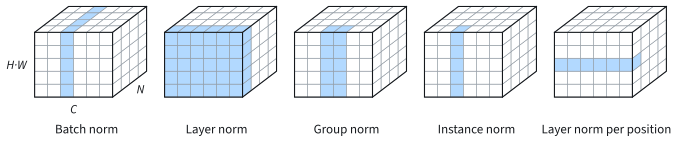

```{.python .input}
%load_ext d2lbook.tab
tab.interact_select('mxnet', 'pytorch', 'tensorflow', 'jax')
```

# Normalization Layers
:label:`sec_batch_norm`

When we trained LeNet in :numref:`sec_lenet`, the learning rate that worked
smoothly for an MLP broke down: at 0.1, validation accuracy lingered at chance
for several epochs and reached only about 73% after ten, forcing us to boost
the learning rate twentyfold to 2.0 and train for 30 epochs to reach ~89%. We
encountered the same fragility in :numref:`sec_blocks`, where a peak learning
rate of 0.1 trained VGG cleanly yet caused NiN and GoogLeNet to stall or
diverge. A five-layer network ought not to be this sensitive to its step size.
Why does the usable learning rate depend so delicately on architecture, and
can we insert a layer inside the network to eliminate that fragility?

The root cause is how signal and gradient scales drift as they propagate
through depth. Each of LeNet's four sigmoid layers shrinks backpropagated
gradients by at least a factor of $1/4$, leaving early layers with tiny
updates compared with later ones so that no single learning rate fits the
whole network. Adding depth compounds the issue because every layer rescales
the activations entering the next. Although ReLU activations and careful
initialization (:numref:`subsec_he_init`) balance activation variance at step
zero, nothing keeps those scales aligned once gradient updates begin moving
the weights.

*Batch normalization* :cite:`Ioffe.Szegedy.2015` solves this dynamically
throughout training. Placed right before a layer's nonlinearity, it
standardizes each feature using the mean and variance of the current
minibatch, then applies a learned scale and shift. That simple transformation
stabilizes both forward activations and backward gradients while rendering
each normalized layer invariant to weight rescaling. As we will observe below,
adding batch normalization lets LeNet train cleanly not just at the MLP's
learning rate, but across a 300-fold range of step sizes. Alongside the
residual connections of the next section, batch normalization unlocked
networks over a hundred layers deep—even though researchers still debate the
exact mechanisms behind its full empirical power. Because batch normalization
couples examples within a minibatch, however, it degrades when minibatches are
very small; in the second half of this section we introduce *layer
normalization* and *group normalization*, which normalize each example on its
own.

```{.python .input #batch-norm-batch-normalization}
%%tab mxnet
import math
import numpy as np
from mxnet import autograd, gluon, init, np as mnp, npx
from mxnet.gluon import nn
from d2l import mxnet as d2l
npx.set_np()
```

```{.python .input #batch-norm-batch-normalization}
%%tab pytorch
import math
import numpy as np
import torch
from torch import nn
from torch.nn import functional as F
from d2l import torch as d2l
```

```{.python .input #batch-norm-batch-normalization}
%%tab tensorflow
import math
import numpy as np
import tensorflow as tf
from d2l import tensorflow as d2l
```

```{.python .input #batch-norm-batch-normalization}
%%tab jax
import math
import numpy as np
import jax
from jax import numpy as jnp
from flax import nnx
import optax
from d2l import jax as d2l
```

## Batch Normalization

### Standardizing over a Minibatch

Consider a single pre-activation feature computed by a fully connected layer
across a minibatch $\mathcal{B}$ of $m$ examples, producing scalar values
$x_1, \ldots, x_m$. Batch normalization computes their sample mean and sample
variance across the minibatch,

$$\hat{\mu}_\mathcal{B} = \frac{1}{m} \sum_{i=1}^m x_i
\quad \textrm{and} \quad
\hat{\sigma}^2_\mathcal{B} = \frac{1}{m} \sum_{i=1}^m
(x_i - \hat{\mu}_\mathcal{B})^2,$$

and transforms each value via

$$
\textrm{BN}(x_i) = \gamma \, \frac{x_i - \hat{\mu}_\mathcal{B}}
{\sqrt{\hat{\sigma}^2_\mathcal{B} + \epsilon}} + \beta.
$$
:eqlabel:`eq_batchnorm`

The fraction standardizes the feature across the minibatch to zero mean and
variance $\hat{\sigma}^2_\mathcal{B} / (\hat{\sigma}^2_\mathcal{B} +
\epsilon)$, just shy of 1. The tiny constant $\epsilon > 0$ (typically
$10^{-5}$) guards against division by zero whenever all entries in the
minibatch coincide. In a layer with multiple features, each feature is
normalized independently using its own minibatch mean and variance.

As a concrete check, the four values $(2, 4, 6, 8)$ have mean 5 and variance
$(9 + 1 + 1 + 9)/4 = 5$, standardizing (up to $\epsilon$) to
$(x_i - 5)/\sqrt{5} \approx (-1.34, -0.45, 0.45, 1.34)$. Notice that
$(20, 40, 60, 80)$ and $(102, 104, 106, 108)$ map to the exact same four
numbers: standardization strips away both the arbitrary scale and the offset
of the incoming feature.

Zero mean and unit variance, however, are not necessarily ideal for every
downstream activation function—a sigmoid, for example, behaves nearly linearly
over unit-variance inputs. To restore full representational freedom,
:eqref:`eq_batchnorm` introduces a learnable *scale* $\gamma$ and *shift*
$\beta$ for each feature, initialized to $\gamma = 1$ and $\beta = 0$ and
trained alongside the network weights. Because setting $\gamma$ and $\beta$
to the dataset's true standard deviation and mean recovers the original
unnormalized feature (up to minibatch sampling fluctuations), batch
normalization does not reduce the expressive power of the network.

### Scale Invariance

Stripping away feature scale produces two powerful effects on optimization.
The first is immediate and directly explains how batch normalization rescues
LeNet: whenever a feature varies very little across a minibatch—for instance,
after passing through saturating sigmoids clustered near $1/2$—dividing by
its tiny standard deviation $\hat{\sigma}_\mathcal{B}$ restores unit variance
on the forward pass, and by the chain rule amplifies its backpropagated
gradient by the same factor $1/\hat{\sigma}_\mathcal{B}$. Vanishing signals
and vanishing gradients are both automatically rescaled.

The second effect is subtler and acts on the layer weights themselves. Write
$x_i = \mathbf{w}^\top \mathbf{h}_i + b$ for the pre-activation of example
$i$. Scaling $\mathbf{w}$ and $b$ by any positive constant $a > 0$ scales
every $x_i$, their mean, and their standard deviation by $a$, leaving the
normalized output unchanged (ignoring $\epsilon$):

$$\textrm{BN}(a \mathbf{w}^\top \mathbf{h}_i + a b) =
\textrm{BN}(\mathbf{w}^\top \mathbf{h}_i + b).$$

Consequently, the loss depends only on the *direction* of $\mathbf{w}$, not
its Euclidean norm. Differentiating both sides with respect to $\mathbf{w}$
reveals that the gradient at $a \mathbf{w}$ equals $1/a$ times the gradient
at $\mathbf{w}$ :cite:`Ioffe.Szegedy.2015`: small weights receive larger
gradients while large weights receive smaller ones.

Consider what happens if we choose an overly aggressive learning rate $\eta$.
Because the loss is constant along the radial ray of $\mathbf{w}$, the
gradient $\mathbf{g}$ is orthogonal to $\mathbf{w}$, so every SGD step
strictly increases the weight norm:
$\|\mathbf{w} - \eta \mathbf{g}\|^2 = \|\mathbf{w}\|^2 + \eta^2 \|\mathbf{g}\|^2$.
An excessively large step inflates $\|\mathbf{w}\|$ rapidly, which in turn
shrinks all subsequent gradients by the same factor—creating a built-in
self-stabilizing feedback loop for large learning rates
:cite:`Arora.Li.Lyu.2019`.

Keep the caveats of this analysis in mind. Strictly speaking, it assumes
plain SGD without weight decay (under weight decay, weight norms reach an
equilibrium where outward gradient growth balances inward decay); it applies
only to layers immediately followed by normalization (not the final output
layer of a classifier); and it cannot stop divergence during the very first
few steps before weight norms grow. Even with those caveats, scale invariance
provides our clearest explanation for why normalized networks tolerate vastly
wider learning-rate ranges.

### Fully Connected and Convolutional Layers

For a fully connected layer with weights $\mathbf{W}$, bias $\mathbf{b}$, and
nonlinearity $\phi$, batch normalization is placed between the affine
transformation and the activation function, as proposed in
:citet:`Ioffe.Szegedy.2015`:

$$\mathbf{h} = \phi(\textrm{BN}(\mathbf{W}\mathbf{x} + \mathbf{b})).$$

Here each output unit is treated as a separate feature with its own minibatch
mean, variance, $\gamma_j$, and $\beta_j$.

For a convolutional layer, batch normalization respects translation
equivariance by treating each output *channel* as one feature, computing a
single mean and variance across both the $m$ minibatch examples *and* all
$p \times q$ spatial locations ($m \cdot p \cdot q$ values per channel). In
LeNet's first convolutional layer (6 channels of $28 \times 28$ with batch
size 128), each channel's statistics pool $128 \cdot 28 \cdot 28 = 100{,}352$
entries—far more stable than the 128 entries per unit in a dense layer. Each
channel likewise shares a single scalar $\gamma$ and $\beta$ across all
spatial coordinates so that the normalized layer remains shift-equivariant.

### Training and Prediction

At inference time, a deployed model often scores one image at a time, and its
prediction for a given input must be deterministic rather than dependent on
whatever other images happen to share its minibatch. Batch normalization
therefore operates in two distinct modes. In *training mode*, it normalizes
using the current minibatch's statistics as in :eqref:`eq_batchnorm`, while
updating exponential moving averages $\hat{\mu}$ and $\hat{\sigma}^2$
(initialized to 0 and 1) after every step:

$$
\hat{\mu} \leftarrow \rho \, \hat{\mu} + (1 - \rho) \,
\hat{\mu}_\mathcal{B} \quad \textrm{and} \quad
\hat{\sigma}^2 \leftarrow \rho \, \hat{\sigma}^2 + (1 - \rho) \,
\hat{\sigma}^2_\mathcal{B}.
$$
:eqlabel:`eq_bn_running`

The *decay* $\rho$ governs the effective window of these running statistics: a
minibatch from $k$ steps ago carries weight $(1 - \rho)\rho^k$. At
$\rho = 0.9$, weights halve roughly every seven steps, averaging over roughly
the most recent $1/(1 - \rho) = 10$ minibatches (out of 469 minibatches of
size 128 per Fashion-MNIST epoch). In *prediction mode*, the layer freezes
these running estimates and normalizes every input with them, reducing batch
normalization to a fixed, deterministic affine transformation. Like dropout
(:numref:`sec_dropout`), batch normalization thus behaves differently during
training and evaluation.

Watch out for a notorious API inconsistency across libraries: some frameworks
name the parameter $\rho$ `momentum`, whereas others name $1 - \rho$
`momentum`—and neither has anything to do with optimization momentum.
Throughout this chapter we standardize on $\rho = 0.9$ and $\epsilon = 10^{-5}$,
passing them explicitly wherever a framework's defaults differ.

## Implementation from Scratch

Below, `batch_norm` implements both :eqref:`eq_batchnorm` and
:eqref:`eq_bn_running` across training and prediction modes for both fully
connected (2D) and convolutional (4D) inputs.

:begin_tab:`mxnet, pytorch`
Images are stored as (examples, channels, height, width), so the channel
axis is 1.
:end_tab:

:begin_tab:`tensorflow, jax`
Images are stored as (examples, height, width, channels), so the channel
axis is the last.
:end_tab:

```{.python .input #batch-norm-implementation-from-scratch-1}
%%tab mxnet
def batch_norm(X, gamma, beta, moving_mean, moving_var, eps, momentum):
    if not autograd.is_training():
        # Prediction mode: normalize with the running estimates
        X_hat = (X - moving_mean) / mnp.sqrt(moving_var + eps)
    else:
        assert len(X.shape) in (2, 4)
        # Fully connected: average over examples. Convolutional: over
        # examples and positions, one mean and variance per channel
        axes = 0 if len(X.shape) == 2 else (0, 2, 3)
        mean = X.mean(axis=axes, keepdims=True)
        var = ((X - mean) ** 2).mean(axis=axes, keepdims=True)
        X_hat = (X - mean) / mnp.sqrt(var + eps)
        # Update the running estimates; `momentum` is the decay rho
        moving_mean = momentum * moving_mean + (1.0 - momentum) * mean
        moving_var = momentum * moving_var + (1.0 - momentum) * var
    Y = gamma * X_hat + beta  # Scale and shift
    return Y, moving_mean, moving_var
```

```{.python .input #batch-norm-implementation-from-scratch-1}
%%tab pytorch
def batch_norm(X, gamma, beta, moving_mean, moving_var, eps, momentum,
               training):
    if not training:
        # Prediction mode: normalize with the running estimates
        X_hat = (X - moving_mean) / torch.sqrt(moving_var + eps)
    else:
        assert len(X.shape) in (2, 4)
        # Fully connected: average over examples. Convolutional: over
        # examples and positions, one mean and variance per channel
        dims = 0 if len(X.shape) == 2 else (0, 2, 3)
        mean = X.mean(dim=dims, keepdim=True)
        var = ((X - mean) ** 2).mean(dim=dims, keepdim=True)
        X_hat = (X - mean) / torch.sqrt(var + eps)
        # Update the running estimates; `momentum` is the decay rho
        moving_mean = momentum * moving_mean + (1.0 - momentum) * mean
        moving_var = momentum * moving_var + (1.0 - momentum) * var
    Y = gamma * X_hat + beta  # Scale and shift
    return Y, moving_mean.detach(), moving_var.detach()
```

```{.python .input #batch-norm-implementation-from-scratch-1}
%%tab tensorflow
def batch_norm(X, gamma, beta, moving_mean, moving_var, eps, momentum,
               training):
    if not training:
        # Prediction mode: normalize with the running estimates
        X_hat = (X - moving_mean) / tf.sqrt(moving_var + eps)
    else:
        assert len(X.shape) in (2, 4)
        # Channels last: average over every axis except the last one
        axes = list(range(len(X.shape) - 1))
        mean = tf.reduce_mean(X, axes)
        var = tf.reduce_mean((X - mean) ** 2, axes)
        X_hat = (X - mean) / tf.sqrt(var + eps)
        # Update the running estimates in place; `momentum` is the decay rho
        moving_mean.assign(momentum * moving_mean + (1.0 - momentum) * mean)
        moving_var.assign(momentum * moving_var + (1.0 - momentum) * var)
    return gamma * X_hat + beta  # Scale and shift
```

```{.python .input #batch-norm-implementation-from-scratch-1}
%%tab jax
def batch_norm(X, gamma, beta, moving_mean, moving_var, eps, momentum,
               training):
    if not training:
        # Prediction mode: normalize with the running estimates
        X_hat = (X - moving_mean[...]) / jnp.sqrt(moving_var[...] + eps)
    else:
        assert X.ndim in (2, 4)
        # Channels last: average over every axis except the last one
        axes = tuple(range(X.ndim - 1))
        mean = X.mean(axis=axes, keepdims=True)
        var = ((X - mean) ** 2).mean(axis=axes, keepdims=True)
        X_hat = (X - mean) / jnp.sqrt(var + eps)
        # Update the running estimates in place; `momentum` is the decay rho
        moving_mean[...] = momentum * moving_mean[...] + (1.0 - momentum) * mean
        moving_var[...] = momentum * moving_var[...] + (1.0 - momentum) * var
    return gamma * X_hat + beta  # Scale and shift
```

Wrapping `batch_norm` in a `BatchNorm` layer requires tracking two distinct
kinds of state: learnable parameters (`gamma` and `beta`) updated by the
optimizer, and non-trainable buffers (`moving_mean` and `moving_var`) that
the optimizer ignores yet the module still saves to disk and transfers to GPUs
alongside its weights.

```{.python .input #batch-norm-implementation-from-scratch-2}
%%tab mxnet
class BatchNorm(nn.Block):
    # `num_features`: outputs of a fully connected layer or channels of a
    # convolutional layer. `num_dims`: 2 or 4, the number of input axes
    def __init__(self, num_features, num_dims):
        super().__init__()
        shape = (1, num_features) if num_dims == 2 else (1, num_features, 1, 1)
        # Scale and shift, learned, start at 1 and 0
        self.gamma = gluon.Parameter('gamma', shape=shape, init=init.One())
        self.beta = gluon.Parameter('beta', shape=shape, init=init.Zero())
        # Running estimates, not learned (no gradient), start at 0 and 1
        self.moving_mean = gluon.Parameter('moving_mean', shape=shape,
                                           init=init.Zero(), grad_req='null')
        self.moving_var = gluon.Parameter('moving_var', shape=shape,
                                          init=init.One(), grad_req='null')

    def forward(self, X):
        Y, moving_mean, moving_var = batch_norm(
            X, self.gamma.data(), self.beta.data(), self.moving_mean.data(),
            self.moving_var.data(), eps=1e-5, momentum=0.9)
        self.moving_mean.set_data(moving_mean)
        self.moving_var.set_data(moving_var)
        return Y
```

```{.python .input #batch-norm-implementation-from-scratch-2}
%%tab pytorch
class BatchNorm(nn.Module):
    # `num_features`: outputs of a fully connected layer or channels of a
    # convolutional layer. `num_dims`: 2 or 4, the number of input axes
    def __init__(self, num_features, num_dims):
        super().__init__()
        shape = (1, num_features) if num_dims == 2 else (1, num_features, 1, 1)
        # Scale and shift, learned, start at 1 and 0
        self.gamma = nn.Parameter(torch.ones(shape))
        self.beta = nn.Parameter(torch.zeros(shape))
        # Running estimates, not learned, start at 0 and 1
        self.register_buffer('moving_mean', torch.zeros(shape))
        self.register_buffer('moving_var', torch.ones(shape))

    def forward(self, X):
        Y, moving_mean, moving_var = batch_norm(
            X, self.gamma, self.beta, self.moving_mean, self.moving_var,
            eps=1e-5, momentum=0.9, training=self.training)
        self.moving_mean.copy_(moving_mean)
        self.moving_var.copy_(moving_var)
        return Y
```

```{.python .input #batch-norm-implementation-from-scratch-2}
%%tab tensorflow
class BatchNorm(tf.keras.layers.Layer):
    def build(self, input_shape):
        shape = [input_shape[-1]]  # One entry per feature or channel
        # Scale and shift, learned, start at 1 and 0
        self.gamma = self.add_weight(name='gamma', shape=shape,
                                     initializer='ones')
        self.beta = self.add_weight(name='beta', shape=shape,
                                    initializer='zeros')
        # Running estimates, not learned, start at 0 and 1
        self.moving_mean = self.add_weight(name='moving_mean', shape=shape,
            initializer='zeros', trainable=False)
        self.moving_var = self.add_weight(name='moving_var', shape=shape,
            initializer='ones', trainable=False)

    def call(self, X, training=False):
        return batch_norm(X, self.gamma, self.beta, self.moving_mean,
                          self.moving_var, eps=1e-5, momentum=0.9,
                          training=training)
```

```{.python .input #batch-norm-implementation-from-scratch-2}
%%tab jax
class BatchNorm(nnx.Module):
    # `num_features`: outputs of a fully connected layer or channels of a
    # convolutional layer. `num_dims`: 2 or 4, the number of input axes
    def __init__(self, num_features, num_dims, deterministic=False):
        self.deterministic = deterministic  # True in prediction mode
        shape = (1, num_features) if num_dims == 2 else (1, 1, 1, num_features)
        # Scale and shift, learned, start at 1 and 0
        self.gamma = nnx.Param(jnp.ones(shape))
        self.beta = nnx.Param(jnp.zeros(shape))
        # Running estimates, not learned, start at 0 and 1
        self.moving_mean = nnx.BatchStat(jnp.zeros(shape))
        self.moving_var = nnx.BatchStat(jnp.ones(shape))

    def set_view(self, *, deterministic):
        self.deterministic = deterministic

    def __call__(self, X):
        return batch_norm(X, self.gamma, self.beta, self.moving_mean,
                          self.moving_var, eps=1e-5, momentum=0.9,
                          training=not self.deterministic)
```

:begin_tab:`mxnet`
`autograd.is_training()` is true inside `autograd.record()` (the Trainer
records every training step), so the mode needs no flag of its own. The
running estimates are parameters with `grad_req='null'`, which receive no
gradient.
:end_tab:

:begin_tab:`pytorch`
`register_buffer` registers a tensor that `model.to(device)` moves and
`state_dict()` saves, but that `parameters()` does not return. The
attribute `self.training` is set by `model.train()` and `model.eval()`,
which the Trainer calls before training and validation.
:end_tab:

:begin_tab:`tensorflow`
`add_weight(..., trainable=False)` creates variables that the layer saves
but the optimizer ignores. Keras passes `training=True` to `call` during
training steps.
:end_tab:

:begin_tab:`jax`
NNX keeps the running estimates in `BatchStat` variables, which the
optimizer ignores since it updates only `Param`s. The Trainer creates a
training view of the model with `deterministic=False` and a prediction view
with `deterministic=True`; `set_view` receives this flag.
:end_tab:

To verify our from-scratch implementation, we run both `BatchNorm` and the
framework's built-in layer (each with $\rho = 0.9$ and $\epsilon = 10^{-5}$)
on an identical minibatch of 128 six-channel $28 \times 28$ feature maps
drawn with mean 2 and standard deviation 3. Below we check that every output
channel has mean 0 and variance 1, that our output matches the framework's
built-in layer, and that the running means update properly after one step.

```{.python .input #batch-norm-implementation-from-scratch-3}
%%tab mxnet
X = mnp.random.normal(2, 3, size=(128, 6, 28, 28))
bn, bn_ref = BatchNorm(6, num_dims=4), nn.BatchNorm()  # rho 0.9, eps 1e-5
bn.initialize()
bn_ref.initialize()
with autograd.record():  # Training mode
    Y, Y_ref = bn(X), bn_ref(X)
{'largest channel mean': float(mnp.abs(Y.mean(axis=(0, 2, 3))).max()),
 'average channel variance': float(Y.var(axis=(0, 2, 3)).mean()),
 'largest difference': float(mnp.abs(Y - Y_ref).max()),
 'running means': bn.moving_mean.data().reshape(-1)}
```

```{.python .input #batch-norm-implementation-from-scratch-3}
%%tab pytorch
X = 2 + 3 * torch.randn(128, 6, 28, 28)
bn, bn_ref = BatchNorm(6, num_dims=4), nn.BatchNorm2d(6)  # rho 0.9, eps 1e-5
with torch.no_grad():
    Y, Y_ref = bn(X), bn_ref(X)  # New layers are in training mode
{'largest channel mean': float(Y.mean(dim=(0, 2, 3)).abs().max()),
 'average channel variance': float(Y.var(dim=(0, 2, 3),
                                         unbiased=False).mean()),
 'largest difference': float((Y - Y_ref).abs().max()),
 'running means': bn.moving_mean.reshape(-1)}
```

```{.python .input #batch-norm-implementation-from-scratch-3}
%%tab tensorflow
X = 2 + 3 * tf.random.normal((128, 28, 28, 6))
bn = BatchNorm()
bn_ref = tf.keras.layers.BatchNormalization(momentum=0.9, epsilon=1e-5)
Y, Y_ref = bn(X, training=True), bn_ref(X, training=True)
{'largest channel mean': float(
     tf.reduce_max(tf.abs(tf.reduce_mean(Y, axis=(0, 1, 2))))),
 'average channel variance': float(
     tf.reduce_mean(tf.math.reduce_variance(Y, axis=(0, 1, 2)))),
 'largest difference': float(tf.reduce_max(tf.abs(Y - Y_ref))),
 'running means': bn.moving_mean.numpy()}
```

```{.python .input #batch-norm-implementation-from-scratch-3}
%%tab jax
X = 2 + 3 * jax.random.normal(d2l.get_key(), (128, 28, 28, 6))
bn = BatchNorm(6, num_dims=4)  # Training mode
bn_ref = nnx.BatchNorm(6, momentum=0.9, epsilon=1e-5, use_fast_variance=False,
                       use_running_average=False,
                       rngs=nnx.Rngs(d2l.get_key()))
Y, Y_ref = bn(X), bn_ref(X)
{'largest channel mean': float(jnp.abs(Y.mean(axis=(0, 1, 2))).max()),
 'average channel variance': float(Y.var(axis=(0, 1, 2)).mean()),
 'largest difference': float(jnp.abs(Y - Y_ref).max()),
 'running means': bn.moving_mean[...].reshape(-1)}
```

Every channel now has zero mean and unit variance up to single-precision
roundoff, and our implementation matches the built-in layer to within
$10^{-6}$. After a single minibatch, the running means have moved a fraction
$1 - \rho = 0.1$ of the way from 0 toward the minibatch mean of 2.

:begin_tab:`pytorch`
`nn.BatchNorm2d(6)` uses PyTorch's default `momentum=0.1`, which is our
$\rho = 0.9$.
:end_tab:

## LeNet with Batch Normalization

Let us now return to LeNet (:numref:`sec_lenet`) and put batch normalization
to the test. Keeping the exact same Xavier initialization, `BNLeNet` inserts
a built-in batch normalization layer after each of LeNet's four hidden layers
(the 6- and 16-channel convolutions and the 120- and 84-unit dense layers)
right before each sigmoid activation. Notice that we disable biases on those
four layers: subtracting the minibatch mean completely cancels any additive
bias immediately preceding batch normalization, while $\beta$ takes over its
role. Across all $6 + 16 + 120 + 84 = 226$ normalized features, trading 226
biases for 226 $(\gamma, \beta)$ pairs adds just 226 trainable parameters to
LeNet's 61,706.

```{.python .input #batch-norm-concise-implementation-1}
%%tab mxnet
class BNLeNet(d2l.Classifier):
    """LeNet with batch normalization before each hidden sigmoid."""
    def __init__(self, lr=0.1, num_steps=4690, num_classes=10):
        super().__init__()
        self.save_hyperparameters()
        self.net = nn.HybridSequential()
        self.net.add(  # No biases before batch normalization
            nn.Conv2D(6, kernel_size=5, padding=2, use_bias=False),
            nn.BatchNorm(), nn.Activation('sigmoid'),
            nn.AvgPool2D(pool_size=2, strides=2),
            nn.Conv2D(16, kernel_size=5, use_bias=False), nn.BatchNorm(),
            nn.Activation('sigmoid'), nn.AvgPool2D(pool_size=2, strides=2),
            nn.Flatten(),
            nn.Dense(120, use_bias=False), nn.BatchNorm(),
            nn.Activation('sigmoid'),
            nn.Dense(84, use_bias=False), nn.BatchNorm(),
            nn.Activation('sigmoid'),
            nn.Dense(num_classes))
        self.net.initialize(init.Xavier())
        self.net.hybridize()  # Compile the network into one graph
```

```{.python .input #batch-norm-concise-implementation-1}
%%tab pytorch
class BNLeNet(d2l.Classifier):
    """LeNet with batch normalization before each hidden sigmoid."""
    def __init__(self, lr=0.1, num_steps=4690, num_classes=10):
        super().__init__()
        self.save_hyperparameters()
        self.net = nn.Sequential(  # No biases before batch normalization
            nn.LazyConv2d(6, kernel_size=5, padding=2, bias=False),
            nn.LazyBatchNorm2d(), nn.Sigmoid(),
            nn.AvgPool2d(kernel_size=2, stride=2),
            nn.LazyConv2d(16, kernel_size=5, bias=False),
            nn.LazyBatchNorm2d(), nn.Sigmoid(),
            nn.AvgPool2d(kernel_size=2, stride=2),
            nn.Flatten(),
            nn.LazyLinear(120, bias=False), nn.LazyBatchNorm1d(), nn.Sigmoid(),
            nn.LazyLinear(84, bias=False), nn.LazyBatchNorm1d(), nn.Sigmoid(),
            nn.LazyLinear(num_classes))

    weight_init = d2l.LeNet.weight_init  # Xavier weights, zero biases
```

```{.python .input #batch-norm-concise-implementation-1}
%%tab tensorflow
class BNLeNet(d2l.Classifier):
    """LeNet with batch normalization before each hidden sigmoid."""
    def __init__(self, lr=0.1, num_steps=4690, num_classes=10):
        super().__init__()
        self.save_hyperparameters()
        layers = tf.keras.layers
        def bn():  # rho = 0.9 and epsilon = 1e-5
            return layers.BatchNormalization(momentum=0.9, epsilon=1e-5)
        self.net = tf.keras.models.Sequential([  # No biases before BN
            layers.Conv2D(6, kernel_size=5, padding='same', use_bias=False),
            bn(), layers.Activation('sigmoid'), layers.AvgPool2D(2, strides=2),
            layers.Conv2D(16, kernel_size=5, use_bias=False), bn(),
            layers.Activation('sigmoid'), layers.AvgPool2D(2, strides=2),
            layers.Flatten(),
            layers.Dense(120, use_bias=False), bn(),
            layers.Activation('sigmoid'),
            layers.Dense(84, use_bias=False), bn(),
            layers.Activation('sigmoid'),
            layers.Dense(num_classes)])
```

```{.python .input #batch-norm-concise-implementation-1}
%%tab jax
class BNLeNet(d2l.Classifier):
    """LeNet with batch normalization before each hidden sigmoid."""
    def __init__(self, lr=0.1, num_steps=4690, num_classes=10, rngs=None):
        super().__init__()
        self.save_hyperparameters(ignore=['rngs'])
        rngs = nnx.Rngs(d2l.get_key()) if rngs is None else rngs
        init = dict(kernel_init=nnx.initializers.xavier_uniform(), rngs=rngs)
        bn = lambda n: nnx.BatchNorm(n, momentum=0.9,  # rho = 0.9
                                     use_fast_variance=False, rngs=rngs)
        nb = dict(use_bias=False, **init)  # No biases before BN

        def avg_pool(x):  # 2x2 windows, stride 2
            return nnx.avg_pool(x, window_shape=(2, 2), strides=(2, 2))

        def flatten(x):  # One vector per example
            return x.reshape((x.shape[0], -1))

        self.net = nnx.Sequential(
            nnx.Conv(1, 6, kernel_size=(5, 5), padding=2, **nb), bn(6),
            nnx.sigmoid, avg_pool,
            nnx.Conv(6, 16, kernel_size=(5, 5), padding='VALID', **nb),
            bn(16), nnx.sigmoid, avg_pool, flatten,
            nnx.Linear(400, 120, **nb), bn(120), nnx.sigmoid,
            nnx.Linear(120, 84, **nb), bn(84), nnx.sigmoid,
            nnx.Linear(84, num_classes, **init))
```

:begin_tab:`mxnet`
Gluon's `BatchNorm` defaults to `momentum=0.9`, which is $\rho$, and
`epsilon=1e-5`. `init.Xavier()` draws the weights of the convolutional and
dense layers from Xavier's uniform distribution and leaves the scale and
shift of each batch normalization layer at 1 and 0.
:end_tab:

:begin_tab:`pytorch`
`LazyBatchNorm2d` normalizes each channel of a four-axis input and
`LazyBatchNorm1d` each feature of a two-axis one. Their defaults,
`momentum=0.1` and `eps=1e-5`, are our $\rho = 0.9$ and $\epsilon$.
`BNLeNet` reuses LeNet's `weight_init`; only the output layer has a bias
for it to set to zero.
:end_tab:

:begin_tab:`tensorflow`
Keras' `BatchNormalization` defaults to `momentum=0.99` and
`epsilon=1e-3`, so we pass $\rho = 0.9$ and $\epsilon = 10^{-5}$. Its
`momentum` is $\rho$, as in our implementation. Xavier initialization
(`glorot_uniform`) and a zero bias for the output layer are the Keras
defaults.
:end_tab:

:begin_tab:`jax`
Flax's `nnx.BatchNorm` defaults to `momentum=0.99`, so we pass
$\rho = 0.9$; its `epsilon` defaults to $10^{-5}$. By default it also
computes the variance as the mean of the squares minus the square of the
mean, which loses precision when the mean is large compared with the standard
deviation; `use_fast_variance=False` subtracts the mean before squaring, as
our implementation does. Flax pads to `'SAME'` by default, so the second
convolution asks for `'VALID'`, and the flattened output has
$16 \cdot 5 \cdot 5 = 400$ entries.
:end_tab:

Before training, notice a subtle interaction between prediction mode and the
learning rate. Because the running averages lag behind by roughly ten
minibatches, whenever the network weights are still changing rapidly those
averages describe a slightly stale snapshot of the network. This is not merely
theoretical: under a constant learning rate of 0.1, `BNLeNet`'s
prediction-mode validation accuracy can suddenly dip by 10 percentage points
or more on individual epochs, including the final one. Decaying the learning
rate smoothly to zero fixes this cleanly: as the step size shrinks, the
weights settle and the running averages lock onto the final network. We
therefore reuse the warmup-and-cosine schedule :eqref:`eq_cosine_warmup` from
:numref:`sec_alexnet` (studied further in :numref:`chap_optimization`), warming
up over the first tenth of `num_steps`, and wrap `d2l.LeNet` in a subclass
`CosineLeNet` so both models share the exact same schedule.

```{.python .input #batch-norm-cosine-sgd}
%%tab mxnet
@d2l.add_to_class(BNLeNet)
def configure_optimizers(self):
    schedule = lambda t: self.lr * d2l.cosine_warmup(  # MXNet counts from 1
        t - 1, self.num_steps, self.num_steps // 10)
    return gluon.Trainer(self.collect_params(), 'sgd', {
        'learning_rate': None, 'lr_scheduler': schedule})

class CosineLeNet(d2l.LeNet):
    def __init__(self, lr=0.1, num_steps=4690, num_classes=10):
        super().__init__(lr, num_classes)
        self.num_steps = num_steps

    configure_optimizers = BNLeNet.configure_optimizers
```

```{.python .input #batch-norm-cosine-sgd}
%%tab pytorch
@d2l.add_to_class(BNLeNet)
def configure_optimizers(self):
    optim = torch.optim.SGD(self.parameters(), lr=self.lr)
    schedule = torch.optim.lr_scheduler.LambdaLR(optim, lambda t: (
        d2l.cosine_warmup(t, self.num_steps, self.num_steps // 10)))
    return optim, schedule  # The Trainer steps it after every minibatch

class CosineLeNet(d2l.LeNet):
    def __init__(self, lr=0.1, num_steps=4690, num_classes=10):
        super().__init__(lr, num_classes)
        self.num_steps = num_steps

    configure_optimizers = BNLeNet.configure_optimizers
```

```{.python .input #batch-norm-cosine-sgd}
%%tab tensorflow
@d2l.add_to_class(BNLeNet)
def configure_optimizers(self):
    schedule = lambda: self.lr * d2l.cosine_warmup(
        optim.iterations, self.num_steps, self.num_steps // 10)
    optim = tf.keras.optimizers.SGD(schedule)
    return optim

class CosineLeNet(d2l.LeNet):
    def __init__(self, lr=0.1, num_steps=4690, num_classes=10):
        super().__init__(lr, num_classes)
        self.num_steps = num_steps

    configure_optimizers = BNLeNet.configure_optimizers
```

```{.python .input #batch-norm-cosine-sgd}
%%tab jax
@d2l.add_to_class(BNLeNet)
def configure_optimizers(self):
    return optax.sgd(lambda t: self.lr * d2l.cosine_warmup(
        t, self.num_steps, self.num_steps // 10))

class CosineLeNet(d2l.LeNet):
    def __init__(self, lr=0.1, num_steps=4690, num_classes=10, rngs=None):
        super().__init__(lr, num_classes, rngs=rngs)
        self.num_steps = num_steps

    configure_optimizers = BNLeNet.configure_optimizers
```

Let us train both `CosineLeNet` and `BNLeNet` under identical settings—peak
learning rate 0.1 (the MLP's rate), batch size 128, and 10 epochs—and track
validation accuracy epoch by epoch.

```{.python .input #batch-norm-concise-implementation-2}
data = d2l.FashionMNIST(batch_size=128)
num_steps = 10 * len(data.train_dataloader())
curves = {}
for model in (CosineLeNet(0.1, num_steps), BNLeNet(0.1, num_steps)):
    trainer = d2l.Trainer(max_epochs=10, num_gpus=1)
    trainer.board.display = False  # We plot the accuracies ourselves
    trainer.fit(model, data)
    curves[type(model).__name__] = trainer.history['val_acc']
```

```{.python .input #batch-norm-lenet-with-batch-normalization-5}
d2l.plot(list(range(1, 11)), list(curves.values()), 'epoch',
         'validation accuracy', legend=list(curves))
```

```{.python .input #batch-norm-lenet-with-batch-normalization-6}
{name: round(acc[-1], 3) for name, acc in curves.items()}  # After 10 epochs
```

Without batch normalization, LeNet stalls at chance (10%) for the first two to
five epochs and reaches only around 60% after ten (lower than the 73% in
:numref:`sec_lenet`, plausibly because the cosine decay halves the average
step size). With batch normalization, the exact same architecture clears 70%
in its very first epoch and climbs to ~88% after ten—nearly matching the
88--90% that unnormalized LeNet required twenty times the learning rate and
three times as many epochs to attain. Notice also how smoothly the curve
flattens over the final epochs as the learning rate anneals to zero. Adding
just 226 parameters did not expand the network's representational capacity; it
simply brought every layer's activations and gradients onto a healthy scale.

Comparing at a single learning rate, however, leaves open an important
question: did batch normalization merely shift the sweet spot to a different
step size, or does it genuinely widen the range of workable learning rates? To
find out, we sweep peak learning rates across a 300-fold span from 0.03 to 10
and plot final 10-epoch validation accuracy for both models.

```{.python .input #batch-norm-lenet-with-batch-normalization-7}
lrs = (0.03, 0.1, 0.3, 1, 3, 10)
final = {'CosineLeNet': [], 'BNLeNet': []}
for lr in lrs:
    for cls in (CosineLeNet, BNLeNet):
        trainer = d2l.Trainer(max_epochs=10, num_gpus=1)
        trainer.board.display = False
        trainer.fit(cls(lr, num_steps), data)
        final[cls.__name__].append(trainer.history['val_acc'][-1])
d2l.plot(list(lrs), list(final.values()), 'peak learning rate',
         'validation accuracy', legend=list(final), xscale='log')
```

The sweep gives a decisive answer. Plain LeNet succeeds only in a narrow band
around 1 to 3 (reaching 84--87%): below that window it learns too slowly in
10 epochs, and at 10 it becomes erratic, sometimes stalling at chance. By
contrast, `BNLeNet` clears ~85% at *every* learning rate from 0.03 to 10, and
reaches ~91% at rates of 1 and above (three full points higher than at 0.1).
Where the unnormalized network must be tuned within a factor of three, the
normalized network works smoothly across a factor of 300—just as our
scale-invariance analysis predicted (though the ceiling cannot extend forever,
since the final output layer remains unnormalized).

Why batch normalization helps deep networks so dramatically goes beyond internal covariate shift :cite:`Ioffe.Szegedy.2015`: subsequent studies showed that it smooths the loss landscape and gradients :cite:`Santurkar.Tsipras.Ilyas.ea.2018`, keeps activation and gradient scales balanced across depth, renders hidden weights scale-invariant so large learning rates self-stabilize, and injects mild minibatch noise that regularizes like dropout :cite:`Luo.Wang.Shao.ea.2018,brock2021nfnet`.

## Normalization without Batch Statistics
:label:`subsec_beyond_bn`

Coupling an example's output to the other examples in its minibatch is an
unusual property for a neural network layer, and it introduces two practical
weaknesses. First, minibatch statistics deteriorate as batch size shrinks. In
the extreme case of a fully connected layer with a minibatch of one example,
every entry equals its own mean, forcing every standardized activation to 0 so
the layer outputs a constant $\beta$ regardless of the input. Memory-heavy
tasks such as object detection and semantic segmentation often fit only one or
two high-resolution images per GPU, precisely where batch statistics are
noisiest. Second, batch normalization computes two different functions in
training and prediction modes; whenever running estimates drift out of sync
with test-time inputs (for instance, after fine-tuning across domains),
accuracy can degrade silently in ways that are notoriously hard to debug.

Both limitations vanish if we compute normalization statistics *within each
example independently*. :numref:`fig_norm_axes` compares the resulting family
of normalization layers on a convolutional activation tensor with batch axis
$N$, channel axis $C$, and spatial axes $H \cdot W$: every variant uses the
exact same standardization formula and differs solely in which entries are
grouped together to share a mean and variance.

![Normalization methods for activations with examples $N$, channels $C$, and spatial positions $H\cdot W$. The shaded numbers share one mean and one variance. Batch normalization averages each channel over the minibatch and all positions; layer normalization averages each example over all channels and positions; group normalization over a group of channels and all positions; instance normalization over a single channel. The layer normalization of transformers and ConvNeXt averages over the channels at one position.](../img/arch-norm-axes.svg)
:label:`fig_norm_axes`

### Layer Normalization
:label:`subsec_layer-normalization-in-bn`

*Layer normalization* :cite:`Ba.Kiros.Hinton.2016` standardizes all $n$
features $\mathbf{x} = (x_1, \ldots, x_n)$ of a single example independently:

$$\textrm{LN}(\mathbf{x})_j = \gamma_j \, \frac{x_j - \hat{\mu}}
{\sqrt{\hat{\sigma}^2 + \epsilon}} + \beta_j
\quad \textrm{with} \quad
\hat{\mu} = \frac{1}{n} \sum_{j=1}^n x_j
\quad \textrm{and} \quad
\hat{\sigma}^2 = \frac{1}{n} \sum_{j=1}^n (x_j - \hat{\mu})^2.$$

This is :eqref:`eq_batchnorm` transposed: instead of averaging one feature
across examples, we average one example across its features while keeping the
learnable scale $\gamma_j$ and shift $\beta_j$ per feature. Because no other
example enters the computation, layer normalization behaves identically at
every batch size and in both training and prediction modes, requiring no
running statistics at all. Note that in practice the exact axes pooled by
"layer normalization" depend on the architecture: in convolutional tensors it
may pool across all channels and spatial positions of an example (second panel
of :numref:`fig_norm_axes`), whereas Transformers normalize each token's
feature vector independently and ConvNeXt (:numref:`sec_convnext`) similarly
normalizes the channel vector at each individual pixel without pooling across
space (rightmost panel).

### Group and Instance Normalization

Tailored specifically to convolutional layers, *group normalization*
:cite:`wu2018groupnorm` partitions the $c$ channels into $G$ groups of $c/G$
channels and standardizes each example over each group's
$(c/G) \cdot p \cdot q$ entries, followed by a per-channel learned scale and
shift. It smoothly interpolates between two extremes: $G = 1$ pools across
every channel and position (spatial layer normalization in
:numref:`fig_norm_axes`), whereas $G = c$ normalizes each channel of each
example on its own, known as *instance normalization*. Intermediate choices
(typically $G = 32$) provide enough elements per group for reliable statistics
without forcing unrelated feature channels to share a single mean and
variance. Below we verify on a batch of 32 tensors (16 channels, 4 groups)
that every `(example, group)` slice is standardized to zero mean and unit
variance and that normalizing the first example alone produces the exact same
output as normalizing it inside the full batch.

```{.python .input #batch-norm-group-normalization}
%%tab mxnet
X = mnp.random.normal(size=(32, 16, 8, 8))
gn = nn.GroupNorm(num_groups=4)  # 4 groups of 4 channels each
gn.initialize()
Y = gn(X)
G = Y.reshape(32, 4, -1)  # Collect each (example, group) pair's numbers
(mnp.abs(G.mean(axis=2)).max(), G.var(axis=2).mean(),
 mnp.abs(gn(X[:1]) - Y[:1]).max())
```

```{.python .input #batch-norm-group-normalization}
%%tab pytorch
X = torch.randn(32, 16, 8, 8)
gn = nn.GroupNorm(4, 16).requires_grad_(False)  # 4 groups of 4 channels
Y = gn(X)
G = Y.reshape(32, 4, -1)  # Collect each (example, group) pair's numbers
(G.mean(dim=2).abs().max(), G.var(dim=2, unbiased=False).mean(),
 (gn(X[:1]) - Y[:1]).abs().max())
```

```{.python .input #batch-norm-group-normalization}
%%tab tensorflow
X = tf.random.normal((32, 8, 8, 16))  # Channels last, as Keras expects
gn = tf.keras.layers.GroupNormalization(groups=4, epsilon=1e-5)
Y = gn(X)
# Collect each (example, group) pair's numbers
G = tf.reshape(tf.transpose(Y, (0, 3, 1, 2)), (32, 4, -1))
(tf.reduce_max(tf.abs(tf.reduce_mean(G, axis=2))),
 tf.reduce_mean(tf.math.reduce_variance(G, axis=2)),
 tf.reduce_max(tf.abs(gn(X[:1]) - Y[:1])))
```

```{.python .input #batch-norm-group-normalization}
%%tab jax
X = jax.random.normal(d2l.get_key(), (32, 8, 8, 16))  # Channels last
gn = nnx.GroupNorm(16, num_groups=4, epsilon=1e-5,
                   rngs=nnx.Rngs(d2l.get_key()))
Y = gn(X)
# Collect each (example, group) pair's numbers
G = jnp.transpose(Y, (0, 3, 1, 2)).reshape(32, 4, -1)
(jnp.abs(G.mean(axis=2)).max(), G.var(axis=2).mean(),
 jnp.abs(gn(X[:1]) - Y[:1]).max())
```

As expected, every group achieves zero mean and unit variance up to roundoff,
and the first example's output is strictly independent of the rest of the
batch. Does this independence carry an accuracy tradeoff? At large batch sizes,
only a tiny one: on ImageNet with ResNet-50 and 32 images per GPU,
:citet:`wu2018groupnorm` report 23.6% top-1 error for batch normalization
versus 24.1% for group normalization. Drop to 2 images per GPU, however, and
batch normalization's error spikes to 34.7% while group normalization holds
steady at 24.1%—making group normalization the standard choice for detection
and segmentation models trained with small per-GPU batches.

### Normalizer-Free Networks

Activation normalization is not the only way to keep signal scales well
behaved in deep convnets. *Normalizer-free networks* (NFNets)
:cite:`brock2021nfnet` trained deep ResNet-style architectures without a single
normalization layer to state-of-the-art ImageNet accuracy (among models
trained solely on ImageNet). Rather than normalizing activations, NFNets
standardize each convolutional kernel's weights directly—preserving throughout
training the variance balance that initialization (:numref:`subsec_he_init`)
establishes only at step zero—and pair this with adaptive gradient clipping
relative to each weight tensor's norm. Although we will not implement NFNets
here, their success offers illuminating evidence: the fact that deep convnets
train just as well when signal scale is controlled through weights instead of
activations strongly supports the view that scale control is the core job of a
normalization layer.

## Summary

Batch normalization standardizes each feature of a dense layer—or each channel
of a convolutional layer—using the mean and variance of the current minibatch,
followed by a learned scale and shift. By keeping forward signals and backward
gradients properly scaled and making normalized layers invariant to weight
norms, it lets LeNet train smoothly across peak learning rates spanning 0.03
to 10 (a 300-fold band compared with a 3-fold band without it), even though
the full theoretical explanation for its deep-network benefits remains open.
At inference time, batch normalization switches to frozen exponential moving
averages of the training statistics. Because coupling across examples breaks
down at tiny batch sizes, layer normalization and group normalization compute
their statistics strictly within each example, eliminating both batch-size
sensitivity and the train--test mode split. In the next section, we combine
batch normalization with residual connections to push network depth past a
hundred layers.

## Exercises

1. **Bias before batch norm.** `BNLeNet` builds its four normalized layers without a bias. Show from :eqref:`eq_batchnorm` that adding a bias $\mathbf{b}$ before batch normalization changes neither the training-mode output nor the weight gradients, and that $\partial L / \partial \mathbf{b} = \mathbf{0}$. What happens to such a bias in prediction mode?

1. [code] **Learning-rate ceiling.** In the sweep of this section, `BNLeNet` trained cleanly at every peak rate up to 10.
    1. Extend the sweep for `BNLeNet` to peak rates of 30, 100, and 300. Where does training break down?
    1. The output linear layer is the only weight layer not followed by batch normalization. Test whether it sets the ceiling by fixing the output layer's learning rate at 0.1 while sweeping the normalized layers' peak rate across 30, 100, and 300.
    1. Replace the sigmoids in both `CosineLeNet` and `BNLeNet` with ReLUs (using He initialization) and repeat the learning-rate sweep. How does the workable band of the unnormalized network change, and why?

1. [code] **Running averages and recomputed statistics.** The decay $\rho$ in :eqref:`eq_bn_running` determines how many recent minibatches the running statistics average over.
    1. After how many steps does a minibatch's weight in the running mean fall below 1% of the newest minibatch's weight for $\rho = 0.9$ and $\rho = 0.99$? Compare both horizons against the 469 steps of one Fashion-MNIST epoch.
    1. Train `BNLeNet` for 10 epochs at a constant learning rate of 0.1 (`d2l.Classifier.configure_optimizers`). After every epoch, evaluate the model twice: once in prediction mode using its running averages, and once after recomputing fresh statistics over 100 training minibatches with weights frozen. Plot both validation curves alongside the cosine-schedule curve and explain the gap.

1. [code] **Minibatch coupling.** Because batch normalization couples examples within a minibatch, evaluate a trained `BNLeNet` on the validation set in three ways (measuring prediction mode first so training-mode passes do not overwrite the running statistics): (i) prediction mode, (ii) training mode with validation batch size 128, and (iii) training mode with validation batch size 2 (or 1). Explain the three resulting accuracies.

1. [code] **Small-batch training: BatchNorm vs. GroupNorm/LayerNorm.** ● Build a variant of `BNLeNet` that replaces `BatchNorm` with group normalization (2 groups) after the two convolutional layers and layer normalization (:numref:`subsec_layer-normalization-in-bn`) after the two hidden dense layers. Train both `BNLeNet` and this variant for 2 epochs at batch size 4 and at batch size 128. How does each model's validation accuracy change when the batch size drops from 128 to 4, and why?

1. [code] **Backward pass of batch norm.** ● Because $\hat{\mu}_\mathcal{B}$ and $\hat{\sigma}^2_\mathcal{B}$ in :eqref:`eq_batchnorm` depend on every element of the minibatch, the backward pass of batch normalization couples all $m$ examples.
    1. Derive by hand the gradient $\partial L / \partial x_i$ of a scalar loss $L$ with respect to each input $x_i$ of a 1D batch-norm layer, and show from your formula that $\sum_{i=1}^m \partial L / \partial x_i = 0$ identically.
    1. Implement your backward formula and verify that it matches automatic differentiation to machine precision.

:begin_tab:`mxnet`
[Discussions](https://d2l.discourse.group/t/83)
:end_tab:

:begin_tab:`pytorch`
[Discussions](https://d2l.discourse.group/t/84)
:end_tab:

:begin_tab:`tensorflow`
[Discussions](https://d2l.discourse.group/t/330)
:end_tab:

:begin_tab:`jax`
[Discussions](https://d2l.discourse.group/t/18005)
:end_tab:

<!-- slides -->

::: {.slide}
::: {.cover}
[Dive into Deep Learning · §7.3]{.kicker}

Normalization Layers<br>**minibatch standardization · scale invariance · training and prediction modes · layer and group normalization**
:::
:::

::: {.slide title="At the MLP's Learning Rate, LeNet Barely Learns in 10 Epochs"}
[The problem]{.kicker}

- LeNet on Fashion-MNIST, learning rate 0.1: at chance (10%) for the
  first few epochs, **about 73%** after 10.
- It needs learning rate **2.0** and 30 epochs to reach ≈ 89%.
- Each of its four sigmoids scales the gradient by at most ¼, so early
  layers get much smaller gradients than late ones.
- Every layer changes the scale of the next layer's input, and these
  scales drift as the weights change.

::: {.d2l-note .warn}
Can we fix the scale of every layer's signal inside the network?
:::
:::

::: {.slide title="By the End of This Deck You Can"}
[Goals]{.kicker}

- standardize a minibatch of activations by hand;
- explain why batch normalization makes the gradient adapt to the scale
  of the weights;
- count the numbers behind each mean in a convolutional layer;
- tell training mode from prediction mode, and set the running-average
  decay $\rho$ and $\epsilon$ explicitly;
- choose between batch, layer, and group normalization.

**Running example:** LeNet against LeNet with batch normalization
(`BNLeNet`) on Fashion-MNIST, 10 epochs: parameters and accuracy, at peak
rate 0.1 and then at rates from 0.03 to 10.
:::

::: {.slide title="Normalizing the Signal Inside the Network"}
[Where this fits]{.kicker}

::: {.cols .vc}
::: {.col}
| section | adds |
|---|---|
| AlexNet | learned features, ReLU, dropout, GPUs |
| VGG, NiN, GoogLeNet | blocks, 1 × 1 convolutions, global pooling |
| **Normalization Layers** | **batch, layer, group normalization** |
| ResNet, ResNeXt, DenseNet | residual connections make depth trainable |
| Efficient Convnets | separable blocks, scaling, re-parameterization |
| Training Recipes | schedules, augmentation, weight averaging |
| ConvNeXt | a ResNet modernized one change at a time |
| Design Spaces (RegNet) | rules from populations of networks |
:::

::: {.col .narrow}
- **Uses:** LeNet, `Trainer`, dropout's two modes.
- **Skips:** why batch normalization helps (still debated).
:::
:::
:::

::: {.slide}
::: {.divider}
[01]{.dnum}

[Batch Normalization]{.dtitle}

[standardize each feature over the minibatch]{.dsub}
:::
:::

::: {.slide title="Batch Normalization Standardizes Each Feature over the Minibatch"}
[Definition]{.kicker}

One feature, values $x_1, \ldots, x_m$ over a minibatch $\mathcal{B}$ of
$m$ examples:

$$\hat\mu_\mathcal{B} = \tfrac{1}{m}\textstyle\sum_i x_i, \qquad
\hat\sigma^2_\mathcal{B} = \tfrac{1}{m}\textstyle\sum_i (x_i - \hat\mu_\mathcal{B})^2,$$

$$\textrm{BN}(x_i) = \gamma \, \frac{x_i - \hat\mu_\mathcal{B}}{\sqrt{\hat\sigma^2_\mathcal{B} + \epsilon}} + \beta.$$

$\epsilon = 10^{-5}$ avoids division by zero; scale $\gamma$ and shift
$\beta$ are learned, one pair per feature, starting at 1 and 0.
:::

::: {.slide title="(2, 4, 6, 8), (20, 40, 60, 80), and (102, …, 108) Normalize Alike"}
[Worked example]{.kicker}

- $(2, 4, 6, 8)$: mean 5, variance $(9 + 1 + 1 + 9)/4 = 5$.
- Standardized: $(x_i - 5)/\sqrt5 \approx (-1.34, -0.45, 0.45, 1.34)$.
- $(20, 40, 60, 80)$ and $(102, 104, 106, 108)$ give the same four
  numbers.

::: {.d2l-note .rule}
Standardization removes the scale and the offset of a feature. A learned
$\gamma$ and $\beta$ equal to the feature's standard deviation and mean
would restore them, so nothing is lost.
:::
:::

::: {.slide title="Scaling the Weights by a Leaves the Output Unchanged and Divides the Gradient by a"}
[Scale invariance]{.kicker}

Feature $x_i = \mathbf{w}^\top\mathbf{h}_i + b$; multiply $\mathbf{w}, b$
by $a > 0$:

$$\textrm{BN}(a\mathbf{w}^\top\mathbf{h}_i + ab) = \textrm{BN}(\mathbf{w}^\top\mathbf{h}_i + b)
\;\Rightarrow\; L(a\mathbf{w}) = L(\mathbf{w}),$$

$$\Rightarrow\; \nabla L(a\mathbf{w}) = \tfrac{1}{a}\nabla L(\mathbf{w}).$$

- Small weights get large gradients, large weights small ones.
- A feature that barely varies is divided by its small
  $\hat\sigma_\mathcal{B}$, forward and backward.

**The gradient adapts to the scale of each layer's weights.**
:::

::: {.slide title="A Step That Is Too Large Lengthens the Weights and Shrinks Later Gradients"}
[Scale invariance]{.kicker}

$L(a\mathbf{w}) = L(\mathbf{w})$, so the gradient $\mathbf{g}$ is
orthogonal to $\mathbf{w}$. One step with learning rate $\eta$:

$$\|\mathbf{w} - \eta\mathbf{g}\|^2 = \|\mathbf{w}\|^2 + \eta^2\|\mathbf{g}\|^2.$$

- Longer weights → gradients smaller by the same factor: an overlarge
  rate partly corrects itself.
- Conditions: plain SGD, no weight decay (with decay the length settles
  at a balance); only weights that feed a normalization, so not the
  output layer; the first steps can still blow up.

Source: Arora, Li, and Lyu (2019).
:::

::: {.slide title="Check: Which Minibatches Give the Same Output?"}
[Check]{.kicker}

One feature, $\gamma = 1$, $\beta = 0$, ignore $\epsilon$. Which give the
same standardized values as $(1, 2, 3)$?

(a) $(10, 20, 30)$ (b) $(11, 12, 13)$ (c) $(-1, -2, -3)$

::: {.fragment .fade-up}
::: {.d2l-note}
**Answer.** (a) and (b): $(-1.22, 0, 1.22)$. (c) gives
$(1.22, 0, -1.22)$: a negative scale flips the sign.
:::
:::
:::

::: {.slide title="A Convolutional Channel Averages Over Examples and Positions"}
[Convolutional layers]{.kicker}

- One mean and variance per **channel**, over all $m$ examples and all
  $p \cdot q$ positions: $m \cdot p \cdot q$ numbers.
- LeNet's first layer, 6 channels of 28×28, minibatch 128:
  $128 \cdot 28 \cdot 28 = 100{,}352$ numbers per channel.
- A fully connected feature: 128 numbers.
- One $\gamma$, $\beta$ per channel: the same function at every position.

Placement: $\mathbf{h} = \phi(\textrm{BN}(\mathbf{W}\mathbf{x} + \mathbf{b}))$,
before the nonlinearity.
:::

::: {.slide title="Training Mode Uses the Minibatch; Prediction Mode Uses Running Averages"}
[Two modes]{.kicker}

After every training step:

$$\hat\mu \leftarrow \rho\,\hat\mu + (1-\rho)\,\hat\mu_\mathcal{B}, \qquad
\hat\sigma^2 \leftarrow \rho\,\hat\sigma^2 + (1-\rho)\,\hat\sigma^2_\mathcal{B}.$$

- Decay $\rho = 0.9$: weights halve every ~7 steps; memory ≈ 10
  minibatches of the 469 in an epoch.
- Prediction: fixed $\hat\mu, \hat\sigma^2$, one image at a time, no
  dependence on the other images.

Like dropout: one layer, two behaviors.
:::

::: {.slide title="The Layer's Momentum Argument Is the Decay: We Use ρ = 0.9, ε = 10⁻⁵" only="mxnet"}
[Two modes]{.kicker}

- Gluon's `BatchNorm`: `momentum` is $\rho$, default 0.9.
- `epsilon` defaults to $10^{-5}$.
- The defaults are our values; we pass nothing.

Unrelated to the momentum of optimization.
:::

::: {.slide title="The Layer's Momentum Argument Is the Decay: We Use ρ = 0.9, ε = 10⁻⁵" only="pytorch"}
[Two modes]{.kicker}

- `BatchNorm2d`: `momentum` is $1 - \rho$, default 0.1, i.e. $\rho = 0.9$.
- `eps` defaults to $10^{-5}$.
- The defaults are our values; we pass nothing.

Unrelated to the momentum of optimization.
:::

::: {.slide title="The Layer's Momentum Argument Is the Decay: We Use ρ = 0.9, ε = 10⁻⁵" only="tensorflow"}
[Two modes]{.kicker}

- Keras' `BatchNormalization`: `momentum` is $\rho$, default 0.99.
- `epsilon` defaults to $10^{-3}$.
- We pass `momentum=0.9, epsilon=1e-5`.

Unrelated to the momentum of optimization.
:::

::: {.slide title="The Layer's Momentum Argument Is the Decay: We Use ρ = 0.9, ε = 10⁻⁵" only="jax"}
[Two modes]{.kicker}

- Flax's `nnx.BatchNorm`: `momentum` is $\rho$, default 0.99.
- `epsilon` defaults to $10^{-5}$.
- We pass `momentum=0.9`, and `use_fast_variance=False` for the
  two-pass variance.

Unrelated to the momentum of optimization.
:::

::: {.slide}
::: {.divider}
[02]{.dnum}

[Implementation and LeNet]{.dtitle}

[a few lines, checked against the framework layer]{.dsub}
:::
:::

::: {.slide title="Training Mode Normalizes with the Minibatch and Updates Two Running Averages" only="mxnet"}
[From scratch]{.kicker}

```{.python #batch-norm-exercises-1}
axes = 0 if len(X.shape) == 2 else (0, 2, 3)  # examples (+ positions)
mean = X.mean(axis=axes, keepdims=True)
var = ((X - mean) ** 2).mean(axis=axes, keepdims=True)
X_hat = (X - mean) / mnp.sqrt(var + eps)
moving_mean = momentum * moving_mean + (1.0 - momentum) * mean
moving_var = momentum * moving_var + (1.0 - momentum) * var
Y = gamma * X_hat + beta
```

Prediction mode: `X_hat` from `moving_mean`, `moving_var`; no update.
:::

::: {.slide title="Training Mode Normalizes with the Minibatch and Updates Two Running Averages" only="pytorch"}
[From scratch]{.kicker}

```{.python #batch-norm-exercises-2}
dims = 0 if len(X.shape) == 2 else (0, 2, 3)  # examples (+ positions)
mean = X.mean(dim=dims, keepdim=True)
var = ((X - mean) ** 2).mean(dim=dims, keepdim=True)
X_hat = (X - mean) / torch.sqrt(var + eps)
moving_mean = momentum * moving_mean + (1.0 - momentum) * mean
moving_var = momentum * moving_var + (1.0 - momentum) * var
Y = gamma * X_hat + beta
```

Prediction mode: `X_hat` from `moving_mean`, `moving_var`; no update.
:::

::: {.slide title="Training Mode Normalizes with the Minibatch and Updates Two Running Averages" only="tensorflow"}
[From scratch]{.kicker}

```{.python #batch-norm-exercises-3}
axes = list(range(len(X.shape) - 1))  # all but the channels (last)
mean = tf.reduce_mean(X, axes)
var = tf.reduce_mean((X - mean) ** 2, axes)
X_hat = (X - mean) / tf.sqrt(var + eps)
moving_mean.assign(momentum * moving_mean + (1.0 - momentum) * mean)
moving_var.assign(momentum * moving_var + (1.0 - momentum) * var)
Y = gamma * X_hat + beta
```

Prediction mode: `X_hat` from `moving_mean`, `moving_var`; no update.
:::

::: {.slide title="Training Mode Normalizes with the Minibatch and Updates Two Running Averages" only="jax"}
[From scratch]{.kicker}

```{.python #batch-norm-exercises-4}
axes = tuple(range(X.ndim - 1))  # all but the channels (last)
mean = X.mean(axis=axes, keepdims=True)
var = ((X - mean) ** 2).mean(axis=axes, keepdims=True)
X_hat = (X - mean) / jnp.sqrt(var + eps)
moving_mean[...] = momentum * moving_mean[...] + (1.0 - momentum) * mean
moving_var[...] = momentum * moving_var[...] + (1.0 - momentum) * var
Y = gamma * X_hat + beta
```

Prediction mode: `X_hat` from `moving_mean`, `moving_var`; no update.
:::

::: {.slide title="Our Layer Matches the Framework's to Within 10⁻⁶"}
[From scratch]{.kicker}

Minibatch of 128 × 6 channels × 28×28, entries with mean 2 and standard
deviation 3. Printed: largest channel mean, mean channel variance, largest
difference from the framework layer, running means after one step:

@!batch-norm-implementation-from-scratch-3

Running means moved $1 - \rho$, a tenth of the way, from 0 toward 2.
:::

::: {.slide title="BNLeNet Is LeNet Plus Four Normalization Layers"}
[LeNet with batch normalization]{.kicker}

- Conv 5×5, 6 channels, pad 2 → **BN** → sigmoid → avg-pool
- Conv 5×5, 16 channels → **BN** → sigmoid → avg-pool
- Dense 120 → **BN** → sigmoid; Dense 84 → **BN** → sigmoid; Dense 10
- Xavier weights, as in LeNet; no bias before BN (the mean subtraction
  would remove it, and $\beta$ takes its place)

$6 + 16 + 120 + 84 = 226$ features: 226 biases out, 452 parameters
($\gamma$, $\beta$) in, **226** more than LeNet's 61,706, plus 452
running statistics.
:::

::: {.slide title="A Learning Rate That Decays to Zero Lets the Running Averages Catch Up"}
[LeNet with batch normalization]{.kicker}

- Running averages summarize ~10 minibatches of *older* weights.
- Constant rate 0.1: prediction-mode accuracy of `BNLeNet` drops by ≥ 10
  points in single epochs of some runs, the last one included.
- Cosine schedule: warmup over the first $t_\textrm{w}$ steps, then
  $\eta_t = \tfrac{\eta_0}{2}\bigl(1 + \cos\tfrac{\pi(t - t_\textrm{w})}{T - t_\textrm{w}}\bigr)$
  down to 0 at step $T$.

**As the rate shrinks, the weights stop moving and the averages catch up.**
:::

::: {.slide title="Same Schedule, Same 10 Epochs: BNLeNet Learns from the First Epoch"}
[LeNet with batch normalization]{.kicker}

@!batch-norm-lenet-with-batch-normalization-5

Peak rate 0.1. Validation accuracy after 10 epochs: LeNet ≈ 60%, less if
it sits at chance longer (2–5 epochs); `BNLeNet` **≈ 88%**.
:::

::: {.slide title="With Batch Normalization, Peak Rates from 0.03 to 10 All Work"}
[LeNet with batch normalization]{.kicker}

@!batch-norm-lenet-with-batch-normalization-7

- Plain LeNet: 84–87% only near 1 to 3; at 10 erratic, sometimes at
  chance.
- `BNLeNet`: about 85% or more at every rate, about 91% at 1 and above.
- A band a factor of 3 wide against one a factor of 300 wide.
:::

::: {.slide title="Check: Batch Normalization with a Minibatch of One"}
[Check]{.kicker}

A fully connected layer with batch normalization in training mode
receives a minibatch of a single example. What does it output?

::: {.fragment .fade-up}
::: {.d2l-note}
**Answer.** Each value equals its own mean, so every standardized
feature is 0 and the layer outputs $\beta$, whatever the input (some
layers raise an error instead). A convolutional channel still averages over
positions, but noisily.
:::
:::
:::

::: {.slide}
::: {.divider}
[03]{.dnum}

[Normalization without Batch Statistics]{.dtitle}

[statistics within each example]{.dsub}
:::
:::

::: {.slide title="Batch Statistics Couple the Examples of a Minibatch"}
[Limitations]{.kicker}

- **Small minibatches:** detection and segmentation fit 1–2 large images
  per GPU; the statistics are noisy, and at one example useless.
- **Two functions:** training uses minibatch statistics, prediction the
  running averages. When these describe the data poorly (after
  fine-tuning on a new domain), accuracy drops silently.

**Fix:** compute the statistics within each example.
:::

::: {.slide title="The Normalizers Differ Only in Which Numbers Share a Mean"}
[Layer, group, instance]{.kicker}



- Layer norm: one example, all channels and positions (transformers:
  one token's vector; ConvNeXt: channels at one position).
- Group norm: groups of $c/G$ channels; $G = c$ is instance norm.
:::

::: {.slide title="With 2 Images per GPU, Batch Norm's Error Rises to 34.7%, Group Norm's Stays at 24.1%"}
[Group normalization]{.kicker}

ResNet-50 on ImageNet, top-1 error:

| images per GPU | 32 | 2 |
|---|--:|--:|
| batch normalization | 23.6% | 34.7% |
| group normalization | 24.1% | 24.1% |

Large minibatches: batch norm keeps a small edge. Small ones: group norm.

Source: Wu and He (2018).
:::

::: {.slide title="Recap"}
[Wrap-up]{.kicker}

- **Batch norm:** standardize each feature (conv: each channel) over the
  minibatch, then learned $\gamma$, $\beta$.
- **Scale invariance:** weights × $a$ → gradient ÷ $a$; an overlarge
  step lengthens the weights and partly corrects itself.
- **LeNet, peak rate 0.1, cosine decay, 10 epochs:** ≈ 60% without,
  ≈ 88% with, for 226 extra parameters. With batch normalization every
  peak from 0.03 to 10 gives about 85% or more.
- **Two modes:** running averages with $\rho = 0.9$, $\epsilon = 10^{-5}$,
  set explicitly.
- **Small minibatches:** layer or group normalization, statistics within
  each example.

**Next:** residual connections, to train networks with more than a hundred
layers.
:::
