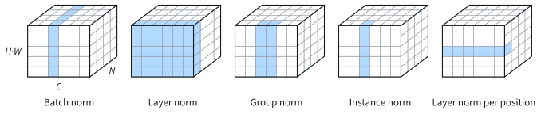

```{.python .input}
%load_ext d2lbook.tab
tab.interact_select('mxnet', 'pytorch', 'tensorflow', 'jax')
```

# Normalization Layers
:label:`sec_batch_norm`

When we trained LeNet in :numref:`sec_lenet`, the learning rate that suited
the MLP did not work. At a learning rate of 0.1 its validation accuracy
stayed at chance for the first few epochs and reached only about 73% after
ten; we had to raise the rate to 2.0, twenty times larger, and train for 30
epochs to reach about 89%. A network of five layers should not need such
care. Nor should the networks of :numref:`sec_blocks`, where a peak rate of
0.1 suited one network and made others diverge or stall. Why does the right
learning rate depend so strongly on the network, and can a layer inside the
network remove that dependence?

The cause is the scale of the signals inside the network. Each of LeNet's
four sigmoids multiplies the gradient by at most $1/4$ on the way back, so
the first layers receive much smaller gradients than the last, and no single
learning rate suits all of them. Depth makes matters worse, since every layer
changes the scale of the signals that enter the next one. Have the ReLU and a
careful initialization (:numref:`subsec_he_init`) not solved this already?
Only in part: they set the scales right at the start of training, and nothing
holds them there once the weights move.

*Batch normalization* :cite:`Ioffe.Szegedy.2015` controls these scales
inside the network, throughout training. Before the nonlinearity of a layer,
it standardizes each feature with the mean and the variance of the current
minibatch, then applies a learned scale and shift. This rescales the signal
on the way forward and its gradient on the way back, and it makes the layer
indifferent to the length of its weights. We will see that LeNet with batch
normalization trains well at the MLP's learning rate, and at rates a hundred
times larger. Together with the
residual connections of the next section, batch normalization made networks
with more than a hundred layers trainable, although why it helps as much as
it does is still argued over. Its statistics, however, couple the examples of
a minibatch, which fails when minibatches are small. The last part of this
section introduces layer and group normalization, which compute their
statistics within each example.

```{.python .input #batch-norm-batch-normalization}
%%tab mxnet
import math
import numpy as np
from mxnet import autograd, gluon, init, np as mnp, npx
from mxnet.gluon import nn
from d2l import mxnet as d2l
npx.set_np()
```

```{.python .input #batch-norm-batch-normalization}
%%tab pytorch
import math
import numpy as np
import torch
from torch import nn
from torch.nn import functional as F
from d2l import torch as d2l
```

```{.python .input #batch-norm-batch-normalization}
%%tab tensorflow
import math
import numpy as np
import tensorflow as tf
from d2l import tensorflow as d2l
```

```{.python .input #batch-norm-batch-normalization}
%%tab jax
import math
import numpy as np
import jax
from jax import numpy as jnp
from flax import nnx
import optax
from d2l import jax as d2l
```

## Batch Normalization

### Standardizing over a Minibatch

Consider one feature computed by a fully connected layer, say the input to
the nonlinearity of one hidden unit, and a minibatch $\mathcal{B}$ of $m$
examples. The layer produces one value $x_i$ of this feature for each
example $i$. Batch normalization computes the mean and the variance of these
$m$ values,

$$\hat{\mu}_\mathcal{B} = \frac{1}{m} \sum_{i=1}^m x_i
\quad \textrm{and} \quad
\hat{\sigma}^2_\mathcal{B} = \frac{1}{m} \sum_{i=1}^m
(x_i - \hat{\mu}_\mathcal{B})^2,$$

and replaces each value by

$$
\textrm{BN}(x_i) = \gamma \, \frac{x_i - \hat{\mu}_\mathcal{B}}
{\sqrt{\hat{\sigma}^2_\mathcal{B} + \epsilon}} + \beta.
$$
:eqlabel:`eq_batchnorm`

The fraction standardizes the feature: over the minibatch it has mean 0 and
variance $\hat{\sigma}^2_\mathcal{B} / (\hat{\sigma}^2_\mathcal{B} +
\epsilon)$, just below 1. The small constant $\epsilon > 0$, typically
$10^{-5}$, prevents a division by zero when the feature takes the same value
on every example of the minibatch. A layer with several features normalizes
each of them separately, with its own mean and variance.

For example, the four values $(2, 4, 6, 8)$ have mean 5 and variance
$(9 + 1 + 1 + 9)/4 = 5$. Ignoring $\epsilon$, they are standardized to
$(x_i - 5)/\sqrt{5} \approx (-1.34, -0.45, 0.45, 1.34)$. The values
$(20, 40, 60, 80)$ and $(102, 104, 106, 108)$ are standardized to the same
four numbers: the standardization removes the scale and the offset of the
feature.

Mean 0 and variance 1 need not be what the next layer works best with. A
sigmoid, for instance, is nearly linear on inputs of unit variance. The
*scale* $\gamma$ and the *shift* $\beta$ in :eqref:`eq_batchnorm` restore
this freedom. They are parameters learned with the weights, one pair per
feature, initialized to $\gamma = 1$ and $\beta = 0$. Nothing is lost by
standardizing first: with $\gamma$ and $\beta$ equal to the standard deviation
and the mean of the feature over the data, the layer would restore the
original scale and offset, up to the fluctuation of the minibatch statistics.
Batch normalization therefore does not restrict what a network can represent.

### Scale Invariance

Removing the scale of a feature has two consequences. The first is simple,
and it is the one that matters for LeNet. A feature that barely varies over
the minibatch, such as one computed from sigmoid outputs that all lie near
$1/2$, is divided by its small $\hat{\sigma}_\mathcal{B}$ on the way forward,
and by the chain rule its gradient is multiplied by the same factor
$1/\hat{\sigma}_\mathcal{B}$ on the way back. A signal that has become too
small is enlarged, and its gradient with it.

The second consequence is subtler and concerns the weights. Let $x_i =
\mathbf{w}^\top \mathbf{h}_i + b$ be computed from the inputs
$\mathbf{h}_i$ of example $i$. Multiplying $\mathbf{w}$ and $b$ by a
constant $a > 0$ multiplies every $x_i$, their mean, and their standard
deviation by $a$, so, ignoring $\epsilon$,

$$\textrm{BN}(a \mathbf{w}^\top \mathbf{h}_i + a b) =
\textrm{BN}(\mathbf{w}^\top \mathbf{h}_i + b).$$

The loss therefore depends on the direction of the weights but not on their
length. Differentiating both sides with respect to $\mathbf{w}$ shows that the
gradient at $a \mathbf{w}$ is $1/a$ times the gradient at $\mathbf{w}$
:cite:`Ioffe.Szegedy.2015`: small weights receive large gradients and large
weights small ones.

What happens when the learning rate is too large? Since the loss does not
change along $\mathbf{w}$, the gradient $\mathbf{g}$ is orthogonal to
$\mathbf{w}$, and a step of gradient descent with learning rate $\eta$ makes
the weights longer: $\|\mathbf{w} - \eta \mathbf{g}\|^2 = \|\mathbf{w}\|^2 +
\eta^2 \|\mathbf{g}\|^2$. A step that is too large makes them much longer,
which shrinks all later gradients of the layer. An overlarge rate thus
corrects itself to some degree :cite:`Arora.Li.Lyu.2019`.

The argument has conditions, and they are worth knowing. It describes plain
gradient descent and SGD without weight decay; with weight decay the length
of the weights does not keep growing but settles where growth and decay
balance. It covers only the weights that feed a normalization, since only
they are scale-invariant, and the output layer of a classifier is not among
them. And it promises nothing about the first steps, in which the loss can
still blow up before the weights have grown. Within these limits it is the
best argument we have for why normalized networks tolerate large learning
rates.

### Fully Connected and Convolutional Layers

In a fully connected layer with weights $\mathbf{W}$, bias $\mathbf{b}$, and
activation function $\phi$, batch normalization goes between the affine map
and the nonlinearity, as in the original paper :cite:`Ioffe.Szegedy.2015`:

$$\mathbf{h} = \phi(\textrm{BN}(\mathbf{W}\mathbf{x} + \mathbf{b})).$$

Each of the outputs of the affine map is one feature with its own statistics
and its own $\gamma_j$ and $\beta_j$.

A convolutional layer applies the same kernel at every position, and batch
normalization follows suit: it treats each output *channel* as one feature
and computes its mean and variance over the examples of the minibatch *and*
over all positions. With $m$ examples and an output of height $p$ and width
$q$, each channel's statistics average $m \cdot p \cdot q$ numbers. For the
first convolutional layer of LeNet, which produces six channels of $28
\times 28$, a minibatch of 128 images gives $128 \cdot 28 \cdot 28 =
100{,}352$ numbers per channel, against 128 per feature in a fully connected
layer. Each channel has a single $\gamma$ and $\beta$, so the normalized
layer still applies the same function at every position.

### Training and Prediction

At prediction time a model may see one image at a time, and its output for
an image should not depend on which other images happen to share its
minibatch. Batch normalization therefore uses two different statistics in
two modes. In *training mode* it normalizes with the statistics of the
current minibatch, as in :eqref:`eq_batchnorm`. It also keeps running
estimates $\hat{\mu}$ and $\hat{\sigma}^2$ of the mean and the variance,
starting from 0 and 1, and updates them after every minibatch,

$$
\hat{\mu} \leftarrow \rho \, \hat{\mu} + (1 - \rho) \,
\hat{\mu}_\mathcal{B} \quad \textrm{and} \quad
\hat{\sigma}^2 \leftarrow \rho \, \hat{\sigma}^2 + (1 - \rho) \,
\hat{\sigma}^2_\mathcal{B}.
$$
:eqlabel:`eq_bn_running`

The *decay* $\rho$ sets the memory of these exponential moving averages: the
minibatch $k$ steps back contributes with weight $(1 - \rho)\rho^k$. With
$\rho = 0.9$ these weights halve about every seven steps, and the estimates
average over roughly the last $1/(1 - \rho) = 10$ minibatches, a small
fraction of the 469 minibatches of 128 images in one epoch of Fashion-MNIST.
In *prediction mode* the layer normalizes with the running estimates and
leaves them unchanged, so it computes a fixed affine function of each
feature. Like dropout (:numref:`sec_dropout`), the layer thus behaves
differently in training and at prediction.

Unfortunately, some framework layers call $\rho$ the *momentum* of the layer
and others $1 - \rho$, and the name has nothing to do with the momentum
method of optimization. Throughout this chapter we use $\rho = 0.9$ and
$\epsilon = 10^{-5}$ and pass them explicitly where the layer's defaults
differ.

## Implementation from Scratch

The function `batch_norm` implements :eqref:`eq_batchnorm` and
:eqref:`eq_bn_running` for both modes and for both kinds of layer.

:begin_tab:`mxnet, pytorch`
Images are stored as (examples, channels, height, width), so the channel
axis is 1.
:end_tab:

:begin_tab:`tensorflow, jax`
Images are stored as (examples, height, width, channels), so the channel
axis is the last.
:end_tab:

```{.python .input #batch-norm-implementation-from-scratch-1}
%%tab mxnet
def batch_norm(X, gamma, beta, moving_mean, moving_var, eps, momentum):
    if not autograd.is_training():
        # Prediction mode: normalize with the running estimates
        X_hat = (X - moving_mean) / mnp.sqrt(moving_var + eps)
    else:
        assert len(X.shape) in (2, 4)
        # Fully connected: average over examples. Convolutional: over
        # examples and positions, one mean and variance per channel
        axes = 0 if len(X.shape) == 2 else (0, 2, 3)
        mean = X.mean(axis=axes, keepdims=True)
        var = ((X - mean) ** 2).mean(axis=axes, keepdims=True)
        X_hat = (X - mean) / mnp.sqrt(var + eps)
        # Update the running estimates; `momentum` is the decay rho
        moving_mean = momentum * moving_mean + (1.0 - momentum) * mean
        moving_var = momentum * moving_var + (1.0 - momentum) * var
    Y = gamma * X_hat + beta  # Scale and shift
    return Y, moving_mean, moving_var
```

```{.python .input #batch-norm-implementation-from-scratch-1}
%%tab pytorch
def batch_norm(X, gamma, beta, moving_mean, moving_var, eps, momentum,
               training):
    if not training:
        # Prediction mode: normalize with the running estimates
        X_hat = (X - moving_mean) / torch.sqrt(moving_var + eps)
    else:
        assert len(X.shape) in (2, 4)
        # Fully connected: average over examples. Convolutional: over
        # examples and positions, one mean and variance per channel
        dims = 0 if len(X.shape) == 2 else (0, 2, 3)
        mean = X.mean(dim=dims, keepdim=True)
        var = ((X - mean) ** 2).mean(dim=dims, keepdim=True)
        X_hat = (X - mean) / torch.sqrt(var + eps)
        # Update the running estimates; `momentum` is the decay rho
        moving_mean = momentum * moving_mean + (1.0 - momentum) * mean
        moving_var = momentum * moving_var + (1.0 - momentum) * var
    Y = gamma * X_hat + beta  # Scale and shift
    return Y, moving_mean.detach(), moving_var.detach()
```

```{.python .input #batch-norm-implementation-from-scratch-1}
%%tab tensorflow
def batch_norm(X, gamma, beta, moving_mean, moving_var, eps, momentum,
               training):
    if not training:
        # Prediction mode: normalize with the running estimates
        X_hat = (X - moving_mean) / tf.sqrt(moving_var + eps)
    else:
        assert len(X.shape) in (2, 4)
        # Channels last: average over every axis except the last one
        axes = list(range(len(X.shape) - 1))
        mean = tf.reduce_mean(X, axes)
        var = tf.reduce_mean((X - mean) ** 2, axes)
        X_hat = (X - mean) / tf.sqrt(var + eps)
        # Update the running estimates in place; `momentum` is the decay rho
        moving_mean.assign(momentum * moving_mean + (1.0 - momentum) * mean)
        moving_var.assign(momentum * moving_var + (1.0 - momentum) * var)
    return gamma * X_hat + beta  # Scale and shift
```

```{.python .input #batch-norm-implementation-from-scratch-1}
%%tab jax
def batch_norm(X, gamma, beta, moving_mean, moving_var, eps, momentum,
               training):
    if not training:
        # Prediction mode: normalize with the running estimates
        X_hat = (X - moving_mean[...]) / jnp.sqrt(moving_var[...] + eps)
    else:
        assert X.ndim in (2, 4)
        # Channels last: average over every axis except the last one
        axes = tuple(range(X.ndim - 1))
        mean = X.mean(axis=axes, keepdims=True)
        var = ((X - mean) ** 2).mean(axis=axes, keepdims=True)
        X_hat = (X - mean) / jnp.sqrt(var + eps)
        # Update the running estimates in place; `momentum` is the decay rho
        moving_mean[...] = momentum * moving_mean[...] + (1.0 - momentum) * mean
        moving_var[...] = momentum * moving_var[...] + (1.0 - momentum) * var
    return gamma * X_hat + beta  # Scale and shift
```

The layer `BatchNorm` holds two kinds of state. The scale `gamma` and the
shift `beta` are parameters, updated by the optimizer. The running estimates
`moving_mean` and `moving_var` are not parameters: the optimizer must leave
them alone, but they belong to the model, which saves them and moves them to
the GPU with its parameters.

```{.python .input #batch-norm-implementation-from-scratch-2}
%%tab mxnet
class BatchNorm(nn.Block):
    # `num_features`: outputs of a fully connected layer or channels of a
    # convolutional layer. `num_dims`: 2 or 4, the number of input axes
    def __init__(self, num_features, num_dims):
        super().__init__()
        shape = (1, num_features) if num_dims == 2 else (1, num_features, 1, 1)
        # Scale and shift, learned, start at 1 and 0
        self.gamma = gluon.Parameter('gamma', shape=shape, init=init.One())
        self.beta = gluon.Parameter('beta', shape=shape, init=init.Zero())
        # Running estimates, not learned (no gradient), start at 0 and 1
        self.moving_mean = gluon.Parameter('moving_mean', shape=shape,
                                           init=init.Zero(), grad_req='null')
        self.moving_var = gluon.Parameter('moving_var', shape=shape,
                                          init=init.One(), grad_req='null')

    def forward(self, X):
        Y, moving_mean, moving_var = batch_norm(
            X, self.gamma.data(), self.beta.data(), self.moving_mean.data(),
            self.moving_var.data(), eps=1e-5, momentum=0.9)
        self.moving_mean.set_data(moving_mean)
        self.moving_var.set_data(moving_var)
        return Y
```

```{.python .input #batch-norm-implementation-from-scratch-2}
%%tab pytorch
class BatchNorm(nn.Module):
    # `num_features`: outputs of a fully connected layer or channels of a
    # convolutional layer. `num_dims`: 2 or 4, the number of input axes
    def __init__(self, num_features, num_dims):
        super().__init__()
        shape = (1, num_features) if num_dims == 2 else (1, num_features, 1, 1)
        # Scale and shift, learned, start at 1 and 0
        self.gamma = nn.Parameter(torch.ones(shape))
        self.beta = nn.Parameter(torch.zeros(shape))
        # Running estimates, not learned, start at 0 and 1
        self.register_buffer('moving_mean', torch.zeros(shape))
        self.register_buffer('moving_var', torch.ones(shape))

    def forward(self, X):
        Y, moving_mean, moving_var = batch_norm(
            X, self.gamma, self.beta, self.moving_mean, self.moving_var,
            eps=1e-5, momentum=0.9, training=self.training)
        self.moving_mean.copy_(moving_mean)
        self.moving_var.copy_(moving_var)
        return Y
```

```{.python .input #batch-norm-implementation-from-scratch-2}
%%tab tensorflow
class BatchNorm(tf.keras.layers.Layer):
    def build(self, input_shape):
        shape = [input_shape[-1]]  # One entry per feature or channel
        # Scale and shift, learned, start at 1 and 0
        self.gamma = self.add_weight(name='gamma', shape=shape,
                                     initializer='ones')
        self.beta = self.add_weight(name='beta', shape=shape,
                                    initializer='zeros')
        # Running estimates, not learned, start at 0 and 1
        self.moving_mean = self.add_weight(name='moving_mean', shape=shape,
            initializer='zeros', trainable=False)
        self.moving_var = self.add_weight(name='moving_var', shape=shape,
            initializer='ones', trainable=False)

    def call(self, X, training=False):
        return batch_norm(X, self.gamma, self.beta, self.moving_mean,
                          self.moving_var, eps=1e-5, momentum=0.9,
                          training=training)
```

```{.python .input #batch-norm-implementation-from-scratch-2}
%%tab jax
class BatchNorm(nnx.Module):
    # `num_features`: outputs of a fully connected layer or channels of a
    # convolutional layer. `num_dims`: 2 or 4, the number of input axes
    def __init__(self, num_features, num_dims, deterministic=False):
        self.deterministic = deterministic  # True in prediction mode
        shape = (1, num_features) if num_dims == 2 else (1, 1, 1, num_features)
        # Scale and shift, learned, start at 1 and 0
        self.gamma = nnx.Param(jnp.ones(shape))
        self.beta = nnx.Param(jnp.zeros(shape))
        # Running estimates, not learned, start at 0 and 1
        self.moving_mean = nnx.BatchStat(jnp.zeros(shape))
        self.moving_var = nnx.BatchStat(jnp.ones(shape))

    def set_view(self, *, deterministic):
        self.deterministic = deterministic

    def __call__(self, X):
        return batch_norm(X, self.gamma, self.beta, self.moving_mean,
                          self.moving_var, eps=1e-5, momentum=0.9,
                          training=not self.deterministic)
```

:begin_tab:`mxnet`
`autograd.is_training()` is true inside `autograd.record()` (the Trainer
records every training step), so the mode needs no flag of its own. The
running estimates are parameters with `grad_req='null'`, which receive no
gradient.
:end_tab:

:begin_tab:`pytorch`
`register_buffer` registers a tensor that `model.to(device)` moves and
`state_dict()` saves, but that `parameters()` does not return. The
attribute `self.training` is set by `model.train()` and `model.eval()`,
which the Trainer calls before training and validation.
:end_tab:

:begin_tab:`tensorflow`
`add_weight(..., trainable=False)` creates variables that the layer saves
but the optimizer ignores. Keras passes `training=True` to `call` during
training steps.
:end_tab:

:begin_tab:`jax`
NNX keeps the running estimates in `BatchStat` variables, which the
optimizer ignores since it updates only `Param`s. The Trainer creates a
training view of the model with `deterministic=False` and a prediction view
with `deterministic=True`; `set_view` receives this flag.
:end_tab:

To check the implementation, we apply our layer and the framework's, both with
$\rho = 0.9$ and $\epsilon = 10^{-5}$, to the same minibatch of 128
six-channel $28 \times 28$ feature maps whose entries have mean 2 and standard
deviation 3. The cell reports the largest per-channel mean of our output,
which should be 0; its average per-channel variance, which should be 1; its
largest difference from the framework's output; and our running means after
this one step.

```{.python .input #batch-norm-implementation-from-scratch-3}
%%tab mxnet
X = mnp.random.normal(2, 3, size=(128, 6, 28, 28))
bn, bn_ref = BatchNorm(6, num_dims=4), nn.BatchNorm()  # rho 0.9, eps 1e-5
bn.initialize()
bn_ref.initialize()
with autograd.record():  # Training mode
    Y, Y_ref = bn(X), bn_ref(X)
{'largest channel mean': float(mnp.abs(Y.mean(axis=(0, 2, 3))).max()),
 'average channel variance': float(Y.var(axis=(0, 2, 3)).mean()),
 'largest difference': float(mnp.abs(Y - Y_ref).max()),
 'running means': bn.moving_mean.data().reshape(-1)}
```

```{.python .input #batch-norm-implementation-from-scratch-3}
%%tab pytorch
X = 2 + 3 * torch.randn(128, 6, 28, 28)
bn, bn_ref = BatchNorm(6, num_dims=4), nn.BatchNorm2d(6)  # rho 0.9, eps 1e-5
with torch.no_grad():
    Y, Y_ref = bn(X), bn_ref(X)  # New layers are in training mode
{'largest channel mean': float(Y.mean(dim=(0, 2, 3)).abs().max()),
 'average channel variance': float(Y.var(dim=(0, 2, 3),
                                         unbiased=False).mean()),
 'largest difference': float((Y - Y_ref).abs().max()),
 'running means': bn.moving_mean.reshape(-1)}
```

```{.python .input #batch-norm-implementation-from-scratch-3}
%%tab tensorflow
X = 2 + 3 * tf.random.normal((128, 28, 28, 6))
bn = BatchNorm()
bn_ref = tf.keras.layers.BatchNormalization(momentum=0.9, epsilon=1e-5)
Y, Y_ref = bn(X, training=True), bn_ref(X, training=True)
{'largest channel mean': float(
     tf.reduce_max(tf.abs(tf.reduce_mean(Y, axis=(0, 1, 2))))),
 'average channel variance': float(
     tf.reduce_mean(tf.math.reduce_variance(Y, axis=(0, 1, 2)))),
 'largest difference': float(tf.reduce_max(tf.abs(Y - Y_ref))),
 'running means': bn.moving_mean.numpy()}
```

```{.python .input #batch-norm-implementation-from-scratch-3}
%%tab jax
X = 2 + 3 * jax.random.normal(d2l.get_key(), (128, 28, 28, 6))
bn = BatchNorm(6, num_dims=4)  # Training mode
bn_ref = nnx.BatchNorm(6, momentum=0.9, epsilon=1e-5, use_fast_variance=False,
                       use_running_average=False,
                       rngs=nnx.Rngs(d2l.get_key()))
Y, Y_ref = bn(X), bn_ref(X)
{'largest channel mean': float(jnp.abs(Y.mean(axis=(0, 1, 2))).max()),
 'average channel variance': float(Y.var(axis=(0, 1, 2)).mean()),
 'largest difference': float(jnp.abs(Y - Y_ref).max()),
 'running means': bn.moving_mean[...].reshape(-1)}
```

Every channel of the output has mean 0 and variance 1 up to single-precision
roundoff, and our layer agrees with the framework's to within about $10^{-6}$. After
one step the running means have moved $1 - \rho$, a tenth of the way, from
their starting value 0 toward the minibatch means of about 2.

:begin_tab:`pytorch`
`nn.BatchNorm2d(6)` uses PyTorch's default `momentum=0.1`, which is our
$\rho = 0.9$.
:end_tab:

## LeNet with Batch Normalization

Let us return to the network that started this section. We add batch
normalization to the LeNet of :numref:`sec_lenet`, with the same Xavier
initialization, and use the framework layers, which we have just seen compute
what ours does. LeNet has four hidden layers: two convolutional layers with 6
and 16 channels and two fully connected layers with 120 and 84 units.
`BNLeNet` inserts a batch normalization layer after each of them, before its
sigmoid, and drops their biases: batch normalization subtracts the mean of
each feature, which removes any bias added before it, and its shift $\beta$
takes over the role of the bias. Each of the $6 + 16 + 120 + 84 = 226$
normalized features thus trades one bias for a scale and a shift, 226
parameters on top of LeNet's 61,706.

```{.python .input #batch-norm-concise-implementation-1}
%%tab mxnet
class BNLeNet(d2l.Classifier):
    """LeNet with batch normalization before each hidden sigmoid."""
    def __init__(self, lr=0.1, num_steps=4690, num_classes=10):
        super().__init__()
        self.save_hyperparameters()
        self.net = nn.HybridSequential()
        self.net.add(  # No biases before batch normalization
            nn.Conv2D(6, kernel_size=5, padding=2, use_bias=False),
            nn.BatchNorm(), nn.Activation('sigmoid'),
            nn.AvgPool2D(pool_size=2, strides=2),
            nn.Conv2D(16, kernel_size=5, use_bias=False), nn.BatchNorm(),
            nn.Activation('sigmoid'), nn.AvgPool2D(pool_size=2, strides=2),
            nn.Flatten(),
            nn.Dense(120, use_bias=False), nn.BatchNorm(),
            nn.Activation('sigmoid'),
            nn.Dense(84, use_bias=False), nn.BatchNorm(),
            nn.Activation('sigmoid'),
            nn.Dense(num_classes))
        self.net.initialize(init.Xavier())
        self.net.hybridize()  # Compile the network into one graph
```

```{.python .input #batch-norm-concise-implementation-1}
%%tab pytorch
class BNLeNet(d2l.Classifier):
    """LeNet with batch normalization before each hidden sigmoid."""
    def __init__(self, lr=0.1, num_steps=4690, num_classes=10):
        super().__init__()
        self.save_hyperparameters()
        self.net = nn.Sequential(  # No biases before batch normalization
            nn.LazyConv2d(6, kernel_size=5, padding=2, bias=False),
            nn.LazyBatchNorm2d(), nn.Sigmoid(),
            nn.AvgPool2d(kernel_size=2, stride=2),
            nn.LazyConv2d(16, kernel_size=5, bias=False),
            nn.LazyBatchNorm2d(), nn.Sigmoid(),
            nn.AvgPool2d(kernel_size=2, stride=2),
            nn.Flatten(),
            nn.LazyLinear(120, bias=False), nn.LazyBatchNorm1d(), nn.Sigmoid(),
            nn.LazyLinear(84, bias=False), nn.LazyBatchNorm1d(), nn.Sigmoid(),
            nn.LazyLinear(num_classes))

    weight_init = d2l.LeNet.weight_init  # Xavier weights, zero biases
```

```{.python .input #batch-norm-concise-implementation-1}
%%tab tensorflow
class BNLeNet(d2l.Classifier):
    """LeNet with batch normalization before each hidden sigmoid."""
    def __init__(self, lr=0.1, num_steps=4690, num_classes=10):
        super().__init__()
        self.save_hyperparameters()
        layers = tf.keras.layers
        def bn():  # rho = 0.9 and epsilon = 1e-5
            return layers.BatchNormalization(momentum=0.9, epsilon=1e-5)
        self.net = tf.keras.models.Sequential([  # No biases before BN
            layers.Conv2D(6, kernel_size=5, padding='same', use_bias=False),
            bn(), layers.Activation('sigmoid'), layers.AvgPool2D(2, strides=2),
            layers.Conv2D(16, kernel_size=5, use_bias=False), bn(),
            layers.Activation('sigmoid'), layers.AvgPool2D(2, strides=2),
            layers.Flatten(),
            layers.Dense(120, use_bias=False), bn(),
            layers.Activation('sigmoid'),
            layers.Dense(84, use_bias=False), bn(),
            layers.Activation('sigmoid'),
            layers.Dense(num_classes)])
```

```{.python .input #batch-norm-concise-implementation-1}
%%tab jax
class BNLeNet(d2l.Classifier):
    """LeNet with batch normalization before each hidden sigmoid."""
    def __init__(self, lr=0.1, num_steps=4690, num_classes=10, rngs=None):
        super().__init__()
        self.save_hyperparameters(ignore=['rngs'])
        rngs = nnx.Rngs(d2l.get_key()) if rngs is None else rngs
        init = dict(kernel_init=nnx.initializers.xavier_uniform(), rngs=rngs)
        bn = lambda n: nnx.BatchNorm(n, momentum=0.9,  # rho = 0.9
                                     use_fast_variance=False, rngs=rngs)
        nb = dict(use_bias=False, **init)  # No biases before BN

        def avg_pool(x):  # 2x2 windows, stride 2
            return nnx.avg_pool(x, window_shape=(2, 2), strides=(2, 2))

        def flatten(x):  # One vector per example
            return x.reshape((x.shape[0], -1))

        self.net = nnx.Sequential(
            nnx.Conv(1, 6, kernel_size=(5, 5), padding=2, **nb), bn(6),
            nnx.sigmoid, avg_pool,
            nnx.Conv(6, 16, kernel_size=(5, 5), padding='VALID', **nb),
            bn(16), nnx.sigmoid, avg_pool, flatten,
            nnx.Linear(400, 120, **nb), bn(120), nnx.sigmoid,
            nnx.Linear(120, 84, **nb), bn(84), nnx.sigmoid,
            nnx.Linear(84, num_classes, **init))
```

:begin_tab:`mxnet`
Gluon's `BatchNorm` defaults to `momentum=0.9`, which is $\rho$, and
`epsilon=1e-5`. `init.Xavier()` draws the weights of the convolutional and
dense layers from Xavier's uniform distribution and leaves the scale and
shift of each batch normalization layer at 1 and 0.
:end_tab:

:begin_tab:`pytorch`
`LazyBatchNorm2d` normalizes each channel of a four-axis input and
`LazyBatchNorm1d` each feature of a two-axis one. Their defaults,
`momentum=0.1` and `eps=1e-5`, are our $\rho = 0.9$ and $\epsilon$.
`BNLeNet` reuses LeNet's `weight_init`; only the output layer has a bias
for it to set to zero.
:end_tab:

:begin_tab:`tensorflow`
Keras' `BatchNormalization` defaults to `momentum=0.99` and
`epsilon=1e-3`, so we pass $\rho = 0.9$ and $\epsilon = 10^{-5}$. Its
`momentum` is $\rho$, as in our implementation. Xavier initialization
(`glorot_uniform`) and a zero bias for the output layer are the Keras
defaults.
:end_tab:

:begin_tab:`jax`
Flax's `nnx.BatchNorm` defaults to `momentum=0.99`, so we pass
$\rho = 0.9$; its `epsilon` defaults to $10^{-5}$. By default it also
computes the variance as the mean of the squares minus the square of the
mean, which loses precision when the mean is large compared with the standard
deviation; `use_fast_variance=False` subtracts the mean before squaring, as
our implementation does. Flax pads to `'SAME'` by default, so the second
convolution asks for `'VALID'`, and the flattened output has
$16 \cdot 5 \cdot 5 = 400$ entries.
:end_tab:

Prediction mode raises one more issue. The running averages summarize the
statistics of the last ten or so minibatches, computed with weights that
have changed since. While the weights still move quickly, the running
averages describe a slightly different network from the one we evaluate.
This is no mere technicality: with a constant learning rate of 0.1, the
prediction-mode validation accuracy of `BNLeNet` drops by ten points or more
in single epochs of some runs, the last epoch included. We therefore let the
learning rate decay to zero during training. As the rate shrinks, the weights
stop moving and the running averages catch up with them. To this end we reuse
the schedule :eqref:`eq_cosine_warmup` with which we trained AlexNet
(:numref:`sec_alexnet`), a linear warmup followed by a half-cosine decay to
zero; :numref:`chap_optimization` treats such schedules. The warmup takes one
tenth of the `num_steps` steps of training. For a fair comparison, LeNet gets
the same schedule through a subclass.

```{.python .input #batch-norm-cosine-sgd}
%%tab mxnet
@d2l.add_to_class(BNLeNet)
def configure_optimizers(self):
    schedule = lambda t: self.lr * d2l.cosine_warmup(  # MXNet counts from 1
        t - 1, self.num_steps, self.num_steps // 10)
    return gluon.Trainer(self.collect_params(), 'sgd', {
        'learning_rate': None, 'lr_scheduler': schedule})

class CosineLeNet(d2l.LeNet):
    def __init__(self, lr=0.1, num_steps=4690, num_classes=10):
        super().__init__(lr, num_classes)
        self.num_steps = num_steps

    configure_optimizers = BNLeNet.configure_optimizers
```

```{.python .input #batch-norm-cosine-sgd}
%%tab pytorch
@d2l.add_to_class(BNLeNet)
def configure_optimizers(self):
    optim = torch.optim.SGD(self.parameters(), lr=self.lr)
    schedule = torch.optim.lr_scheduler.LambdaLR(optim, lambda t: (
        d2l.cosine_warmup(t, self.num_steps, self.num_steps // 10)))
    return optim, schedule  # The Trainer steps it after every minibatch

class CosineLeNet(d2l.LeNet):
    def __init__(self, lr=0.1, num_steps=4690, num_classes=10):
        super().__init__(lr, num_classes)
        self.num_steps = num_steps

    configure_optimizers = BNLeNet.configure_optimizers
```

```{.python .input #batch-norm-cosine-sgd}
%%tab tensorflow
@d2l.add_to_class(BNLeNet)
def configure_optimizers(self):
    schedule = lambda: self.lr * d2l.cosine_warmup(
        optim.iterations, self.num_steps, self.num_steps // 10)
    optim = tf.keras.optimizers.SGD(schedule)
    return optim

class CosineLeNet(d2l.LeNet):
    def __init__(self, lr=0.1, num_steps=4690, num_classes=10):
        super().__init__(lr, num_classes)
        self.num_steps = num_steps

    configure_optimizers = BNLeNet.configure_optimizers
```

```{.python .input #batch-norm-cosine-sgd}
%%tab jax
@d2l.add_to_class(BNLeNet)
def configure_optimizers(self):
    return optax.sgd(lambda t: self.lr * d2l.cosine_warmup(
        t, self.num_steps, self.num_steps // 10))

class CosineLeNet(d2l.LeNet):
    def __init__(self, lr=0.1, num_steps=4690, num_classes=10, rngs=None):
        super().__init__(lr, num_classes, rngs=rngs)
        self.num_steps = num_steps

    configure_optimizers = BNLeNet.configure_optimizers
```

We train LeNet and `BNLeNet` with identical settings, a peak learning rate
of 0.1 (the MLP's), minibatches of 128 images, and 10 epochs, and keep the
validation accuracy of each after every epoch.

```{.python .input #batch-norm-concise-implementation-2}
data = d2l.FashionMNIST(batch_size=128)
num_steps = 10 * len(data.train_dataloader())
curves = {}
for model in (CosineLeNet(0.1, num_steps), BNLeNet(0.1, num_steps)):
    trainer = d2l.Trainer(max_epochs=10, num_gpus=1)
    trainer.board.display = False  # We plot the accuracies ourselves
    trainer.fit(model, data)
    curves[type(model).__name__] = trainer.history['val_acc']
```

```{.python .input #batch-norm-lenet-with-batch-normalization-5}
d2l.plot(list(range(1, 11)), list(curves.values()), 'epoch',
         'validation accuracy', legend=list(curves))
```

```{.python .input #batch-norm-lenet-with-batch-normalization-6}
{name: round(acc[-1], 3) for name, acc in curves.items()}  # After 10 epochs
```

LeNet sits at chance, 10%, for the first two to five epochs, and after ten it
reaches about 60%, less in runs that stay at chance longer. That it falls
short of the 73% of :numref:`sec_lenet` is plausible, since the schedule
halves the average learning rate; we have not tested this explanation. With
batch normalization the same network is near 70% or above after the first
epoch and reaches about 88% after ten, close to the 88--90% that LeNet
reaches with twenty times the learning rate and three times the epochs. Its
curve is flat over the last epochs, where the learning rate has decayed.
Batch normalization added 226 parameters and a few operations per
activation. It changed the scale of every layer's signal and gradient, and
left the capacity of the network as it was.

Both networks ran at a single learning rate, and 0.1 suits LeNet badly. Does
batch normalization merely move the best learning rate, or does it make the
choice matter less? We train both networks again with peak rates from 0.03
to 10, a factor of 300, and plot the validation accuracy after 10 epochs
against the peak rate.

```{.python .input #batch-norm-lenet-with-batch-normalization-7}
lrs = (0.03, 0.1, 0.3, 1, 3, 10)
final = {'CosineLeNet': [], 'BNLeNet': []}
for lr in lrs:
    for cls in (CosineLeNet, BNLeNet):
        trainer = d2l.Trainer(max_epochs=10, num_gpus=1)
        trainer.board.display = False
        trainer.fit(cls(lr, num_steps), data)
        final[cls.__name__].append(trainer.history['val_acc'][-1])
d2l.plot(list(lrs), list(final.values()), 'peak learning rate',
         'validation accuracy', legend=list(final), xscale='log')
```

Without batch normalization LeNet does well only at rates near 1 to 3,
where it reaches 84–87%. Below that band it learns slowly or not at all in 10
epochs, and at 10 the outcome is erratic: some runs reach the mid-80s, others
never leave chance. With batch normalization every rate in the range, from
0.03 to 10, gives about 85% or more, and rates of 1 and above reach about
91%, three points more than the 0.1 we used above. The plain network has to
be tuned to within a factor of three. The normalized one works over a factor
of 300, and this is the answer to the question that opened the section. It
is also the tolerance of large rates that scale invariance led us to expect,
although we should not expect it to continue indefinitely: the output layer
is not normalized.

Why batch normalization helps so much is less settled than what it computes.
Its authors attributed the effect to a reduction of *internal covariate
shift*, the change in the distribution of a layer's inputs as the layers
before it learn :cite:`Ioffe.Szegedy.2015`. Later measurements found that
batch normalization does not reduce this shift, and that it makes the loss and
its gradient change more smoothly with the parameters instead
:cite:`Santurkar.Tsipras.Ilyas.ea.2018`. What can be said with confidence is
narrower. Batch normalization rescales the signal and its gradient at every
layer, and it makes each layer invariant to the scale of its weights. As the
sweep showed, normalized networks tolerate larger learning rates. The noise
of the minibatch statistics is also widely believed to act as a regularizer
:cite:`Luo.Wang.Shao.ea.2018,brock2021nfnet`; we may think of it as a
relative of the noise of dropout. Why these effects add up to faster
training of very deep networks is still argued over. The method spread on
the strength of its results, well ahead of its explanation
:cite:`Lipton.Steinhardt.2018`.

## Normalization without Batch Statistics
:label:`subsec_beyond_bn`

The output of batch normalization for one example depends on the other
examples in its minibatch, a strange property for a layer to have. This
coupling causes two problems. First, the statistics are only as good as the
minibatch is large. In a fully connected
layer, a minibatch of one example makes every standardized feature 0, since
each value equals its own mean; the layer then outputs $\beta$ whatever the
input. Object detection and semantic segmentation train on large images, so
memory often limits them to one or two images per GPU, where the statistics
are noisiest. Second, the network computes different functions in training
and in prediction mode. When the running estimates describe the data at
prediction time poorly, for instance after fine-tuning on data from another
domain, accuracy drops in a way that is hard to trace to a normalization
layer.

Both problems disappear when each example is normalized with statistics of
its own. :numref:`fig_norm_axes` shows the options for a convolutional
layer, whose activations have an example axis $N$, a channel axis $C$, and
the spatial positions $H \cdot W$. They differ only in the set of numbers
that share one mean and one variance.

![Normalization methods for activations with examples $N$, channels $C$, and spatial positions $H\cdot W$. The shaded numbers share one mean and one variance. Batch normalization averages each channel over the minibatch and all positions; layer normalization averages each example over all channels and positions; group normalization over a group of channels and all positions; instance normalization over a single channel. The layer normalization of transformers and ConvNeXt averages over the channels at one position.](../img/arch-norm-axes.svg)
:label:`fig_norm_axes`

### Layer Normalization
:label:`subsec_layer-normalization-in-bn`

*Layer normalization* :cite:`Ba.Kiros.Hinton.2016` standardizes the
features of each example separately. For the $n$ features
$\mathbf{x} = (x_1, \ldots, x_n)$ of one example it computes

$$\textrm{LN}(\mathbf{x})_j = \gamma_j \, \frac{x_j - \hat{\mu}}
{\sqrt{\hat{\sigma}^2 + \epsilon}} + \beta_j
\quad \textrm{with} \quad
\hat{\mu} = \frac{1}{n} \sum_{j=1}^n x_j
\quad \textrm{and} \quad
\hat{\sigma}^2 = \frac{1}{n} \sum_{j=1}^n (x_j - \hat{\mu})^2.$$

This is :eqref:`eq_batchnorm` with the roles of examples and features
exchanged: the average runs over the features of one example instead of over
the examples of one feature, while the scale $\gamma_j$ and the shift
$\beta_j$ remain per feature. No other example enters, so layer normalization
computes the same function at every minibatch size and in both modes, and it
keeps no running estimates. Which features are averaged together depends on
the model, and the name is used rather loosely. For a convolutional layer it
can mean all channels and positions of an example, the second panel of
:numref:`fig_norm_axes`. Transformers normalize the vector of each token, and
the convolutional network ConvNeXt (:numref:`sec_convnext`) likewise
normalizes the channel vector at each position, the last panel, without
pooling over positions.

### Group and Instance Normalization

For convolutional layers, *group normalization* :cite:`wu2018groupnorm`
divides the $c$ channels into $G$ groups of $c/G$ channels and standardizes
each example separately over each group, that is, over $(c/G) \cdot p \cdot q$
numbers, followed by a scale and a shift per channel. With $G = 1$ it
normalizes each example over all channels and positions at once, the layer
normalization of :numref:`fig_norm_axes`. With $G = c$ it normalizes every
channel of every example separately; this special case is called *instance
normalization*. Intermediate group counts, typically $G = 32$, give each
group enough numbers for stable statistics without forcing unrelated
channels to share them. We check on a minibatch of 32 examples with 16
channels and 4 groups that every (example, group) pair is standardized, and
that normalizing the first example alone gives the same output as
normalizing it within the minibatch.

```{.python .input #batch-norm-group-normalization}
%%tab mxnet
X = mnp.random.normal(size=(32, 16, 8, 8))
gn = nn.GroupNorm(num_groups=4)  # 4 groups of 4 channels each
gn.initialize()
Y = gn(X)
G = Y.reshape(32, 4, -1)  # Collect each (example, group) pair's numbers
(mnp.abs(G.mean(axis=2)).max(), G.var(axis=2).mean(),
 mnp.abs(gn(X[:1]) - Y[:1]).max())
```

```{.python .input #batch-norm-group-normalization}
%%tab pytorch
X = torch.randn(32, 16, 8, 8)
gn = nn.GroupNorm(4, 16).requires_grad_(False)  # 4 groups of 4 channels
Y = gn(X)
G = Y.reshape(32, 4, -1)  # Collect each (example, group) pair's numbers
(G.mean(dim=2).abs().max(), G.var(dim=2, unbiased=False).mean(),
 (gn(X[:1]) - Y[:1]).abs().max())
```

```{.python .input #batch-norm-group-normalization}
%%tab tensorflow
X = tf.random.normal((32, 8, 8, 16))  # Channels last, as Keras expects
gn = tf.keras.layers.GroupNormalization(groups=4, epsilon=1e-5)
Y = gn(X)
# Collect each (example, group) pair's numbers
G = tf.reshape(tf.transpose(Y, (0, 3, 1, 2)), (32, 4, -1))
(tf.reduce_max(tf.abs(tf.reduce_mean(G, axis=2))),
 tf.reduce_mean(tf.math.reduce_variance(G, axis=2)),
 tf.reduce_max(tf.abs(gn(X[:1]) - Y[:1])))
```

```{.python .input #batch-norm-group-normalization}
%%tab jax
X = jax.random.normal(d2l.get_key(), (32, 8, 8, 16))  # Channels last
gn = nnx.GroupNorm(16, num_groups=4, epsilon=1e-5,
                   rngs=nnx.Rngs(d2l.get_key()))
Y = gn(X)
# Collect each (example, group) pair's numbers
G = jnp.transpose(Y, (0, 3, 1, 2)).reshape(32, 4, -1)
(jnp.abs(G.mean(axis=2)).max(), G.var(axis=2).mean(),
 jnp.abs(gn(X[:1]) - Y[:1]).max())
```

Each group has mean 0 and variance 1 up to roundoff, and the first example
is normalized the same way alone as within the minibatch. Does this
independence cost accuracy? With large minibatches, a little: for a ResNet-50
trained on ImageNet with 32 images per GPU, :citet:`wu2018groupnorm` report a
top-1 error of 23.6% with batch normalization and 24.1% with group
normalization. With 2 images per GPU the error of batch normalization rises
to 34.7%, while that of group normalization stays at 24.1%. Group
normalization is therefore common where minibatches are small, as in
detection and segmentation.

### Normalizer-Free Networks

Normalization layers are not the only way to keep the scales of a deep
network under control. Normalizer-free networks (NFNets)
:cite:`brock2021nfnet` train ResNet-style networks without any normalization
layer, to an ImageNet accuracy that was the best reported at the time for
a model trained on ImageNet alone. They standardize the weights of each
convolution instead of its outputs, which keeps throughout training the scale
that a careful initialization (:numref:`subsec_he_init`) sets only at the
start, and they clip a gradient whose norm is large relative to the norm of
the weights it updates. We will not use these networks. They matter here as
evidence: a network that trains this well once the scale of its weights is
held fixed by other means suggests that controlling scale is the main thing
a normalization layer does.

## Summary

Batch normalization standardizes each feature of a layer, or each channel of
a convolutional layer, with the mean and the variance of the current
minibatch, then applies a learned scale and shift. This rescales the signal
and its gradient at every layer and makes the layer invariant to the scale of
its weights. LeNet, whose sigmoids leave the first layers with small
gradients, then trains at every peak learning rate from 0.03 to 10, where
the plain network needs one between about 1 and 3. Why the method helps very
deep networks as much as it does is not settled. At prediction time the layer uses running
averages of the statistics instead. Its dependence on the minibatch fails when
minibatches are small; layer and group normalization compute their
statistics within each example and avoid both the coupling and the two
modes. The next section combines batch normalization with residual
connections to train much deeper networks.

## Exercises

1. **Bias before batch norm.** `BNLeNet` builds its four normalized layers
   without a bias. Show from :eqref:`eq_batchnorm` that adding a bias
   $\mathbf{b}$ before the normalization changes neither the output in
   training mode nor the gradient with respect to the weights, and that the
   gradient with respect to $\mathbf{b}$ is zero. What happens to such a
   bias in prediction mode?
1. [code] **Learning-rate ceiling.** In the sweep of this section `BNLeNet`
   trained at every peak rate up to 10.
    1. Extend the sweep for `BNLeNet` to peak rates of 30, 100, and 300.
       Where does training fail?
    1. The output layer is the only layer with weights that no
       normalization follows. Test whether it sets the ceiling: give it a
       learning rate of its own, fixed at 0.1, and repeat the first part.
    1. Replace the sigmoids of both networks by ReLUs, with He
       initialization, and repeat the sweep of this section. How does the
       band of good rates of the plain network change, and why?
1. [code] **Leave-one-out ablation.** Does every layer need batch
   normalization? `BNLeNet` normalizes the output of each of its four
   hidden layers. Remove batch normalization from one layer at a time and
   retrain. Report, as a table, the validation-accuracy cost of each
   removal, and identify the layer whose removal hurts most.
1. [code] **Running averages and recomputed statistics.** The decay
   $\rho$ in :eqref:`eq_bn_running` sets how many minibatches the running
   estimates remember.
    1. After how many steps does the weight of a minibatch in the running
       mean fall below 1% of the weight of the newest minibatch, for
       $\rho = 0.9$ and for $\rho = 0.99$? Compare both with the 469
       steps of an epoch.
    1. Train `BNLeNet` for 10 epochs with a constant learning rate of 0.1,
       the `configure_optimizers` of `d2l.Classifier`, instead of the
       cosine schedule. After every epoch, evaluate a copy of the model
       twice: once in prediction mode as it is, and once after
       recomputing its statistics for the current weights. To recompute
       them, reset the running estimates and pass 100 training
       minibatches through the copy in training mode, without updating the
       weights, averaging the minibatch statistics with equal weights. Plot
       both validation curves, add the curve of this section's cosine
       schedule, and explain the differences.
    1. Repeat the second part with $\rho = 0.99$. Does a longer memory
       remove the difference? Why or why not?
1. [code] **Minibatch coupling.** The output of batch normalization for
   one example depends on the other examples in its minibatch. Train
   `BNLeNet` as in this section. Measure its validation accuracy in
   prediction mode, then in training mode with validation batches of 128
   images, and then in training mode with validation batches of one image.
   Measure in prediction mode first, since every training-mode forward
   pass updates the running estimates. Explain the three accuracies.
   If the layer refuses a training-mode minibatch of one example, explain
   why, and measure with minibatches of two instead.
1. [code] **Small-batch training.** ● Build a variant of `BNLeNet` that
   uses group normalization with two groups after each convolutional layer
   and layer normalization (:numref:`subsec_layer-normalization-in-bn`)
   after each hidden fully connected layer, in place of batch
   normalization. Train `BNLeNet` and the variant for two epochs at batch
   size 4 and again at batch size 128, keeping the other hyperparameters
   of this section. Report the validation accuracy of all four runs. How
   does the accuracy of each network change when the batch size drops from
   128 to 4, and why?
1. [code] **Backward pass of batch norm.** ● The batch statistics in
   :eqref:`eq_batchnorm` depend on every element of the minibatch, so the
   backward pass is not elementwise.
    1. Derive, by hand, the gradient of a scalar loss with respect to each
       input of the batch-norm layer, working through the forward steps:
       mean, centering, variance, normalization, and the affine scale and
       shift.
    1. Implement your expression and verify it against the gradient
       computed by automatic differentiation.
    1. Show from your expression that the gradient with respect to the
       inputs sums to zero over the minibatch, and explain why.

    *Adapted from Simon Prince,
    [Understanding Deep Learning](https://udlbook.github.io/udlbook/),
    Problem 11.5.*
1. [extended] **Beyond mean and variance.** ●● Batch normalization
   standardizes each channel separately. For each of the following
   alternatives, describe how it would be applied at a layer and what it
   costs in computation, parameters, and estimation variance. Implement
   at least one of them in place of our `BatchNorm` in a copy of `BNLeNet`
   and compare its validation accuracy with that of batch normalization.
    1. The probability integral transform, which maps each channel through
       its empirical cumulative distribution function.
    1. Whitening with a full covariance estimate across the $c$ channels.
    1. Whitening with a structured covariance estimate, for example a
       block-diagonal or a low-rank-plus-diagonal matrix.

:begin_tab:`mxnet`
[Discussions](https://d2l.discourse.group/t/83)
:end_tab:

:begin_tab:`pytorch`
[Discussions](https://d2l.discourse.group/t/84)
:end_tab:

:begin_tab:`tensorflow`
[Discussions](https://d2l.discourse.group/t/330)
:end_tab:

:begin_tab:`jax`
[Discussions](https://d2l.discourse.group/t/18005)
:end_tab:

<!-- slides -->

::: {.slide}
::: {.cover}
[Dive into Deep Learning · §7.3]{.kicker}

Normalization Layers<br>**minibatch standardization · scale invariance · training and prediction modes · layer and group normalization**
:::
:::

::: {.slide title="At the MLP's Learning Rate, LeNet Barely Learns in 10 Epochs"}
[The problem]{.kicker}

- LeNet on Fashion-MNIST, learning rate 0.1: at chance (10%) for the
  first few epochs, **about 73%** after 10.
- It needs learning rate **2.0** and 30 epochs to reach ≈ 89%.
- Each of its four sigmoids scales the gradient by at most ¼, so early
  layers get much smaller gradients than late ones.
- Every layer changes the scale of the next layer's input, and these
  scales drift as the weights change.

::: {.d2l-note .warn}
Can we fix the scale of every layer's signal inside the network?
:::
:::

::: {.slide title="By the End of This Deck You Can"}
[Goals]{.kicker}

- standardize a minibatch of activations by hand;
- explain why batch normalization makes the gradient adapt to the scale
  of the weights;
- count the numbers behind each mean in a convolutional layer;
- tell training mode from prediction mode, and set the running-average
  decay $\rho$ and $\epsilon$ explicitly;
- choose between batch, layer, and group normalization.

**Running example:** LeNet against LeNet with batch normalization
(`BNLeNet`) on Fashion-MNIST, 10 epochs: parameters and accuracy, at peak
rate 0.1 and then at rates from 0.03 to 10.
:::

::: {.slide title="Normalizing the Signal Inside the Network"}
[Where this fits]{.kicker}

::: {.cols .vc}
::: {.col}
| section | adds |
|---|---|
| AlexNet | learned features, ReLU, dropout, GPUs |
| VGG, NiN, GoogLeNet | blocks, 1 × 1 convolutions, global pooling |
| **Normalization Layers** | **batch, layer, group normalization** |
| ResNet, ResNeXt, DenseNet | residual connections make depth trainable |
| Efficient Convnets | separable blocks, scaling, re-parameterization |
| Training Recipes | schedules, augmentation, weight averaging |
| ConvNeXt | a ResNet modernized one change at a time |
| Design Spaces (RegNet) | rules from populations of networks |
:::

::: {.col .narrow}
- **Uses:** LeNet, `Trainer`, dropout's two modes.
- **Skips:** why batch normalization helps (still debated).
:::
:::
:::

::: {.slide}
::: {.divider}
[01]{.dnum}

[Batch Normalization]{.dtitle}

[standardize each feature over the minibatch]{.dsub}
:::
:::

::: {.slide title="Batch Normalization Standardizes Each Feature over the Minibatch"}
[Definition]{.kicker}

One feature, values $x_1, \ldots, x_m$ over a minibatch $\mathcal{B}$ of
$m$ examples:

$$\hat\mu_\mathcal{B} = \tfrac{1}{m}\textstyle\sum_i x_i, \qquad
\hat\sigma^2_\mathcal{B} = \tfrac{1}{m}\textstyle\sum_i (x_i - \hat\mu_\mathcal{B})^2,$$

$$\textrm{BN}(x_i) = \gamma \, \frac{x_i - \hat\mu_\mathcal{B}}{\sqrt{\hat\sigma^2_\mathcal{B} + \epsilon}} + \beta.$$

$\epsilon = 10^{-5}$ avoids division by zero; scale $\gamma$ and shift
$\beta$ are learned, one pair per feature, starting at 1 and 0.
:::

::: {.slide title="(2, 4, 6, 8), (20, 40, 60, 80), and (102, …, 108) Normalize Alike"}
[Worked example]{.kicker}

- $(2, 4, 6, 8)$: mean 5, variance $(9 + 1 + 1 + 9)/4 = 5$.
- Standardized: $(x_i - 5)/\sqrt5 \approx (-1.34, -0.45, 0.45, 1.34)$.
- $(20, 40, 60, 80)$ and $(102, 104, 106, 108)$ give the same four
  numbers.

::: {.d2l-note .rule}
Standardization removes the scale and the offset of a feature. A learned
$\gamma$ and $\beta$ equal to the feature's standard deviation and mean
would restore them, so nothing is lost.
:::
:::

::: {.slide title="Scaling the Weights by a Leaves the Output Unchanged and Divides the Gradient by a"}
[Scale invariance]{.kicker}

Feature $x_i = \mathbf{w}^\top\mathbf{h}_i + b$; multiply $\mathbf{w}, b$
by $a > 0$:

$$\textrm{BN}(a\mathbf{w}^\top\mathbf{h}_i + ab) = \textrm{BN}(\mathbf{w}^\top\mathbf{h}_i + b)
\;\Rightarrow\; L(a\mathbf{w}) = L(\mathbf{w}),$$

$$\Rightarrow\; \nabla L(a\mathbf{w}) = \tfrac{1}{a}\nabla L(\mathbf{w}).$$

- Small weights get large gradients, large weights small ones.
- A feature that barely varies is divided by its small
  $\hat\sigma_\mathcal{B}$, forward and backward.

**The gradient adapts to the scale of each layer's weights.**
:::

::: {.slide title="A Step That Is Too Large Lengthens the Weights and Shrinks Later Gradients"}
[Scale invariance]{.kicker}

$L(a\mathbf{w}) = L(\mathbf{w})$, so the gradient $\mathbf{g}$ is
orthogonal to $\mathbf{w}$. One step with learning rate $\eta$:

$$\|\mathbf{w} - \eta\mathbf{g}\|^2 = \|\mathbf{w}\|^2 + \eta^2\|\mathbf{g}\|^2.$$

- Longer weights → gradients smaller by the same factor: an overlarge
  rate partly corrects itself.
- Conditions: plain SGD, no weight decay (with decay the length settles
  at a balance); only weights that feed a normalization, so not the
  output layer; the first steps can still blow up.

Source: Arora, Li, and Lyu (2019).
:::

::: {.slide title="Check: Which Minibatches Give the Same Output?"}
[Check]{.kicker}

One feature, $\gamma = 1$, $\beta = 0$, ignore $\epsilon$. Which give the
same standardized values as $(1, 2, 3)$?

(a) $(10, 20, 30)$ (b) $(11, 12, 13)$ (c) $(-1, -2, -3)$

::: {.fragment .fade-up}
::: {.d2l-note}
**Answer.** (a) and (b): $(-1.22, 0, 1.22)$. (c) gives
$(1.22, 0, -1.22)$: a negative scale flips the sign.
:::
:::
:::

::: {.slide title="A Convolutional Channel Averages Over Examples and Positions"}
[Convolutional layers]{.kicker}

- One mean and variance per **channel**, over all $m$ examples and all
  $p \cdot q$ positions: $m \cdot p \cdot q$ numbers.
- LeNet's first layer, 6 channels of 28×28, minibatch 128:
  $128 \cdot 28 \cdot 28 = 100{,}352$ numbers per channel.
- A fully connected feature: 128 numbers.
- One $\gamma$, $\beta$ per channel: the same function at every position.

Placement: $\mathbf{h} = \phi(\textrm{BN}(\mathbf{W}\mathbf{x} + \mathbf{b}))$,
before the nonlinearity.
:::

::: {.slide title="Training Mode Uses the Minibatch; Prediction Mode Uses Running Averages"}
[Two modes]{.kicker}

After every training step:

$$\hat\mu \leftarrow \rho\,\hat\mu + (1-\rho)\,\hat\mu_\mathcal{B}, \qquad
\hat\sigma^2 \leftarrow \rho\,\hat\sigma^2 + (1-\rho)\,\hat\sigma^2_\mathcal{B}.$$

- Decay $\rho = 0.9$: weights halve every ~7 steps; memory ≈ 10
  minibatches of the 469 in an epoch.
- Prediction: fixed $\hat\mu, \hat\sigma^2$, one image at a time, no
  dependence on the other images.

Like dropout: one layer, two behaviors.
:::

::: {.slide title="The Layer's Momentum Argument Is the Decay: We Use ρ = 0.9, ε = 10⁻⁵" only="mxnet"}
[Two modes]{.kicker}

- Gluon's `BatchNorm`: `momentum` is $\rho$, default 0.9.
- `epsilon` defaults to $10^{-5}$.
- The defaults are our values; we pass nothing.

Unrelated to the momentum of optimization.
:::

::: {.slide title="The Layer's Momentum Argument Is the Decay: We Use ρ = 0.9, ε = 10⁻⁵" only="pytorch"}
[Two modes]{.kicker}

- `BatchNorm2d`: `momentum` is $1 - \rho$, default 0.1, i.e. $\rho = 0.9$.
- `eps` defaults to $10^{-5}$.
- The defaults are our values; we pass nothing.

Unrelated to the momentum of optimization.
:::

::: {.slide title="The Layer's Momentum Argument Is the Decay: We Use ρ = 0.9, ε = 10⁻⁵" only="tensorflow"}
[Two modes]{.kicker}

- Keras' `BatchNormalization`: `momentum` is $\rho$, default 0.99.
- `epsilon` defaults to $10^{-3}$.
- We pass `momentum=0.9, epsilon=1e-5`.

Unrelated to the momentum of optimization.
:::

::: {.slide title="The Layer's Momentum Argument Is the Decay: We Use ρ = 0.9, ε = 10⁻⁵" only="jax"}
[Two modes]{.kicker}

- Flax's `nnx.BatchNorm`: `momentum` is $\rho$, default 0.99.
- `epsilon` defaults to $10^{-5}$.
- We pass `momentum=0.9`, and `use_fast_variance=False` for the
  two-pass variance.

Unrelated to the momentum of optimization.
:::

::: {.slide}
::: {.divider}
[02]{.dnum}

[Implementation and LeNet]{.dtitle}

[a few lines, checked against the framework layer]{.dsub}
:::
:::

::: {.slide title="Training Mode Normalizes with the Minibatch and Updates Two Running Averages" only="mxnet"}
[From scratch]{.kicker}

```{.python #batch-norm-exercises-1}
axes = 0 if len(X.shape) == 2 else (0, 2, 3)  # examples (+ positions)
mean = X.mean(axis=axes, keepdims=True)
var = ((X - mean) ** 2).mean(axis=axes, keepdims=True)
X_hat = (X - mean) / mnp.sqrt(var + eps)
moving_mean = momentum * moving_mean + (1.0 - momentum) * mean
moving_var = momentum * moving_var + (1.0 - momentum) * var
Y = gamma * X_hat + beta
```

Prediction mode: `X_hat` from `moving_mean`, `moving_var`; no update.
:::

::: {.slide title="Training Mode Normalizes with the Minibatch and Updates Two Running Averages" only="pytorch"}
[From scratch]{.kicker}

```{.python #batch-norm-exercises-2}
dims = 0 if len(X.shape) == 2 else (0, 2, 3)  # examples (+ positions)
mean = X.mean(dim=dims, keepdim=True)
var = ((X - mean) ** 2).mean(dim=dims, keepdim=True)
X_hat = (X - mean) / torch.sqrt(var + eps)
moving_mean = momentum * moving_mean + (1.0 - momentum) * mean
moving_var = momentum * moving_var + (1.0 - momentum) * var
Y = gamma * X_hat + beta
```

Prediction mode: `X_hat` from `moving_mean`, `moving_var`; no update.
:::

::: {.slide title="Training Mode Normalizes with the Minibatch and Updates Two Running Averages" only="tensorflow"}
[From scratch]{.kicker}

```{.python #batch-norm-exercises-3}
axes = list(range(len(X.shape) - 1))  # all but the channels (last)
mean = tf.reduce_mean(X, axes)
var = tf.reduce_mean((X - mean) ** 2, axes)
X_hat = (X - mean) / tf.sqrt(var + eps)
moving_mean.assign(momentum * moving_mean + (1.0 - momentum) * mean)
moving_var.assign(momentum * moving_var + (1.0 - momentum) * var)
Y = gamma * X_hat + beta
```

Prediction mode: `X_hat` from `moving_mean`, `moving_var`; no update.
:::

::: {.slide title="Training Mode Normalizes with the Minibatch and Updates Two Running Averages" only="jax"}
[From scratch]{.kicker}

```{.python #batch-norm-exercises-4}
axes = tuple(range(X.ndim - 1))  # all but the channels (last)
mean = X.mean(axis=axes, keepdims=True)
var = ((X - mean) ** 2).mean(axis=axes, keepdims=True)
X_hat = (X - mean) / jnp.sqrt(var + eps)
moving_mean[...] = momentum * moving_mean[...] + (1.0 - momentum) * mean
moving_var[...] = momentum * moving_var[...] + (1.0 - momentum) * var
Y = gamma * X_hat + beta
```

Prediction mode: `X_hat` from `moving_mean`, `moving_var`; no update.
:::

::: {.slide title="Our Layer Matches the Framework's to Within 10⁻⁶"}
[From scratch]{.kicker}

Minibatch of 128 × 6 channels × 28×28, entries with mean 2 and standard
deviation 3. Printed: largest channel mean, mean channel variance, largest
difference from the framework layer, running means after one step:

@!batch-norm-implementation-from-scratch-3

Running means moved $1 - \rho$, a tenth of the way, from 0 toward 2.
:::

::: {.slide title="BNLeNet Is LeNet Plus Four Normalization Layers"}
[LeNet with batch normalization]{.kicker}

- Conv 5×5, 6 channels, pad 2 → **BN** → sigmoid → avg-pool
- Conv 5×5, 16 channels → **BN** → sigmoid → avg-pool
- Dense 120 → **BN** → sigmoid; Dense 84 → **BN** → sigmoid; Dense 10
- Xavier weights, as in LeNet; no bias before BN (the mean subtraction
  would remove it, and $\beta$ takes its place)

$6 + 16 + 120 + 84 = 226$ features: 226 biases out, 452 parameters
($\gamma$, $\beta$) in, **226** more than LeNet's 61,706, plus 452
running statistics.
:::

::: {.slide title="A Learning Rate That Decays to Zero Lets the Running Averages Catch Up"}
[LeNet with batch normalization]{.kicker}

- Running averages summarize ~10 minibatches of *older* weights.
- Constant rate 0.1: prediction-mode accuracy of `BNLeNet` drops by ≥ 10
  points in single epochs of some runs, the last one included.
- Cosine schedule: warmup over the first $t_\textrm{w}$ steps, then
  $\eta_t = \tfrac{\eta_0}{2}\bigl(1 + \cos\tfrac{\pi(t - t_\textrm{w})}{T - t_\textrm{w}}\bigr)$
  down to 0 at step $T$.

**As the rate shrinks, the weights stop moving and the averages catch up.**
:::

::: {.slide title="Same Schedule, Same 10 Epochs: BNLeNet Learns from the First Epoch"}
[LeNet with batch normalization]{.kicker}

@!batch-norm-lenet-with-batch-normalization-5

Peak rate 0.1. Validation accuracy after 10 epochs: LeNet ≈ 60%, less if
it sits at chance longer (2–5 epochs); `BNLeNet` **≈ 88%**.
:::

::: {.slide title="With Batch Normalization, Peak Rates from 0.03 to 10 All Work"}
[LeNet with batch normalization]{.kicker}

@!batch-norm-lenet-with-batch-normalization-7

- Plain LeNet: 84–87% only near 1 to 3; at 10 erratic, sometimes at
  chance.
- `BNLeNet`: about 85% or more at every rate, about 91% at 1 and above.
- A band a factor of 3 wide against one a factor of 300 wide.
:::

::: {.slide title="Check: Batch Normalization with a Minibatch of One"}
[Check]{.kicker}

A fully connected layer with batch normalization in training mode
receives a minibatch of a single example. What does it output?

::: {.fragment .fade-up}
::: {.d2l-note}
**Answer.** Each value equals its own mean, so every standardized
feature is 0 and the layer outputs $\beta$, whatever the input (some
layers raise an error instead). A convolutional channel still averages over
positions, but noisily.
:::
:::
:::

::: {.slide}
::: {.divider}
[03]{.dnum}

[Normalization without Batch Statistics]{.dtitle}

[statistics within each example]{.dsub}
:::
:::

::: {.slide title="Batch Statistics Couple the Examples of a Minibatch"}
[Limitations]{.kicker}

- **Small minibatches:** detection and segmentation fit 1–2 large images
  per GPU; the statistics are noisy, and at one example useless.
- **Two functions:** training uses minibatch statistics, prediction the
  running averages. When these describe the data poorly (after
  fine-tuning on a new domain), accuracy drops silently.

**Fix:** compute the statistics within each example.
:::

::: {.slide title="The Normalizers Differ Only in Which Numbers Share a Mean"}
[Layer, group, instance]{.kicker}



- Layer norm: one example, all channels and positions (transformers:
  one token's vector; ConvNeXt: channels at one position).
- Group norm: groups of $c/G$ channels; $G = c$ is instance norm.
:::

::: {.slide title="With 2 Images per GPU, Batch Norm's Error Rises to 34.7%, Group Norm's Stays at 24.1%"}
[Group normalization]{.kicker}

ResNet-50 on ImageNet, top-1 error:

| images per GPU | 32 | 2 |
|---|--:|--:|
| batch normalization | 23.6% | 34.7% |
| group normalization | 24.1% | 24.1% |

Large minibatches: batch norm keeps a small edge. Small ones: group norm.

Source: Wu and He (2018).
:::

::: {.slide title="Recap"}
[Wrap-up]{.kicker}

- **Batch norm:** standardize each feature (conv: each channel) over the
  minibatch, then learned $\gamma$, $\beta$.
- **Scale invariance:** weights × $a$ → gradient ÷ $a$; an overlarge
  step lengthens the weights and partly corrects itself.
- **LeNet, peak rate 0.1, cosine decay, 10 epochs:** ≈ 60% without,
  ≈ 88% with, for 226 extra parameters. With batch normalization every
  peak from 0.03 to 10 gives about 85% or more.
- **Two modes:** running averages with $\rho = 0.9$, $\epsilon = 10^{-5}$,
  set explicitly.
- **Small minibatches:** layer or group normalization, statistics within
  each example.

**Next:** residual connections, to train networks with more than a hundred
layers.
:::
