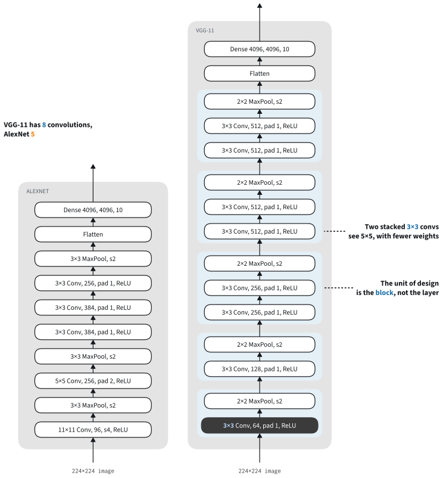
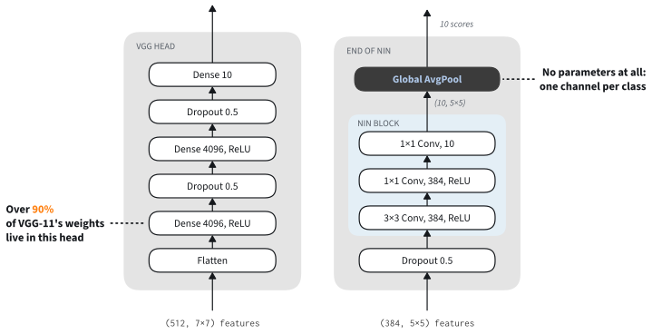
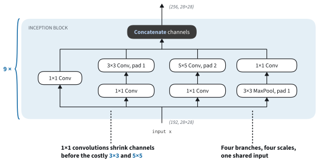

```{.python .input}
%load_ext d2lbook.tab
tab.interact_select('mxnet', 'pytorch', 'tensorflow', 'jax')
```

# Blocks, Bottlenecks, and Branches: VGG, NiN, GoogLeNet
:label:`sec_blocks`

AlexNet (:numref:`sec_alexnet`) was crafted layer by layer: an $11 \times 11$
kernel here, 384 channels there, and max-pooling after the first, second, and
fifth convolutions. Hand-tuning every layer is manageable for an eight-layer
model, but scaling to twenty or more layers calls for systematic design rules.
Equally striking, AlexNet concentrates 92% of its 47 million parameters inside
its fully connected classification head—where they contribute only 5% of the
arithmetic and rely on heavy dropout to avoid memorizing the training set.
Between 2013 and 2014, three landmark architectures tackled these bottlenecks
in turn. Even though practitioners rarely deploy these exact models today, the
structural ideas they introduced appear in virtually every modern convnet.

First, *VGG* :cite:`Simonyan.Zisserman.2014` shifted design from individual
layers to repeatable *blocks*—stacks of small $3 \times 3$ convolutions
followed by pooling—turning an entire architecture into a compact list of
block specifications. Second, *Network in Network* (NiN)
:cite:`Lin.Chen.Yan.2013` eliminated the bloated fully connected head
altogether, mixing channels at every pixel via $1 \times 1$ convolutions and
reducing the final feature maps directly to class scores with global average
pooling. Third, *GoogLeNet* :cite:`Szegedy.Liu.Jia.ea.2015` avoided committing
to a single kernel size by running multiple filter sizes in parallel inside
each block, keeping the larger convolutions affordable through $1 \times 1$
channel-reduction bottlenecks. Below we build all three architectures, count
their parameters and multiply-adds just as we did for AlexNet, and train them
on Fashion-MNIST under the same cosine schedule so we can compare them side by
side.

```{.python .input #blocks-imports}
%%tab mxnet
import math
import numpy as np
from mxnet import autograd, gluon, init, np as mnp, npx
from mxnet.gluon import nn
from d2l import mxnet as d2l
npx.set_np()
```

```{.python .input #blocks-imports}
%%tab pytorch
import math
import numpy as np
import torch
from torch import nn
from torch.nn import functional as F
from d2l import torch as d2l
```

```{.python .input #blocks-imports}
%%tab tensorflow
import math
import numpy as np
import tensorflow as tf
from d2l import tensorflow as d2l
```

```{.python .input #blocks-imports}
%%tab jax
import math
import numpy as np
import jax
from jax import numpy as jnp
from flax import nnx
import optax
from d2l import jax as d2l
```

## VGG: Blocks as the Unit of Design
:label:`sec_vgg`

### Stacks of $3 \times 3$ Convolutions
:label:`subsec_vgg-blocks`

If every convolutional layer were followed by stride-2 pooling, an input of width $d$ could support at most $\lfloor\log_2 d\rfloor$ layers before collapsing to $1 \times 1$ ($224 \to 112 \to 56 \to 28 \to 14 \to 7 \to 3 \to 1$). Going deeper requires stacking several stride-1, shape-preserving convolutions at each spatial resolution before downsampling.

VGG :cite:`Simonyan.Zisserman.2014` standardized on $3 \times 3$ kernels—the smallest symmetric filter that captures left/right and up/down neighbors. Two stacked $3 \times 3$ layers cover the same $5 \times 5$ receptive field as one $5 \times 5$ layer using $2 \cdot 9c^2 = 18c^2$ weights instead of $25c^2$; three stacked $3 \times 3$ layers cover a $7 \times 7$ window with $27c^2$ weights instead of $49c^2$ while inserting three ReLU nonlinearities instead of one. A *VGG block* stacks `num_convs` padded $3 \times 3$ convolutions with ReLU, followed by $2 \times 2$ stride-2 max-pooling:

```{.python .input #vgg-vgg-blocks  n=2}
%%tab mxnet
def vgg_block(num_convs, num_channels):
    blk = nn.HybridSequential()
    for _ in range(num_convs):
        blk.add(nn.Conv2D(num_channels, kernel_size=3, padding=1,
                          activation='relu'))
    blk.add(nn.MaxPool2D(pool_size=2, strides=2))
    return blk
```

```{.python .input #vgg-vgg-blocks  n=3}
%%tab pytorch
def vgg_block(num_convs, out_channels):
    layers = []
    for _ in range(num_convs):
        layers.append(nn.LazyConv2d(out_channels, kernel_size=3, padding=1))
        layers.append(nn.ReLU())
    layers.append(nn.MaxPool2d(kernel_size=2, stride=2))
    return nn.Sequential(*layers)
```

```{.python .input #vgg-vgg-blocks  n=4}
%%tab tensorflow
def he():  # A new He-normal initializer for each layer
    return dict(kernel_initializer=tf.keras.initializers.VarianceScaling(
        2.0, 'fan_in', 'untruncated_normal'))

def vgg_block(num_convs, num_channels):
    blk = tf.keras.models.Sequential()
    for _ in range(num_convs):
        blk.add(tf.keras.layers.Conv2D(num_channels, kernel_size=3,
                                       padding='same', activation='relu',
                                       **he()))
    blk.add(tf.keras.layers.MaxPool2D(pool_size=2, strides=2))
    return blk
```

```{.python .input #vgg-vgg-blocks}
%%tab jax
def vgg_block(num_convs, in_channels, out_channels, init):
    layers = []
    for _ in range(num_convs):
        layers.append(nnx.Conv(in_channels, out_channels, kernel_size=(3, 3),
                               padding=(1, 1), **init))
        layers.append(nnx.relu)
        in_channels = out_channels
    layers.append(max_pool)
    return nnx.Sequential(*layers)

def max_pool(x):  # 2x2 windows, stride 2
    return nnx.max_pool(x, window_shape=(2, 2), strides=(2, 2))
```

### The VGG Network
:label:`subsec_vgg-network`

A complete VGG network chains a sequence of these blocks together and attaches
AlexNet's dense classification head—two 4096-unit hidden layers with dropout
followed by the output layer. :numref:`fig_vgg` contrasts VGG-11 with AlexNet.
Five pooling stages halve a $224 \times 224$ input down to $7 \times 7$, while
channel width doubles from stage to stage until reaching 512.


:label:`fig_vgg`

Because every VGG block is completely specified by two integers—its number of
convolutions and its output channel count—the entire convolutional trunk can
be passed in as a list of `(num_convs, out_channels)` tuples (`arch`). Rather
than defining one rigid architecture, VGG defines a *parameterized family*:
VGG-11, VGG-16, and VGG-19 share the exact same class and differ only in
`arch`. Treating network topology as modular data rather than hand-wired code
is VGG's most enduring legacy. As in :numref:`sec_alexnet`, we initialize all
networks in this section with He-normal weights and zero biases.

:begin_tab:`mxnet`
As for AlexNet, the networks are built from `HybridSequential` containers
and `HybridBlock`s and compiled into one graph by `hybridize()`. Gluon's
`Dense` layer flattens its input, so the head needs no flattening layer.
:end_tab:

:begin_tab:`pytorch`
As for AlexNet, the `Trainer` calls `weight_init` on every layer once the
first minibatch has fixed the shapes of the lazy layers.
:end_tab:

:begin_tab:`tensorflow`
`he()` gives every layer its own initializer, since an unseeded Keras
initializer returns the same values on every call.
:end_tab:

:begin_tab:`jax`
The dictionary `init` carries the weight initializer and the random number
streams to every layer.
:end_tab:

```{.python .input #vgg-vgg-network-1  n=5}
%%tab mxnet
class VGG(d2l.Classifier):
    def __init__(self, arch, lr=0.1, num_steps=4690, num_classes=10):
        super().__init__()
        self.save_hyperparameters()
        self.net = nn.HybridSequential()
        for (num_convs, num_channels) in arch:
            self.net.add(vgg_block(num_convs, num_channels))
        self.net.add(*self.head())
        self.net.initialize(init.MSRAPrelu('in', 0))
        self.net.hybridize()

    def head(self):  # AlexNet's fully connected head
        return [nn.Dense(4096, activation='relu'), nn.Dropout(0.5),
                nn.Dense(4096, activation='relu'), nn.Dropout(0.5),
                nn.Dense(self.num_classes)]
```

```{.python .input #vgg-vgg-network-1  n=5}
%%tab pytorch
class VGG(d2l.Classifier):
    def __init__(self, arch, lr=0.1, num_steps=4690, num_classes=10):
        super().__init__()
        self.save_hyperparameters()
        conv_blks = [vgg_block(num_convs, out_channels)
                     for (num_convs, out_channels) in arch]
        self.net = nn.Sequential(*conv_blks, *self.head())

    def head(self):  # AlexNet's fully connected head
        return [nn.Flatten(),
                nn.LazyLinear(4096), nn.ReLU(), nn.Dropout(0.5),
                nn.LazyLinear(4096), nn.ReLU(), nn.Dropout(0.5),
                nn.LazyLinear(self.num_classes)]

    def weight_init(self, module):  # He-normal weights, zero biases
        if type(module) in (nn.Linear, nn.Conv2d):
            nn.init.kaiming_normal_(module.weight, nonlinearity='relu')
            nn.init.zeros_(module.bias)
```

```{.python .input #vgg-vgg-network-1  n=5}
%%tab tensorflow
class VGG(d2l.Classifier):
    def __init__(self, arch, lr=0.1, num_steps=4690, num_classes=10):
        super().__init__()
        self.save_hyperparameters()
        self.net = tf.keras.models.Sequential(
            [vgg_block(num_convs, num_channels)
             for (num_convs, num_channels) in arch] + self.head())

    def head(self):  # AlexNet's fully connected head
        layers = tf.keras.layers
        return [layers.Flatten(),
                layers.Dense(4096, activation='relu', **he()),
                layers.Dropout(0.5),
                layers.Dense(4096, activation='relu', **he()),
                layers.Dropout(0.5),
                layers.Dense(self.num_classes, **he())]
```

```{.python .input #vgg-vgg-network-1  n=5}
%%tab jax
class VGG(d2l.Classifier):
    def __init__(self, arch, lr=0.1, num_steps=4690, num_classes=10,
                 input_shape=(224, 224, 1), rngs=None):
        super().__init__()
        self.save_hyperparameters(ignore=['rngs'])
        rngs = (nnx.Rngs(params=d2l.get_key(), dropout=d2l.get_key())
                if rngs is None else rngs)
        he = nnx.initializers.variance_scaling(2.0, 'fan_in', 'normal')
        init = dict(kernel_init=he, rngs=rngs)
        conv_blks, in_channels = [], input_shape[-1]
        for num_convs, out_channels in arch:
            conv_blks.append(vgg_block(num_convs, in_channels, out_channels,
                                       init))
            in_channels = out_channels
        # Each block halves the height and the width
        height, width = (n // 2 ** len(arch) for n in input_shape[:2])
        self.net = nnx.Sequential(
            *conv_blks, *self.head((height, width, in_channels), init))

    def head(self, shape, init):  # AlexNet's fully connected head
        return [flatten,
                nnx.Linear(math.prod(shape), 4096, **init), nnx.relu,
                nnx.Dropout(0.5, rngs=init['rngs']),
                nnx.Linear(4096, 4096, **init), nnx.relu,
                nnx.Dropout(0.5, rngs=init['rngs']),
                nnx.Linear(4096, self.num_classes, **init)]

def flatten(x):  # One vector per example
    return x.reshape((x.shape[0], -1))
```

:begin_tab:`jax`
`VGG` takes the image size as `input_shape`, since NNX layers need their
input sizes when they are built: the first fully connected layer reads
$h w c$ numbers for a final feature map of $h \times w$ pixels and $c$
channels.
:end_tab:

VGG-11, the smallest variant in the original paper, stacks five blocks with
(1, 1, 2, 2, 2) convolutional layers and (64, 128, 256, 512, 512) channels—eight
convolutional layers plus three dense layers, totaling 11 parameterized
layers. Let us inspect the intermediate tensor shapes on a single
$224 \times 224$ image.

```{.python .input #vgg-vgg-network-2  n=6}
%%tab mxnet, pytorch
VGG(arch=((1, 64), (1, 128), (2, 256), (2, 512), (2, 512))).layer_summary(
    (1, 1, 224, 224))
```

```{.python .input #vgg-vgg-network-2  n=7}
%%tab tensorflow, jax
VGG(arch=((1, 64), (1, 128), (2, 256), (2, 512), (2, 512))).layer_summary(
    (1, 224, 224, 1))
```

The final convolutional block outputs a $512 \times 7 \times 7$ tensor,
flattening to 25,088 features entering the dense head. Tallying the layers as
in AlexNet shows that VGG-11 contains 128.8 million parameters and performs
7.5 billion multiply-adds per image—eight times AlexNet's compute. Once again,
parameters and computation live in completely different places: the dense head
holds 93% of all weights, with its first $25{,}088 \times 4096$ matrix alone
accounting for 103 million parameters.

### Training

Since running eight times AlexNet's compute is unnecessarily heavy for a
Fashion-MNIST demonstration, we train a quarter-width VGG-11 with channel
counts 16, 32, 64, 128, and 128, which executes 512 million multiply-adds per
image—roughly half of AlexNet's 938 million. All other training settings match
:numref:`sec_alexnet`: $224 \times 224$ upsampled images, batch size 128, and
10 epochs of SGD with the warmup-and-cosine schedule :eqref:`eq_cosine_warmup`,
reusing AlexNet's `configure_optimizers`.

The only hyperparameter that varies across networks in this section is the
peak learning rate. At a peak of 0.1, several of the unnormalized architectures
below sit dangerously close to instability, occasionally diverging or stalling
at chance; those models are trained at 0.03 instead. Our quarter-width VGG
trains smoothly at 0.1 and gains roughly 1.5 percentage points over 0.03, so
we run it at 0.1.

```{.python .input #blocks-training-1}
%%tab mxnet
@d2l.add_to_class(VGG)
def configure_optimizers(self):
    schedule = lambda t: self.lr * d2l.cosine_warmup(  # MXNet counts from 1
        t - 1, self.num_steps, self.num_steps // 10)
    return gluon.Trainer(self.collect_params(), 'sgd', {
        'learning_rate': None, 'lr_scheduler': schedule})
```

```{.python .input #blocks-training-1}
%%tab pytorch
@d2l.add_to_class(VGG)
def configure_optimizers(self):
    optim = torch.optim.SGD(self.parameters(), lr=self.lr)
    schedule = torch.optim.lr_scheduler.LambdaLR(optim, lambda t: (
        d2l.cosine_warmup(t, self.num_steps, self.num_steps // 10)))
    return optim, schedule  # The Trainer steps it after every minibatch
```

```{.python .input #blocks-training-1}
%%tab tensorflow
@d2l.add_to_class(VGG)
def configure_optimizers(self):
    schedule = lambda: self.lr * d2l.cosine_warmup(
        optim.iterations, self.num_steps, self.num_steps // 10)
    optim = tf.keras.optimizers.SGD(schedule)
    return optim
```

```{.python .input #blocks-training-1}
%%tab jax
@d2l.add_to_class(VGG)
def configure_optimizers(self):
    return optax.sgd(lambda t: self.lr * d2l.cosine_warmup(
        t, self.num_steps, self.num_steps // 10))
```

```{.python .input #vgg-training  n=8}
data = d2l.FashionMNIST(batch_size=128, resize=(224, 224))
model = VGG(arch=((1, 16), (1, 32), (2, 64), (2, 128), (2, 128)), lr=0.1,
            num_steps=10 * len(data.train_dataloader()))
trainer = d2l.Trainer(max_epochs=10, num_gpus=1)
trainer.fit(model, data)
val_acc = {'VGG': trainer.history['val_acc']}  # for the comparison below
```

Our quarter-width VGG reaches roughly 93% validation accuracy—two percentage
points ahead of AlexNet with roughly half the arithmetic. To be fair, much of
that lead reflects the higher learning rate: at AlexNet's peak of 0.03, the
same VGG finishes just under 92%, as we verify shortly. Notice, however, what
narrowing the convolutional trunk failed to fix: although the convolutions
shrank to just 0.6 million parameters, the dense head still maps
$128 \times 7 \times 7 = 6272$ activations to 4096 hidden units, accounting
for 42.5 million of the model's 43.1 million parameters—an astonishing 99%.
Blocks regularized the body of the network, leaving the head as bloated as
ever.

## NiN: $1 \times 1$ Convolutions and Global Average Pooling
:label:`sec_nin`

A dense classification head consumes tens of millions of parameters because it
assigns a separate weight linking every spatial coordinate of every channel to
every hidden unit. All of that capacity serves a single task: summarizing the
final feature maps into class logits. *Network in Network* (NiN) asks whether
we can dispense with that dense head entirely, while simultaneously enriching
the nonlinearity within each convolutional block. Recall that a standard
convolution followed by a ReLU applies only a thresholded linear filter to
each local patch. To compute a richer nonlinear function of the same spatial
window without enlarging the kernel, we can stack per-pixel channel-mixing
layers—precisely the $1 \times 1$ convolutions introduced in
:numref:`subsec_1x1`.

### NiN Blocks

Because a $1 \times 1$ convolution applies the same fully connected layer
independently at every pixel, following a spatial convolution with two
$1 \times 1$ convolutions (each paired with ReLU) places a miniature
one-hidden-layer MLP at every spatial location—hence the name *network in
network*. :numref:`fig_nin` contrasts VGG's dense head with the end of NiN.


:label:`fig_nin`

```{.python .input #nin-nin-blocks}
%%tab mxnet
def nin_block(num_channels, kernel_size, strides, padding, num_classes=None):
    blk = nn.HybridSequential()
    blk.add(nn.Conv2D(num_channels, kernel_size, strides, padding,
                      activation='relu'),
            nn.Conv2D(num_channels, kernel_size=1, activation='relu'))
    if num_classes is None:
        blk.add(nn.Conv2D(num_channels, kernel_size=1, activation='relu'))
    else:  # Last block: one map of scores per class, no ReLU
        blk.add(nn.Conv2D(num_classes, kernel_size=1))
    return blk
```

```{.python .input #nin-nin-blocks}
%%tab pytorch
def nin_block(out_channels, kernel_size, strides, padding, num_classes=None):
    layers = [
        nn.LazyConv2d(out_channels, kernel_size, strides, padding), nn.ReLU(),
        nn.LazyConv2d(out_channels, kernel_size=1), nn.ReLU()]
    if num_classes is None:
        layers += [nn.LazyConv2d(out_channels, kernel_size=1), nn.ReLU()]
    else:  # Last block: one map of scores per class, no ReLU
        layers.append(nn.LazyConv2d(num_classes, kernel_size=1))
    return nn.Sequential(*layers)
```

```{.python .input #nin-nin-blocks}
%%tab tensorflow
def nin_block(out_channels, kernel_size, strides, padding, num_classes=None):
    Conv2D = tf.keras.layers.Conv2D
    layers = [Conv2D(out_channels, kernel_size, strides=strides,
                     padding=padding, activation='relu', **he()),
              Conv2D(out_channels, 1, activation='relu', **he())]
    if num_classes is None:
        layers.append(Conv2D(out_channels, 1, activation='relu', **he()))
    else:  # Last block: one map of scores per class, no ReLU
        layers.append(Conv2D(num_classes, 1, **he()))
    return tf.keras.models.Sequential(layers)
```

```{.python .input #nin-nin-blocks}
%%tab jax
def nin_block(in_channels, out_channels, kernel_size, strides, padding,
              init, num_classes=None):
    layers = [
        nnx.Conv(in_channels, out_channels, kernel_size, strides=strides,
                 padding=padding, **init), nnx.relu,
        nnx.Conv(out_channels, out_channels, kernel_size=(1, 1), **init),
        nnx.relu]
    if num_classes is None:
        layers += [nnx.Conv(out_channels, out_channels, kernel_size=(1, 1),
                            **init), nnx.relu]
    else:  # Last block: one map of scores per class, no ReLU
        layers.append(nnx.Conv(out_channels, num_classes, kernel_size=(1, 1),
                               **init))
    return nnx.Sequential(*layers)
```

### Global Average Pooling

For its backbone, NiN mirrors AlexNet's early kernel sizes and channel counts:
blocks starting with $11 \times 11$, $5 \times 5$, and $3 \times 3$
convolutions of widths 96, 256, and 384, each followed by $3 \times 3$
max-pooling with stride 2. At the top of the network, however, NiN breaks
decisively with AlexNet and VGG. After dropout, a fourth 384-channel NiN block
terminates in a $1 \times 1$ convolution whose output channel count equals the
number of classes (10 for Fashion-MNIST), and *global average pooling*
averages each of those ten feature maps across all spatial coordinates to
produce the ten class logits directly. With zero parameters in the pooling
head, the final block itself must learn to produce high average spatial
responses in the channel corresponding to the true class.

Notice an important implementation detail: when `num_classes` is passed to
`nin_block`, that final $1 \times 1$ convolution omits the ReLU activation
because its outputs are raw class logits. Placing a ReLU on the logits would
risk permanently killing a class: if every spatial position of a class channel
ever became negative across the dataset, its logit and gradient would vanish
identically, preventing SGD from ever reviving it.

Global average pooling brings a second conceptual advantage alongside its
parameter savings. Because convolutions are translation-equivariant and
averaging over all spatial coordinates is invariant to permutations, the
resulting class scores do not depend on *where* an object appears in the image
(up to border and striding effects). By contrast, a flattened dense head
assigns distinct weights to each spatial cell and must relearn every object at
every position.

```{.python .input #nin-nin-model-1}
%%tab mxnet
class NiN(d2l.Classifier):
    def __init__(self, lr=0.1, num_steps=4690, num_classes=10):
        super().__init__()
        self.save_hyperparameters()
        self.net = nn.HybridSequential()
        self.net.add(
            nin_block(96, kernel_size=11, strides=4, padding=0),
            nn.MaxPool2D(pool_size=3, strides=2),
            nin_block(256, kernel_size=5, strides=1, padding=2),
            nn.MaxPool2D(pool_size=3, strides=2),
            nin_block(384, kernel_size=3, strides=1, padding=1),
            nn.MaxPool2D(pool_size=3, strides=2),
            nn.Dropout(0.5),
            nin_block(384, kernel_size=3, strides=1, padding=1,
                      num_classes=num_classes),
            nn.GlobalAvgPool2D(),
            nn.Flatten())
        self.net.initialize(init.MSRAPrelu('in', 0))
        self.net.hybridize()
```

```{.python .input #nin-nin-model-1}
%%tab pytorch
class NiN(d2l.Classifier):
    def __init__(self, lr=0.1, num_steps=4690, num_classes=10):
        super().__init__()
        self.save_hyperparameters()
        self.net = nn.Sequential(
            nin_block(96, kernel_size=11, strides=4, padding=0),
            nn.MaxPool2d(3, stride=2),
            nin_block(256, kernel_size=5, strides=1, padding=2),
            nn.MaxPool2d(3, stride=2),
            nin_block(384, kernel_size=3, strides=1, padding=1),
            nn.MaxPool2d(3, stride=2),
            nn.Dropout(0.5),
            nin_block(384, kernel_size=3, strides=1, padding=1,
                      num_classes=num_classes),
            nn.AdaptiveAvgPool2d((1, 1)),
            nn.Flatten())

    weight_init = VGG.weight_init  # He-normal weights, zero biases
```

```{.python .input #nin-nin-model-1}
%%tab tensorflow
class NiN(d2l.Classifier):
    def __init__(self, lr=0.1, num_steps=4690, num_classes=10):
        super().__init__()
        self.save_hyperparameters()
        self.net = tf.keras.models.Sequential([
            nin_block(96, kernel_size=11, strides=4, padding='valid'),
            tf.keras.layers.MaxPool2D(pool_size=3, strides=2),
            nin_block(256, kernel_size=5, strides=1, padding='same'),
            tf.keras.layers.MaxPool2D(pool_size=3, strides=2),
            nin_block(384, kernel_size=3, strides=1, padding='same'),
            tf.keras.layers.MaxPool2D(pool_size=3, strides=2),
            tf.keras.layers.Dropout(0.5),
            nin_block(384, kernel_size=3, strides=1, padding='same',
                      num_classes=num_classes),
            tf.keras.layers.GlobalAvgPool2D()])
```

```{.python .input #nin-nin-model-1}
%%tab jax
class NiN(d2l.Classifier):
    def __init__(self, lr=0.1, num_steps=4690, num_classes=10, rngs=None):
        super().__init__()
        self.save_hyperparameters(ignore=['rngs'])
        rngs = (nnx.Rngs(params=d2l.get_key(), dropout=d2l.get_key())
                if rngs is None else rngs)
        he = nnx.initializers.variance_scaling(2.0, 'fan_in', 'normal')
        init = dict(kernel_init=he, rngs=rngs)

        def max_pool(x):  # 3x3 windows, stride 2
            return nnx.max_pool(x, (3, 3), strides=(2, 2))

        self.net = nnx.Sequential(
            nin_block(1, 96, (11, 11), (4, 4), (0, 0), init), max_pool,
            nin_block(96, 256, (5, 5), (1, 1), (2, 2), init), max_pool,
            nin_block(256, 384, (3, 3), (1, 1), (1, 1), init), max_pool,
            nnx.Dropout(0.5, rngs=rngs),
            nin_block(384, 384, (3, 3), (1, 1), (1, 1), init,
                      num_classes=num_classes),
            global_avg_pool)

def global_avg_pool(x):  # Average over height and width (NHWC)
    return x.mean(axis=(1, 2))
```

Let us trace the tensor shapes on a single $224 \times 224$ input.

```{.python .input #nin-nin-model-2}
%%tab mxnet, pytorch
NiN().layer_summary((1, 1, 224, 224))
```

```{.python .input #nin-nin-model-2}
%%tab tensorflow, jax
NiN().layer_summary((1, 224, 224, 1))
```

Just as in AlexNet, the spatial dimensions step down from 224 to 54, 26, 12,
and 5, after which the final NiN block emits ten $5 \times 5$ score maps that
global average pooling collapses to ten logits. Eliminating the dense head
slashes the parameter count to just 3.4 million—only 7% of AlexNet's
footprint—while total arithmetic stays comparable at 798 million multiply-adds
per image (versus 938 million for AlexNet), because the added $1 \times 1$
convolutions shift computation into the convolutional body.

### Training NiN

We train NiN with the same optimizer schedule as VGG, using a peak learning
rate of 0.03 because runs at 0.1 occasionally diverge.

```{.python .input #nin-training}
NiN.configure_optimizers = VGG.configure_optimizers  # AlexNet's schedule
data = d2l.FashionMNIST(batch_size=128, resize=(224, 224))
model = NiN(lr=0.03, num_steps=10 * len(data.train_dataloader()))
trainer = d2l.Trainer(max_epochs=10, num_gpus=1)
trainer.fit(model, data)
val_acc['NiN'] = trainer.history['val_acc']
```

After 10 epochs, NiN reaches roughly 89% validation accuracy—about two points
below AlexNet and four below our quarter-width VGG. Its training loss finishes
near 0.30 (compared with ~0.22 for AlexNet) with its validation loss tracking
closely, indicating that in 10 epochs NiN underfits slightly without
overfitting. As an architecture on its own, NiN is modest for its arithmetic
cost; its lasting impact comes from the two reusable primitives it
popularized: $1 \times 1$ channel-mixing convolutions and global average
pooling heads.

### A Pooled Head for VGG

Because NiN alters both the convolutional body and the classifier head
simultaneously, its score alone does not tell us how much the dense head was
actually contributing. To isolate the head cleanly, we keep the exact same
quarter-width VGG body and override only `VGG.head`. In `PooledVGG`, global
average pooling summarizes the 128 output channels of the final block, and a
single linear layer maps those 128 features directly to the ten classes—cutting
away 42.5 million of the network's 43.1 million parameters (and the same
number of multiply-adds). Because `PooledVGG`, like NiN, can diverge or
collapse at 0.1, we train both `VGG` and `PooledVGG` at the matched peak
learning rate of 0.03 so the comparison isolates the head alone.

```{.python .input #nin-training-2}
%%tab mxnet
class PooledVGG(VGG):
    def head(self):  # Global average pooling and one fully connected layer
        return [nn.GlobalAvgPool2D(), nn.Dense(self.num_classes)]
```

```{.python .input #nin-training-2}
%%tab pytorch
class PooledVGG(VGG):
    def head(self):  # Global average pooling and one fully connected layer
        return [nn.AdaptiveAvgPool2d((1, 1)), nn.Flatten(),
                nn.LazyLinear(self.num_classes)]
```

```{.python .input #nin-training-2}
%%tab tensorflow
class PooledVGG(VGG):
    def head(self):  # Global average pooling and one fully connected layer
        return [tf.keras.layers.GlobalAvgPool2D(),
                tf.keras.layers.Dense(self.num_classes, **he())]
```

```{.python .input #nin-training-2}
%%tab jax
class PooledVGG(VGG):
    def head(self, shape, init):  # Global average pooling, one linear layer
        return [global_avg_pool,
                nnx.Linear(shape[-1], self.num_classes, **init)]
```

```{.python .input #nin-training-3}
heads = {}  # Both heads at peak 0.03, the rate the pooled head tolerates
for net in (VGG, PooledVGG):
    model = net(arch=((1, 16), (1, 32), (2, 64), (2, 128), (2, 128)),
                lr=0.03, num_steps=10 * len(data.train_dataloader()))
    trainer = d2l.Trainer(max_epochs=10, num_gpus=1)
    trainer.fit(model, data)
    heads[net.__name__] = round(trainer.history['val_acc'][-1], 3)
val_acc['PooledVGG'] = trainer.history['val_acc']
heads
```

`PooledVGG` finishes at 89--90% validation accuracy, roughly two percentage
points behind the dense-headed `VGG` (~92% at the same 0.03 peak), with a
higher training loss (~0.25 vs. ~0.20). Thus, for this narrow convolutional
body trained for 10 epochs on Fashion-MNIST, the extra capacity of the dense
head is worth roughly two accuracy points—at the expense of 99% of the model's
parameters.

## GoogLeNet: Multi-Branch Blocks
:label:`sec_googlenet`

Every architecture so far has forced the designer to pick a single kernel size
at each layer: $1 \times 1$ mixes channels locally, $3 \times 3$ captures fine
textures, and $5 \times 5$ spans broader neighborhoods, yet objects in real
photographs appear at every scale. GoogLeNet sidesteps that choice altogether:
its *Inception block* processes the same input through multiple kernel sizes
in parallel and concatenates their outputs along the channel axis. Running
multiple filter sizes at once would naively explode both parameters and
computation, so GoogLeNet borrows NiN's $1 \times 1$ convolution as a
dimensionality-reduction bottleneck ahead of every expensive spatial filter.

### The Inception Block

As shown in :numref:`fig_inception`, each Inception block splits its input
across four parallel branches: (1) a $1 \times 1$ convolution; (2) a
$1 \times 1$ channel reduction followed by a $3 \times 3$ convolution; (3) a
$1 \times 1$ channel reduction followed by a $5 \times 5$ convolution; and
(4) a $3 \times 3$ stride-1 max-pooling layer followed by a $1 \times 1$
convolution. Every branch pads its input to preserve spatial height and width
so the four outputs can be concatenated cleanly along the channel dimension.
The per-branch channel counts act as tuning knobs allocating capacity across
spatial scales. (The block's name playfully nods to the film *Inception* and
the deep-learning meme "we need to go deeper.")


:label:`fig_inception`

```{.python .input #googlenet-inception-blocks}
%%tab mxnet
class Inception(nn.HybridBlock):
    # c1--c4 are the numbers of output channels of the four branches
    def __init__(self, c1, c2, c3, c4):
        super().__init__()
        self.b1_1 = nn.Conv2D(c1, kernel_size=1, activation='relu')
        self.b2_1 = nn.Conv2D(c2[0], kernel_size=1, activation='relu')
        self.b2_2 = nn.Conv2D(c2[1], kernel_size=3, padding=1,
                              activation='relu')
        self.b3_1 = nn.Conv2D(c3[0], kernel_size=1, activation='relu')
        self.b3_2 = nn.Conv2D(c3[1], kernel_size=5, padding=2,
                              activation='relu')
        self.b4_1 = nn.MaxPool2D(pool_size=3, strides=1, padding=1)
        self.b4_2 = nn.Conv2D(c4, kernel_size=1, activation='relu')

    def forward(self, x):
        b1 = self.b1_1(x)
        b2 = self.b2_2(self.b2_1(x))
        b3 = self.b3_2(self.b3_1(x))
        b4 = self.b4_2(self.b4_1(x))
        return mnp.concatenate((b1, b2, b3, b4), axis=1)
```

```{.python .input #googlenet-inception-blocks}
%%tab pytorch
class Inception(nn.Module):
    # c1--c4 are the numbers of output channels of the four branches
    def __init__(self, c1, c2, c3, c4):
        super().__init__()
        self.b1_1 = nn.LazyConv2d(c1, kernel_size=1)
        self.b2_1 = nn.LazyConv2d(c2[0], kernel_size=1)
        self.b2_2 = nn.LazyConv2d(c2[1], kernel_size=3, padding=1)
        self.b3_1 = nn.LazyConv2d(c3[0], kernel_size=1)
        self.b3_2 = nn.LazyConv2d(c3[1], kernel_size=5, padding=2)
        self.b4_1 = nn.MaxPool2d(kernel_size=3, stride=1, padding=1)
        self.b4_2 = nn.LazyConv2d(c4, kernel_size=1)

    def forward(self, x):
        b1 = F.relu(self.b1_1(x))
        b2 = F.relu(self.b2_2(F.relu(self.b2_1(x))))
        b3 = F.relu(self.b3_2(F.relu(self.b3_1(x))))
        b4 = F.relu(self.b4_2(self.b4_1(x)))
        return torch.cat((b1, b2, b3, b4), dim=1)
```

```{.python .input #googlenet-inception-blocks}
%%tab tensorflow
class Inception(tf.keras.Model):
    # c1--c4 are the numbers of output channels of the four branches
    def __init__(self, c1, c2, c3, c4):
        super().__init__()
        def Conv2D(*args, **kwargs):  # ReLU, He-normal initializer
            return tf.keras.layers.Conv2D(*args, activation='relu',
                                          **kwargs, **he())
        self.b1_1 = Conv2D(c1, 1)
        self.b2_1 = Conv2D(c2[0], 1)
        self.b2_2 = Conv2D(c2[1], 3, padding='same')
        self.b3_1 = Conv2D(c3[0], 1)
        self.b3_2 = Conv2D(c3[1], 5, padding='same')
        self.b4_1 = tf.keras.layers.MaxPool2D(3, 1, padding='same')
        self.b4_2 = Conv2D(c4, 1)

    def call(self, x):
        b1 = self.b1_1(x)
        b2 = self.b2_2(self.b2_1(x))
        b3 = self.b3_2(self.b3_1(x))
        b4 = self.b4_2(self.b4_1(x))
        return tf.concat((b1, b2, b3, b4), axis=-1)
```

```{.python .input #googlenet-inception-blocks}
%%tab jax
class Inception(nnx.Module):
    # c1--c4 are the numbers of output channels of the four branches
    def __init__(self, in_channels, c1, c2, c3, c4, init):
        self.b1_1 = nnx.Conv(in_channels, c1, kernel_size=(1, 1), **init)
        self.b2_1 = nnx.Conv(in_channels, c2[0], kernel_size=(1, 1), **init)
        self.b2_2 = nnx.Conv(c2[0], c2[1], kernel_size=(3, 3),
                             padding='SAME', **init)
        self.b3_1 = nnx.Conv(in_channels, c3[0], kernel_size=(1, 1), **init)
        self.b3_2 = nnx.Conv(c3[0], c3[1], kernel_size=(5, 5),
                             padding='SAME', **init)
        self.b4_2 = nnx.Conv(in_channels, c4, kernel_size=(1, 1), **init)

    def __call__(self, x):
        b1 = nnx.relu(self.b1_1(x))
        b2 = nnx.relu(self.b2_2(nnx.relu(self.b2_1(x))))
        b3 = nnx.relu(self.b3_2(nnx.relu(self.b3_1(x))))
        pooled = nnx.max_pool(x, window_shape=(3, 3), strides=(1, 1),
                              padding='SAME')
        b4 = nnx.relu(self.b4_2(pooled))
        return jnp.concatenate((b1, b2, b3, b4), axis=-1)
```

GoogLeNet's first Inception block vividly illustrates the savings of $1 \times 1$
channel reduction. On a $224 \times 224$ input, it receives 192 channels at
$28 \times 28$ resolution (:numref:`fig_inception`). With branch widths
$c_1 = 64$, $c_2 = (96, 128)$, $c_3 = (16, 32)$, and $c_4 = 32$, it outputs
$64 + 128 + 32 + 32 = 256$ channels at the same $28 \times 28$ resolution.
Applying a $5 \times 5$ convolution directly from 192 channels to 32 would
require $25 \cdot 192 \cdot 32 = 153{,}600$ weights. Projecting 192 channels
down to 16 first costs only $192 \cdot 16 = 3{,}072$ weights for the
$1 \times 1$ reduction plus $25 \cdot 16 \cdot 32 = 12{,}800$ for the
$5 \times 5$ filter—15,872 weights in all, a nearly tenfold reduction in both
parameters and multiply-adds. Placing a narrow $1 \times 1$ projection ahead
of an expensive spatial convolution is called a *bottleneck*, and it became
one of the most widely adopted primitives in deep vision, reappearing in
:numref:`subsec_resnext` and :numref:`sec_efficient_cnns`.

### Stem, Body, and Head

At a macro level, GoogLeNet established the three-part *stem--body--head*
blueprint shared by almost all modern vision backbones. The *stem* ingests
raw pixels through a short stack of standard convolutions and pooling layers
(here three convolutions and two max-poolings), rapidly reducing spatial
resolution eightfold while expanding to 192 channels. The *body* chains nine
Inception blocks arranged in three stages of two, five, and two blocks,
separated by stride-2 max-pooling. Finally, the *head* adopts NiN's compact
design: global average pooling followed by a single linear classifier layer.

The per-branch widths of the nine Inception blocks were hand-tuned in the
original paper rather than derived from a simple formula. Just as in VGG, we
encode the entire schedule as structured data—a tuple of stages, each holding
one configuration tuple per Inception block:

```{.python .input #blocks-stem-body-and-head-1}
googlenet_arch = (
    ((64, (96, 128), (16, 32), 32), (128, (128, 192), (32, 96), 64)),
    ((192, (96, 208), (16, 48), 64), (160, (112, 224), (24, 64), 64),
     (128, (128, 256), (24, 64), 64), (112, (144, 288), (32, 64), 64),
     (256, (160, 320), (32, 128), 128)),
    ((256, (160, 320), (32, 128), 128), (384, (192, 384), (48, 128), 128)))
```

Passing `arch` into `GoogLeNet` assembles the stem, the three Inception stages
separated by max-pooling, and the global-pooling head.

```{.python .input #blocks-stem-body-and-head-2}
%%tab mxnet
class GoogLeNet(d2l.Classifier):
    def __init__(self, arch=googlenet_arch, lr=0.1, num_steps=4690,
                 num_classes=10):
        super().__init__()
        self.save_hyperparameters()
        pool = lambda: nn.MaxPool2D(pool_size=3, strides=2, padding=1)
        stem = nn.HybridSequential()
        stem.add(nn.Conv2D(64, kernel_size=7, strides=2, padding=3,
                           activation='relu'), pool(),
                 nn.Conv2D(64, kernel_size=1, activation='relu'),
                 nn.Conv2D(192, kernel_size=3, padding=1, activation='relu'),
                 pool())
        body = []
        for group in arch:
            blk = nn.HybridSequential()
            blk.add(*[Inception(*c) for c in group])
            body.append(blk)
        self.net = nn.HybridSequential()
        self.net.add(stem, body[0], pool(), body[1], pool(), body[2],
                     nn.GlobalAvgPool2D(), nn.Dense(num_classes))
        self.net.initialize(init.MSRAPrelu('in', 0))
        self.net.hybridize()
```

```{.python .input #blocks-stem-body-and-head-2}
%%tab pytorch
class GoogLeNet(d2l.Classifier):
    def __init__(self, arch=googlenet_arch, lr=0.1, num_steps=4690,
                 num_classes=10):
        super().__init__()
        self.save_hyperparameters()
        pool = lambda: nn.MaxPool2d(kernel_size=3, stride=2, padding=1)
        stem = nn.Sequential(
            nn.LazyConv2d(64, kernel_size=7, stride=2, padding=3), nn.ReLU(),
            pool(),
            nn.LazyConv2d(64, kernel_size=1), nn.ReLU(),
            nn.LazyConv2d(192, kernel_size=3, padding=1), nn.ReLU(), pool())
        body = [nn.Sequential(*[Inception(*c) for c in group])
                for group in arch]
        head = nn.Sequential(nn.AdaptiveAvgPool2d((1, 1)), nn.Flatten(),
                             nn.LazyLinear(num_classes))
        self.net = nn.Sequential(stem, body[0], pool(), body[1], pool(),
                                 body[2], head)

    weight_init = VGG.weight_init  # He-normal weights, zero biases
```

```{.python .input #blocks-stem-body-and-head-2}
%%tab tensorflow
class GoogLeNet(d2l.Classifier):
    def __init__(self, arch=googlenet_arch, lr=0.1, num_steps=4690,
                 num_classes=10):
        super().__init__()
        self.save_hyperparameters()
        layers = tf.keras.layers
        # Pad 1 on every side: 'same' pads unevenly at stride 2
        pool = lambda: tf.keras.Sequential([layers.ZeroPadding2D(1),
                                            layers.MaxPool2D(3, strides=2)])
        stem = tf.keras.Sequential([
            layers.ZeroPadding2D(3),
            layers.Conv2D(64, 7, strides=2, activation='relu', **he()),
            pool(),
            layers.Conv2D(64, 1, activation='relu', **he()),
            layers.Conv2D(192, 3, padding='same', activation='relu', **he()),
            pool()])
        body = [tf.keras.Sequential([Inception(*c) for c in group])
                for group in arch]
        head = tf.keras.Sequential([layers.GlobalAvgPool2D(),
                                    layers.Dense(num_classes, **he())])
        self.net = tf.keras.Sequential([stem, body[0], pool(), body[1],
                                        pool(), body[2], head])
```

```{.python .input #blocks-stem-body-and-head-2}
%%tab jax
class GoogLeNet(d2l.Classifier):
    def __init__(self, arch=googlenet_arch, lr=0.1, num_steps=4690,
                 num_classes=10, rngs=None):
        super().__init__()
        self.save_hyperparameters(ignore=['rngs'])
        rngs = nnx.Rngs(d2l.get_key()) if rngs is None else rngs
        he = nnx.initializers.variance_scaling(2.0, 'fan_in', 'normal')
        init = dict(kernel_init=he, rngs=rngs)

        def pool(x):  # 3x3 windows, stride 2; 'SAME' would pad unevenly
            return nnx.max_pool(x, window_shape=(3, 3), strides=(2, 2),
                                padding=((1, 1), (1, 1)))

        stem = nnx.Sequential(
            nnx.Conv(1, 64, kernel_size=(7, 7), strides=(2, 2), padding=3,
                     **init), nnx.relu, pool,
            nnx.Conv(64, 64, kernel_size=(1, 1), **init), nnx.relu,
            nnx.Conv(64, 192, kernel_size=(3, 3), padding='SAME', **init),
            nnx.relu, pool)
        body, in_channels = [], 192
        for group in arch:
            blocks = []
            for c1, c2, c3, c4 in group:
                blocks.append(Inception(in_channels, c1, c2, c3, c4, init))
                in_channels = c1 + c2[1] + c3[1] + c4
            body.append(nnx.Sequential(*blocks))
        head = nnx.Sequential(global_avg_pool,
                              nnx.Linear(in_channels, num_classes, **init))
        self.net = nnx.Sequential(stem, body[0], pool, body[1], pool,
                                  body[2], head)
```

With five stride-2 downsampling operations in total—three inside the stem
(the initial $7 \times 7$ convolution plus two max-poolings) and two between
the Inception stages—GoogLeNet shrinks spatial resolution by a factor of 32.
To keep Fashion-MNIST training brisk, we resize inputs to $96 \times 96$, so
the three Inception stages operate at $12 \times 12$, $6 \times 6$, and
$3 \times 3$ while channel depth climbs from 192 after the stem to 480, 832,
and 1024.

```{.python .input #googlenet-googlenet-model-7}
%%tab mxnet, pytorch
GoogLeNet().layer_summary((1, 1, 96, 96))
```

```{.python .input #googlenet-googlenet-model-7}
%%tab tensorflow, jax
GoogLeNet().layer_summary((1, 96, 96, 1))
```

GoogLeNet is by far the deepest architecture in this section, spanning 22
parameterized layers along its longest path (three in the stem, two per
Inception block across nine blocks, and the linear head). As with NiN, we
train it at a peak learning rate of 0.03 because occasional runs at 0.1 stall
at chance. Keep one experimental detail in mind for the comparison below:
because we train on $96 \times 96$ rather than $224 \times 224$ inputs,
GoogLeNet's 6.0 million parameters require only 276 million multiply-adds per
image.

```{.python .input #blocks-stem-body-and-head-3}
GoogLeNet.configure_optimizers = VGG.configure_optimizers
data = d2l.FashionMNIST(batch_size=128, resize=(96, 96))
model = GoogLeNet(lr=0.03, num_steps=10 * len(data.train_dataloader()))
trainer = d2l.Trainer(max_epochs=10, num_gpus=1)
trainer.fit(model, data)
val_acc['GoogLeNet'] = trainer.history['val_acc']
```

After 10 epochs, GoogLeNet finishes near 91% validation accuracy—matching
AlexNet at the same peak learning rate—with a slightly lower training loss
(just below 0.20) and a matching validation loss (~0.25).

## Comparing the Networks

Because the cosine schedule decays the learning rate smoothly to zero, final-epoch
validation accuracy is stable across all four models and lets us compare them
directly:

```{.python .input #blocks-comparing-the-networks}
{name: round(acc[-1], 3) for name, acc in val_acc.items()}  # After 10 epochs
```

:numref:`tab_blocks_scoreboard` brings together LeNet, AlexNet, and all four
architectures from this section, listing input resolution, parameter count,
multiply-adds per image, peak learning rate, and Fashion-MNIST validation
accuracy.

:Parameters, multiply-adds, and Fashion-MNIST validation accuracy of the networks of :numref:`sec_lenet`, :numref:`sec_alexnet`, and this section. Multiply-adds are per image at the training input size. Accuracies are after 10 epochs at the peak learning rate given, as ranges over repeated runs; a single value means that the runs agree to within half a point. LeNet's are after 30 epochs at a constant learning rate.
:label:`tab_blocks_scoreboard`

| network | input | parameters | multiply-adds | peak rate | validation accuracy |
|:--|:--|--:|--:|--:|:--|
| LeNet | $28 \times 28$ | 0.06M | 0.4M | 2.0 | 88–90% (30 epochs) |
| AlexNet | $224 \times 224$ | 46.8M | 938M | 0.03 | 91% |
| VGG, quarter width | $224 \times 224$ | 43.1M | 512M | 0.1 | 93% |
| VGG, quarter width | $224 \times 224$ | 43.1M | 512M | 0.03 | 92% |
| VGG, quarter width, pooled head | $224 \times 224$ | 0.6M | 470M | 0.03 | 89–90% |
| NiN | $224 \times 224$ | 3.4M | 798M | 0.03 | 89% |
| GoogLeNet | $96 \times 96$ | 6.0M | 276M | 0.03 | 91% |

Three lessons stand out from :numref:`tab_blocks_scoreboard`:

1. **Raw arithmetic does not dictate accuracy:** Quarter-width VGG achieves the highest accuracy at half of AlexNet's multiply-adds, whereas NiN spends nearly as much compute as AlexNet yet finishes two points lower.
2. **Bottlenecks and stem downsampling slash parameter and pixel budgets:** GoogLeNet matches AlexNet's 91% accuracy with $8\times$ fewer parameters (6.0M vs. 46.8M) and $96 \times 96$ inputs (276M multiply-adds, though at $224 \times 224$ GoogLeNet performs ~1.5B multiply-adds).
3. **Global average pooling trades a small accuracy margin on narrow trunks for massive parameter savings:** Swapping `VGG`'s dense head for global average pooling (`PooledVGG`) removes 99% of its parameters (43.1M $\to$ 0.6M) at a cost of ~2 percentage points on Fashion-MNIST, while on ImageNet GoogLeNet's deeper body with a pooled head decisively beat 144M-parameter VGG models.

Notice also a shared ceiling across all four networks: none normalizes intermediate activations, none exceeds ~22 layers without auxiliary heads or staged pretraining, and NiN, `PooledVGG`, and GoogLeNet all become unstable when the peak learning rate rises from 0.03 to 0.1. In :numref:`sec_batch_norm`, we fix this scale fragility directly.

## Summary

After AlexNet, deep vision shifted from hand-designing individual layers to
composing modular blocks. VGG introduced repeatable stacks of padded
$3 \times 3$ convolutions and pooling, showing that small stacked kernels
capture wide receptive fields with fewer weights and more nonlinearities while
turning network topology into data. NiN introduced $1 \times 1$ per-pixel
channel mixing and replaced massive dense classifier heads (which hold over
90% of the weights in AlexNet and VGG) with parameter-free global average
pooling. GoogLeNet combined multi-scale parallel branches with $1 \times 1$
bottlenecks inside a clean stem--body--head layout. On Fashion-MNIST under a
shared cosine warmup schedule, quarter-width VGG leads in accuracy, GoogLeNet
matches AlexNet with an eighth of its parameters, and swapping VGG's dense
head for global average pooling saves 99% of its parameters at a cost of
roughly two percentage points.

## Exercises

1. **VGG-16 from its configuration.** VGG-16 stacks 13 convolutional layers in five blocks with `arch=((2, 64), (2, 128), (3, 256), (3, 512), (3, 512))` and three fully connected layers of 4096, 4096, and 1000 units on $224 \times 224$ RGB images.
    1. Count its parameters and multiply-adds by hand, separately for the convolutional body and the fully connected head, and verify your total against the 138 million parameters reported by :citet:`Simonyan.Zisserman.2014`.
    1. Which single layer holds the most parameters? Which layers perform the most multiply-adds, and why do several convolutional layers tie?

1. [code] **Native resolution.** Fashion-MNIST images are $28 \times 28$, so upsampling to $224 \times 224$ spends compute without adding information.
    1. Train quarter-width `VGG` (`arch=((1, 16), (1, 32), (2, 64), (2, 128), (2, 128))`, `lr=0.1`) on images resized to $56 \times 56$ and $84 \times 84$. State the spatial size of the feature map entering the dense head at each resolution, and compare validation accuracy and epoch time against the $224 \times 224$ run.
    1. `GoogLeNet` accepts a $28 \times 28$ input as written because every stride-2 step pads to halve resolution (rounding up). Compute the spatial resolution at which each of the three Inception stages operates on a $28 \times 28$ input. What do the $3 \times 3$ and $5 \times 5$ branches compute at the final stage?

1. **Where the savings come from.** ● Using the layer counts of this section and :numref:`tab_alexnet_cost`:
    1. For VGG-11, `NiN`, and `GoogLeNet` on a single-channel $224 \times 224$ image with 10 classes, split the parameters and multiply-adds between the convolutional layers and the classification head.
    1. Relative to VGG-11, does `NiN` save more parameters in its body or in its head? What about `GoogLeNet`? Answer the same questions for multiply-adds and name the design choice responsible for each saving.

1. [code] **Single-branch Inception ablation.** ● Build a variant of `GoogLeNet` whose Inception blocks keep only the $3 \times 3$ branch with its $1 \times 1$ reduction: let the $3 \times 3$ convolution emit as many channels as the full four-branch block, and choose the $1 \times 1$ reduction width so each block's parameter count stays within 10% of the original. Train both networks on $96 \times 96$ Fashion-MNIST and compare validation accuracy. What does the result say about mixing kernel sizes within a block?

:begin_tab:`mxnet`
[Discussions](https://d2l.discourse.group/t/77)
:end_tab:

:begin_tab:`pytorch`
[Discussions](https://d2l.discourse.group/t/78)
:end_tab:

:begin_tab:`tensorflow`
[Discussions](https://d2l.discourse.group/t/277)
:end_tab:

:begin_tab:`jax`
[Discussions](https://d2l.discourse.group/t/18002)
:end_tab:

<!-- slides -->

::: {.slide}
::: {.cover}
[Dive into Deep Learning · §7.2]{.kicker}

Blocks, Bottlenecks, and Branches: VGG, NiN, GoogLeNet<br>**repeatable $3\times 3$ blocks · $1\times 1$ channel mixing · global average pooling · multi-branch Inception**
:::
:::

::: {.slide title="Two Structural Flaws in AlexNet's Layer-by-Layer Design"}
[Motivation & Design Bottlenecks]{.kicker}

Scaling convnets from 8 layers to 20+ layers between 2013 and 2014 required solving two structural bottlenecks in AlexNet:

- **Ad-hoc layer lists do not scale:** Choosing kernel sizes ($11\times 11$, $5\times 5$, $3\times 3$), strides, and pooling locations one layer at a time offers no systematic recipe for deeper networks.
- **The 43M-parameter dense head:** AlexNet places 92% of its parameters in two 4096-unit dense layers that contribute only 5% of its multiply-adds and require heavy dropout to prevent memorization.
- **Three landmark solutions:** **VGG** introduced repeatable *blocks* of stacked $3\times 3$ convolutions; **NiN** introduced $1\times 1$ channel-mixing convolutions and parameter-free *global average pooling*; **GoogLeNet** combined parallel multi-scale branches with $1\times 1$ *bottlenecks* inside a stem–body–head layout.
:::

::: {.slide title="Why Stack Narrow 3×3 Convolutions Over Large Kernels?"}
[VGG: Receptive Field per FLOP]{.kicker}

If every convolution were followed by stride-2 pooling, a $224\times 224$ image would collapse to $1\times 1$ after $\lfloor\log_2 224\rfloor = 7$ layers ($224$ $\to$ $112$ $\to$ $56$ $\to$ $28$ $\to$ $14$ $\to$ $7$ $\to$ $3$ $\to$ $1$). Going deeper requires stacking stride-1 padded convolutions at each spatial resolution:

- **Receptive field equivalence:** Two stacked $3\times 3$ layers span a $5\times 5$ window ($1 + 2\cdot(3-1) = 5$); three stacked $3\times 3$ layers span a $7\times 7$ window ($1 + 3\cdot(3-1) = 7$).
- **Parameter and FLOP savings (at constant width $c$):**
  $$\text{Two } 3\times 3:\ 2 \cdot 9c^2 = 18c^2 \text{ vs. } 25c^2 \text{ (28\% fewer)} \qquad \text{Three } 3\times 3:\ 3 \cdot 9c^2 = 27c^2 \text{ vs. } 49c^2 \text{ (45\% fewer)}$$
- **Richer nonlinearity:** Three stacked $3\times 3$ layers insert **three ReLU activations** instead of one, increasing expressive power per weight.
:::

::: {.slide title="Implementing a Reusable VGG Block" except="tensorflow"}
[VGG: Modular Block Code]{.kicker}

A VGG block repeats `num_convs` padded $3\times 3$ convolutions ($p=1$, preserving height and width) followed by $2\times 2$ stride-2 max-pooling that halves spatial dimensions:

@vgg-vgg-blocks
:::

::: {.slide title="Implementing a Reusable VGG Block" only="tensorflow"}
[VGG: Modular Block Code]{.kicker}

A VGG block repeats `num_convs` padded $3\times 3$ convolutions (`padding='same'`, preserving height and width) followed by $2\times 2$ stride-2 max-pooling that halves spatial dimensions:

```{.python #blocks-exercises}
def vgg_block(num_convs, num_channels):
    blk = tf.keras.models.Sequential()
    for _ in range(num_convs):
        blk.add(tf.keras.layers.Conv2D(num_channels, kernel_size=3,
                                       padding='same', activation='relu'))
    blk.add(tf.keras.layers.MaxPool2D(pool_size=2, strides=2))
    return blk
```
:::

::: {.slide title="Network Topology as Data: The VGG Family"}
[VGG: Parameterized Architecture]{.kicker}

Because every VGG block is defined by a `(num_convs, out_channels)` tuple, an entire architecture family is specified by passing an `arch` list to one class:

::: {.cols .vc}
::: {.col}
- **VGG-11 specification:** `arch = ((1, 64), (1, 128), (2, 256), (2, 512), (2, 512))` (8 convs + 3 dense layers = 11 layers).
- **Resolution & width invariant:** Five stride-2 pools halve $224$ $\to$ $112$ $\to$ $56$ $\to$ $28$ $\to$ $14$ $\to$ $7$ while channels double $64$ $\to$ $128$ $\to$ $256$ $\to$ $512$, keeping per-layer compute $h w c^2$ roughly constant across stages.
- **VGG-16 and VGG-19:** Simply change `arch` to `(2, 2, 3, 3, 3)` or `(2, 2, 4, 4, 4)` blocks without altering class code.
:::

::: {.col .fig}
{.nostretch width=56%}
:::
:::
:::

::: {.slide title="VGG-11 Shapes and the 103M-Parameter Dense Bottleneck"}
[VGG: Resource Ledger]{.kicker}

Inspecting VGG-11 on a $224\times 224$ input shows that modularizing the convolutional trunk left the classifier head even more bloated than AlexNet's:

::: {.cols}
::: {.col}
- **Convolutional trunk:** 8 layers hold $9.2\text{M}$ parameters (7%) and execute $7.43\text{G}$ multiply-adds (98% of compute—$8\times$ AlexNet).
- **Flattened dense head:** The final $512 \times 7 \times 7$ map flattens to $25{,}088$ features, making the first dense matrix $25{,}088 \times 4096 = 102.8\text{M}$ weights ($119.6\text{M}$ across all three dense layers, or **93% of VGG-11's 128.8M parameters**).
:::

::: {.col .fig}
@!vgg-vgg-network-2
:::
:::
:::

::: {.slide title="Training Quarter-Width VGG-11 on Fashion-MNIST"}
[VGG: Experimental Evidence]{.kicker}

Halving channel widths fourfold to `(16, 32, 64, 128, 128)` cuts compute to $512\text{M}$ multiply-adds (half of AlexNet) and trains cleanly at peak learning rate $\eta_0 = 0.1$:

::: {.cols .vc}
::: {.col}
- **Accuracy vs. compute:** Quarter-width VGG reaches **$\approx 93\%$** validation accuracy in 10 epochs—2 points ahead of AlexNet at half the arithmetic (and $\approx 92\%$ at AlexNet's $\eta_0 = 0.03$).
- **The head problem persists:** Shrinking the trunk cuts convolutional weights to $0.6\text{M}$, yet the dense head ($6272$ $\to$ $4096$ $\to$ $4096$ $\to$ $10$) still holds **$42.5\text{M}$ of the $43.1\text{M}$ parameters (99%)**.
:::

::: {.col .fig}
@!vgg-training
:::
:::
:::

::: {.slide title="NiN: Per-Pixel Channel Mixing with 1×1 Convolutions"}
[Network in Network (NiN)]{.kicker}

A standard convolution applies a single linear filter plus ReLU to each local patch. *Network in Network* (NiN) enriches local representation by placing a miniature per-pixel MLP after every spatial filter:

- **$1\times 1$ convolution as a shared per-pixel linear layer:** A $1\times 1$ convolution mapping $c_{\textrm{i}} \to c_{\textrm{o}}$ applies the exact same dense matrix $\mathbf{W} \in \mathbb{R}^{c_{\textrm{o}} \times c_{\textrm{i}}}$ independently to the channel vector at every spatial coordinate $(x, y)$.
- **The NiN block:** Stacks one $k\times k$ spatial convolution followed by two $1\times 1$ convolutions (each with ReLU), computing a two-layer nonlinear MLP over every local receptive field:

@nin-nin-blocks
:::

::: {.slide title="Global Average Pooling Eliminates the 43M-Parameter Head"}
[NiN: Parameter-Free Classification Head]{.kicker}

Instead of flattening feature maps into massive dense layers, NiN projects the final block directly to $K$ class channels and averages each channel spatially:

::: {.cols .vc}
::: {.col}
- **Zero-parameter spatial aggregation:** The final NiN block emits one $h \times w$ feature map per class ($K=10$), and *global average pooling* computes the mean of each $5\times 5$ map to yield the $10$ class logits:
  $$z_k = \frac{1}{h w} \sum_{x=1}^h \sum_{y=1}^w X_{k, x, y}$$
- **Built-in translation invariance:** Averaging over all $(x,y)$ coordinates makes class scores invariant to where an object appears.
- **14× parameter reduction:** Total parameters drop from AlexNet's $46.8\text{M}$ to **$3.4\text{M}$** ($798\text{M}$ MACs).
:::

::: {.col .fig}
{.nostretch width=82%}
:::
:::
:::

::: {.slide title="Critical Pitfall: Never Put a ReLU on Final Logit Maps"}
[NiN: Training & Implementation Pitfall]{.kicker}

When `num_classes` is passed to the final `nin_block`, omitting the ReLU after the final $1\times 1$ convolution is essential for trainability:

::: {.cols .vc}
::: {.col}
- **The dead-class failure mode:** If a ReLU followed the final $1\times 1$ layer, any class channel whose $5\times 5$ spatial entries all became negative would be clamped to $0$ everywhere, producing logit $z_k = 0$ and gradient $\partial L / \partial W = 0$ identically—permanently killing that class.
- **Training NiN on Fashion-MNIST:** At peak learning rate $\eta_0 = 0.03$, NiN reaches $\approx 89\%$ validation accuracy (training loss $\approx 0.30$, underfitting slightly in 10 epochs without overfitting).
:::

::: {.col .fig}
@!nin-training
:::
:::
:::

::: {.slide title="Controlled Ablation: Global Average Pooling on VGG"}
[Head Ablation: VGG vs. PooledVGG]{.kicker}

Because NiN changes both the trunk and the head, we isolate the head's contribution by replacing *only* `VGG.head` with global average pooling plus a single $128 \to 10$ linear layer (`PooledVGG`):

@nin-training-2

@!nin-training-3

::: {.d2l-note}
At matched peak learning rate $\eta_0 = 0.03$, swapping the dense head for global average pooling removes **99% of VGG's parameters** ($43.1\text{M} \to 0.6\text{M}$, head shrinks from $42.5\text{M}$ to $1{,}290$ weights) at a cost of $\approx 2$ accuracy points ($92\% \to 89.5\%$) on this narrow 10-epoch trunk.
:::
:::

::: {.slide title="GoogLeNet: Multi-Scale Parallel Branches and Bottlenecks"}
[GoogLeNet & The Inception Block]{.kicker}

Objects in natural images appear at wildly different spatial scales. Rather than committing to a single kernel size per layer, GoogLeNet's *Inception block* runs four parallel branches and concatenates their outputs along the channel axis:

::: {.cols .vc}
::: {.col}
- **Four parallel spatial scales:**
  1. $1\times 1$ conv ($c_1$ ch): pixelwise channel features.
  2. $1\times 1$ reduction $\to$ $3\times 3$ conv ($c_{2,1} \to c_{2,2}$ ch).
  3. $1\times 1$ reduction $\to$ $5\times 5$ conv ($c_{3,1} \to c_{3,2}$ ch).
  4. $3\times 3$ stride-1 max-pool $\to$ $1\times 1$ conv ($c_4$ ch).
- **1×1 dimensionality-reduction bottlenecks:** Squeeze input channels $c_{\textrm{i}}$ into a narrow intermediate subspace before expensive $3\times 3$ and $5\times 5$ filters.
:::

::: {.col .fig}
{.nostretch width=88%}
:::
:::
:::

::: {.slide title="Implementing the Four-Branch Inception Block"}
[GoogLeNet: Block Code]{.kicker}

Every branch uses "same" padding ($p=1$ for $3\times 3$, $p=2$ for $5\times 5$, $p=1$ for stride-1 $3\times 3$ max-pooling) so the four output tensors share identical spatial height and width before channel concatenation:

@googlenet-inception-blocks
:::

::: {.slide title="Why 1×1 Bottlenecks Cut Spatial Filter Cost Tenfold"}
[GoogLeNet: Bottleneck Arithmetic]{.kicker}

Consider the $5\times 5$ branch of GoogLeNet's first Inception block, which receives $c_{\textrm{i}} = 192$ channels at $28\times 28$ resolution and emits $c_{\textrm{o}} = 32$ channels:

- **Direct $5\times 5$ convolution ($192 \to 32$):**
  $$\text{Weights} = 5^2 \cdot 192 \cdot 32 = 153{,}600 \qquad \text{MACs} = 28^2 \cdot 153{,}600 = 120.4\text{M}$$
- **With a 16-channel $1\times 1$ bottleneck ($192 \xrightarrow{1\times 1} 16 \xrightarrow{5\times 5} 32$):**
  $$\text{Weights} = \underbrace{192 \cdot 16}_{3{,}072} + \underbrace{5^2 \cdot 16 \cdot 32}_{12{,}800} = 15{,}872 \qquad \text{MACs} = 28^2 \cdot 15{,}872 = 12.4\text{M}$$

::: {.d2l-note .rule}
Inserting the 16-channel $1\times 1$ bottleneck slashes both parameters and multiply-adds of the $5\times 5$ branch by **$9.7\times$**, making parallel multi-scale processing cheaper than a single unreduced convolution.
:::
:::

::: {.slide title="The Stem–Body–Head Macro Blueprint"}
[GoogLeNet: Macro Architecture]{.kicker}

GoogLeNet established the three-part macro template inherited by ResNet, MobileNet, ConvNeXt, and RegNet:

::: {.cols}
::: {.col}
- **Rapidly downsampling stem:** A $7\times 7$ stride-2 conv, stride-2 max-pool, $1\times 1$ conv, $3\times 3$ conv, and second stride-2 max-pool reduce spatial resolution $8\times$ while expanding to 192 channels.
- **Three-stage Inception body:** Stacks 2, 5, and 2 Inception blocks separated by stride-2 max-pooling ($192$ $\to$ $480$ $\to$ $832$ $\to$ $1024$ channels across 22 total weight layers).
- **Global average pooling head:** Averages the $1024$ final channels into a 1024-vector feeding one $1024 \to 10$ linear layer.
:::

::: {.col .fig}
@!googlenet-googlenet-model-7
:::
:::
:::

::: {.slide title="Training GoogLeNet and Comparing All Five Architectures"}
[Empirical Comparison]{.kicker}

Trained on $96\times 96$ Fashion-MNIST at $\eta_0 = 0.03$, GoogLeNet matches AlexNet's 91% validation accuracy with $8\times$ fewer parameters ($6.0\text{M}$ vs. $46.8\text{M}$):

::: {.cols .vc}
::: {.col}
| Model | Input | Params | MACs | Peak $\eta_0$ | Val Acc |
|:--|:--|--:|--:|--:|--:|
| LeNet (30 ep) | $28^2$ | 0.06M | 0.4M | 2.0 | 88–90% |
| AlexNet | $224^2$ | 46.8M | 938M | 0.03 | 91% |
| Quarter-VGG | $224^2$ | 43.1M | 512M | 0.1 / 0.03 | 93% / 92% |
| PooledVGG | $224^2$ | 0.6M | 470M | 0.03 | 89–90% |
| NiN | $224^2$ | 3.4M | 798M | 0.03 | 89% |
| GoogLeNet | $96^2$ | 6.0M | 276M | 0.03 | 91% |
:::

::: {.col .fig}
@!blocks-stem-body-and-head-3
:::
:::
:::

::: {.slide title="Concept Check: Block Design & Bottleneck Arithmetic"}
[Concept Check]{.kicker}

Test your understanding of blocks, bottlenecks, and pooling heads:

1. **Stacked $3\times 3$ vs. $7\times 7$:** A stage operates at $c = 256$ channels. How many parameters does a stack of three $3\times 3$ convolutions require compared with a single $7\times 7$ convolution (ignoring biases), and what receptive field do both span?
2. **Inception $3\times 3$ bottleneck:** In GoogLeNet's first Inception block ($c_{\textrm{i}} = 192$), branch 2 reduces $192 \to 96$ with a $1\times 1$ conv before a $3\times 3$ conv emitting $128$ channels. By what factor does the $1\times 1$ reduction shrink the branch's weight count compared with a direct $192 \to 128$ $3\times 3$ conv?

::: {.d2l-note .fragment .fade-up}
**Answers:**

1. Both span a **$7\times 7$ receptive field**. Three $3\times 3$ layers use $3 \cdot 9 \cdot 256^2 = 1{,}769{,}472$ weights versus $49 \cdot 256^2 = 3{,}211{,}264$ for one $7\times 7$ layer—saving $1.44\text{M}$ weights ($45\%$) while adding two extra ReLU nonlinearities.
2. Direct $3\times 3$: $9 \cdot 192 \cdot 128 = 221{,}184$ weights. With the $1\times 1$ bottleneck: $192 \cdot 96 + 9 \cdot 96 \cdot 128 = 18{,}432 + 110{,}592 = 129{,}024$ weights (a **$1.71\times$ reduction**).
:::
:::

::: {.slide title="Summary: Key Takeaways from VGG, NiN, and GoogLeNet"}
[Summary]{.kicker}

| Architecture / Primitive | Structural Mechanism | Problem Solved & Legacy |
|:--|:--|:--|
| **VGG Block** | `num_convs` padded $3\times 3$ convs + $2\times 2$ stride-2 max-pool | Replaces ad-hoc layer lists with modular `arch` tuples; $k$ stacked $3\times 3$ convs span $(2k+1)^2$ with fewer weights |
| **$1\times 1$ Convolution (NiN)** | Per-pixel dense layer $\mathbf{W} \in \mathbb{R}^{c_{\textrm{o}} \times c_{\textrm{i}}}$ shared across $(x, y)$ | Mixes information across channels and adjusts channel dimensionality without spatial footprint |
| **Global Average Pooling (NiN)** | Averages each feature map over all $h \times w$ spatial positions | Eliminates 40M+ dense classifier heads (cutting 93–99% of weights) and enforces spatial shift invariance |
| **Inception Block (GoogLeNet)** | Parallel $1\times 1$, $3\times 3$, $5\times 5$, and pool branches with $1\times 1$ bottlenecks | Captures multi-scale features simultaneously while $1\times 1$ projections cut spatial filter cost up to $10\times$ |
| **Stem–Body–Head Layout** | Downsampling stem $\to$ stage-wise block body $\to$ global pool + linear head | Universal macro blueprint for all modern vision backbones; next (§7.3) we stabilize their scale with normalization |
:::

