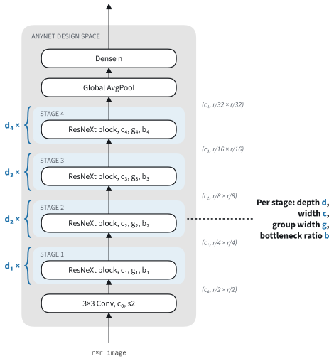
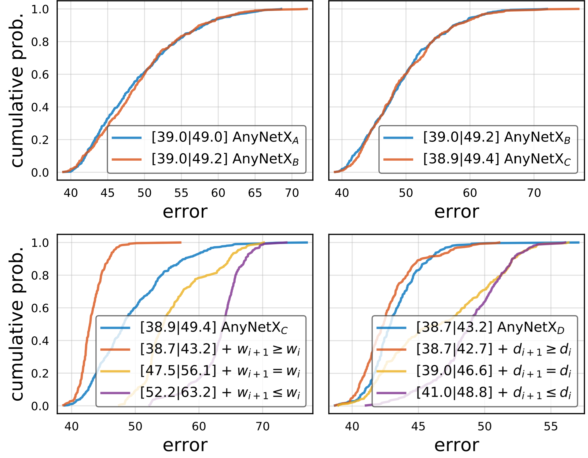

```{.python .input}
%load_ext d2lbook.tab
tab.interact_select('mxnet', 'pytorch', 'tensorflow', 'jax')
```

# Convolutional Network Design Spaces
:label:`sec_cnn-design`

Most of the networks we built in this chapter were designed by hand, fixing a
small set of structural hyperparameters at every stage: how many blocks to
stack, how many channels each stage emits, and which block topology to use.
Where do those numbers come from, and are there general principles governing
them? Looking back across our models offers surprisingly little guidance:
ResNet-18 uses $(2, 2, 2, 2)$ blocks per stage, ResNet-50 uses $(3, 4, 6, 3)$,
and ConvNeXt-T uses $(3, 3, 9, 3)$—borrowed from Swin and validated once.
Worse, these parameters interact tightly: under a fixed compute budget, making
a stage deeper forces it to be narrower, and grouped convolutions free up
compute for wider channels. Exhaustive search is out of the question: with
four numbers per stage across four stages, even two choices per number yield
$2^{16} = 65{,}536$ distinct networks, each requiring its own training run.
And even if brute force unearthed one winning network, a single point estimate
cannot reveal *which* design choices mattered or how to adapt them to a new
compute budget or building block.

*Neural architecture search* (NAS) :cite:`zoph2016neural,liu2018darts`, which
produced EfficientNet (:numref:`sec_efficient_cnns`), automates single-model
selection, yet like manual engineering it returns one point solution rather
than reusable scientific rules. :citet:`Radosavovic.Kosaraju.Girshick.ea.2020`
took a fundamentally different path: comparing entire *design spaces*—that is,
populations of networks generated by a shared template and a small set of
constraints. By sampling networks from a design space, training them briefly,
and checking whether a proposed constraint improves the *error distribution*
of the entire population, they distilled simple, generalizable design rules
that define the *RegNet* family. Below we implement their AnyNet template,
walk through their ImageNet population evidence (500 models per space), test
their strongest rule ourselves on two small Fashion-MNIST populations, and
train a compact RegNet head to head against ResNet-18.

```{.python .input #cnn-design-designing-convolutional-network-architectures}
%%tab mxnet
import math
import numpy as np
from mxnet import autograd, gluon, init, np as mnp, npx
from mxnet.gluon import nn
from d2l import mxnet as d2l
npx.set_np()
```

```{.python .input #cnn-design-designing-convolutional-network-architectures}
%%tab pytorch
import math
import numpy as np
import torch
from torch import nn
from torch.nn import functional as F
from d2l import torch as d2l
```

```{.python .input #cnn-design-designing-convolutional-network-architectures}
%%tab tensorflow
import math
import numpy as np
import tensorflow as tf
from d2l import tensorflow as d2l
```

```{.python .input #cnn-design-designing-convolutional-network-architectures}
%%tab jax
import math
import numpy as np
import jax
from jax import numpy as jnp
from flax import nnx
import optax
from d2l import jax as d2l
```

## The AnyNet Design Space
:label:`subsec_the-anynet-design-space`

Across this chapter, modern convnets converged on the three-part
stem--body--head template introduced in :numref:`sec_googlenet`. The *stem*
processes raw pixels with one or a few convolutions and usually downsamples
immediately; the *body* performs the bulk of the computation through a
sequence of *stages*, each repeating a uniform *block* at a fixed resolution
while halving spatial dimensions and widening channels at every stage
boundary; and the *head* maps the final feature tensor to class logits via
global average pooling and a linear layer. ResNet's four stages emit features
at $1/4$, $1/8$, $1/16$, and $1/32$ of the input resolution—a multi-scale
pyramid that endured all the way to ConvNeXt largely because downstream object
detectors and segmentation heads tap all four scales simultaneously
(:numref:`sec_multiscale-object-detection`).

### Stage Parameters of Hand-Designed Networks

:numref:`tab_hand_designed_stages` compares four landmark architectures from
this chapter side by side. Notice that while channel widths cleanly double
from stage to stage in every row, stage depths follow no obvious rule.

:Stage depths and widths of four hand-designed networks (ImageNet versions).
:label:`tab_hand_designed_stages`

| Network | Blocks per stage | Output channels per stage | Block |
|:--|:--|:--|:--|
| ResNet-18 (:numref:`sec_resnet`) | 2, 2, 2, 2 | 64, 128, 256, 512 | two $3 \times 3$ convolutions |
| ResNet-50 :cite:`He.Zhang.Ren.ea.2016` | 3, 4, 6, 3 | 256, 512, 1024, 2048 | $1 \times 1$, $3 \times 3$, $1 \times 1$ bottleneck |
| ResNeXt-50 (:numref:`subsec_resnext`) | 3, 4, 6, 3 | 256, 512, 1024, 2048 | bottleneck with 32 groups |
| ConvNeXt-T (:numref:`sec_convnext`) | 3, 3, 9, 3 | 96, 192, 384, 768 | $7 \times 7$ depthwise, inverted bottleneck |

The *AnyNet* design space of :citet:`Radosavovic.Kosaraju.Girshick.ea.2020`
locks in this macro template while leaving stage hyperparameters free
(:numref:`fig_anynet_full`). Its stem is a single stride-2 $3 \times 3$
convolution emitting $c_0 = 32$ channels, followed by batch normalization and
ReLU (reading RGB images on ImageNet and a single grayscale channel on
Fashion-MNIST). Its body comprises four stages, where stage $i$ stacks $d_i$
ResNeXt blocks (:numref:`fig_resnext_block`): a $1 \times 1$ convolution
projects $c_i$ channels to $c_i / b_i$, a grouped $3 \times 3$ convolution
processes groups of $g_i$ channels, and a second $1 \times 1$ convolution
restores $c_i$ channels, with batch normalization after every convolution and
a residual shortcut. (Note the paper's notation: $b_i$ is the *bottleneck
ratio*, so the bottleneck width that :numref:`subsec_resnext` denoted $b$ is
$c_i / b_i$ here.) The opening block of each stage halves spatial resolution
with stride 2 and projects the shortcut via a stride-2 $1 \times 1$
convolution. Global average pooling and a linear classifier form the head.

![The AnyNet design space: a stem, a body of four stages, and a head. Stage $\mathit{i}$ repeats a ResNeXt block $\mathit{d_i}$ times; the first block of each stage halves the resolution. The annotations give the number of channels and the resolution after each part for an $\mathit{r} \times \mathit{r}$ input; the head outputs $\mathit{n}$ class scores. The free choices per stage are the depth $\mathit{d_i}$, the width $\mathit{c_i}$, the group width $\mathit{g_i}$, and the bottleneck ratio $\mathit{b_i}$.](../img/arch-anynet.svg)
:label:`fig_anynet_full`

Each stage therefore exposes four degrees of freedom: depth $d_i$, output
width $c_i$, bottleneck ratio $b_i \geq 1$, and *group width* $g_i$ (the
number of channels per group—careful not to confuse this with the *group
count* $g$ in :numref:`subsec_resnext`, which remains the meaning of the
`groups` argument in `d2l.ResNeXtBlock`). Across four stages, these 16 free
numbers—sampling depths up to 16, widths up to 1024 in steps of 8, bottleneck
ratios in $\{1, 2, 4\}$, and power-of-two group widths up to 32—span roughly
$(16 \cdot 128 \cdot 3 \cdot 6)^4 \approx 2 \times 10^{18}$ candidate
architectures: impossible to enumerate, yet trivial to sample randomly. On
$224 \times 224$ ImageNet inputs, the stem and four stages perform five
spatial halvings, ending at $224 / 2^5 = 7 \times 7$.

### Implementing AnyNet

To explore this space in code, we build a general `AnyNet` constructor driven
by stage tuples, starting with its three-layer stem.

```{.python .input #cnn-design-the-anynet-design-space-1}
%%tab mxnet
class AnyNet(d2l.Classifier):
    def stem(self, num_channels):
        net = nn.HybridSequential()
        net.add(nn.Conv2D(num_channels, kernel_size=3, padding=1, strides=2,
                          use_bias=False),
                nn.BatchNorm(), nn.Activation('relu'))
        return net
```

```{.python .input #cnn-design-the-anynet-design-space-1}
%%tab pytorch
class AnyNet(d2l.Classifier):
    def stem(self, num_channels):
        return nn.Sequential(
            nn.LazyConv2d(num_channels, kernel_size=3, stride=2, padding=1,
                          bias=False),
            nn.LazyBatchNorm2d(), nn.ReLU())
```

```{.python .input #cnn-design-the-anynet-design-space-1}
%%tab tensorflow
def he_init():  # He initialization; Keras needs one instance per layer
    return tf.keras.initializers.VarianceScaling(2.0, 'fan_in',
                                                 'untruncated_normal')

class AnyNet(d2l.Classifier):
    def stem(self, num_channels):
        return tf.keras.models.Sequential([
            tf.keras.layers.ZeroPadding2D(1),  # Pad every side
            tf.keras.layers.Conv2D(num_channels, kernel_size=3, strides=2,
                                   use_bias=False,
                                   kernel_initializer=he_init()),
            tf.keras.layers.BatchNormalization(momentum=0.9, epsilon=1e-5),
            tf.keras.layers.Activation('relu')])
```

```{.python .input #cnn-design-the-anynet-design-space-1}
%%tab jax
he = nnx.initializers.variance_scaling(2.0, 'fan_in', 'normal')

class AnyNet(d2l.Classifier):
    def __init__(self, arch, stem_channels, lr=0.1, num_classes=10,
                 in_channels=1, rngs=None):
        super().__init__()
        self.save_hyperparameters(ignore=['rngs'])
        rngs = nnx.Rngs(d2l.get_key()) if rngs is None else rngs
        self.net = self.create_net(in_channels, rngs)

    def stem(self, in_channels, num_channels, rngs):
        return nnx.Sequential(
            nnx.Conv(in_channels, num_channels, kernel_size=(3, 3),
                     strides=(2, 2), padding=(1, 1), use_bias=False,
                     kernel_init=he, rngs=rngs),
            nnx.BatchNorm(num_channels, momentum=0.9,
                          use_fast_variance=False, rngs=rngs), nnx.relu)
```

Each stage stacks `depth` instances of `d2l.ResNeXtBlock`
(:numref:`subsec_resnext`) parameterized by output width $c_i$, number of
groups, and `bot_mul` $= 1/b_i$ (so group width equals $(c_i/b_i)/\text{groups}$),
with stride 2 applied only to the opening block.

```{.python .input #cnn-design-the-anynet-design-space-2}
%%tab mxnet
@d2l.add_to_class(AnyNet)
def stage(self, depth, num_channels, groups, bot_mul):
    net = nn.HybridSequential()
    for i in range(depth):
        if i == 0:
            net.add(d2l.ResNeXtBlock(
                num_channels, groups, bot_mul, use_1x1conv=True, strides=2))
        else:
            net.add(d2l.ResNeXtBlock(
                num_channels, groups, bot_mul))
    return net
```

```{.python .input #cnn-design-the-anynet-design-space-2}
%%tab pytorch
@d2l.add_to_class(AnyNet)
def stage(self, depth, num_channels, groups, bot_mul):
    blk = []
    for i in range(depth):
        if i == 0:
            blk.append(d2l.ResNeXtBlock(num_channels, groups, bot_mul,
                use_1x1conv=True, strides=2))
        else:
            blk.append(d2l.ResNeXtBlock(num_channels, groups, bot_mul))
    return nn.Sequential(*blk)
```

```{.python .input #cnn-design-the-anynet-design-space-2}
%%tab tensorflow
@d2l.add_to_class(AnyNet)
def stage(self, depth, num_channels, groups, bot_mul):
    net = tf.keras.models.Sequential()
    for i in range(depth):
        if i == 0:
            net.add(d2l.ResNeXtBlock(num_channels, groups, bot_mul,
                use_1x1conv=True, strides=2))
        else:
            net.add(d2l.ResNeXtBlock(num_channels, groups, bot_mul))
    return net
```

```{.python .input #cnn-design-the-anynet-design-space-2}
%%tab jax
@d2l.add_to_class(AnyNet)
def stage(self, depth, num_channels, groups, bot_mul, in_channels, rngs):
    blk = []
    for i in range(depth):
        if i == 0:
            blk.append(d2l.ResNeXtBlock(num_channels, groups, bot_mul,
                use_1x1conv=True, strides=(2, 2), in_channels=in_channels,
                rngs=rngs))
        else:
            blk.append(d2l.ResNeXtBlock(num_channels, groups, bot_mul,
                                        in_channels=num_channels, rngs=rngs))
    return nnx.Sequential(*blk)
```

Assembling the stem, one stage per `(depth, num_channels, groups, bot_mul)`
entry in `arch`, and the global-pooling head completes `AnyNet`. As in
:numref:`sec_resnet`, all convolutional and linear weights use He
initialization (:numref:`subsec_he_init`), and convolutions omit biases before
batch normalization.

```{.python .input #cnn-design-the-anynet-design-space-3}
%%tab mxnet
@d2l.add_to_class(AnyNet)
def __init__(self, arch, stem_channels, lr=0.1, num_classes=10):
    super(AnyNet, self).__init__()
    self.save_hyperparameters()
    self.net = nn.HybridSequential()
    self.net.add(self.stem(stem_channels))
    for s in arch:
        self.net.add(self.stage(*s))
    self.net.add(nn.GlobalAvgPool2D(), nn.Dense(num_classes))
    self.net.initialize(init.MSRAPrelu('in', 0))  # He initialization
    self.net.hybridize()  # Compile the network into one graph
```

```{.python .input #cnn-design-the-anynet-design-space-3}
%%tab pytorch
@d2l.add_to_class(AnyNet)
def __init__(self, arch, stem_channels, lr=0.1, num_classes=10):
    super(AnyNet, self).__init__()
    self.save_hyperparameters()
    self.net = nn.Sequential(self.stem(stem_channels))
    for i, s in enumerate(arch):
        self.net.add_module(f'stage{i+1}', self.stage(*s))
    self.net.add_module('head', nn.Sequential(
        nn.AdaptiveAvgPool2d((1, 1)), nn.Flatten(),
        nn.LazyLinear(num_classes)))

@d2l.add_to_class(AnyNet)
def weight_init(self, module):
    # The Trainer calls this after the first minibatch fixed the shapes
    if type(module) in (nn.Linear, nn.Conv2d):
        nn.init.kaiming_normal_(module.weight, nonlinearity='relu')
        if module.bias is not None:
            nn.init.zeros_(module.bias)
```

```{.python .input #cnn-design-the-anynet-design-space-3}
%%tab tensorflow
@d2l.add_to_class(AnyNet)
def __init__(self, arch, stem_channels, lr=0.1, num_classes=10):
    super(AnyNet, self).__init__()
    self.save_hyperparameters()
    self.net = tf.keras.models.Sequential([self.stem(stem_channels)])
    for s in arch:
        self.net.add(self.stage(*s))
    self.net.add(tf.keras.models.Sequential([
        tf.keras.layers.GlobalAvgPool2D(),
        tf.keras.layers.Dense(num_classes, kernel_initializer=he_init())]))
```

```{.python .input #cnn-design-the-anynet-design-space-3}
%%tab jax
@d2l.add_to_class(AnyNet)
def create_net(self, in_channels, rngs):
    layers = [self.stem(in_channels, self.stem_channels, rngs)]
    stage_channels = self.stem_channels
    for s in self.arch:
        layers.append(self.stage(*s, stage_channels, rngs))
        stage_channels = s[1]
    layers.append(nnx.Sequential(
        global_avg_pool,
        nnx.Linear(stage_channels, self.num_classes, kernel_init=he,
                   rngs=rngs)))
    return nnx.Sequential(*layers)

def global_avg_pool(X):  # Average over height and width (NHWC)
    return X.mean(axis=(1, 2))
```

Because every sampled model in a design space must be judged under the exact
same training protocol, we attach the optimizer directly to `AnyNet`—matching
the protocol used by :citet:`Radosavovic.Kosaraju.Girshick.ea.2020` (and
Recipe A in :numref:`sec_training_recipes`): SGD with momentum 0.9
(:numref:`sec_efficient_cnns`, :numref:`chap_optimization`), coupled weight
decay (:numref:`sec_weight_decay`), and our chapter-wide `d2l.cosine_warmup`
schedule (:numref:`sec_alexnet`, warming up over the first 10% of `num_steps`
to `lr` and decaying along a half-cosine to zero). Whereas the paper sets
weight decay to $5 \times 10^{-5}$ for 100 ImageNet epochs, for our shorter
Fashion-MNIST runs we use $10^{-3}$, which tuned best for `RegNetX32`
(:numref:`subsec_regnet`) while performing equally well for `ResNet18`.

```{.python .input #cnn-design-training-1}
%%tab mxnet
@d2l.add_to_class(AnyNet)
def configure_optimizers(self):
    warmup = self.num_steps // 10
    schedule = lambda t: self.lr * d2l.cosine_warmup(  # MXNet counts
        t - 1, self.num_steps, warmup)  # updates from 1
    return gluon.Trainer(self.collect_params(), 'sgd', {
        'learning_rate': None, 'lr_scheduler': schedule,
        'momentum': 0.9, 'wd': 1e-3})  # wd: weight decay in the gradient
```

```{.python .input #cnn-design-training-1}
%%tab pytorch
@d2l.add_to_class(AnyNet)
def configure_optimizers(self):
    optim = torch.optim.SGD(self.parameters(), lr=self.lr, momentum=0.9,
                            weight_decay=1e-3)  # Decay added to the gradient
    warmup = self.num_steps // 10
    schedule = torch.optim.lr_scheduler.LambdaLR(
        optim, lambda t: d2l.cosine_warmup(t, self.num_steps, warmup))
    return optim, schedule  # The Trainer steps it after every minibatch
```

```{.python .input #cnn-design-training-1}
%%tab tensorflow
class CoupledSGD(tf.keras.optimizers.SGD):
    """SGD that adds weight decay to the gradient (L2 regularization)."""
    def __init__(self, weight_decay, **kwargs):
        super().__init__(**kwargs)
        self.l2 = weight_decay

    def apply_gradients(self, grads_and_vars):
        return super().apply_gradients(
            [(g + self.l2 * v, v) for g, v in grads_and_vars])

@d2l.add_to_class(AnyNet)
def configure_optimizers(self):
    warmup = self.num_steps // 10
    schedule = lambda: self.lr * d2l.cosine_warmup(
        optim.iterations, self.num_steps, warmup)
    optim = CoupledSGD(1e-3, learning_rate=schedule, momentum=0.9)
    return optim
```

```{.python .input #cnn-design-training-1}
%%tab jax
@d2l.add_to_class(AnyNet)
def configure_optimizers(self):
    warmup = self.num_steps // 10
    schedule = lambda t: self.lr * d2l.cosine_warmup(
        t, self.num_steps, warmup)
    return optax.chain(optax.add_decayed_weights(1e-3),  # In the gradient
                       optax.sgd(schedule, momentum=0.9))
```

:begin_tab:`tensorflow`
The `weight_decay` argument of a Keras optimizer shrinks the weights directly,
outside the momentum buffer. `CoupledSGD`, as in
:numref:`sec_training_recipes`, adds the decay to the gradient instead.
:end_tab:

## Comparing Design Spaces
:label:`subsec_design_space_distributions`

How can we compare two massive design spaces without ever finding the single
best architecture in either? :citet:`radosavovic2019network` rely on four
working assumptions so that a modestly sized sample of briefly trained models
can faithfully represent an entire space:

1. **Good principles are abundant.** Many networks satisfying sound design
   rules perform well—there are many good needles in the haystack—so
   optimizing a *distribution* over architectures is meaningful.
1. **Short-run ranking transfers.** Validation accuracy after a brief training
   run correlates well with final converged accuracy (enabling 10-epoch
   ImageNet runs in the paper and 1-epoch Fashion-MNIST runs below).
1. **Small-scale findings extrapolate.** Rules discovered at low compute
   budgets continue to hold when scaled up to large models (verified at scale
   at the end).
1. **Design factors roughly decouple.** Individual structural constraints can
   be evaluated sequentially without severe hidden interactions.

None of these four assumptions is guaranteed a priori—the second and third are
especially strong—and the exercises below test them directly at small scale.

Accepting these assumptions, we draw $n$ random networks from a space, train
each briefly, and record their validation errors $e_1, \ldots, e_n$. The
*empirical cumulative distribution function* (CDF) gives, at every error
threshold $e$, the fraction of sampled models achieving error at most $e$:

$$\hat{F}(e) = \frac{1}{n}\sum_{j=1}^n \mathbf{1}(e_j \leq e).$$
:eqlabel:`eq_edf`

The higher and farther left a CDF curve rises, the richer the space is in
accurate networks. When one space's CDF lies uniformly above another's, a
randomly drawn model from the first space beats any error threshold with
higher probability—even if the single best model in both spaces happens to
coincide.

Using this lens, :citet:`Radosavovic.Kosaraju.Girshick.ea.2020` sampled 500
networks per space at ~400 million multiply-adds (400 MFLOPs), trained each
for 10 ImageNet epochs, and plotted the resulting CDFs in
:numref:`fig_regnet-fig`, tightening the unconstrained AnyNetX$_A$ space one
rule at a time. Sharing a single bottleneck ratio $b$ across all four stages
(AnyNetX$_B$) and then sharing a single group width $g$ (AnyNetX$_C$) leaves
the error distribution untouched (mean error ~49%)—a major win in its own
right, eliminating 6 of the 16 free hyperparameters for free. The dramatic
breakthrough comes from constraining *stage widths*: requiring nondecreasing
widths ($c_{i+1} \geq c_i$) slashes mean population error by six full points
to ~43%, whereas constant or shrinking widths degrade mean error to 56% and
63%. Requiring nondecreasing depths ($d_{i+1} \geq d_i$) trims another half
point while constant or shrinking depths fall behind.

![Error CDFs of design spaces, reproduced from :citet:`Radosavovic.Kosaraju.Girshick.ea.2020`: 500 networks sampled from each space, each trained for 10 epochs on ImageNet at about 400 million multiply-adds. Legends give the minimum and mean top-1 error in percent; $w_i$ is the paper's symbol for the width $c_i$. Top: one bottleneck ratio for all stages (AnyNetX$_B$) against none (AnyNetX$_A$), then one group width as well (AnyNetX$_C$). Bottom: widths that increase, stay equal, or decrease across stages; then depths that do the same in the space with increasing widths (AnyNetX$_D$).](../img/regnet-fig.png)
:label:`fig_regnet-fig`

Because empirical rules depend on the dataset, compute budget, and block type,
it is instructive to apply the exact same population methodology to
Fashion-MNIST for the single strongest rule: growing versus shrinking widths.
We define two two-stage spaces using a 32-channel stem and ResNeXt blocks
($b = 1$, group width 16), drawing stage depths $d_i \in \{1, \ldots, 8\}$ and
widths $c_i \in \{16, 32, \ldots, 256\}$ subject to $c_1 < c_2$ in one space
and $c_1 > c_2$ in the other. Just as in the paper, we match compute budgets
by tallying multiply-adds across the stem, every block, and all projection
shortcuts (:numref:`sec_alexnet`).

```{.python .input #cnn-design-comparing-design-spaces-1}
def mult_adds(arch, r, stem_channels=32, group_width=16, num_classes=10):
    """Multiply-adds of an AnyNet with k = 1 for one r x r image; arch holds
    (depth, width) for each stage."""
    r //= 2  # The stem halves the resolution
    total, c_in = r * r * 9 * stem_channels, stem_channels  # Grayscale input
    for d, c in arch:
        total += r * r * c_in * c  # First 1 x 1 convolution, before the stride
        r //= 2
        total += r * r * c_in * c  # 1 x 1 convolution of the shortcut
        total += r * r * c * c * (2 * d - 1)  # The other 1 x 1 convolutions
        total += r * r * 9 * group_width * c * d  # Grouped 3 x 3 convolutions
        c_in = c
    return total + c_in * num_classes  # Linear head
```

To draw a candidate model, we sample two depths and two distinct widths, sort
the widths according to the space's constraint, and accept the draw only if
its multiply-adds fall within 20% of our 112M budget per $96 \times 96$ image
(matching the `RegNetX32` model we train in :numref:`subsec_regnet`).

```{.python .input #cnn-design-comparing-design-spaces-2}
def sample_arch(rng, increasing, r=96, budget=112e6):
    """Depths and widths of two stages at about `budget` multiply-adds."""
    while True:
        depths = rng.integers(1, 9, size=2).tolist()
        widths = sorted(rng.choice(np.arange(16, 257, 16), 2, replace=False)
                        .tolist(), reverse=not increasing)
        arch = tuple(zip(depths, widths))
        if abs(mult_adds(arch, r) / budget - 1) <= 0.2:
            return arch

rng = np.random.default_rng()
for increasing in (True, False):
    arch = sample_arch(rng, increasing)
    print(arch, f'{mult_adds(arch, 96) / 1e6:.0f} million multiply-adds')
```

At matched compute, models with decreasing widths spend their channels on
high-resolution early maps and narrow down at the top. Below we train each
sampled architecture for one epoch (one-tenth of our full runs in
:numref:`subsec_regnet`) using `AnyNet`'s optimizer and record its validation
error.

```{.python .input #cnn-design-comparing-design-spaces-3}
%%tab mxnet, pytorch, jax
def population_errors(rng, increasing, data, n, num_epochs=1):
    """Validation errors of n networks sampled from one design space."""
    errors = []
    for _ in range(n):
        arch = sample_arch(rng, increasing)
        model = AnyNet(tuple((d, c, c // 16, 1) for d, c in arch), 32)
        model.num_steps = num_epochs * len(data.train_dataloader())
        trainer = d2l.Trainer(max_epochs=num_epochs, num_gpus=1)
        trainer.board.display = False  # We plot the errors ourselves
        trainer.fit(model, data)
        errors.append(1 - float(trainer.history['val_acc'][-1]))
    return np.array(errors)
```

```{.python .input #cnn-design-comparing-design-spaces-3}
%%tab tensorflow
def population_errors(rng, increasing, data, n, num_epochs=1):
    """Validation errors of n networks sampled from one design space."""
    errors = []
    for _ in range(n):
        arch = sample_arch(rng, increasing)
        trainer = d2l.Trainer(max_epochs=num_epochs)
        trainer.board.display = False  # We plot the errors ourselves
        with d2l.try_gpu():
            model = AnyNet(tuple((d, c, c // 16, 1) for d, c in arch), 32)
            model.num_steps = num_epochs * len(data.train_dataloader())
            trainer.fit(model, data)
        errors.append(1 - float(trainer.history['val_acc'][-1]))
    return np.array(errors)
```

We draw and train 12 models per space (24 single-epoch runs in all).

```{.python .input #cnn-design-comparing-design-spaces-4}
data = d2l.FashionMNIST(batch_size=128, resize=(96, 96))
spaces = {'increasing widths': True, 'decreasing widths': False}
errors = {name: population_errors(rng, increasing, data, 12)
          for name, increasing in spaces.items()}
```

Plotting the empirical CDF :eqref:`eq_edf` produces a step function jumping by
$1/n$ at each sorted validation error.

```{.python .input #cnn-design-comparing-design-spaces-5}
def ecdf(e):
    """Corners of the step function of the empirical CDF of e."""
    e = np.sort(e)
    return np.repeat(e, 2), np.repeat(np.arange(len(e) + 1) / len(e), 2)[1:-1]

X, Y = zip(*(ecdf(e) for e in errors.values()))
d2l.plot(list(X), list(Y), xlabel='validation error',
         ylabel='fraction of networks', legend=list(errors),
         legend_loc='outside', figsize=(5, 2.5))
for name, e in errors.items():
    print(f'{name}: mean error {e.mean():.3f}, minimum {e.min():.3f}')
```

Here, the two CDFs largely overlap: across repeated draws, mean errors hover
near 12% and differ by less than a single percentage point (usually nudging in
favor of increasing widths), while the best models in both spaces land around
11%. A constraint worth twenty full points of mean error on ImageNet shrinks
to under a point on Fashion-MNIST—too small for 12 samples per space to
separate cleanly. That is a sobering yet illuminating finding: on an easy
ten-class dataset where almost any reasonable convnet hits ~88% in a single
epoch, architectural constraints have little room to separate populations.
Design rules are never universal laws; their magnitude depends directly on the
complexity of the task they were discovered on.

## RegNet
:label:`subsec_regnet`

### Design Principles

Combining the surviving constraints from ImageNet defines the compact
AnyNetX$_E$ design space:

* a single shared bottleneck ratio $b$ across all stages;
* a single shared group width $g$ across all stages;
* nondecreasing stage widths, $c_{i} \leq c_{i+1}$;
* nondecreasing stage depths, $d_{i} \leq d_{i+1}$.

Inspecting the top-performing networks inside AnyNetX$_E$ reveals one further
striking pattern. Indexing blocks sequentially as $j = 0, 1, \ldots$ from
bottom to top, optimal block widths follow a simple linear ramp,

$$u_j = u_0 + a j,$$

parameterized by an initial width $u_0$ and slope $a > 0$. Because every block
inside a stage shares one width, RegNet quantizes each $u_j$ onto a geometric
grid—just like the doubling widths of hand-crafted networks in
:numref:`tab_hand_designed_stages`—grouping consecutive blocks that snap to
the same quantized width into a single stage to form a clean staircase
(problem :exref:`ex_cnn-design-quantized-widths` works out an explicit
example). Surprisingly, the authors also found that $b = 1$ (no internal
bottleneck compression at all) consistently outperforms the $b = 4$
bottlenecks of ResNet-50 and ResNeXt-50. Combining quantized linear widths
with $b = 1$ defines the *RegNetX* family, collapsing 16 arbitrary stage
numbers down to just a few interpretable parameters per compute budget.

### RegNetX32 on Fashion-MNIST

Let us now construct a compact RegNet-style network obeying these rules and
compare it directly with ResNet-18. Because upsampled $96 \times 96$
Fashion-MNIST images originate from $28 \times 28$ thumbnails, running four
stages (five halvings) would shrink the final stages to tiny $6 \times 6$ and
$3 \times 3$ grids; we therefore use two stages operating at $24 \times 24$
and $12 \times 12$ (problem :exref:`ex_cnn-design-four-stages` tests four
stages). Behind a 32-channel stem, we hand-pick increasing depths and widths—stage
1 with $d_1 = 4$, $c_1 = 64$ and stage 2 with $d_2 = 6$, $c_2 = 160$—together
with $b = 1$ and shared group width $g = 16$ (giving $64/16 = 4$ and
$160/16 = 10$ groups). One stem convolution, ten three-layer blocks, and one
linear classifier total 32 layers, giving `RegNetX32`.

```{.python .input #cnn-design-regnet-1}
%%tab mxnet, pytorch, tensorflow
class RegNetX32(AnyNet):
    def __init__(self, lr=0.1, num_classes=10, num_steps=None):
        stem_channels, group_width, bot_mul = 32, 16, 1
        depths, channels = (4, 6), (64, 160)
        super().__init__(  # The number of groups is c_i / g
            tuple((d, c, c // group_width, bot_mul)
                  for d, c in zip(depths, channels)),
            stem_channels, lr, num_classes)
        self.num_steps = num_steps  # Length of the learning-rate schedule
```

```{.python .input #cnn-design-regnet-1}
%%tab jax
class RegNetX32(AnyNet):
    def __init__(self, lr=0.1, num_classes=10, num_steps=None,
                 in_channels=1, rngs=None):
        stem_channels, group_width, bot_mul = 32, 16, 1
        depths, channels = (4, 6), (64, 160)
        super().__init__(  # The number of groups is c_i / g
            tuple((d, c, c // group_width, bot_mul)
                  for d, c in zip(depths, channels)),
            stem_channels, lr, num_classes, in_channels, rngs)
        self.num_steps = num_steps  # Length of the learning-rate schedule
```

Inspecting `layer_summary` confirms that spatial resolution steps down cleanly
from $96 \to 48 \to 24 \to 12$ as channel depth grows.

```{.python .input #cnn-design-regnet-2}
%%tab mxnet, pytorch
RegNetX32().layer_summary((1, 1, 96, 96))
```

```{.python .input #cnn-design-regnet-2}
%%tab tensorflow
RegNetX32().layer_summary((1, 96, 96, 1))
```

```{.python .input #cnn-design-regnet-2}
%%tab jax
RegNetX32().layer_summary((1, 96, 96, 1))
```

Tallying arithmetic as in :numref:`sec_alexnet`, `RegNetX32` executes 112
million multiply-adds per $96 \times 96$ image—nearly three times fewer than
ResNet-18's 319 million.

Let us train `RegNetX32` on $96 \times 96$ Fashion-MNIST for 10 epochs with
batch size 128 using `AnyNet`'s momentum-SGD optimizer at peak rate 0.1 (with
one epoch of warmup).


```{.python .input #cnn-design-training}
%%tab mxnet, pytorch, jax
data = d2l.FashionMNIST(batch_size=128, resize=(96, 96))
model = RegNetX32(lr=0.1, num_steps=10 * len(data.train_dataloader()))
trainer = d2l.Trainer(max_epochs=10, num_gpus=1)
trainer.fit(model, data)
```

```{.python .input #cnn-design-training}
%%tab tensorflow
data = d2l.FashionMNIST(batch_size=128, resize=(96, 96))
trainer = d2l.Trainer(max_epochs=10)
with d2l.try_gpu():
    model = RegNetX32(lr=0.1, num_steps=10 * len(data.train_dataloader()))
    trainer.fit(model, data)
```

Let us print its parameter count and final validation accuracy.

```{.python .input #cnn-design-training-2}
print(f'{d2l.num_params(model):,} parameters, validation accuracy '
      f'{trainer.history["val_acc"][-1]:.3f}')
```

To keep the comparison strictly controlled, we train ResNet-18 under the exact
same `AnyNet` optimizer. Because ResNet-18 shares the same stem--body--head
structure, we simply subclass `AnyNet` and override `stem` and `stage` using
`d2l.Residual` (:numref:`sec_resnet`), passing `(depth, width, stride)` for
each stage.

```{.python .input #cnn-design-regnetx32-on-fashion-mnist-1}
%%tab mxnet
class ResNet18(AnyNet):
    def __init__(self, lr=0.1, num_classes=10, num_steps=None):
        super().__init__(((2, 64, 1), (2, 128, 2), (2, 256, 2), (2, 512, 2)),
                         64, lr, num_classes)
        self.num_steps = num_steps

    def stem(self, num_channels):
        net = nn.HybridSequential()
        net.add(nn.Conv2D(num_channels, kernel_size=7, strides=2, padding=3,
                          use_bias=False),
                nn.BatchNorm(), nn.Activation('relu'),
                nn.MaxPool2D(pool_size=3, strides=2, padding=1))
        return net

    def stage(self, depth, num_channels, stride):
        net = nn.HybridSequential()
        net.add(d2l.Residual(num_channels, use_1x1conv=stride > 1,
                             strides=stride))
        for _ in range(depth - 1):
            net.add(d2l.Residual(num_channels))
        return net
```

```{.python .input #cnn-design-regnetx32-on-fashion-mnist-1}
%%tab pytorch
class ResNet18(AnyNet):
    def __init__(self, lr=0.1, num_classes=10, num_steps=None):
        super().__init__(((2, 64, 1), (2, 128, 2), (2, 256, 2), (2, 512, 2)),
                         64, lr, num_classes)
        self.num_steps = num_steps

    def stem(self, num_channels):
        return nn.Sequential(
            nn.LazyConv2d(num_channels, kernel_size=7, stride=2, padding=3,
                          bias=False),
            nn.LazyBatchNorm2d(), nn.ReLU(),
            nn.MaxPool2d(kernel_size=3, stride=2, padding=1))

    def stage(self, depth, num_channels, stride):
        blk = [d2l.Residual(num_channels, use_1x1conv=stride > 1,
                            strides=stride)]
        blk += [d2l.Residual(num_channels) for _ in range(depth - 1)]
        return nn.Sequential(*blk)
```

```{.python .input #cnn-design-regnetx32-on-fashion-mnist-1}
%%tab tensorflow
class ResNet18(AnyNet):
    def __init__(self, lr=0.1, num_classes=10, num_steps=None):
        super().__init__(((2, 64, 1), (2, 128, 2), (2, 256, 2), (2, 512, 2)),
                         64, lr, num_classes)
        self.num_steps = num_steps

    def stem(self, num_channels):
        return tf.keras.models.Sequential([
            tf.keras.layers.ZeroPadding2D(3),  # Pad every side
            tf.keras.layers.Conv2D(num_channels, kernel_size=7, strides=2,
                                   use_bias=False,
                                   kernel_initializer=he_init()),
            tf.keras.layers.BatchNormalization(momentum=0.9, epsilon=1e-5),
            tf.keras.layers.Activation('relu'),
            tf.keras.layers.ZeroPadding2D(1),  # Zeros are safe after a ReLU
            tf.keras.layers.MaxPool2D(pool_size=3, strides=2)])

    def stage(self, depth, num_channels, stride):
        net = tf.keras.models.Sequential()
        net.add(d2l.Residual(num_channels, use_1x1conv=stride > 1,
                             strides=stride))
        for _ in range(depth - 1):
            net.add(d2l.Residual(num_channels))
        return net
```

```{.python .input #cnn-design-regnetx32-on-fashion-mnist-1}
%%tab jax
class ResNet18(AnyNet):
    def __init__(self, lr=0.1, num_classes=10, num_steps=None,
                 in_channels=1, rngs=None):
        super().__init__(((2, 64, 1), (2, 128, 2), (2, 256, 2), (2, 512, 2)),
                         64, lr, num_classes, in_channels, rngs)
        self.num_steps = num_steps

    def stem(self, in_channels, num_channels, rngs):
        return nnx.Sequential(
            nnx.Conv(in_channels, num_channels, kernel_size=(7, 7),
                     strides=(2, 2), padding=3, use_bias=False,
                     kernel_init=he, rngs=rngs),
            nnx.BatchNorm(num_channels, momentum=0.9,
                          use_fast_variance=False, rngs=rngs), nnx.relu,
            max_pool)

    def stage(self, depth, num_channels, stride, in_channels, rngs):
        blk = [d2l.Residual(num_channels, use_1x1conv=stride > 1,
                            strides=(stride, stride), in_channels=in_channels,
                            rngs=rngs)]
        blk += [d2l.Residual(num_channels, in_channels=num_channels,
                             rngs=rngs) for _ in range(depth - 1)]
        return nnx.Sequential(*blk)

def max_pool(X):  # 3x3 windows, stride 2, padding 1 on every side
    return nnx.max_pool(X, window_shape=(3, 3), strides=(2, 2),
                        padding=((1, 1), (1, 1)))
```

Now we train `ResNet18` on the exact same data for 10 epochs.

```{.python .input #cnn-design-regnetx32-on-fashion-mnist-2}
%%tab mxnet, pytorch, jax
model = ResNet18(lr=0.1, num_steps=10 * len(data.train_dataloader()))
trainer = d2l.Trainer(max_epochs=10, num_gpus=1)
trainer.fit(model, data)
```

```{.python .input #cnn-design-regnetx32-on-fashion-mnist-2}
%%tab tensorflow
trainer = d2l.Trainer(max_epochs=10)
with d2l.try_gpu():
    model = ResNet18(lr=0.1, num_steps=10 * len(data.train_dataloader()))
    trainer.fit(model, data)
```

```{.python .input #cnn-design-regnetx32-on-fashion-mnist-3}
print(f'{d2l.num_params(model):,} parameters, validation accuracy '
      f'{trainer.history["val_acc"][-1]:.3f}')
```


Both architectures finish near 94% validation accuracy (93.7--94.2% across runs), yet `RegNetX32` uses only 519,658 parameters compared with ResNet-18's 11,175,370—under 5% of the weights and a third of the multiply-adds (112M vs. 319M). Three nuances frame this result:

1. **Architecture--optimizer coupling:** Under plain SGD without momentum or weight decay (:numref:`sec_resnet`), `RegNetX32` drops to ~91% while ResNet-18 reaches ~93%; `RegNetX32` pulls even only under the momentum-and-weight-decay protocol on which the RegNet space was calibrated.
2. **Dataset ceiling:** Scaling up to four-stage RegNets (RegNetX-400MF, -800MF, -1.6GF; 4.8--8.3M parameters) plateaus at the same 93--94% ceiling on Fashion-MNIST.
3. **Arithmetic vs. GPU latency:** Because grouped convolutions have lower GPU arithmetic intensity than dense ones (:numref:`sec_efficient_cnns`), an epoch of `RegNetX32` takes ~$1.5\times$ longer than ResNet-18 despite performing a third of the multiply-adds. On GPUs, RegNets run up to $5\times$ faster than EfficientNets at equal multiply-adds, and match ResNet latency at equal *activation* counts :cite:`Radosavovic.Kosaraju.Girshick.ea.2020`.

## Summary

Comparing *design spaces* shifts architectural analysis from single point estimates to error distributions over populations sampled from a parameterized template (`AnyNet`). Across 500 briefly trained ImageNet samples per space, tying a single bottleneck ratio $b = 1$ and group width $g$ across stages costs nothing while enforcing nondecreasing stage widths ($u_j = u_0 + a j$ quantized to a staircase) and depths cuts mean population error from 49% to 43%, yielding the RegNetX family. On Fashion-MNIST, `RegNetX32` matches ResNet-18's ~94% accuracy with under 5% of its parameters and a third of its multiply-adds. Across the entire chapter, a small core of structural primitives—repeatable blocks, activation normalization, and residual shortcuts—and the discipline of separating architectural gains from training-recipe gains form the foundation of modern vision backbones.

## Exercises

1. [code] **Four stages at matched budget.** `RegNetX32` uses two stages on $96 \times 96$ Fashion-MNIST. Extend it to the four stages of :numref:`fig_anynet_full`, keeping widths and depths nondecreasing across stages and the total parameter count within 10% of `RegNetX32`. Compare validation accuracy and time per epoch against `RegNetX32`, and state the spatial feature-map resolution at which each of the four stages operates.
   :exlabel:`ex_cnn-design-four-stages`

1. **Quantized linear widths.** :citet:`Radosavovic.Kosaraju.Girshick.ea.2020` parameterize the block widths of a $d$-block network via the linear ramp $u_j = u_0 + a\, j$ ($j = 0, \ldots, d-1$) of :numref:`subsec_regnet`, then snap each block to a geometric grid with ratio $m$:
   $$s_j = \operatorname{round}\left(\frac{\log(u_j / u_0)}{\log m}\right), \qquad \tilde{u}_j = u_0\, m^{s_j},$$
   grouping blocks with equal $\tilde{u}_j$ into a single stage.
    1. For $d = 13$, $u_0 = 24$, $a = 36.44$, and $m = 2.49$ (the paper's $w_0, w_a, w_m$ for RegNetX-200MF), compute the number of stages, the depth $d_i$ of each stage, and the stage widths rounded to the nearest multiple of 8.
    1. How do the number of stages and the staircase approximation $\tilde{u}_j \approx u_j$ behave as $m \to 1$ versus as $m$ becomes large?
    1. Which of your rounded stage widths from (a) are not divisible by a shared group width of $g = 16$, and how should they be adjusted?
   :exlabel:`ex_cnn-design-quantized-widths`

1. [code] **RegNetY (adding Squeeze-and-Excitation).** RegNetY inserts the squeeze-and-excitation gate `SE` (:numref:`subsec_se`, with reduction ratio $r = 4$) into every `ResNeXtBlock` right after its grouped $3 \times 3$ convolution :cite:`Radosavovic.Kosaraju.Girshick.ea.2020`.
    1. Build `RegNetY32` with the stage configuration of `RegNetX32`. Predict the added parameter count using the $2c^2/r$ formula and verify it against `d2l.num_params`.
    1. Train `RegNetY32` on $96 \times 96$ Fashion-MNIST and compare its validation accuracy and time per epoch against `RegNetX32`. Why does `SE` add measurable wall-clock time despite adding almost zero multiply-adds?
   :exlabel:`ex_cnn-design-regnety`

1. [code] **Breaking the RegNet rules.** ● Implement three variants of `RegNetX32` at roughly matched parameter counts that each violate one AnyNetX$_E$ rule (:numref:`subsec_regnet`): (i) decreasing stage depths ($d_1 > d_2$), (ii) unequal group widths across stages, and (iii) bottleneck compression $b_i > 1$ that differs across stages. Train each variant three times on Fashion-MNIST, compare against `RegNetX32`, and contrast your findings with the population CDFs in :numref:`fig_regnet-fig`. Why does testing a single hand-picked network per violation provide weaker evidence than comparing two empirical CDFs?
   :exlabel:`ex_cnn-design-vionet`

1. [extended] **A ConvNeXt design space.** ● Build a two-stage AnyNet design space using `ConvNeXtBlock` (:numref:`sec_convnext`, adding the expansion ratio $t \in \{2, 4\}$ as an argument) together with `ConvNeXt`'s stem and downsampling layers, sampling stage depths $d_i \in \{1, 2, 4\}$ and widths $c_i \in \{32, 64, 128\}$.
    1. Which of AnyNet's four per-stage degrees of freedom ($d_i, c_i, g_i, b_i$) have a direct counterpart in `ConvNeXtBlock`, and which are fixed by depthwise separability?
    1. Sample 16 networks from the unconstrained space, 16 with a shared expansion ratio $t_1 = t_2$, and 16 enforcing $c_1 \le c_2$ and $d_1 \le d_2$. Train each for 2 epochs on $96 \times 96$ Fashion-MNIST, plot the three empirical error CDFs :eqref:`eq_edf`, and check which RegNet principles carry over to ConvNeXt blocks.
   :exlabel:`ex_cnn-design-convnext-space`

:begin_tab:`mxnet`
[Discussions](https://d2l.discourse.group/t/7462)
:end_tab:

:begin_tab:`pytorch`
[Discussions](https://d2l.discourse.group/t/7463)
:end_tab:

:begin_tab:`tensorflow`
[Discussions](https://d2l.discourse.group/t/8738)
:end_tab:

:begin_tab:`jax`
[Discussions](https://d2l.discourse.group/t/18009)
:end_tab:

<!-- slides -->

::: {.slide}
::: {.cover}
[Dive into Deep Learning · §7.8]{.kicker}

Convolutional Network Design Spaces<br>**the AnyNet template · comparing error distributions · RegNet rules · a small RegNet on Fashion-MNIST**
:::
:::

::: {.slide title="Hand-Designed Networks Choose Their Stage Depths Without a Rule"}
[The problem]{.kicker}

| network | blocks per stage | channels per stage |
|---|---|---|
| ResNet-18 | 2, 2, 2, 2 | 64, 128, 256, 512 |
| ResNet-50 | 3, 4, 6, 3 | 256, 512, 1024, 2048 |
| ConvNeXt-T | 3, 3, 9, 3 | 96, 192, 384, 768 |

- Widths double every stage; depths follow no visible rule.
- Two values for each of 16 stage numbers: $2^{16} = 65{,}536$ networks
  to train.

::: {.d2l-note .warn}
Which choices matter, and do they carry over to a new budget?
:::
:::

::: {.slide title="By the End of This Deck You Can"}
[Goals]{.kicker}

- describe a family of networks as a template with free numbers;
- compare two design spaces by the error distribution of their samples;
- state the RegNet rules and the evidence behind each;
- build a RegNet instance from four numbers per stage and train it.

**Running example:** a 32-layer RegNetX with 0.52M parameters against the
11.2M-parameter ResNet-18 on Fashion-MNIST, both trained with one recipe.
:::

::: {.slide title="From Single Networks to Rules for Families"}
[Where this fits]{.kicker}

::: {.cols .vc}
::: {.col}
| section | adds |
|---|---|
| AlexNet | learned features, ReLU, dropout, GPUs |
| VGG, NiN, GoogLeNet | blocks, 1 × 1 convolutions, global pooling |
| Normalization Layers | batch, layer, group normalization |
| ResNet, ResNeXt, DenseNet | residual connections make depth trainable |
| Efficient Convnets | separable blocks, scaling, re-parameterization |
| Training Recipes | schedules, augmentation, weight averaging |
| ConvNeXt | a ResNet modernized one change at a time |
| **Design Spaces (RegNet)** | **rules from populations of networks** |
:::

::: {.col .narrow}
- **Uses:** the ResNeXt block (grouped bottleneck), stem-body-head,
  He initialization.
- **Skips:** neural architecture search algorithms.
:::
:::
:::

::: {.slide}
::: {.divider}
[01]{.dnum}

[The AnyNet Design Space]{.dtitle}

[one template, sixteen free numbers]{.dsub}
:::
:::

::: {.slide title="AnyNet: Stem, Four Stages of ResNeXt Blocks, Head"}
{width=52%}
:::

::: {.slide title="Four Numbers per Stage Give About 2 × 10¹⁸ Networks"}
[AnyNet]{.kicker}

| per stage | symbol | sampled values |
|---|---|---|
| depth | $d_i$ | 1 … 16 |
| width | $c_i$ | 8 … 1024, multiples of 8 |
| bottleneck ratio | $b_i$ | 1, 2, 4 |
| group width (channels per group) | $g_i$ | 1, 2, 4, …, 32 |

Four stages: 16 numbers, $(16 \cdot 128 \cdot 3 \cdot 6)^4 \approx 2 \times 10^{18}$
networks.
:::

::: {.slide}
::: {.divider}
[02]{.dnum}

[Comparing Design Spaces]{.dtitle}

[populations of briefly trained networks]{.dsub}
:::
:::

::: {.slide title="Judge a Space by the Error Distribution of Its Samples"}
[Comparison]{.kicker}

Sample $n$ networks, train each briefly, record errors $e_1, \ldots, e_n$:

$$\hat{F}(e) = \frac{1}{n}\sum_{j=1}^n \mathbf{1}(e_j \leq e)$$

- $\hat{F}(e)$: fraction of sampled networks with error at most $e$.
- A curve that lies higher is a space where good networks are common.
- Paper: 500 networks per space, 10 ImageNet epochs, about 400M multiply-adds.

Assumes: short runs rank networks as long runs do; small results carry
over to large.
:::

::: {.slide title="Tying b and g Costs Nothing; Growing Widths and Depths Helps"}
[Comparison]{.kicker}

{width=70%}
:::

::: {.slide title="Growing Widths Cut the Mean Error from 49% to 43%"}
[Comparison]{.kicker}

| constraint added | mean top-1 error |
|---|--:|
| none (AnyNetX$_A$) | ≈ 49% |
| one bottleneck ratio $b$ (narrow $c_i$ to $c_i/b$ inside the block) | ≈ 49% |
| one group width $g$ (channels per group) | ≈ 49% |
| widths grow, $c_{i+1} \ge c_i$ | **≈ 43%** |
| (widths equal / shrink) | 56% / 63% |
| depths grow, $d_{i+1} \ge d_i$ | half a point lower |

Six of 16 numbers removed at no cost, then two constraints that help.

[Radosavovic et al., 2020; 500 networks per space, 10 ImageNet epochs]{.small}
:::

::: {.slide title="On Fashion-MNIST, the Width Rule Is Worth at Most a Point"}
[Comparison]{.kicker}

@!cnn-design-comparing-design-spaces-5

- 12 two-stage networks per space: $c_1 < c_2$ against $c_1 > c_2$, at
  112M multiply-adds ± 20%, one epoch each.
- Best networks about equal (≈ 11%); mean errors near 12%, less than a
  point apart, usually in favor of growing widths.
- ImageNet: 20 points between the two spaces; Fashion-MNIST: under 1,
  too little for 12 samples to resolve.
:::

::: {.slide title="Check: How Many Free Numbers Are Left?"}
[Check]{.kicker}

AnyNet has 16 numbers. After one $b$ and one $g$ for all four stages, how
many remain? Why can a design-space comparison not name the best network?

::: {.fragment .fade-up}
::: {.d2l-note}
**Answer.** 4 depths + 4 widths + one $b$ + one $g$ = 10. The CDF compares
populations; the best network of two spaces may be the same one.
:::
:::
:::

::: {.slide}
::: {.divider}
[03]{.dnum}

[RegNet]{.dtitle}

[rules, an instance, and a training run]{.dsub}
:::
:::

::: {.slide title="RegNet: No Bottleneck, Widths That Grow Linearly with Block Index"}
[RegNet]{.kicker}

- AnyNetX$_E$: one $b$, one $g$, $c_i \le c_{i+1}$, $d_i \le d_{i+1}$.
- Best sampled networks: $b = 1$, and block $j$ has width about
  $u_j = u_0 + a j$ (initial width $u_0$, slope $a$).
- Snap each $u_j$ to a geometric grid; equal widths form a stage: a
  staircase.
- **RegNetX**: these rules; a handful of numbers per compute budget
  instead of 16.

[Radosavovic et al., 2020: beats EfficientNet at equal multiply-adds, up to 5× faster on GPUs]{.small}
:::

::: {.slide title="RegNetX32: Two Stages, Four Numbers Each"}
[RegNet]{.kicker}

| stage | depth $d$ | width $c$ | groups $c/g$ | $b$ | resolution |
|---|--:|--:|--:|--:|--:|
| stem | | 32 | | | 48×48 |
| 1 | 4 | 64 | 4 | 1 | 24×24 |
| 2 | 6 | 160 | 10 | 1 | 12×12 |

- widths and depths grow; $b = 1$ (no bottleneck); one group width $g = 16$
- 1 stem conv + 10 blocks × 3 convs + 1 linear = **32 layers**
- two stages: Fashion-MNIST has 28 × 28 pixels of detail
- 0.52M parameters, 112M multiply-adds per image (ResNet-18: 11.2M, 319M)
:::

::: {.slide title="Each Stage Halves the Resolution: 96 → 48 → 24 → 12"}
[RegNet]{.kicker}

@!cnn-design-regnet-2
:::

::: {.slide title="Ten Epochs with Momentum and Weight Decay: About 94%"}
[RegNet]{.kicker}

@!cnn-design-training

The paper's optimizer, SGD with momentum 0.9, with weight decay $10^{-3}$
added to the gradient; warmup over the first epoch to a peak of 0.1, cosine
to 0.
:::

::: {.slide title="ResNet-18 Is an AnyNet with Its Own Stem and Block"}
[RegNet]{.kicker}

| | stem | block | stages (depth, width) |
|---|---|---|---|
| RegNetX32 | 3 × 3, stride 2 | grouped bottleneck, $b = 1$, $g = 16$ | (4, 64), (6, 160) |
| ResNet-18 | 7 × 7, stride 2, max-pool | two 3 × 3 convolutions | (2, 64), (2, 128), (2, 256), (2, 512) |

- override `stem` and `stage`; the head and the optimizer are inherited
- same data, schedule, momentum 0.9, weight decay $10^{-3}$: a fair comparison
:::

::: {.slide title="RegNetX32 Matches ResNet-18 with a Third of Its Multiply-Adds"}
[RegNet]{.kicker}

| same optimizer and schedule | parameters | multiply-adds | accuracy, 10 epochs |
|---|--:|--:|--:|
| ResNet-18 (hand-designed) | 11.2M | 319M | ≈ 94% |
| RegNetX32 (four numbers per stage) | 0.52M | 112M | ≈ 94% |

@!cnn-design-training-2

@!cnn-design-regnetx32-on-fashion-mnist-3

With plain SGD instead (no momentum, no decay): ResNet-18 93%, RegNetX32
about 91%. The design rules were found under the paper's optimizer.
:::

::: {.slide title="Larger RegNets Gain Nothing: Fashion-MNIST Saturates Near 94%"}
[RegNet]{.kicker}

| same recipe, 10 epochs | parameters | multiply-adds | accuracy |
|---|--:|--:|--:|
| RegNetX32 | 0.52M | 112M | ≈ 94% |
| RegNetX-400MF / -800MF / -1.6GF (four stages) | 4.8–8.3M | | 93–94% |
| ResNet-18 | 11.2M | 319M | ≈ 94% |

- The deep four-stage models start with the last BN scale of each block
  at 0 (blocks start as the identity); without it some runs start badly.
- The dataset, not the architecture, limits the accuracy to about 94%.
:::

::: {.slide title="A Third of the Multiply-Adds, Yet Slower Steps on a GPU"}
[RegNet]{.kicker}

- An epoch of RegNetX32 takes about 1.5× as long as one of ResNet-18,
  with 112M against 319M multiply-adds per image.
- Multiply-adds count arithmetic, not time: GPU libraries run grouped
  convolutions, like depthwise ones, well below the arithmetic rate of
  dense ones.
- The paper's 5× GPU speedup is against EfficientNet. Against ResNets it
  finds similar GPU times only at equal numbers of activations.
:::

::: {.slide title="Recap"}
[Wrap-up]{.kicker}

- **Design space:** a template (stem, stages, head) with free numbers;
  AnyNet has 16.
- **Comparison:** error CDFs of 500 briefly trained samples per space;
  on Fashion-MNIST, 12 per space: within about a point.
- **Rules:** one $b$ and one $g$ (free), widths and depths that grow
  (49% → 43% mean error), $b = 1$, linear widths.
- **Fashion-MNIST:** RegNetX32, 0.52M parameters, ≈ 94% after 10 epochs:
  matches ResNet-18 trained the same way with a third of its multiply-adds.
- Rules hold for the block, budget, and protocol they were fitted on.

**Next:** RNNs and sequence models.
:::
