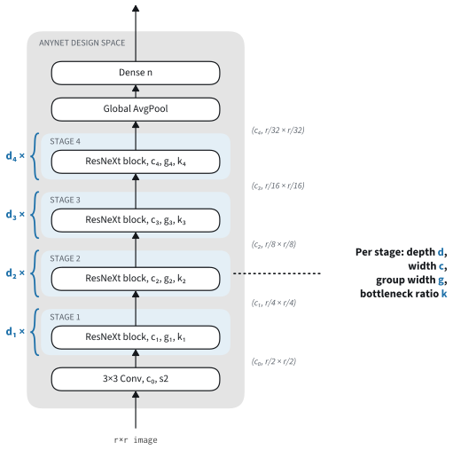
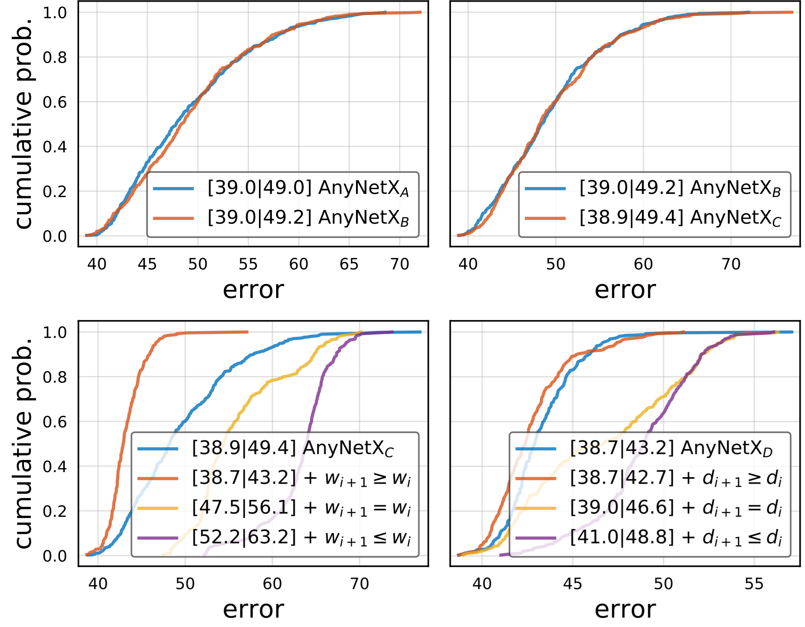

```{.python .input}
%load_ext d2lbook.tab
tab.interact_select('mxnet', 'pytorch', 'tensorflow', 'jax')
```

# Convolutional Network Design Spaces
:label:`sec_cnn-design`

Most networks in this chapter were designed by hand, and each design fixes a
few numbers for every stage: how many blocks it repeats, how many channels
they produce, and what the block looks like. ResNet-18 repeats its blocks
$(2, 2, 2, 2)$ times across four stages, ResNet-50 $(3, 4, 6, 3)$ times, and
ConvNeXt-T $(3, 3, 9, 3)$ times. ResNet's depths come with no stated rule,
and ConvNeXt-T's were copied from Swin and checked once. The choices interact: at a fixed
budget of computation, a deeper stage must be narrower, and a block with
grouped convolutions can afford more channels than one without. Trying every
combination is out of the question. With only two values for each of the
16 numbers that describe the networks of this section, there are
$2^{16} = 65{,}536$ variants, each needing its own training run. And a
single good network, however it was found, does not say which of its
choices mattered, so nothing carries over to a new compute budget or a new
block.

Neural architecture search (NAS), which found EfficientNet's base network
(:numref:`sec_efficient_cnns`), automates the hand design. It selects from
a set of candidate networks the one with the best estimated accuracy, by
reinforcement learning, evolution, or a gradient-based relaxation
:cite:`zoph2016neural,liu2018darts`. The first NAS methods trained
thousands of candidates, and like hand design, NAS returns one network
rather than a reason. Compound scaling then grows that network to larger
budgets, but it scales a fixed design rather than explaining it. :citet:`Radosavovic.Kosaraju.Girshick.ea.2020` compare whole
*design spaces* instead: populations of networks defined by a template and
a few constraints. They sample networks from a space, train each briefly,
and keep a constraint if it improves the error distribution of the whole
population. The constraints that survive are design rules, and the networks
that satisfy all of them form the RegNet family. We build the template,
read the evidence for each rule, and train a small RegNet on Fashion-MNIST.

```{.python .input #cnn-design-designing-convolutional-network-architectures}
%%tab mxnet
from d2l import mxnet as d2l
from mxnet import gluon, init, npx
from mxnet.gluon import nn
npx.set_np()
```

```{.python .input #cnn-design-designing-convolutional-network-architectures}
%%tab pytorch
from d2l import torch as d2l
import torch
from torch import nn
```

```{.python .input #cnn-design-designing-convolutional-network-architectures}
%%tab tensorflow
import tensorflow as tf
from d2l import tensorflow as d2l
```

```{.python .input #cnn-design-designing-convolutional-network-architectures}
%%tab jax
from d2l import jax as d2l
from flax import nnx
import jax
import optax
```

## The AnyNet Design Space
:label:`subsec_the-anynet-design-space`

The networks of this chapter share one template. A *stem* processes the raw
image with one or a few convolutions and usually lowers its resolution. A
*body* of *stages* does most of the work: each stage operates at one
resolution and repeats one kind of *block*, and each new stage halves the
resolution and widens the channels. A *head* turns the last feature map into
class scores; since NiN (:numref:`sec_nin`) it has been global average
pooling, followed since GoogLeNet by a linear layer. ResNet's body has four
stages, which end at $1/4$, $1/8$, $1/16$, and $1/32$ of the input
resolution. Detection and segmentation networks read features from all four
stages, coarse ones for large objects and fine ones for small objects
(:numref:`sec_multiscale-object-detection`), which is one reason this layout
has persisted from ResNet to ConvNeXt.

### Stage Parameters of Hand-Designed Networks

:numref:`tab_hand_designed_stages` lists the stages of four networks from
this chapter. Their widths double from stage to stage in every row. Their
depths follow no visible rule.

:Stage depths and widths of four hand-designed networks (ImageNet versions).
:label:`tab_hand_designed_stages`

| Network | Blocks per stage | Output channels per stage | Block |
|:--|:--|:--|:--|
| ResNet-18 (:numref:`sec_resnet`) | 2, 2, 2, 2 | 64, 128, 256, 512 | two $3 \times 3$ convolutions |
| ResNet-50 :cite:`He.Zhang.Ren.ea.2016` | 3, 4, 6, 3 | 256, 512, 1024, 2048 | $1 \times 1$, $3 \times 3$, $1 \times 1$ bottleneck |
| ResNeXt-50 (:numref:`subsec_resnext`) | 3, 4, 6, 3 | 256, 512, 1024, 2048 | bottleneck with 32 groups |
| ConvNeXt-T (:numref:`sec_convnext`) | 3, 3, 9, 3 | 96, 192, 384, 768 | $7 \times 7$ depthwise, inverted bottleneck |

The *AnyNet* design space of :citet:`Radosavovic.Kosaraju.Girshick.ea.2020`
fixes the template and leaves these numbers free
(:numref:`fig_anynet_full`). The stem is one $3 \times 3$ convolution with
stride 2 and $c_0 = 32$ output channels, followed by batch normalization and
a ReLU. In the paper it reads RGB images; ours reads the single channel of
Fashion-MNIST. The body has four stages, and stage $i$ repeats one block
$d_i$ times. The block is the ResNeXt block of
:numref:`fig_resnext_block`: a $1 \times 1$ convolution narrows the $c_i$
channels of the stage to $c_i / k_i$, a $3 \times 3$ convolution processes
them in groups of $g_i$ channels each, and a second $1 \times 1$ convolution
restores $c_i$ channels; batch normalization follows each convolution, and a
residual connection adds the input. The first block of each stage halves the
resolution with stride 2 and passes its shortcut through a $1 \times 1$
convolution so that the shapes match. The head is global average pooling and
one fully connected layer.

![The AnyNet design space: a stem, a body of four stages, and a head. Stage $\mathit{i}$ repeats a ResNeXt block $\mathit{d_i}$ times; the first block of each stage halves the resolution. The annotations give the number of channels and the resolution after each part for an $\mathit{r} \times \mathit{r}$ input; the head outputs $\mathit{n}$ class scores. The free choices per stage are the depth $\mathit{d_i}$, the width $\mathit{c_i}$, the group width $\mathit{g_i}$, and the bottleneck ratio $\mathit{k_i}$.](../img/arch-anynet.svg)
:label:`fig_anynet_full`

Each stage has four free numbers: its depth $d_i$, its width $c_i$, the
bottleneck ratio $k_i \geq 1$, and the group width $g_i$, the number of
channels per group. The paper's $g_i$ counts channels per group, whereas $g$
in :numref:`subsec_resnext` counted groups; the `groups` argument of
`d2l.ResNeXtBlock` keeps the latter meaning. Four stages give 16 numbers. The paper samples depths up
to 16, widths up to 1024 in multiples of 8, bottleneck ratios from
$\{1, 2, 4\}$, and group widths from the powers of two up to 32, which makes
about $(16 \cdot 128 \cdot 3 \cdot 6)^4 \approx 2 \times 10^{18}$ networks.
For $224 \times 224$ ImageNet images the stem and the four stages each halve
the resolution, so the body ends at $224 / 2^5 = 7$ pixels on a side.

### Implementing AnyNet

The stem is a three-layer sequential block.

```{.python .input #cnn-design-the-anynet-design-space-1}
%%tab mxnet
class AnyNet(d2l.Classifier):
    def stem(self, num_channels):
        net = nn.HybridSequential()
        net.add(nn.Conv2D(num_channels, kernel_size=3, padding=1, strides=2,
                          use_bias=False),
                nn.BatchNorm(), nn.Activation('relu'))
        return net
```

```{.python .input #cnn-design-the-anynet-design-space-1}
%%tab pytorch
class AnyNet(d2l.Classifier):
    def stem(self, num_channels):
        return nn.Sequential(
            nn.LazyConv2d(num_channels, kernel_size=3, stride=2, padding=1,
                          bias=False),
            nn.LazyBatchNorm2d(), nn.ReLU())
```

```{.python .input #cnn-design-the-anynet-design-space-1}
%%tab tensorflow
def he_init():  # He initialization; Keras needs one instance per layer
    return tf.keras.initializers.VarianceScaling(2.0, 'fan_in',
                                                 'untruncated_normal')

class AnyNet(d2l.Classifier):
    def stem(self, num_channels):
        return tf.keras.models.Sequential([
            tf.keras.layers.ZeroPadding2D(1),  # Pad every side
            tf.keras.layers.Conv2D(num_channels, kernel_size=3, strides=2,
                                   use_bias=False,
                                   kernel_initializer=he_init()),
            tf.keras.layers.BatchNormalization(momentum=0.9, epsilon=1e-5),
            tf.keras.layers.Activation('relu')])
```

```{.python .input #cnn-design-the-anynet-design-space-1}
%%tab jax
he = nnx.initializers.variance_scaling(2.0, 'fan_in', 'normal')

class AnyNet(d2l.Classifier):
    def __init__(self, arch, stem_channels, lr=0.1, num_classes=10,
                 in_channels=1, rngs=None):
        super().__init__()
        self.save_hyperparameters(ignore=['rngs'])
        rngs = nnx.Rngs(d2l.get_key()) if rngs is None else rngs
        self.net = self.create_net(in_channels, rngs)

    def stem(self, in_channels, num_channels, rngs):
        return nnx.Sequential(
            nnx.Conv(in_channels, num_channels, kernel_size=(3, 3),
                     strides=(2, 2), padding=(1, 1), use_bias=False,
                     kernel_init=he, rngs=rngs),
            nnx.BatchNorm(num_channels, momentum=0.9,
                          use_fast_variance=False, rngs=rngs), nnx.relu)
```

A stage repeats `d2l.ResNeXtBlock` from :numref:`subsec_resnext`. Its
arguments are the width $c_i$, the number of groups, and `bot_mul`
$= 1/k_i$; the group width is the bottleneck width $c_i/k_i$ divided by the
number of groups. Only the first block of the stage has stride 2.

```{.python .input #cnn-design-the-anynet-design-space-2}
%%tab mxnet
@d2l.add_to_class(AnyNet)
def stage(self, depth, num_channels, groups, bot_mul):
    net = nn.HybridSequential()
    for i in range(depth):
        if i == 0:
            net.add(d2l.ResNeXtBlock(
                num_channels, groups, bot_mul, use_1x1conv=True, strides=2))
        else:
            net.add(d2l.ResNeXtBlock(
                num_channels, groups, bot_mul))
    return net
```

```{.python .input #cnn-design-the-anynet-design-space-2}
%%tab pytorch
@d2l.add_to_class(AnyNet)
def stage(self, depth, num_channels, groups, bot_mul):
    blk = []
    for i in range(depth):
        if i == 0:
            blk.append(d2l.ResNeXtBlock(num_channels, groups, bot_mul,
                use_1x1conv=True, strides=2))
        else:
            blk.append(d2l.ResNeXtBlock(num_channels, groups, bot_mul))
    return nn.Sequential(*blk)
```

```{.python .input #cnn-design-the-anynet-design-space-2}
%%tab tensorflow
@d2l.add_to_class(AnyNet)
def stage(self, depth, num_channels, groups, bot_mul):
    net = tf.keras.models.Sequential()
    for i in range(depth):
        if i == 0:
            net.add(d2l.ResNeXtBlock(num_channels, groups, bot_mul,
                use_1x1conv=True, strides=2))
        else:
            net.add(d2l.ResNeXtBlock(num_channels, groups, bot_mul))
    return net
```

```{.python .input #cnn-design-the-anynet-design-space-2}
%%tab jax
@d2l.add_to_class(AnyNet)
def stage(self, depth, num_channels, groups, bot_mul, in_channels, rngs):
    blk = []
    for i in range(depth):
        if i == 0:
            blk.append(d2l.ResNeXtBlock(num_channels, groups, bot_mul,
                use_1x1conv=True, strides=(2, 2), in_channels=in_channels,
                rngs=rngs))
        else:
            blk.append(d2l.ResNeXtBlock(num_channels, groups, bot_mul,
                                        in_channels=num_channels, rngs=rngs))
    return nnx.Sequential(*blk)
```

The network is the stem, one stage per entry of the tuple `arch`, and the
head. Each entry of `arch` holds the four numbers
`(depth, num_channels, groups, bot_mul)` of one stage. Every convolution and
linear layer starts from He initialization (normal with variance
$2/n_\textrm{in}$, :numref:`subsec_he_init`). The convolutions have no
bias, since batch normalization follows each of them; the linear layers
start with zero biases.

```{.python .input #cnn-design-the-anynet-design-space-3}
%%tab mxnet
@d2l.add_to_class(AnyNet)
def __init__(self, arch, stem_channels, lr=0.1, num_classes=10):
    super(AnyNet, self).__init__()
    self.save_hyperparameters()
    self.net = nn.HybridSequential()
    self.net.add(self.stem(stem_channels))
    for s in arch:
        self.net.add(self.stage(*s))
    self.net.add(nn.GlobalAvgPool2D(), nn.Dense(num_classes))
    self.net.initialize(init.MSRAPrelu('in', 0))  # He initialization
    self.net.hybridize()  # Compile the network into one graph
```

```{.python .input #cnn-design-the-anynet-design-space-3}
%%tab pytorch
@d2l.add_to_class(AnyNet)
def __init__(self, arch, stem_channels, lr=0.1, num_classes=10):
    super(AnyNet, self).__init__()
    self.save_hyperparameters()
    self.net = nn.Sequential(self.stem(stem_channels))
    for i, s in enumerate(arch):
        self.net.add_module(f'stage{i+1}', self.stage(*s))
    self.net.add_module('head', nn.Sequential(
        nn.AdaptiveAvgPool2d((1, 1)), nn.Flatten(),
        nn.LazyLinear(num_classes)))

@d2l.add_to_class(AnyNet)
def weight_init(self, module):
    # The Trainer calls this after the first minibatch fixed the shapes
    if type(module) in (nn.Linear, nn.Conv2d):
        nn.init.kaiming_normal_(module.weight, nonlinearity='relu')
        if module.bias is not None:
            nn.init.zeros_(module.bias)
```

```{.python .input #cnn-design-the-anynet-design-space-3}
%%tab tensorflow
@d2l.add_to_class(AnyNet)
def __init__(self, arch, stem_channels, lr=0.1, num_classes=10):
    super(AnyNet, self).__init__()
    self.save_hyperparameters()
    self.net = tf.keras.models.Sequential([self.stem(stem_channels)])
    for s in arch:
        self.net.add(self.stage(*s))
    self.net.add(tf.keras.models.Sequential([
        tf.keras.layers.GlobalAvgPool2D(),
        tf.keras.layers.Dense(num_classes, kernel_initializer=he_init())]))
```

```{.python .input #cnn-design-the-anynet-design-space-3}
%%tab jax
@d2l.add_to_class(AnyNet)
def create_net(self, in_channels, rngs):
    layers = [self.stem(in_channels, self.stem_channels, rngs)]
    stage_channels = self.stem_channels
    for s in self.arch:
        layers.append(self.stage(*s, stage_channels, rngs))
        stage_channels = s[1]
    layers.append(nnx.Sequential(
        global_avg_pool,
        nnx.Linear(stage_channels, self.num_classes, kernel_init=he,
                   rngs=rngs)))
    return nnx.Sequential(*layers)

def global_avg_pool(X):  # Average over height and width (NHWC)
    return X.mean(axis=(1, 2))
```

## Comparing Design Spaces
:label:`subsec_design_space_distributions`

Two design spaces can be compared without finding the best network in
either. :citet:`radosavovic2019network` make four assumptions that let
a population of briefly trained networks stand in for the space:

1. Good design principles exist, so that many networks satisfying them
   perform well. A distribution over networks is then a sensible object to
   optimize: there are many good needles in the haystack.
1. Accuracy after a few passes through the data ranks networks nearly as
   accuracy after full training does. Optimizing with such cheap
   approximations of the objective is called *multi-fidelity optimization*
   :cite:`forrester2007multi`.
1. Results for small networks carry over to larger ones, so the search can
   run at a low compute budget and be checked at a high one at the end.
1. The effects of different design choices are roughly independent, so each
   can be studied separately.

Under these assumptions we sample $n$ networks from a space, train each, and
record its error. The *empirical cumulative distribution function* (CDF) of
the errors $e_1, \ldots, e_n$ gives, for every threshold $e$, the fraction of
sampled networks whose error is at most $e$:

$$\hat{F}(e) = \frac{1}{n}\sum_{j=1}^n \mathbf{1}(e_j \leq e).$$
:eqlabel:`eq_edf`

A curve that rises early belongs to a space in which many networks reach low
error. If the curve of one space lies above that of another at every $e$, a
random network from the first space is at least as likely as one from the
second to beat any threshold. This compares populations, not best networks:
the best network of the two spaces may be the same.

:citet:`Radosavovic.Kosaraju.Girshick.ea.2020` sample 500 networks from each
space at a budget of about 400 million multiply-adds (the paper's 400 MFLOPs),
train each for 10 epochs on
ImageNet, and compare the CDFs in :numref:`fig_regnet-fig`. Each step adds
one constraint to the unconstrained AnyNetX$_A$ space. Using one bottleneck
ratio $k$ for all stages (AnyNetX$_B$) and then also one group width $g$
(AnyNetX$_C$) leaves the curve where it was: the mean error moves from 49.0%
to 49.2% and 49.4%. These two constraints remove six of the 16 numbers at no
measurable cost, so the space becomes smaller and easier to search. Requiring
widths to increase across stages, $c_{i+1} \geq c_i$, lowers the mean error
of the sampled networks from 49.4% to 43.2%, while equal or decreasing
widths raise it to 56.1% and 63.2%. Requiring depths to increase as well,
$d_{i+1} \geq d_i$, lowers it a little further, to 42.7%. Constant or
decreasing depths raise it.

![Error CDFs of design spaces, reproduced from :citet:`Radosavovic.Kosaraju.Girshick.ea.2020`: 500 networks sampled from each space, each trained for 10 epochs on ImageNet at about 400 million multiply-adds. Legends give the minimum and mean top-1 error in percent; $w_i$ is the paper's symbol for the width $c_i$. Top: one bottleneck ratio for all stages (AnyNetX$_B$) against none (AnyNetX$_A$), then one group width as well (AnyNetX$_C$). Bottom: widths that increase, stay equal, or decrease across stages; then depths that do the same in the space with increasing widths (AnyNetX$_D$).](../img/regnet-fig.png)
:label:`fig_regnet-fig`

The evidence is specific to the paper's block, budget, and training
protocol. It supports keeping the constraints in this search space; it does
not prove that every task or block family benefits from them.

## RegNet
:label:`subsec_regnet`

### Design Principles

The constraints that survived define the AnyNetX$_E$ space:

* one bottleneck ratio $k$ for all stages;
* one group width $g$ for all stages;
* widths that do not decrease across stages, $c_{i} \leq c_{i+1}$;
* depths that do not decrease across stages, $d_{i} \leq d_{i+1}$.

The best networks of AnyNetX$_E$ share one more regularity. If we number the
blocks $j = 0, 1, \ldots$ through the whole body, the width of block $j$
grows roughly linearly; in the paper's symbols,

$$u_j = w_0 + w_a j,$$

with an initial width $w_0$ and a slope $w_a > 0$. Since all blocks of a
stage share one width, RegNet snaps each $u_j$ to a nearby value on a
geometric grid; blocks that land on the same value form a stage, which turns
the line into a staircase (problem :exref:`ex_cnn-design-quantized-widths`
works one out). A further analysis of the resulting space finds that its
best networks use $k = 1$: the block does not narrow its channels at all.
The *RegNetX* family consists of the networks with quantized linear widths
and $k = 1$. It is described by a handful of numbers per compute budget
instead of 16, and :citet:`Radosavovic.Kosaraju.Girshick.ea.2020` report
that RegNet models match or beat EfficientNet at equal multiply-adds under
the same training setup while running up to five times faster on GPUs.

### RegNetX32 on Fashion-MNIST

We now build a small network that follows the rules. Fashion-MNIST images,
upsampled to $96 \times 96$ as in :numref:`sec_resnet`, are small: after the
stem and four stages the map would be $3 \times 3$. We therefore use two
stages. The stem has 32 channels; stage 1 has $d_1 = 4$ blocks of width
$c_1 = 32$ and stage 2 has $d_2 = 6$ blocks of width $c_2 = 80$, so widths and
depths increase; $k = 1$. Counting one stem convolution, three convolutions
per block, and the linear head gives 32 layers. One simplification breaks a
rule: both stages use 16 groups, so the group widths are 2 and 5 channels
rather than one shared value (problem :exref:`ex_cnn-design-vionet`
restores it).

```{.python .input #cnn-design-regnet-1}
%%tab mxnet, pytorch, tensorflow
class RegNetX32(AnyNet):
    def __init__(self, lr=0.1, num_classes=10, num_steps=None):
        stem_channels, groups, bot_mul = 32, 16, 1
        depths, channels = (4, 6), (32, 80)
        super().__init__(
            ((depths[0], channels[0], groups, bot_mul),
             (depths[1], channels[1], groups, bot_mul)),
            stem_channels, lr, num_classes)
        self.num_steps = num_steps  # Length of the learning-rate schedule
```

```{.python .input #cnn-design-regnet-1}
%%tab jax
class RegNetX32(AnyNet):
    def __init__(self, lr=0.1, num_classes=10, num_steps=None,
                 in_channels=1, rngs=None):
        stem_channels, groups, bot_mul = 32, 16, 1
        depths, channels = (4, 6), (32, 80)
        super().__init__(
            ((depths[0], channels[0], groups, bot_mul),
             (depths[1], channels[1], groups, bot_mul)),
            stem_channels, lr, num_classes, in_channels, rngs)
        self.num_steps = num_steps  # Length of the learning-rate schedule
```

Each stage halves the resolution and widens the channels: $96 \to 48$ in the
stem, then 24 and 12 in the two stages.

```{.python .input #cnn-design-regnet-2}
%%tab mxnet, pytorch
RegNetX32().layer_summary((1, 1, 96, 96))
```

```{.python .input #cnn-design-regnet-2}
%%tab tensorflow
RegNetX32().layer_summary((1, 96, 96, 1))
```

```{.python .input #cnn-design-regnet-2}
%%tab jax
RegNetX32().layer_summary((1, 96, 96, 1))
```

How well does a network built from these rules do at a small scale? We
train it as we trained ResNet-18 in :numref:`sec_resnet`: Fashion-MNIST at
$96 \times 96$, minibatches of 128, and 10 epochs of minibatch SGD whose
rate rises linearly over the first epoch and then decays to zero along a
cosine (`d2l.cosine_warmup` of :numref:`sec_batch_norm`, stepped after every
minibatch). Only the peak rate differs: 0.1 instead of 0.01. The small
network needs the larger rate; with a peak of 0.05 it ends near 88%.

```{.python .input #cnn-design-training-1}
%%tab mxnet
@d2l.add_to_class(AnyNet)
def configure_optimizers(self):
    warmup = self.num_steps // 10
    schedule = lambda t: self.lr * d2l.cosine_warmup(  # MXNet counts
        t - 1, self.num_steps, warmup)  # updates from 1
    return gluon.Trainer(self.collect_params(), 'sgd', {
        'learning_rate': None, 'lr_scheduler': schedule})
```

```{.python .input #cnn-design-training-1}
%%tab pytorch
@d2l.add_to_class(AnyNet)
def configure_optimizers(self):
    optim = torch.optim.SGD(self.parameters(), lr=self.lr)
    warmup = self.num_steps // 10
    schedule = torch.optim.lr_scheduler.LambdaLR(
        optim, lambda t: d2l.cosine_warmup(t, self.num_steps, warmup))
    return optim, schedule  # The Trainer steps it after every minibatch
```

```{.python .input #cnn-design-training-1}
%%tab tensorflow
@d2l.add_to_class(AnyNet)
def configure_optimizers(self):
    warmup = self.num_steps // 10
    schedule = lambda: self.lr * d2l.cosine_warmup(
        optim.iterations, self.num_steps, warmup)
    optim = tf.keras.optimizers.SGD(schedule)
    return optim
```

```{.python .input #cnn-design-training-1}
%%tab jax
@d2l.add_to_class(AnyNet)
def configure_optimizers(self):
    warmup = self.num_steps // 10
    return optax.sgd(lambda t: self.lr * d2l.cosine_warmup(
        t, self.num_steps, warmup))
```

```{.python .input #cnn-design-training}
%%tab mxnet, pytorch, jax
data = d2l.FashionMNIST(batch_size=128, resize=(96, 96))
model = RegNetX32(lr=0.1, num_steps=10 * len(data.train_dataloader()))
trainer = d2l.Trainer(max_epochs=10, num_gpus=1)
trainer.fit(model, data)
```

```{.python .input #cnn-design-training}
%%tab tensorflow
data = d2l.FashionMNIST(batch_size=128, resize=(96, 96))
trainer = d2l.Trainer(max_epochs=10)
with d2l.try_gpu():
    model = RegNetX32(lr=0.1, num_steps=10 * len(data.train_dataloader()))
    trainer.fit(model, data)
```

We count the parameters of the trained network and read off its final
validation accuracy.

```{.python .input #cnn-design-training-2}
print(f'{d2l.num_params(model):,} parameters, validation accuracy '
      f'{trainer.history["val_acc"][-1]:.3f}')
```

RegNetX32 has 113,674 parameters and reaches about 90% validation accuracy
after 10 epochs. That is within about a point of the 90–91% of the ResNet-18
in :numref:`sec_resnet`, with about 1% of its 11.2 million parameters. A
network assembled from a few rules and four numbers per stage is thus a strong
baseline at this scale. The rules did not come from Fashion-MNIST, and the
comparison is not controlled: the two networks differ in depth, width, block,
and peak learning rate.

### Squeeze-and-Excitation Gates
:label:`subsec_se`

RegNetY adds one component to every block of RegNetX: a
*squeeze-and-excitation* (SE) gate :cite:`Hu.Shen.Sun.2018`. A convolution
mixes information within a small window; an SE gate lets the network
reweight whole channels based on the entire image. It *squeezes* each
channel to one number by global average pooling, passes the resulting
vector of $c$ channel summaries through a two-layer MLP with a hidden
width of $c/r$ and a sigmoid output (the *excitation*), and multiplies each
channel of the input by its gate value in $(0, 1)$. The MLP has about
$2c^2/r$ weights for a reduction ratio $r$ and acts on one vector per image,
not on the feature map, so it adds almost no computation. It is a simple form
of attention, computed per channel rather than per position
(:numref:`chap_attention` develops the general mechanism). EfficientNet
:cite:`tan2019efficientnet` also places an SE gate in every block.

An SE gate is a few lines: pool, two dense layers, rescale.

```{.python .input #cnn-design-squeeze-and-excitation-gates}
%%tab mxnet
class SE(nn.HybridBlock):
    def __init__(self, num_channels, ratio=4):
        super().__init__()
        self.fc = nn.HybridSequential()
        self.fc.add(nn.Dense(num_channels // ratio, activation='relu'),
                    nn.Dense(num_channels, activation='sigmoid'))

    def forward(self, X):
        s = self.fc(X.mean(axis=(2, 3)))
        return X * npx.reshape(s, (-2, -2, 1, 1))  # Keep any batch size

se = SE(32)
se.initialize()
se(d2l.randn(2, 32, 16, 16)).shape
```

```{.python .input #cnn-design-squeeze-and-excitation-gates}
%%tab pytorch
class SE(nn.Module):
    def __init__(self, num_channels, ratio=4):
        super().__init__()
        self.fc = nn.Sequential(
            nn.LazyLinear(num_channels // ratio), nn.ReLU(),
            nn.LazyLinear(num_channels), nn.Sigmoid())

    def forward(self, X):
        s = self.fc(X.mean(dim=(2, 3)))
        return X * s[:, :, None, None]

SE(32)(d2l.randn(2, 32, 16, 16)).shape
```

```{.python .input #cnn-design-squeeze-and-excitation-gates}
%%tab tensorflow
class SE(tf.keras.Model):
    def __init__(self, num_channels, ratio=4):
        super().__init__()
        self.fc = tf.keras.Sequential([
            tf.keras.layers.Dense(num_channels // ratio, activation='relu',
                                  kernel_initializer=he_init()),
            tf.keras.layers.Dense(num_channels, activation='sigmoid',
                                  kernel_initializer=he_init())])

    def call(self, X):
        s = self.fc(tf.reduce_mean(X, axis=(1, 2)))
        return X * s[:, None, None, :]

SE(32)(tf.random.normal((2, 16, 16, 32))).shape
```

```{.python .input #cnn-design-squeeze-and-excitation-gates}
%%tab jax
class SE(nnx.Module):
    def __init__(self, num_channels, ratio=4, rngs=None):
        rngs = nnx.Rngs(d2l.get_key()) if rngs is None else rngs
        self.squeeze = nnx.Linear(num_channels, num_channels // ratio,
                                  kernel_init=he, rngs=rngs)
        self.excite = nnx.Linear(num_channels // ratio, num_channels,
                                 kernel_init=he, rngs=rngs)

    def __call__(self, X):
        s = X.mean(axis=(1, 2))
        s = nnx.relu(self.squeeze(s))
        s = nnx.sigmoid(self.excite(s))
        return X * s[:, None, None, :]

X = jax.random.normal(d2l.get_key(), (2, 16, 16, 32))
SE(32)(X).shape
```

The output has the shape of the input, so an SE gate can be inserted into
any block without changing the rest of the network. For $c = 32$ and $r = 4$
the gate has $2 \cdot 32^2 / 4 = 512$ weights plus 40 biases.

## Summary

Hand-designed networks fix their stage depths and widths by intuition, and a
single good network does not reveal which of its choices mattered. A design
space is a population of networks defined by a template, here AnyNet: a stem,
four stages of ResNeXt blocks with a free depth, width, group width, and
bottleneck ratio each, and a head. Comparing the error distributions of
briefly trained samples shows that one bottleneck ratio and one group width
for all stages cost nothing, while widths and depths that grow across stages
help. RegNet adds a bottleneck ratio of 1 and widths that grow linearly with
the block index, which turns 16 free numbers into a few. The rules were
derived for one block family, budget, and training protocol; whether they
hold for other blocks, such as those of ConvNeXt or of the vision
transformers of :numref:`chap_transformers`, is a question the same method
can answer (problem :exref:`ex_cnn-design-convnext-space`).

## Exercises

1. [code] **Four stages at matched budget.** `RegNetX32` uses two stages.
   Extend it to the four stages of :numref:`fig_anynet_full`, keeping widths
   and depths nondecreasing across stages and the parameter count within 10%
   of `RegNetX32`. Compare validation accuracy and time per epoch on
   Fashion-MNIST at $96 \times 96$. Work out the feature-map size at which
   each stage operates and explain what a $3 \times 3$ convolution computes
   on the last one.

1. **Quantized linear widths.** :citet:`Radosavovic.Kosaraju.Girshick.ea.2020`
   turn the observation that width should grow linearly with the block index
   into a rule with three numbers. For $d$ blocks, the target width of block
   $j$ is the linear rule of :numref:`subsec_regnet`,
   $$u_j = w_0 + w_a\, j, \qquad j = 0, \ldots, d-1.$$
   Each block is snapped to a geometric grid with ratio $w_m$,
   $$s_j = \operatorname{round}\left(\frac{\log(u_j / w_0)}{\log w_m}\right), \qquad w_j = w_0\, w_m^{s_j}.$$
   Blocks with equal $w_j$ form one stage.
    1. For $d = 13$, $w_0 = 24$, $w_a = 36.44$, and $w_m = 2.49$, compute the
       number of stages, the depth of each, and the stage widths rounded to
       the nearest multiple of 8. Compare with the RegNetX-200MF
       configuration in the paper.
    1. Describe how the number of stages, and how closely $w_j$ tracks
       $u_j$, change as $w_m \to 1$ and as $w_m$ grows large.
    1. A shared group width must divide every stage width. Which of your
       widths violate this for a group width of 16, and how would you adjust
       them?
   :exlabel:`ex_cnn-design-quantized-widths`

1. [code] **RegNetY.** RegNetY adds the `SE` gate of :numref:`subsec_se` to
   every block. Insert `SE` into `d2l.ResNeXtBlock` after its grouped
   $3 \times 3$ convolution, as :citet:`Radosavovic.Kosaraju.Girshick.ea.2020`
   do, and build a RegNetY32 with the configuration of `RegNetX32`.
    1. Predict the added parameter count from the estimate of about
       $2c^2/r$ per gate and verify it against the model.
    1. Compare validation accuracy and time per epoch with `RegNetX32`.
       Where does the extra time come from, given that the gate adds almost
       no multiply-adds?

1. **Design spaces versus architecture search.** Neural architecture search
   :cite:`zoph2016neural,liu2018darts` selects one network from a search
   space; the method of :numref:`subsec_design_space_distributions`
   constrains a distribution over networks.
    1. Explain why comparing empirical CDFs :eqref:`eq_edf` cannot identify
       the best network in a space, and why that is not its purpose.
    1. Of the four assumptions listed in
       :numref:`subsec_design_space_distributions`, which does a NAS method
       that trains candidates briefly also rely on, and which are specific
       to the design-space approach?
    1. Name one failure mode of each approach: what can go wrong when a
       single architecture is selected by a proxy score, and what can go
       wrong when a design space is constrained by rules fitted to a sample?

1. [code] **VioNet.** ● `RegNetX32` passes `groups=16`, the number of
   groups, to stages of width 32 and 80, so its group widths, the channels
   per group, are 2 and 5. Build a baseline with the depths and widths of
   `RegNetX32` and one group width of 16 shared by both stages. Then
   implement variants of the baseline that each violate one design
   principle of AnyNetX$_E$ (:numref:`subsec_regnet`) at roughly
   matched parameter count: widths that decrease across stages, depths
   that decrease across stages, group widths that differ between stages,
   and bottleneck ratios that differ between stages.
    1. Report validation accuracy for each violation against the baseline.
    1. Which of depth $d_i$, width $c_i$, group width $g_i$, and bottleneck
       ratio $k_i$ matters most here?
    1. Compare your ranking with :numref:`fig_regnet-fig`. Which violations
       did the sampled design spaces of
       :citet:`Radosavovic.Kosaraju.Girshick.ea.2020` also find harmless,
       and why does one network per violation give weaker evidence than an
       error CDF?
   :exlabel:`ex_cnn-design-vionet`

1. [extended] **Proxy reliability.** ● The method of
   :numref:`subsec_design_space_distributions` assumes that accuracy after a
   few epochs predicts final accuracy and that results at small scale carry
   over to larger networks. Test both with eight configurations sampled from
   a two-stage AnyNet space with $d_i \in \{2, 4, 6\}$,
   $c_i \in \{16, 32, 64, 128\}$ subject to $c_1 \le c_2$, a number of groups
   in $\{4, 8\}$ shared by both stages (the `groups` argument of
   `d2l.ResNeXtBlock`), and $k = 1$. The *rank correlation* of two rankings
   is the correlation between the positions the networks occupy in them.
    1. Train each configuration for 10 epochs on Fashion-MNIST at
       $96 \times 96$, recording validation accuracy after every epoch.
       Compute the rank correlation between the ranking after 1, 2, and 5
       epochs and the ranking after 10 epochs.
    1. Repeat the eight runs with every width halved and the input resized
       to $48 \times 48$. Compute the rank correlation between the final
       rankings at small and at full scale.
    1. Which of the two assumptions holds up better in your experiment? What
       would a failure of the weaker one do to conclusions drawn from short,
       small-scale runs such as those behind :numref:`fig_regnet-fig`?

1. [extended] **A ConvNeXt design space.** ● The design spaces of
   :numref:`fig_regnet-fig` were built from ResNeXt blocks. Build a
   two-stage AnyNet space from the `ConvNeXtBlock` of :numref:`sec_convnext`
   instead, with the stem and downsampling layer of `ConvNeXt`. Stage $i$
   has depth $d_i \in \{1, 2, 4\}$, width $c_i \in \{32, 64, 128\}$, and an
   expansion ratio in $\{2, 4\}$. `ConvNeXtBlock` fixes the expansion ratio
   at 4, so add it as an argument.
    1. Which of the AnyNet parameters $d_i$, $c_i$, $g_i$, and $k_i$ have a
       counterpart in this space, and which does the block fix?
    1. Sample 16 networks from the unconstrained space, 16 with one
       expansion ratio shared by both stages, and 16 with $c_1 \le c_2$ and
       $d_1 \le d_2$. Train each for two epochs on Fashion-MNIST at
       $96 \times 96$ and plot the three empirical CDFs :eqref:`eq_edf`.
       Which differences are resolved at 16 samples per space?
    1. Which of the RegNet design principles survive the change of block?
   :exlabel:`ex_cnn-design-convnext-space`

:begin_tab:`mxnet`
[Discussions](https://d2l.discourse.group/t/7462)
:end_tab:

:begin_tab:`pytorch`
[Discussions](https://d2l.discourse.group/t/7463)
:end_tab:

:begin_tab:`tensorflow`
[Discussions](https://d2l.discourse.group/t/8738)
:end_tab:

:begin_tab:`jax`
[Discussions](https://d2l.discourse.group/t/18009)
:end_tab:

<!-- slides -->

::: {.slide}
::: {.cover}
[Dive into Deep Learning · §7.8]{.kicker}

Convolutional Network Design Spaces<br>**the AnyNet template · comparing error distributions · RegNet rules · a small RegNet on Fashion-MNIST**
:::
:::

::: {.slide title="Hand-Designed Networks Choose Their Stage Depths Without a Rule"}
[The problem]{.kicker}

| network | blocks per stage | channels per stage |
|---|---|---|
| ResNet-18 | 2, 2, 2, 2 | 64, 128, 256, 512 |
| ResNet-50 | 3, 4, 6, 3 | 256, 512, 1024, 2048 |
| ConvNeXt-T | 3, 3, 9, 3 | 96, 192, 384, 768 |

- Widths double every stage; depths follow no visible rule.
- Two values for each of 16 stage numbers: $2^{16} = 65{,}536$ networks
  to train.

::: {.d2l-note .warn}
Which choices matter, and do they carry over to a new budget?
:::
:::

::: {.slide title="By the End of This Deck You Can"}
[Goals]{.kicker}

- describe a family of networks as a template with free numbers;
- compare two design spaces by the error distribution of their samples;
- state the RegNet rules and the evidence behind each;
- build a RegNet instance from four numbers per stage and train it.

**Running example:** parameters and accuracy on Fashion-MNIST, a 32-layer
RegNetX with 114k parameters against the 11.2M-parameter ResNet-18.
:::

::: {.slide title="From Single Networks to Rules for Families"}
[Where this fits]{.kicker}

::: {.cols .vc}
::: {.col}
| section | adds |
|---|---|
| AlexNet | learned features, ReLU, dropout, GPUs |
| VGG, NiN, GoogLeNet | blocks, 1 × 1 convolutions, global pooling |
| Normalization Layers | batch, layer, group normalization |
| ResNet, ResNeXt, DenseNet | residual connections make depth trainable |
| Efficient Convnets | separable blocks, scaling, re-parameterization |
| Training Recipes | schedules, augmentation, weight averaging |
| ConvNeXt | a ResNet modernized one change at a time |
| **Design Spaces (RegNet)** | **rules from populations of networks** |
:::

::: {.col .narrow}
- **Uses:** the ResNeXt block (grouped bottleneck), stem-body-head,
  He initialization.
- **Skips:** neural architecture search algorithms.
:::
:::
:::

::: {.slide}
::: {.divider}
[01]{.dnum}

[The AnyNet Design Space]{.dtitle}

[one template, sixteen free numbers]{.dsub}
:::
:::

::: {.slide title="AnyNet: Stem, Four Stages of ResNeXt Blocks, Head"}
{width=52%}
:::

::: {.slide title="Four Numbers per Stage Give About 2 × 10¹⁸ Networks"}
[AnyNet]{.kicker}

| per stage | symbol | sampled values |
|---|---|---|
| depth | $d_i$ | 1 … 16 |
| width | $c_i$ | 8 … 1024, multiples of 8 |
| bottleneck ratio | $k_i$ | 1, 2, 4 |
| group width (channels per group) | $g_i$ | 1, 2, 4, …, 32 |

Four stages: 16 numbers, $(16 \cdot 128 \cdot 3 \cdot 6)^4 \approx 2 \times 10^{18}$
networks.
:::

::: {.slide}
::: {.divider}
[02]{.dnum}

[Comparing Design Spaces]{.dtitle}

[populations of briefly trained networks]{.dsub}
:::
:::

::: {.slide title="Judge a Space by the Error Distribution of Its Samples"}
[Comparison]{.kicker}

Sample $n$ networks, train each briefly, record errors $e_1, \ldots, e_n$:

$$\hat{F}(e) = \frac{1}{n}\sum_{j=1}^n \mathbf{1}(e_j \leq e)$$

- $\hat{F}(e)$: fraction of sampled networks with error at most $e$.
- A curve that lies higher is a space where good networks are common.
- Paper: 500 networks per space, 10 ImageNet epochs, about 400M multiply-adds.

Assumes: short runs rank networks as long runs do; small results carry
over to large.
:::

::: {.slide title="Tying k and g Costs Nothing; Growing Widths and Depths Helps"}
[Comparison]{.kicker}

{width=70%}
:::

::: {.slide title="Growing Widths Cut the Mean Error from 49.4% to 43.2%"}
[Comparison]{.kicker}

| constraint added | mean top-1 error |
|---|--:|
| none (AnyNetX$_A$) | 49.0% |
| one bottleneck ratio $k$ | 49.2% |
| one group width $g$ | 49.4% |
| widths grow, $c_{i+1} \ge c_i$ | **43.2%** |
| (widths equal / shrink) | 56.1% / 63.2% |
| depths grow, $d_{i+1} \ge d_i$ | **42.7%** |

Six of 16 numbers removed at no cost, then two constraints that help.

[Radosavovic et al., 2020; 500 networks per space, 10 ImageNet epochs]{.small}
:::

::: {.slide title="Check: How Many Free Numbers Are Left?"}
[Check]{.kicker}

AnyNet has 16 numbers. After one $k$ and one $g$ for all four stages, how
many remain? Why can a design-space comparison not name the best network?

::: {.fragment .fade-up}
::: {.d2l-note}
**Answer.** 4 depths + 4 widths + one $k$ + one $g$ = 10. The CDF compares
populations; the best network of two spaces may be the same one.
:::
:::
:::

::: {.slide}
::: {.divider}
[03]{.dnum}

[RegNet]{.dtitle}

[rules, an instance, and a training run]{.dsub}
:::
:::

::: {.slide title="RegNet: No Bottleneck, Widths That Grow Linearly with Block Index"}
[RegNet]{.kicker}

- AnyNetX$_E$: one $k$, one $g$, $c_i \le c_{i+1}$, $d_i \le d_{i+1}$.
- Best sampled networks: $k = 1$, and block $j$ has width about
  $u_j = w_0 + w_a j$.
- Snap each $u_j$ to a geometric grid; equal widths form a stage: a
  staircase.
- **RegNetX**: these rules; a handful of numbers per compute budget
  instead of 16.

[Radosavovic et al., 2020: beats EfficientNet at equal multiply-adds, up to 5× faster on GPUs]{.small}
:::

::: {.slide title="RegNetX32: Two Stages, Four Numbers Each"}
[RegNet]{.kicker}

| stage | depth $d$ | width $c$ | groups | $k$ | resolution |
|---|--:|--:|--:|--:|--:|
| stem | | 32 | | | 48×48 |
| 1 | 4 | 32 | 16 | 1 | 24×24 |
| 2 | 6 | 80 | 16 | 1 | 12×12 |

- widths and depths grow; $k = 1$ (no bottleneck)
- 1 stem conv + 10 blocks × 3 convs + 1 linear = **32 layers**
- one simplification: shared *number* of groups, so group widths 2 and 5
:::

::: {.slide title="Each Stage Halves the Resolution: 96 → 48 → 24 → 12"}
[RegNet]{.kicker}

@!cnn-design-regnet-2
:::

::: {.slide title="Ten Epochs with a Cosine Schedule: About 90%, No Final Dip"}
[RegNet]{.kicker}

@!cnn-design-training

Same schedule as ResNet-18 (warmup over the first epoch, cosine to 0), peak
rate 0.1 instead of 0.01.
:::

::: {.slide title="RegNetX32 Comes Within a Point of ResNet-18 with 1% of Its Parameters"}
[RegNet]{.kicker}

| | parameters | validation accuracy, 10 epochs |
|---|--:|--:|
| ResNet-18 (hand-designed) | 11.2M | 90–91% |
| RegNetX32 (four numbers per stage) | 0.114M | ≈ 90% |

@!cnn-design-training-2

Not a controlled comparison: depth, width, block, and peak rate differ.
:::

::: {.slide title="RegNetY Adds a Squeeze-and-Excitation Gate to Every Block"}
[RegNet]{.kicker}

- **Squeeze:** average each of the $c$ channels over all positions.
- **Excite:** MLP $c \to c/r \to c$ with a sigmoid output: one gate in
  $(0, 1)$ per channel.
- **Scale:** multiply each channel by its gate.
- Cost: about $2c^2/r$ weights, acting on one vector per image: almost no
  arithmetic.
- Attention over channels instead of positions.
:::

::: {.slide title="Check: The Cost of an SE Gate"}
[Check]{.kicker}

An SE gate on $c = 256$ channels with $r = 4$. How many weights? How many
multiply-adds per image, compared with one $3 \times 3$ convolution
$256 \to 256$ on a $14 \times 14$ map?

::: {.fragment .fade-up}
::: {.d2l-note}
**Answer.** $2 \cdot 256^2 / 4 = 32{,}768$ weights and as many
multiply-adds. The convolution does
$9 \cdot 256^2 \cdot 196 \approx 116$M: the gate adds 0.03%.
:::
:::
:::

::: {.slide title="Recap"}
[Wrap-up]{.kicker}

- **Design space:** a template (stem, stages, head) with free numbers;
  AnyNet has 16.
- **Comparison:** error CDFs of 500 briefly trained samples per space.
- **Rules:** one $k$ and one $g$ (free), widths and depths that grow
  (49.4% → 42.7% mean error), $k = 1$, linear widths.
- **Fashion-MNIST:** RegNetX32, 114k parameters, ≈ 90% after 10 epochs:
  within about a point of ResNet-18 with 1% of its parameters.
- Rules hold for the block, budget, and protocol they were fitted on.

**Next:** RNNs and sequence models.
:::
