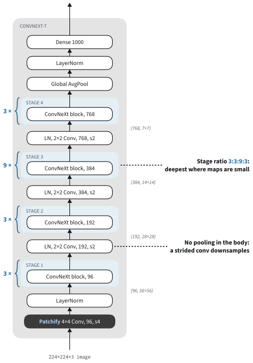
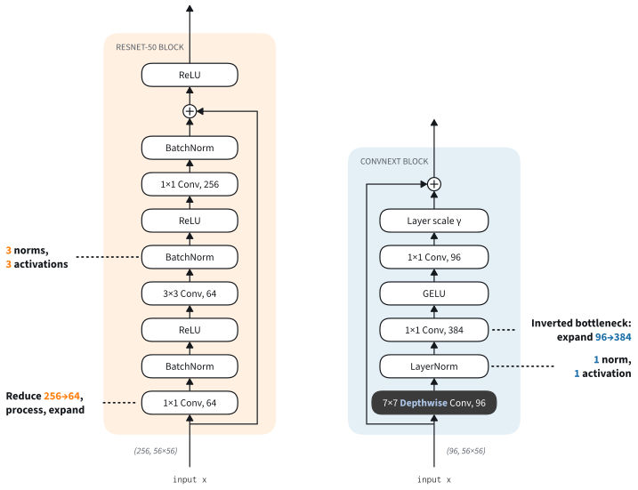

```{.python .input}
%load_ext d2lbook.tab
tab.interact_select('mxnet', 'pytorch', 'tensorflow', 'jax')
```

# ConvNeXt: Modernizing a ResNet Step by Step
:label:`sec_convnext`

Every architecture in this chapter so far has been convolutional, and until
2020 convnets sat atop every major image-classification leaderboard. In 2021,
however, an architecture without a single standard spatial convolution took
the lead: the *Swin Transformer* :cite:`liu2021swin`, built around
*attention*, achieved 81.3% top-1 accuracy on ImageNet compared with 76.1% for
a similarly sized ResNet-50. Did attention itself cause that five-point leap—and
if so, were convolutional networks obsolete?

A brief sketch of vision transformers suffices here (we develop them fully in
:numref:`chap_transformers`). A *vision transformer*
:cite:`Dosovitskiy.Beyer.Kolesnikov.ea.2021` partitions an image into a grid
of patches, embeds each patch as a feature vector, and processes the sequence
through a stack of identical blocks. Each block has two sublayers: an
*attention* layer that lets every patch compute a data-dependent weighted
average of other patches, followed by a pointwise MLP applied independently
to each patch vector. Swin restores hierarchical convnet structure by
computing attention inside local $7 \times 7$ windows and downsampling
between stages.

After :numref:`sec_training_recipes`, we should immediately be skeptical of
crediting a five-point gap to attention alone. Swin differs from a 2015 ResNet
in at least a dozen ways beyond attention: it trains with a 300-epoch modern
recipe, slices images with a patch stem, allocates depth differently across
stages, and adopts different activations and normalizations. To disentangle
these factors, :citet:`liu2022convnet` ran a landmark controlled experiment:
starting from a standard ResNet-50, they introduced Swin-inspired
modernizations one at a time, measuring ImageNet top-1 accuracy after every
change without ever adding attention. The resulting pure convnet, *ConvNeXt*,
reaches 82.0%—edging past Swin-T using primitives we have already built in
this chapter: modern training recipes (:numref:`sec_training_recipes`),
depthwise convolutions and inverted bottlenecks (:numref:`sec_efficient_cnns`),
and layer normalization (:numref:`sec_batch_norm`). Because each row of their
ablation requires a full ImageNet run, we walk through their published roadmap
step by step, implement ConvNeXt from scratch, and then conduct a compact
three-step modernization roadmap of our own on Fashion-MNIST starting from a
parameter-matched ResNet-18.

```{.python .input #convnext-imports}
%%tab mxnet
import math
import numpy as np
from mxnet import autograd, gluon, init, np as mnp, npx
from mxnet.gluon import nn
from d2l import mxnet as d2l
npx.set_np()
```

```{.python .input #convnext-imports}
%%tab pytorch
import math
import numpy as np
import torch
from torch import nn
from torch.nn import functional as F
from d2l import torch as d2l
```

```{.python .input #convnext-imports}
%%tab tensorflow
import math
import numpy as np
import tensorflow as tf
from d2l import tensorflow as d2l
```

```{.python .input #convnext-imports}
%%tab jax
import math
import numpy as np
import jax
from jax import numpy as jnp
from flax import nnx
import optax
from d2l import jax as d2l
```

```{.python .input #convnext-convnext-a-convnet-for-the-2020s-1}
%%tab mxnet
import mxnet as mx
```

## The Modernization Roadmap

:numref:`tab_convnext_roadmap` walks through the exact sequence of changes
tested by :citet:`liu2022convnet`. Each row accumulates every modification
above it while keeping compute anchored near Swin-T's budget of roughly 4.5
billion multiply-adds per image (reported as 4.5 GFLOPs in the paper).

:The ConvNeXt modernization roadmap :cite:`liu2022convnet`. ImageNet top-1 accuracy of a ResNet-50 as design changes accumulate; each row includes all rows above it, at roughly constant cost. Swin-T, a transformer of similar cost, reaches 81.3%.
:label:`tab_convnext_roadmap`

| Change | What it means | Top-1 |
|:--|:--|:--|
| (starting point) | ResNet-50 with its 2015 recipe | 76.1% |
| Modern training recipe | 300 epochs, AdamW, Mixup, label smoothing, stochastic depth (:numref:`sec_training_recipes`) | 78.8% |
| Stage ratio | blocks per stage $(3, 4, 6, 3) \to (3, 3, 9, 3)$ | 79.4% |
| Patchify stem | $7 \times 7$ stride-2 convolution plus pooling $\to$ one $4 \times 4$ stride-4 convolution | 79.5% |
| Depthwise convolutions | the $3 \times 3$ convolution becomes depthwise; width grows from 64 to 96 channels | 80.5% |
| Inverted bottleneck | expand $4\times$ inside the block instead of compressing | 80.6% |
| Large kernels | depthwise convolution moved to the front and enlarged to $7 \times 7$ | 80.6% |
| ReLU $\to$ GELU | a smooth activation, as in transformers | 80.6% |
| Fewer activations | one activation per block instead of three | 81.3% |
| Fewer normalizations | one normalization per block instead of three | 81.4% |
| BN $\to$ LN | layer normalization over channels at each position | 81.5% |
| Separate downsampling | an LN plus $2 \times 2$ stride-2 convolution between stages | 82.0% |

Immediately, the very first row delivers the largest single jump—without
touching a single layer of the network. Echoing :numref:`sec_training_recipes`,
upgrading the training recipe alone lifts an untouched ResNet-50 by 2.7
percentage points. Of the 5.9-point total gain separating 2015 ResNet-50 from
ConvNeXt, 2.7 points come from training and 3.2 from architecture (in this
ordering), confirming that pitting a modern transformer against a 2015-recipe
ResNet confounded recipes with architectures.

### Macro Design

The next two rows reshape the network's macro structure. Swin-T allocates its
blocks across four stages in a $1{:}1{:}3{:}1$ ratio, concentrating depth in
stage 3 where feature maps are compact and compute is cheap; shifting
ResNet-50's $(3, 4, 6, 3)$ layout to $(3, 3, 9, 3)$ adds 0.6 points. Next
comes the stem. Whereas ResNet opens with an overlapping $7 \times 7$ stride-2
convolution followed by max-pooling to downsample fourfold, a vision
transformer chops the image into disjoint patches and projects each patch
through a shared linear layer—which is algebraically identical to a
non-overlapping $4 \times 4$ convolution with stride 4 (:numref:`sec_padding`).
Swapping in this *patchify* stem preserves accuracy (79.5%) while producing
one token vector per $4 \times 4$ patch, just like a transformer.

### Depthwise Convolutions and the Inverted Bottleneck

A transformer block cleanly factors computation into two stages: attention
mixes information *across spatial positions*, and the MLP mixes information
*across channels* at each position. As we saw in
:numref:`sec_depthwise_separable`, a convnet can perform the exact same
factorization: a *depthwise* convolution mixes across space within each
channel, and $1 \times 1$ convolutions mix across channels at each pixel.
Replacing the dense $3 \times 3$ layer in ResNet's bottleneck with a depthwise
convolution slashes compute enough to widen stage 1 from 64 to 96 channels
(matching Swin-T), jumping accuracy to 80.5%.

Once the spatial convolution is depthwise rather than dense, its cost scales
linearly rather than quadratically with width, removing the rationale for
compressing channels before filtering. ConvNeXt therefore adopts MobileNetV2's
*inverted bottleneck* (:numref:`sec_efficient_cnns`), maintaining a thin
residual stream and expanding $4\times$ inside the block—the exact same
$1\times \to 4\times \to 1\times$ geometry as a transformer MLP—nudging
accuracy to 80.6%.

With spatial filtering now lightweight, kernel size also becomes easy to
enlarge. First, moving the depthwise convolution to the front of the block so
it acts on $c$ channels instead of $4c$ drops accuracy by 0.7 points (to
79.9%—the sole dip on the roadmap); expanding its kernel from $3 \times 3$ to
$7 \times 7$ immediately recovers that ground. A $7 \times 7$ filter matches
the receptive field of three stacked $3 \times 3$ layers
(:numref:`sec_padding`). Back in VGG (:numref:`sec_vgg`), dense $7 \times 7$
kernels were prohibitively expensive ($k^2 c_\textrm{i} c_\textrm{o}$); for a
depthwise kernel ($k^2 c$), growing from $3 \times 3$ to $7 \times 7$ only
scales a tiny fraction of block compute by $49/9 \approx 5$. Accuracy
saturates right at $7 \times 7$—matching the exact window size of Swin's local
attention.

### Micro Design

The final group of edits refines individual layers inside the block. Swapping
ReLU for *GELU* :cite:`Hendrycks.Gimpel.2016`—the smooth activation favored by
transformers—leaves accuracy unchanged on its own (80.6%). What *does* move
the needle is trimming the *number* of activations and normalizations. A
classic ResNet bottleneck puts a normalization and an activation after all
three convolutions, whereas a transformer block uses only a single activation
inside its MLP and fewer normalizations. Removing two of the three GELUs—keeping
only the one between the two $1 \times 1$ layers—jumps accuracy by 0.7 points,
the biggest micro-design gain on the table. (There is still no crisp
theoretical proof for why removing two nonlinearities improves accuracy; it is
best viewed as a clean empirical finding.) Trimming three normalizations down
to one adds 0.1 points, and switching that lone normalization from batch
normalization to per-position *layer normalization* across channels
(:numref:`subsec_layer-normalization-in-bn`) adds another 0.1 points (81.5%).
:numref:`fig_resnet_vs_convnext_block` compares the original ResNet bottleneck
against the resulting ConvNeXt block (including the learnable per-channel
layer scale $\boldsymbol{\gamma}$ described below).


:label:`fig_resnet_vs_convnext_block`

Finally, whereas ResNet downsamples inside the opening block of each stage
with a stride-2 convolution, Swin inserts dedicated patch-merging layers
between stages. Adopting separate downsampling layers—a layer normalization
followed by a $2 \times 2$ stride-2 convolution between stages, plus a
normalization after the stem and before the linear head to stabilize
training—completes the roadmap at 82.0%. :numref:`fig_convnext` shows the
assembled ConvNeXt-T backbone, stacking $(3, 3, 9, 3)$ blocks of widths
$(96, 192, 384, 768)$ in the classic stem--body--head layout
(:numref:`sec_googlenet`).


:label:`fig_convnext`

At matched compute, ConvNeXt-T surpasses Swin-T without a single attention
layer. The takeaway is not that convolutions are inherently superior to
attention, but that the 2021 accuracy gap came from training recipes and
architectural design hygiene rather than attention alone—under matched tuning,
both paradigms scale comparably.

## Implementation

Because the modernization roadmap stripped away more layers than it added, the
ConvNeXt block is remarkably clean to implement.

### The ConvNeXt Block

Each block applies a $7 \times 7$ depthwise convolution, per-position layer
normalization, a $1 \times 1$ expansion ($c \to 4c$), GELU, and a $1 \times 1$
projection ($4c \to c$), then adds the residual input. Two training
stabilizers from the paper accompany the block. *Layer scale*
:cite:`touvron2021cait` multiplies the residual branch by a learnable
per-channel vector $\boldsymbol{\gamma}$ initialized to $10^{-6}$ (distinct
from batch-norm scale), ensuring every block starts nearly as the identity so
deep optimization begins smoothly. *Stochastic depth* randomly drops entire
residual branches during training via `d2l.drop_path`
(:numref:`sec_training_recipes`).

Because layer normalization operates across the channel vector at each spatial
location, in a channels-last tensor `(batch, height, width, channels)` it is
standard `LayerNorm` over the final axis, and the two $1 \times 1$
convolutions are ordinary linear layers over that same axis. Following
:citet:`liu2022convnet`, we initialize all convolutional and linear weights
from $\mathcal{N}(0, 0.02^2)$ with zero biases.

:begin_tab:`mxnet`
Images are stored channels-first, so the block normalizes over `axis=1` and
keeps its $1 \times 1$ convolutions as convolutions.
:end_tab:

:begin_tab:`pytorch`
Images are stored channels-first, so `LayerNorm2d` permutes to channels-last
for the normalization and back, and the block does the same around its two
linear layers.
:end_tab:

:begin_tab:`tensorflow, jax`
Images are stored channels-last, so the block uses the library's layer
normalization and dense layers directly.
:end_tab:

```{.python .input #convnext-block}
%%tab mxnet
def gelu(X):  # MXNet's GPU GELU gradient is NaN at 0, smolix/mxnet#103
    return 0.5 * X * (1 + npx.erf(X / math.sqrt(2)))

def layer_norm():  # Over the channel axis of an NCHW tensor
    return nn.LayerNorm(axis=1, epsilon=1e-6)

class ConvNeXtBlock(nn.HybridBlock):
    """Depthwise 7x7, norm, 1x1 expand, GELU, 1x1 project, scaled residual."""
    def __init__(self, dim, drop_prob=0.0, layer_scale=1e-6,
                 norm=layer_norm):
        super().__init__()
        self.dwconv = nn.Conv2D(dim, kernel_size=7, padding=3, groups=dim)
        self.norm = norm()
        self.pwconv1 = nn.Conv2D(4 * dim, kernel_size=1)
        self.pwconv2 = nn.Conv2D(dim, kernel_size=1)
        self.gamma = gluon.Parameter('gamma', shape=(1, dim, 1, 1),
                                     init=init.Constant(layer_scale))
        self.drop_prob = drop_prob

    def forward(self, X):
        Y = self.pwconv2(gelu(self.pwconv1(self.norm(self.dwconv(X)))))
        return X + d2l.drop_path(self.gamma.data() * Y, self.drop_prob)
```

```{.python .input #convnext-block}
%%tab pytorch
class LayerNorm2d(nn.LayerNorm):
    """LayerNorm over the channel axis of an NCHW tensor."""
    def __init__(self, num_channels, eps=1e-6):
        super().__init__(num_channels, eps=eps)

    def forward(self, X):
        return super().forward(X.permute(0, 2, 3, 1)).permute(0, 3, 1, 2)

class ConvNeXtBlock(nn.Module):
    """Depthwise 7x7, norm, 1x1 expand, GELU, 1x1 project, scaled residual."""
    def __init__(self, dim, drop_prob=0.0, layer_scale=1e-6,
                 norm=LayerNorm2d):
        super().__init__()
        self.dwconv = nn.Conv2d(dim, dim, kernel_size=7, padding=3,
                                groups=dim)
        self.norm = norm(dim)
        self.pwconv1 = nn.Linear(dim, 4 * dim)  # 1x1 conv in channels-last
        self.pwconv2 = nn.Linear(4 * dim, dim)
        self.gamma = nn.Parameter(layer_scale * torch.ones(dim))
        self.drop_prob = drop_prob

    def forward(self, X):
        Y = self.norm(self.dwconv(X)).permute(0, 2, 3, 1)  # to channels-last
        Y = self.pwconv2(F.gelu(self.pwconv1(Y)))
        Y = (self.gamma * Y).permute(0, 3, 1, 2)  # back to channels-first
        return X + d2l.drop_path(Y, self.drop_prob, self.training)
```

```{.python .input #convnext-block}
%%tab tensorflow
def normal_002():  # Keras needs a fresh initializer object per layer
    return tf.keras.initializers.RandomNormal(stddev=0.02)

def layer_norm():
    return tf.keras.layers.LayerNormalization(epsilon=1e-6)

class ConvNeXtBlock(tf.keras.layers.Layer):
    """Depthwise 7x7, norm, 1x1 expand, GELU, 1x1 project, scaled residual."""
    def __init__(self, dim, drop_prob=0.0, layer_scale=1e-6,
                 norm=layer_norm):
        super().__init__()
        self.dwconv = tf.keras.layers.DepthwiseConv2D(
            kernel_size=7, padding='same',
            depthwise_initializer=normal_002())
        self.norm = norm()
        self.pwconv1 = tf.keras.layers.Dense(
            4 * dim, kernel_initializer=normal_002())
        self.pwconv2 = tf.keras.layers.Dense(
            dim, kernel_initializer=normal_002())
        self.gamma = self.add_weight(
            shape=(dim,),
            initializer=tf.keras.initializers.Constant(layer_scale))
        self.drop_prob = drop_prob

    def call(self, X, training=False):
        Y = self.norm(self.dwconv(X), training=training)
        Y = self.pwconv2(tf.keras.activations.gelu(self.pwconv1(Y)))
        return X + d2l.drop_path(self.gamma * Y, self.drop_prob, training)
```

```{.python .input #convnext-block}
%%tab jax
def layer_norm(dim, rngs):
    return nnx.LayerNorm(dim, epsilon=1e-6, rngs=rngs)

class ConvNeXtBlock(nnx.Module):
    """Depthwise 7x7, norm, 1x1 expand, GELU, 1x1 project, scaled residual."""
    def __init__(self, dim, drop_prob=0.0, layer_scale=1e-6, norm=layer_norm,
                 rngs=None):
        rngs = (nnx.Rngs(params=d2l.get_key(), dropout=d2l.get_key())
                if rngs is None else rngs)
        w_init = nnx.initializers.normal(0.02)
        self.dwconv = nnx.Conv(dim, dim, kernel_size=(7, 7), padding='same',
                               feature_group_count=dim, kernel_init=w_init,
                               rngs=rngs)
        self.norm = norm(dim, rngs)
        self.pwconv1 = nnx.Linear(dim, 4 * dim, kernel_init=w_init,
                                  rngs=rngs)
        self.pwconv2 = nnx.Linear(4 * dim, dim, kernel_init=w_init,
                                  rngs=rngs)
        self.gamma = nnx.Param(layer_scale * jnp.ones(dim))
        self.drop_prob, self.rngs = drop_prob, rngs
        self.deterministic = False

    def set_view(self, *, deterministic):
        self.deterministic = deterministic

    def __call__(self, X):
        Y = self.norm(self.dwconv(X))
        Y = self.pwconv2(nnx.gelu(self.pwconv1(Y), approximate=False))
        return X + d2l.drop_path(self.rngs.dropout(), self.gamma * Y,
                                 self.drop_prob, not self.deterministic)
```

### The Full Network

As in VGG (:numref:`sec_vgg`), the complete architecture iterates over a tuple
of `(depth, channels)` stage specifications, opening with the patchify stem
plus layer normalization and inserting dedicated downsampling layers between
stages with no spatial pooling anywhere in the body. Stochastic-depth drop
probabilities ramp linearly from 0 in the first block to `drop_path_max` in
the last. For Fashion-MNIST we adopt the compact *ConvNeXt-atto* profile—widths
$(40, 80, 160, 320)$ and stage depths $(2, 2, 6, 2)$—keeping the third stage
deepest just like ConvNeXt-T. Exposing `norm` as an argument and `stem` as a
method makes swapping them trivial in our ablation below.

```{.python .input #convnext-model}
%%tab mxnet
class ConvNeXt(d2l.Classifier):
    def __init__(self, arch=((2, 40), (2, 80), (6, 160), (2, 320)),
                 lr=2e-3, num_classes=10, drop_path_max=0.1,
                 norm=layer_norm):
        super().__init__()
        self.save_hyperparameters()
        depths = [d for d, c in arch]
        rates = mnp.linspace(0, drop_path_max, sum(depths)).tolist()
        self.net = nn.HybridSequential()
        self.net.add(*self.stem(arch[0][1], norm))
        b = 0
        for i, (depth, c) in enumerate(arch):
            if i > 0:  # Separate downsampling layer between stages
                self.net.add(norm(), nn.Conv2D(c, kernel_size=2, strides=2))
            for _ in range(depth):
                self.net.add(ConvNeXtBlock(c, rates[b], norm=norm))
                b += 1
        self.net.add(nn.GlobalAvgPool2D(), norm(), nn.Flatten(),
                     nn.Dense(num_classes))
        self.net.initialize(init.Normal(0.02))

    def stem(self, c, norm):  # Patchify: a 4x4 convolution with stride 4
        return [nn.Conv2D(c, kernel_size=4, strides=4), norm()]
```

```{.python .input #convnext-model}
%%tab pytorch
class ConvNeXt(d2l.Classifier):
    def __init__(self, arch=((2, 40), (2, 80), (6, 160), (2, 320)),
                 lr=2e-3, num_classes=10, drop_path_max=0.1,
                 norm=LayerNorm2d):
        super().__init__()
        self.save_hyperparameters()
        depths = [d for d, c in arch]
        rates = torch.linspace(0, drop_path_max, sum(depths)).tolist()
        layers = self.stem(arch[0][1], norm)
        c_prev, b = arch[0][1], 0
        for i, (depth, c) in enumerate(arch):
            if i > 0:  # Separate downsampling layer between stages
                layers += [norm(c_prev),
                           nn.Conv2d(c_prev, c, kernel_size=2, stride=2)]
            for _ in range(depth):
                layers.append(ConvNeXtBlock(c, rates[b], norm=norm))
                b += 1
            c_prev = c
        layers += [nn.AdaptiveAvgPool2d((1, 1)), norm(c_prev), nn.Flatten(),
                   nn.Linear(c_prev, num_classes)]
        self.net = nn.Sequential(*layers)
        self.net.apply(self.weight_init)

    def stem(self, c, norm):  # Patchify: a 4x4 convolution with stride 4
        return [nn.Conv2d(1, c, kernel_size=4, stride=4), norm(c)]

    def weight_init(self, module):
        if type(module) in (nn.Conv2d, nn.Linear):
            nn.init.normal_(module.weight, std=0.02)
            nn.init.zeros_(module.bias)
```

```{.python .input #convnext-model}
%%tab tensorflow
class ConvNeXt(d2l.Classifier):
    def __init__(self, arch=((2, 40), (2, 80), (6, 160), (2, 320)),
                 lr=2e-3, num_classes=10, drop_path_max=0.1,
                 norm=layer_norm):
        super().__init__()
        self.save_hyperparameters()
        depths = [d for d, c in arch]
        rates = tf.linspace(0.0, drop_path_max, sum(depths)).numpy().tolist()
        self.net = tf.keras.models.Sequential(self.stem(arch[0][1], norm))
        b = 0
        for i, (depth, c) in enumerate(arch):
            if i > 0:  # Separate downsampling layer between stages
                self.net.add(norm())
                self.net.add(tf.keras.layers.Conv2D(
                    c, kernel_size=2, strides=2,
                    kernel_initializer=normal_002()))
            for _ in range(depth):
                self.net.add(ConvNeXtBlock(c, rates[b], norm=norm))
                b += 1
        self.net.add(tf.keras.layers.GlobalAvgPool2D())
        self.net.add(norm())
        self.net.add(tf.keras.layers.Dense(num_classes,
                                           kernel_initializer=normal_002()))

    def stem(self, c, norm):  # Patchify: a 4x4 convolution with stride 4
        return [tf.keras.layers.Conv2D(c, kernel_size=4, strides=4,
                                       kernel_initializer=normal_002()),
                norm()]
```

```{.python .input #convnext-model}
%%tab jax
class ConvNeXt(d2l.Classifier):
    def __init__(self, arch=((2, 40), (2, 80), (6, 160), (2, 320)),
                 lr=2e-3, num_classes=10, drop_path_max=0.1, norm=layer_norm,
                 rngs=None):
        super().__init__()
        self.save_hyperparameters(ignore=['rngs'])
        rngs = (nnx.Rngs(params=d2l.get_key(), dropout=d2l.get_key(),
                         mixup=d2l.get_key()) if rngs is None else rngs)
        self.rngs = rngs
        w_init = nnx.initializers.normal(0.02)
        depths = [d for d, c in arch]
        rates = jnp.linspace(0, drop_path_max, sum(depths)).tolist()
        layers = self.stem(arch[0][1], norm, rngs)
        c_prev, b = arch[0][1], 0
        for i, (depth, c) in enumerate(arch):
            if i > 0:  # Separate downsampling layer between stages
                layers += [norm(c_prev, rngs),
                           nnx.Conv(c_prev, c, kernel_size=(2, 2),
                                    strides=(2, 2), kernel_init=w_init,
                                    rngs=rngs)]
            for _ in range(depth):
                layers.append(ConvNeXtBlock(c, rates[b], norm=norm, rngs=rngs))
                b += 1
            c_prev = c
        layers += [global_avg_pool, norm(c_prev, rngs),
                   nnx.Linear(c_prev, num_classes, kernel_init=w_init,
                              rngs=rngs)]
        self.net = nnx.Sequential(*layers)

    def stem(self, c, norm, rngs):  # Patchify: a 4x4 convolution, stride 4
        return [nnx.Conv(1, c, kernel_size=(4, 4), strides=(4, 4),
                         kernel_init=nnx.initializers.normal(0.02),
                         rngs=rngs),
                norm(c, rngs)]

def global_avg_pool(X):  # Average over height and width (NHWC)
    return X.mean(axis=(1, 2))
```

On $64 \times 64$ Fashion-MNIST inputs, the patchify stem produces a
$16 \times 16$ grid, and the three downsampling layers step resolution down to
$8 \times 8$, $4 \times 4$, and $2 \times 2$ before global average pooling.
Let us check the output shape and count trainable parameters.

```{.python .input #convnext-params}
%%tab mxnet
model = ConvNeXt()
assert model(mnp.random.normal(size=(1, 1, 64, 64))).shape == (1, 10)
d2l.num_params(model)
```

```{.python .input #convnext-params}
%%tab pytorch
model = ConvNeXt()
assert model(torch.randn(1, 1, 64, 64)).shape == (1, 10)
d2l.num_params(model)
```

```{.python .input #convnext-params}
%%tab tensorflow
model = ConvNeXt()
assert model(tf.random.normal((1, 64, 64, 1))).shape == (1, 10)
d2l.num_params(model)
```

```{.python .input #convnext-params}
%%tab jax
model = ConvNeXt()
assert model(jnp.zeros((1, 64, 64, 1))).shape == (1, 10)
d2l.num_params(model)
```

Our ConvNeXt-atto model contains exactly 3,376,450 parameters—roughly a third
of ResNet-18's 11.2 million (:numref:`sec_resnet`). Because any misconfigured
width or kernel size immediately shifts this exact number, matching the
parameter count is a reliable sanity check for any reimplementation.

## A Small Roadmap on Fashion-MNIST

Every choice in :numref:`tab_convnext_roadmap` was validated on 1.3 million
$224 \times 224$ ImageNet photos. Do those same architectural decisions carry
over to small $64 \times 64$ grayscale garments? To find out, we run a compact
cumulative roadmap of our own: starting from a parameter-matched control—a
ResNet-18 narrowed from base width 64 to 35 channels (3.35M parameters)—we
apply ConvNeXt's modifications in three cumulative steps. Every model trains
for 20 epochs on full Fashion-MNIST under the compact modern recipe from
:numref:`sec_training_recipes` (AdamW with decoupled weight decay, 10% linear
warmup plus cosine decay, label smoothing, and Mixup; :numref:`chap_optimization`
covers AdamW in detail). To isolate architecture cleanly, we set ConvNeXt's
stochastic-depth rate to 0 so both families share identical regularization.

Packaging the training procedure as a `ModernRecipe` mixin lets every model in
the roadmap inherit the exact same optimizer, schedule, and mixed training
step while keeping validation loss as plain cross-entropy.

```{.python .input #convnext-recipe}
%%tab mxnet
class ModernRecipe:
    """AdamW, linear warmup then cosine decay, label smoothing, Mixup."""
    def configure_optimizers(self):
        warmup = self.num_steps // 10
        schedule = lambda t: self.lr * d2l.cosine_warmup(  # MXNet counts
            t - 1, self.num_steps, warmup)  # updates from 1
        return gluon.Trainer(self.collect_params(), 'adamw', {
            'learning_rate': None, 'lr_scheduler': schedule, 'wd': 0.05,
            'epsilon': 1e-8})

    def training_step(self, batch):
        X, y_a, y_b, lam = d2l.mixup(*batch, alpha=0.2)
        Y_hat = self(X)
        n, label_smoothing = Y_hat.shape[1], 0.1
        smooth = lambda y: ((1 - label_smoothing) * npx.one_hot(y, n)
                            + label_smoothing / n)
        loss = gluon.loss.SoftmaxCrossEntropyLoss(sparse_label=False)
        return (lam * loss(Y_hat, smooth(y_a))
                + (1 - lam) * loss(Y_hat, smooth(y_b))).mean()

class ModernConvNeXt(ModernRecipe, ConvNeXt):
    def __init__(self, num_steps, lr=2e-3, norm=layer_norm):
        super().__init__(lr=lr, drop_path_max=0.0, norm=norm)
        self.num_steps = num_steps
        # Compile into one graph here, not in ConvNeXt: a hybridized net with
        # its own Parameter breaks after a CPU run (smolix/mxnet#104)
        self.net.hybridize()
```

```{.python .input #convnext-recipe}
%%tab pytorch
class ModernRecipe:
    """AdamW, linear warmup then cosine decay, label smoothing, Mixup."""
    def configure_optimizers(self):
        optim = torch.optim.AdamW(self.parameters(), lr=self.lr,
                                  weight_decay=0.05)
        warmup = self.num_steps // 10
        schedule = torch.optim.lr_scheduler.LambdaLR(
            optim, lambda t: d2l.cosine_warmup(t, self.num_steps, warmup))
        return optim, schedule  # The Trainer steps it after every minibatch

    def training_step(self, batch):
        X, y_a, y_b, lam = d2l.mixup(*batch, alpha=0.2)
        Y_hat = self(X)
        loss = lambda y: F.cross_entropy(Y_hat, y, label_smoothing=0.1)
        return lam * loss(y_a) + (1 - lam) * loss(y_b)

class ModernConvNeXt(ModernRecipe, ConvNeXt):
    def __init__(self, num_steps, lr=2e-3, norm=LayerNorm2d):
        super().__init__(lr=lr, drop_path_max=0.0, norm=norm)
        self.num_steps = num_steps
```

```{.python .input #convnext-recipe}
%%tab tensorflow
class ModernRecipe:
    """AdamW, linear warmup then cosine decay, label smoothing, Mixup."""
    def configure_optimizers(self):
        warmup = self.num_steps // 10
        schedule = lambda: self.lr * d2l.cosine_warmup(
            optim.iterations, self.num_steps, warmup)
        optim = tf.keras.optimizers.AdamW(schedule, weight_decay=0.05,
                                          epsilon=1e-8)
        return optim

    def training_step(self, batch):
        X, y_a, y_b, lam = d2l.mixup(*batch, alpha=0.2)
        Y_hat = self(X, training=True)
        loss = tf.keras.losses.CategoricalCrossentropy(
            from_logits=True, label_smoothing=0.1)
        one_hot = lambda y: tf.one_hot(y, Y_hat.shape[1])
        return (lam * loss(one_hot(y_a), Y_hat)
                + (1 - lam) * loss(one_hot(y_b), Y_hat))

class ModernConvNeXt(ModernRecipe, ConvNeXt):
    def __init__(self, num_steps, lr=2e-3, norm=layer_norm):
        super().__init__(lr=lr, drop_path_max=0.0, norm=norm)
        self.num_steps = num_steps
```

```{.python .input #convnext-recipe}
%%tab jax
class ModernRecipe:
    """AdamW, linear warmup then cosine decay, label smoothing, Mixup."""
    def configure_optimizers(self):
        warmup = self.num_steps // 10
        schedule = lambda t: self.lr * d2l.cosine_warmup(t, self.num_steps,
                                                         warmup)
        return optax.adamw(schedule, weight_decay=0.05)

    def training_step(self, batch):
        X, y_a, y_b, lam = d2l.mixup(self.rngs.mixup(), *batch, alpha=0.2)
        Y_hat = self(X)
        smooth = lambda y: optax.smooth_labels(
            jax.nn.one_hot(y, Y_hat.shape[1]), 0.1)
        loss = lambda y: optax.softmax_cross_entropy(Y_hat, smooth(y)).mean()
        return lam * loss(y_a) + (1 - lam) * loss(y_b)

class ModernConvNeXt(ModernRecipe, ConvNeXt):
    def __init__(self, num_steps, lr=2e-3, norm=layer_norm):
        super().__init__(lr=lr, drop_path_max=0.0, norm=norm)
        self.num_steps = num_steps
```

Our baseline `CompactResNet18` stacks `d2l.Residual` blocks
(:numref:`sec_resnet`) across widths 35, 70, 140, and 280 behind ResNet's
standard $7 \times 7$ stride-2 stem and max-pooling.

```{.python .input #convnext-recipe-2}
%%tab mxnet
class CompactResNet18(ModernRecipe, d2l.Classifier):
    """ResNet-18 with base width 35 instead of 64, trained by the recipe."""
    def __init__(self, num_steps, lr=2e-3, num_classes=10, base=35):
        super().__init__()
        self.save_hyperparameters()
        self.net = nn.HybridSequential()
        self.net.add(nn.Conv2D(base, kernel_size=7, strides=2, padding=3,
                               use_bias=False),
                     nn.BatchNorm(), nn.Activation('relu'),
                     nn.MaxPool2D(pool_size=3, strides=2, padding=1))
        for i, c in enumerate((base, 2 * base, 4 * base, 8 * base)):
            for j in range(2):
                down = i > 0 and j == 0
                self.net.add(d2l.Residual(c, use_1x1conv=down,
                                          strides=2 if down else 1))
        self.net.add(nn.GlobalAvgPool2D(), nn.Dense(num_classes))
        self.net.initialize(init.MSRAPrelu('in', 0))  # He initialization
        self.net.hybridize()
```

```{.python .input #convnext-recipe-2}
%%tab pytorch
class CompactResNet18(ModernRecipe, d2l.Classifier):
    """ResNet-18 with base width 35 instead of 64, trained by the recipe."""
    def __init__(self, num_steps, lr=2e-3, num_classes=10, base=35):
        super().__init__()
        self.save_hyperparameters()
        layers = [nn.LazyConv2d(base, kernel_size=7, stride=2, padding=3,
                                bias=False),
                  nn.LazyBatchNorm2d(), nn.ReLU(),
                  nn.MaxPool2d(kernel_size=3, stride=2, padding=1)]
        for i, c in enumerate((base, 2 * base, 4 * base, 8 * base)):
            for j in range(2):
                down = i > 0 and j == 0
                layers.append(d2l.Residual(c, use_1x1conv=down,
                                           strides=2 if down else 1))
        layers += [nn.AdaptiveAvgPool2d((1, 1)), nn.Flatten(),
                   nn.LazyLinear(num_classes)]
        self.net = nn.Sequential(*layers)

    def weight_init(self, module):
        # The Trainer calls this after the first minibatch fixed the shapes
        if type(module) in (nn.Conv2d, nn.Linear):
            nn.init.kaiming_normal_(module.weight, nonlinearity='relu')
            if module.bias is not None:
                nn.init.zeros_(module.bias)
```

```{.python .input #convnext-recipe-2}
%%tab tensorflow
def he_init():  # He initialization; Keras needs one instance per layer
    return tf.keras.initializers.VarianceScaling(2.0, 'fan_in',
                                                 'untruncated_normal')

class CompactResNet18(ModernRecipe, d2l.Classifier):
    """ResNet-18 with base width 35 instead of 64, trained by the recipe."""
    def __init__(self, num_steps, lr=2e-3, num_classes=10, base=35):
        super().__init__()
        self.save_hyperparameters()
        self.net = tf.keras.models.Sequential([
            tf.keras.layers.ZeroPadding2D(3),  # Pad every side
            tf.keras.layers.Conv2D(base, kernel_size=7, strides=2,
                                   use_bias=False,
                                   kernel_initializer=he_init()),
            tf.keras.layers.BatchNormalization(momentum=0.9, epsilon=1e-5),
            tf.keras.layers.Activation('relu'),
            tf.keras.layers.ZeroPadding2D(1),  # Inputs are >= 0 after ReLU
            tf.keras.layers.MaxPool2D(pool_size=3, strides=2)])
        for i, c in enumerate((base, 2 * base, 4 * base, 8 * base)):
            for j in range(2):
                down = i > 0 and j == 0
                self.net.add(d2l.Residual(c, use_1x1conv=down,
                                          strides=2 if down else 1))
        self.net.add(tf.keras.layers.GlobalAvgPool2D())
        self.net.add(tf.keras.layers.Dense(num_classes,
                                           kernel_initializer=he_init()))
```

```{.python .input #convnext-recipe-2}
%%tab jax
class CompactResNet18(ModernRecipe, d2l.Classifier):
    """ResNet-18 with base width 35 instead of 64, trained by the recipe."""
    def __init__(self, num_steps, lr=2e-3, num_classes=10, base=35,
                 rngs=None):
        super().__init__()
        self.save_hyperparameters(ignore=['rngs'])
        rngs = (nnx.Rngs(params=d2l.get_key(), mixup=d2l.get_key())
                if rngs is None else rngs)
        self.rngs = rngs
        w_init = nnx.initializers.variance_scaling(2.0, 'fan_in', 'normal')
        layers = [nnx.Conv(1, base, (7, 7), strides=(2, 2), padding=3,
                           use_bias=False, kernel_init=w_init, rngs=rngs),
                  nnx.BatchNorm(base, momentum=0.9, use_fast_variance=False,
                                rngs=rngs), nnx.relu, max_pool]
        c_prev = base
        for i, c in enumerate((base, 2 * base, 4 * base, 8 * base)):
            for j in range(2):
                down = i > 0 and j == 0
                layers.append(d2l.Residual(
                    c, use_1x1conv=down, strides=(2, 2) if down else (1, 1),
                    in_channels=c_prev, rngs=rngs))
                c_prev = c
        layers += [global_avg_pool,
                   nnx.Linear(c_prev, num_classes, kernel_init=w_init,
                              rngs=rngs)]
        self.net = nnx.Sequential(*layers)

def max_pool(X):  # 3x3 windows, stride 2, padding 1
    return nnx.max_pool(X, (3, 3), (2, 2), padding=((1, 1), (1, 1)))
```

We bundle the paper's changes into three clean steps by architectural region:
(1) replace ResNet's blocks and stages with ConvNeXt's $7 \times 7$ inverted
bottlenecks, $(2, 2, 6, 2)$ stage ratio, single GELU/norm, layer scale, and
separate downsampling while keeping ResNet's stem and batch normalization
(covering eight rows of :numref:`tab_convnext_roadmap`); (2) swap batch
normalization for layer normalization; and (3) replace ResNet's stem with the
$4 \times 4$ patchify stem to arrive at full ConvNeXt. (Although the original
paper swapped the stem earlier, the final architecture is order-independent,
even if individual step attributions can vary slightly.) Overriding `stem` in
`ResNetStemConvNeXt` and toggling `norm` implements all four models cleanly.

```{.python .input #convnext-roadmap-1}
%%tab mxnet
class ResNetStemConvNeXt(ModernConvNeXt):
    """ConvNeXt with the stem of ResNet-18 instead of the patchify stem."""
    def stem(self, c, norm):  # 7x7 convolution with stride 2, max-pooling
        return [nn.Conv2D(c, kernel_size=7, strides=2, padding=3), norm(),
                nn.Activation('relu'),
                nn.MaxPool2D(pool_size=3, strides=2, padding=1)]

roadmap = {'compact ResNet-18': CompactResNet18,
           'ConvNeXt blocks and stages, BN': (
               lambda num_steps: ResNetStemConvNeXt(num_steps,
                                                    norm=nn.BatchNorm)),
           '+ BN -> LN': ResNetStemConvNeXt,
           '+ patchify stem = ConvNeXt': ModernConvNeXt}
```

```{.python .input #convnext-roadmap-1}
%%tab pytorch
class ResNetStemConvNeXt(ModernConvNeXt):
    """ConvNeXt with the stem of ResNet-18 instead of the patchify stem."""
    def stem(self, c, norm):  # 7x7 convolution with stride 2, max-pooling
        return [nn.Conv2d(1, c, kernel_size=7, stride=2, padding=3), norm(c),
                nn.ReLU(), nn.MaxPool2d(kernel_size=3, stride=2, padding=1)]

roadmap = {'compact ResNet-18': CompactResNet18,
           'ConvNeXt blocks and stages, BN': (
               lambda num_steps: ResNetStemConvNeXt(num_steps,
                                                    norm=nn.BatchNorm2d)),
           '+ BN -> LN': ResNetStemConvNeXt,
           '+ patchify stem = ConvNeXt': ModernConvNeXt}
```

```{.python .input #convnext-roadmap-1}
%%tab tensorflow
def batch_norm():  # Decay 0.9 and epsilon 1e-5, as in the ResNet
    return tf.keras.layers.BatchNormalization(momentum=0.9, epsilon=1e-5)

class ResNetStemConvNeXt(ModernConvNeXt):
    """ConvNeXt with the stem of ResNet-18 instead of the patchify stem."""
    def stem(self, c, norm):  # 7x7 convolution with stride 2, max-pooling
        return [tf.keras.layers.ZeroPadding2D(3),  # Pad every side
                tf.keras.layers.Conv2D(c, kernel_size=7, strides=2,
                                       kernel_initializer=normal_002()),
                norm(), tf.keras.layers.Activation('relu'),
                tf.keras.layers.ZeroPadding2D(1),  # Inputs >= 0 after ReLU
                tf.keras.layers.MaxPool2D(pool_size=3, strides=2)]

roadmap = {'compact ResNet-18': CompactResNet18,
           'ConvNeXt blocks and stages, BN': (
               lambda num_steps: ResNetStemConvNeXt(num_steps,
                                                    norm=batch_norm)),
           '+ BN -> LN': ResNetStemConvNeXt,
           '+ patchify stem = ConvNeXt': ModernConvNeXt}
```

```{.python .input #convnext-roadmap-1}
%%tab jax
def batch_norm(dim, rngs):  # Decay 0.9 and a two-pass variance, as in ResNet
    return nnx.BatchNorm(dim, momentum=0.9, use_fast_variance=False,
                         rngs=rngs)

class ResNetStemConvNeXt(ModernConvNeXt):
    """ConvNeXt with the stem of ResNet-18 instead of the patchify stem."""
    def stem(self, c, norm, rngs):  # 7x7 convolution, stride 2, max-pooling
        return [nnx.Conv(1, c, kernel_size=(7, 7), strides=(2, 2), padding=3,
                         kernel_init=nnx.initializers.normal(0.02),
                         rngs=rngs),
                norm(c, rngs), nnx.relu, max_pool]

roadmap = {'compact ResNet-18': CompactResNet18,
           'ConvNeXt blocks and stages, BN': (
               lambda num_steps: ResNetStemConvNeXt(num_steps,
                                                    norm=batch_norm)),
           '+ BN -> LN': ResNetStemConvNeXt,
           '+ patchify stem = ConvNeXt': ModernConvNeXt}
```

Let us train all four models in sequence and record their parameter counts and
final validation accuracies.

```{.python .input #convnext-train}
%%tab mxnet, pytorch, jax
data = d2l.FashionMNIST(batch_size=128, resize=(64, 64))
num_steps = 20 * len(data.train_dataloader())
results = {}
for name, make_model in roadmap.items():
    model = make_model(num_steps)
    trainer = d2l.Trainer(max_epochs=20, num_gpus=1)
    trainer.board.display = False  # Four runs; we tabulate the results
    trainer.fit(model, data)
    results[name] = (d2l.num_params(model), trainer.history['val_acc'][-1])
```

```{.python .input #convnext-train}
%%tab tensorflow
data = d2l.FashionMNIST(batch_size=128, resize=(64, 64))
num_steps = 20 * len(data.train_dataloader())
results = {}
for name, make_model in roadmap.items():
    trainer = d2l.Trainer(max_epochs=20)
    trainer.board.display = False  # Four runs; we tabulate the results
    with d2l.try_gpu():
        model = make_model(num_steps)
        trainer.fit(model, data)
    results[name] = (d2l.num_params(model), trainer.history['val_acc'][-1])
```

```{.python .input #convnext-eval}
for name, (params, accuracy) in results.items():
    print(f'{name:34s} {params:>9,} parameters, '
          f'validation accuracy {accuracy:.3f}')
```

:Our roadmap on Fashion-MNIST beside the paper's. The last column is the validation accuracy after 20 epochs of the modern recipe at $64 \times 64$, rounded to the stability of repeated runs; the paper's column adds up the ImageNet top-1 gains of the rows of :numref:`tab_convnext_roadmap` that each step covers.
:label:`tab_convnext_local`

| Step | Rows of the paper | Gain on ImageNet | Parameters | Validation accuracy |
|:--|:--|--:|--:|--:|
| Compact ResNet-18 | (ResNet-50 with the modern recipe) | | 3.35M | ≈ 94% |
| ConvNeXt blocks and stages, BN | stage ratio to fewer normalizations, separate downsampling | +3.0 | 3.38M | ≈ 94% |
| BN $\to$ LN | BN $\to$ LN | +0.1 | 3.38M | ≈ 94% |
| Patchify stem (our ConvNeXt) | patchify stem | +0.1 | 3.38M | ≈ 91.5% |

The results in :numref:`tab_convnext_local` pinpoint what transfers to $64 \times 64$ Fashion-MNIST and what does not. Keeping ResNet's overlapping stem, ConvNeXt's modernized blocks, stage ratio, and layer normalization tie with our parameter-matched `CompactResNet18` (~94%, within ~43--46M multiply-adds per image). The entire ~2.5-point drop to ~91.5% comes from the single step that was neutral on $224 \times 224$ ImageNet: the non-overlapping $4 \times 4$ stride-4 patchify stem, which jumps straight to a coarse $16 \times 16$ grid in one linear projection. Architectural choices tuned at ImageNet resolution do not transfer blindly to low-resolution domains, and a cumulative ablation immediately identifies which component to adapt.

## Limits and Open Problems

While ConvNeXt showed that pure convnets match hierarchical Vision Transformers in supervised classification under matched recipes, two active frontiers remain:

1. **Masked self-supervised pretraining:** Dropping random image patches as in masked autoencoders :cite:`he2022masked` is natural for a sequence of patch tokens, whereas dense sliding convolutions bleed across masked holes. *ConvNeXt V2* :cite:`woo2023convnextv2` bridges this gap with sparse convolutions and Global Response Normalization (Exercise :exref:`ex_convnext-global-response-normalization`).
2. **Global context:** Even a $7 \times 7$ depthwise filter is local, leaving open how ultra-large depthwise kernels :cite:`ding2022replknet`, deformable convolutions, and hybrid conv--attention stacks compare at frontier scale.

## Summary

Starting from a standard ResNet-50, ConvNeXt applied Swin-inspired upgrades one at a time—a 300-epoch modern recipe (+2.7 points), a $1{:}1{:}3{:}1$ stage ratio, a $4 \times 4$ stride-4 patchify stem, a $7 \times 7$ depthwise convolution leading a $4\times$ inverted bottleneck, a single GELU and LayerNorm per block, layer scale, and separate $2 \times 2$ stride-2 downsampling layers—reaching 82.0% on ImageNet without attention. On $64 \times 64$ Fashion-MNIST, ConvNeXt's body and LayerNorm match a parameter-matched ResNet-18 (~94%), while the coarse $4 \times 4$ patchify stem costs ~2.5 points.

## Exercises

1. **Arithmetic of the depthwise move and kernel enlargement.** In :numref:`tab_convnext_roadmap`, just before the "Large kernels" row, each block expands $c \to 4c$ with a $1 \times 1$ convolution, filters the $4c$ channels with a $3 \times 3$ depthwise convolution, and projects $4c \to c$ with a second $1 \times 1$ convolution. The "Large kernels" step first moves the depthwise convolution to the *front* of the block (where it acts on $c$ channels instead of $4c$) and then enlarges its kernel to $7 \times 7$.
    1. Count the multiply-adds per spatial pixel of the depthwise layer before the move ($3 \times 3$ on $4c$), after the move ($3 \times 3$ on $c$), and after enlarging to $7 \times 7$ on $c$. Compare the net change against what enlarging to $7 \times 7$ *in place* on $4c$ channels would have cost.
    1. What fraction of the full `ConvNeXtBlock`'s multiply-adds per pixel ($49c + 8c^2$) does the $7 \times 7$ depthwise convolution account for at $c = 96$ and at $c = 384$?

1. **Where the parameters live in ConvNeXt.**
    1. For the `ConvNeXt` model of this section ($3{,}376{,}450$ parameters), compute the exact fraction of parameters in (i) the $7 \times 7$ depthwise convolutions, (ii) the $1 \times 1$ expansion and projection layers, (iii) the normalization and layer-scale vectors inside the blocks, (iv) the downsampling layers, and (v) the stem and head.
    1. Express the parameter count of a `ConvNeXtBlock` and a two-layer `Residual` block (:numref:`sec_resnet`, without a $1 \times 1$ shortcut) as functions of width $c$. By what asymptotic factor is `ConvNeXtBlock` more parameter-efficient for large $c$, and which design choice accounts for that factor?

1. [code] **Layer scale versus stochastic depth.** Under the roadmap recipe of :numref:`tab_convnext_local`, train `ConvNeXt` with layer-scale initialization $\gamma_0 = 10^{-6}$ (default), with $\gamma_0 = 1$, and with layer scale removed altogether, and compare their training curves. Both layer scale at $10^{-6}$ and stochastic depth (:numref:`sec_training_recipes`) make a deep network effectively shallower at the start of training: contrast how each mechanism works, when during training it is active, and whether it alters the evaluation-time network.

1. [code] **Global Response Normalization (ConvNeXt V2).** ConvNeXt V2 :cite:`woo2023convnextv2` removes layer scale and inserts Global Response Normalization (GRN) right after the GELU inside each block. For a feature map $\mathbf{X}$ with $C$ channels, let $g_c = \|\mathbf{X}_c\|_2$ be the spatial $\ell_2$ norm of channel $c$ and $\bar{g} = \frac{1}{C}\sum_{c=1}^C g_c$. GRN rescales each channel by its relative response with a learnable affine transform and residual:
   $$\mathrm{GRN}(\mathbf{X})_c = \gamma_c \frac{g_c}{\bar{g} + \epsilon} \mathbf{X}_c + \beta_c + \mathbf{X}_c,$$
   where $\epsilon = 10^{-6}$ and $\boldsymbol{\gamma}, \boldsymbol{\beta}$ are initialized to zero so GRN begins as the identity. Implement GRN in a few lines of code, insert it into `ConvNeXtBlock` in place of layer scale, and compare validation accuracy under the roadmap recipe of :numref:`tab_convnext_local`.
   :exlabel:`ex_convnext-global-response-normalization`

1. [code] **Depthwise kernel size sweep.** ● Under the recipe of :numref:`tab_convnext_local`, train `ConvNeXt` with $3 \times 3$, $7 \times 7$, and $11 \times 11$ depthwise kernels (padding 1, 3, and 5) and compare parameter counts, multiply-adds, wall-clock time per epoch, and validation accuracy. Why does the wall-clock time per epoch grow much faster from $7 \times 7$ to $11 \times 11$ than the total multiply-add count would suggest?

1. [code] **2×2 architecture-by-recipe ablation.** ● The first and last rows of :numref:`tab_convnext_local` compare `CompactResNet18` and `ModernConvNeXt` under the modern AdamW/Mixup/smoothing recipe. Complete the $2 \times 2$ ablation square by training both architectures under Recipe A of :numref:`sec_training_recipes` (momentum SGD, step decay, no Mixup or label smoothing, retuning the peak learning rate). Does the modern training recipe boost both architectures equally?

[Discussions](https://d2l.discourse.group/t/36762)

<!-- slides -->

::: {.slide}
::: {.cover}
[Dive into Deep Learning · §7.7]{.kicker}

ConvNeXt<br>**the modernization roadmap · the ConvNeXt block · a small roadmap of our own**
:::
:::

::: {.slide title="In 2021 Swin-T Beat ResNet-50 by Five Points at Similar Cost"}
[The problem]{.kicker}

- A **vision transformer** cuts the image into patches, turns each patch
  into a vector, and stacks blocks of two parts: **attention** (each patch
  averages the features of the others; in Swin, within 7×7 windows) and an
  **MLP** (each patch alone).
- ImageNet top-1 at about 4.5G multiply-adds: **Swin-T 81.3%**, ResNet-50 76.1%.
- But Swin also has a newer training recipe, a patch stem, another
  activation, another normalization, other stage depths.

::: {.d2l-note .warn}
Which of these differences carried the five points?
:::

[Liu et al., 2021 (Swin); Liu et al., 2022 (ConvNeXt)]{.small}
:::

::: {.slide title="By the End of This Deck You Can"}
[Goals]{.kicker}

- read a cumulative ablation and attribute its gains;
- explain why a depthwise convolution plus $1 \times 1$ convolutions
  divide the work as attention plus MLP do;
- build the ConvNeXt block and network and check them by their parameter
  count;
- run a small cumulative ablation and read it against the spread of
  repeated runs.

**Running example:** a ResNet-18 with 3.35M parameters turned into a
ConvNeXt with 3.38M in three steps, trained on Fashion-MNIST after each.
:::

::: {.slide title="Modernizing the ResNet, Step by Step"}
[Where this fits]{.kicker}

::: {.cols .vc}
::: {.col}
| section | adds |
|---|---|
| AlexNet | learned features, ReLU, dropout, GPUs |
| VGG, NiN, GoogLeNet | blocks, 1 × 1 convolutions, global pooling |
| Normalization Layers | batch, layer, group normalization |
| ResNet, ResNeXt, DenseNet | residual connections make depth trainable |
| Efficient Convnets | separable blocks, scaling, re-parameterization |
| Training Recipes | schedules, augmentation, weight averaging |
| **ConvNeXt** | **a ResNet modernized one change at a time** |
| Design Spaces (RegNet) | rules from populations of networks |
:::

::: {.col .narrow}
- **Uses:** depthwise convolutions, inverted bottleneck, layer
  normalization, the modern recipe, `Residual`.
- **Skips:** attention and transformers (later chapter).
:::
:::
:::

::: {.slide}
::: {.divider}
[01]{.dnum}

[The Modernization Roadmap]{.dtitle}

[eleven changes, measured one at a time]{.dsub}
:::
:::

::: {.slide title="Eleven Changes Take ResNet-50 from 76.1% to 82.0% Without Attention"}
[Roadmap]{.kicker}

| change (cumulative) | top-1 |
|:--|--:|
| ResNet-50, 2015 recipe | 76.1% |
| modern training recipe | **78.8%** |
| stage ratio (3,4,6,3) → (3,3,9,3) | 79.4% |
| patchify stem (4×4, stride 4) | 79.5% |
| depthwise conv, width 64 → 96 | 80.5% |
| inverted bottleneck; 7×7 depthwise first | 80.6% |
| GELU; one activation per block | 81.3% |
| one norm per block; BN → LN | 81.5% |
| separate downsampling layers | **82.0%** |

[Liu et al., 2022; ImageNet-1K, about 4.5G multiply-adds throughout]{.small}
:::

::: {.slide title="The Recipe Alone Is Worth 2.7 of the 5.9 Points"}
[Roadmap]{.kicker}

- 300 epochs, AdamW, Mixup, label smoothing, stochastic depth: the same
  ResNet-50 goes from 76.1% to **78.8%**.
- A 600-epoch recipe takes it to 80.4% (Wightman et al., 2021).
- Of the 5.9 points: **2.7 training, 3.2 architecture**.

::: {.d2l-note .rule}
Comparing a tuned transformer with a 2015-recipe ResNet compares recipes
as much as architectures.
:::
:::

::: {.slide title="A Patch Embedding Is a Convolution Whose Kernel Equals Its Stride"}
[Macro design]{.kicker}

- **Stage ratio:** Swin spends its depth where maps are small, 1:1:3:1;
  ResNet-50's (3, 4, 6, 3) becomes (3, 3, 9, 3): **+0.6**.
- **Stem:** ResNet uses a 7×7 stride-2 conv + max-pool, overlapping
  windows, 4× downsampling.
- A transformer multiplies each non-overlapping 4×4 patch by one matrix:
  a **4×4 convolution with stride 4**. Same accuracy (79.5%), one vector
  per patch.
:::

::: {.slide title="Depthwise Plus 1×1 Divides the Work as Attention Plus MLP Do"}
[Block design]{.kicker}

| | mixes positions | mixes channels |
|---|---|---|
| transformer block | attention | MLP (expand 4×, project) |
| ConvNeXt block | depthwise $7 \times 7$ conv | $1 \times 1$ convs (expand 4×, project) |

- Depthwise is cheap: width 64 → 96 affordable, **80.5%**.
- Invert the bottleneck (thin stream, 4× expansion inside): 80.6%.
- Move the depthwise conv first, enlarge to 7×7 (Swin's window size): 80.6%;
  9×9 and 11×11 bring nothing more.
:::

::: {.slide title="Check: What Does the 7×7 Kernel Cost?"}
[Check]{.kicker}

A block of width $c = 96$. Multiply-adds per position for the depthwise
$3 \times 3$, the depthwise $7 \times 7$, and the $1 \times 1$ expansion
$96 \to 384$?

::: {.fragment .fade-up}
::: {.d2l-note}
**Answer.** $9 \cdot 96 = 864$; $49 \cdot 96 = 4{,}704$;
$96 \cdot 384 = 36{,}864$. The larger kernel is 5× its small version but
still an eighth of one $1 \times 1$ convolution.
:::
:::
:::

::: {.slide title="One GELU and One Normalization per Block Beat Three of Each"}
[Block design]{.kicker}

- ReLU → GELU alone: no change (80.6%).
- Keep one GELU, between the two $1 \times 1$ convs: **+0.7**, the largest
  micro-design gain.
- Keep one normalization: +0.1; make it a layer norm over the channels
  at each position: +0.1 (81.5%).
- Separate downsampling (LN + 2×2 stride-2 conv between stages): **82.0%**.
:::

::: {.slide title="Three Norms and Three Activations Become One of Each"}
{width=74%}
:::

::: {.slide title="ConvNeXt-T: Patchify Stem, Stages 3:3:9:3, No Pooling in the Body"}
[Architecture]{.kicker}

| part | layers | output (224×224 input) |
|---|---|---|
| stem | 4×4 conv, stride 4; LN | 96 @ 56×56 |
| stage 1 | 3 ConvNeXt blocks | 96 @ 56×56 |
| stage 2 | LN + 2×2 conv, stride 2; 3 blocks | 192 @ 28×28 |
| stage 3 | LN + 2×2 conv, stride 2; 9 blocks | 384 @ 14×14 |
| stage 4 | LN + 2×2 conv, stride 2; 3 blocks | 768 @ 7×7 |
| head | global average pool, LN, linear | 1000 |

**82.0%** (roadmap; 82.1% in the final model) against Swin-T's 81.3% at
similar cost.
:::

::: {.slide}
::: {.divider}
[02]{.dnum}

[Implementation]{.dtitle}

[a six-operation block and the arch-tuple loop]{.dsub}
:::
:::

::: {.slide title="The Block Is Six Operations and a Residual"}
[Implementation]{.kicker}

$$\mathbf{Y} = \mathbf{X} + \boldsymbol{\gamma} \odot \mathbf{W}_2\, \mathrm{GELU}\big(\mathbf{W}_1\, \mathrm{LN}(\mathrm{DWConv}_{7\times7}(\mathbf{X}))\big)$$

- $\mathbf{W}_1$: $c \to 4c$, $\mathbf{W}_2$: $4c \to c$, both $1 \times 1$
  (linear layers on the channel axis).
- **Layer scale** $\boldsymbol{\gamma}$, one entry per channel, starts at
  $10^{-6}$: every block starts close to the identity.
- **Stochastic depth:** drop the branch per example with probability $p$,
  scale kept branches by $1/(1-p)$.
- Weights $\sim \mathcal{N}(0, 0.02^2)$, zero biases.
:::

::: {.slide title="Our Fashion-MNIST ConvNeXt Has 3,376,450 Parameters"}
[Implementation]{.kicker}

- widths (40, 80, 160, 320), depths (2, 2, 6, 2): ConvNeXt-atto
- 64×64 input → 16 → 8 → 4 → 2 → global pool

@!convnext-params

A sensitive check: one wrongly sized layer would change it.
About a third of ResNet-18's 11.2M.
:::

::: {.slide}
::: {.divider}
[03]{.dnum}

[A Small Roadmap on Fashion-MNIST]{.dtitle}

[three steps from ResNet-18 to ConvNeXt]{.dsub}
:::
:::

::: {.slide title="The Control Is a ResNet-18 Narrowed to ConvNeXt's 3.4M Parameters"}
[Roadmap]{.kicker}

- ResNet-18 layout with base width 35 instead of 64: stages of 35, 70,
  140, 280 channels; 43.2M multiply-adds per 64×64 image against the
  ConvNeXt's 44.3M.
- All four networks: full Fashion-MNIST at 64×64, 20 epochs, batch 128.
- Recipe: AdamW (weight decay 0.05); learning rate up linearly to
  $2 \times 10^{-3}$ over 10% of the steps, then cosine to 0; label
  smoothing 0.1; Mixup with $\alpha = 0.2$.
- Stochastic depth off: the networks differ in architecture alone.
- Validation loss: plain cross-entropy for every network.
- Steps: (1) ConvNeXt blocks and stages, keeping the ResNet stem and BN;
  (2) BN → LN; (3) patchify stem.
:::

::: {.slide title="On Fashion-MNIST, Only the Patchify Stem Costs Accuracy"}
[Roadmap]{.kicker}

@!convnext-eval

| step | ImageNet (paper) | validation accuracy |
|:--|--:|--:|
| compact ResNet-18 | | ≈ 94% |
| ConvNeXt blocks and stages, BN | +3.0 | ≈ 94% |
| BN → LN | +0.1 | ≈ 94% |
| patchify stem (ConvNeXt) | +0.1 | ≈ 91.5% |

The block, its stages and LN transfer; the stem that was neutral on ImageNet
costs about two points here.
:::

::: {.slide title="Check: Where Did Swin's Five Points Come From?"}
[Check]{.kicker}

Swin-T 81.3% against ResNet-50 76.1% at similar cost. How much of the gap
does the roadmap attribute to training, and how much does a convnet
without attention close with architecture alone?

::: {.fragment .fade-up}
::: {.d2l-note}
**Answer.** The recipe gives 2.7 of the 5.2 points (78.8%). Architecture
changes without attention add 3.2 more, to 82.0%: the whole gap and 0.7
beyond.
:::
:::
:::

::: {.slide title="Two Questions ConvNeXt Leaves Open"}
[Beyond this deck]{.kicker}

- **Masked pretraining** (hide most patches, reconstruct them) suits patch
  sets, not sliding convolutions. ConvNeXt V2 uses sparse convolutions and
  finds many channels collapse; **Global Response Normalization**
  rescales each channel by its response relative to the others.
- **Wide context:** a 7×7 kernel sees a small window. Much larger
  depthwise kernels, convolutions that learn where to sample, and
  attention are the candidates; which sees the whole image most cheaply
  is open.
:::

::: {.slide title="Recap"}
[Wrap-up]{.kicker}

- **ConvNeXt** = a controlled ablation: ResNet-50 76.1% → **82.0%**, Swin-T
  81.3%, no attention.
- **Recipe:** 2.7 of the 5.9 points.
- **Block:** 7×7 depthwise (positions) → LN → 1×1 expand 4× → GELU →
  1×1 project (channels), layer scale, residual.
- **Our roadmap, Fashion-MNIST, 3.4M parameters:** the block, its stages
  and LN tie with ResNet-18 (≈ 94%); the patchify stem costs about two
  points (≈ 91.5%).

**Next:** rules for whole families of networks, from populations of
sampled designs.
:::
