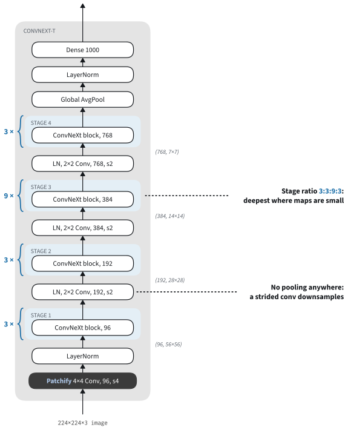
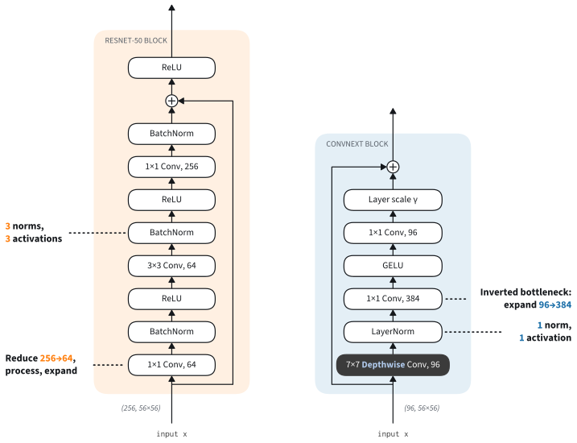

```{.python .input}
%load_ext d2lbook.tab
tab.interact_select('mxnet', 'pytorch', 'tensorflow', 'jax')
```

# ConvNeXt: A ConvNet for the 2020s
:label:`sec_convnext`

In 2021 a network without convolutions beat the ResNet on its home ground. A
*vision transformer* :cite:`Dosovitskiy.Beyer.Kolesnikov.ea.2021` cuts the
image into a grid of patches, turns each patch into a vector, and processes
this set of vectors with a stack of identical blocks. Each block has two
parts. An *attention* layer lets every patch take a weighted average of the
features of other patches, with weights computed from the features
themselves; a small MLP then transforms each patch's vector on its own. The
Swin Transformer :cite:`liu2021swin`, a vision transformer that computes
attention within local $7 \times 7$ windows of patches and lowers the
resolution between stages as a convnet does, reached 81.3% top-1 accuracy on
ImageNet, against 76.1% for a ResNet-50 of similar cost. If attention
caused the gap, convolutional networks were obsolete.

But Swin differs from a 2015 ResNet in many ways besides attention: it was
trained with a newer recipe, its stem slices the image into patches, and it
uses another activation, another normalization, and other stage depths.
Which of these differences carried the improvement? :citet:`liu2022convnet`
answered by experiment. Starting from a ResNet-50, they applied one
Swin-inspired change at a time, measured ImageNet accuracy after each, and
never added attention. The result, *ConvNeXt*, reaches 82.0%. Its
ingredients come from earlier sections: the training recipe of
:numref:`sec_training_recipes`, the depthwise convolutions and inverted
bottlenecks of :numref:`sec_efficient_cnns`, and the layer normalization of
:numref:`sec_batch_norm`. We read the sequence of changes, build the network,
and train a small ConvNeXt on Fashion-MNIST against a ResNet-18 with the same
number of parameters. Transformers themselves are the subject of
:numref:`chap_transformers`.

```{.python .input #convnext-imports}
%%tab mxnet
from d2l import mxnet as d2l
import math
import mxnet as mx
from mxnet import gluon, init, np as mnp, npx
from mxnet.gluon import nn
npx.set_np()
```

```{.python .input #convnext-imports}
%%tab pytorch
from d2l import torch as d2l
import torch
from torch import nn
from torch.nn import functional as F
```

```{.python .input #convnext-imports}
%%tab tensorflow
import tensorflow as tf
from d2l import tensorflow as d2l
```

```{.python .input #convnext-imports}
%%tab jax
from d2l import jax as d2l
from flax import nnx
import jax
from jax import numpy as jnp
import optax
```

## The Modernization Roadmap

:numref:`tab_convnext_roadmap` lists the changes in the order the paper
applied them. Each row keeps every change above it, so the accuracies are
cumulative, and the computational cost stays near that of Swin-T, about
4.5 billion multiply-adds per image (the paper's 4.5 GFLOPs).

:The ConvNeXt modernization roadmap :cite:`liu2022convnet`. ImageNet top-1 accuracy of a ResNet-50 as design changes accumulate; each row includes all rows above it, at roughly constant cost. Swin-T, a transformer of similar cost, reaches 81.3%.
:label:`tab_convnext_roadmap`

| Change | What it means | Top-1 |
|:--|:--|:--|
| (starting point) | ResNet-50 with its 2015 recipe | 76.1% |
| Modern training recipe | 300 epochs, AdamW, Mixup, label smoothing, stochastic depth (:numref:`sec_training_recipes`) | 78.8% |
| Stage ratio | blocks per stage $(3, 4, 6, 3) \to (3, 3, 9, 3)$ | 79.4% |
| Patchify stem | $7 \times 7$ stride-2 convolution plus pooling $\to$ one $4 \times 4$ stride-4 convolution | 79.5% |
| Depthwise convolutions | the $3 \times 3$ convolution becomes depthwise; width grows from 64 to 96 channels | 80.5% |
| Inverted bottleneck | expand $4\times$ inside the block instead of compressing | 80.6% |
| Large kernels | depthwise convolution moved to the front and enlarged to $7 \times 7$ | 80.6% |
| ReLU $\to$ GELU | a smooth activation, as in transformers | 80.6% |
| Fewer activations | one activation per block instead of three | 81.3% |
| Fewer normalizations | one normalization per block instead of three | 81.4% |
| BN $\to$ LN | layer normalization over channels at each position | 81.5% |
| Separate downsampling | an LN plus $2 \times 2$ stride-2 convolution between stages | 82.0% |

The first change, the training recipe, gives the largest single improvement
and does not touch the architecture. It is the recipe effect of
:numref:`sec_training_recipes`: a longer schedule with AdamW and strong
regularization lifts the same ResNet-50 by 2.7 points, and a still longer
600-epoch procedure takes it to 80.4% :cite:`wightman2021resnet`. Of the 5.9
points that separate the 2015 ResNet-50 from ConvNeXt, 2.7 come from
training and 3.2 from the architecture. Papers that compared a well-tuned
transformer against a ResNet trained the 2015 way were therefore comparing
recipes as much as architectures.

### Macro Design

The next two rows change the shape of the network as a whole. Swin-T
distributes its blocks across four stages in the ratio $1{:}1{:}3{:}1$,
spending most of its depth where the feature maps are small and each block
is cheap. Adopting the same ratio turns ResNet-50's $(3, 4, 6, 3)$ blocks
into $(3, 3, 9, 3)$ and adds 0.6 points. The stem changes more. ResNet
begins with a $7 \times 7$ stride-2 convolution followed by max-pooling, a
fourfold reduction computed with overlapping windows. A vision transformer
instead slices the image into non-overlapping patches and multiplies the
pixels of each patch by one shared matrix. That is a convolution whose kernel
size equals its stride (:numref:`sec_padding`), here a $4 \times 4$
convolution with stride 4. This *patchify* stem replaces the ResNet stem with
no loss (79.5%) and produces one feature vector per $4 \times 4$ patch, the
same object a transformer computes.

### Depthwise Convolutions and the Inverted Bottleneck

A transformer block separates two kinds of mixing. Attention combines
information across positions, and the MLP that follows combines the channels
of each position on its own. A convolutional network can separate them the
same way. A *depthwise* convolution applies one $k \times k$ filter to each
channel separately, so it mixes positions but not channels, and a
$1 \times 1$ convolution mixes channels at each position but not positions
(:numref:`sec_depthwise_separable`). ConvNeXt makes the $3 \times 3$
convolution of the ResNet bottleneck depthwise. That cuts its cost so much
that the network can afford more width: 96 channels in the first stage
instead of 64, matching Swin-T, which brings 80.5%.

The ResNet bottleneck compresses its input with a $1 \times 1$ convolution,
processes it, and expands it again. Once the spatial convolution is
depthwise, the economics reverse, as :numref:`sec_efficient_cnns` showed for
MobileNetV2: the block can keep a thin stream between blocks and expand it
inside. The transformer's MLP has the same shape, a $1 \times 1$ expansion
by $4\times$, an activation, and a projection back. *Inverting* the
bottleneck this way adds a little (80.6%).

With the dense convolution gone, the kernel size becomes cheap to change. The
depthwise convolution moves to the front of the block, so that it acts on the
thin stream of $c$ channels instead of the $4c$ expanded ones. This alone
costs 0.7 points (to 79.9%), and enlarging the kernel from $3 \times 3$ to
$7 \times 7$ recovers them. A $7 \times 7$ kernel widens the receptive field
as much as three stacked $3 \times 3$ layers (:eqref:`eq_receptive_field`).
VGG chose the stack (:numref:`sec_vgg`) because dense kernels cost
$k^2 c_\textrm{i} c_\textrm{o}$ multiply-adds per position. A depthwise
kernel costs $k^2 c$, so going from $3 \times 3$ to $7 \times 7$ multiplies
a small term by $49/9 \approx 5$. The authors report that accuracy saturates
at $7 \times 7$: kernels of $9 \times 9$ and $11 \times 11$ bring no further
improvement at this scale. $7 \times 7$ is also the window size of Swin's
attention.

### Micro Design

The remaining rows change individual layers. GELU
:cite:`Hendrycks.Gimpel.2016`, a smooth variant of the ReLU used in Swin and
in BERT- and ViT-style transformers, changes nothing by itself (80.6%). What matters is *how
many* activations and normalizations the block contains. A ResNet bottleneck
follows every convolution with a normalization and an activation: three of
each. A transformer block has one activation, inside its MLP, and one
normalization per part. Keeping only the GELU between the two $1 \times 1$
convolutions adds 0.7 points, more than any other change in this group.
Keeping only one normalization adds 0.1, and making that one a
layer normalization over the channels at each spatial position, instead of a
batch normalization, adds another tenth (81.5%). :numref:`sec_batch_norm`
introduced normalization as an aid to optimization; here fewer such layers,
one per block, train better than three.
:numref:`fig_resnet_vs_convnext_block` shows the block before and after.


:label:`fig_resnet_vs_convnext_block`

Finally, ResNet downsamples inside the first block of each stage by giving
its $3 \times 3$ convolution a stride of 2. Swin uses a separate
patch-merging layer between stages. Adopting the same separation completes
the roadmap at 82.0%: a layer normalization followed by a $2 \times 2$
stride-2 convolution between stages, plus a normalization after the stem and
one before the classifier, which the authors found necessary for stable
training. :numref:`fig_convnext` shows the assembled ConvNeXt-T: a patchify
stem, four stages of $(3, 3, 9, 3)$ blocks at widths $(96, 192, 384, 768)$,
downsampling layers between them, and a head of global average pooling, the
stem-body-head layout this chapter has used since :numref:`sec_googlenet`.


:label:`fig_convnext`

At equal cost, ConvNeXt-T matches Swin-T, and the paper reports the same for
larger models and for transfer to detection and segmentation. The gap of
2021 came from the training recipe and from design choices other than
attention. The experiment does not show that
convolutions are better: under comparable tuning the two families reach
similar accuracy.

## Implementation

The roadmap removed more than it added, so the block is short.

### The ConvNeXt Block

The block applies, in order, a $7 \times 7$ depthwise convolution, a layer
normalization, a $1 \times 1$ convolution that expands the channels
$4\times$, a GELU, and a $1 \times 1$ convolution that projects back, and it
adds the result to its input. Two details of the paper's training setup come
with it. *Layer scale* :cite:`touvron2021cait` multiplies the branch by a
learnable vector $\boldsymbol{\gamma}$, one entry per channel, initialized
to $10^{-6}$. Every block then starts close to the identity, and the network
begins training as a shallow function. *Stochastic depth*
(:numref:`sec_training_recipes`) drops the whole branch of a block, for each
example independently, with probability $p$ during training and scales the
kept branches by $1/(1-p)$, so that the expected output is unchanged.

The layer normalization of ConvNeXt normalizes the channels at each spatial
position separately, as a transformer normalizes each patch vector. In a
channels-last layout (examples, height, width, channels) this is the default
layer normalization over the last axis, and a $1 \times 1$ convolution is a
linear layer applied to that axis. Following the paper, every convolution
and linear layer starts with weights drawn from a normal distribution with
standard deviation 0.02 and zero biases.

:begin_tab:`mxnet`
Images are stored channels-first, so the block normalizes over `axis=1` and
keeps its $1 \times 1$ convolutions as convolutions.
:end_tab:

:begin_tab:`pytorch`
Images are stored channels-first, so the block permutes to channels-last for
the layer normalization and the two linear layers and permutes back
afterwards.
:end_tab:

:begin_tab:`tensorflow, jax`
Images are stored channels-last, so the block uses the library's layer
normalization and dense layers directly.
:end_tab:

```{.python .input #convnext-block}
%%tab mxnet
def gelu(X):  # MXNet's GPU GELU gradient is NaN at 0, smolix/mxnet#103
    return 0.5 * X * (1 + npx.erf(X / math.sqrt(2)))

class ConvNeXtBlock(nn.HybridBlock):
    """Depthwise 7x7, LN, 1x1 expand, GELU, 1x1 project, scaled residual."""
    def __init__(self, dim, drop_prob=0.0, layer_scale=1e-6):
        super().__init__()
        self.dwconv = nn.Conv2D(dim, kernel_size=7, padding=3, groups=dim)
        self.norm = nn.LayerNorm(axis=1, epsilon=1e-6)
        self.pwconv1 = nn.Conv2D(4 * dim, kernel_size=1)
        self.pwconv2 = nn.Conv2D(dim, kernel_size=1)
        self.gamma = gluon.Parameter('gamma', shape=(1, dim, 1, 1),
                                     init=init.Constant(layer_scale))
        self.drop_prob = drop_prob

    def forward(self, X):
        Y = self.pwconv2(gelu(self.pwconv1(self.norm(self.dwconv(X)))))
        return X + d2l.drop_path(self.gamma.data() * Y, self.drop_prob)
```

```{.python .input #convnext-block}
%%tab pytorch
class ConvNeXtBlock(nn.Module):
    """Depthwise 7x7, LN, 1x1 expand, GELU, 1x1 project, scaled residual."""
    def __init__(self, dim, drop_prob=0.0, layer_scale=1e-6):
        super().__init__()
        self.dwconv = nn.Conv2d(dim, dim, kernel_size=7, padding=3,
                                groups=dim)
        self.norm = nn.LayerNorm(dim, eps=1e-6)
        self.pwconv1 = nn.Linear(dim, 4 * dim)  # 1x1 conv in channels-last
        self.pwconv2 = nn.Linear(4 * dim, dim)
        self.gamma = nn.Parameter(layer_scale * torch.ones(dim))
        self.drop_prob = drop_prob

    def forward(self, X):
        Y = self.dwconv(X).permute(0, 2, 3, 1)  # to channels-last
        Y = self.pwconv2(F.gelu(self.pwconv1(self.norm(Y))))
        Y = (self.gamma * Y).permute(0, 3, 1, 2)  # back to channels-first
        return X + d2l.drop_path(Y, self.drop_prob, self.training)
```

```{.python .input #convnext-block}
%%tab tensorflow
def normal_002():  # Keras needs a fresh initializer object per layer
    return tf.keras.initializers.RandomNormal(stddev=0.02)

class ConvNeXtBlock(tf.keras.layers.Layer):
    """Depthwise 7x7, LN, 1x1 expand, GELU, 1x1 project, scaled residual."""
    def __init__(self, dim, drop_prob=0.0, layer_scale=1e-6):
        super().__init__()
        self.dwconv = tf.keras.layers.DepthwiseConv2D(
            kernel_size=7, padding='same',
            depthwise_initializer=normal_002())
        self.norm = tf.keras.layers.LayerNormalization(epsilon=1e-6)
        self.pwconv1 = tf.keras.layers.Dense(
            4 * dim, kernel_initializer=normal_002())
        self.pwconv2 = tf.keras.layers.Dense(
            dim, kernel_initializer=normal_002())
        self.gamma = self.add_weight(
            shape=(dim,),
            initializer=tf.keras.initializers.Constant(layer_scale))
        self.drop_prob = drop_prob

    def call(self, X, training=False):
        Y = self.pwconv2(tf.keras.activations.gelu(
            self.pwconv1(self.norm(self.dwconv(X)))))
        return X + d2l.drop_path(self.gamma * Y, self.drop_prob, training)
```

```{.python .input #convnext-block}
%%tab jax
class ConvNeXtBlock(nnx.Module):
    """Depthwise 7x7, LN, 1x1 expand, GELU, 1x1 project, scaled residual."""
    def __init__(self, dim, drop_prob=0.0, layer_scale=1e-6, rngs=None):
        rngs = (nnx.Rngs(params=d2l.get_key(), dropout=d2l.get_key())
                if rngs is None else rngs)
        w_init = nnx.initializers.normal(0.02)
        self.dwconv = nnx.Conv(dim, dim, kernel_size=(7, 7), padding='same',
                               feature_group_count=dim, kernel_init=w_init,
                               rngs=rngs)
        self.norm = nnx.LayerNorm(dim, epsilon=1e-6, rngs=rngs)
        self.pwconv1 = nnx.Linear(dim, 4 * dim, kernel_init=w_init,
                                  rngs=rngs)
        self.pwconv2 = nnx.Linear(4 * dim, dim, kernel_init=w_init,
                                  rngs=rngs)
        self.gamma = nnx.Param(layer_scale * jnp.ones(dim))
        self.drop_prob, self.rngs = drop_prob, rngs
        self.deterministic = False

    def set_view(self, *, deterministic):
        self.deterministic = deterministic

    def __call__(self, X):
        Y = self.norm(self.dwconv(X))
        Y = self.pwconv2(nnx.gelu(self.pwconv1(Y), approximate=False))
        return X + d2l.drop_path(self.rngs.dropout(), self.gamma * Y,
                                 self.drop_prob, not self.deterministic)
```

### The Full Network

The network is the loop over a tuple of (depth, channels) pairs of
:numref:`sec_vgg` once more. The stem is the patchify convolution plus a
layer normalization. Between stages sits the separate downsampling layer, a
layer normalization followed by a $2 \times 2$ stride-2 convolution; there is
no pooling in the body. Following the paper, the stochastic-depth
probability grows linearly from zero at the first block to its maximum at the
last. For Fashion-MNIST we use the widths $(40, 80, 160, 320)$ and depths
$(2, 2, 6, 2)$ of ConvNeXt-atto, the smallest variant in common use; the
third stage is the deepest, as in ConvNeXt-T.

```{.python .input #convnext-model}
%%tab mxnet
class ConvNeXt(d2l.Classifier):
    def __init__(self, arch=((2, 40), (2, 80), (6, 160), (2, 320)),
                 lr=2e-3, num_classes=10, drop_path_max=0.1):
        super().__init__()
        self.save_hyperparameters()
        depths = [d for d, c in arch]
        rates = mnp.linspace(0, drop_path_max, sum(depths)).tolist()
        self.net = nn.HybridSequential()
        self.net.add(nn.Conv2D(arch[0][1], kernel_size=4, strides=4),
                     nn.LayerNorm(axis=1, epsilon=1e-6))
        b = 0
        for i, (depth, c) in enumerate(arch):
            if i > 0:  # Separate downsampling layer between stages
                self.net.add(nn.LayerNorm(axis=1, epsilon=1e-6),
                             nn.Conv2D(c, kernel_size=2, strides=2))
            for _ in range(depth):
                self.net.add(ConvNeXtBlock(c, drop_prob=rates[b]))
                b += 1
        self.net.add(nn.GlobalAvgPool2D(), nn.Flatten(),
                     nn.LayerNorm(axis=-1, epsilon=1e-6),
                     nn.Dense(num_classes))
        self.net.initialize(init.Normal(0.02))
```

```{.python .input #convnext-model}
%%tab pytorch
class LayerNorm2d(nn.LayerNorm):
    """LayerNorm over the channel axis of an NCHW tensor."""
    def forward(self, X):
        return super().forward(X.permute(0, 2, 3, 1)).permute(0, 3, 1, 2)

class ConvNeXt(d2l.Classifier):
    def __init__(self, arch=((2, 40), (2, 80), (6, 160), (2, 320)),
                 lr=2e-3, num_classes=10, drop_path_max=0.1):
        super().__init__()
        self.save_hyperparameters()
        depths = [d for d, c in arch]
        rates = torch.linspace(0, drop_path_max, sum(depths)).tolist()
        layers = [nn.Conv2d(1, arch[0][1], kernel_size=4, stride=4),
                  LayerNorm2d(arch[0][1], eps=1e-6)]
        c_prev, b = arch[0][1], 0
        for i, (depth, c) in enumerate(arch):
            if i > 0:  # Separate downsampling layer between stages
                layers += [LayerNorm2d(c_prev, eps=1e-6),
                           nn.Conv2d(c_prev, c, kernel_size=2, stride=2)]
            for _ in range(depth):
                layers.append(ConvNeXtBlock(c, drop_prob=rates[b]))
                b += 1
            c_prev = c
        layers += [nn.AdaptiveAvgPool2d((1, 1)), nn.Flatten(),
                   nn.LayerNorm(c_prev, eps=1e-6),
                   nn.Linear(c_prev, num_classes)]
        self.net = nn.Sequential(*layers)
        self.net.apply(self.weight_init)

    def weight_init(self, module):
        if type(module) in (nn.Conv2d, nn.Linear):
            nn.init.normal_(module.weight, std=0.02)
            nn.init.zeros_(module.bias)
```

```{.python .input #convnext-model}
%%tab tensorflow
class ConvNeXt(d2l.Classifier):
    def __init__(self, arch=((2, 40), (2, 80), (6, 160), (2, 320)),
                 lr=2e-3, num_classes=10, drop_path_max=0.1):
        super().__init__()
        self.save_hyperparameters()
        depths = [d for d, c in arch]
        rates = tf.linspace(0.0, drop_path_max, sum(depths)).numpy().tolist()
        self.net = tf.keras.models.Sequential([
            tf.keras.layers.Conv2D(arch[0][1], kernel_size=4, strides=4,
                                   kernel_initializer=normal_002()),
            tf.keras.layers.LayerNormalization(epsilon=1e-6)])
        b = 0
        for i, (depth, c) in enumerate(arch):
            if i > 0:  # Separate downsampling layer between stages
                self.net.add(tf.keras.layers.LayerNormalization(epsilon=1e-6))
                self.net.add(tf.keras.layers.Conv2D(
                    c, kernel_size=2, strides=2,
                    kernel_initializer=normal_002()))
            for _ in range(depth):
                self.net.add(ConvNeXtBlock(c, drop_prob=rates[b]))
                b += 1
        self.net.add(tf.keras.layers.GlobalAvgPool2D())
        self.net.add(tf.keras.layers.LayerNormalization(epsilon=1e-6))
        self.net.add(tf.keras.layers.Dense(num_classes,
                                           kernel_initializer=normal_002()))
```

```{.python .input #convnext-model}
%%tab jax
class ConvNeXt(d2l.Classifier):
    def __init__(self, arch=((2, 40), (2, 80), (6, 160), (2, 320)),
                 lr=2e-3, num_classes=10, drop_path_max=0.1, rngs=None):
        super().__init__()
        self.save_hyperparameters(ignore=['rngs'])
        rngs = (nnx.Rngs(params=d2l.get_key(), dropout=d2l.get_key(),
                         mixup=d2l.get_key()) if rngs is None else rngs)
        self.rngs = rngs
        w_init = nnx.initializers.normal(0.02)
        depths = [d for d, c in arch]
        rates = jnp.linspace(0, drop_path_max, sum(depths)).tolist()
        layers = [nnx.Conv(1, arch[0][1], kernel_size=(4, 4), strides=(4, 4),
                           kernel_init=w_init, rngs=rngs),
                  nnx.LayerNorm(arch[0][1], epsilon=1e-6, rngs=rngs)]
        c_prev, b = arch[0][1], 0
        for i, (depth, c) in enumerate(arch):
            if i > 0:  # Separate downsampling layer between stages
                layers += [nnx.LayerNorm(c_prev, epsilon=1e-6, rngs=rngs),
                           nnx.Conv(c_prev, c, kernel_size=(2, 2),
                                    strides=(2, 2), kernel_init=w_init,
                                    rngs=rngs)]
            for _ in range(depth):
                layers.append(ConvNeXtBlock(c, drop_prob=rates[b], rngs=rngs))
                b += 1
            c_prev = c
        layers += [global_avg_pool,
                   nnx.LayerNorm(c_prev, epsilon=1e-6, rngs=rngs),
                   nnx.Linear(c_prev, num_classes, kernel_init=w_init,
                              rngs=rngs)]
        self.net = nnx.Sequential(*layers)

def global_avg_pool(X):  # Average over height and width (NHWC)
    return X.mean(axis=(1, 2))
```

We train on Fashion-MNIST upsampled to $64 \times 64$. Such an input leaves
the stem as a $16 \times 16$ map, and the three downsampling layers reduce
it to $8 \times 8$, $4 \times 4$, and finally $2 \times 2$ before the head
pools it away. We check the output shape
and count the parameters.

```{.python .input #convnext-params}
%%tab mxnet
model = ConvNeXt()
assert model(mnp.random.normal(size=(1, 1, 64, 64))).shape == (1, 10)
d2l.num_params(model)
```

```{.python .input #convnext-params}
%%tab pytorch
model = ConvNeXt()
assert model(torch.randn(1, 1, 64, 64)).shape == (1, 10)
d2l.num_params(model)
```

```{.python .input #convnext-params}
%%tab tensorflow
model = ConvNeXt()
assert model(tf.random.normal((1, 64, 64, 1))).shape == (1, 10)
d2l.num_params(model)
```

```{.python .input #convnext-params}
%%tab jax
model = ConvNeXt()
assert model(jnp.zeros((1, 64, 64, 1))).shape == (1, 10)
d2l.num_params(model)
```

The network has 3,376,450 parameters, about a third of the 11.2 million of
the ResNet-18 that :numref:`sec_resnet` trained on Fashion-MNIST. Because a
single wrongly sized layer changes it, the count is a sensitive check of any
reimplementation, ours included.

## A Parameter-Matched Comparison

ConvNeXt's design was selected on ImageNet at $224 \times 224$. Does it also
help on small grayscale images? We train our ConvNeXt against a control with
the same number of parameters: a ResNet-18 whose base width is reduced from
64 to 35 channels. Both use the compact modern recipe B of
:numref:`sec_training_recipes`: AdamW with weight decay 0.05, a learning rate
that rises linearly from zero to $2 \times 10^{-3}$ and then decays to zero
along a cosine, label smoothing of 0.1, and Mixup with $\alpha = 0.2$. Two
settings differ from that section: the networks train for 20 epochs on the
full training set instead of 45 epochs on 10,000 images, and the warmup
covers the first 10% of the steps instead of three epochs. We set the
stochastic-depth rate of ConvNeXt to zero because the ResNet control has no
such mechanism.

The class `ModernRecipe` below packages that recipe as a mixin, so that one
copy serves both models: it supplies the optimizer with its schedule and the
training step, and any classifier that stores its learning rate `lr` and its
total number of optimization steps `num_steps` can inherit it. The
validation loss stays the plain cross-entropy of `Classifier`, so it means
the same in every section.

```{.python .input #convnext-recipe}
%%tab mxnet
class ModernRecipe:
    """AdamW, linear warmup then cosine decay, label smoothing, Mixup."""
    def configure_optimizers(self):
        warmup = self.num_steps // 10
        schedule = lambda t: self.lr * d2l.cosine_warmup(  # MXNet counts
            t - 1, self.num_steps, warmup)  # updates from 1
        return gluon.Trainer(self.collect_params(), 'adamw', {
            'learning_rate': None, 'lr_scheduler': schedule, 'wd': 0.05,
            'epsilon': 1e-8})

    def training_step(self, batch):
        X, y_a, y_b, lam = d2l.mixup(*batch, alpha=0.2)
        Y_hat = self(X)
        n, label_smoothing = Y_hat.shape[1], 0.1
        smooth = lambda y: ((1 - label_smoothing) * npx.one_hot(y, n)
                            + label_smoothing / n)
        loss = gluon.loss.SoftmaxCrossEntropyLoss(sparse_label=False)
        return (lam * loss(Y_hat, smooth(y_a))
                + (1 - lam) * loss(Y_hat, smooth(y_b))).mean()

class ModernConvNeXt(ModernRecipe, ConvNeXt):
    def __init__(self, num_steps, lr=2e-3):
        super().__init__(lr=lr, drop_path_max=0.0)
        self.num_steps = num_steps
        # Compile into one graph here, not in ConvNeXt: a hybridized net with
        # its own Parameter breaks after a CPU run (smolix/mxnet#104)
        self.net.hybridize()
```

```{.python .input #convnext-recipe}
%%tab pytorch
class ModernRecipe:
    """AdamW, linear warmup then cosine decay, label smoothing, Mixup."""
    def configure_optimizers(self):
        optim = torch.optim.AdamW(self.parameters(), lr=self.lr,
                                  weight_decay=0.05)
        warmup = self.num_steps // 10
        schedule = torch.optim.lr_scheduler.LambdaLR(
            optim, lambda t: d2l.cosine_warmup(t, self.num_steps, warmup))
        return optim, schedule  # The Trainer steps it after every minibatch

    def training_step(self, batch):
        X, y_a, y_b, lam = d2l.mixup(*batch, alpha=0.2)
        Y_hat = self(X)
        loss = lambda y: F.cross_entropy(Y_hat, y, label_smoothing=0.1)
        return lam * loss(y_a) + (1 - lam) * loss(y_b)

class ModernConvNeXt(ModernRecipe, ConvNeXt):
    def __init__(self, num_steps, lr=2e-3):
        super().__init__(lr=lr, drop_path_max=0.0)
        self.num_steps = num_steps
```

```{.python .input #convnext-recipe}
%%tab tensorflow
class ModernRecipe:
    """AdamW, linear warmup then cosine decay, label smoothing, Mixup."""
    def configure_optimizers(self):
        warmup = self.num_steps // 10
        schedule = lambda: self.lr * d2l.cosine_warmup(
            optim.iterations, self.num_steps, warmup)
        optim = tf.keras.optimizers.AdamW(schedule, weight_decay=0.05,
                                          epsilon=1e-8)
        return optim

    def training_step(self, batch):
        X, y_a, y_b, lam = d2l.mixup(*batch, alpha=0.2)
        Y_hat = self(X, training=True)
        loss = tf.keras.losses.CategoricalCrossentropy(
            from_logits=True, label_smoothing=0.1)
        one_hot = lambda y: tf.one_hot(y, Y_hat.shape[1])
        return (lam * loss(one_hot(y_a), Y_hat)
                + (1 - lam) * loss(one_hot(y_b), Y_hat))

class ModernConvNeXt(ModernRecipe, ConvNeXt):
    def __init__(self, num_steps, lr=2e-3):
        super().__init__(lr=lr, drop_path_max=0.0)
        self.num_steps = num_steps
```

```{.python .input #convnext-recipe}
%%tab jax
class ModernRecipe:
    """AdamW, linear warmup then cosine decay, label smoothing, Mixup."""
    def configure_optimizers(self):
        warmup = self.num_steps // 10
        schedule = lambda t: self.lr * d2l.cosine_warmup(t, self.num_steps,
                                                         warmup)
        return optax.adamw(schedule, weight_decay=0.05)

    def training_step(self, batch):
        X, y_a, y_b, lam = d2l.mixup(self.rngs.mixup(), *batch, alpha=0.2)
        Y_hat = self(X)
        smooth = lambda y: optax.smooth_labels(
            jax.nn.one_hot(y, Y_hat.shape[1]), 0.1)
        loss = lambda y: optax.softmax_cross_entropy(Y_hat, smooth(y)).mean()
        return lam * loss(y_a) + (1 - lam) * loss(y_b)

class ModernConvNeXt(ModernRecipe, ConvNeXt):
    def __init__(self, num_steps, lr=2e-3):
        super().__init__(lr=lr, drop_path_max=0.0)
        self.num_steps = num_steps
```

The control stacks the `Residual` blocks of :numref:`sec_resnet` in the
layout of ResNet-18: a $7 \times 7$ stride-2 stem with max-pooling, four
stages of two blocks each with 35, 70, 140, and 280 channels, and a
global-average-pooling head.

```{.python .input #convnext-recipe-2}
%%tab mxnet
class CompactResNet18(ModernRecipe, d2l.Classifier):
    """ResNet-18 with base width 35 instead of 64, trained by the recipe."""
    def __init__(self, num_steps, lr=2e-3, num_classes=10, base=35):
        super().__init__()
        self.save_hyperparameters()
        self.net = nn.HybridSequential()
        self.net.add(nn.Conv2D(base, kernel_size=7, strides=2, padding=3,
                               use_bias=False),
                     nn.BatchNorm(), nn.Activation('relu'),
                     nn.MaxPool2D(pool_size=3, strides=2, padding=1))
        for i, c in enumerate((base, 2 * base, 4 * base, 8 * base)):
            for j in range(2):
                down = i > 0 and j == 0
                self.net.add(d2l.Residual(c, use_1x1conv=down,
                                          strides=2 if down else 1))
        self.net.add(nn.GlobalAvgPool2D(), nn.Dense(num_classes))
        self.net.initialize(init.MSRAPrelu('in', 0))  # He initialization
        self.net.hybridize()
```

```{.python .input #convnext-recipe-2}
%%tab pytorch
class CompactResNet18(ModernRecipe, d2l.Classifier):
    """ResNet-18 with base width 35 instead of 64, trained by the recipe."""
    def __init__(self, num_steps, lr=2e-3, num_classes=10, base=35):
        super().__init__()
        self.save_hyperparameters()
        layers = [nn.LazyConv2d(base, kernel_size=7, stride=2, padding=3,
                                bias=False),
                  nn.LazyBatchNorm2d(), nn.ReLU(),
                  nn.MaxPool2d(kernel_size=3, stride=2, padding=1)]
        for i, c in enumerate((base, 2 * base, 4 * base, 8 * base)):
            for j in range(2):
                down = i > 0 and j == 0
                layers.append(d2l.Residual(c, use_1x1conv=down,
                                           strides=2 if down else 1))
        layers += [nn.AdaptiveAvgPool2d((1, 1)), nn.Flatten(),
                   nn.LazyLinear(num_classes)]
        self.net = nn.Sequential(*layers)

    def weight_init(self, module):
        # The Trainer calls this after the first minibatch fixed the shapes
        if type(module) in (nn.Conv2d, nn.Linear):
            nn.init.kaiming_normal_(module.weight, nonlinearity='relu')
            if module.bias is not None:
                nn.init.zeros_(module.bias)
```

```{.python .input #convnext-recipe-2}
%%tab tensorflow
def he_init():  # He initialization; Keras needs one instance per layer
    return tf.keras.initializers.VarianceScaling(2.0, 'fan_in',
                                                 'untruncated_normal')

class CompactResNet18(ModernRecipe, d2l.Classifier):
    """ResNet-18 with base width 35 instead of 64, trained by the recipe."""
    def __init__(self, num_steps, lr=2e-3, num_classes=10, base=35):
        super().__init__()
        self.save_hyperparameters()
        self.net = tf.keras.models.Sequential([
            tf.keras.layers.ZeroPadding2D(3),  # Pad every side
            tf.keras.layers.Conv2D(base, kernel_size=7, strides=2,
                                   use_bias=False,
                                   kernel_initializer=he_init()),
            tf.keras.layers.BatchNormalization(momentum=0.9, epsilon=1e-5),
            tf.keras.layers.Activation('relu'),
            tf.keras.layers.ZeroPadding2D(1),  # Inputs are >= 0 after ReLU
            tf.keras.layers.MaxPool2D(pool_size=3, strides=2)])
        for i, c in enumerate((base, 2 * base, 4 * base, 8 * base)):
            for j in range(2):
                down = i > 0 and j == 0
                self.net.add(d2l.Residual(c, use_1x1conv=down,
                                          strides=2 if down else 1))
        self.net.add(tf.keras.layers.GlobalAvgPool2D())
        self.net.add(tf.keras.layers.Dense(num_classes,
                                           kernel_initializer=he_init()))
```

```{.python .input #convnext-recipe-2}
%%tab jax
class CompactResNet18(ModernRecipe, d2l.Classifier):
    """ResNet-18 with base width 35 instead of 64, trained by the recipe."""
    def __init__(self, num_steps, lr=2e-3, num_classes=10, base=35,
                 rngs=None):
        super().__init__()
        self.save_hyperparameters(ignore=['rngs'])
        rngs = (nnx.Rngs(params=d2l.get_key(), mixup=d2l.get_key())
                if rngs is None else rngs)
        self.rngs = rngs
        w_init = nnx.initializers.variance_scaling(2.0, 'fan_in', 'normal')
        layers = [nnx.Conv(1, base, (7, 7), strides=(2, 2), padding=3,
                           use_bias=False, kernel_init=w_init, rngs=rngs),
                  nnx.BatchNorm(base, momentum=0.9, use_fast_variance=False,
                                rngs=rngs), nnx.relu, max_pool]
        c_prev = base
        for i, c in enumerate((base, 2 * base, 4 * base, 8 * base)):
            for j in range(2):
                down = i > 0 and j == 0
                layers.append(d2l.Residual(
                    c, use_1x1conv=down, strides=(2, 2) if down else (1, 1),
                    in_channels=c_prev, rngs=rngs))
                c_prev = c
        layers += [global_avg_pool,
                   nnx.Linear(c_prev, num_classes, kernel_init=w_init,
                              rngs=rngs)]
        self.net = nnx.Sequential(*layers)

def max_pool(X):  # 3x3 windows, stride 2, padding 1
    return nnx.max_pool(X, (3, 3), (2, 2), padding=((1, 1), (1, 1)))
```

We train both networks for 20 epochs on the full Fashion-MNIST training set
at $64 \times 64$ and record the validation accuracy after the last epoch.

```{.python .input #convnext-train}
%%tab mxnet, pytorch, jax
data = d2l.FashionMNIST(batch_size=128, resize=(64, 64))
num_steps = 20 * len(data.train_dataloader())
models, accuracy = {}, {}
for name, cls in (('ConvNeXt', ModernConvNeXt),
                  ('compact ResNet-18', CompactResNet18)):
    models[name] = cls(num_steps)
    trainer = d2l.Trainer(max_epochs=20, num_gpus=1)
    trainer.fit(models[name], data)
    accuracy[name] = trainer.history['val_acc'][-1]
```

```{.python .input #convnext-train}
%%tab tensorflow
data = d2l.FashionMNIST(batch_size=128, resize=(64, 64))
num_steps = 20 * len(data.train_dataloader())
models, accuracy = {}, {}
for name, cls in (('ConvNeXt', ModernConvNeXt),
                  ('compact ResNet-18', CompactResNet18)):
    trainer = d2l.Trainer(max_epochs=20)
    with d2l.try_gpu():
        models[name] = cls(num_steps)
        trainer.fit(models[name], data)
    accuracy[name] = trainer.history['val_acc'][-1]
```

```{.python .input #convnext-eval}
for name, model in models.items():
    print(f'{name}: {d2l.num_params(model):,} parameters, '
          f'validation accuracy {accuracy[name]:.3f}')
```

:Validation accuracy of the scaled-down ConvNeXt and a ResNet-18 with the same number of parameters and nearly the same multiply-adds per $64 \times 64$ image, after 20 epochs of the modern recipe on Fashion-MNIST (rounded).
:label:`tab_convnext_local`

| Model | Parameters | Multiply-adds | Validation accuracy |
|:--|--:|--:|--:|
| ConvNeXt | 3,376,450 | 44.3M | ≈ 92% |
| Compact ResNet-18 | 3,346,675 | 43.2M | ≈ 94% |

The compact ResNet-18 is ahead by about two points in every run, and both
validation curves level off over the last epochs as the learning rate decays
to zero. The result is specific to this setting. Every change on the roadmap
was selected on 1.3 million ImageNet images at $224 \times 224$. Our control
matches both the parameters and the arithmetic: counting the multiply-adds of
every convolution and linear layer for one $64 \times 64$ image gives 44.3
million for the ConvNeXt and 43.2 million for the ResNet. It does not match
the running time. What the experiment shows is that ConvNeXt's design choices
do not transfer automatically to a small grayscale task; it does not rank
convolutional architectures in general.

## Limits and Open Problems

ConvNeXt answers one question, which design choices closed the gap of 2021,
and leaves two open. The first is pretraining. Large vision models are now
often pretrained without labels, for instance as *masked autoencoders*
:cite:`he2022masked` that hide most patches of an image and learn to
reconstruct them. Hiding patches is natural for a network that treats the
image as a set of patches and awkward for a convolution that slides across
the holes. ConvNeXt V2 :cite:`woo2023convnextv2` makes it work with sparse
convolutions that skip the masked regions, and in doing so finds that many
channels of the pretrained V1 block become inactive or copies of each other.
Its remedy, *Global Response Normalization*, rescales each channel by its
overall response relative to the other channels; problem
:exref:`ex_convnext-global-response-normalization` implements it.

The second is spatial context. A $7 \times 7$ kernel sees a small window, and
global attention, as in the original vision transformer, lets every
position read from every other. Depthwise kernels of $31 \times 31$
:cite:`ding2022replknet`, trained with the re-parameterization of
:numref:`sec_efficient_cnns`, widen the window further and help most in
detection and segmentation. Whether fixed large kernels, convolutions that
learn where to sample, or attention is the better way to see the whole image
at a given cost is still open.

## Summary

ConvNeXt is a controlled experiment wearing an architecture's name. Starting
from a ResNet-50, it applied the design choices of the Swin Transformer one
at a time and kept those that helped: a modern training recipe, a
$1{:}1{:}3{:}1$ stage ratio, a patchify stem, depthwise convolutions in an
inverted bottleneck led by a $7 \times 7$ kernel, one GELU and one layer
normalization per block, and separate downsampling layers. The result matches Swin-T at
equal cost without attention, and 2.7 of its 5.9 points over the 2015
ResNet-50 come from the recipe alone. Its block separates mixing across
positions (the depthwise convolution) from mixing across channels (the
$1 \times 1$ expansion and projection), as a transformer block separates
attention from its MLP. Choices selected at ImageNet scale need not transfer
to other data: on upsampled Fashion-MNIST, a ResNet-18 with the same number
of parameters is about two points more accurate than our ConvNeXt.

## Exercises

1. **Roadmap ablations.** The roadmap in :numref:`tab_convnext_roadmap`
   applies its changes in one fixed order, and each row's gain is measured
   with every earlier change in place.
    1. Just before the "Large kernels" row, each block expands its residual
       width $c$ to $4c$ with a $1 \times 1$ convolution, applies a
       $3 \times 3$ depthwise convolution to the $4c$ channels, and projects
       back to $c$ with a second $1 \times 1$ convolution. The row first
       moves the depthwise convolution in front of the expansion, where it
       acts on $c$ channels, and then enlarges its kernel to $7 \times 7$.
       Count the multiply-adds per spatial position of the depthwise
       convolution before the move, after the move, and after the
       enlargement. Compare the net change over the row with the change
       that enlarging the kernel to $7 \times 7$ in place, on the $4c$
       channels, would have caused.
    1. Choose two rows whose gains you expect to depend on their order, and
       design the additional runs that would measure the interaction.

1. **Where the parameters live.**
    1. For the `ConvNeXt` of this section, compute the fraction of
       parameters in the depthwise convolutions, in the $1 \times 1$
       expansions and projections, in the normalizations and layer-scale
       vectors inside the blocks, in the downsampling layers, and in the
       stem and head. Check that the total is 3,376,450.
    1. Express the parameter count of a `ConvNeXtBlock` and of a `Residual`
       block of :numref:`sec_resnet` without the $1 \times 1$ shortcut as
       functions of the width $c$. Which design decision makes the ConvNeXt
       block cheaper, and by what factor for large $c$?

1. **Normalization axes.** The activations entering a normalization layer
   form a minibatch of $n$ images, each with $c$ channels on an
   $h \times w$ map. Consider three layers: batch normalization, the
   per-position layer normalization of `ConvNeXtBlock`, and a layer
   normalization over all $chw$ values of an image with one learnable scale
   and one learnable shift per value.
    1. For each layer, state which values share one mean and variance, and
       count its learnable parameters.
    1. A network trained on $64 \times 64$ images is evaluated on
       $224 \times 224$ images. Which of the three layers can be applied to
       the larger images with their trained parameters unchanged? Explain.

1. [code] **Layer scale.** Under the recipe of the comparison in
   :numref:`tab_convnext_local`, train `ConvNeXt` with $\boldsymbol{\gamma}$
   initialized to $10^{-6}$ (the default), with $\boldsymbol{\gamma}$
   initialized to $1$, and with layer scale removed, and compare the
   training curves. Layer scale at $10^{-6}$ and stochastic depth
   (:eqref:`eq_stochastic_depth` of :numref:`sec_training_recipes`) both
   make the network effectively shallower than its block count. For each
   mechanism, explain how it does so, state when during training it acts,
   and state whether it changes the network used at evaluation.

1. [code] **Global Response Normalization.** ConvNeXt V2
   :cite:`woo2023convnextv2` inserts GRN after the GELU of the block and
   removes layer scale. For a feature map $\mathbf{X}$ with $C$ channels,
   let $g_c$ be the $\ell_2$ norm of channel $c$ over all spatial positions
   and $\bar{g}$ the mean of $g_1, \ldots, g_C$. GRN rescales each channel
   by its normalized response and adds a learnable per-channel affine term
   and a residual,
   $$\mathrm{GRN}(\mathbf{X})_c = \gamma_c \frac{g_c}{\bar{g} + \epsilon} \mathbf{X}_c + \beta_c + \mathbf{X}_c,$$
   with a small $\epsilon$ against division by zero ($10^{-6}$ in the
   paper's code), and with $\gamma_c$ and $\beta_c$ initialized to zero so
   that the layer starts as the identity.
    1. Implement GRN in about five lines and insert it into `ConvNeXtBlock`
       after the GELU, dropping layer scale.
    1. Retrain under the recipe of the comparison in
       :numref:`tab_convnext_local` and compare
       the validation accuracy.
   :exlabel:`ex_convnext-global-response-normalization`

1. [code] **Depthwise kernel size.** ● Under the recipe of the comparison in
   :numref:`tab_convnext_local`, train `ConvNeXt` with $3 \times 3$ and
   with $11 \times 11$ depthwise convolutions that leave the feature-map
   size unchanged, and compare accuracy, parameter count, and time per
   epoch against the $7 \times 7$ baseline. Does accuracy saturate at
   $7 \times 7$ here as :citet:`liu2022convnet` report on ImageNet? How
   does the change in time per epoch compare with the change in the
   depthwise term's arithmetic, and why?

1. [code] **Channel redundancy.** ● Take the `ConvNeXt` trained with GRN in
   problem :exref:`ex_convnext-global-response-normalization` and the one
   trained without it under the same recipe. Measure the channel redundancy
   that GRN was designed to prevent, at the input of the second $1 \times 1$
   convolution of every block. For each validation image, flatten each
   channel's map into a vector over the spatial positions, and average the
   cosine similarity over all pairs of channels. Average over the images
   and compare the networks with and without GRN block by block. In which
   stages, if any, does GRN make the channels less similar?

1. [code] **Recipe downgrade.** ● The comparison in
   :numref:`tab_convnext_local` trains two architectures under the modern
   recipe. Complete the ablation square by training both models under
   recipe A of :numref:`sec_training_recipes`: SGD with momentum, step
   decay, and neither Mixup nor label smoothing, with the learning rate
   retuned. How much of each network's accuracy survives the downgrade, and
   does the recipe help both architectures equally? Compare the size of the
   effect with the 2.7 points that the "Modern training recipe" row of
   :numref:`tab_convnext_roadmap` attributes to the recipe on ImageNet.

<!-- slides -->

::: {.slide}
::: {.cover}
[Dive into Deep Learning · §7.7]{.kicker}

ConvNeXt<br>**the modernization roadmap · the ConvNeXt block · a parameter-matched comparison**
:::
:::

::: {.slide title="In 2021 Swin-T Beat ResNet-50 by Five Points at Similar Cost"}
[The problem]{.kicker}

- A **vision transformer** cuts the image into patches, turns each patch
  into a vector, and stacks blocks of two parts: **attention** (each patch
  averages the features of the others; in Swin, within 7×7 windows) and an
  **MLP** (each patch alone).
- ImageNet top-1 at about 4.5G multiply-adds: **Swin-T 81.3%**, ResNet-50 76.1%.
- But Swin also has a newer training recipe, a patch stem, another
  activation, another normalization, other stage depths.

::: {.d2l-note .warn}
Which of these differences carried the five points?
:::

[Liu et al., 2021 (Swin); Liu et al., 2022 (ConvNeXt)]{.small}
:::

::: {.slide title="By the End of This Deck You Can"}
[Goals]{.kicker}

- read a cumulative ablation and attribute its gains;
- explain why a depthwise convolution plus $1 \times 1$ convolutions
  divide the work as attention plus MLP do;
- build the ConvNeXt block and network and check them by their parameter
  count;
- compare two architectures fairly: same parameters, data, recipe, epochs.

**Running example:** parameters, multiply-adds, and accuracy on
Fashion-MNIST: a ConvNeXt with 3.38M parameters against a ResNet-18 with
3.35M.
:::

::: {.slide title="Modernizing the ResNet, Step by Step"}
[Where this fits]{.kicker}

::: {.cols .vc}
::: {.col}
| section | adds |
|---|---|
| AlexNet | learned features, ReLU, dropout, GPUs |
| VGG, NiN, GoogLeNet | blocks, 1 × 1 convolutions, global pooling |
| Normalization Layers | batch, layer, group normalization |
| ResNet, ResNeXt, DenseNet | residual connections make depth trainable |
| Efficient Convnets | separable blocks, scaling, re-parameterization |
| Training Recipes | schedules, augmentation, weight averaging |
| **ConvNeXt** | **a ResNet modernized one change at a time** |
| Design Spaces (RegNet) | rules from populations of networks |
:::

::: {.col .narrow}
- **Uses:** depthwise convolutions, inverted bottleneck, layer
  normalization, the modern recipe, `Residual`.
- **Skips:** attention and transformers (later chapter).
:::
:::
:::

::: {.slide}
::: {.divider}
[01]{.dnum}

[The Modernization Roadmap]{.dtitle}

[eleven changes, measured one at a time]{.dsub}
:::
:::

::: {.slide title="Eleven Changes Take ResNet-50 from 76.1% to 82.0% Without Attention"}
[Roadmap]{.kicker}

| change (cumulative) | top-1 |
|:--|--:|
| ResNet-50, 2015 recipe | 76.1% |
| modern training recipe | **78.8%** |
| stage ratio (3,4,6,3) → (3,3,9,3) | 79.4% |
| patchify stem (4×4, stride 4) | 79.5% |
| depthwise conv, width 64 → 96 | 80.5% |
| inverted bottleneck; 7×7 depthwise first | 80.6% |
| GELU; one activation per block | 81.3% |
| one norm per block; BN → LN | 81.5% |
| separate downsampling layers | **82.0%** |

[Liu et al., 2022; ImageNet-1K, about 4.5G multiply-adds throughout]{.small}
:::

::: {.slide title="The Recipe Alone Is Worth 2.7 of the 5.9 Points"}
[Roadmap]{.kicker}

- 300 epochs, AdamW, Mixup, label smoothing, stochastic depth: the same
  ResNet-50 goes from 76.1% to **78.8%**.
- A 600-epoch recipe takes it to 80.4% (Wightman et al., 2021).
- Of the 5.9 points: **2.7 training, 3.2 architecture**.

::: {.d2l-note .rule}
Comparing a tuned transformer with a 2015-recipe ResNet compares recipes
as much as architectures.
:::
:::

::: {.slide title="A Patch Embedding Is a Convolution Whose Kernel Equals Its Stride"}
[Macro design]{.kicker}

- **Stage ratio:** Swin spends its depth where maps are small, 1:1:3:1;
  ResNet-50's (3, 4, 6, 3) becomes (3, 3, 9, 3): **+0.6**.
- **Stem:** ResNet uses a 7×7 stride-2 conv + max-pool, overlapping
  windows, 4× downsampling.
- A transformer multiplies each non-overlapping 4×4 patch by one matrix:
  a **4×4 convolution with stride 4**. Same accuracy (79.5%), one vector
  per patch.
:::

::: {.slide title="Depthwise Plus 1×1 Divides the Work as Attention Plus MLP Do"}
[Block design]{.kicker}

| | mixes positions | mixes channels |
|---|---|---|
| transformer block | attention | MLP (expand 4×, project) |
| ConvNeXt block | depthwise $7 \times 7$ conv | $1 \times 1$ convs (expand 4×, project) |

- Depthwise is cheap: width 64 → 96 affordable, **80.5%**.
- Invert the bottleneck (thin stream, 4× expansion inside): 80.6%.
- Move the depthwise conv first, enlarge to 7×7 (Swin's window size): 80.6%;
  9×9 and 11×11 bring nothing more.
:::

::: {.slide title="Check: What Does the 7×7 Kernel Cost?"}
[Check]{.kicker}

A block of width $c = 96$. Multiply-adds per position for the depthwise
$3 \times 3$, the depthwise $7 \times 7$, and the $1 \times 1$ expansion
$96 \to 384$?

::: {.fragment .fade-up}
::: {.d2l-note}
**Answer.** $9 \cdot 96 = 864$; $49 \cdot 96 = 4{,}704$;
$96 \cdot 384 = 36{,}864$. The larger kernel is 5× its small version but
still an eighth of one $1 \times 1$ convolution.
:::
:::
:::

::: {.slide title="One GELU and One Normalization per Block Beat Three of Each"}
[Block design]{.kicker}

- ReLU → GELU alone: no change (80.6%).
- Keep one GELU, between the two $1 \times 1$ convs: **+0.7**, the largest
  micro-design gain.
- Keep one normalization: +0.1; make it a layer norm over the channels
  at each position: +0.1 (81.5%).
- Separate downsampling (LN + 2×2 stride-2 conv between stages): **82.0%**.
:::

::: {.slide title="Three Norms and Three Activations Become One of Each"}
{width=74%}
:::

::: {.slide title="ConvNeXt-T: Patchify Stem, Stages 3:3:9:3, No Pooling in the Body"}
[Architecture]{.kicker}

| part | layers | output (224×224 input) |
|---|---|---|
| stem | 4×4 conv, stride 4; LN | 96 @ 56×56 |
| stage 1 | 3 ConvNeXt blocks | 96 @ 56×56 |
| stage 2 | LN + 2×2 conv, stride 2; 3 blocks | 192 @ 28×28 |
| stage 3 | LN + 2×2 conv, stride 2; 9 blocks | 384 @ 14×14 |
| stage 4 | LN + 2×2 conv, stride 2; 3 blocks | 768 @ 7×7 |
| head | global average pool, LN, linear | 1000 |

**82.0%** (roadmap; 82.1% in the final model) against Swin-T's 81.3% at
similar cost.
:::

::: {.slide}
::: {.divider}
[02]{.dnum}

[Implementation]{.dtitle}

[a six-operation block and the arch-tuple loop]{.dsub}
:::
:::

::: {.slide title="The Block Is Six Operations and a Residual"}
[Implementation]{.kicker}

$$\mathbf{Y} = \mathbf{X} + \boldsymbol{\gamma} \odot \mathbf{W}_2\, \mathrm{GELU}\big(\mathbf{W}_1\, \mathrm{LN}(\mathrm{DWConv}_{7\times7}(\mathbf{X}))\big)$$

- $\mathbf{W}_1$: $c \to 4c$, $\mathbf{W}_2$: $4c \to c$, both $1 \times 1$
  (linear layers on the channel axis).
- **Layer scale** $\boldsymbol{\gamma}$, one entry per channel, starts at
  $10^{-6}$: every block starts as the identity.
- **Stochastic depth:** drop the branch per example with probability $p$,
  scale kept branches by $1/(1-p)$.
- Weights $\sim \mathcal{N}(0, 0.02^2)$, zero biases.
:::

::: {.slide title="Our Fashion-MNIST ConvNeXt Has 3,376,450 Parameters"}
[Implementation]{.kicker}

- widths (40, 80, 160, 320), depths (2, 2, 6, 2): ConvNeXt-atto
- 64×64 input → 16 → 8 → 4 → 2 → global pool

@!convnext-params

A sensitive check: one wrongly sized layer would change it.
About a third of ResNet-18's 11.2M.
:::

::: {.slide}
::: {.divider}
[03]{.dnum}

[A Parameter-Matched Comparison]{.dtitle}

[same parameters, data, recipe, and epochs]{.dsub}
:::
:::

::: {.slide title="The Control: a ResNet-18 Narrowed to 3.35M Parameters"}
[Comparison]{.kicker}

- ResNet-18 layout with base width 35 instead of 64: stages of 35, 70,
  140, 280 channels; 44.3M against 43.2M multiply-adds per 64×64 image.
- Both models: full Fashion-MNIST at 64×64, 20 epochs, batch 128.
- Recipe: AdamW (weight decay 0.05); learning rate up linearly to
  $2 \times 10^{-3}$ over 10% of the steps, then cosine to 0; label
  smoothing 0.1; Mixup with $\alpha = 0.2$.
- Stochastic depth off: the control has no counterpart.
- Validation loss: plain cross-entropy for both.
:::

::: {.slide title="At 3.4M Parameters, the ResNet-18 Wins by About Two Points"}
[Comparison]{.kicker}

@!convnext-eval

| | parameters | multiply-adds | validation accuracy |
|---|--:|--:|--:|
| ConvNeXt | 3.38M | 44.3M | ≈ 92% |
| compact ResNet-18 | 3.35M | 43.2M | ≈ 94% |

The roadmap was selected on ImageNet at 224 px; its choices need not
transfer to 64 px grayscale images.
:::

::: {.slide title="Check: Where Did Swin's Five Points Come From?"}
[Check]{.kicker}

Swin-T 81.3% against ResNet-50 76.1% at similar cost. How much of the gap
does the roadmap attribute to training, and how much does a convnet
without attention close with architecture alone?

::: {.fragment .fade-up}
::: {.d2l-note}
**Answer.** The recipe gives 2.7 of the 5.2 points (78.8%). Architecture
changes without attention add 3.2 more, to 82.0%: the whole gap and 0.7
beyond.
:::
:::
:::

::: {.slide title="Two Questions ConvNeXt Leaves Open"}
[Beyond this deck]{.kicker}

- **Masked pretraining** (hide most patches, reconstruct them) suits patch
  sets, not sliding convolutions. ConvNeXt V2 uses sparse convolutions and
  finds many channels collapse; **Global Response Normalization**
  rescales each channel by its response relative to the others.
- **Wide context:** a 7×7 kernel sees a small window. 31×31 depthwise
  kernels (with re-parameterization) help detection and segmentation;
  deformable convolutions and attention are the alternatives.
:::

::: {.slide title="Recap"}
[Wrap-up]{.kicker}

- **ConvNeXt** = a controlled ablation: ResNet-50 76.1% → **82.0%**, Swin-T
  81.3%, no attention.
- **Recipe:** 2.7 of the 5.9 points.
- **Block:** 7×7 depthwise (positions) → LN → 1×1 expand 4× → GELU →
  1×1 project (channels), layer scale, residual.
- **Fashion-MNIST, 3.4M parameters:** ConvNeXt ≈ 92%, ResNet-18 ≈ 94%:
  design choices are selected for a regime.

**Next:** rules for whole families of networks, from populations of
sampled designs.
:::
