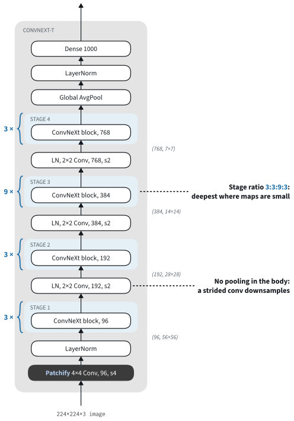
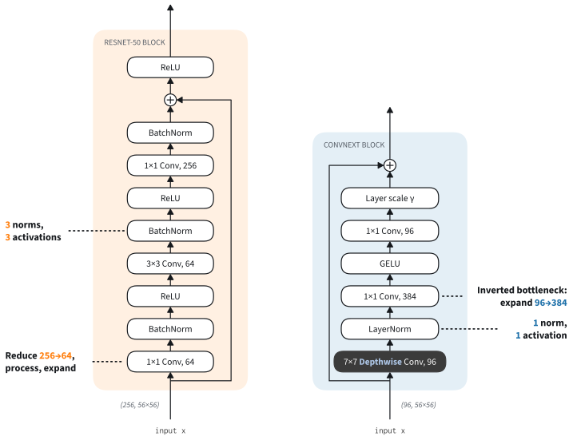

```{.python .input}
%load_ext d2lbook.tab
tab.interact_select('mxnet', 'pytorch', 'tensorflow', 'jax')
```

# ConvNeXt: Modernizing a ResNet Step by Step
:label:`sec_convnext`

Every network of this chapter so far is a convolutional network, and until 2020
the best image classifiers were convolutional networks too. In 2021 a network
without convolutions overtook them. The Swin Transformer :cite:`liu2021swin`,
built around a layer called *attention*, reached 81.3% top-1 accuracy on
ImageNet, against 76.1% for a ResNet-50 of similar cost. Did attention cause
the gap? If it did, convolutional networks were obsolete.

A sketch of the newcomer is all we need here; :numref:`chap_transformers`
treats it properly. A *vision transformer*
:cite:`Dosovitskiy.Beyer.Kolesnikov.ea.2021` cuts the image into a grid of
patches, turns each patch into a vector, and passes these vectors through a
stack of identical blocks. Each block has two parts. An attention layer lets
every patch take a weighted average of the features of other patches, with
weights computed from the features themselves; a small MLP then transforms each
patch's vector on its own. Swin computes attention within local $7 \times 7$
windows of patches and lowers the resolution between stages as a convnet does.

The previous section suggests caution. Swin differs from a 2015 ResNet in many
ways besides attention: it was trained with a newer recipe, its stem slices the
image into patches, and it uses another activation, another normalization, and
other stage depths. Which of these differences carried the improvement?
:citet:`liu2022convnet` answered by experiment. Starting from a ResNet-50, they
applied one Swin-inspired change at a time, measured ImageNet accuracy after
each, and never added attention. The result, *ConvNeXt*, reaches 82.0%. Its
ingredients come from earlier sections: the training recipe of
:numref:`sec_training_recipes`, the depthwise convolutions and inverted
bottlenecks of :numref:`sec_efficient_cnns`, and the layer normalization of
:numref:`sec_batch_norm`. Every row of their table is a full ImageNet training
run, so we cannot repeat the experiment. We read the table instead and build the
network it ends in. Then we run a small roadmap of our own on Fashion-MNIST:
starting from a ResNet-18 with the same number of parameters, we apply the
paper's changes in three steps and train after each.

```{.python .input #convnext-imports}
%%tab mxnet
import math
import numpy as np
from mxnet import autograd, gluon, init, np as mnp, npx
from mxnet.gluon import nn
from d2l import mxnet as d2l
npx.set_np()
```

```{.python .input #convnext-imports}
%%tab pytorch
import math
import numpy as np
import torch
from torch import nn
from torch.nn import functional as F
from d2l import torch as d2l
```

```{.python .input #convnext-imports}
%%tab tensorflow
import math
import numpy as np
import tensorflow as tf
from d2l import tensorflow as d2l
```

```{.python .input #convnext-imports}
%%tab jax
import math
import numpy as np
import jax
from jax import numpy as jnp
from flax import nnx
import optax
from d2l import jax as d2l
```

```{.python .input #convnext-convnext-a-convnet-for-the-2020s-1}
%%tab mxnet
import mxnet as mx
```

## The Modernization Roadmap

:numref:`tab_convnext_roadmap` lists the changes in the order the paper
applied them. Each row keeps every change above it, so the accuracies are
cumulative, and the computational cost stays near that of Swin-T, about
4.5 billion multiply-adds per image (the paper's 4.5 GFLOPs).

:The ConvNeXt modernization roadmap :cite:`liu2022convnet`. ImageNet top-1 accuracy of a ResNet-50 as design changes accumulate; each row includes all rows above it, at roughly constant cost. Swin-T, a transformer of similar cost, reaches 81.3%.
:label:`tab_convnext_roadmap`

| Change | What it means | Top-1 |
|:--|:--|:--|
| (starting point) | ResNet-50 with its 2015 recipe | 76.1% |
| Modern training recipe | 300 epochs, AdamW, Mixup, label smoothing, stochastic depth (:numref:`sec_training_recipes`) | 78.8% |
| Stage ratio | blocks per stage $(3, 4, 6, 3) \to (3, 3, 9, 3)$ | 79.4% |
| Patchify stem | $7 \times 7$ stride-2 convolution plus pooling $\to$ one $4 \times 4$ stride-4 convolution | 79.5% |
| Depthwise convolutions | the $3 \times 3$ convolution becomes depthwise; width grows from 64 to 96 channels | 80.5% |
| Inverted bottleneck | expand $4\times$ inside the block instead of compressing | 80.6% |
| Large kernels | depthwise convolution moved to the front and enlarged to $7 \times 7$ | 80.6% |
| ReLU $\to$ GELU | a smooth activation, as in transformers | 80.6% |
| Fewer activations | one activation per block instead of three | 81.3% |
| Fewer normalizations | one normalization per block instead of three | 81.4% |
| BN $\to$ LN | layer normalization over channels at each position | 81.5% |
| Separate downsampling | an LN plus $2 \times 2$ stride-2 convolution between stages | 82.0% |

The first change gives the largest single improvement, and it does not touch
the architecture at all. This is the recipe effect of
:numref:`sec_training_recipes`, here worth 2.7 points on an unchanged
ResNet-50. Of the 5.9 points that separate the 2015 ResNet-50 from ConvNeXt,
2.7 thus come from training and 3.2 from the architecture, at least in this
order of application. Papers that compared a well-tuned transformer against a
ResNet trained the 2015 way were therefore comparing recipes as much as
architectures.

### Macro Design

The next two rows change the shape of the network as a whole. Swin-T
distributes its blocks across four stages in the ratio $1{:}1{:}3{:}1$,
spending most of its depth where the feature maps are small and each block is
cheap. Adopting the same ratio turns ResNet-50's $(3, 4, 6, 3)$ blocks into
$(3, 3, 9, 3)$ and adds 0.6 points. The stem changes more. ResNet begins with a
$7 \times 7$ stride-2 convolution followed by max-pooling, a fourfold reduction
computed with overlapping windows. A vision transformer instead slices the
image into non-overlapping patches and multiplies the pixels of each patch by
one shared matrix. That is nothing more exotic than a convolution whose kernel
size equals its stride (:numref:`sec_padding`), here a $4 \times 4$ convolution
with stride 4. This *patchify* stem replaces the ResNet stem with no loss
(79.5%) and produces one feature vector per $4 \times 4$ patch, the same object
a transformer computes.

### Depthwise Convolutions and the Inverted Bottleneck

A transformer block separates two kinds of mixing. Attention combines
information across positions, and the MLP that follows combines the channels of
each position on its own. A convolutional network can separate them the same
way, with the two layers of :numref:`sec_depthwise_separable`: a *depthwise*
convolution mixes positions but not channels, and a $1 \times 1$ convolution
mixes channels at each position but not positions. ConvNeXt makes the
$3 \times 3$ convolution of the ResNet bottleneck depthwise. That cuts its cost
so much that the network can afford more width: 96 channels in the first stage
instead of 64, matching Swin-T, which brings 80.5%.

Why does the ResNet bottleneck compress its input before the spatial
convolution and expand it afterwards? Because the cost of a dense convolution
grows with the square of the width. The cost of a depthwise convolution grows
only in proportion to the width, so the reason to compress is gone, and the
block can keep a thin stream between blocks and expand it inside, as
MobileNetV2 does (:numref:`sec_efficient_cnns`). The transformer's MLP has the
same shape, a $1 \times 1$ expansion by $4\times$, an activation, and a
projection back. *Inverting* the bottleneck this way adds a little (80.6%).

With the dense convolution gone, the kernel size becomes cheap to change. The
depthwise convolution moves to the front of the block, so that it acts on the
thin stream of $c$ channels instead of the $4c$ expanded ones. This alone costs
0.7 points (to 79.9%), the only step backwards on the roadmap, and enlarging
the kernel from $3 \times 3$ to $7 \times 7$ recovers them. A $7 \times 7$
kernel widens the receptive field as much as three stacked $3 \times 3$ layers
(:numref:`sec_padding`). VGG chose the stack (:numref:`sec_vgg`) because dense
kernels cost $k^2 c_\textrm{i} c_\textrm{o}$ multiply-adds per position. A
depthwise kernel costs $k^2 c$, so going from $3 \times 3$ to $7 \times 7$
multiplies a small term by $49/9 \approx 5$. The authors report no further gain
from kernels beyond $7 \times 7$, which is also the window size of Swin's
attention.

### Micro Design

The remaining rows change individual layers. GELU
:cite:`Hendrycks.Gimpel.2016`, the smooth variant of the ReLU that transformers
use, changes nothing by itself (80.6%). What matters is *how many* activations
and normalizations the block contains. A ResNet bottleneck follows every
convolution with a normalization and an activation: three of each. A
transformer block has one activation, inside its MLP, and one normalization in
front of each of its two parts. Keeping only the GELU between the two
$1 \times 1$ convolutions adds 0.7 points, more than any other change in this
group. Why should a network improve when it loses two of its three
nonlinearities? We know of no convincing argument, and the gain is best
taken as an empirical finding. Keeping only one normalization adds 0.1, and
making that one a layer normalization over the channels at each spatial
position (:numref:`subsec_layer-normalization-in-bn`), instead of a batch
normalization, adds another tenth (81.5%).
:numref:`sec_batch_norm` introduced normalization as an aid to optimization;
here fewer such layers, one per block, train better than three.
:numref:`fig_resnet_vs_convnext_block` shows the block before and after; its
layer scale $\boldsymbol{\gamma}$ is defined with the implementation below.


:label:`fig_resnet_vs_convnext_block`

Finally, ResNet downsamples inside the first block of each stage by giving its
$3 \times 3$ convolution a stride of 2. Swin uses a separate patch-merging
layer between stages. Adopting the same separation completes the roadmap at
82.0%: a layer normalization followed by a $2 \times 2$ stride-2 convolution
between stages, plus a normalization after the stem and one before the
classifier, without which training was unstable. :numref:`fig_convnext` shows
the assembled ConvNeXt-T, with four stages of $(3, 3, 9, 3)$ blocks at widths
$(96, 192, 384, 768)$, in the stem-body-head layout this chapter has used since
:numref:`sec_googlenet`.


:label:`fig_convnext`

At equal cost, ConvNeXt-T matches Swin-T without a single attention layer. The
gap of 2021 came from the training recipe and from design choices other than
attention. The experiment does not show that convolutions are better: under
comparable tuning the two families reach similar accuracy.

## Implementation

The roadmap removed more than it added, so the block is short.

### The ConvNeXt Block

The block applies, in order, a $7 \times 7$ depthwise convolution, a layer
normalization, a $1 \times 1$ convolution that expands the channels $4\times$,
a GELU, and a $1 \times 1$ convolution that projects back, and it adds the
result to its input. Two details of the paper's training setup come with it.
*Layer scale* :cite:`touvron2021cait` multiplies the branch by a learnable
vector $\boldsymbol{\gamma}$, one entry per channel, initialized to $10^{-6}$.
(It shares its letter with the scale of batch normalization but is a
parameter of its own.) Every block then starts close to the identity, and the
network begins training as a shallow function. *Stochastic depth* drops the whole branch of a block at
random during training; we reuse `d2l.drop_path` of
:numref:`sec_training_recipes`.

The layer normalization acts on the channel vector at each spatial position. In
a channels-last layout (examples, height, width, channels) this is the default
layer normalization over the last axis, and a $1 \times 1$ convolution is a
linear layer applied to that axis. Following the paper, every convolution and
linear layer starts with weights drawn from a normal distribution with standard
deviation 0.02 and zero biases.

:begin_tab:`mxnet`
Images are stored channels-first, so the block normalizes over `axis=1` and
keeps its $1 \times 1$ convolutions as convolutions.
:end_tab:

:begin_tab:`pytorch`
Images are stored channels-first, so `LayerNorm2d` permutes to channels-last
for the normalization and back, and the block does the same around its two
linear layers.
:end_tab:

:begin_tab:`tensorflow, jax`
Images are stored channels-last, so the block uses the library's layer
normalization and dense layers directly.
:end_tab:

```{.python .input #convnext-block}
%%tab mxnet
def gelu(X):  # MXNet's GPU GELU gradient is NaN at 0, smolix/mxnet#103
    return 0.5 * X * (1 + npx.erf(X / math.sqrt(2)))

def layer_norm():  # Over the channel axis of an NCHW tensor
    return nn.LayerNorm(axis=1, epsilon=1e-6)

class ConvNeXtBlock(nn.HybridBlock):
    """Depthwise 7x7, norm, 1x1 expand, GELU, 1x1 project, scaled residual."""
    def __init__(self, dim, drop_prob=0.0, layer_scale=1e-6,
                 norm=layer_norm):
        super().__init__()
        self.dwconv = nn.Conv2D(dim, kernel_size=7, padding=3, groups=dim)
        self.norm = norm()
        self.pwconv1 = nn.Conv2D(4 * dim, kernel_size=1)
        self.pwconv2 = nn.Conv2D(dim, kernel_size=1)
        self.gamma = gluon.Parameter('gamma', shape=(1, dim, 1, 1),
                                     init=init.Constant(layer_scale))
        self.drop_prob = drop_prob

    def forward(self, X):
        Y = self.pwconv2(gelu(self.pwconv1(self.norm(self.dwconv(X)))))
        return X + d2l.drop_path(self.gamma.data() * Y, self.drop_prob)
```

```{.python .input #convnext-block}
%%tab pytorch
class LayerNorm2d(nn.LayerNorm):
    """LayerNorm over the channel axis of an NCHW tensor."""
    def __init__(self, num_channels, eps=1e-6):
        super().__init__(num_channels, eps=eps)

    def forward(self, X):
        return super().forward(X.permute(0, 2, 3, 1)).permute(0, 3, 1, 2)

class ConvNeXtBlock(nn.Module):
    """Depthwise 7x7, norm, 1x1 expand, GELU, 1x1 project, scaled residual."""
    def __init__(self, dim, drop_prob=0.0, layer_scale=1e-6,
                 norm=LayerNorm2d):
        super().__init__()
        self.dwconv = nn.Conv2d(dim, dim, kernel_size=7, padding=3,
                                groups=dim)
        self.norm = norm(dim)
        self.pwconv1 = nn.Linear(dim, 4 * dim)  # 1x1 conv in channels-last
        self.pwconv2 = nn.Linear(4 * dim, dim)
        self.gamma = nn.Parameter(layer_scale * torch.ones(dim))
        self.drop_prob = drop_prob

    def forward(self, X):
        Y = self.norm(self.dwconv(X)).permute(0, 2, 3, 1)  # to channels-last
        Y = self.pwconv2(F.gelu(self.pwconv1(Y)))
        Y = (self.gamma * Y).permute(0, 3, 1, 2)  # back to channels-first
        return X + d2l.drop_path(Y, self.drop_prob, self.training)
```

```{.python .input #convnext-block}
%%tab tensorflow
def normal_002():  # Keras needs a fresh initializer object per layer
    return tf.keras.initializers.RandomNormal(stddev=0.02)

def layer_norm():
    return tf.keras.layers.LayerNormalization(epsilon=1e-6)

class ConvNeXtBlock(tf.keras.layers.Layer):
    """Depthwise 7x7, norm, 1x1 expand, GELU, 1x1 project, scaled residual."""
    def __init__(self, dim, drop_prob=0.0, layer_scale=1e-6,
                 norm=layer_norm):
        super().__init__()
        self.dwconv = tf.keras.layers.DepthwiseConv2D(
            kernel_size=7, padding='same',
            depthwise_initializer=normal_002())
        self.norm = norm()
        self.pwconv1 = tf.keras.layers.Dense(
            4 * dim, kernel_initializer=normal_002())
        self.pwconv2 = tf.keras.layers.Dense(
            dim, kernel_initializer=normal_002())
        self.gamma = self.add_weight(
            shape=(dim,),
            initializer=tf.keras.initializers.Constant(layer_scale))
        self.drop_prob = drop_prob

    def call(self, X, training=False):
        Y = self.norm(self.dwconv(X), training=training)
        Y = self.pwconv2(tf.keras.activations.gelu(self.pwconv1(Y)))
        return X + d2l.drop_path(self.gamma * Y, self.drop_prob, training)
```

```{.python .input #convnext-block}
%%tab jax
def layer_norm(dim, rngs):
    return nnx.LayerNorm(dim, epsilon=1e-6, rngs=rngs)

class ConvNeXtBlock(nnx.Module):
    """Depthwise 7x7, norm, 1x1 expand, GELU, 1x1 project, scaled residual."""
    def __init__(self, dim, drop_prob=0.0, layer_scale=1e-6, norm=layer_norm,
                 rngs=None):
        rngs = (nnx.Rngs(params=d2l.get_key(), dropout=d2l.get_key())
                if rngs is None else rngs)
        w_init = nnx.initializers.normal(0.02)
        self.dwconv = nnx.Conv(dim, dim, kernel_size=(7, 7), padding='same',
                               feature_group_count=dim, kernel_init=w_init,
                               rngs=rngs)
        self.norm = norm(dim, rngs)
        self.pwconv1 = nnx.Linear(dim, 4 * dim, kernel_init=w_init,
                                  rngs=rngs)
        self.pwconv2 = nnx.Linear(4 * dim, dim, kernel_init=w_init,
                                  rngs=rngs)
        self.gamma = nnx.Param(layer_scale * jnp.ones(dim))
        self.drop_prob, self.rngs = drop_prob, rngs
        self.deterministic = False

    def set_view(self, *, deterministic):
        self.deterministic = deterministic

    def __call__(self, X):
        Y = self.norm(self.dwconv(X))
        Y = self.pwconv2(nnx.gelu(self.pwconv1(Y), approximate=False))
        return X + d2l.drop_path(self.rngs.dropout(), self.gamma * Y,
                                 self.drop_prob, not self.deterministic)
```

### The Full Network

The network is once more the loop over a tuple of (depth, channels) pairs of
:numref:`sec_vgg`. The stem is the patchify convolution plus a layer
normalization, and the downsampling layer sits between the stages; there is no
pooling in the body. Following the paper, the stochastic-depth probability
grows linearly from zero at the first block to its maximum at the last. For
Fashion-MNIST we use the widths $(40, 80, 160, 320)$ and depths $(2, 2, 6, 2)$
of ConvNeXt-atto, the smallest variant in common use; the third stage is the
deepest, as in ConvNeXt-T. The normalization layer is an argument, `norm`, and
the stem a method, `stem`, so that the experiment at the end of this section
can exchange them.

```{.python .input #convnext-model}
%%tab mxnet
class ConvNeXt(d2l.Classifier):
    def __init__(self, arch=((2, 40), (2, 80), (6, 160), (2, 320)),
                 lr=2e-3, num_classes=10, drop_path_max=0.1,
                 norm=layer_norm):
        super().__init__()
        self.save_hyperparameters()
        depths = [d for d, c in arch]
        rates = mnp.linspace(0, drop_path_max, sum(depths)).tolist()
        self.net = nn.HybridSequential()
        self.net.add(*self.stem(arch[0][1], norm))
        b = 0
        for i, (depth, c) in enumerate(arch):
            if i > 0:  # Separate downsampling layer between stages
                self.net.add(norm(), nn.Conv2D(c, kernel_size=2, strides=2))
            for _ in range(depth):
                self.net.add(ConvNeXtBlock(c, rates[b], norm=norm))
                b += 1
        self.net.add(nn.GlobalAvgPool2D(), norm(), nn.Flatten(),
                     nn.Dense(num_classes))
        self.net.initialize(init.Normal(0.02))

    def stem(self, c, norm):  # Patchify: a 4x4 convolution with stride 4
        return [nn.Conv2D(c, kernel_size=4, strides=4), norm()]
```

```{.python .input #convnext-model}
%%tab pytorch
class ConvNeXt(d2l.Classifier):
    def __init__(self, arch=((2, 40), (2, 80), (6, 160), (2, 320)),
                 lr=2e-3, num_classes=10, drop_path_max=0.1,
                 norm=LayerNorm2d):
        super().__init__()
        self.save_hyperparameters()
        depths = [d for d, c in arch]
        rates = torch.linspace(0, drop_path_max, sum(depths)).tolist()
        layers = self.stem(arch[0][1], norm)
        c_prev, b = arch[0][1], 0
        for i, (depth, c) in enumerate(arch):
            if i > 0:  # Separate downsampling layer between stages
                layers += [norm(c_prev),
                           nn.Conv2d(c_prev, c, kernel_size=2, stride=2)]
            for _ in range(depth):
                layers.append(ConvNeXtBlock(c, rates[b], norm=norm))
                b += 1
            c_prev = c
        layers += [nn.AdaptiveAvgPool2d((1, 1)), norm(c_prev), nn.Flatten(),
                   nn.Linear(c_prev, num_classes)]
        self.net = nn.Sequential(*layers)
        self.net.apply(self.weight_init)

    def stem(self, c, norm):  # Patchify: a 4x4 convolution with stride 4
        return [nn.Conv2d(1, c, kernel_size=4, stride=4), norm(c)]

    def weight_init(self, module):
        if type(module) in (nn.Conv2d, nn.Linear):
            nn.init.normal_(module.weight, std=0.02)
            nn.init.zeros_(module.bias)
```

```{.python .input #convnext-model}
%%tab tensorflow
class ConvNeXt(d2l.Classifier):
    def __init__(self, arch=((2, 40), (2, 80), (6, 160), (2, 320)),
                 lr=2e-3, num_classes=10, drop_path_max=0.1,
                 norm=layer_norm):
        super().__init__()
        self.save_hyperparameters()
        depths = [d for d, c in arch]
        rates = tf.linspace(0.0, drop_path_max, sum(depths)).numpy().tolist()
        self.net = tf.keras.models.Sequential(self.stem(arch[0][1], norm))
        b = 0
        for i, (depth, c) in enumerate(arch):
            if i > 0:  # Separate downsampling layer between stages
                self.net.add(norm())
                self.net.add(tf.keras.layers.Conv2D(
                    c, kernel_size=2, strides=2,
                    kernel_initializer=normal_002()))
            for _ in range(depth):
                self.net.add(ConvNeXtBlock(c, rates[b], norm=norm))
                b += 1
        self.net.add(tf.keras.layers.GlobalAvgPool2D())
        self.net.add(norm())
        self.net.add(tf.keras.layers.Dense(num_classes,
                                           kernel_initializer=normal_002()))

    def stem(self, c, norm):  # Patchify: a 4x4 convolution with stride 4
        return [tf.keras.layers.Conv2D(c, kernel_size=4, strides=4,
                                       kernel_initializer=normal_002()),
                norm()]
```

```{.python .input #convnext-model}
%%tab jax
class ConvNeXt(d2l.Classifier):
    def __init__(self, arch=((2, 40), (2, 80), (6, 160), (2, 320)),
                 lr=2e-3, num_classes=10, drop_path_max=0.1, norm=layer_norm,
                 rngs=None):
        super().__init__()
        self.save_hyperparameters(ignore=['rngs'])
        rngs = (nnx.Rngs(params=d2l.get_key(), dropout=d2l.get_key(),
                         mixup=d2l.get_key()) if rngs is None else rngs)
        self.rngs = rngs
        w_init = nnx.initializers.normal(0.02)
        depths = [d for d, c in arch]
        rates = jnp.linspace(0, drop_path_max, sum(depths)).tolist()
        layers = self.stem(arch[0][1], norm, rngs)
        c_prev, b = arch[0][1], 0
        for i, (depth, c) in enumerate(arch):
            if i > 0:  # Separate downsampling layer between stages
                layers += [norm(c_prev, rngs),
                           nnx.Conv(c_prev, c, kernel_size=(2, 2),
                                    strides=(2, 2), kernel_init=w_init,
                                    rngs=rngs)]
            for _ in range(depth):
                layers.append(ConvNeXtBlock(c, rates[b], norm=norm, rngs=rngs))
                b += 1
            c_prev = c
        layers += [global_avg_pool, norm(c_prev, rngs),
                   nnx.Linear(c_prev, num_classes, kernel_init=w_init,
                              rngs=rngs)]
        self.net = nnx.Sequential(*layers)

    def stem(self, c, norm, rngs):  # Patchify: a 4x4 convolution, stride 4
        return [nnx.Conv(1, c, kernel_size=(4, 4), strides=(4, 4),
                         kernel_init=nnx.initializers.normal(0.02),
                         rngs=rngs),
                norm(c, rngs)]

def global_avg_pool(X):  # Average over height and width (NHWC)
    return X.mean(axis=(1, 2))
```

We train on Fashion-MNIST upsampled to $64 \times 64$. Such an input leaves
the stem as a $16 \times 16$ map, and the three downsampling layers reduce
it to $8 \times 8$, $4 \times 4$, and finally $2 \times 2$ before the head
pools it away. We check the output shape and count the parameters.

```{.python .input #convnext-params}
%%tab mxnet
model = ConvNeXt()
assert model(mnp.random.normal(size=(1, 1, 64, 64))).shape == (1, 10)
d2l.num_params(model)
```

```{.python .input #convnext-params}
%%tab pytorch
model = ConvNeXt()
assert model(torch.randn(1, 1, 64, 64)).shape == (1, 10)
d2l.num_params(model)
```

```{.python .input #convnext-params}
%%tab tensorflow
model = ConvNeXt()
assert model(tf.random.normal((1, 64, 64, 1))).shape == (1, 10)
d2l.num_params(model)
```

```{.python .input #convnext-params}
%%tab jax
model = ConvNeXt()
assert model(jnp.zeros((1, 64, 64, 1))).shape == (1, 10)
d2l.num_params(model)
```

The network has 3,376,450 parameters, about a third of the 11.2 million of
the ResNet-18 that :numref:`sec_resnet` trained on Fashion-MNIST. Because a
single wrongly sized layer changes it, the count is a sensitive check of any
reimplementation, ours included.

## A Small Roadmap on Fashion-MNIST

Every choice on the roadmap was made on 1.3 million ImageNet images at
$224 \times 224$. Which of them also help on small grayscale images? Nothing
guarantees that any do. We test them the way the paper found them: start from a
control, apply the changes cumulatively, and train after each step. The control
has as many parameters as our ConvNeXt: a ResNet-18 whose base width is reduced
from 64 to 35 channels. Every network uses the compact modern recipe B of
:numref:`sec_training_recipes` with its settings: AdamW, that is, Adam with
decoupled weight decay (:numref:`chap_optimization`), warmup and cosine decay,
label smoothing, and Mixup. Only the length differs: 20 epochs on the full
training set instead of 45 epochs on 10,000 images, with a warmup over the
first 10% of the steps instead of three epochs. Like recipe B, we leave out
stochastic depth, by setting ConvNeXt's rate to zero, so that the networks
differ in architecture alone.

The class `ModernRecipe` below packages that recipe as a mixin, so that one
copy serves every network: any classifier that stores its learning rate `lr`
and its total number of optimization steps `num_steps` can inherit the
optimizer, its schedule, and the training step. The validation loss stays the
plain cross-entropy of `Classifier`, so it means the same in every section.

```{.python .input #convnext-recipe}
%%tab mxnet
class ModernRecipe:
    """AdamW, linear warmup then cosine decay, label smoothing, Mixup."""
    def configure_optimizers(self):
        warmup = self.num_steps // 10
        schedule = lambda t: self.lr * d2l.cosine_warmup(  # MXNet counts
            t - 1, self.num_steps, warmup)  # updates from 1
        return gluon.Trainer(self.collect_params(), 'adamw', {
            'learning_rate': None, 'lr_scheduler': schedule, 'wd': 0.05,
            'epsilon': 1e-8})

    def training_step(self, batch):
        X, y_a, y_b, lam = d2l.mixup(*batch, alpha=0.2)
        Y_hat = self(X)
        n, label_smoothing = Y_hat.shape[1], 0.1
        smooth = lambda y: ((1 - label_smoothing) * npx.one_hot(y, n)
                            + label_smoothing / n)
        loss = gluon.loss.SoftmaxCrossEntropyLoss(sparse_label=False)
        return (lam * loss(Y_hat, smooth(y_a))
                + (1 - lam) * loss(Y_hat, smooth(y_b))).mean()

class ModernConvNeXt(ModernRecipe, ConvNeXt):
    def __init__(self, num_steps, lr=2e-3, norm=layer_norm):
        super().__init__(lr=lr, drop_path_max=0.0, norm=norm)
        self.num_steps = num_steps
        # Compile into one graph here, not in ConvNeXt: a hybridized net with
        # its own Parameter breaks after a CPU run (smolix/mxnet#104)
        self.net.hybridize()
```

```{.python .input #convnext-recipe}
%%tab pytorch
class ModernRecipe:
    """AdamW, linear warmup then cosine decay, label smoothing, Mixup."""
    def configure_optimizers(self):
        optim = torch.optim.AdamW(self.parameters(), lr=self.lr,
                                  weight_decay=0.05)
        warmup = self.num_steps // 10
        schedule = torch.optim.lr_scheduler.LambdaLR(
            optim, lambda t: d2l.cosine_warmup(t, self.num_steps, warmup))
        return optim, schedule  # The Trainer steps it after every minibatch

    def training_step(self, batch):
        X, y_a, y_b, lam = d2l.mixup(*batch, alpha=0.2)
        Y_hat = self(X)
        loss = lambda y: F.cross_entropy(Y_hat, y, label_smoothing=0.1)
        return lam * loss(y_a) + (1 - lam) * loss(y_b)

class ModernConvNeXt(ModernRecipe, ConvNeXt):
    def __init__(self, num_steps, lr=2e-3, norm=LayerNorm2d):
        super().__init__(lr=lr, drop_path_max=0.0, norm=norm)
        self.num_steps = num_steps
```

```{.python .input #convnext-recipe}
%%tab tensorflow
class ModernRecipe:
    """AdamW, linear warmup then cosine decay, label smoothing, Mixup."""
    def configure_optimizers(self):
        warmup = self.num_steps // 10
        schedule = lambda: self.lr * d2l.cosine_warmup(
            optim.iterations, self.num_steps, warmup)
        optim = tf.keras.optimizers.AdamW(schedule, weight_decay=0.05,
                                          epsilon=1e-8)
        return optim

    def training_step(self, batch):
        X, y_a, y_b, lam = d2l.mixup(*batch, alpha=0.2)
        Y_hat = self(X, training=True)
        loss = tf.keras.losses.CategoricalCrossentropy(
            from_logits=True, label_smoothing=0.1)
        one_hot = lambda y: tf.one_hot(y, Y_hat.shape[1])
        return (lam * loss(one_hot(y_a), Y_hat)
                + (1 - lam) * loss(one_hot(y_b), Y_hat))

class ModernConvNeXt(ModernRecipe, ConvNeXt):
    def __init__(self, num_steps, lr=2e-3, norm=layer_norm):
        super().__init__(lr=lr, drop_path_max=0.0, norm=norm)
        self.num_steps = num_steps
```

```{.python .input #convnext-recipe}
%%tab jax
class ModernRecipe:
    """AdamW, linear warmup then cosine decay, label smoothing, Mixup."""
    def configure_optimizers(self):
        warmup = self.num_steps // 10
        schedule = lambda t: self.lr * d2l.cosine_warmup(t, self.num_steps,
                                                         warmup)
        return optax.adamw(schedule, weight_decay=0.05)

    def training_step(self, batch):
        X, y_a, y_b, lam = d2l.mixup(self.rngs.mixup(), *batch, alpha=0.2)
        Y_hat = self(X)
        smooth = lambda y: optax.smooth_labels(
            jax.nn.one_hot(y, Y_hat.shape[1]), 0.1)
        loss = lambda y: optax.softmax_cross_entropy(Y_hat, smooth(y)).mean()
        return lam * loss(y_a) + (1 - lam) * loss(y_b)

class ModernConvNeXt(ModernRecipe, ConvNeXt):
    def __init__(self, num_steps, lr=2e-3, norm=layer_norm):
        super().__init__(lr=lr, drop_path_max=0.0, norm=norm)
        self.num_steps = num_steps
```

The control stacks the `Residual` blocks of :numref:`sec_resnet` in the
layout of ResNet-18: a $7 \times 7$ stride-2 stem with max-pooling, four
stages of two blocks each with 35, 70, 140, and 280 channels, and a
global-average-pooling head.

```{.python .input #convnext-recipe-2}
%%tab mxnet
class CompactResNet18(ModernRecipe, d2l.Classifier):
    """ResNet-18 with base width 35 instead of 64, trained by the recipe."""
    def __init__(self, num_steps, lr=2e-3, num_classes=10, base=35):
        super().__init__()
        self.save_hyperparameters()
        self.net = nn.HybridSequential()
        self.net.add(nn.Conv2D(base, kernel_size=7, strides=2, padding=3,
                               use_bias=False),
                     nn.BatchNorm(), nn.Activation('relu'),
                     nn.MaxPool2D(pool_size=3, strides=2, padding=1))
        for i, c in enumerate((base, 2 * base, 4 * base, 8 * base)):
            for j in range(2):
                down = i > 0 and j == 0
                self.net.add(d2l.Residual(c, use_1x1conv=down,
                                          strides=2 if down else 1))
        self.net.add(nn.GlobalAvgPool2D(), nn.Dense(num_classes))
        self.net.initialize(init.MSRAPrelu('in', 0))  # He initialization
        self.net.hybridize()
```

```{.python .input #convnext-recipe-2}
%%tab pytorch
class CompactResNet18(ModernRecipe, d2l.Classifier):
    """ResNet-18 with base width 35 instead of 64, trained by the recipe."""
    def __init__(self, num_steps, lr=2e-3, num_classes=10, base=35):
        super().__init__()
        self.save_hyperparameters()
        layers = [nn.LazyConv2d(base, kernel_size=7, stride=2, padding=3,
                                bias=False),
                  nn.LazyBatchNorm2d(), nn.ReLU(),
                  nn.MaxPool2d(kernel_size=3, stride=2, padding=1)]
        for i, c in enumerate((base, 2 * base, 4 * base, 8 * base)):
            for j in range(2):
                down = i > 0 and j == 0
                layers.append(d2l.Residual(c, use_1x1conv=down,
                                           strides=2 if down else 1))
        layers += [nn.AdaptiveAvgPool2d((1, 1)), nn.Flatten(),
                   nn.LazyLinear(num_classes)]
        self.net = nn.Sequential(*layers)

    def weight_init(self, module):
        # The Trainer calls this after the first minibatch fixed the shapes
        if type(module) in (nn.Conv2d, nn.Linear):
            nn.init.kaiming_normal_(module.weight, nonlinearity='relu')
            if module.bias is not None:
                nn.init.zeros_(module.bias)
```

```{.python .input #convnext-recipe-2}
%%tab tensorflow
def he_init():  # He initialization; Keras needs one instance per layer
    return tf.keras.initializers.VarianceScaling(2.0, 'fan_in',
                                                 'untruncated_normal')

class CompactResNet18(ModernRecipe, d2l.Classifier):
    """ResNet-18 with base width 35 instead of 64, trained by the recipe."""
    def __init__(self, num_steps, lr=2e-3, num_classes=10, base=35):
        super().__init__()
        self.save_hyperparameters()
        self.net = tf.keras.models.Sequential([
            tf.keras.layers.ZeroPadding2D(3),  # Pad every side
            tf.keras.layers.Conv2D(base, kernel_size=7, strides=2,
                                   use_bias=False,
                                   kernel_initializer=he_init()),
            tf.keras.layers.BatchNormalization(momentum=0.9, epsilon=1e-5),
            tf.keras.layers.Activation('relu'),
            tf.keras.layers.ZeroPadding2D(1),  # Inputs are >= 0 after ReLU
            tf.keras.layers.MaxPool2D(pool_size=3, strides=2)])
        for i, c in enumerate((base, 2 * base, 4 * base, 8 * base)):
            for j in range(2):
                down = i > 0 and j == 0
                self.net.add(d2l.Residual(c, use_1x1conv=down,
                                          strides=2 if down else 1))
        self.net.add(tf.keras.layers.GlobalAvgPool2D())
        self.net.add(tf.keras.layers.Dense(num_classes,
                                           kernel_initializer=he_init()))
```

```{.python .input #convnext-recipe-2}
%%tab jax
class CompactResNet18(ModernRecipe, d2l.Classifier):
    """ResNet-18 with base width 35 instead of 64, trained by the recipe."""
    def __init__(self, num_steps, lr=2e-3, num_classes=10, base=35,
                 rngs=None):
        super().__init__()
        self.save_hyperparameters(ignore=['rngs'])
        rngs = (nnx.Rngs(params=d2l.get_key(), mixup=d2l.get_key())
                if rngs is None else rngs)
        self.rngs = rngs
        w_init = nnx.initializers.variance_scaling(2.0, 'fan_in', 'normal')
        layers = [nnx.Conv(1, base, (7, 7), strides=(2, 2), padding=3,
                           use_bias=False, kernel_init=w_init, rngs=rngs),
                  nnx.BatchNorm(base, momentum=0.9, use_fast_variance=False,
                                rngs=rngs), nnx.relu, max_pool]
        c_prev = base
        for i, c in enumerate((base, 2 * base, 4 * base, 8 * base)):
            for j in range(2):
                down = i > 0 and j == 0
                layers.append(d2l.Residual(
                    c, use_1x1conv=down, strides=(2, 2) if down else (1, 1),
                    in_channels=c_prev, rngs=rngs))
                c_prev = c
        layers += [global_avg_pool,
                   nnx.Linear(c_prev, num_classes, kernel_init=w_init,
                              rngs=rngs)]
        self.net = nnx.Sequential(*layers)

def max_pool(X):  # 3x3 windows, stride 2, padding 1
    return nnx.max_pool(X, (3, 3), (2, 2), padding=((1, 1), (1, 1)))
```

Our roadmap groups the paper's changes by the part of the network they act on.
The first step replaces the blocks and stages of the ResNet by those of
ConvNeXt (the $7 \times 7$ depthwise convolution in an inverted bottleneck,
one GELU and one normalization per block, layer scale, the $(2, 2, 6, 2)$
stages, and the separate downsampling layers) but keeps the ResNet stem and
batch normalization; it covers eight rows of :numref:`tab_convnext_roadmap`. The
second step replaces batch normalization by layer normalization. The third
replaces the ResNet stem by the patchify stem, which completes our ConvNeXt.
The paper changed the stem before the blocks; the final network does not
depend on the order, although the gain credited to each step can. In code,
the steps are the argument `norm` and a subclass, `ResNetStemConvNeXt`, that
overrides the method `stem`.

```{.python .input #convnext-roadmap-1}
%%tab mxnet
class ResNetStemConvNeXt(ModernConvNeXt):
    """ConvNeXt with the stem of ResNet-18 instead of the patchify stem."""
    def stem(self, c, norm):  # 7x7 convolution with stride 2, max-pooling
        return [nn.Conv2D(c, kernel_size=7, strides=2, padding=3), norm(),
                nn.Activation('relu'),
                nn.MaxPool2D(pool_size=3, strides=2, padding=1)]

roadmap = {'compact ResNet-18': CompactResNet18,
           'ConvNeXt blocks and stages, BN': (
               lambda num_steps: ResNetStemConvNeXt(num_steps,
                                                    norm=nn.BatchNorm)),
           '+ BN -> LN': ResNetStemConvNeXt,
           '+ patchify stem = ConvNeXt': ModernConvNeXt}
```

```{.python .input #convnext-roadmap-1}
%%tab pytorch
class ResNetStemConvNeXt(ModernConvNeXt):
    """ConvNeXt with the stem of ResNet-18 instead of the patchify stem."""
    def stem(self, c, norm):  # 7x7 convolution with stride 2, max-pooling
        return [nn.Conv2d(1, c, kernel_size=7, stride=2, padding=3), norm(c),
                nn.ReLU(), nn.MaxPool2d(kernel_size=3, stride=2, padding=1)]

roadmap = {'compact ResNet-18': CompactResNet18,
           'ConvNeXt blocks and stages, BN': (
               lambda num_steps: ResNetStemConvNeXt(num_steps,
                                                    norm=nn.BatchNorm2d)),
           '+ BN -> LN': ResNetStemConvNeXt,
           '+ patchify stem = ConvNeXt': ModernConvNeXt}
```

```{.python .input #convnext-roadmap-1}
%%tab tensorflow
def batch_norm():  # Decay 0.9 and epsilon 1e-5, as in the ResNet
    return tf.keras.layers.BatchNormalization(momentum=0.9, epsilon=1e-5)

class ResNetStemConvNeXt(ModernConvNeXt):
    """ConvNeXt with the stem of ResNet-18 instead of the patchify stem."""
    def stem(self, c, norm):  # 7x7 convolution with stride 2, max-pooling
        return [tf.keras.layers.ZeroPadding2D(3),  # Pad every side
                tf.keras.layers.Conv2D(c, kernel_size=7, strides=2,
                                       kernel_initializer=normal_002()),
                norm(), tf.keras.layers.Activation('relu'),
                tf.keras.layers.ZeroPadding2D(1),  # Inputs >= 0 after ReLU
                tf.keras.layers.MaxPool2D(pool_size=3, strides=2)]

roadmap = {'compact ResNet-18': CompactResNet18,
           'ConvNeXt blocks and stages, BN': (
               lambda num_steps: ResNetStemConvNeXt(num_steps,
                                                    norm=batch_norm)),
           '+ BN -> LN': ResNetStemConvNeXt,
           '+ patchify stem = ConvNeXt': ModernConvNeXt}
```

```{.python .input #convnext-roadmap-1}
%%tab jax
def batch_norm(dim, rngs):  # Decay 0.9 and a two-pass variance, as in ResNet
    return nnx.BatchNorm(dim, momentum=0.9, use_fast_variance=False,
                         rngs=rngs)

class ResNetStemConvNeXt(ModernConvNeXt):
    """ConvNeXt with the stem of ResNet-18 instead of the patchify stem."""
    def stem(self, c, norm, rngs):  # 7x7 convolution, stride 2, max-pooling
        return [nnx.Conv(1, c, kernel_size=(7, 7), strides=(2, 2), padding=3,
                         kernel_init=nnx.initializers.normal(0.02),
                         rngs=rngs),
                norm(c, rngs), nnx.relu, max_pool]

roadmap = {'compact ResNet-18': CompactResNet18,
           'ConvNeXt blocks and stages, BN': (
               lambda num_steps: ResNetStemConvNeXt(num_steps,
                                                    norm=batch_norm)),
           '+ BN -> LN': ResNetStemConvNeXt,
           '+ patchify stem = ConvNeXt': ModernConvNeXt}
```

We train the four networks in turn and record the parameters and the
validation accuracy after the last epoch of each.

```{.python .input #convnext-train}
%%tab mxnet, pytorch, jax
data = d2l.FashionMNIST(batch_size=128, resize=(64, 64))
num_steps = 20 * len(data.train_dataloader())
results = {}
for name, make_model in roadmap.items():
    model = make_model(num_steps)
    trainer = d2l.Trainer(max_epochs=20, num_gpus=1)
    trainer.board.display = False  # Four runs; we tabulate the results
    trainer.fit(model, data)
    results[name] = (d2l.num_params(model), trainer.history['val_acc'][-1])
```

```{.python .input #convnext-train}
%%tab tensorflow
data = d2l.FashionMNIST(batch_size=128, resize=(64, 64))
num_steps = 20 * len(data.train_dataloader())
results = {}
for name, make_model in roadmap.items():
    trainer = d2l.Trainer(max_epochs=20)
    trainer.board.display = False  # Four runs; we tabulate the results
    with d2l.try_gpu():
        model = make_model(num_steps)
        trainer.fit(model, data)
    results[name] = (d2l.num_params(model), trainer.history['val_acc'][-1])
```

```{.python .input #convnext-eval}
for name, (params, accuracy) in results.items():
    print(f'{name:34s} {params:>9,} parameters, '
          f'validation accuracy {accuracy:.3f}')
```

:Our roadmap on Fashion-MNIST beside the paper's. The last column is the validation accuracy after 20 epochs of the modern recipe at $64 \times 64$, rounded to the stability of repeated runs; the paper's column adds up the ImageNet top-1 gains of the rows of :numref:`tab_convnext_roadmap` that each step covers.
:label:`tab_convnext_local`

| Step | Rows of the paper | Gain on ImageNet | Parameters | Validation accuracy |
|:--|:--|--:|--:|--:|
| Compact ResNet-18 | (ResNet-50 with the modern recipe) | | 3.35M | ≈ 94% |
| ConvNeXt blocks and stages, BN | stage ratio to fewer normalizations, separate downsampling | +3.0 | 3.38M | ≈ 94% |
| BN $\to$ LN | BN $\to$ LN | +0.1 | 3.38M | ≈ 94% |
| Patchify stem (our ConvNeXt) | patchify stem | +0.1 | 3.38M | ≈ 91.5% |

The changes that make up the ConvNeXt block transfer. With the ResNet stem,
the ConvNeXt is as accurate as the ResNet-18, with batch or with layer
normalization: the first three rows agree within the spread of repeated
runs, a few tenths of a point. The eight rows that were worth three points
on ImageNet gain nothing here, and they lose nothing either. All of the
loss, about two points, comes from the one step that was neutral on
ImageNet, the patchify stem. The stem it replaces convolves at twice the
final resolution and then max-pools over neighboring positions; the patchify
stem reaches the $16 \times 16$ grid in a single linear step, without
pooling. Which of these differences matters we have not tested.

The control is fair as far as arithmetic goes: counting the multiply-adds of
every convolution and linear layer for one $64 \times 64$ image gives 43.2
million for the ResNet, 46.2 million for the ConvNeXt with the ResNet stem,
and 44.3 million for our ConvNeXt. We did not match the running time, which
multiply-adds do not determine (:numref:`sec_efficient_cnns`), and 20 epochs
are short for a design tuned for 300. Within these limits the experiment
locates the two points that our ConvNeXt loses. Design choices selected on
ImageNet do not transfer automatically, but here only one of them fails to.

## Limits and Open Problems

ConvNeXt answers one question, which design choices closed the gap of 2021, and
leaves two open. The first is pretraining. Large vision models are now often
pretrained without labels, for instance as *masked autoencoders*
:cite:`he2022masked` that hide most patches of an image and learn to
reconstruct them. That is natural for a network that treats the image as a set
of patches and awkward for a convolution that slides across the holes. ConvNeXt
V2 :cite:`woo2023convnextv2` makes it work; problem
:exref:`ex_convnext-global-response-normalization` implements the layer it
adds. The second is how far a convolution needs to see. A $7 \times 7$ kernel
sees a small window, whereas global attention lets every position read from
every other. Whether much larger kernels :cite:`ding2022replknet`, convolutions
that learn where to sample, or attention is the better way to see the whole
image at a given cost is still open.

## Summary

ConvNeXt is a controlled experiment wearing an architecture's name. Starting
from a ResNet-50, it applied the design choices of the Swin Transformer one at
a time and kept those that helped: a modern training recipe, a $1{:}1{:}3{:}1$
stage ratio, a patchify stem, depthwise convolutions in an inverted bottleneck
led by a $7 \times 7$ kernel, one GELU and one layer normalization per block,
and separate downsampling layers. The result matches Swin-T at equal cost
without attention, and almost half of its gain over the 2015 ResNet-50 comes
from the recipe alone. Its block separates mixing across positions from mixing
across channels, as a transformer block separates attention from its MLP.
Choices selected at ImageNet scale need not transfer, and a small roadmap
shows which do not: on upsampled Fashion-MNIST the ConvNeXt block, its stages,
and layer normalization match a ResNet-18 with the same number of parameters,
and the patchify stem alone costs about two points.

## Exercises

1. **Roadmap ablations.** The roadmap in :numref:`tab_convnext_roadmap`
   applies its changes in one fixed order, and each row's gain is measured
   with every earlier change in place.
    1. Just before the "Large kernels" row, each block expands its residual
       width $c$ to $4c$ with a $1 \times 1$ convolution, applies a
       $3 \times 3$ depthwise convolution to the $4c$ channels, and projects
       back to $c$ with a second $1 \times 1$ convolution. The row first
       moves the depthwise convolution in front of the expansion, where it
       acts on $c$ channels, and then enlarges its kernel to $7 \times 7$.
       Count the multiply-adds per spatial position of the depthwise
       convolution before the move, after the move, and after the
       enlargement. Compare the net change over the row with the change
       that enlarging the kernel to $7 \times 7$ in place, on the $4c$
       channels, would have caused.
    1. Choose two rows whose gains you expect to depend on their order, and
       design the additional runs that would measure the interaction.

1. **Where the parameters live.**
    1. For the `ConvNeXt` of this section, compute the fraction of
       parameters in the depthwise convolutions, in the $1 \times 1$
       expansions and projections, in the normalizations and layer-scale
       vectors inside the blocks, in the downsampling layers, and in the
       stem and head. Check that the total is 3,376,450.
    1. Express the parameter count of a `ConvNeXtBlock` and of a `Residual`
       block of :numref:`sec_resnet` without the $1 \times 1$ shortcut as
       functions of the width $c$. Which design decision makes the ConvNeXt
       block cheaper, and by what factor for large $c$?

1. **Normalization axes.** The activations entering a normalization layer
   form a minibatch of $n$ images, each with $c$ channels on an
   $h \times w$ map. Consider three layers: batch normalization, the
   per-position layer normalization of `ConvNeXtBlock`, and a layer
   normalization over all $chw$ values of an image with one learnable scale
   and one learnable shift per value.
    1. For each layer, state which values share one mean and variance, and
       count its learnable parameters.
    1. A network trained on $64 \times 64$ images is evaluated on
       $224 \times 224$ images. Which of the three layers can be applied to
       the larger images with their trained parameters unchanged? Explain.

1. [code] **Layer scale.** Under the recipe of the roadmap in
   :numref:`tab_convnext_local`, train `ConvNeXt` with $\boldsymbol{\gamma}$
   initialized to $10^{-6}$ (the default), with $\boldsymbol{\gamma}$
   initialized to $1$, and with layer scale removed, and compare the
   training curves. Layer scale at $10^{-6}$ and stochastic depth
   (:eqref:`eq_stochastic_depth` of :numref:`sec_training_recipes`) both
   make the network effectively shallower than its block count. For each
   mechanism, explain how it does so, state when during training it acts,
   and state whether it changes the network used at evaluation.

1. [code] **Global Response Normalization.** ConvNeXt V2
   :cite:`woo2023convnextv2` inserts GRN after the GELU of the block and
   removes layer scale. For a feature map $\mathbf{X}$ with $C$ channels,
   let $g_c$ be the $\ell_2$ norm of channel $c$ over all spatial positions
   and $\bar{g}$ the mean of $g_1, \ldots, g_C$. GRN rescales each channel
   by its normalized response and adds a learnable per-channel affine term
   and a residual,
   $$\mathrm{GRN}(\mathbf{X})_c = \gamma_c \frac{g_c}{\bar{g} + \epsilon} \mathbf{X}_c + \beta_c + \mathbf{X}_c,$$
   with a small $\epsilon$ against division by zero ($10^{-6}$ in the
   paper's code), and with $\gamma_c$ and $\beta_c$ initialized to zero so
   that the layer starts as the identity.
    1. Implement GRN in about five lines and insert it into `ConvNeXtBlock`
       after the GELU, dropping layer scale.
    1. Retrain under the recipe of the roadmap in
       :numref:`tab_convnext_local` and compare
       the validation accuracy.
   :exlabel:`ex_convnext-global-response-normalization`

1. [code] **Depthwise kernel size.** ● Under the recipe of the roadmap in
   :numref:`tab_convnext_local`, train `ConvNeXt` with $3 \times 3$ and
   with $11 \times 11$ depthwise convolutions that leave the feature-map
   size unchanged, and compare accuracy, parameter count, and time per
   epoch against the $7 \times 7$ baseline. Does accuracy saturate at
   $7 \times 7$ here as :citet:`liu2022convnet` report on ImageNet? How
   does the change in time per epoch compare with the change in the
   depthwise term's arithmetic, and why?

1. [code] **Channel redundancy.** ● Take the `ConvNeXt` trained with GRN in
   problem :exref:`ex_convnext-global-response-normalization` and the one
   trained without it under the same recipe. Measure the channel redundancy
   that GRN was designed to prevent, at the input of the second $1 \times 1$
   convolution of every block. For each validation image, flatten each
   channel's map into a vector over the spatial positions, and average the
   cosine similarity over all pairs of channels. Average over the images
   and compare the networks with and without GRN block by block. In which
   stages, if any, does GRN make the channels less similar?

1. [code] **Recipe downgrade.** ● The first and last rows of
   :numref:`tab_convnext_local` train two architectures under the modern
   recipe. Complete the ablation square by training both models under
   recipe A of :numref:`sec_training_recipes`: SGD with momentum, step
   decay, and neither Mixup nor label smoothing, with the learning rate
   retuned. How much of each network's accuracy survives the downgrade, and
   does the recipe help both architectures equally? Compare the size of the
   effect with the 2.7 points that the "Modern training recipe" row of
   :numref:`tab_convnext_roadmap` attributes to the recipe on ImageNet.

[Discussions](https://d2l.discourse.group/t/36762)

<!-- slides -->

::: {.slide}
::: {.cover}
[Dive into Deep Learning · §7.7]{.kicker}

ConvNeXt<br>**the modernization roadmap · the ConvNeXt block · a small roadmap of our own**
:::
:::

::: {.slide title="In 2021 Swin-T Beat ResNet-50 by Five Points at Similar Cost"}
[The problem]{.kicker}

- A **vision transformer** cuts the image into patches, turns each patch
  into a vector, and stacks blocks of two parts: **attention** (each patch
  averages the features of the others; in Swin, within 7×7 windows) and an
  **MLP** (each patch alone).
- ImageNet top-1 at about 4.5G multiply-adds: **Swin-T 81.3%**, ResNet-50 76.1%.
- But Swin also has a newer training recipe, a patch stem, another
  activation, another normalization, other stage depths.

::: {.d2l-note .warn}
Which of these differences carried the five points?
:::

[Liu et al., 2021 (Swin); Liu et al., 2022 (ConvNeXt)]{.small}
:::

::: {.slide title="By the End of This Deck You Can"}
[Goals]{.kicker}

- read a cumulative ablation and attribute its gains;
- explain why a depthwise convolution plus $1 \times 1$ convolutions
  divide the work as attention plus MLP do;
- build the ConvNeXt block and network and check them by their parameter
  count;
- run a small cumulative ablation and read it against the spread of
  repeated runs.

**Running example:** a ResNet-18 with 3.35M parameters turned into a
ConvNeXt with 3.38M in three steps, trained on Fashion-MNIST after each.
:::

::: {.slide title="Modernizing the ResNet, Step by Step"}
[Where this fits]{.kicker}

::: {.cols .vc}
::: {.col}
| section | adds |
|---|---|
| AlexNet | learned features, ReLU, dropout, GPUs |
| VGG, NiN, GoogLeNet | blocks, 1 × 1 convolutions, global pooling |
| Normalization Layers | batch, layer, group normalization |
| ResNet, ResNeXt, DenseNet | residual connections make depth trainable |
| Efficient Convnets | separable blocks, scaling, re-parameterization |
| Training Recipes | schedules, augmentation, weight averaging |
| **ConvNeXt** | **a ResNet modernized one change at a time** |
| Design Spaces (RegNet) | rules from populations of networks |
:::

::: {.col .narrow}
- **Uses:** depthwise convolutions, inverted bottleneck, layer
  normalization, the modern recipe, `Residual`.
- **Skips:** attention and transformers (later chapter).
:::
:::
:::

::: {.slide}
::: {.divider}
[01]{.dnum}

[The Modernization Roadmap]{.dtitle}

[eleven changes, measured one at a time]{.dsub}
:::
:::

::: {.slide title="Eleven Changes Take ResNet-50 from 76.1% to 82.0% Without Attention"}
[Roadmap]{.kicker}

| change (cumulative) | top-1 |
|:--|--:|
| ResNet-50, 2015 recipe | 76.1% |
| modern training recipe | **78.8%** |
| stage ratio (3,4,6,3) → (3,3,9,3) | 79.4% |
| patchify stem (4×4, stride 4) | 79.5% |
| depthwise conv, width 64 → 96 | 80.5% |
| inverted bottleneck; 7×7 depthwise first | 80.6% |
| GELU; one activation per block | 81.3% |
| one norm per block; BN → LN | 81.5% |
| separate downsampling layers | **82.0%** |

[Liu et al., 2022; ImageNet-1K, about 4.5G multiply-adds throughout]{.small}
:::

::: {.slide title="The Recipe Alone Is Worth 2.7 of the 5.9 Points"}
[Roadmap]{.kicker}

- 300 epochs, AdamW, Mixup, label smoothing, stochastic depth: the same
  ResNet-50 goes from 76.1% to **78.8%**.
- A 600-epoch recipe takes it to 80.4% (Wightman et al., 2021).
- Of the 5.9 points: **2.7 training, 3.2 architecture**.

::: {.d2l-note .rule}
Comparing a tuned transformer with a 2015-recipe ResNet compares recipes
as much as architectures.
:::
:::

::: {.slide title="A Patch Embedding Is a Convolution Whose Kernel Equals Its Stride"}
[Macro design]{.kicker}

- **Stage ratio:** Swin spends its depth where maps are small, 1:1:3:1;
  ResNet-50's (3, 4, 6, 3) becomes (3, 3, 9, 3): **+0.6**.
- **Stem:** ResNet uses a 7×7 stride-2 conv + max-pool, overlapping
  windows, 4× downsampling.
- A transformer multiplies each non-overlapping 4×4 patch by one matrix:
  a **4×4 convolution with stride 4**. Same accuracy (79.5%), one vector
  per patch.
:::

::: {.slide title="Depthwise Plus 1×1 Divides the Work as Attention Plus MLP Do"}
[Block design]{.kicker}

| | mixes positions | mixes channels |
|---|---|---|
| transformer block | attention | MLP (expand 4×, project) |
| ConvNeXt block | depthwise $7 \times 7$ conv | $1 \times 1$ convs (expand 4×, project) |

- Depthwise is cheap: width 64 → 96 affordable, **80.5%**.
- Invert the bottleneck (thin stream, 4× expansion inside): 80.6%.
- Move the depthwise conv first, enlarge to 7×7 (Swin's window size): 80.6%;
  9×9 and 11×11 bring nothing more.
:::

::: {.slide title="Check: What Does the 7×7 Kernel Cost?"}
[Check]{.kicker}

A block of width $c = 96$. Multiply-adds per position for the depthwise
$3 \times 3$, the depthwise $7 \times 7$, and the $1 \times 1$ expansion
$96 \to 384$?

::: {.fragment .fade-up}
::: {.d2l-note}
**Answer.** $9 \cdot 96 = 864$; $49 \cdot 96 = 4{,}704$;
$96 \cdot 384 = 36{,}864$. The larger kernel is 5× its small version but
still an eighth of one $1 \times 1$ convolution.
:::
:::
:::

::: {.slide title="One GELU and One Normalization per Block Beat Three of Each"}
[Block design]{.kicker}

- ReLU → GELU alone: no change (80.6%).
- Keep one GELU, between the two $1 \times 1$ convs: **+0.7**, the largest
  micro-design gain.
- Keep one normalization: +0.1; make it a layer norm over the channels
  at each position: +0.1 (81.5%).
- Separate downsampling (LN + 2×2 stride-2 conv between stages): **82.0%**.
:::

::: {.slide title="Three Norms and Three Activations Become One of Each"}
{width=74%}
:::

::: {.slide title="ConvNeXt-T: Patchify Stem, Stages 3:3:9:3, No Pooling in the Body"}
[Architecture]{.kicker}

| part | layers | output (224×224 input) |
|---|---|---|
| stem | 4×4 conv, stride 4; LN | 96 @ 56×56 |
| stage 1 | 3 ConvNeXt blocks | 96 @ 56×56 |
| stage 2 | LN + 2×2 conv, stride 2; 3 blocks | 192 @ 28×28 |
| stage 3 | LN + 2×2 conv, stride 2; 9 blocks | 384 @ 14×14 |
| stage 4 | LN + 2×2 conv, stride 2; 3 blocks | 768 @ 7×7 |
| head | global average pool, LN, linear | 1000 |

**82.0%** (roadmap; 82.1% in the final model) against Swin-T's 81.3% at
similar cost.
:::

::: {.slide}
::: {.divider}
[02]{.dnum}

[Implementation]{.dtitle}

[a six-operation block and the arch-tuple loop]{.dsub}
:::
:::

::: {.slide title="The Block Is Six Operations and a Residual"}
[Implementation]{.kicker}

$$\mathbf{Y} = \mathbf{X} + \boldsymbol{\gamma} \odot \mathbf{W}_2\, \mathrm{GELU}\big(\mathbf{W}_1\, \mathrm{LN}(\mathrm{DWConv}_{7\times7}(\mathbf{X}))\big)$$

- $\mathbf{W}_1$: $c \to 4c$, $\mathbf{W}_2$: $4c \to c$, both $1 \times 1$
  (linear layers on the channel axis).
- **Layer scale** $\boldsymbol{\gamma}$, one entry per channel, starts at
  $10^{-6}$: every block starts close to the identity.
- **Stochastic depth:** drop the branch per example with probability $p$,
  scale kept branches by $1/(1-p)$.
- Weights $\sim \mathcal{N}(0, 0.02^2)$, zero biases.
:::

::: {.slide title="Our Fashion-MNIST ConvNeXt Has 3,376,450 Parameters"}
[Implementation]{.kicker}

- widths (40, 80, 160, 320), depths (2, 2, 6, 2): ConvNeXt-atto
- 64×64 input → 16 → 8 → 4 → 2 → global pool

@!convnext-params

A sensitive check: one wrongly sized layer would change it.
About a third of ResNet-18's 11.2M.
:::

::: {.slide}
::: {.divider}
[03]{.dnum}

[A Small Roadmap on Fashion-MNIST]{.dtitle}

[three steps from ResNet-18 to ConvNeXt]{.dsub}
:::
:::

::: {.slide title="The Control Is a ResNet-18 Narrowed to ConvNeXt's 3.4M Parameters"}
[Roadmap]{.kicker}

- ResNet-18 layout with base width 35 instead of 64: stages of 35, 70,
  140, 280 channels; 43.2M multiply-adds per 64×64 image against the
  ConvNeXt's 44.3M.
- All four networks: full Fashion-MNIST at 64×64, 20 epochs, batch 128.
- Recipe: AdamW (weight decay 0.05); learning rate up linearly to
  $2 \times 10^{-3}$ over 10% of the steps, then cosine to 0; label
  smoothing 0.1; Mixup with $\alpha = 0.2$.
- Stochastic depth off: the networks differ in architecture alone.
- Validation loss: plain cross-entropy for every network.
- Steps: (1) ConvNeXt blocks and stages, keeping the ResNet stem and BN;
  (2) BN → LN; (3) patchify stem.
:::

::: {.slide title="On Fashion-MNIST, Only the Patchify Stem Costs Accuracy"}
[Roadmap]{.kicker}

@!convnext-eval

| step | ImageNet (paper) | validation accuracy |
|:--|--:|--:|
| compact ResNet-18 | | ≈ 94% |
| ConvNeXt blocks and stages, BN | +3.0 | ≈ 94% |
| BN → LN | +0.1 | ≈ 94% |
| patchify stem (ConvNeXt) | +0.1 | ≈ 91.5% |

The block, its stages and LN transfer; the stem that was neutral on ImageNet
costs about two points here.
:::

::: {.slide title="Check: Where Did Swin's Five Points Come From?"}
[Check]{.kicker}

Swin-T 81.3% against ResNet-50 76.1% at similar cost. How much of the gap
does the roadmap attribute to training, and how much does a convnet
without attention close with architecture alone?

::: {.fragment .fade-up}
::: {.d2l-note}
**Answer.** The recipe gives 2.7 of the 5.2 points (78.8%). Architecture
changes without attention add 3.2 more, to 82.0%: the whole gap and 0.7
beyond.
:::
:::
:::

::: {.slide title="Two Questions ConvNeXt Leaves Open"}
[Beyond this deck]{.kicker}

- **Masked pretraining** (hide most patches, reconstruct them) suits patch
  sets, not sliding convolutions. ConvNeXt V2 uses sparse convolutions and
  finds many channels collapse; **Global Response Normalization**
  rescales each channel by its response relative to the others.
- **Wide context:** a 7×7 kernel sees a small window. Much larger
  depthwise kernels, convolutions that learn where to sample, and
  attention are the candidates; which sees the whole image most cheaply
  is open.
:::

::: {.slide title="Recap"}
[Wrap-up]{.kicker}

- **ConvNeXt** = a controlled ablation: ResNet-50 76.1% → **82.0%**, Swin-T
  81.3%, no attention.
- **Recipe:** 2.7 of the 5.9 points.
- **Block:** 7×7 depthwise (positions) → LN → 1×1 expand 4× → GELU →
  1×1 project (channels), layer scale, residual.
- **Our roadmap, Fashion-MNIST, 3.4M parameters:** the block, its stages
  and LN tie with ResNet-18 (≈ 94%); the patchify stem costs about two
  points (≈ 91.5%).

**Next:** rules for whole families of networks, from populations of
sampled designs.
:::
