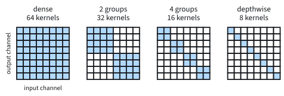
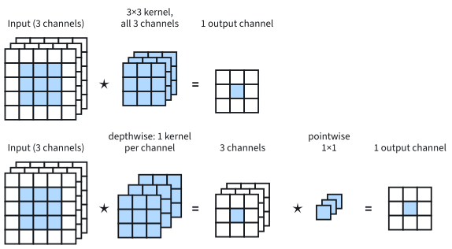
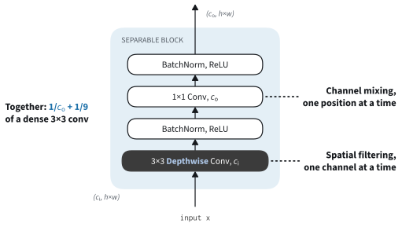
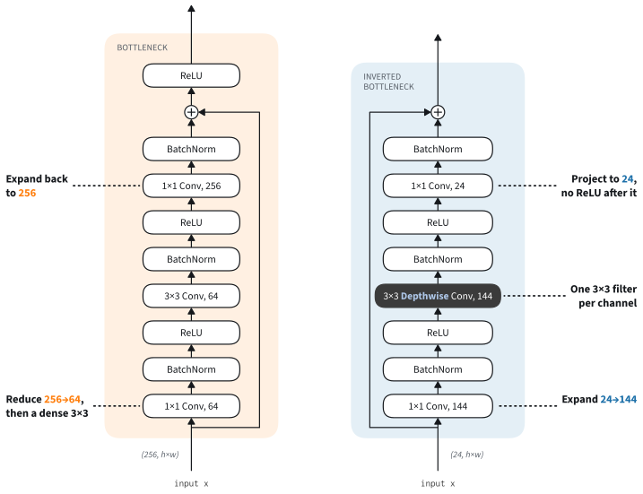
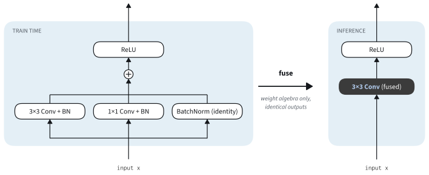
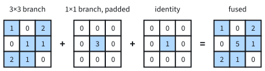

```{.python .input}
%load_ext d2lbook.tab
tab.interact_select('mxnet', 'pytorch', 'tensorflow', 'jax')
```

# Efficient Convnets
:label:`sec_efficient_cnns`

The architectures we studied so far were engineered to top academic accuracy
leaderboards using datacenter GPUs. In real-world deployment, however, vast
numbers of convolutional networks run on smartphones, smart cameras,
autonomous vehicles, and embedded boards where latency, memory footprint, and
battery draw are hard budgets: a model that busts its budget simply cannot
ship, regardless of its benchmark accuracy. Consider a phone classifying
frames from its camera in real time. VGG-16 requires 15.3 billion
multiply-adds for a single $224 \times 224$ frame, which at 30 frames per
second translates to 460 billion multiply-adds every second, while its 138
million single-precision parameters consume 550 MB of RAM alongside every
other app on the device. How can we shrink a convolutional network's cost by
an order of magnitude, and what accuracy tradeoff does that entail?

In this section, we explore three major ideas behind efficient convnet design.
*Factorization* decomposes each dense convolution into a lightweight
per-channel spatial filter paired with a $1 \times 1$ channel mixer. *Scaling
and search* fix a strong building block and optimize stage depths, widths, and
input resolution systematically. *Structural re-parameterization* trains a
multi-branch architecture for easy optimization and then algebraically merges
those branches into a single fast convolution for deployment. Along the way,
we benchmark factorization directly in both accuracy and wall-clock time—and
uncover a sobering lesson: theoretical multiply-add counts rarely tell the
whole speed story, and whether factorization beats simply narrowing a dense
model depends strongly on the scale of the task.

```{.python .input #efficient-convnets-imports}
%%tab mxnet
import math
import numpy as np
from mxnet import autograd, gluon, init, np as mnp, npx
from mxnet.gluon import nn
from d2l import mxnet as d2l
npx.set_np()
```

```{.python .input #efficient-convnets-imports}
%%tab pytorch
import math
import numpy as np
import torch
from torch import nn
from torch.nn import functional as F
from d2l import torch as d2l
```

```{.python .input #efficient-convnets-imports}
%%tab tensorflow
import math
import numpy as np
import tensorflow as tf
from d2l import tensorflow as d2l
```

```{.python .input #efficient-convnets-imports}
%%tab jax
import math
import numpy as np
import jax
from jax import numpy as jnp
from flax import nnx
import optax
from d2l import jax as d2l
```

```{.python .input #efficient-convnets-1}
%%tab mxnet
import mxnet as mx
import time
```

```{.python .input #efficient-convnets-1}
%%tab pytorch, tensorflow, jax
import time
```

## Depthwise-Separable Networks

Because dense spatial convolutions consume the lion's share of a convnet's
arithmetic, the most direct path to efficiency is factorizing the convolution
layer itself.

### Depthwise-Separable Convolutions
:label:`sec_depthwise_separable`

A standard dense convolution scales with $c_\textrm{i} c_\textrm{o}$ because
every output channel reads every input channel through its own spatial filter.
In :numref:`subsec_resnext`, ResNeXt's grouped convolution broke that
all-to-all coupling by partitioning channels into $g$ disjoint groups,
restricting each output group to its matching input group and dividing both
weights and multiply-adds by $g$. As :numref:`fig_conv_groups` illustrates,
grouping turns the dense channel-connectivity matrix into a block-diagonal
pattern.


:label:`fig_conv_groups`

Now push grouping all the way to its limit: $g = c_\textrm{i} = c_\textrm{o}$,
so every group contains a single channel. This *depthwise convolution* applies
one $k\times k$ spatial filter independently to each input channel with zero
cross-channel mixing—the exact complement of a $1\times 1$ convolution
(:numref:`subsec_1x1`), which mixes all channels at each pixel with zero
spatial interaction. Chaining a depthwise $k\times k$ convolution and a
*pointwise* $1\times 1$ convolution recovers both spatial filtering and
channel mixing in two cheap steps, yielding a *depthwise-separable
convolution* :cite:`chollet2017xception,howard2017mobilenet`.
:numref:`fig_conv_depthwise` contrasts this two-stage factorization against
the dense convolution it replaces.


:label:`fig_conv_depthwise`

Let us quantify the savings. For an $h\times w$ output and a $k\times k$
kernel, a dense convolution requires $hw\cdot c_\textrm{i} c_\textrm{o} k^2$
multiply-adds, whereas the depthwise-separable pair requires
$hw\cdot c_\textrm{i} k^2$ for spatial filtering plus
$hw\cdot c_\textrm{i} c_\textrm{o}$ for pointwise mixing. Their ratio is

$$
\frac{h w \cdot c_\textrm{i} k^2 + h w \cdot c_\textrm{i} c_\textrm{o}}{h w \cdot c_\textrm{i} c_\textrm{o} k^2}
= \frac{1}{c_\textrm{o}} + \frac{1}{k^2},
$$
:eqlabel:`eq_depthwise_sep_ratio`

and the exact same ratio holds for parameter counts. In
:numref:`fig_conv_depthwise` ($c_\textrm{i} = c_\textrm{o} = k = 3$), the
dense layer uses $3 \cdot 27 = 81$ weights versus $27 + 9 = 36$ for the
separable pair (ratio $1/3 + 1/9 = 4/9$). Adding one more output channel costs
27 new weights in the dense layer versus only 3 in the separable layer. Once
$c_\textrm{o}$ is large and $k = 3$, the ratio approaches $1/9$: nearly a
ninefold reduction in both weights and arithmetic.

Naturally, these savings are not free—they come from a structural constraint
on the effective filter tensor. Because the separable pair applies a single
spatial filter $\mathbf{D}_c$ to input channel $c$ and then linearly combines
those filtered maps with scalar pointwise weights $P_{o,c}$, it is equivalent
to a dense convolution whose kernels are forced into the factored form
$\mathbf{K}_{o,c} = P_{o,c}\,\mathbf{D}_c$. Every output channel must share
the same spatial filter on input channel $c$ (up to a scalar multiple),
whereas a dense convolution can learn an arbitrary independent $k\times k$
filter for every $(o, c)$ pair. Efficient networks accept this rank-1
restriction and reinvest the freed budget into deeper or wider stages.

Let us verify the parameter ratio in code for a bias-free $3\times 3$ layer
mapping 128 channels to 128 channels, where :eqref:`eq_depthwise_sep_ratio`
predicts a reduction factor of $(1/128 + 1/9)^{-1} \approx 8.4$.

:begin_tab:`tensorflow`
Keras layers take channels-last inputs, so `X` below has shape
$(1, 32, 32, c_\textrm{i})$.
:end_tab:

:begin_tab:`jax`
Flax layers take channels-last inputs, so `X` below has shape
$(1, 32, 32, c_\textrm{i})$.
:end_tab:

```{.python .input #channels-grouped-depthwise-and-depthwise-separable-convolutions}
%%tab mxnet
c_i, c_o, k = 128, 128, 3
X = d2l.normal(0, 1, (1, c_i, 32, 32))
dense = nn.Conv2D(c_o, kernel_size=k, padding=1, use_bias=False)
depthwise = nn.Conv2D(c_i, kernel_size=k, padding=1, groups=c_i,
                      use_bias=False)
pointwise = nn.Conv2D(c_o, kernel_size=1, use_bias=False)
for layer in (dense, depthwise, pointwise):
    layer.initialize()
assert dense(X).shape == pointwise(depthwise(X)).shape
p_dense = dense.weight.data().size
p_sep = depthwise.weight.data().size + pointwise.weight.data().size
p_dense, p_sep, p_dense / p_sep
```

```{.python .input #channels-grouped-depthwise-and-depthwise-separable-convolutions}
%%tab pytorch
c_i, c_o, k = 128, 128, 3
X = d2l.normal(0, 1, (1, c_i, 32, 32))
dense = nn.LazyConv2d(c_o, kernel_size=k, padding=1, bias=False)
depthwise = nn.LazyConv2d(c_i, kernel_size=k, padding=1, groups=c_i,
                          bias=False)
pointwise = nn.LazyConv2d(c_o, kernel_size=1, bias=False)
assert dense(X).shape == pointwise(depthwise(X)).shape
p_dense = dense.weight.numel()
p_sep = depthwise.weight.numel() + pointwise.weight.numel()
p_dense, p_sep, p_dense / p_sep
```

```{.python .input #channels-grouped-depthwise-and-depthwise-separable-convolutions}
%%tab tensorflow
c_i, c_o, k = 128, 128, 3
X = d2l.normal((1, 32, 32, c_i), 0, 1)
dense = tf.keras.layers.Conv2D(c_o, kernel_size=k, padding='same',
                               use_bias=False)
depthwise = tf.keras.layers.DepthwiseConv2D(kernel_size=k, padding='same',
                                            use_bias=False)
pointwise = tf.keras.layers.Conv2D(c_o, kernel_size=1, use_bias=False)
assert dense(X).shape == pointwise(depthwise(X)).shape
p_dense = dense.count_params()
p_sep = depthwise.count_params() + pointwise.count_params()
p_dense, p_sep, p_dense / p_sep
```

```{.python .input #channels-grouped-depthwise-and-depthwise-separable-convolutions}
%%tab jax
c_i, c_o, k = 128, 128, 3
X = jax.random.normal(d2l.get_key(), (1, 32, 32, c_i))
dense = nnx.Conv(c_i, c_o, kernel_size=(k, k), padding='SAME',
                 use_bias=False, rngs=nnx.Rngs(d2l.get_key()))
depthwise = nnx.Conv(c_i, c_i, kernel_size=(k, k), padding='SAME',
                     feature_group_count=c_i, use_bias=False,
                     rngs=nnx.Rngs(d2l.get_key()))
pointwise = nnx.Conv(c_i, c_o, kernel_size=(1, 1), use_bias=False,
                     rngs=nnx.Rngs(d2l.get_key()))
assert dense(X).shape == pointwise(depthwise(X)).shape
p_dense = dense.kernel[...].size
p_sep = depthwise.kernel[...].size + pointwise.kernel[...].size
p_dense, p_sep, p_dense / p_sep
```

The dense layer uses 147,456 weights versus 17,536 for the separable pair—an
exact $8.4\times$ reduction.

:begin_tab:`mxnet`
In Gluon, `groups=c_i` turns `nn.Conv2D` into a depthwise convolution.
:end_tab:

:begin_tab:`pytorch`
In PyTorch, `groups=c_i` turns `nn.Conv2d` into a depthwise convolution;
any `groups` that divides both channel counts gives a grouped convolution.
:end_tab:

:begin_tab:`tensorflow`
Keras has a separate `DepthwiseConv2D` layer; grouped convolutions use the
`groups` argument of `Conv2D`.
:end_tab:

:begin_tab:`jax`
In Flax, `feature_group_count=c_i` turns `nnx.Conv` into a depthwise
convolution; it is the number of groups $g$.
:end_tab:

### MobileNet

*MobileNet* :cite:`howard2017mobilenet` scaled depthwise-separable
convolutions into a complete mobile-grade backbone. After a single dense stem
convolution, every layer uses the block in :numref:`fig_dws_block`: a
depthwise $3 \times 3$ convolution followed by a pointwise $1 \times 1$
convolution, each paired with batch normalization and ReLU. Spatial
downsampling is handled directly by stride-2 depthwise convolutions (avoiding
separate pooling layers), and the model ends with NiN's global average pooling
and a single linear layer (:numref:`sec_nin`). The ImageNet payoff was
striking: MobileNet came within one percentage point of VGG-16 (70.6% vs.
71.5% top-1 accuracy) using only 0.57 billion multiply-adds and 4.2 million
parameters—$27\times$ less arithmetic and $33\times$ fewer parameters.


:label:`fig_dws_block`

### The Inverted Bottleneck

Recall that a classic ResNet or ResNeXt bottleneck (:numref:`subsec_resnext`)
*compresses* channels before its spatial filter: a $1 \times 1$ layer squeezes
a wide representation into a narrow subspace so that the expensive dense
$3 \times 3$ convolution stays affordable, and a second $1 \times 1$ layer
expands back out. When the $3 \times 3$ layer is *depthwise*, however, that
logic flips completely. A depthwise convolution is inexpensive even on wide
feature maps, and because it learns only one spatial filter per channel, it
actually benefits from running at high width.

*MobileNetV2* :cite:`sandler2018mobilenetv2` therefore *inverts* the
bottleneck. The residual highway stays narrow (say, 24 channels); inside the
block, a $1 \times 1$ expansion lifts it sixfold to 144 channels, a depthwise
$3 \times 3$ convolution filters that expanded space, and a linear
$1 \times 1$ projection compresses back down to 24 channels. Crucially, the
final projection omits ReLU: applying a ReLU to a very thin bottleneck zeroes
out negative coordinates and permanently discards information that later
layers cannot recover. :numref:`fig_inverted_bottleneck` places the standard
and inverted bottlenecks side by side.


:label:`fig_inverted_bottleneck`

Because the residual shortcut connects the thin ends rather than the wide
interiors, only compact tensors persist in memory between blocks—a major win
on mobile processors where activation RAM is often tighter than flash storage
for weights. We will encounter this exact inverted-bottleneck geometry again
(with a larger $7 \times 7$ depthwise kernel moved to the front) in ConvNeXt
(:numref:`sec_convnext`).

### A Mini-MobileNet

To test depthwise-separable factorization firsthand on Fashion-MNIST, we build
a compact MobileNetV1-style network using the clean block of
:numref:`fig_dws_block` so the factorization itself stays front and center.
Because every convolution is followed by batch normalization, all convolutions
omit biases, and all convolutional and linear weights use He initialization
(:numref:`sec_numerical_stability`).

```{.python .input #efficient-convnets-a-mini-mobilenet-1}
%%tab mxnet
def dws_block(in_channels, out_channels, strides=1):
    """Depthwise 3x3 and pointwise 1x1 convolutions, each with BN and ReLU."""
    blk = nn.HybridSequential()
    blk.add(nn.Conv2D(in_channels, kernel_size=3, strides=strides, padding=1,
                      groups=in_channels, use_bias=False),
            nn.BatchNorm(), nn.Activation('relu'),
            nn.Conv2D(out_channels, kernel_size=1, use_bias=False),
            nn.BatchNorm(), nn.Activation('relu'))
    return blk

he_init = init.MSRAPrelu('in', 0)  # Normal with variance 2/n_in
```

```{.python .input #efficient-convnets-a-mini-mobilenet-1}
%%tab pytorch
def dws_block(in_channels, out_channels, stride=1):
    """Depthwise 3x3 and pointwise 1x1 convolutions, each with BN and ReLU."""
    return nn.Sequential(
        nn.Conv2d(in_channels, in_channels, kernel_size=3, stride=stride,
                  padding=1, groups=in_channels, bias=False),
        nn.BatchNorm2d(in_channels), nn.ReLU(),
        nn.Conv2d(in_channels, out_channels, kernel_size=1, bias=False),
        nn.BatchNorm2d(out_channels), nn.ReLU())

def he_init(module):
    """Normal weights with variance 2/n_in and zero biases."""
    if isinstance(module, (nn.Conv2d, nn.Linear)):
        nn.init.kaiming_normal_(module.weight)
        if module.bias is not None:
            nn.init.zeros_(module.bias)
```

```{.python .input #efficient-convnets-a-mini-mobilenet-1}
%%tab tensorflow
def he_init():
    """Normal weights with variance 2/n_in; one instance per layer."""
    return tf.keras.initializers.VarianceScaling(2.0, 'fan_in',
                                                 'untruncated_normal')

def dws_block(out_channels, strides=1):
    """Depthwise 3x3 and pointwise 1x1 convolutions, each with BN and ReLU."""
    return tf.keras.Sequential([
        tf.keras.layers.ZeroPadding2D(1),  # Pad 1 on every side
        tf.keras.layers.DepthwiseConv2D(  # Each unit sees n_in = 3 x 3 inputs
            3, strides, use_bias=False,
            depthwise_initializer=tf.keras.initializers.RandomNormal(
                stddev=math.sqrt(2 / 9))),
        tf.keras.layers.BatchNormalization(momentum=0.9, epsilon=1e-5),
        tf.keras.layers.ReLU(),
        tf.keras.layers.Conv2D(out_channels, 1, use_bias=False,
                               kernel_initializer=he_init()),
        tf.keras.layers.BatchNormalization(momentum=0.9, epsilon=1e-5),
        tf.keras.layers.ReLU()])
```

```{.python .input #efficient-convnets-a-mini-mobilenet-1}
%%tab jax
he_init = nnx.initializers.variance_scaling(2.0, 'fan_in', 'normal')

def global_avg_pool(X):  # Average over height and width (NHWC)
    return X.mean(axis=(1, 2))

class DWSBlock(nnx.Module):
    """Depthwise 3x3 and pointwise 1x1 convolutions, each with BN and ReLU."""
    def __init__(self, in_channels, out_channels, strides=1, *, rngs):
        self.depthwise = nnx.Conv(
            in_channels, in_channels, (3, 3), strides=strides,
            padding=1, feature_group_count=in_channels, use_bias=False,
            kernel_init=he_init, rngs=rngs)
        self.bn1 = nnx.BatchNorm(in_channels, momentum=0.9,
                                 use_fast_variance=False, rngs=rngs)
        self.pointwise = nnx.Conv(in_channels, out_channels, (1, 1),
                                  use_bias=False, kernel_init=he_init,
                                  rngs=rngs)
        self.bn2 = nnx.BatchNorm(out_channels, momentum=0.9,
                                 use_fast_variance=False, rngs=rngs)

    def __call__(self, X):
        X = nnx.relu(self.bn1(self.depthwise(X)))
        return nnx.relu(self.bn2(self.pointwise(X)))
```

As in VGG (:numref:`sec_vgg`), the architecture is specified cleanly as a list
of `(out_channels, stride)` pairs. A stride-2 $3 \times 3$ stem lifts the
single-channel input to 32 channels at half resolution; seven
depthwise-separable blocks then double the channels and halve spatial
resolution three times; and global average pooling plus a linear head emit the
ten class logits.

Here we also upgrade the optimizer to SGD with momentum 0.9, which accumulates
an exponentially weighted moving average of past gradients so effective step
sizes can reach up to ten times a plain SGD step at the same learning rate
(:numref:`sec_momentum`). Because of this change in optimizer, do not compare
the raw accuracies here directly with the plain-SGD ResNet-18 runs of
:numref:`sec_resnet`. As before, the learning rate anneals smoothly to zero
along a half-cosine (:numref:`sec_alexnet`) over the `num_steps` training
steps (4,690 minibatches for 10 epochs), here using each framework's built-in
cosine scheduler without warmup.

```{.python .input #efficient-convnets-a-mini-mobilenet-2}
%%tab mxnet
class MiniMobileNet(d2l.Classifier):
    def __init__(self, arch=((64, 1), (128, 2), (128, 1), (256, 2), (256, 1),
                             (512, 2), (512, 1)),
                 lr=0.05, num_steps=4690, num_classes=10):
        super().__init__()
        self.save_hyperparameters()
        self.net = nn.HybridSequential()
        self.net.add(nn.Conv2D(32, kernel_size=3, strides=2, padding=1,
                               use_bias=False),
                     nn.BatchNorm(), nn.Activation('relu'))
        c = 32
        for c_out, strides in arch:
            self.net.add(dws_block(c, c_out, strides))
            c = c_out
        self.net.add(nn.GlobalAvgPool2D(), nn.Dense(num_classes))
        self.net.initialize(he_init)
        self.net.hybridize()

    def configure_optimizers(self):
        schedule = mx.lr_scheduler.CosineScheduler(self.num_steps, self.lr)
        return gluon.Trainer(self.collect_params(), 'sgd', {
            'learning_rate': self.lr, 'momentum': 0.9,
            'lr_scheduler': schedule})
```

```{.python .input #efficient-convnets-a-mini-mobilenet-2}
%%tab pytorch
class MiniMobileNet(d2l.Classifier):
    def __init__(self, arch=((64, 1), (128, 2), (128, 1), (256, 2), (256, 1),
                             (512, 2), (512, 1)),
                 lr=0.05, num_steps=4690, num_classes=10):
        super().__init__()
        self.save_hyperparameters()
        layers = [nn.Conv2d(1, 32, kernel_size=3, stride=2, padding=1,
                            bias=False),
                  nn.BatchNorm2d(32), nn.ReLU()]
        c = 32
        for c_out, stride in arch:
            layers.append(dws_block(c, c_out, stride))
            c = c_out
        layers += [nn.AdaptiveAvgPool2d((1, 1)), nn.Flatten(),
                   nn.Linear(c, num_classes)]
        self.net = nn.Sequential(*layers)
        self.net.apply(he_init)

    def configure_optimizers(self):
        optim = torch.optim.SGD(self.parameters(), lr=self.lr, momentum=0.9)
        return optim, torch.optim.lr_scheduler.CosineAnnealingLR(
            optim, self.num_steps)  # Stepped after every minibatch
```

```{.python .input #efficient-convnets-a-mini-mobilenet-2}
%%tab tensorflow
class MiniMobileNet(d2l.Classifier):
    def __init__(self, arch=((64, 1), (128, 2), (128, 1), (256, 2), (256, 1),
                             (512, 2), (512, 1)),
                 lr=0.05, num_steps=4690, num_classes=10):
        super().__init__()
        self.save_hyperparameters()
        self.net = tf.keras.Sequential([
            tf.keras.layers.ZeroPadding2D(1),
            tf.keras.layers.Conv2D(32, 3, 2, use_bias=False,
                                   kernel_initializer=he_init()),
            tf.keras.layers.BatchNormalization(momentum=0.9, epsilon=1e-5),
            tf.keras.layers.ReLU()])
        for c_out, strides in arch:
            self.net.add(dws_block(c_out, strides))
        self.net.add(tf.keras.layers.GlobalAvgPool2D())
        self.net.add(tf.keras.layers.Dense(num_classes,
                                           kernel_initializer=he_init()))

    def configure_optimizers(self):
        schedule = tf.keras.optimizers.schedules.CosineDecay(self.lr,
                                                             self.num_steps)
        return tf.keras.optimizers.SGD(schedule, momentum=0.9)
```

```{.python .input #efficient-convnets-a-mini-mobilenet-2}
%%tab jax
class MiniMobileNet(d2l.Classifier):
    def __init__(self, arch=((64, 1), (128, 2), (128, 1), (256, 2),
                             (256, 1), (512, 2), (512, 1)),
                 lr=0.05, num_steps=4690, num_classes=10, rngs=None):
        super().__init__()
        self.save_hyperparameters(ignore=['rngs'])
        rngs = nnx.Rngs(d2l.get_key()) if rngs is None else rngs
        layers = [nnx.Conv(1, 32, (3, 3), strides=2, padding=1,
                           use_bias=False, kernel_init=he_init, rngs=rngs),
                  nnx.BatchNorm(32, momentum=0.9, use_fast_variance=False,
                                rngs=rngs),
                  nnx.relu]
        c = 32
        for c_out, strides in arch:
            layers.append(DWSBlock(c, c_out, strides, rngs=rngs))
            c = c_out
        layers += [global_avg_pool,
                   nnx.Linear(c, num_classes, kernel_init=he_init,
                              rngs=rngs)]
        self.net = nnx.Sequential(*layers)

    def configure_optimizers(self):
        schedule = optax.cosine_decay_schedule(self.lr, self.num_steps)
        return optax.sgd(schedule, momentum=0.9)
```

Let us count `MiniMobileNet`'s trainable parameters and compare against a
dense counterpart; we save `num_params` in `d2l` for reuse in later sections.

```{.python .input #efficient-convnets-a-mini-mobilenet-3}
%%tab mxnet
def num_params(model):  #@save
    """The number of trainable parameters."""
    return sum(p.data().size for p in model.collect_params().values()
               if p.grad_req != 'null')

model = MiniMobileNet()
assert model(mnp.zeros((1, 1, 96, 96))).shape == (1, 10)
num_params(model)
```

```{.python .input #efficient-convnets-a-mini-mobilenet-3}
%%tab pytorch
def num_params(model):  #@save
    """The number of trainable parameters."""
    return sum(p.numel() for p in model.parameters() if p.requires_grad)

model = MiniMobileNet()
assert model(torch.zeros(1, 1, 96, 96)).shape == (1, 10)
num_params(model)
```

```{.python .input #efficient-convnets-a-mini-mobilenet-3}
%%tab tensorflow
def num_params(model):  #@save
    """The number of trainable parameters."""
    return sum(int(tf.size(w)) for w in model.trainable_variables)

model = MiniMobileNet()
assert model(tf.zeros((1, 96, 96, 1))).shape == (1, 10)
num_params(model)
```

```{.python .input #efficient-convnets-a-mini-mobilenet-3}
%%tab jax
def num_params(model):  #@save
    """The number of trainable parameters."""
    return sum(p.size for _, p in nnx.state(model, nnx.Param).flat_state())

model = MiniMobileNet()
assert model(jnp.zeros((1, 96, 96, 1))).shape == (1, 10)
num_params(model)
```

`MiniMobileNet` contains 542,474 trainable parameters. Replacing each
separable block with an ordinary dense $3 \times 3$ convolution between the
same widths would require
$9 \sum_l c_{\textrm{i},l}\, c_{\textrm{o},l} = 4{,}663{,}296$ weights in the
seven blocks alone—$8.8\times$ the 530,528 weights of our separable layers,
approaching the asymptotic $9\times$ ceiling as channel width reaches 512.

### Arithmetic, Accuracy, and Time

How much accuracy does factorization trade away, and how much wall-clock speed
does it actually buy? To find out, we first build `VGGSmall`, a dense
VGG-style network (:numref:`sec_vgg`) matched to `MiniMobileNet`'s *parameter
count*. Because each dense $3 \times 3$ layer uses roughly nine times as many
weights as a separable block, matching the parameter budget caps `VGGSmall` at
128 channels where `MiniMobileNet` reaches 512. Both models share batch
normalization, He initialization, a global-average-pooling head, and the exact
same training schedule. Keep in mind that matching parameters lets both the
layer type and channel width vary together.

```{.python .input #efficient-convnets-training-and-comparison-1}
%%tab mxnet
class VGGSmall(d2l.Classifier):
    """A dense VGG-style network with the same parameter budget."""
    def __init__(self, arch=((2, 32), (2, 64), (2, 128), (2, 128)),
                 lr=0.05, num_steps=4690, num_classes=10):
        super().__init__()
        self.save_hyperparameters()
        self.net = nn.HybridSequential()
        for num_convs, c_out in arch:
            for _ in range(num_convs):
                self.net.add(nn.Conv2D(c_out, kernel_size=3, padding=1,
                                       use_bias=False),
                             nn.BatchNorm(), nn.Activation('relu'))
            self.net.add(nn.MaxPool2D(2))
        self.net.add(nn.GlobalAvgPool2D(), nn.Dense(num_classes))
        self.net.initialize(he_init)
        self.net.hybridize()

    def configure_optimizers(self):
        schedule = mx.lr_scheduler.CosineScheduler(self.num_steps, self.lr)
        return gluon.Trainer(self.collect_params(), 'sgd', {
            'learning_rate': self.lr, 'momentum': 0.9,
            'lr_scheduler': schedule})
```

```{.python .input #efficient-convnets-training-and-comparison-1}
%%tab pytorch
class VGGSmall(d2l.Classifier):
    """A dense VGG-style network with the same parameter budget."""
    def __init__(self, arch=((2, 32), (2, 64), (2, 128), (2, 128)),
                 lr=0.05, num_steps=4690, num_classes=10):
        super().__init__()
        self.save_hyperparameters()
        layers, c = [], 1
        for num_convs, c_out in arch:
            for _ in range(num_convs):
                layers += [nn.Conv2d(c, c_out, kernel_size=3, padding=1,
                                     bias=False),
                           nn.BatchNorm2d(c_out), nn.ReLU()]
                c = c_out
            layers.append(nn.MaxPool2d(2))
        layers += [nn.AdaptiveAvgPool2d((1, 1)), nn.Flatten(),
                   nn.Linear(c, num_classes)]
        self.net = nn.Sequential(*layers)
        self.net.apply(he_init)

    def configure_optimizers(self):
        optim = torch.optim.SGD(self.parameters(), lr=self.lr, momentum=0.9)
        return optim, torch.optim.lr_scheduler.CosineAnnealingLR(
            optim, self.num_steps)  # Stepped after every minibatch
```

```{.python .input #efficient-convnets-training-and-comparison-1}
%%tab tensorflow
class VGGSmall(d2l.Classifier):
    """A dense VGG-style network with the same parameter budget."""
    def __init__(self, arch=((2, 32), (2, 64), (2, 128), (2, 128)),
                 lr=0.05, num_steps=4690, num_classes=10):
        super().__init__()
        self.save_hyperparameters()
        self.net = tf.keras.Sequential()
        for num_convs, c_out in arch:
            for _ in range(num_convs):
                self.net.add(tf.keras.layers.Conv2D(
                    c_out, 3, padding='same', use_bias=False,
                    kernel_initializer=he_init()))
                self.net.add(tf.keras.layers.BatchNormalization(
                    momentum=0.9, epsilon=1e-5))
                self.net.add(tf.keras.layers.ReLU())
            self.net.add(tf.keras.layers.MaxPool2D(2))
        self.net.add(tf.keras.layers.GlobalAvgPool2D())
        self.net.add(tf.keras.layers.Dense(num_classes,
                                           kernel_initializer=he_init()))

    def configure_optimizers(self):
        schedule = tf.keras.optimizers.schedules.CosineDecay(self.lr,
                                                             self.num_steps)
        return tf.keras.optimizers.SGD(schedule, momentum=0.9)
```

```{.python .input #efficient-convnets-training-and-comparison-1}
%%tab jax
class VGGSmall(d2l.Classifier):
    """A dense VGG-style network with the same parameter budget."""
    def __init__(self, arch=((2, 32), (2, 64), (2, 128), (2, 128)),
                 lr=0.05, num_steps=4690, num_classes=10, rngs=None):
        super().__init__()
        self.save_hyperparameters(ignore=['rngs'])
        rngs = nnx.Rngs(d2l.get_key()) if rngs is None else rngs
        layers, c = [], 1
        for num_convs, c_out in arch:
            for _ in range(num_convs):
                layers += [nnx.Conv(c, c_out, (3, 3), padding='same',
                                    use_bias=False, kernel_init=he_init,
                                    rngs=rngs),
                           nnx.BatchNorm(c_out, momentum=0.9,
                                         use_fast_variance=False, rngs=rngs),
                           nnx.relu]
                c = c_out
            layers.append(max_pool)
        layers += [global_avg_pool,
                   nnx.Linear(c, num_classes, kernel_init=he_init,
                              rngs=rngs)]
        self.net = nnx.Sequential(*layers)

    def configure_optimizers(self):
        schedule = optax.cosine_decay_schedule(self.lr, self.num_steps)
        return optax.sgd(schedule, momentum=0.9)

def max_pool(X):  # 2x2 windows, stride 2
    return nnx.max_pool(X, (2, 2), (2, 2))
```

Before launching training, let us tally the exact multiply-add counts on
$96 \times 96$ inputs. With "same" padding and stride $s$, an $h \times h$
input maps to side $\lceil h/s \rceil$, and a grouped $k \times k$ convolution
with $g$ groups costs $k^2 c_\textrm{i} / g$ multiply-adds per output element.

```{.python .input #efficient-convnets-arithmetic-accuracy-and-time-1}
def conv_macs(h, c_in, c_out, k=3, stride=1, groups=1):
    """Output side and multiply-adds of a k x k convolution, 'same' padding."""
    h = -(-h // stride)  # ceil(h / stride)
    return h, h * h * k * k * c_in * c_out // groups

def mobilenet_macs(arch, h=96, num_classes=10):
    h, total = conv_macs(h, 1, 32, stride=2)  # The stem
    c = 32
    for c_out, stride in arch:
        h, depthwise = conv_macs(h, c, c, stride=stride, groups=c)
        h, pointwise = conv_macs(h, c, c_out, k=1)
        total, c = total + depthwise + pointwise, c_out
    return total + c * num_classes

def vgg_macs(arch, h=96, num_classes=10):
    total, c = 0, 1
    for num_convs, c_out in arch:
        for _ in range(num_convs):
            h, macs = conv_macs(h, c, c_out)
            total, c = total + macs, c_out
        h //= 2  # 2 x 2 max-pooling
    return total + c * num_classes

narrow = ((2, 11), (2, 23), (2, 46), (2, 46))  # VGGSmall's widths / 2.8
macs = {'Mini-MobileNet': mobilenet_macs(MiniMobileNet().arch),
        'VGG-style': vgg_macs(VGGSmall().arch),
        'VGG-style, narrow': vgg_macs(narrow)}
macs, macs['VGG-style'] / macs['Mini-MobileNet']
```

Despite matching in parameter count, `VGGSmall` executes 385 million
multiply-adds per image while `MiniMobileNet` needs only 50 million—$7.7\times$
less arithmetic. That gap reflects *where* each model places its weights:
`VGGSmall` applies dense filters across high-resolution $96 \times 96$ to
$24 \times 24$ feature maps, whereas nearly three-quarters of `MiniMobileNet`'s
weights sit in its final two pointwise layers acting on tiny $6 \times 6$
grids.

On edge hardware, however, the decisive comparison is at *equal arithmetic*.
To bring `VGGSmall` down to `MiniMobileNet`'s 50 million multiply-adds, we
shrink every channel count by a factor of ~2.8 to `(11, 23, 46, 46)` (`narrow`
above), leaving just 76,000 parameters—one-seventh of `MiniMobileNet`'s
weight count. Let us train all three models for 10 epochs on $96 \times 96$
Fashion-MNIST.

```{.python .input #efficient-convnets-training-and-comparison-2}
data = d2l.FashionMNIST(batch_size=128, resize=(96, 96))
num_steps = 10 * len(data.train_dataloader())  # 10 epochs of 469 steps
models = {'Mini-MobileNet': MiniMobileNet(lr=0.05, num_steps=num_steps),
          'VGG-style': VGGSmall(lr=0.05, num_steps=num_steps),
          'VGG-style, narrow': VGGSmall(narrow, lr=0.05, num_steps=num_steps)}
accuracy = {}
for name, model in models.items():
    trainer = d2l.Trainer(max_epochs=10, num_gpus=1)
    trainer.fit(model, data)
    accuracy[name] = trainer.history['val_acc'][-1]
```

Operation counts measure arithmetic, not elapsed time. To see how multiply-adds
translate to real latency, we benchmark inference forward passes on batches of
128 images on the GPU—warming up once and synchronizing the device before
reading the wall clock (:numref:`subsec_async_dispatch`).

```{.python .input #efficient-convnets-training-and-comparison-4}
%%tab mxnet
def forward_ms(model, num_reps=50):
    """Milliseconds per forward pass of a batch of 128 images."""
    X = mnp.random.normal(size=(128, 1, 96, 96), device=d2l.try_gpu())
    model(X)
    npx.waitall()  # Warm up and wait
    start = time.perf_counter()
    for _ in range(num_reps):
        model(X)
    npx.waitall()
    return 1000 * (time.perf_counter() - start) / num_reps

for name, model in models.items():
    print(f'{name}: {num_params(model):,} parameters, '
          f'{macs[name] / 1e6:.1f}M multiply-adds, '
          f'accuracy {accuracy[name]:.3f}, '
          f'{forward_ms(model):.1f} ms/batch')
```

```{.python .input #efficient-convnets-training-and-comparison-4}
%%tab pytorch
def forward_ms(model, num_reps=50):
    """Milliseconds per forward pass of a batch of 128 images."""
    X = torch.randn(128, 1, 96, 96, device=d2l.try_gpu())
    model.eval()
    with torch.inference_mode():
        sync = torch.cuda.synchronize if X.is_cuda else lambda: None
        model(X)
        sync()  # Warm up and wait
        start = time.perf_counter()
        for _ in range(num_reps):
            model(X)
        sync()
    return 1000 * (time.perf_counter() - start) / num_reps

for name, model in models.items():
    print(f'{name}: {num_params(model):,} parameters, '
          f'{macs[name] / 1e6:.1f}M multiply-adds, '
          f'accuracy {accuracy[name]:.3f}, '
          f'{forward_ms(model):.1f} ms/batch')
```

```{.python .input #efficient-convnets-training-and-comparison-4}
%%tab tensorflow
def forward_ms(model, num_reps=50):
    """Milliseconds per forward pass of a batch of 128 images."""
    X = tf.random.normal((128, 96, 96, 1))
    @tf.function
    def forward(X):
        return model(X, training=False)
    forward(X).numpy()  # Trace, warm up, and wait
    start = time.perf_counter()
    for _ in range(num_reps):
        Y = forward(X)
    Y.numpy()  # Wait for the GPU
    return 1000 * (time.perf_counter() - start) / num_reps

for name, model in models.items():
    print(f'{name}: {num_params(model):,} parameters, '
          f'{macs[name] / 1e6:.1f}M multiply-adds, '
          f'accuracy {accuracy[name]:.3f}, '
          f'{forward_ms(model):.1f} ms/batch')
```

```{.python .input #efficient-convnets-training-and-comparison-4}
%%tab jax
def forward_ms(model, num_reps=50):
    """Milliseconds per forward pass of a batch of 128 images."""
    X = jax.random.normal(d2l.get_key(), (128, 96, 96, 1))
    graphdef, state = nnx.split(nnx.view(model, use_running_average=True))
    forward = jax.jit(lambda state, X: nnx.merge(graphdef, state)(X))
    forward(state, X).block_until_ready()  # Compile, warm up, and wait
    start = time.perf_counter()
    for _ in range(num_reps):
        Y = forward(state, X)
    Y.block_until_ready()
    return 1000 * (time.perf_counter() - start) / num_reps

for name, model in models.items():
    print(f'{name}: {num_params(model):,} parameters, '
          f'{macs[name] / 1e6:.1f}M multiply-adds, '
          f'accuracy {accuracy[name]:.3f}, '
          f'{forward_ms(model):.1f} ms/batch')
```

:numref:`tab_dws_vs_dense` summarizes all three models across repeated runs,
reporting validation accuracy alongside each model's forward-pass latency
normalized to `MiniMobileNet`.

:Mini-MobileNet against a dense VGG-style network with about the same number
of parameters and a narrow one with about the same number of multiply-adds
(Fashion-MNIST at $96 \times 96$, 10 epochs; validation accuracy and
forward-pass time ratio over repeated runs).
:label:`tab_dws_vs_dense`

| Model | Parameters | Multiply-adds | Validation accuracy | Forward time |
|---|---:|---:|---:|---:|
| Mini-MobileNet | 542,474 | 50.3 million | 91–92% | 1 |
| VGG-style | 583,594 | 384.9 million | 93.5–94% | 2–3.5 |
| VGG-style, narrow | 75,854 | 49.1 million | 93% | 0.5–0.8 |

Three lessons jump out of :numref:`tab_dws_vs_dense`:

1. **Matching parameters is not matching compute:** At ~550K parameters, `VGGSmall` beats `MiniMobileNet` by ~2 percentage points while performing $7.7\times$ more multiply-adds (keeping full $96 \times 96$ resolution in its opening stage and learning unrestricted dense kernels).
2. **At matched arithmetic on a small dataset, narrowing beats factorizing:** Shrinking `VGGSmall` to 50M multiply-adds (`VGG-style, narrow`, 76K parameters) beats `MiniMobileNet` by ~1 point *and* runs faster. By :eqref:`eq_depthwise_sep_ratio`, depthwise factorization pays off most at wide channel counts (saving $5\times$ at $c = 11$ vs. nearly $9\times$ at $c = 512$); 10-class Fashion-MNIST fits comfortably inside narrow dense layers, whereas 1,000-class ImageNet requires wide stages where narrowing a dense convnet starves capacity.
3. **Multiply-adds are a weak proxy for GPU wall-clock latency:** A $7.7\times$ arithmetic reduction yields only a $2\text{--}3.5\times$ speedup because a dense $3 \times 3$ layer performs $9c_\textrm{o}$ multiply-adds per input read (high arithmetic intensity), whereas a depthwise $3 \times 3$ layer performs only 9 multiply-adds per input read, leaving the GPU memory-bandwidth bound.

## Scaling and Searching

MobileNet fixes an efficient building block and selects stage widths by hand.
Two natural questions follow: how should we scale a base architecture up when
more compute becomes available, and can automated optimization choose the
stage widths, depths, and resolutions better than human trial and error?

### Compound Scaling

Counting compute clarifies the scaling question immediately: a convnet's
arithmetic grows linearly with depth, quadratically with channel width (via
$c_\textrm{i} c_\textrm{o}$), and quadratically with input resolution (via
$hw$). Pushing any single dimension alone quickly hits diminishing returns—a
very deep model on tiny thumbnails lacks fine detail to analyze, while
high-resolution images require more layers so receptive fields can span large
objects. *Compound scaling* :cite:`tan2019efficientnet` scales all three
dimensions in lockstep: each scaling step multiplies depth by 1.2, width by
1.1, and resolution by 1.15, roughly doubling total compute
($1.2 \cdot 1.1^2 \cdot 1.15^2 \approx 1.92$). A single integer knob now
generates an entire family—three steps produce a network $1.7\times$ deeper
and $1.3\times$ wider on $1.5\times$ larger images at roughly $7\times$ the
compute.

### Architecture Search

To design the base network itself, EfficientNet used *neural architecture
search* (NAS) over stacks of inverted-bottleneck blocks, optimizing an
objective balancing accuracy against multiply-add counts. As our GPU timing
benchmark just demonstrated, optimizing theoretical multiply-adds can mislead
real hardware. *EfficientNetV2* :cite:`tan2021efficientnetv2` replaced
multiply-adds with measured training speed and parameter count in its search
objective; notably, the search automatically swapped out depthwise blocks in
early high-resolution stages for standard dense $3 \times 3$ convolutions,
which run faster on accelerators despite performing more arithmetic. In both
generations, human engineering designed the core primitives while automated
search allocated widths, depths, and resolutions across stages.

### Squeeze-and-Excitation Gates
:label:`subsec_se`

The inverted-bottleneck blocks searched by EfficientNet include one extra
lightweight module right after the depthwise convolution: a
*squeeze-and-excitation* (SE) gate :cite:`Hu.Shen.Sun.2018`. Whereas a
convolution aggregates information only over a local spatial window, an SE
gate lets the network dynamically reweight entire feature channels using
global image context. It *squeezes* each of the $c$ channels to a single
scalar via global average pooling, passes that $c$-dimensional summary through
a tiny two-layer bottleneck MLP (hidden width $c/r$ with ReLU, output width
$c$ with sigmoid—the *excitation*), and scales every channel of the feature
map by its predicted gate in $(0, 1)$. With reduction ratio $r$, the MLP adds
only ~$2c^2/r$ parameters and operates on a single vector per image rather
than every pixel, making its arithmetic cost negligible. Conceptually, SE
acts as a simple channel-wise attention mechanism—foreshadowing the general
attention layers of :numref:`chap_attention`.

Because SE gates deliver consistent accuracy gains at almost zero compute
cost, they appear throughout MobileNetV3 and RegNetY (:numref:`sec_cnn-design`,
where problem :exref:`ex_cnn-design-regnety` adds SE to RegNet). Implementing
an SE block takes only a handful of lines: global pool, two linear layers, and
channel-wise rescaling.

```{.python .input #cnn-design-squeeze-and-excitation-gates}
%%tab mxnet
class SE(nn.HybridBlock):
    def __init__(self, num_channels, ratio=4):
        super().__init__()
        self.fc = nn.HybridSequential()
        self.fc.add(nn.Dense(num_channels // ratio, activation='relu'),
                    nn.Dense(num_channels, activation='sigmoid'))

    def forward(self, X):
        s = self.fc(X.mean(axis=(2, 3)))
        return X * npx.reshape(s, (-2, -2, 1, 1))  # Keep any batch size

se = SE(32)
se.initialize()
se(d2l.randn(2, 32, 16, 16)).shape
```

```{.python .input #cnn-design-squeeze-and-excitation-gates}
%%tab pytorch
class SE(nn.Module):
    def __init__(self, num_channels, ratio=4):
        super().__init__()
        self.fc = nn.Sequential(
            nn.LazyLinear(num_channels // ratio), nn.ReLU(),
            nn.LazyLinear(num_channels), nn.Sigmoid())

    def forward(self, X):
        s = self.fc(X.mean(dim=(2, 3)))
        return X * s[:, :, None, None]

SE(32)(d2l.randn(2, 32, 16, 16)).shape
```

```{.python .input #cnn-design-squeeze-and-excitation-gates}
%%tab tensorflow
class SE(tf.keras.Model):
    def __init__(self, num_channels, ratio=4):
        super().__init__()
        self.fc = tf.keras.Sequential([
            tf.keras.layers.Dense(num_channels // ratio, activation='relu',
                                  kernel_initializer=he_init()),
            tf.keras.layers.Dense(num_channels, activation='sigmoid',
                                  kernel_initializer=he_init())])

    def call(self, X):
        s = self.fc(tf.reduce_mean(X, axis=(1, 2)))
        return X * s[:, None, None, :]

SE(32)(tf.random.normal((2, 16, 16, 32))).shape
```

```{.python .input #cnn-design-squeeze-and-excitation-gates}
%%tab jax
class SE(nnx.Module):
    def __init__(self, num_channels, ratio=4, rngs=None):
        rngs = nnx.Rngs(d2l.get_key()) if rngs is None else rngs
        self.squeeze = nnx.Linear(num_channels, num_channels // ratio,
                                  kernel_init=he_init, rngs=rngs)
        self.excite = nnx.Linear(num_channels // ratio, num_channels,
                                 kernel_init=he_init, rngs=rngs)

    def __call__(self, X):
        s = X.mean(axis=(1, 2))
        s = nnx.relu(self.squeeze(s))
        s = nnx.sigmoid(self.excite(s))
        return X * s[:, None, None, :]

X = jax.random.normal(d2l.get_key(), (2, 16, 16, 32))
SE(32)(X).shape
```

With $c = 32$ and $r = 4$, the SE module adds just $2 \cdot 32^2 / 4 = 512$
weights and 40 biases while preserving the exact tensor shape, allowing it to
drop into any block seamlessly.

## Structural Re-parameterization

### The RepVGG Block

ResNet (:numref:`sec_resnet`) established that multi-branch blocks with
shortcut paths are dramatically easier to optimize than plain sequential
stacks. At inference time, however, parallel branches carry real systems
overhead: every branch must be launched separately and kept alive in memory
until the summation point, lowering hardware utilization. A plain sequential
stack of $3 \times 3$ convolutions, by contrast, is ideal for accelerators—one
dense, highly optimized kernel per layer and a single live activation buffer.
*RepVGG* :cite:`ding2021repvgg` achieves the best of both worlds by decoupling
training topology from inference topology. During training, every layer sums
three parallel branches before the ReLU—a $3 \times 3$ convolution, a
$1 \times 1$ convolution, and an identity path, each with its own batch
normalization (:numref:`fig_repvgg_reparam`). Once training finishes, every
branch is purely linear in its input, so all three are algebraically *fused
into a single $3 \times 3$ convolution* that computes the exact same function.
We train a multi-branch residual network and deploy a fast plain VGG stack.


:label:`fig_repvgg_reparam`

```{.python .input #efficient-convnets-the-repvgg-block}
%%tab mxnet
class RepVGGBlock(nn.Block):
    """Train-time block: 3x3, 1x1, and identity branches, each with BN."""
    def __init__(self, num_channels):
        super().__init__()
        self.conv3 = nn.Conv2D(num_channels, kernel_size=3, padding=1,
                               use_bias=False)
        self.conv1 = nn.Conv2D(num_channels, kernel_size=1, use_bias=False)
        self.bn3, self.bn1, self.bn0 = (nn.BatchNorm() for _ in range(3))

    def forward(self, X):
        return npx.relu(self.bn3(self.conv3(X)) + self.bn1(self.conv1(X))
                        + self.bn0(X))
```

```{.python .input #efficient-convnets-the-repvgg-block}
%%tab pytorch
class RepVGGBlock(nn.Module):
    """Train-time block: 3x3, 1x1, and identity branches, each with BN."""
    def __init__(self, num_channels):
        super().__init__()
        self.conv3 = nn.Conv2d(num_channels, num_channels, kernel_size=3,
                               padding=1, bias=False)
        self.conv1 = nn.Conv2d(num_channels, num_channels, kernel_size=1,
                               bias=False)
        self.bn3, self.bn1, self.bn0 = (nn.BatchNorm2d(num_channels)
                                        for _ in range(3))

    def forward(self, X):
        return F.relu(self.bn3(self.conv3(X)) + self.bn1(self.conv1(X))
                      + self.bn0(X))
```

```{.python .input #efficient-convnets-the-repvgg-block}
%%tab tensorflow
class RepVGGBlock(tf.keras.Model):
    """Train-time block: 3x3, 1x1, and identity branches, each with BN."""
    def __init__(self, num_channels):
        super().__init__()
        self.conv3 = tf.keras.layers.Conv2D(num_channels, 3, padding='same',
                                            use_bias=False)
        self.conv1 = tf.keras.layers.Conv2D(num_channels, 1, use_bias=False)
        self.bn3, self.bn1, self.bn0 = (
            tf.keras.layers.BatchNormalization(momentum=0.9, epsilon=1e-5)
            for _ in range(3))

    def call(self, X, training=False):
        return tf.nn.relu(self.bn3(self.conv3(X), training=training)
                          + self.bn1(self.conv1(X), training=training)
                          + self.bn0(X, training=training))
```

```{.python .input #efficient-convnets-the-repvgg-block}
%%tab jax
class RepVGGBlock(nnx.Module):
    """Train-time block: 3x3, 1x1, and identity branches, each with BN."""
    def __init__(self, num_channels, rngs=None):
        rngs = nnx.Rngs(d2l.get_key()) if rngs is None else rngs
        self.conv3 = nnx.Conv(num_channels, num_channels, (3, 3),
                              padding='same', use_bias=False, rngs=rngs)
        self.conv1 = nnx.Conv(num_channels, num_channels, (1, 1),
                              use_bias=False, rngs=rngs)
        self.bn3, self.bn1, self.bn0 = (
            nnx.BatchNorm(num_channels, momentum=0.9,
                          use_fast_variance=False, rngs=rngs)
            for _ in range(3))

    def __call__(self, X):
        return nnx.relu(self.bn3(self.conv3(X)) + self.bn1(self.conv1(X))
                        + self.bn0(X))
```

### Fusing the Branches

Collapsing all three branches into one convolution requires three simple steps
of linear algebra. First, in inference mode batch normalization is a fixed
per-channel affine map—subtracting the running mean $\mu_o$, dividing by
$\sqrt{\sigma_o^2 + \epsilon}$, multiplying by $\gamma_o$, and adding
$\beta_o$. Absorbing this affine map directly into a preceding convolution
with kernel $\mathbf{W}$ and bias $b_o$ (indexed by output channel $o$) gives
an equivalent fused kernel and bias:

$$
\begin{aligned}
\hat{\mathbf{W}}_o &= \frac{\gamma_o}{\sqrt{\sigma_o^2 + \epsilon}}\, \mathbf{W}_o, \\
\hat{b}_o &= \beta_o + \frac{\gamma_o(b_o-\mu_o)}{\sqrt{\sigma_o^2 + \epsilon}}.
\end{aligned}
$$
:eqlabel:`eq_bn_fold`

Each output channel's kernel simply scales by its normalization factor while
the fused bias absorbs all input-independent offsets (for instance,
$\gamma_o = 2$, $\sigma_o^2 + \epsilon = 16$, $\mu_o = 1$, $\beta_o = 1$, and
$b_o = 0$ give $\hat{\mathbf{W}}_o = \mathbf{W}_o / 2$ and
$\hat{b}_o = 1 - 0.5 = 0.5$). Since `RepVGGBlock`'s convolutions carry no
biases, `fuse_bn` below implements the $b_o = 0$ case. Note that BN folding is
completely general and is routinely applied by inference compilers to any
`Conv + BN` pair.

Second, we express the remaining two branches as $3 \times 3$ convolutions: a
$1 \times 1$ kernel is simply a $3 \times 3$ kernel zero-padded by one pixel
around its center, and the identity mapping is a $3 \times 3$ convolution
whose kernel $\mathbf{W}^{\textrm{id}}_{o,i}$ equals 1 at the center tap when
$i = o$ and 0 everywhere else. Third, by linearity of convolution, summing the
outputs of three parallel convolutions on the same input is identical to a
single convolution whose kernel is the sum of the three folded kernels and
whose bias is the sum of the three folded biases (:numref:`fig_repvgg_kernels`).


:label:`fig_repvgg_kernels`

```{.python .input #efficient-convnets-fusing-the-branches-1}
%%tab mxnet
def fuse_bn(W, bn, eps=1e-5):
    """Fold inference-mode batch normalization into a bias-free conv."""
    scale = bn.gamma.data() / mnp.sqrt(bn.running_var.data() + eps)
    return (W * scale.reshape(-1, 1, 1, 1),
            bn.beta.data() - bn.running_mean.data() * scale)

def fuse_block(blk):
    c = blk.conv3.weight.shape[0]
    device = blk.conv3.weight.data().device  # Build the fused layer there
    W1 = mnp.zeros((c, c, 3, 3), device=device)
    W1[:, :, 1, 1] = blk.conv1.weight.data().reshape(c, c)
    I = mnp.zeros((c, c, 3, 3), device=device)
    I[:, :, 1, 1] = mnp.eye(c, device=device)
    W3, b3 = fuse_bn(blk.conv3.weight.data(), blk.bn3)
    W1, b1 = fuse_bn(W1, blk.bn1)
    W0, b0 = fuse_bn(I, blk.bn0)
    fused = nn.Conv2D(c, kernel_size=3, padding=1, in_channels=c)
    fused.initialize(device=device)
    fused.weight.set_data(W3 + W1 + W0)
    fused.bias.set_data(b3 + b1 + b0)
    return fused
```

```{.python .input #efficient-convnets-fusing-the-branches-1}
%%tab pytorch
def fuse_bn(W, bn):
    """Fold inference-mode batch normalization into a bias-free conv."""
    scale = bn.weight / torch.sqrt(bn.running_var + bn.eps)
    return W * scale.reshape(-1, 1, 1, 1), bn.bias - bn.running_mean * scale

@torch.no_grad()
def fuse_block(blk):
    c = blk.conv3.weight.shape[0]
    W3, b3 = fuse_bn(blk.conv3.weight, blk.bn3)
    W1, b1 = fuse_bn(F.pad(blk.conv1.weight, (1, 1, 1, 1)), blk.bn1)
    I = torch.zeros_like(W3)  # On the device of the block
    I[torch.arange(c), torch.arange(c), 1, 1] = 1.0
    W0, b0 = fuse_bn(I, blk.bn0)
    fused = nn.Conv2d(c, c, kernel_size=3, padding=1, device=W3.device)
    fused.weight.copy_(W3 + W1 + W0)
    fused.bias.copy_(b3 + b1 + b0)
    return fused
```

```{.python .input #efficient-convnets-fusing-the-branches-1}
%%tab tensorflow
def fuse_bn(W, bn):
    """Fold inference-mode batch normalization into a bias-free conv."""
    scale = bn.gamma / tf.sqrt(bn.moving_variance + bn.epsilon)
    return W * scale, bn.beta - bn.moving_mean * scale

def fuse_block(blk):
    c = blk.conv3.kernel.shape[-1]
    pad = [[1, 1], [1, 1], [0, 0], [0, 0]]
    W3, b3 = fuse_bn(blk.conv3.kernel, blk.bn3)
    W1, b1 = fuse_bn(tf.pad(blk.conv1.kernel, pad), blk.bn1)
    I = tf.pad(tf.reshape(tf.eye(c), (1, 1, c, c)), pad)
    W0, b0 = fuse_bn(I, blk.bn0)
    fused = tf.keras.layers.Conv2D(c, 3, padding='same')
    fused.build((None, None, None, c))
    fused.set_weights([W3 + W1 + W0, b3 + b1 + b0])
    return fused
```

```{.python .input #efficient-convnets-fusing-the-branches-1}
%%tab jax
def fuse_bn(W, bn):
    """Fold inference-mode batch normalization into a bias-free conv."""
    scale = bn.scale[...] / jnp.sqrt(bn.var[...] + bn.epsilon)
    return W * scale, bn.bias[...] - bn.mean[...] * scale

def fuse_block(blk):
    c = blk.conv3.kernel.shape[-1]
    pad = ((1, 1), (1, 1), (0, 0), (0, 0))
    W3, b3 = fuse_bn(blk.conv3.kernel[...], blk.bn3)
    W1, b1 = fuse_bn(jnp.pad(blk.conv1.kernel[...], pad), blk.bn1)
    I = jnp.pad(jnp.eye(c).reshape(1, 1, c, c), pad)
    W0, b0 = fuse_bn(I, blk.bn0)
    fused = nnx.Conv(c, c, (3, 3), padding='same',
                     rngs=nnx.Rngs(d2l.get_key()))
    fused.kernel[...], fused.bias[...] = W3 + W1 + W0, b3 + b1 + b0
    return fused
```

Because fusion relies on inference-mode running statistics, we test `fuse_block`
rigorously: we first pass several training batches (mean 1, standard deviation
2) through `RepVGGBlock` so its running statistics depart from 0 and 1,
randomize $\gamma_o$ and $\beta_o$ so every term in :eqref:`eq_bn_fold` is
exercised, and then compare the maximum absolute discrepancy between the
multi-branch block in inference mode and the single fused convolution on fresh
data.

:begin_tab:`tensorflow`
TensorFlow runs float32 convolutions on recent NVIDIA GPUs in the
reduced-precision TF32 format by default (:numref:`sec_numerics`). We turn
TF32 off so that the check measures the fusion, not the rounding of the
convolution.
:end_tab:

```{.python .input #efficient-convnets-fusing-the-branches-2}
%%tab mxnet
blk = RepVGGBlock(8)
blk.initialize()
for _ in range(4):  # Move the BN running statistics
    with autograd.train_mode():
        blk(mnp.random.normal(1, 2, size=(32, 8, 16, 16)))
for bn in (blk.bn3, blk.bn1, blk.bn0):  # Nontrivial scales and shifts
    bn.gamma.set_data(mnp.random.uniform(0.5, 1.5, size=(8,)))
    bn.beta.set_data(mnp.random.normal(size=(8,)))
fused = fuse_block(blk)
X = mnp.random.normal(1, 2, size=(32, 8, 16, 16))
float(mnp.abs(blk(X) - npx.relu(fused(X))).max())
```

```{.python .input #efficient-convnets-fusing-the-branches-2}
%%tab pytorch
blk = RepVGGBlock(8)
for _ in range(4):  # Move the BN running statistics
    blk(2 * torch.randn(32, 8, 16, 16) + 1)
with torch.no_grad():  # Nontrivial scales and shifts
    for bn in (blk.bn3, blk.bn1, blk.bn0):
        bn.weight.uniform_(0.5, 1.5)
        bn.bias.normal_()
blk.eval()
fused = fuse_block(blk)
X = 2 * torch.randn(32, 8, 16, 16) + 1
with torch.no_grad():
    error = (blk(X) - F.relu(fused(X))).abs().max()
float(error)
```

```{.python .input #efficient-convnets-fusing-the-branches-2}
%%tab tensorflow
tf.config.experimental.enable_tensor_float_32_execution(False)
blk = RepVGGBlock(8)
for _ in range(4):  # Move the BN running statistics
    blk(tf.random.normal((32, 16, 16, 8), 1, 2), training=True)
for bn in (blk.bn3, blk.bn1, blk.bn0):  # Nontrivial scales and shifts
    bn.gamma.assign(tf.random.uniform((8,), 0.5, 1.5))
    bn.beta.assign(tf.random.normal((8,)))
fused = fuse_block(blk)
X = tf.random.normal((32, 16, 16, 8), 1, 2)
float(tf.reduce_max(tf.abs(blk(X, training=False) - tf.nn.relu(fused(X)))))
```

```{.python .input #efficient-convnets-fusing-the-branches-2}
%%tab jax
blk = RepVGGBlock(8)
for _ in range(4):  # Move the BN running statistics
    nnx.view(blk, use_running_average=False)(
        1 + 2 * jax.random.normal(d2l.get_key(), (32, 16, 16, 8)))
for bn in (blk.bn3, blk.bn1, blk.bn0):  # Nontrivial scales and shifts
    bn.scale[...] = jax.random.uniform(d2l.get_key(), (8,), minval=0.5,
                                       maxval=1.5)
    bn.bias[...] = jax.random.normal(d2l.get_key(), (8,))
fused = fuse_block(blk)
X = 1 + 2 * jax.random.normal(d2l.get_key(), (32, 16, 16, 8))
Y = nnx.view(blk, use_running_average=True)(X)
float(jnp.abs(Y - nnx.relu(fused(X))).max())
```

The maximum discrepancy is on the order of $10^{-6}$—pure single-precision
floating-point roundoff—confirming exact functional equivalence. While weight
count drops by only a tenth (from $10c^2$ to $9c^2$), the runtime execution
simplifies dramatically: one dense convolution and one live activation tensor
replace two convolutions, three normalizations, two additions, and three
concurrent feature buffers.

### Quantization after Fusion

Real-world deployment introduces one subtle caveat that exact floating-point
algebra misses. To save energy and memory bandwidth, edge accelerators widely
quantize weights and activations down to 8-bit integers, mapping each tensor's
dynamic range onto just 256 uniformly spaced levels. Because RepVGG's fused
kernel sums three independently batch-normalized branches whose post-folding
scales can differ by orders of magnitude, the fused weights and activations
often develop heavy-tailed dynamic ranges that 256 discrete bins represent
poorly. The impact can be catastrophic: naive post-training 8-bit quantization
drops a fused RepVGG-B0 from 75.1% down to 40.2% ImageNet top-1 accuracy,
whereas a standard ResNet loses only a fraction of a point
:cite:`chu2024qarepvgg`. Regularizing branch scales during training resolves
the issue, leaving an important engineering lesson: exact algebraic
equivalence in FP32 does not guarantee equivalence under low-precision
quantization.

## Summary

Efficient convnets elevate latency, memory, and energy to first-class design
objectives alongside accuracy. Depthwise-separable convolutions factor spatial
filtering from channel mixing, trimming layer cost to $1/c_\textrm{o} + 1/k^2$
of a dense convolution, while MobileNetV2's inverted bottleneck keeps the
residual highway narrow to minimize peak activation memory. On Fashion-MNIST,
`MiniMobileNet` trails a parameter-matched dense network by roughly two points
while performing $7.7\times$ fewer multiply-adds, yet runs only $2\text{--}3.5\times$
faster because low-intensity depthwise layers are bottlenecked by memory
bandwidth; moreover, narrowing the dense network to the same arithmetic budget
beats `MiniMobileNet` in both accuracy and speed on this small task. Beyond
layer factorization, compound scaling and latency-aware architecture search
allocate depth, width, and resolution across stages, squeeze-and-excitation
gates add global channel reweighting at negligible arithmetic cost, and
structural re-parameterization trains multi-branch blocks that fold into fast
plain convolutions at inference time (with care required for post-fusion
quantization). Having examined efficiency by hand and by single-model search,
we turn next to training recipes, systematic ResNet modernization, and
population-level architecture design spaces.

## Exercises

1. **Channel permutation between groups (ShuffleNet).** ● Grouped convolutions can be mixed without dense $1 \times 1$ weights :cite:`Zhang.Zhou.Lin.ea.2018`. Follow a grouped $k \times k$ convolution ($c_\textrm{i} \to c_\textrm{o}$ channels, $g$ groups) with a fixed permutation of the $c_\textrm{o}$ intermediate channels and a second grouped convolution ($c_\textrm{o} \to c_\textrm{o}$, $g$ groups). Find the condition on $g$ and $c_\textrm{o}$ under which a permutation allows every output channel of the second layer to depend on all $c_\textrm{i}$ input channels, and construct that permutation explicitly.

1. [code] **Width multiplier.** Add a width multiplier $m$ to `MiniMobileNet` that scales every stage's channel count by $m$ :cite:`howard2017mobilenet`. Predict how the parameter count and multiply-adds scale with $m$, and verify your prediction at $m = 0.5$ using `num_params` and `mobilenet_macs`.
   :exlabel:`ex_efficient-convnets-width-multiplier`

1. [code] **Folding batch normalization with bias.** Extend `fuse_bn` to a preceding convolution that carries a nonzero bias $b_o$ using :eqref:`eq_bn_fold`, and verify numerically that the `Conv + BN` pair in inference mode agrees with the single folded convolution to within $10^{-6}$. Why can no fixed kernel and bias reproduce the output of `Conv + BN` when batch normalization runs in *training* mode?

1. [code] **The MobileNetV2 inverted bottleneck.** ● MobileNetV2 :cite:`sandler2018mobilenetv2` replaces the block of :numref:`fig_dws_block` with an inverted bottleneck: a $1 \times 1$ expansion by factor $t = 6$, a depthwise $3 \times 3$ convolution, a *linear* $1 \times 1$ projection (no ReLU), and a residual shortcut whenever input and output shapes match.
    1. Implement the inverted-bottleneck block with $t = 6$ and replace the blocks of `MiniMobileNet` with it, choosing stage widths so the total parameter count stays near 542,474. Train it under the setup of :numref:`tab_dws_vs_dense` and compare validation accuracy and forward latency against `MiniMobileNet`.
    1. Add a ReLU after the final $1 \times 1$ projection, train both the linear and ReLU variants three times each, and check whether the linear projection outperforms the ReLU projection at this scale.
    1. For a $96 \times 96$ input, tabulate the number of elements in each block's input, output, and expanded interior tensor. Explain why an inference engine that fuses or tiles the expansion and depthwise filtering channel-by-channel never needs to materialize the full expanded tensor in RAM.

1. [code] **Arithmetic intensity and batch size.** ● `MiniMobileNet` performs $7.7\times$ fewer multiply-adds than `VGGSmall`, yet its GPU forward pass in :numref:`tab_dws_vs_dense` is only $2\text{--}3.5\times$ faster.
    1. Define the arithmetic intensity of a layer as its multiply-adds divided by the total number of tensor elements it reads and writes (weights + input activations + output activations). Compute the arithmetic intensity of the depthwise convolution, the pointwise convolution, and an equivalent dense $3 \times 3$ convolution for every stage of `MiniMobileNet`. In which stages is the depthwise arithmetic intensity lowest, and how does this explain why EfficientNetV2 :cite:`tan2021efficientnetv2` replaces early depthwise stages with dense convolutions?
    1. Measure `forward_ms` for `MiniMobileNet` and `VGGSmall` across batch sizes $B \in \{1, 16, 128, 512\}$ and plot latency per image versus $B$. How does their speed ratio change with $B$, and why?

1. [code] **Training and quantizing RepVGG blocks.** ● Why train a three-branch `RepVGGBlock` if it fuses into a single $3 \times 3$ convolution at inference time?
    1. Extend `RepVGGBlock` and `fuse_block` to support stride-2 downsampling blocks that change channel width (keeping only the $3 \times 3$ and $1 \times 1$ branches when input and output shapes differ :cite:`ding2021repvgg`). Build a small convnet from `RepVGGBlock`s and a matched plain convnet that keeps only the single $3 \times 3$ branch during training. Train both on Fashion-MNIST, compare their convergence, and verify that fusing the trained RepVGG network leaves its validation accuracy unchanged.
    1. Fold the batch normalizations of the plain network with `fuse_bn`, then quantize the weights of both deployed networks to 8-bit integers using symmetric per-tensor scaling ($\hat{w} = s \cdot \mathrm{round}(w / s)$ with $s = \max |w| / 127$). Compare the accuracy drop of the fused RepVGG network against the plain network and relate it to the weight-distribution analysis of :citet:`chu2024qarepvgg`.

[Discussions](https://d2l.discourse.group/t/36760)

<!-- slides -->

::: {.slide}
::: {.cover}
[Dive into Deep Learning · §7.5]{.kicker}

Efficient Convnets<br>**depthwise-separable factorization · inverted bottlenecks · FLOPs vs. latency · compound scaling · RepVGG fusion**
:::
:::

::: {.slide title="Hard Edge Budgets: Why 15B Multiply-Adds Cannot Ship"}
[Motivation & Deployment Constraints]{.kicker}

::: {.cols .vc}
::: {.col}
- **Datacenter vs. edge:** VGG-16 demands $15.3\textrm{B}$ MACs/frame and $550\textrm{ MB}$ of fp32 weights; MobileNetV1 hits $70.6\%$ ImageNet top-1 ($-0.9\%$) with **$27\times$ fewer MACs** ($0.57\textrm{B}$) and **$33\times$ fewer weights** ($4.2\textrm{M}$).
- **Three pillars:** Depthwise-separable factorization, compound scaling + SE gates, and RepVGG train-to-eval branch fusion.
:::

::: {.col .fig .big}
@fig:ch07-mcnn-edge-budget-gap
:::
:::
:::

::: {.slide title="From Grouped Convolutions to the Depthwise Limit"}
[Channel Connectivity Matrix]{.kicker}

A standard $k \times k$ convolution scales quadratically with width ($c_{\textrm{i}} c_{\textrm{o}} k^2$) because every output channel convolves every input channel with an independent spatial filter:

::: {.cols .vc}
::: {.col}
- **Grouped convolution ($g$ groups):** Partitions channels into $g$ disjoint blocks of $c_{\textrm{i}}/g \to c_{\textrm{o}}/g$, turning the connectivity matrix block-diagonal and cutting weights and MACs to $c_{\textrm{i}} c_{\textrm{o}} k^2 / g$.
- **The depthwise limit ($g = c_{\textrm{i}} = c_{\textrm{o}}$):** Every group holds a **single channel**. Each of the $c_{\textrm{i}}$ channels is filtered by its own dedicated $k \times k$ kernel ($c_{\textrm{i}} k^2$ weights) with zero cross-channel mixing.
:::

::: {.col .fig}
{.nostretch width=95%}
:::
:::
:::

::: {.slide title="Depthwise-Separable Convs: Factoring Space and Channels"}
[Two-Step Factorization]{.kicker}

Chaining a depthwise $k \times k$ spatial filter with a pointwise $1 \times 1$ channel mixer factors one dense convolution into two lightweight steps:

::: {.cols .vc}
::: {.col}
- **Step 1 — Depthwise ($k \times k$, $g = c_{\textrm{i}}$):** Filters spatial neighborhoods independently within each input channel: $h w c_{\textrm{i}} k^2$ multiply-adds.
- **Step 2 — Pointwise ($1 \times 1$, $c_{\textrm{i}} \to c_{\textrm{o}}$):** Linearly combines the $c_{\textrm{i}}$ filtered channels at each pixel: $h w c_{\textrm{i}} c_{\textrm{o}}$ multiply-adds.
- **Expressive restriction (rank-1 kernel factorization):** Equivalent to restricting each $(o, c)$ dense $k\times k$ filter to the factored form $\mathbf{K}_{o,c} = P_{o,c}\,\mathbf{D}_c$.
:::

::: {.col .fig}
{.nostretch width=82%}
:::
:::
:::

::: {.slide title="The Depthwise-Separable FLOP and Parameter Ratio"}
[Quantitative Savings]{.kicker}

Dividing the two-step separable cost by the standard dense cost yields the exact reduction ratio for both parameters and multiply-adds:

$$\frac{\text{Depthwise} + \text{Pointwise}}{\text{Dense}} = \frac{h w \cdot c_{\textrm{i}} k^2 + h w \cdot c_{\textrm{i}} c_{\textrm{o}}}{h w \cdot c_{\textrm{i}} c_{\textrm{o}} k^2} = \frac{1}{c_{\textrm{o}}} + \frac{1}{k^2}$$

- **Asymptotic $k^2$ speedup:** When $c_{\textrm{o}} \gg k^2$, the $1/c_{\textrm{o}}$ term becomes negligible and a $3\times 3$ separable layer costs **$\approx 1/9$** ($8\text{--}9\times$ cheaper) of a dense $3\times 3$ layer; a $7\times 7$ separable layer (ConvNeXt) costs $\approx 1/49$.
- **Verifying at $c_{\textrm{i}} = c_{\textrm{o}} = 128, k = 3$:** $(1/128 + 1/9)^{-1} = 147{,}456 / 17{,}536 \approx \mathbf{8.41\times}$ fewer weights:

@!channels-grouped-depthwise-and-depthwise-separable-convolutions
:::

::: {.slide title="MobileNetV1 and the Depthwise-Separable Block"}
[MobileNet Architecture]{.kicker}

MobileNetV1 replaces every standard convolutional layer after the stem with a `Depthwise 3×3 -> BN -> ReLU -> Pointwise 1×1 -> BN -> ReLU` block:

::: {.cols .vc}
::: {.col}
- **Strided depthwise downsampling:** Setting `stride=2` on the depthwise $3\times 3$ convolution halves resolution without separate pooling layers.
- **Mini-MobileNet on $96\times 96$ Fashion-MNIST:** A stride-2 32-channel $3\times 3$ stem followed by 7 separable blocks climbing to 512 channels uses **$542{,}474$ parameters** (vs. $4.66\text{M}$ weights if those 7 blocks were dense $3\times 3$ convolutions—an $8.8\times$ reduction).
:::

::: {.col .fig}
{.nostretch width=75%}
:::
:::
:::

::: {.slide title="Implementing a Depthwise-Separable Block in Code"}
[Mini-MobileNet Block]{.kicker}

In code, setting `groups=in_channels` (or `DepthwiseConv2D` / `feature_group_count=in_channels`) turns a $3\times 3$ convolution into a depthwise filter, followed by a $1\times 1$ pointwise channel mixer:

@efficient-convnets-a-mini-mobilenet-1
:::

::: {.slide title="Assembling Mini-MobileNet and Counting Parameters"}
[Mini-MobileNet Backbone]{.kicker}

::: {.cols .vc}
::: {.col}
@efficient-convnets-a-mini-mobilenet-3
:::

::: {.col .fig}
@fig:ch07-mcnn-mini-mobilenet-pipeline
:::
:::
:::

::: {.slide title="MobileNetV2: The Inverted Bottleneck & Linear Projection"}
[Inverted Bottlenecks]{.kicker}

When the $3\times 3$ filter is depthwise rather than dense, it is already cheap—and because it learns only one filter per channel, it needs a *wide* channel space to be expressive:

::: {.cols .vc}
::: {.col}
- **Classic ResNet bottleneck (left):** Compresses $256 \xrightarrow{1\times 1} 64$ $\to$ $\text{dense } 3\times 3$ $\to$ $64 \xrightarrow{1\times 1} 256$ so the expensive dense $3\times 3$ runs at narrow width.
- **Inverted bottleneck (right, MobileNetV2):** Keeps the residual stream thin ($24$ ch), *expands* $6\times$ via $1\times 1$ ($24 \to 144$), runs depthwise $3\times 3$ at $144$ ch, and projects $144 \to 24$.
- **Why the final $1\times 1$ projection omits ReLU:** Applying ReLU to a low-dimensional 24-channel bottleneck destroys negative coordinates; keeping the narrow projection *linear* preserves information while thin shortcuts minimize inter-block SRAM traffic.
:::

::: {.col .fig}
{.nostretch width=78%}
:::
:::
:::

::: {.slide title="Controlled Benchmark: Parameter-Matched vs. FLOP-Matched"}
[Three-Way Comparison]{.kicker}

We compare `MiniMobileNet` ($542\text{K}$ params, $50.3\text{M}$ MACs) against two dense VGG-style baselines on $96\times 96$ Fashion-MNIST: `VGGSmall` matched in *parameters* ($584\text{K}$ params, width up to 128) and `VGG-style, narrow` matched in *multiply-adds* ($49.1\text{M}$ MACs, width $\div 2.8$, $76\text{K}$ params):

@!efficient-convnets-arithmetic-accuracy-and-time-1

@!efficient-convnets-training-and-comparison-4
:::

::: {.slide title="Why 7.7× Fewer FLOPs Yield Only 2–3.5× Faster GPUs"}
[Systems Analysis: Arithmetic Intensity]{.kicker}

::: {.cols .vc}
::: {.col}
- **Parameter-matched (`VGGSmall`, 385M MACs):** $7.7\times$ more MACs than `MiniMobileNet` ($50.3\textrm{M}$), yet only $2\text{--}3.5\times$ slower on GPU ($93.8\%$ vs. $91.5\%$ acc).
- **FLOP-matched (`VGG-style, narrow`, 49.1M MACs):** Beats `MiniMobileNet` in accuracy ($93\%$) *and* runs faster ($0.5\text{--}0.8\times$ time).
- **Roofline bottleneck:** Depthwise $3 \times 3$ does only $9$ MACs/read vs. $9c_\textrm{o}$ for dense $3 \times 3$.
:::

::: {.col .fig .big}
@fig:ch07-mcnn-arithmetic-intensity-roofline
:::
:::
:::

::: {.slide title="Compound Scaling and Latency-Aware Architecture Search"}
[EfficientNet & EfficientNetV2]{.kicker}

::: {.cols .vc}
::: {.col}
$$\text{MACs} \propto d \cdot w^2 \cdot r^2$$

- **Compound scaling (Tan & Le, 2019):** Each step $\phi$ scales $(d, w, r)$ by $(1.2^\phi, 1.1^\phi, 1.15^\phi)$, multiplying compute by $\approx 1.92^\phi$.
- **Latency-aware NAS (EfficientNetV2):** Replaces early high-resolution depthwise stages with fused dense $3 \times 3$ convolutions for higher GPU arithmetic intensity.
:::

::: {.col .fig}
@fig:ch07-mcnn-compound-scaling-cube
:::
:::
:::

::: {.slide title="Squeeze-and-Excitation (SE): Global Channel Attention"}
[Squeeze-and-Excitation Gates]{.kicker}

::: {.cols .vc}
::: {.col}
@cnn-design-squeeze-and-excitation-gates

- **Squeeze $\to$ Excite $\to$ Rescale:** Pools $(C, H, W) \to (C, 1, 1)$ and runs a $C \to C/r \to C$ gating MLP ($\sigma$) for $<0.03\%$ extra MACs.
:::

::: {.col .fig}
@fig:ch07-mcnn-se-channel-gating
:::
:::
:::

::: {.slide title="RepVGG: Multi-Branch Training, Single-Path Inference"}
[Structural Re-parameterization]{.kicker}

Multi-branch residual topologies are easy to optimize during training, whereas plain single-path $3\times 3$ stacks achieve peak memory and compute efficiency at inference. *RepVGG* (Ding et al., 2021) bridges both worlds via algebraic fusion:

::: {.cols .vc}
::: {.col}
- **Train-time block:** Sums three parallel batch-normalized branches before ReLU:
  $$\mathbf{Y} = \textrm{ReLU}\bigl(\textrm{BN}_3(\textrm{Conv}_{3\times 3}(\mathbf{X})) + \textrm{BN}_1(\textrm{Conv}_{1\times 1}(\mathbf{X})) + \textrm{BN}_0(\mathbf{X})\bigr)$$
- **Deploy-time fusion:** Because all three branches inside $\textrm{ReLU}(\cdot)$ are linear operators at inference time, they fold algebraically into a **single $3\times 3$ convolution with bias**, eliminating two branches and two live activation buffers.
:::

::: {.col .fig}
{.nostretch width=85%}
:::
:::
:::

::: {.slide title="The Three Linear-Algebra Steps of Branch Fusion"}
[Algebraic BN Folding & Kernel Addition]{.kicker}

Collapsing a trained `RepVGGBlock` into one $3\times 3$ layer $(\hat{\mathbf{W}}, \hat{\mathbf{b}})$ requires three exact transformations per output channel $o$:

::: {.cols .vc}
::: {.col}
- **1. Fold inference-mode BatchNorm into each branch:** With frozen running stats $(\mu_o, \sigma_o^2)$ and parameters $(\gamma_o, \beta_o)$:
  $$\hat{\mathbf{W}}_o = \frac{\gamma_o}{\sqrt{\sigma_o^2 + \epsilon}}\,\mathbf{W}_o, \qquad \hat{b}_o = \beta_o + \frac{\gamma_o(b_o - \mu_o)}{\sqrt{\sigma_o^2 + \epsilon}}$$
- **2. Embed $1\times 1$ and identity as $3\times 3$ kernels:** Zero-pad the $1\times 1$ kernel by 1 pixel on all sides; write the identity on channel $o$ as a $3\times 3$ kernel with $1$ at center tap $(i=o, 1, 1)$ and $0$ elsewhere.
- **3. Sum by linearity:** $\hat{\mathbf{W}}_{\text{fused}} = \hat{\mathbf{W}}^{(3)} + \hat{\mathbf{W}}^{(1)} + \hat{\mathbf{W}}^{(0)}$ and $\hat{\mathbf{b}}_{\text{fused}} = \hat{\mathbf{b}}^{(3)} + \hat{\mathbf{b}}^{(1)} + \hat{\mathbf{b}}^{(0)}$.
:::

::: {.col .fig}
{.nostretch width=86%}
:::
:::
:::

::: {.slide title="Implementing Branch Fusion (`fuse_bn` and `fuse_block`)"}
[RepVGG Fusion Code]{.kicker}

We fold each branch's frozen BatchNorm into its $3\times 3$-padded kernel and sum the three folded kernels and biases into a single `Conv2d` layer:

@efficient-convnets-fusing-the-branches-1
:::

::: {.slide title="Exact FP32 Equivalence vs. The INT8 Quantization Pitfall"}
[Code Verification & Deployment Pitfall]{.kicker}

We implement `fuse_bn` and `fuse_block`, verify exact equivalence in `float32`, and highlight a critical post-training quantization hazard:

::: {.cols .vc}
::: {.col}
- **Exact to FP32 roundoff ($\sim 10^{-6}$):** After updating running stats and randomizing $(\gamma, \beta)$, the fused $3\times 3$ layer matches the 3-branch block to within $10^{-6}$.
- **Pitfall — FP32 equivalence $\neq$ INT8 equivalence (Chu et al., 2024):** Because the center tap of $\hat{\mathbf{W}}_{\text{fused}}$ sums three independently normalized branches of wildly different scales ($\gamma_o / \sqrt{\sigma_o^2 + \epsilon}$), fused weights develop heavy-tailed outliers. Naive 8-bit uniform quantization (256 bins) crashes fused RepVGG-B0 on ImageNet from **$75.1\%$ to $40.2\%$** (recoverable via QAT or branch-scale regularization).
:::

::: {.col .fig}
@!efficient-convnets-fusing-the-branches-2
:::
:::
:::

::: {.slide title="Concept Check: Separable Savings, SE Cost & BN Folding"}
[Concept Check]{.kicker}

Work out these three quantitative efficiency checks:

1. **Separable $7\times 7$ savings:** In ConvNeXt (§7.7), a block uses a $7\times 7$ depthwise convolution followed by a $1\times 1$ convolution at width $c_{\textrm{i}} = c_{\textrm{o}} = 96$. By what factor is this depthwise-separable pair cheaper than a dense $7\times 7$ convolution at $c = 96$?
2. **Squeeze-and-Excitation overhead:** On a stage with $c = 256$ channels at $14\times 14$ resolution, compare the multiply-adds of an SE gate ($r = 4$) against one dense $3\times 3$ convolution ($256 \to 256$).
3. **BN folding by hand:** A bias-free conv channel ($b_o = 0$) has kernel $\mathbf{W}_o$ followed by BatchNorm with running mean $\mu_o = 0.5$, running variance $\sigma_o^2 + \epsilon = 0.25$, scale $\gamma_o = 1$, and shift $\beta_o = 0$. What are the folded kernel $\hat{\mathbf{W}}_o$ and bias $\hat{b}_o$?

::: {.d2l-note .fragment .fade-up}
**Answers:**

1. Reduction ratio: $1/c_{\textrm{o}} + 1/k^2 = 1/96 + 1/49 \approx 0.0308$, so it is **$32.4\times$ cheaper** (approaching $49\times$ as $c_{\textrm{o}}$ grows).
2. **SE gate:** $2 c^2 / r = 2(256^2)/4 = 32{,}768$ MACs (acting on a $1\times 1$ pooled vector). **Dense $3\times 3$ conv:** $14^2 \cdot 9 \cdot 256^2 \approx 115.6\text{M}$ MACs. The SE gate adds just **$0.028\%$** arithmetic overhead.
3. Scale factor $\gamma_o / \sqrt{\sigma_o^2 + \epsilon} = 1 / \sqrt{0.25} = 2$. Thus $\hat{\mathbf{W}}_o = 2\mathbf{W}_o$ and $\hat{b}_o = 0 + 2(0 - 0.5) = -1$.
:::
:::

::: {.slide title="Summary: Key Takeaways on Efficient Convnets"}
[Summary]{.kicker}

| Technique | Mathematical / Structural Form | Efficiency Gain & Practical Caveat |
|:--|:--|:--|
| **Depthwise-Separable Conv** | Depthwise $k\times k$ ($g=c_{\textrm{i}}$) + Pointwise $1\times 1$ ($c_{\textrm{i}}\to c_{\textrm{o}}$) | Cuts weights & MACs to $1/c_{\textrm{o}} + 1/k^2$ ($\approx 1/9$ for $3\times 3$), but depthwise step has low arithmetic intensity ($9$ MACs/read) |
| **Inverted Bottleneck (MBConv)** | Thin residual ($c$) $\to$ $1\times 1$ ($tc$) $\to$ $\text{DW } 3\times 3$ ($tc$) $\to$ linear $1\times 1$ ($c$) | Keeps inter-block tensors thin in SRAM; omits final ReLU to prevent rank collapse in narrow bottleneck |
| **Compound Scaling** | Scale $(d, w, r) \leftarrow (\alpha^\phi d, \beta^\phi w, \gamma^\phi r)$ with $\alpha\beta^2\gamma^2 \approx 2$ | Balances receptive field, feature capacity, and image detail simultaneously (EfficientNet) |
| **Squeeze-and-Excitation (SE)** | $\mathbf{X} \odot \sigma(\mathbf{W}_2\,\textrm{ReLU}(\mathbf{W}_1\,\textrm{GAP}(\mathbf{X})))$ | Global channel attention for $2c^2/r$ weights and $<0.1\%$ FLOPs |
| **RepVGG Re-parameterization** | Fold $\textrm{BN}$ into $3\times 3, 1\times 1, \mathbf{I}$ branches and sum into one $3\times 3$ conv | Multi-branch trainability + single-path FP32 inference speed; requires branch-scale control for INT8 quantization |
:::

