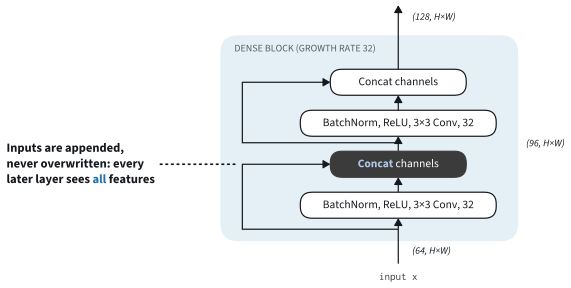
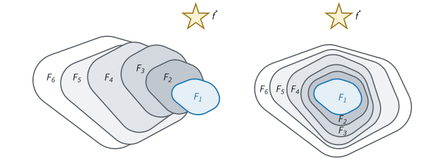
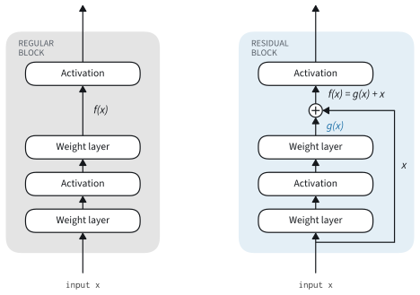
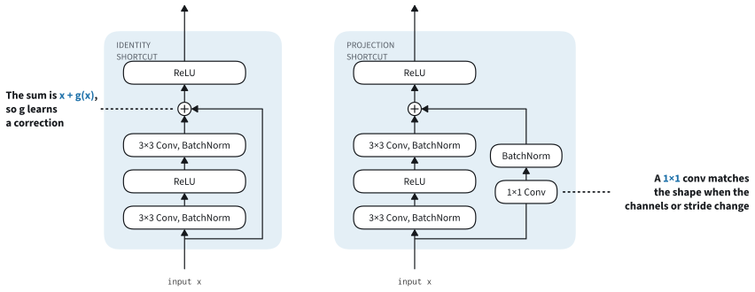
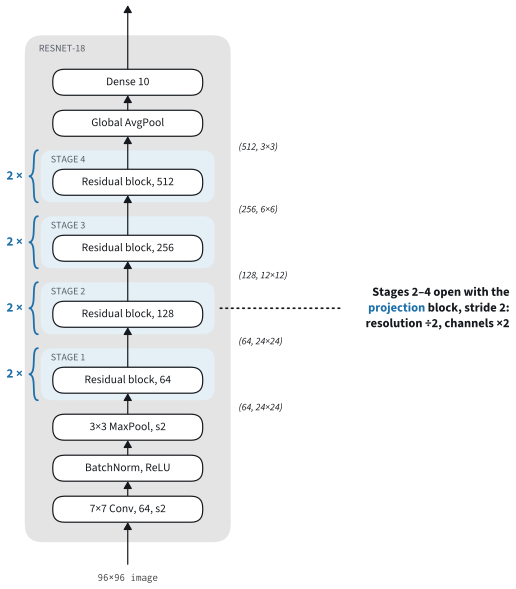
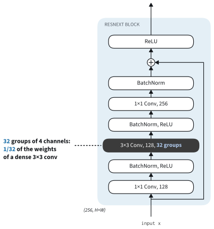

```{.python .input}
%load_ext d2lbook.tab
tab.interact_select('mxnet', 'pytorch', 'tensorflow', 'jax')
```

# Residual Networks: ResNet, ResNeXt, and DenseNet
:label:`sec_resnet`

Adding layers helped every network of this chapter so far, but the gains do
not continue indefinitely, and the reason is not overfitting.
:citet:`He.Zhang.Ren.ea.2016` trained *plain* networks, stacks of
convolutions with batch normalization and ReLU in the style of VGG, at
several depths. On CIFAR-10 a plain network with 56 layers ended training
with a higher *training* error than one with 20 layers. On ImageNet a plain
network with 34 layers had a higher training error than one with 18 layers
throughout training, and a top-1 validation error of 28.5% against 27.9%.
A deeper network that fits even its training data worse does not overfit;
the optimizer fails to find a good setting of its parameters. This
*degradation problem* is puzzling, because the deeper network could copy the
shallower one and pass its result through the extra layers unchanged, so a
setting that is at least as good exists.

*Residual networks* (ResNets) make that setting easy to reach. Each block
adds a learned correction to its input instead of replacing it, so a block
whose correction is zero passes its input through unchanged. With this
change, the 34-layer network reached a top-1 error of 25.0% where the
18-layer one reached 27.9%, and residual networks with 152 layers won the
ImageNet challenge of 2015. This section first states the argument in terms
of the functions a network can represent, then builds the residual block and
the 18-layer ResNet and trains it on Fashion-MNIST, with the batch
normalization of :numref:`sec_batch_norm` in every block. Two variants close
the section: ResNeXt splits the block into parallel groups to make it wider
at the same cost, and DenseNet concatenates the outputs of its layers
instead of adding them.

```{.python .input #resnet-residual-networks-resnet-and-resnext}
%%tab mxnet
from d2l import mxnet as d2l
from mxnet import gluon, init, np as mnp, npx
from mxnet.gluon import nn
npx.set_np()
```

```{.python .input #resnet-residual-networks-resnet-and-resnext}
%%tab pytorch
from d2l import torch as d2l
import torch
from torch import nn
from torch.nn import functional as F
```

```{.python .input #resnet-residual-networks-resnet-and-resnext}
%%tab tensorflow
from d2l import tensorflow as d2l
import tensorflow as tf
```

```{.python .input #resnet-residual-networks-resnet-and-resnext}
%%tab jax
from d2l import jax as d2l
from flax import nnx
from jax import numpy as jnp
import jax
import optax
```

## Function Classes and Depth

Let $\mathcal{F}$ be the set of functions that an architecture can represent
as its parameters vary, its *function class*. Training searches
$\mathcal{F}$ for the function that best fits the training data
$(\mathbf{X}, \mathbf{y})$. Its loss is the smallest loss available in the
class,

$$L^*_{\mathcal{F}} \stackrel{\textrm{def}}{=}
\min_{f\in\mathcal{F}} L(\mathbf{X},\mathbf{y},f).$$

A larger architecture has a larger function class $\mathcal{F}'$. If the
classes are *nested*, $\mathcal{F}\subseteq\mathcal{F}'$, then
$L^*_{\mathcal{F}'}\leq L^*_{\mathcal{F}}$: the larger class still contains
the best function of the smaller one, so its best fit can only be better.
For classes that are not nested there is no such guarantee, since the larger
class may have lost the function that worked. :numref:`fig_functionclasses`
illustrates the difference, with a star for the function we would like to
find. Nesting is a statement about the best function in each class. It does
not promise that the optimizer finds that function, nor that the function
generalizes better.


:label:`fig_functionclasses`

Adding a layer to a network nests the function classes if the new layer can
compute the identity $f(\mathbf{x}) = \mathbf{x}$: the deeper network then
contains every function of the shallower one. A plain layer
$\mathbf{x} \mapsto \textrm{ReLU}(\textrm{BN}(\mathbf{W}\mathbf{x} +
\mathbf{b}))$ can compute the identity only for particular values of its
weights, and the degradation results show that gradient descent does not
find them. A residual block changes the parameterization so that the
identity lies at the simplest point of the parameter space, where the
correction is zero.

## Residual Blocks
:label:`subsec_residual-blks`

:numref:`fig_residual_block` compares a regular block with a residual one.
Both receive the input $\mathbf{x}$ and feed their result into an activation
function. The regular block on the left must learn the desired mapping
$f(\mathbf{x})$ directly. The residual block on the right learns the
*residual mapping* $g(\mathbf{x}) = f(\mathbf{x}) - \mathbf{x}$ and adds the
input back, so its output is $\mathbf{x} + g(\mathbf{x})$. If the identity
is the desired mapping, the residual block only has to drive $g$ to zero,
for instance by setting the weights and bias of its last layer to zero. The
line that carries $\mathbf{x}$ to the addition is called a *residual
connection* or *shortcut connection*.


:label:`fig_residual_block`

The shortcut also helps the gradient. The Jacobian of
$\mathbf{x} + g(\mathbf{x})$ with respect to $\mathbf{x}$ is
$\mathbf{I} + \partial g / \partial \mathbf{x}$. In a stack of such blocks,
the gradient of the loss reaches every block through the chain of identity
terms, without passing through the convolutions of the blocks above it. Two
things remain on this path in ResNet: the ReLU after each addition, which
blocks the gradient wherever the sum is negative, and the $1 \times 1$
convolutions, with their batch normalization, on the shortcuts of the
downsampling blocks. The pre-activation design of the exercises removes the
ReLU: it normalizes at the start of the branch, adds at its end, and leaves
the identity path untouched. The pre-norm transformer block of
:numref:`sec_transformer-block` has the same layout, and the ConvNeXt block of
:numref:`sec_convnext` also leaves its identity path untouched, with no
activation after the addition. In a plain network the gradient must pass
through every layer and is scaled by each.

ResNet's residual block follows VGG's design of $3 \times 3$ convolutions. It
has two $3 \times 3$ convolutional layers with the same number of output
channels. Each convolution is followed by batch normalization, and the first
also by a ReLU. The convolutions have no bias: batch normalization subtracts
the mean of each channel and would remove it. The block adds its input to the
output of the second batch normalization and applies a final ReLU. Because
that ReLU sets negative values to zero, a block whose branch outputs zero is
the identity only on inputs that are already nonnegative. Every block of the
network receives such inputs, since each one follows a ReLU. The output of the
two convolutions must have the shape of the input so that they can be added.
When a block changes the number of channels or halves the resolution, a
$1 \times 1$ convolution with the same stride, followed by batch
normalization, transforms the input on the shortcut to the new shape. With
stride 2, this convolution reads only one of every four input positions.
:citet:`He.Zhang.Zhang.ea.2019` therefore average-pool the input of the
shortcut with a $2 \times 2$ window and stride 2 and then apply a $1 \times 1$
convolution with stride 1, so that every position contributes; they call the
result *ResNet-D*. In the bottleneck blocks of ResNet-50 they also move the
stride from the first $1 \times 1$ convolution of the branch, which has the
same problem, to the $3 \times 3$ one. We keep the original shortcut; an
exercise builds the ResNet-D version. The class `Residual` implements both the
identity and the $1 \times 1$ shortcut.

```{.python .input #resnet-residual-blocks-1}
%%tab mxnet
class Residual(nn.HybridBlock):  #@save
    """The Residual block of ResNet models."""
    def __init__(self, num_channels, use_1x1conv=False, strides=1):
        super().__init__()
        # No conv biases: the batch normalization after each conv removes them
        self.conv1 = nn.Conv2D(num_channels, kernel_size=3, padding=1,
                               strides=strides, use_bias=False)
        self.conv2 = nn.Conv2D(num_channels, kernel_size=3, padding=1,
                               use_bias=False)
        # Auto-enable 1x1 conv when downsampling so the residual shape matches.
        if use_1x1conv or strides != 1:
            self.conv3 = nn.Conv2D(num_channels, kernel_size=1,
                                   strides=strides, use_bias=False)
            self.bn3 = nn.BatchNorm()
        else:
            self.conv3 = None
        self.bn1 = nn.BatchNorm()
        self.bn2 = nn.BatchNorm()

    def forward(self, X):
        Y = npx.relu(self.bn1(self.conv1(X)))
        Y = self.bn2(self.conv2(Y))
        if self.conv3:
            X = self.bn3(self.conv3(X))
        return npx.relu(Y + X)
```

```{.python .input #resnet-residual-blocks-1}
%%tab pytorch
class Residual(nn.Module):  #@save
    """The Residual block of ResNet models."""
    def __init__(self, num_channels, use_1x1conv=False, strides=1):
        super().__init__()
        # No conv biases: the batch normalization after each conv removes them
        self.conv1 = nn.LazyConv2d(num_channels, kernel_size=3, padding=1,
                                   stride=strides, bias=False)
        self.conv2 = nn.LazyConv2d(num_channels, kernel_size=3, padding=1,
                                   bias=False)
        # Auto-enable 1x1 conv when downsampling so the residual shape matches.
        if use_1x1conv or strides != 1:
            self.conv3 = nn.LazyConv2d(num_channels, kernel_size=1,
                                       stride=strides, bias=False)
            self.bn3 = nn.LazyBatchNorm2d()
        else:
            self.conv3 = None
        self.bn1 = nn.LazyBatchNorm2d()
        self.bn2 = nn.LazyBatchNorm2d()

    def forward(self, X):
        Y = F.relu(self.bn1(self.conv1(X)))
        Y = self.bn2(self.conv2(Y))
        if self.conv3:
            X = self.bn3(self.conv3(X))
        Y += X
        return F.relu(Y)
```

```{.python .input #resnet-residual-blocks-1}
%%tab tensorflow
class Residual(tf.keras.Model):  #@save
    """The Residual block of ResNet models."""
    def __init__(self, num_channels, use_1x1conv=False, strides=1):
        super().__init__()
        # He initialization, one initializer instance per layer
        he = lambda: tf.keras.initializers.VarianceScaling(
            2.0, 'fan_in', 'untruncated_normal')
        # No conv biases: the batch normalization after each conv removes
        # them. conv1 pads 1 on every side: 'same' pads only right and bottom
        # when the stride is 2 and the sizes are even
        self.conv1 = tf.keras.Sequential([
            tf.keras.layers.ZeroPadding2D(1),
            tf.keras.layers.Conv2D(num_channels, kernel_size=3,
                                   strides=strides, use_bias=False,
                                   kernel_initializer=he())])
        self.conv2 = tf.keras.layers.Conv2D(num_channels, kernel_size=3,
            padding='same', use_bias=False, kernel_initializer=he())
        # Running averages decay 0.9 and epsilon 1e-5 (the Keras defaults are
        # 0.99 and 1e-3)
        bn = lambda: tf.keras.layers.BatchNormalization(momentum=0.9,
                                                        epsilon=1e-5)
        self.conv3 = None
        # Auto-enable 1x1 conv when downsampling so the residual shape matches.
        if use_1x1conv or strides != 1:
            self.conv3 = tf.keras.layers.Conv2D(num_channels, kernel_size=1,
                strides=strides, use_bias=False, kernel_initializer=he())
            self.bn3 = bn()
        self.bn1, self.bn2 = bn(), bn()

    def call(self, X):
        Y = tf.keras.activations.relu(self.bn1(self.conv1(X)))
        Y = self.bn2(self.conv2(Y))
        if self.conv3 is not None:
            X = self.bn3(self.conv3(X))
        Y += X
        return tf.keras.activations.relu(Y)
```

```{.python .input #resnet-residual-blocks-1}
%%tab jax
class Residual(nnx.Module):  #@save
    """The Residual block of ResNet models."""
    def __init__(self, num_channels, use_1x1conv=False, strides=(1, 1),
                 in_channels=None, rngs=None):
        in_channels = num_channels if in_channels is None else in_channels
        strides = (strides, strides) if isinstance(strides, int) else strides
        rngs = nnx.Rngs(d2l.get_key()) if rngs is None else rngs
        # He initialization; no conv biases, since the batch normalization
        # after each conv removes them
        he = nnx.initializers.variance_scaling(2.0, 'fan_in', 'normal')
        # padding=1 on every side: 'SAME' pads only right and bottom when the
        # stride is 2 and the sizes are even
        self.conv1 = nnx.Conv(in_channels, num_channels, kernel_size=(3, 3),
                              padding=1, strides=strides, use_bias=False,
                              kernel_init=he, rngs=rngs)
        self.conv2 = nnx.Conv(num_channels, num_channels, kernel_size=(3, 3),
                              padding='same', use_bias=False,
                              kernel_init=he, rngs=rngs)
        # Running averages decay 0.9 and a two-pass variance (the Flax
        # defaults are 0.99 and a one-pass variance)
        bn = lambda: nnx.BatchNorm(num_channels, momentum=0.9,
                                   use_fast_variance=False, rngs=rngs)
        # Auto-enable 1x1 conv when downsampling so the residual shape matches.
        if use_1x1conv or any(s != 1 for s in strides):
            self.conv3 = nnx.Conv(in_channels, num_channels,
                                  kernel_size=(1, 1), strides=strides,
                                  use_bias=False, kernel_init=he, rngs=rngs)
            self.bn3 = bn()
        else:
            self.conv3 = None
        self.bn1, self.bn2 = bn(), bn()

    def __call__(self, X):
        Y = nnx.relu(self.bn1(self.conv1(X)))
        Y = self.bn2(self.conv2(Y))
        if self.conv3:
            X = self.bn3(self.conv3(X))
        Y += X
        return nnx.relu(Y)
```

:begin_tab:`jax`
NNX layers need the number of input channels when they are constructed, so
the JAX `Residual` takes `in_channels`, which defaults to `num_channels`.
:end_tab:

With `use_1x1conv=False` and stride 1 the block adds its input directly
before the final ReLU. With `use_1x1conv=True` or a stride other than 1 it
adds the input after a $1 \times 1$ convolution, which adjusts the channels
and the resolution. :numref:`fig_resnet_block` shows the two variants.


:label:`fig_resnet_block`

A block with matching shapes maps a minibatch of four three-channel
$6 \times 6$ inputs to an output of the same shape.

```{.python .input #resnet-residual-blocks-2}
%%tab mxnet
blk = Residual(3)
blk.initialize()
X = d2l.randn(4, 3, 6, 6)
blk(X).shape
```

```{.python .input #resnet-residual-blocks-2}
%%tab pytorch
blk = Residual(3)
X = d2l.randn(4, 3, 6, 6)
blk(X).shape
```

```{.python .input #resnet-residual-blocks-2}
%%tab tensorflow
blk = Residual(3)
X = d2l.normal((4, 6, 6, 3))
blk(X).shape
```

```{.python .input #resnet-residual-blocks-2}
%%tab jax
blk = Residual(3)
X = jax.random.normal(d2l.get_key(), (4, 6, 6, 3))
blk(X).shape
```

With six output channels and stride 2, the block doubles the channels and
halves the height and the width. This is the block that opens each stage of
ResNet below.

```{.python .input #resnet-residual-blocks-3}
%%tab mxnet
blk = Residual(6, use_1x1conv=True, strides=2)
blk.initialize()
blk(X).shape
```

```{.python .input #resnet-residual-blocks-3}
%%tab pytorch
blk = Residual(6, use_1x1conv=True, strides=2)
blk(X).shape
```

```{.python .input #resnet-residual-blocks-3}
%%tab tensorflow
blk = Residual(6, use_1x1conv=True, strides=2)
blk(X).shape
```

```{.python .input #resnet-residual-blocks-3}
%%tab jax
blk = Residual(6, use_1x1conv=True, strides=(2, 2), in_channels=3)
blk(X).shape
```

## ResNet-18

### Stem, Stages, and Head

ResNet arranges residual blocks into the stem, body, and head of GoogLeNet
(:numref:`sec_googlenet`). The stem is GoogLeNet's: a $7 \times 7$
convolution with 64 output channels and stride 2, followed by $3 \times 3$
max-pooling with stride 2, which together reduce the resolution fourfold.
ResNet adds batch normalization after the convolution.

```{.python .input #resnet-resnet-model-1}
%%tab mxnet
class ResNet(d2l.Classifier):
    def b1(self):
        net = nn.HybridSequential()
        net.add(nn.Conv2D(64, kernel_size=7, strides=2, padding=3,
                          use_bias=False),
                nn.BatchNorm(), nn.Activation('relu'),
                nn.MaxPool2D(pool_size=3, strides=2, padding=1))
        return net
```

```{.python .input #resnet-resnet-model-1}
%%tab pytorch
class ResNet(d2l.Classifier):
    def b1(self):
        return nn.Sequential(
            nn.LazyConv2d(64, kernel_size=7, stride=2, padding=3, bias=False),
            nn.LazyBatchNorm2d(), nn.ReLU(),
            nn.MaxPool2d(kernel_size=3, stride=2, padding=1))

    def weight_init(self, module):
        # The Trainer calls this after the first minibatch fixed the shapes
        if type(module) in (nn.Linear, nn.Conv2d):
            nn.init.kaiming_normal_(module.weight, nonlinearity='relu')  # He
            if module.bias is not None:
                nn.init.zeros_(module.bias)
```

```{.python .input #resnet-resnet-model-1}
%%tab tensorflow
def he_init():  # He initialization; Keras needs one instance per layer
    return tf.keras.initializers.VarianceScaling(2.0, 'fan_in',
                                                 'untruncated_normal')

class ResNet(d2l.Classifier):
    def b1(self):
        return tf.keras.models.Sequential([
            tf.keras.layers.ZeroPadding2D(3),  # Pad every side
            tf.keras.layers.Conv2D(64, kernel_size=7, strides=2,
                                   use_bias=False,
                                   kernel_initializer=he_init()),
            tf.keras.layers.BatchNormalization(momentum=0.9, epsilon=1e-5),
            tf.keras.layers.Activation('relu'),
            tf.keras.layers.ZeroPadding2D(1),  # Zeros are safe after a ReLU
            tf.keras.layers.MaxPool2D(pool_size=3, strides=2)])
```

```{.python .input #resnet-resnet-model-1}
%%tab jax
class ResNet(d2l.Classifier):
    def __init__(self, arch, lr=0.1, num_steps=4690, num_classes=10,
                 in_channels=1, rngs=None):
        super().__init__()
        self.save_hyperparameters(ignore=['rngs'])
        rngs = nnx.Rngs(d2l.get_key()) if rngs is None else rngs
        self.net = self.create_net(in_channels, rngs)

    def b1(self, in_channels, rngs):
        he = nnx.initializers.variance_scaling(2.0, 'fan_in', 'normal')
        return nnx.Sequential(
            nnx.Conv(in_channels, 64, kernel_size=(7, 7), strides=(2, 2),
                     padding=3, use_bias=False, kernel_init=he, rngs=rngs),
            nnx.BatchNorm(64, momentum=0.9, use_fast_variance=False,
                          rngs=rngs), nnx.relu, max_pool)

def max_pool(X):  # 3x3 windows, stride 2, padding 1 on every side
    return nnx.max_pool(X, window_shape=(3, 3), strides=(2, 2),
                        padding=((1, 1), (1, 1)))
```

The body consists of four *stages*, each a sequence of residual blocks with
the same number of output channels. The first stage keeps the 64 channels
and the resolution of the stem, which has already reduced the resolution.
The first block of each later stage doubles the number of channels and
halves the height and the width.

```{.python .input #resnet-resnet-model-2}
%%tab mxnet
@d2l.add_to_class(ResNet)
def block(self, num_residuals, num_channels, first_block=False):
    blk = nn.HybridSequential()
    for i in range(num_residuals):
        if i == 0 and not first_block:
            blk.add(Residual(num_channels, use_1x1conv=True, strides=2))
        else:
            blk.add(Residual(num_channels))
    return blk
```

```{.python .input #resnet-resnet-model-2}
%%tab pytorch
@d2l.add_to_class(ResNet)
def block(self, num_residuals, num_channels, first_block=False):
    blk = []
    for i in range(num_residuals):
        if i == 0 and not first_block:
            blk.append(Residual(num_channels, use_1x1conv=True, strides=2))
        else:
            blk.append(Residual(num_channels))
    return nn.Sequential(*blk)
```

```{.python .input #resnet-resnet-model-2}
%%tab tensorflow
@d2l.add_to_class(ResNet)
def block(self, num_residuals, num_channels, first_block=False):
    blk = tf.keras.models.Sequential()
    for i in range(num_residuals):
        if i == 0 and not first_block:
            blk.add(Residual(num_channels, use_1x1conv=True, strides=2))
        else:
            blk.add(Residual(num_channels))
    return blk
```

```{.python .input #resnet-resnet-model-2}
%%tab jax
@d2l.add_to_class(ResNet)
def block(self, num_residuals, num_channels, in_channels,
          first_block=False, rngs=None):
    blk = []
    for i in range(num_residuals):
        if i == 0 and not first_block:
            blk.append(Residual(num_channels, use_1x1conv=True,
                                strides=(2, 2), in_channels=in_channels,
                                rngs=rngs))
        else:
            blk.append(Residual(num_channels, in_channels=in_channels,
                                rngs=rngs))
        in_channels = num_channels
    return nnx.Sequential(*blk)
```

The head is that of NiN and GoogLeNet: global average pooling, which
averages each channel over all positions, followed by a fully connected
output layer. The argument `arch` lists the number of blocks and the number
of channels of each stage. Since the network uses ReLU activations, its
weights start from He initialization, which draws them with variance
$2/n_\textrm{in}$ for a layer with $n_\textrm{in}$ inputs per output and
keeps the scale of the activations from layer to layer
(:numref:`subsec_he_init`). The only bias, that of the output layer, starts
at zero.

```{.python .input #resnet-resnet-model-3}
%%tab mxnet
@d2l.add_to_class(ResNet)
def __init__(self, arch, lr=0.1, num_steps=4690, num_classes=10):
    super(ResNet, self).__init__()
    self.save_hyperparameters()
    self.net = nn.HybridSequential()
    self.net.add(self.b1())
    for i, b in enumerate(arch):
        self.net.add(self.block(*b, first_block=(i==0)))
    self.net.add(nn.GlobalAvgPool2D(), nn.Dense(num_classes))
    self.net.initialize(init.MSRAPrelu('in', 0))  # He initialization
    self.net.hybridize()  # Compile the network into one graph
```

```{.python .input #resnet-resnet-model-3}
%%tab pytorch
@d2l.add_to_class(ResNet)
def __init__(self, arch, lr=0.1, num_steps=4690, num_classes=10):
    super(ResNet, self).__init__()
    self.save_hyperparameters()
    self.net = nn.Sequential(self.b1())
    for i, b in enumerate(arch):
        self.net.add_module(f'b{i+2}', self.block(*b, first_block=(i==0)))
    self.net.add_module('last', nn.Sequential(
        nn.AdaptiveAvgPool2d((1, 1)), nn.Flatten(),
        nn.LazyLinear(num_classes)))
```

```{.python .input #resnet-resnet-model-3}
%%tab tensorflow
@d2l.add_to_class(ResNet)
def __init__(self, arch, lr=0.1, num_steps=4690, num_classes=10):
    super(ResNet, self).__init__()
    self.save_hyperparameters()
    self.net = self.b1()
    for i, b in enumerate(arch):
        self.net.add(self.block(*b, first_block=(i==0)))
    self.net.add(tf.keras.models.Sequential([
        tf.keras.layers.GlobalAvgPool2D(),
        tf.keras.layers.Dense(num_classes, kernel_initializer=he_init())]))
```

```{.python .input #resnet-resnet-model-3}
%%tab jax
@d2l.add_to_class(ResNet)
def create_net(self, in_channels, rngs):
    layers = [self.b1(in_channels, rngs)]
    stage_channels = 64
    for i, (num_residuals, num_channels) in enumerate(self.arch):
        layers.append(self.block(num_residuals, num_channels, stage_channels,
                                 first_block=(i == 0), rngs=rngs))
        stage_channels = num_channels
    layers.append(nnx.Sequential(
        global_avg_pool,
        nnx.Linear(stage_channels, self.num_classes, rngs=rngs,
                   kernel_init=nnx.initializers.variance_scaling(
                       2.0, 'fan_in', 'normal'))))
    return nnx.Sequential(*layers)

def global_avg_pool(X):  # Average over height and width (NHWC)
    return X.mean(axis=(1, 2))
```

:begin_tab:`mxnet`
`init.MSRAPrelu('in', 0)` is He initialization: it draws the weights of every
convolutional and dense layer from a normal distribution with variance
$2/n_\textrm{in}$; the bias of the output layer starts at zero, and the scale
and shift of each batch normalization layer at 1 and 0. The network is built
from `HybridBlock`s, and `hybridize()` compiles it into a single graph, which
MXNet executes several times faster than one operator at a time.
:end_tab:

:begin_tab:`pytorch`
As for LeNet in :numref:`sec_lenet`, the Trainer calls the model's
`weight_init` once the first minibatch has fixed the shapes of the lazy
layers. It applies He initialization (`kaiming_normal_`) to every
convolutional and fully connected layer, including those inside the
`Residual` blocks, and sets the bias of the output layer to zero; the
convolutions have none.
:end_tab:

:begin_tab:`tensorflow`
`VarianceScaling(2.0, 'fan_in', 'untruncated_normal')` is He
initialization. Keras initializers without a seed repeat their values when
one instance is shared, so every layer gets its own; `Residual` does the
same internally. The bias of the output layer starts at zero, the Keras
default.
:end_tab:

:begin_tab:`jax`
NNX layers draw their weights when they are constructed, so every layer,
including those inside `Residual`, receives He initialization
(`variance_scaling(2.0, 'fan_in', 'normal')`) as its `kernel_init`; the
bias of the output layer starts at zero.
:end_tab:

With two blocks in each of the four stages we obtain ResNet-18. Each stage
holds four $3 \times 3$ convolutional layers, not counting the $1 \times 1$
convolutions on the shortcuts. Together with the $7 \times 7$ convolution of
the stem and the fully connected output layer, these are 18 layers.
ResNet-34 has 3, 4, 6, and 3 blocks per stage. ResNet-50, -101, and -152
replace the block by a *bottleneck* block of a $1 \times 1$, a $3 \times 3$,
and a $1 \times 1$ convolution, the ResNeXt block below with a single
group. :numref:`fig_resnet18` shows ResNet-18.


:label:`fig_resnet18`

```{.python .input #resnet-resnet-model-4}
%%tab mxnet, pytorch, tensorflow
class ResNet18(ResNet):
    def __init__(self, lr=0.1, num_steps=4690, num_classes=10):
        super().__init__(((2, 64), (2, 128), (2, 256), (2, 512)),
                         lr, num_steps, num_classes)
```

```{.python .input #resnet-resnet-model-4}
%%tab jax
class ResNet18(ResNet):
    def __init__(self, lr=0.1, num_steps=4690, num_classes=10, in_channels=1,
                 rngs=None):
        super().__init__(((2, 64), (2, 128), (2, 256), (2, 512)),
                         lr, num_steps, num_classes, in_channels, rngs)
```

We follow the shape of a single-channel $96 \times 96$ image through the
network. As in the earlier networks of this chapter, the resolution shrinks
and the number of channels grows until global average pooling collapses
each channel to one number.

```{.python .input #resnet-resnet-model-5}
%%tab mxnet, pytorch
ResNet18().layer_summary((1, 1, 96, 96))
```

```{.python .input #resnet-resnet-model-5}
%%tab tensorflow
ResNet18().layer_summary((1, 96, 96, 1))
```

```{.python .input #resnet-resnet-model-5}
%%tab jax
ResNet18().layer_summary((1, 96, 96, 1))
```

### Training

We train ResNet-18 on Fashion-MNIST, upsampled to $96 \times 96$ pixels,
with minibatches of 128 images and 10 epochs. The learning rate follows the
schedule of the earlier networks of this chapter (`d2l.cosine_warmup` of
:numref:`sec_alexnet`): it rises linearly over the first epoch and then
decays to zero along a half-cosine, stepped after every minibatch. Only the
peak differs: 0.1 instead of 0.03. Batch normalization makes the larger peak
safe. Every convolution is followed by a normalization, so a step that
scales up the weights of a convolution does not scale up its normalized
output, and the gradient that reaches those weights shrinks as they grow
(:numref:`sec_batch_norm`). The networks of :numref:`sec_blocks` have no
normalization, and NiN diverges at a peak of 0.1 in some runs. ResNet-18
gains from the larger peak: at 0.03 it ends about a point lower. The decay
matters too: with a constant rate of 0.1, the validation accuracy moves by
up to a few points from one epoch to the next and ends lower.

```{.python .input #resnet-training-schedule}
%%tab mxnet
@d2l.add_to_class(ResNet)
def configure_optimizers(self):
    schedule = lambda t: self.lr * d2l.cosine_warmup(  # MXNet counts from 1
        t - 1, self.num_steps, self.num_steps // 10)
    return gluon.Trainer(self.collect_params(), 'sgd', {
        'learning_rate': None, 'lr_scheduler': schedule})
```

```{.python .input #resnet-training-schedule}
%%tab pytorch
@d2l.add_to_class(ResNet)
def configure_optimizers(self):
    optim = torch.optim.SGD(self.parameters(), lr=self.lr)
    schedule = torch.optim.lr_scheduler.LambdaLR(optim, lambda t: (
        d2l.cosine_warmup(t, self.num_steps, self.num_steps // 10)))
    return optim, schedule  # The Trainer steps it after every minibatch
```

```{.python .input #resnet-training-schedule}
%%tab tensorflow
@d2l.add_to_class(ResNet)
def configure_optimizers(self):
    schedule = lambda: self.lr * d2l.cosine_warmup(
        optim.iterations, self.num_steps, self.num_steps // 10)
    optim = tf.keras.optimizers.SGD(schedule)
    return optim
```

```{.python .input #resnet-training-schedule}
%%tab jax
@d2l.add_to_class(ResNet)
def configure_optimizers(self):
    return optax.sgd(lambda t: self.lr * d2l.cosine_warmup(
        t, self.num_steps, self.num_steps // 10))
```

```{.python .input #resnet-training}
data = d2l.FashionMNIST(batch_size=128, resize=(96, 96))
model = ResNet18(lr=0.1, num_steps=10 * len(data.train_dataloader()))
trainer = d2l.Trainer(max_epochs=10, num_gpus=1)
trainer.fit(model, data)
```

```{.python .input #resnet-training-readout}
round(trainer.history['val_acc'][-1], 3)  # Validation accuracy after 10 epochs
```

After 10 epochs ResNet-18 reaches a validation accuracy of about 93%, and
its last three epochs change it by less than a point. That is about a point
above the quarter-width VGG, the best network of :numref:`sec_blocks`, at
$96 \times 96$ instead of $224 \times 224$ pixels. Its training loss falls
below 0.01, far below its validation loss of about 0.27: with 11.2 million
parameters for 60,000 training images, the network fits the training data
almost perfectly and new data much less well. More data, data augmentation,
and regularization reduce this gap; the training recipes of
:numref:`sec_training_recipes` combine them.

## ResNeXt and DenseNet

The residual block fixes how a block passes its input on: the input is added
to the block's output. Two variants keep this idea and change the block.
ResNeXt changes what the block computes, so that it can be wider at the same
cost; DenseNet changes how the input is passed on, by concatenation instead
of addition.

### ResNeXt
:label:`subsec_resnext`

A block becomes more expressive with more channels, but the cost of a
convolution that maps $c_\textrm{i}$ input channels to $c_\textrm{o}$ output
channels grows with the product $c_\textrm{i} c_\textrm{o}$
(:numref:`sec_channels`): doubling the width of a block quadruples its
arithmetic. ResNeXt :cite:`Xie.Girshick.Dollar.ea.2017` borrows from the
Inception block of :numref:`sec_googlenet`, which processes its input in
separate branches. Unlike Inception, it makes all branches identical.

A *grouped convolution* splits the $c_\textrm{i}$ input channels into $g$
groups of $c_\textrm{i}/g$ channels and convolves each group separately into
$c_\textrm{o}/g$ output channels. Each group has a weight tensor of size
$(c_\textrm{i}/g) \times (c_\textrm{o}/g) \times k \times k$, so the $g$
groups together have $c_\textrm{i} c_\textrm{o} k^2 / g$ weights instead of
$c_\textrm{i} c_\textrm{o} k^2$, and the layer performs $g$ times fewer
multiply-adds. We assume that $g$ divides both $c_\textrm{i}$ and
$c_\textrm{o}$. The measured speedup is usually smaller than $g$, because
grouped convolutions make less efficient use of the hardware than dense ones.
Grouped convolutions first appeared in AlexNet
:cite:`Krizhevsky.Sutskever.Hinton.2012`, which split three of its five
convolutional layers into two groups, one per GPU.

The groups of a grouped convolution exchange no information. The ResNeXt
block in :numref:`fig_resnext_block` mixes them by placing the grouped
$3 \times 3$ convolution between two $1 \times 1$ convolutions. The first
reduces the $c$ channels of the input to $b$ *bottleneck* channels, and the
second restores $c$ channels. The $1 \times 1$ convolutions cost
$\mathcal{O}(c b)$ multiply-adds per position and the grouped $3 \times 3$
convolution $\mathcal{O}(b^2 / g)$. The shortcut is an identity or, when the
block changes the shape, a $1 \times 1$ convolution followed by batch
normalization, as in `Residual`. The stride of a downsampling block sits on
the $3 \times 3$ convolution, not on the first $1 \times 1$ one. On
ImageNet, a ResNeXt-50 with 32 groups has about the parameters and the
arithmetic of ResNet-50 and lowers its top-1 error from 23.9% to 22.2%
:cite:`Xie.Girshick.Dollar.ea.2017`.


:label:`fig_resnext_block`

The class `ResNeXtBlock` takes the number of output channels `num_channels`
($c$), the number of groups `groups` ($g$), and `bot_mul`, the ratio $b/c$
of bottleneck channels to output channels. As in `Residual`,
`strides=2` halves the height and the width and switches on the
$1 \times 1$ convolution on the shortcut.

```{.python .input #resnet-resnext-1}
%%tab mxnet
class ResNeXtBlock(nn.HybridBlock):  #@save
    """The ResNeXt block."""
    def __init__(self, num_channels, groups, bot_mul,
                 use_1x1conv=False, strides=1):
        super().__init__()
        bot_channels = int(round(num_channels * bot_mul))
        # No conv biases: the batch normalization after each conv removes them
        self.conv1 = nn.Conv2D(bot_channels, kernel_size=1, padding=0,
                               strides=1, use_bias=False)
        self.conv2 = nn.Conv2D(bot_channels, kernel_size=3, padding=1,
                               strides=strides, groups=groups, use_bias=False)
        self.conv3 = nn.Conv2D(num_channels, kernel_size=1, padding=0,
                               strides=1, use_bias=False)
        self.bn1 = nn.BatchNorm()
        self.bn2 = nn.BatchNorm()
        self.bn3 = nn.BatchNorm()
        # Auto-enable 1x1 conv when downsampling so the residual shape matches.
        if use_1x1conv or strides != 1:
            self.conv4 = nn.Conv2D(num_channels, kernel_size=1,
                                   strides=strides, use_bias=False)
            self.bn4 = nn.BatchNorm()
        else:
            self.conv4 = None

    def forward(self, X):
        Y = npx.relu(self.bn1(self.conv1(X)))
        Y = npx.relu(self.bn2(self.conv2(Y)))
        Y = self.bn3(self.conv3(Y))
        if self.conv4:
            X = self.bn4(self.conv4(X))
        return npx.relu(Y + X)
```

```{.python .input #resnet-resnext-1}
%%tab pytorch
class ResNeXtBlock(nn.Module):  #@save
    """The ResNeXt block."""
    def __init__(self, num_channels, groups, bot_mul, use_1x1conv=False,
                 strides=1):
        super().__init__()
        bot_channels = int(round(num_channels * bot_mul))
        # No conv biases: the batch normalization after each conv removes them
        self.conv1 = nn.LazyConv2d(bot_channels, kernel_size=1, stride=1,
                                   bias=False)
        self.conv2 = nn.LazyConv2d(bot_channels, kernel_size=3,
                                   stride=strides, padding=1,
                                   groups=groups, bias=False)
        self.conv3 = nn.LazyConv2d(num_channels, kernel_size=1, stride=1,
                                   bias=False)
        self.bn1 = nn.LazyBatchNorm2d()
        self.bn2 = nn.LazyBatchNorm2d()
        self.bn3 = nn.LazyBatchNorm2d()
        # Auto-enable 1x1 conv when downsampling so the residual shape matches.
        if use_1x1conv or strides != 1:
            self.conv4 = nn.LazyConv2d(num_channels, kernel_size=1,
                                       stride=strides, bias=False)
            self.bn4 = nn.LazyBatchNorm2d()
        else:
            self.conv4 = None

    def forward(self, X):
        Y = F.relu(self.bn1(self.conv1(X)))
        Y = F.relu(self.bn2(self.conv2(Y)))
        Y = self.bn3(self.conv3(Y))
        if self.conv4:
            X = self.bn4(self.conv4(X))
        return F.relu(Y + X)
```

```{.python .input #resnet-resnext-1}
%%tab tensorflow
class ResNeXtBlock(tf.keras.Model):  #@save
    """The ResNeXt block."""
    def __init__(self, num_channels, groups, bot_mul, use_1x1conv=False,
                 strides=1):
        super().__init__()
        bot_channels = int(round(num_channels * bot_mul))
        # He initialization, one initializer instance per layer; no conv
        # biases, since the batch normalization after each conv removes them
        he = lambda: tf.keras.initializers.VarianceScaling(
            2.0, 'fan_in', 'untruncated_normal')
        self.conv1 = tf.keras.layers.Conv2D(bot_channels, 1, strides=1,
            use_bias=False, kernel_initializer=he())
        self.conv2 = tf.keras.Sequential([  # Pad 1 on every side
            tf.keras.layers.ZeroPadding2D(1),
            tf.keras.layers.Conv2D(bot_channels, 3, strides=strides,
                                   groups=groups, use_bias=False,
                                   kernel_initializer=he())])
        self.conv3 = tf.keras.layers.Conv2D(num_channels, 1, strides=1,
            use_bias=False, kernel_initializer=he())
        # Running averages decay 0.9 and epsilon 1e-5 (the Keras defaults are
        # 0.99 and 1e-3)
        bn = lambda: tf.keras.layers.BatchNormalization(momentum=0.9,
                                                        epsilon=1e-5)
        self.bn1, self.bn2, self.bn3 = bn(), bn(), bn()
        # Auto-enable 1x1 conv when downsampling so the residual shape matches.
        if use_1x1conv or strides != 1:
            self.conv4 = tf.keras.layers.Conv2D(num_channels, 1,
                strides=strides, use_bias=False, kernel_initializer=he())
            self.bn4 = bn()
        else:
            self.conv4 = None

    def call(self, X):
        Y = tf.keras.activations.relu(self.bn1(self.conv1(X)))
        Y = tf.keras.activations.relu(self.bn2(self.conv2(Y)))
        Y = self.bn3(self.conv3(Y))
        if self.conv4:
            X = self.bn4(self.conv4(X))
        return tf.keras.activations.relu(Y + X)
```

```{.python .input #resnet-resnext-1}
%%tab jax
class ResNeXtBlock(nnx.Module):  #@save
    """The ResNeXt block."""
    def __init__(self, num_channels, groups, bot_mul, use_1x1conv=False,
                 strides=(1, 1), in_channels=None, rngs=None):
        in_channels = num_channels if in_channels is None else in_channels
        strides = (strides, strides) if isinstance(strides, int) else strides
        rngs = nnx.Rngs(d2l.get_key()) if rngs is None else rngs
        bot_channels = int(round(num_channels * bot_mul))
        # He initialization; no conv biases, since the batch normalization
        # after each conv removes them
        he = nnx.initializers.variance_scaling(2.0, 'fan_in', 'normal')
        self.conv1 = nnx.Conv(in_channels, bot_channels, kernel_size=(1, 1),
                              strides=(1, 1), use_bias=False,
                              kernel_init=he, rngs=rngs)
        self.conv2 = nnx.Conv(bot_channels, bot_channels,
                              kernel_size=(3, 3), strides=strides,
                              padding=1, feature_group_count=groups,
                              use_bias=False, kernel_init=he, rngs=rngs)
        self.conv3 = nnx.Conv(bot_channels, num_channels, kernel_size=(1, 1),
                              strides=(1, 1), use_bias=False,
                              kernel_init=he, rngs=rngs)
        # Running averages decay 0.9 and a two-pass variance (the Flax
        # defaults are 0.99 and a one-pass variance)
        bn = lambda n: nnx.BatchNorm(n, momentum=0.9, use_fast_variance=False,
                                     rngs=rngs)
        self.bn1, self.bn2 = bn(bot_channels), bn(bot_channels)
        self.bn3 = bn(num_channels)
        # Auto-enable 1x1 conv when downsampling so the residual shape matches.
        if use_1x1conv or any(s != 1 for s in strides):
            self.conv4 = nnx.Conv(in_channels, num_channels,
                                  kernel_size=(1, 1), strides=strides,
                                  use_bias=False, kernel_init=he, rngs=rngs)
            self.bn4 = bn(num_channels)
        else:
            self.conv4 = None

    def __call__(self, X):
        Y = nnx.relu(self.bn1(self.conv1(X)))
        Y = nnx.relu(self.bn2(self.conv2(Y)))
        Y = self.bn3(self.conv3(Y))
        if self.conv4:
            X = self.bn4(self.conv4(X))
        return nnx.relu(Y + X)
```

A block with 32 channels, 16 groups, and as many bottleneck channels as
output channels (`bot_mul=1`) keeps the shape of its input.

```{.python .input #resnet-resnext-2}
%%tab mxnet
blk = ResNeXtBlock(32, 16, 1)
blk.initialize()
X = d2l.randn(4, 32, 96, 96)
blk(X).shape
```

```{.python .input #resnet-resnext-2}
%%tab pytorch
blk = ResNeXtBlock(32, 16, 1)
X = d2l.randn(4, 32, 96, 96)
blk(X).shape
```

```{.python .input #resnet-resnext-2}
%%tab tensorflow
blk = ResNeXtBlock(32, 16, 1)
X = d2l.normal((4, 96, 96, 32))
blk(X).shape
```

```{.python .input #resnet-resnext-2}
%%tab jax
blk = ResNeXtBlock(32, 16, 1)
X = jax.random.normal(d2l.get_key(), (4, 96, 96, 32))
blk(X).shape
```

### DenseNet
:label:`sec_densenet`

A residual block computes $\mathbf{x} + g(\mathbf{x})$: its output keeps the
number of channels of its input, and what the block adds is mixed into the
input. *DenseNet* (dense convolutional network)
:cite:`Huang.Liu.Van-Der-Maaten.ea.2017` instead *concatenates* the output of
each layer to its input along the channel axis, so that every layer receives
the feature maps of all layers before it. A sequence of layers
$f_1, f_2, f_3, \ldots$ thus maps $\mathbf{x}$ to

$$
\mathbf{x} \to \left[
\mathbf{x},
f_1(\mathbf{x}),
f_2\left(\left[\mathbf{x}, f_1\left(\mathbf{x}\right)\right]\right), f_3\left(\left[\mathbf{x}, f_1\left(\mathbf{x}\right), f_2\left(\left[\mathbf{x}, f_1\left(\mathbf{x}\right)\right]\right)\right]\right), \ldots\right],
$$

where $[\cdot, \cdot]$ denotes concatenation. Every layer is connected to all
its predecessors, hence the name. :numref:`fig_densenet_block` shows a dense
block with two layers.


:label:`fig_densenet_block`

A DenseNet alternates *dense blocks*, which concatenate, with *transition
layers*, which reduce the accumulated channels. Each convolution in a dense
block is preceded by batch normalization and a ReLU, the "normalization,
activation, convolution" order that the exercises explore for ResNet. The
convolutions have no bias, since every layer that reads their output starts
with batch normalization.

```{.python .input #densenet-dense-blocks-1}
%%tab mxnet
def conv_block(num_channels):
    blk = nn.Sequential()
    blk.add(nn.BatchNorm(),
            nn.Activation('relu'),
            nn.Conv2D(num_channels, kernel_size=3, padding=1,
                      use_bias=False))
    return blk
```

```{.python .input #densenet-dense-blocks-1}
%%tab pytorch
def conv_block(num_channels):
    return nn.Sequential(
        nn.LazyBatchNorm2d(), nn.ReLU(),
        nn.LazyConv2d(num_channels, kernel_size=3, padding=1, bias=False))
```

```{.python .input #densenet-dense-blocks-1}
%%tab tensorflow
def conv_block(num_channels):
    return tf.keras.models.Sequential([
        tf.keras.layers.BatchNormalization(momentum=0.9, epsilon=1e-5),
        tf.keras.layers.ReLU(),
        tf.keras.layers.Conv2D(num_channels, kernel_size=3,
                               padding='same', use_bias=False)])
```

```{.python .input #densenet-dense-blocks-1}
%%tab jax
class ConvBlock(nnx.Module):
    def __init__(self, in_channels, num_channels, rngs):
        self.bn = nnx.BatchNorm(in_channels, momentum=0.9,
                                use_fast_variance=False, rngs=rngs)
        self.conv = nnx.Conv(in_channels, num_channels, kernel_size=(3, 3),
                             padding=(1, 1), use_bias=False, rngs=rngs)

    def __call__(self, X):
        return self.conv(nnx.relu(self.bn(X)))
```

A dense block stacks several of these convolution blocks, each with the same
number of output channels, and concatenates the input and the output of each
along the channel axis.

```{.python .input #densenet-dense-blocks-2}
%%tab mxnet
class DenseBlock(nn.Block):
    def __init__(self, num_convs, num_channels):
        super().__init__()
        self.net = nn.Sequential()
        for _ in range(num_convs):
            self.net.add(conv_block(num_channels))

    def forward(self, X):
        for blk in self.net:
            Y = blk(X)
            # Concatenate input and output of each block along the channels
            X = mnp.concatenate((X, Y), axis=1)
        return X
```

```{.python .input #densenet-dense-blocks-2}
%%tab pytorch
class DenseBlock(nn.Module):
    def __init__(self, num_convs, num_channels):
        super(DenseBlock, self).__init__()
        layer = []
        for i in range(num_convs):
            layer.append(conv_block(num_channels))
        self.net = nn.Sequential(*layer)

    def forward(self, X):
        for blk in self.net:
            Y = blk(X)
            # Concatenate input and output of each block along the channels
            X = torch.cat((X, Y), dim=1)
        return X
```

```{.python .input #densenet-dense-blocks-2}
%%tab tensorflow
class DenseBlock(tf.keras.layers.Layer):
    def __init__(self, num_convs, num_channels):
        super(DenseBlock, self).__init__()
        self.listLayers = []
        for _ in range(num_convs):
            self.listLayers.append(conv_block(num_channels))

    def call(self, x):
        for layer in self.listLayers:
            y = layer(x)
            # Concatenate input and output of each block along the channels
            x = tf.keras.layers.concatenate([x, y], axis=-1)
        return x
```

```{.python .input #densenet-dense-blocks-2}
%%tab jax
class DenseBlock(nnx.Module):
    def __init__(self, num_convs, num_channels, in_channels=3, rngs=None):
        rngs = nnx.Rngs(d2l.get_key()) if rngs is None else rngs
        layers = []
        for i in range(num_convs):
            layers.append(ConvBlock(
                in_channels + i * num_channels, num_channels, rngs))
        self.layers = nnx.List(layers)

    def __call__(self, X):
        for layer in self.layers:
            Y = layer(X)
            # Concatenate input and output of each block along the channels
            X = jnp.concatenate((X, Y), axis=-1)
        return X
```

A dense block with two convolution blocks of 10 output channels turns an
input with 3 channels into an output with $3 + 10 + 10 = 23$ channels. The
number of output channels of each convolution block, here 10, is called the
*growth rate*.

```{.python .input #densenet-dense-blocks-3}
%%tab mxnet
blk = DenseBlock(2, 10)
X = mnp.random.uniform(size=(4, 3, 8, 8))
blk.initialize()
Y = blk(X)
Y.shape
```

```{.python .input #densenet-dense-blocks-3}
%%tab pytorch
blk = DenseBlock(2, 10)
X = torch.randn(4, 3, 8, 8)
Y = blk(X)
Y.shape
```

```{.python .input #densenet-dense-blocks-3}
%%tab tensorflow
blk = DenseBlock(2, 10)
X = tf.random.uniform((4, 8, 8, 3))
Y = blk(X)
Y.shape
```

```{.python .input #densenet-dense-blocks-3}
%%tab jax
blk = DenseBlock(2, 10)
X = jax.random.normal(d2l.get_key(), (4, 8, 8, 3))
Y = blk(X)
Y.shape
```

Since every dense block adds channels, a stack of them would soon be very
wide. A *transition layer* reduces the number of channels with a
$1 \times 1$ convolution and halves the height and the width with average
pooling of stride 2.

```{.python .input #densenet-transition-layers-1}
%%tab mxnet
def transition_block(num_channels):
    blk = nn.Sequential()
    blk.add(nn.BatchNorm(), nn.Activation('relu'),
            nn.Conv2D(num_channels, kernel_size=1, use_bias=False),
            nn.AvgPool2D(pool_size=2, strides=2))
    return blk
```

```{.python .input #densenet-transition-layers-1}
%%tab pytorch
def transition_block(num_channels):
    return nn.Sequential(
        nn.LazyBatchNorm2d(), nn.ReLU(),
        nn.LazyConv2d(num_channels, kernel_size=1, bias=False),
        nn.AvgPool2d(kernel_size=2, stride=2))
```

```{.python .input #densenet-transition-layers-1}
%%tab tensorflow
def transition_block(num_channels):
    return tf.keras.models.Sequential([
        tf.keras.layers.BatchNormalization(momentum=0.9, epsilon=1e-5),
        tf.keras.layers.ReLU(),
        tf.keras.layers.Conv2D(num_channels, kernel_size=1, use_bias=False),
        tf.keras.layers.AvgPool2D(pool_size=2, strides=2)])
```

```{.python .input #densenet-transition-layers-1}
%%tab jax
class TransitionBlock(nnx.Module):
    def __init__(self, in_channels, num_channels, rngs=None):
        rngs = nnx.Rngs(d2l.get_key()) if rngs is None else rngs
        self.bn = nnx.BatchNorm(in_channels, momentum=0.9,
                                use_fast_variance=False, rngs=rngs)
        self.conv = nnx.Conv(in_channels, num_channels, kernel_size=(1, 1),
                             use_bias=False, rngs=rngs)

    def __call__(self, X):
        X = self.conv(nnx.relu(self.bn(X)))
        return nnx.avg_pool(X, window_shape=(2, 2), strides=(2, 2))
```

A transition layer with 10 channels, applied to the output of the dense
block above, reduces its 23 channels to 10 and halves the height and the
width.

```{.python .input #densenet-transition-layers-2}
%%tab mxnet
blk = transition_block(10)
blk.initialize()
blk(Y).shape
```

```{.python .input #densenet-transition-layers-2}
%%tab pytorch
blk = transition_block(10)
blk(Y).shape
```

```{.python .input #densenet-transition-layers-2}
%%tab tensorflow
blk = transition_block(10)
blk(Y).shape
```

```{.python .input #densenet-transition-layers-2}
%%tab jax
blk = TransitionBlock(23, 10)
blk(Y).shape
```

A full DenseNet alternates four dense blocks with transition layers, like
the four stages of ResNet-18; the assembly follows the ResNet code above.
Because each layer reuses the features of all earlier ones, DenseNet reached
the ImageNet accuracy of ResNet with fewer parameters. Concatenation costs
memory, however. The distinct feature maps of a dense block grow linearly
with its depth, but a direct implementation materializes a new, wider
concatenation for every layer and keeps it, with its normalized version, for
the backward pass, so its memory grows quadratically with the depth of the
block. Memory-efficient implementations recompute these tensors during
backpropagation :cite:`pleiss2017memory`. Addition has no such cost, which
is one reason why residual connections, not dense ones, became the standard
in later architectures.

## Summary

Deeper plain networks can fit even their training data worse than shallower
ones, although they could represent the same functions. A residual block
computes its input plus a learned correction, so that the identity is the
block with zero correction, and the shortcut gives the gradient a direct
path to every block. Stacked in four stages with batch normalization,
residual blocks give ResNet-18, which trains at a peak learning rate of 0.1
and reaches about 93% validation accuracy on Fashion-MNIST in 10 epochs, and
the same template scales to 152 layers.
ResNeXt replaces the middle convolution of a bottleneck block by a grouped
convolution, which makes the block wider at the same cost, and DenseNet
concatenates the outputs of its layers instead of adding them, which reuses
features at the price of memory. Residual connections went on to become a
part of nearly every deep architecture, including the transformers of
:numref:`chap_transformers`.

## Exercises

1. **Inception versus residual blocks.** In the `arch` of
   GoogLeNet (:numref:`sec_googlenet`), the second block of the middle group has
   branch widths $c_1 = 160$, $c_2 = (112, 224)$, $c_3 = (24, 64)$, and
   $c_4 = 64$, and it maps 512 input channels to 512 output channels.
   Compare it with a 512-channel `Residual` block that uses an identity
   shortcut.
    1. Count the convolution weights and the multiply-adds per output
       pixel of both blocks, ignoring biases and normalization
       parameters.
    1. A `Residual` block whose residual branch outputs zero is the
       identity on nonnegative inputs. Determine whether any choice of
       parameters makes the Inception block the identity on nonnegative
       inputs, and state what the answer implies for deepening GoogLeNet
       by inserting Inception blocks.

1. **Pre-activation ordering.** :citet:`He.Zhang.Ren.ea.2016*1`
   moved batch normalization and the ReLU in front of each convolution of
   the residual branch and removed the ReLU after the addition (their
   Figure 1), so that a block computes $\mathbf{x} + g(\mathbf{x})$ with
   the identity path left untouched. The DenseNet convolution block in
   :numref:`sec_densenet` uses this "normalization, activation,
   convolution" order.
    1. Stack $K$ pre-activation blocks,
       $\mathbf{x}_k = \mathbf{x}_{k-1} + g_k(\mathbf{x}_{k-1})$ for
       $k = 1, \ldots, K$. Write $\mathbf{x}_K$ in terms of
       $\mathbf{x}_0$ and the branch outputs, and show that the Jacobian
       $\partial \mathbf{x}_K / \partial \mathbf{x}_0$ contains the
       identity matrix as an additive term.
    1. Now stack $K$ `Residual` blocks with identity shortcuts, each of
       which applies a ReLU after the addition. Which factor takes the
       place of the identity term in
       $\partial \mathbf{x}_K / \partial \mathbf{x}_0$, and what does it
       imply for the gradient that reaches the first block through the
       shortcuts?

1. **Nested function classes.** The containment argument of
   :numref:`fig_functionclasses` applies to a deeper network when each
   added block can represent the identity on every input it receives.
   Every `Residual` block in `ResNet18` receives nonnegative inputs.
    1. Set the weights of `conv2` in a `Residual` block with an identity
       shortcut to zero. Determine the output of `bn2` in
       training mode and in prediction mode, and decide in each mode
       whether the block is then the identity on nonnegative inputs.
       Name parameter values of `bn2` that make the block the identity
       in both modes.
    1. ResNet-34 (Table 1 of :citet:`He.Zhang.Ren.ea.2016`) has the same
       stage widths as `ResNet18` and more blocks per stage. Decide
       whether ResNet-34 represents every function that `ResNet18`
       represents, and justify the answer block by block.

1. [code] **Plain networks.** ● Build a plain variant of `Residual` that
   returns the ReLU of the branch output without adding the input, and
   use it to build plain versions of ResNet-18 and of ResNet-34 (3, 4, 6,
   and 3 blocks per stage). Train the four networks for 10 epochs with the
   settings of this section and plot their training losses on shared axes.
   Does Fashion-MNIST at these depths show the degradation problem? How
   does the gap between the plain networks and the residual ones change
   with depth?

1. **Paths through a residual stack.** A stack of $K$ residual blocks can
   be unraveled into an ensemble of paths: on each block, the signal
   either passes through the block's body or skips it
   :cite:`Veit.Wilber.Belongie.2016`.
    1. How many end-to-end paths pass through exactly $\ell$ of the $K$
       bodies? Verify your formula by explicit enumeration for $K = 4$.
    1. Relate the distribution of path lengths to why very deep residual
       networks remain trainable where equally deep plain networks are
       not.

    *Adapted from Simon Prince,
    [Understanding Deep Learning](https://udlbook.github.io/udlbook/),
    Problem 11.2.*

1. [code] **ResNet variants.** ● Table 1 of :citet:`He.Zhang.Ren.ea.2016`
   specifies ResNet-18 to ResNet-152 by the number of blocks per stage and
   by the block type.
    1. Build ResNet-34 by passing its block counts as `arch` to `ResNet`
       and report its parameter count against `ResNet18`.
    1. ResNet-50 and its deeper relatives use a bottleneck block: a
       $1 \times 1$ convolution that reduces the width fourfold, a
       $3 \times 3$ convolution, and a $1 \times 1$ convolution that
       restores the width. `ResNeXtBlock` with `groups=1` and
       `bot_mul=0.25` implements this block. Compare its parameter count
       and multiply-adds with those of `Residual` at the same input and
       output width, and with those of `Residual` at a quarter of that
       width, which is the width of the matching ResNet-34 stage.
    1. Override `block` in a subclass of `ResNet` so that it stacks
       bottleneck blocks, build ResNet-50, and compare its parameter count
       with ResNet-34's.

1. [code] **ResNet-D shortcut.** In a downsampling `Residual` block, the
   stride-2 $1 \times 1$ convolution on the shortcut reads one of every
   four input positions. :citet:`He.Zhang.Zhang.ea.2019` replace it by
   $2 \times 2$ average pooling with stride 2, followed by a stride-1
   $1 \times 1$ convolution and batch normalization.
    1. Implement this shortcut in a subclass of `Residual` and check on a
       random input that the new block has the same output shape and the
       same number of parameters as the original one.
    1. Build a ResNet-18 from the new block and train it with the settings
       of this section. Compare its validation accuracy with that of
       `ResNet18` over several runs of each network. Is the difference
       larger than the variation between runs?

1. [code] **Pre-activation ResNet-18.** ● Implement the pre-activation
   block of :citet:`He.Zhang.Ren.ea.2016*1` as a variant of `Residual`,
   override `block` in a subclass of `ResNet` so that it stacks the new
   block, and compare the training curves of the resulting ResNet-18 with
   those of `ResNet18`.

1. **DenseNet accounting.** ● :citet:`Huang.Liu.Van-Der-Maaten.ea.2017`
   report that DenseNets match the accuracy of comparable ResNets with
   fewer parameters, whereas :citet:`pleiss2017memory` had to devise
   memory-efficient implementations for them. Consider a dense block whose
   $n$ convolutions each emit $r$ channels (the growth rate) on an input
   with $c$ channels, and compare it with $n$ `Residual` blocks of
   constant width $c$. Ignore biases and batch normalization parameters.
    1. `DenseBlock` builds the input of each convolution as a new
       concatenated tensor, and a naive implementation keeps all of these
       inputs for the backward pass. How many channels does the $i$-th
       convolution consume? Sum them over the block and compare the sum
       with the $2n$ inputs of width $c$ that the $3 \times 3$
       convolutions of the residual blocks keep.
    1. Count the weights of the dense block's $3 \times 3$ convolutions
       and compare them with those of the $n$ residual blocks. For which
       growth rates $r$ does the dense block use fewer parameters?
    1. :citet:`pleiss2017memory` store only the $c + nr$ channels of
       distinct feature maps and discard each concatenated tensor and its
       normalized version after use. For $c = 64$, $r = 32$, and $n = 6$,
       compare this storage with your sum from the first part. Explain
       why the backward pass must then recompute concatenations, batch
       normalizations, and ReLUs, but no convolution.

:begin_tab:`mxnet`
[Discussions](https://d2l.discourse.group/t/85)
:end_tab:

:begin_tab:`pytorch`
[Discussions](https://d2l.discourse.group/t/86)
:end_tab:

:begin_tab:`tensorflow`
[Discussions](https://d2l.discourse.group/t/8737)
:end_tab:

:begin_tab:`jax`
[Discussions](https://d2l.discourse.group/t/18006)
:end_tab:

<!-- slides -->

::: {.slide}
::: {.cover}
[Dive into Deep Learning · §7.4]{.kicker}

Residual Networks<br>**the degradation problem · nested function classes · residual blocks · ResNet-18 · ResNeXt and DenseNet**
:::
:::

::: {.slide title="A 34-Layer Plain Network Fits ImageNet Worse Than an 18-Layer One"}
[The problem]{.kicker}

- Plain networks (convolution, batch norm, ReLU, as in VGG) of growing
  depth on ImageNet: 34 layers end with **higher training error** than 18.
- Top-1 validation error: 28.5% for 34 layers, 27.9% for 18.
- On CIFAR-10: 56 layers train worse than 20.
- Higher *training* error: not overfitting, but an optimizer that cannot
  find a good setting.

::: {.d2l-note .warn}
The deeper network could copy the shallower one and pass its result
through unchanged. Why doesn't training find that?
:::

Source: He et al. (2016).
:::

::: {.slide title="By the End of This Deck You Can"}
[Goals]{.kicker}

- state when a larger model is guaranteed to fit at least as well;
- build a residual block, with an identity or a 1×1 shortcut;
- assemble ResNet-18 and count its 18 layers and 11.2M parameters;
- train it on Fashion-MNIST at the larger learning rate that batch
  normalization allows;
- compute what grouped convolutions save (ResNeXt) and what
  concatenation costs (DenseNet).

**Running example:** ResNet-18 on Fashion-MNIST at 96×96 pixels:
parameters and validation accuracy.
:::

::: {.slide title="Skip Connections Make Depth Trainable"}
[Where this fits]{.kicker}

::: {.cols .vc}
::: {.col}
| section | adds |
|---|---|
| AlexNet | learned features, ReLU, dropout, GPUs |
| VGG, NiN, GoogLeNet | blocks, 1 × 1 convolutions, global pooling |
| Normalization Layers | batch, layer, group normalization |
| **ResNet, ResNeXt, DenseNet** | **residual connections make depth trainable** |
| Efficient Convnets | separable blocks, scaling, re-parameterization |
| Training Recipes | schedules, augmentation, weight averaging |
| ConvNeXt | a ResNet modernized one change at a time |
| Design Spaces (RegNet) | rules from populations of networks |
:::

::: {.col .narrow}
- **Uses:** VGG's 3×3 blocks, GoogLeNet's stem and head, batch
  normalization, `Trainer`.
- **Skips:** ImageNet training; ResNet-50 and deeper (exercises).
:::
:::
:::

::: {.slide}
::: {.divider}
[01]{.dnum}

[Function Classes]{.dtitle}

[when more capacity cannot hurt]{.dsub}
:::
:::

::: {.slide title="Nested Function Classes Guarantee a Best Fit at Least as Good"}
[Function classes]{.kicker}

{width=85%}

If $\mathcal{F} \subseteq \mathcal{F}'$, then
$\min_{f\in\mathcal{F}'} L \le \min_{f\in\mathcal{F}} L$.
:::

::: {.slide title="A Deeper Network Contains the Shallower One If the New Layers Can Be the Identity"}
[Function classes]{.kicker}

- Plain layer $\textrm{ReLU}(\textrm{BN}(\mathbf{W}\mathbf{x} +
  \mathbf{b}))$: the identity needs particular weights; training does
  not find them.
- Residual block $\mathbf{x} + g(\mathbf{x})$: the identity is
  $g = 0$, the simplest point of the parameter space.

**Make the identity easy to reach, and extra depth no longer degrades
training.**
:::

::: {.slide}
::: {.divider}
[02]{.dnum}

[Residual Blocks]{.dtitle}

[learn a correction to the identity]{.dsub}
:::
:::

::: {.slide title="A Residual Block Learns the Correction g(x) = f(x) − x"}
[Residual blocks]{.kicker}

{width=70%}

Identity mapping $\Leftrightarrow$ $g = 0$: zero the last layer of the
branch.
:::

::: {.slide title="The Shortcut Adds the Identity to Every Block's Jacobian"}
[Residual blocks]{.kicker}

$$\frac{\partial(\mathbf{x} + g(\mathbf{x}))}{\partial \mathbf{x}} =
\mathbf{I} + \frac{\partial g}{\partial \mathbf{x}}$$

- Residual stack: the gradient reaches every block through a chain of
  identity terms.
- Plain stack: the gradient passes through every layer and is scaled by
  each.
- Caveat: ResNet's final ReLU after the addition makes the block the
  identity only on nonnegative inputs.
:::

::: {.slide title="Two Variants: Identity Shortcut, or a 1×1 Convolution When the Shape Changes"}
[Residual blocks]{.kicker}

{width=90%}

The 1×1 convolution (with batch norm) has the block's stride, so it
matches channels and resolution. At stride 2 it reads one of every four
positions; ResNet-D average-pools 2×2 first.
:::

::: {.slide title="Same Shape In and Out, or Twice the Channels at Half the Resolution"}
[Residual blocks]{.kicker}

@resnet-residual-blocks-2

@resnet-residual-blocks-3
:::

::: {.slide title="Check: Is a Residual Block with a Zero Branch the Identity?"}
[Check]{.kicker}

Set the weights of `conv2` to zero. The block computes
$\textrm{ReLU}(\textrm{BN}_2(0) + \mathbf{x})$. Is it the identity?

::: {.fragment .fade-up}
::: {.d2l-note}
**Answer.** Training mode: $\textrm{BN}_2(0) = \beta_2$, so the block is
the identity on nonnegative inputs iff $\beta_2 = 0$. Prediction mode:
$\textrm{BN}_2(0) = \beta_2 - \gamma_2\hat\mu_2/\sqrt{\hat\sigma_2^2 +
\epsilon}$. $\gamma_2 = \beta_2 = 0$ gives the identity in both modes.
:::
:::
:::

::: {.slide}
::: {.divider}
[03]{.dnum}

[ResNet-18]{.dtitle}

[stem, four stages, pooling head]{.dsub}
:::
:::

::: {.slide title="ResNet-18: GoogLeNet's Stem and Head Around Four Residual Stages"}
[ResNet-18]{.kicker}

{width=50%}
:::

::: {.slide title="1 + 4 × 2 × 2 + 1 = 18 Layers and 11.2 Million Parameters"}
[ResNet-18]{.kicker}

- Stem: one 7×7 convolution, stride 2, then 3×3 max-pooling, stride 2.
- Four stages × two blocks × two 3×3 convolutions = 16.
- Head: global average pooling and one fully connected layer.
- Channels 64, 128, 256, 512; resolution 24, 12, 6, 3 at 96×96 input.

| model | blocks per stage | parameters |
|---|---|--:|
| ResNet-18 (Fashion-MNIST) | 2, 2, 2, 2 | 11,175,370 |
| ResNet-34 | 3, 4, 6, 3 | (exercise) |
:::

::: {.slide title="The Stage Template: Downsample Once, Then Keep the Shape"}
[ResNet-18]{.kicker}

@resnet-resnet-model-2
:::

::: {.slide title="Batch Normalization Lets ResNet-18 Train at a Peak Rate of 0.1"}
[ResNet-18]{.kicker}

- Schedule of AlexNet and VGG: linear warmup over the first epoch, then
  cosine decay to 0, stepped after every minibatch.
- Peak 0.1 instead of 0.03.
- A normalization follows every convolution: scaling up the convolution's
  weights leaves its normalized output unchanged, and the gradient that
  reaches those weights shrinks as they grow.
- Without normalization, NiN diverges at a peak of 0.1 in some runs.
- ResNet-18 at a peak of 0.03 ends about a point lower.
:::

::: {.slide title="ResNet-18 Reaches About 93% on Fashion-MNIST in 10 Epochs"}
[ResNet-18]{.kicker}

@!resnet-training

Peak rate 0.1, minibatch 128, 96×96 pixels. About a point above the
quarter-width VGG at 224×224. Training loss below 0.01, validation loss
≈ 0.27: 11.2M parameters for 60,000 images.
:::

::: {.slide}
::: {.divider}
[04]{.dnum}

[ResNeXt and DenseNet]{.dtitle}

[wider at the same cost; concatenate instead of add]{.dsub}
:::
:::

::: {.slide title="A Grouped Convolution with g Groups Has 1/g of the Weights and Multiply-Adds"}
[ResNeXt]{.kicker}

- Dense $k \times k$ convolution: $c_\textrm{i} c_\textrm{o} k^2$ weights.
- $g$ groups of $c_\textrm{i}/g \to c_\textrm{o}/g$ channels:
  $c_\textrm{i} c_\textrm{o} k^2 / g$.
- 3×3, 128 → 128 channels: 147,456 weights dense; **4,608** with 32
  groups.
- Measured speedup is smaller than $g$: grouped kernels use the hardware
  less efficiently.
:::

::: {.slide title="ResNeXt-50 Matches ResNet-50's Cost and Lowers Its Error from 23.9% to 22.2%"}
[ResNeXt]{.kicker}

{width=34%}

The 1×1 convolutions mix the groups. Source: Xie et al. (2017).
:::

::: {.slide title="DenseNet Concatenates: Every Layer Sees All Earlier Features"}
[DenseNet]{.kicker}

{width=62%}

Two blocks of 10 channels on a 3-channel input: $3 + 10 + 10 = 23$
channels; a transition layer (1×1 conv, 2×2 average pool) shrinks them.
:::

::: {.slide title="Check: How Many Channels Does a Naive Dense Block Keep?"}
[Check]{.kicker}

Dense block with $c = 64$ input channels, growth rate $r = 32$, $n = 6$
convolutions. The $i$-th convolution reads a new concatenation of
$c + (i-1) r$ channels, all kept for the backward pass. Total?

::: {.fragment .fade-up}
::: {.d2l-note}
**Answer.** $\sum_{i=1}^{6} (64 + 32(i-1)) = 384 + 480 = 864$ channels;
six residual blocks of width 64 keep $2 \cdot 6 \cdot 64 = 768$, a
memory-efficient dense block $c + nr = 256$. The dense sum grows
quadratically: at $n = 24$, 10,368 against 3,072. One reason addition won.
:::
:::
:::

::: {.slide title="Recap"}
[Wrap-up]{.kicker}

- **Degradation:** deeper plain networks can train worse, not overfit.
- **Nesting:** extra layers cannot hurt the best fit if they can be the
  identity; a residual block makes the identity $g = 0$.
- **ResNet-18:** stem, 4 stages × 2 blocks, pooling head; 11.2M
  parameters; peak rate 0.1, which batch normalization makes safe; about
  93% on Fashion-MNIST in 10 epochs.
- **ResNeXt:** grouped 3×3 between 1×1s, $1/g$ of the cost.
- **DenseNet:** concatenation reuses features, at a quadratic memory
  cost.

**Next:** making convolutions cheap enough for phones.
:::
