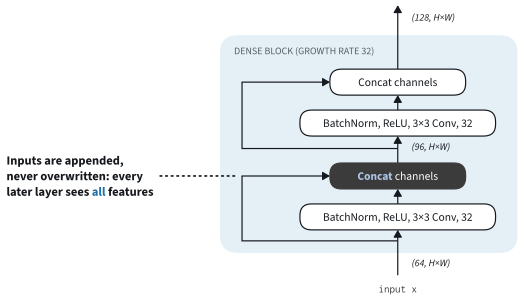
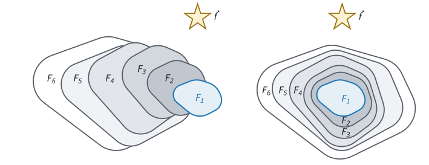
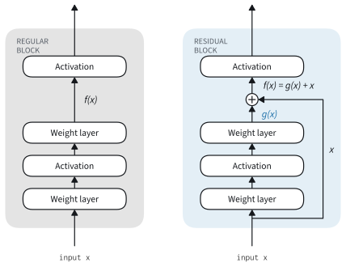
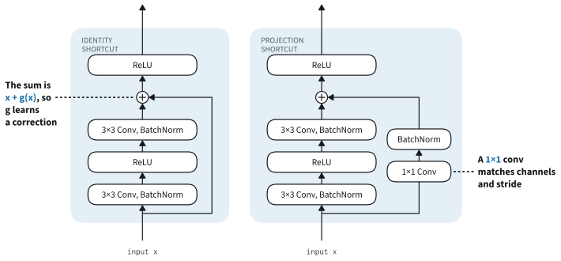
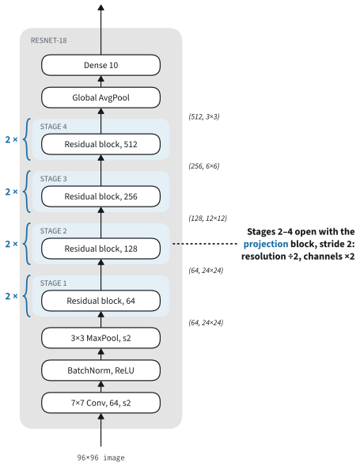
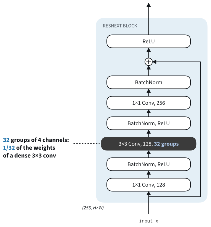

```{.python .input}
%load_ext d2lbook.tab
tab.interact_select('mxnet', 'pytorch', 'tensorflow', 'jax')
```

# Residual Networks
:label:`sec_resnet`

Up to this point on ImageNet, deeper networks consistently meant higher
accuracy—from AlexNet's 8 layers to GoogLeNet's 22—and batch normalization
(:numref:`sec_batch_norm`) seemed to clear the remaining barrier to scaling
depth even further. Naturally, one would expect stacking still more layers to
keep lowering training error, at worst until overfitting sets in. Yet when
:citet:`He.Zhang.Ren.ea.2016` tested this intuition by training *plain*
VGG-style stacks of convolutions with batch normalization and ReLU at
increasing depths, they discovered the exact opposite. On CIFAR-10, a
56-layer plain network finished with a substantially higher *training* error
than a 20-layer network. Because it fits even the training set worse, this
*degradation problem* is not overfitting; it is an optimization failure. The
puzzle is acute: in principle, the 56-layer network could simply copy the
20-layer solution and act as the identity mapping across its remaining 36
layers, guaranteeing a training loss at least as low. Why does SGD fail to
find such a solution, and how can we redesign the building block so it does?

*Residual networks* (ResNets) resolve the paradox with a deceptively simple
reparameterization. Instead of asking each block to learn a full output
transformation from scratch, a residual block adds a learned correction to its
input—so driving the correction to zero immediately recovers the identity
mapping. That single shortcut unlocked unprecedented depth: on ImageNet, where
a 34-layer plain network trailed an 18-layer one, a 34-layer ResNet beat its
18-layer counterpart by nearly three percentage points, and 152-layer ResNets
won the 2015 ImageNet competition.

In this section, we first frame depth through nested function classes and
design the residual block. Next, we reproduce the degradation phenomenon
directly on Fashion-MNIST by training 20- and 56-layer plain and residual
networks side by side, watching degradation appear and vanish before our eyes.
We then assemble and train ResNet-18, and conclude with two influential
descendants: *ResNeXt*, which uses grouped convolutions to widen blocks at
matched cost, and *DenseNet*, which concatenates feature maps rather than
adding them.

```{.python .input #resnet-residual-networks-resnet-and-resnext}
%%tab mxnet
import math
import numpy as np
from mxnet import autograd, gluon, init, np as mnp, npx
from mxnet.gluon import nn
from d2l import mxnet as d2l
npx.set_np()
```

```{.python .input #resnet-residual-networks-resnet-and-resnext}
%%tab pytorch
import math
import numpy as np
import torch
from torch import nn
from torch.nn import functional as F
from d2l import torch as d2l
```

```{.python .input #resnet-residual-networks-resnet-and-resnext}
%%tab tensorflow
import math
import numpy as np
import tensorflow as tf
from d2l import tensorflow as d2l
```

```{.python .input #resnet-residual-networks-resnet-and-resnext}
%%tab jax
import math
import numpy as np
import jax
from jax import numpy as jnp
from flax import nnx
import optax
from d2l import jax as d2l
```

## Function Classes and Depth

Consider the *function class* $\mathcal{F}$ of an architecture—the set of input--output mappings achievable as its parameters vary. When is a larger architecture $\mathcal{F}'$ guaranteed to contain a solution with training loss at least as low as the best in $\mathcal{F}$? Whenever the classes are *nested*, $\mathcal{F} \subseteq \mathcal{F}'$ (:numref:`fig_functionclasses`). If $\mathcal{F} \not\subseteq \mathcal{F}'$, a larger class can drift away from the target $f^*$.


:label:`fig_functionclasses`

Adding a layer nests the function classes whenever the added layer can represent the identity mapping $f(\mathbf{x}) = \mathbf{x}$. A plain block $\mathbf{x} \mapsto \textrm{ReLU}(\textrm{BN}(\mathbf{W}\mathbf{x} + \mathbf{b}))$ *can* represent the identity on nonnegative inputs, so plain networks already lie in the nested right-hand panel of :numref:`fig_functionclasses`—their degradation is not a capacity failure, but an optimization failure: SGD struggles to approximate the identity across dozens of nonlinear layers. A residual block reparameterizes the layer so the identity sits at the origin $g(\mathbf{x}) = 0$ where the residual branch weights vanish.

## Residual Blocks
:label:`subsec_residual-blks`

Instead of learning a target mapping $f(\mathbf{x})$ directly, a residual block (:numref:`fig_residual_block`) learns the *residual* $g(\mathbf{x}) = f(\mathbf{x}) - \mathbf{x}$ and adds the input back through a *shortcut* (or *skip*) connection, outputting $\mathbf{x} + g(\mathbf{x})$. Driving the block to the identity requires only zeroing out the final layer of $g$.


:label:`fig_residual_block`

Shortcuts also create a direct gradient highway. For two stacked blocks $\mathbf{x}_1 = \mathbf{x}_0 + g_1(\mathbf{x}_0)$ and $\mathbf{x}_2 = \mathbf{x}_1 + g_2(\mathbf{x}_1)$, the Jacobian $\partial \mathbf{x}_2 / \partial \mathbf{x}_0 = (\mathbf{I} + \partial g_2 / \partial \mathbf{x}_1)(\mathbf{I} + \partial g_1 / \partial \mathbf{x}_0)$ expands into the identity matrix $\mathbf{I}$ plus branch terms, letting loss gradients reach early blocks without multiplying through every intermediate weight matrix. (From a continuous-time viewpoint, $\mathbf{x}_{l+1} = \mathbf{x}_l + g_l(\mathbf{x}_l)$ is a unit-step Euler discretization of an ODE $\dot{\mathbf{x}} = g(\mathbf{x}, t)$, :numref:`sec_mdl-neural-odes-cnf`.) Note that :citet:`He.Zhang.Ren.ea.2016` verified that batch-normalized plain networks already maintain healthy gradient norms—so residual connections cure degradation even when gradients do not vanish.

Concretely, ResNet's basic `Residual` block stacks two bias-free $3 \times 3$ convolutions with batch normalization and an intermediate ReLU, adds the shortcut input $\mathbf{x}$ to the second batch norm's output, and applies a final ReLU. Setting the second batch norm's $\gamma = \beta = 0$ zeroes out the branch and recovers $\textrm{ReLU}(\mathbf{x}) = \mathbf{x}$ on nonnegative inputs. Whenever `use_1x1conv=True` or `strides != 1` changes channel width or spatial resolution, the shortcut applies a stride-matched $1 \times 1$ convolution and batch normalization so the addition is well defined.

```{.python .input #resnet-residual-blocks-1}
%%tab mxnet
class Residual(nn.HybridBlock):  #@save
    """The Residual block of ResNet models."""
    def __init__(self, num_channels, use_1x1conv=False, strides=1):
        super().__init__()
        # No conv biases: the batch normalization after each conv removes them
        self.conv1 = nn.Conv2D(num_channels, kernel_size=3, padding=1,
                               strides=strides, use_bias=False)
        self.conv2 = nn.Conv2D(num_channels, kernel_size=3, padding=1,
                               use_bias=False)
        # Auto-enable 1x1 conv when downsampling so the residual shape matches.
        if use_1x1conv or strides != 1:
            self.conv3 = nn.Conv2D(num_channels, kernel_size=1,
                                   strides=strides, use_bias=False)
            self.bn3 = nn.BatchNorm()
        else:
            self.conv3 = None
        self.bn1 = nn.BatchNorm()
        self.bn2 = nn.BatchNorm()

    def forward(self, X):
        Y = npx.relu(self.bn1(self.conv1(X)))
        Y = self.bn2(self.conv2(Y))
        if self.conv3:
            X = self.bn3(self.conv3(X))
        return npx.relu(Y + X)
```

```{.python .input #resnet-residual-blocks-1}
%%tab pytorch
class Residual(nn.Module):  #@save
    """The Residual block of ResNet models."""
    def __init__(self, num_channels, use_1x1conv=False, strides=1):
        super().__init__()
        # No conv biases: the batch normalization after each conv removes them
        self.conv1 = nn.LazyConv2d(num_channels, kernel_size=3, padding=1,
                                   stride=strides, bias=False)
        self.conv2 = nn.LazyConv2d(num_channels, kernel_size=3, padding=1,
                                   bias=False)
        # Auto-enable 1x1 conv when downsampling so the residual shape matches.
        if use_1x1conv or strides != 1:
            self.conv3 = nn.LazyConv2d(num_channels, kernel_size=1,
                                       stride=strides, bias=False)
            self.bn3 = nn.LazyBatchNorm2d()
        else:
            self.conv3 = None
        self.bn1 = nn.LazyBatchNorm2d()
        self.bn2 = nn.LazyBatchNorm2d()

    def forward(self, X):
        Y = F.relu(self.bn1(self.conv1(X)))
        Y = self.bn2(self.conv2(Y))
        if self.conv3:
            X = self.bn3(self.conv3(X))
        Y += X
        return F.relu(Y)
```

```{.python .input #resnet-residual-blocks-1}
%%tab tensorflow
class Residual(tf.keras.Model):  #@save
    """The Residual block of ResNet models."""
    def __init__(self, num_channels, use_1x1conv=False, strides=1):
        super().__init__()
        # He initialization, one initializer instance per layer
        he = lambda: tf.keras.initializers.VarianceScaling(
            2.0, 'fan_in', 'untruncated_normal')
        # No conv biases: the batch normalization after each conv removes
        # them. conv1 pads 1 on every side: 'same' pads only right and bottom
        # when the stride is 2 and the sizes are even
        self.conv1 = tf.keras.Sequential([
            tf.keras.layers.ZeroPadding2D(1),
            tf.keras.layers.Conv2D(num_channels, kernel_size=3,
                                   strides=strides, use_bias=False,
                                   kernel_initializer=he())])
        self.conv2 = tf.keras.layers.Conv2D(num_channels, kernel_size=3,
            padding='same', use_bias=False, kernel_initializer=he())
        # Running averages decay 0.9 and epsilon 1e-5 (the Keras defaults are
        # 0.99 and 1e-3)
        bn = lambda: tf.keras.layers.BatchNormalization(momentum=0.9,
                                                        epsilon=1e-5)
        self.conv3 = None
        # Auto-enable 1x1 conv when downsampling so the residual shape matches.
        if use_1x1conv or strides != 1:
            self.conv3 = tf.keras.layers.Conv2D(num_channels, kernel_size=1,
                strides=strides, use_bias=False, kernel_initializer=he())
            self.bn3 = bn()
        self.bn1, self.bn2 = bn(), bn()

    def call(self, X):
        Y = tf.keras.activations.relu(self.bn1(self.conv1(X)))
        Y = self.bn2(self.conv2(Y))
        if self.conv3 is not None:
            X = self.bn3(self.conv3(X))
        Y += X
        return tf.keras.activations.relu(Y)
```

```{.python .input #resnet-residual-blocks-1}
%%tab jax
class Residual(nnx.Module):  #@save
    """The Residual block of ResNet models."""
    def __init__(self, num_channels, use_1x1conv=False, strides=(1, 1),
                 in_channels=None, rngs=None):
        in_channels = num_channels if in_channels is None else in_channels
        strides = (strides, strides) if isinstance(strides, int) else strides
        rngs = nnx.Rngs(d2l.get_key()) if rngs is None else rngs
        # He initialization; no conv biases, since the batch normalization
        # after each conv removes them
        he = nnx.initializers.variance_scaling(2.0, 'fan_in', 'normal')
        # padding=1 on every side: 'SAME' pads only right and bottom when the
        # stride is 2 and the sizes are even
        self.conv1 = nnx.Conv(in_channels, num_channels, kernel_size=(3, 3),
                              padding=1, strides=strides, use_bias=False,
                              kernel_init=he, rngs=rngs)
        self.conv2 = nnx.Conv(num_channels, num_channels, kernel_size=(3, 3),
                              padding='same', use_bias=False,
                              kernel_init=he, rngs=rngs)
        # Running averages decay 0.9 and a two-pass variance (the Flax
        # defaults are 0.99 and a one-pass variance)
        bn = lambda: nnx.BatchNorm(num_channels, momentum=0.9,
                                   use_fast_variance=False, rngs=rngs)
        # Auto-enable 1x1 conv when downsampling so the residual shape matches.
        if use_1x1conv or any(s != 1 for s in strides):
            self.conv3 = nnx.Conv(in_channels, num_channels,
                                  kernel_size=(1, 1), strides=strides,
                                  use_bias=False, kernel_init=he, rngs=rngs)
            self.bn3 = bn()
        else:
            self.conv3 = None
        self.bn1, self.bn2 = bn(), bn()

    def __call__(self, X):
        Y = nnx.relu(self.bn1(self.conv1(X)))
        Y = self.bn2(self.conv2(Y))
        if self.conv3:
            X = self.bn3(self.conv3(X))
        Y += X
        return nnx.relu(Y)
```

:begin_tab:`jax`
NNX layers need the number of input channels when they are constructed, so
the JAX `Residual` takes `in_channels`, which defaults to `num_channels`.
:end_tab:

:numref:`fig_resnet_block` diagrams both configurations; passing
`use_1x1conv=True` or setting a stride greater than 1 activates the projection
shortcut on the right.


:label:`fig_resnet_block`

Let us verify the output shapes. With matching input and output channel counts
and stride 1, the block preserves the `(4, 3, 6, 6)` tensor shape.

```{.python .input #resnet-residual-blocks-2}
%%tab mxnet
blk = Residual(3)
blk.initialize()
X = d2l.randn(4, 3, 6, 6)
blk(X).shape
```

```{.python .input #resnet-residual-blocks-2}
%%tab pytorch
blk = Residual(3)
X = d2l.randn(4, 3, 6, 6)
blk(X).shape
```

```{.python .input #resnet-residual-blocks-2}
%%tab tensorflow
blk = Residual(3)
X = d2l.normal((4, 6, 6, 3))
blk(X).shape
```

```{.python .input #resnet-residual-blocks-2}
%%tab jax
blk = Residual(3)
X = jax.random.normal(d2l.get_key(), (4, 6, 6, 3))
blk(X).shape
```

Setting `num_channels=6`, `use_1x1conv=True`, and `strides=2` doubles the
channels while halving both height and width—the exact downsampling block that
opens stages 2, 3, and 4 of ResNet below.

```{.python .input #resnet-residual-blocks-3}
%%tab mxnet
blk = Residual(6, use_1x1conv=True, strides=2)
blk.initialize()
blk(X).shape
```

```{.python .input #resnet-residual-blocks-3}
%%tab pytorch
blk = Residual(6, use_1x1conv=True, strides=2)
blk(X).shape
```

```{.python .input #resnet-residual-blocks-3}
%%tab tensorflow
blk = Residual(6, use_1x1conv=True, strides=2)
blk(X).shape
```

```{.python .input #resnet-residual-blocks-3}
%%tab jax
blk = Residual(6, use_1x1conv=True, strides=(2, 2), in_channels=3)
blk(X).shape
```

## Plain and Residual Networks Compared
:label:`subsec_plain_residual`

Can we reproduce the degradation problem directly on Fashion-MNIST and watch
residual shortcuts eliminate it? To run a clean controlled test, we construct
two network families that differ *solely* in the presence or absence of
shortcut connections. Adapting the CIFAR-10 design of
:citet:`He.Zhang.Ren.ea.2016` to Fashion-MNIST's native $28 \times 28$ images
keeps deep training fast. A *plain block* mirrors `Residual` layer for layer
without the bypass addition: two $3 \times 3$ convolutions, each followed by
batch normalization and ReLU.

```{.python .input #resnet-plain-and-residual-networks-compared-1}
%%tab mxnet
def plain_block(num_channels, strides=1):
    """The layers of `Residual` without the shortcut."""
    blk = nn.HybridSequential()
    blk.add(nn.Conv2D(num_channels, kernel_size=3, padding=1,
                      strides=strides, use_bias=False),
            nn.BatchNorm(), nn.Activation('relu'),
            nn.Conv2D(num_channels, kernel_size=3, padding=1, use_bias=False),
            nn.BatchNorm(), nn.Activation('relu'))
    return blk
```

```{.python .input #resnet-plain-and-residual-networks-compared-1}
%%tab pytorch
def plain_block(num_channels, strides=1):
    """The layers of `Residual` without the shortcut."""
    return nn.Sequential(
        nn.LazyConv2d(num_channels, kernel_size=3, padding=1, stride=strides,
                      bias=False), nn.LazyBatchNorm2d(), nn.ReLU(),
        nn.LazyConv2d(num_channels, kernel_size=3, padding=1, bias=False),
        nn.LazyBatchNorm2d(), nn.ReLU())
```

```{.python .input #resnet-plain-and-residual-networks-compared-1}
%%tab tensorflow
def he_init():  # He initialization; Keras needs one instance per layer
    return tf.keras.initializers.VarianceScaling(2.0, 'fan_in',
                                                 'untruncated_normal')

def plain_block(num_channels, strides=1):
    """The layers of `Residual` without the shortcut."""
    bn = lambda: tf.keras.layers.BatchNormalization(momentum=0.9,
                                                    epsilon=1e-5)
    return tf.keras.Sequential([
        tf.keras.layers.ZeroPadding2D(1),  # Pad every side, as in Residual
        tf.keras.layers.Conv2D(num_channels, kernel_size=3, strides=strides,
                               use_bias=False, kernel_initializer=he_init()),
        bn(), tf.keras.layers.ReLU(),
        tf.keras.layers.Conv2D(num_channels, kernel_size=3, padding='same',
                               use_bias=False, kernel_initializer=he_init()),
        bn(), tf.keras.layers.ReLU()])
```

```{.python .input #resnet-plain-and-residual-networks-compared-1}
%%tab jax
def plain_block(num_channels, strides, in_channels, rngs):
    """The layers of `Residual` without the shortcut."""
    he = nnx.initializers.variance_scaling(2.0, 'fan_in', 'normal')
    bn = lambda: nnx.BatchNorm(num_channels, momentum=0.9,
                               use_fast_variance=False, rngs=rngs)
    return nnx.Sequential(
        nnx.Conv(in_channels, num_channels, kernel_size=(3, 3), padding=1,
                 strides=strides, use_bias=False, kernel_init=he, rngs=rngs),
        bn(), nnx.relu,
        nnx.Conv(num_channels, num_channels, kernel_size=(3, 3), padding=1,
                 use_bias=False, kernel_init=he, rngs=rngs),
        bn(), nnx.relu)
```

Each network begins with a 16-channel $3 \times 3$ convolution, batch
normalization, and ReLU, followed by three stages of $n$ blocks with 16, 32,
and 64 channels (where the first block of stages 2 and 3 downsamples with
stride 2), and terminates in global average pooling and a linear classifier.
Counting the stem, two convolutions per block, and the linear head yields
$6n + 2$ layers in total: 20 layers for $n = 3$ and 56 layers for $n = 9$.
Passing either `plain_block` or `Residual` as `block` builds the matched pair.
As before, we initialize all weights with He initialization
(:numref:`subsec_he_init`) and train using `d2l.cosine_warmup`
(:numref:`sec_alexnet`) with peak learning rate 0.1—a rate that destabilized
unnormalized networks in :numref:`sec_blocks` but trains smoothly here thanks
to batch normalization after every convolution (:numref:`sec_batch_norm`).

```{.python .input #resnet-plain-and-residual-networks-compared-2}
%%tab mxnet
class DeepNet(d2l.Classifier):
    """6n + 2 layers: a 3x3 stem, three stages of n blocks, a linear head."""
    def __init__(self, block, n, lr=0.1, num_steps=2345, num_classes=10):
        super().__init__()
        self.save_hyperparameters(ignore=['block'])
        self.net = nn.HybridSequential()
        self.net.add(nn.Conv2D(16, kernel_size=3, padding=1, use_bias=False),
                     nn.BatchNorm(), nn.Activation('relu'))
        for i, num_channels in enumerate((16, 32, 64)):
            for j in range(n):  # The first block of stages 2 and 3 downsamples
                strides = 2 if i > 0 and j == 0 else 1
                self.net.add(block(num_channels, strides=strides))
        self.net.add(nn.GlobalAvgPool2D(), nn.Dense(num_classes))
        self.net.initialize(init.MSRAPrelu('in', 0))  # He initialization
        self.net.hybridize()  # Compile the network into one graph

    def configure_optimizers(self):
        # MXNet counts the steps from 1
        schedule = lambda t: self.lr * d2l.cosine_warmup(
            t - 1, self.num_steps, self.num_steps // 10)
        return gluon.Trainer(self.collect_params(), 'sgd', {
            'learning_rate': None, 'lr_scheduler': schedule})
```

```{.python .input #resnet-plain-and-residual-networks-compared-2}
%%tab pytorch
class DeepNet(d2l.Classifier):
    """6n + 2 layers: a 3x3 stem, three stages of n blocks, a linear head."""
    def __init__(self, block, n, lr=0.1, num_steps=2345, num_classes=10):
        super().__init__()
        self.save_hyperparameters(ignore=['block'])
        layers = [nn.LazyConv2d(16, kernel_size=3, padding=1, bias=False),
                  nn.LazyBatchNorm2d(), nn.ReLU()]
        for i, num_channels in enumerate((16, 32, 64)):
            for j in range(n):  # The first block of stages 2 and 3 downsamples
                strides = 2 if i > 0 and j == 0 else 1
                layers.append(block(num_channels, strides=strides))
        layers += [nn.AdaptiveAvgPool2d((1, 1)), nn.Flatten(),
                   nn.LazyLinear(num_classes)]
        self.net = nn.Sequential(*layers)

    def weight_init(self, module):
        # The Trainer calls this after the first minibatch fixed the shapes
        if type(module) in (nn.Linear, nn.Conv2d):
            nn.init.kaiming_normal_(module.weight, nonlinearity='relu')  # He
            if module.bias is not None:
                nn.init.zeros_(module.bias)

    def configure_optimizers(self):
        optim = torch.optim.SGD(self.parameters(), lr=self.lr)
        schedule = torch.optim.lr_scheduler.LambdaLR(optim, lambda t: (
            d2l.cosine_warmup(t, self.num_steps, self.num_steps // 10)))
        return optim, schedule  # The Trainer steps it after every minibatch
```

```{.python .input #resnet-plain-and-residual-networks-compared-2}
%%tab tensorflow
class DeepNet(d2l.Classifier):
    """6n + 2 layers: a 3x3 stem, three stages of n blocks, a linear head."""
    def __init__(self, block, n, lr=0.1, num_steps=2345, num_classes=10):
        super().__init__()
        self.save_hyperparameters(ignore=['block'])
        self.net = tf.keras.Sequential([
            tf.keras.layers.Conv2D(16, kernel_size=3, padding='same',
                use_bias=False, kernel_initializer=he_init()),
            tf.keras.layers.BatchNormalization(momentum=0.9, epsilon=1e-5),
            tf.keras.layers.ReLU()])
        for i, num_channels in enumerate((16, 32, 64)):
            for j in range(n):  # The first block of stages 2 and 3 downsamples
                strides = 2 if i > 0 and j == 0 else 1
                self.net.add(block(num_channels, strides=strides))
        self.net.add(tf.keras.layers.GlobalAvgPool2D())
        self.net.add(tf.keras.layers.Dense(num_classes,
                                           kernel_initializer=he_init()))

    def configure_optimizers(self):
        schedule = lambda: self.lr * d2l.cosine_warmup(
            optim.iterations, self.num_steps, self.num_steps // 10)
        optim = tf.keras.optimizers.SGD(schedule)
        return optim
```

```{.python .input #resnet-plain-and-residual-networks-compared-2}
%%tab jax
class DeepNet(d2l.Classifier):
    """6n + 2 layers: a 3x3 stem, three stages of n blocks, a linear head."""
    def __init__(self, block, n, lr=0.1, num_steps=2345, num_classes=10,
                 rngs=None):
        super().__init__()
        self.save_hyperparameters(ignore=['block', 'rngs'])
        rngs = nnx.Rngs(d2l.get_key()) if rngs is None else rngs
        he = nnx.initializers.variance_scaling(2.0, 'fan_in', 'normal')
        # Fashion-MNIST images have one channel
        layers = [nnx.Conv(1, 16, kernel_size=(3, 3), padding=1,
                           use_bias=False, kernel_init=he, rngs=rngs),
                  nnx.BatchNorm(16, momentum=0.9, use_fast_variance=False,
                                rngs=rngs), nnx.relu]
        in_channels = 16
        for i, num_channels in enumerate((16, 32, 64)):
            for j in range(n):  # The first block of stages 2 and 3 downsamples
                strides = 2 if i > 0 and j == 0 else 1
                layers.append(block(num_channels, strides=strides,
                                         in_channels=in_channels, rngs=rngs))
                in_channels = num_channels
        layers += [global_avg_pool,
                   nnx.Linear(64, num_classes, kernel_init=he, rngs=rngs)]
        self.net = nnx.Sequential(*layers)

    def configure_optimizers(self):
        return optax.sgd(lambda t: self.lr * d2l.cosine_warmup(
            t, self.num_steps, self.num_steps // 10))

def global_avg_pool(X):  # Average over height and width (NHWC)
    return X.mean(axis=(1, 2))
```

:begin_tab:`mxnet`
`init.MSRAPrelu('in', 0)` is MXNet's name for He initialization. The network
is built from `HybridBlock`s, and `hybridize()` compiles it into a single
graph, which MXNet executes several times faster than one operator at a time.
:end_tab:

:begin_tab:`pytorch`
As for LeNet in :numref:`sec_lenet`, the Trainer calls the model's
`weight_init` once the first minibatch has fixed the shapes of the lazy
layers. It applies He initialization (`kaiming_normal_`) to every
convolutional and fully connected layer, including those inside the
`Residual` blocks.
:end_tab:

:begin_tab:`tensorflow`
`VarianceScaling(2.0, 'fan_in', 'untruncated_normal')` is He
initialization. Keras initializers without a seed repeat their values when
one instance is shared, so every layer gets its own; `Residual` does the
same internally.
:end_tab:

:begin_tab:`jax`
NNX layers draw their weights when they are constructed, so every layer,
including those inside `Residual`, receives He initialization
(`variance_scaling(2.0, 'fan_in', 'normal')`) as its `kernel_init`.
:end_tab:

We train all four configurations—plain vs. residual at 20 and 56 layers—for
five epochs with batch size 128 and record their full training histories.

```{.python .input #resnet-plain-and-residual-networks-compared-3}
data = d2l.FashionMNIST(batch_size=128)
num_steps = 5 * len(data.train_dataloader())
history = {}
for name, block in (('plain', plain_block), ('residual', Residual)):
    for n in (3, 9):
        model = DeepNet(block, n, lr=0.1, num_steps=num_steps)
        trainer = d2l.Trainer(max_epochs=5, num_gpus=1)
        trainer.board.display = False  # We plot the losses ourselves
        trainer.fit(model, data)
        history[f'{name}, {6 * n + 2} layers'] = trainer.history
```

Let us overlay all four training loss curves on a logarithmic y-axis (blue for
20 layers, red for 56 layers; dashed for plain networks, solid for residual
networks).

```{.python .input #resnet-plain-and-residual-networks-compared-4}
d2l.plot(list(range(1, 6)), [h['train_loss'] for h in history.values()],
         'epoch', 'training loss', legend=list(history), yscale='log',
         fmts=('b--', 'r--', 'b-', 'r-'))
```

```{.python .input #resnet-plain-and-residual-networks-compared-5}
{name: (round(h['train_loss'][-1], 3), round(h['val_acc'][-1], 3))
 for name, h in history.items()}  # Training loss, validation accuracy
```

The degradation phenomenon appears unmistakably in the plain networks. The
56-layer plain network finishes with a training loss around 0.25--0.30—higher
than the 20-layer plain network's ~0.20—and sits strictly *above* the
shallower curve at every single epoch. Because its training loss is worse,
overfitting is ruled out. Turning on residual shortcuts flips the ordering
completely: the 56-layer residual network drops to roughly 0.15--0.17,
outperforming both 20-layer networks (which end near 0.19 with or without
shortcuts). At 20 layers, shortcuts barely register; at 56 layers, they
determine whether 36 additional layers hinder optimization or improve it.
Since these four runs vary only depth and shortcut connections, the shortcut
is unambiguously responsible. Validation accuracy mirrors the pattern more
gently: the 56-layer plain network trails at 88--90%, while the other three
cluster tightly around 90.5--91.5% after five epochs.

## ResNet-18

### Stem, Stages, and Head

At full ImageNet scale, ResNet adopts the stem--body--head architecture
established by GoogLeNet (:numref:`sec_googlenet`). Its *stem* opens with a
64-channel $7 \times 7$ convolution of stride 2, batch normalization, ReLU,
and $3 \times 3$ max-pooling of stride 2, cutting spatial dimensions fourfold
right away. Below, `ResNet.stem` builds this entry module.

```{.python .input #resnet-resnet-model-1}
%%tab mxnet
class ResNet(d2l.Classifier):
    def stem(self):
        net = nn.HybridSequential()
        net.add(nn.Conv2D(64, kernel_size=7, strides=2, padding=3,
                          use_bias=False),
                nn.BatchNorm(), nn.Activation('relu'),
                nn.MaxPool2D(pool_size=3, strides=2, padding=1))
        return net
```

```{.python .input #resnet-resnet-model-1}
%%tab pytorch
class ResNet(d2l.Classifier):
    def stem(self):
        return nn.Sequential(
            nn.LazyConv2d(64, kernel_size=7, stride=2, padding=3, bias=False),
            nn.LazyBatchNorm2d(), nn.ReLU(),
            nn.MaxPool2d(kernel_size=3, stride=2, padding=1))

    weight_init = DeepNet.weight_init  # He initialization
```

```{.python .input #resnet-resnet-model-1}
%%tab tensorflow
class ResNet(d2l.Classifier):
    def stem(self):
        return tf.keras.models.Sequential([
            tf.keras.layers.ZeroPadding2D(3),  # Pad every side
            tf.keras.layers.Conv2D(64, kernel_size=7, strides=2,
                                   use_bias=False,
                                   kernel_initializer=he_init()),
            tf.keras.layers.BatchNormalization(momentum=0.9, epsilon=1e-5),
            tf.keras.layers.Activation('relu'),
            tf.keras.layers.ZeroPadding2D(1),  # Zeros are safe after a ReLU
            tf.keras.layers.MaxPool2D(pool_size=3, strides=2)])
```

```{.python .input #resnet-resnet-model-1}
%%tab jax
class ResNet(d2l.Classifier):
    def __init__(self, arch, lr=0.1, num_steps=4690, num_classes=10,
                 in_channels=1, rngs=None):
        super().__init__()
        self.save_hyperparameters(ignore=['rngs'])
        rngs = nnx.Rngs(d2l.get_key()) if rngs is None else rngs
        self.net = self.create_net(in_channels, rngs)

    def stem(self, in_channels, rngs):
        he = nnx.initializers.variance_scaling(2.0, 'fan_in', 'normal')
        return nnx.Sequential(
            nnx.Conv(in_channels, 64, kernel_size=(7, 7), strides=(2, 2),
                     padding=3, use_bias=False, kernel_init=he, rngs=rngs),
            nnx.BatchNorm(64, momentum=0.9, use_fast_variance=False,
                          rngs=rngs), nnx.relu, max_pool)

def max_pool(X):  # 3x3 windows, stride 2, padding 1 on every side
    return nnx.max_pool(X, window_shape=(3, 3), strides=(2, 2),
                        padding=((1, 1), (1, 1)))
```

The *body* consists of four *stages*, each stacking `num_residuals` residual
blocks at a fixed channel width. Because the stem has already downsampled the
input fourfold, stage 1 keeps its resolution and 64 channels intact; every
subsequent stage opens with a stride-2 projection block that halves height and
width while doubling channel count. The `stage` method constructs one such
stage.

```{.python .input #resnet-resnet-model-2}
%%tab mxnet
@d2l.add_to_class(ResNet)
def stage(self, num_residuals, num_channels, first_block=False):
    blk = nn.HybridSequential()
    for i in range(num_residuals):
        if i == 0 and not first_block:
            blk.add(Residual(num_channels, use_1x1conv=True, strides=2))
        else:
            blk.add(Residual(num_channels))
    return blk
```

```{.python .input #resnet-resnet-model-2}
%%tab pytorch
@d2l.add_to_class(ResNet)
def stage(self, num_residuals, num_channels, first_block=False):
    blk = []
    for i in range(num_residuals):
        if i == 0 and not first_block:
            blk.append(Residual(num_channels, use_1x1conv=True, strides=2))
        else:
            blk.append(Residual(num_channels))
    return nn.Sequential(*blk)
```

```{.python .input #resnet-resnet-model-2}
%%tab tensorflow
@d2l.add_to_class(ResNet)
def stage(self, num_residuals, num_channels, first_block=False):
    blk = tf.keras.models.Sequential()
    for i in range(num_residuals):
        if i == 0 and not first_block:
            blk.add(Residual(num_channels, use_1x1conv=True, strides=2))
        else:
            blk.add(Residual(num_channels))
    return blk
```

```{.python .input #resnet-resnet-model-2}
%%tab jax
@d2l.add_to_class(ResNet)
def stage(self, num_residuals, num_channels, in_channels,
          first_block=False, rngs=None):
    blk = []
    for i in range(num_residuals):
        if i == 0 and not first_block:
            blk.append(Residual(num_channels, use_1x1conv=True,
                                strides=(2, 2), in_channels=in_channels,
                                rngs=rngs))
        else:
            blk.append(Residual(num_channels, in_channels=in_channels,
                                rngs=rngs))
        in_channels = num_channels
    return nnx.Sequential(*blk)
```

Rounding out the model, the *head* follows NiN and GoogLeNet: global average
pooling followed by a single linear classifier layer. Just like `VGG`, the
`arch` argument specifies `(num_residuals, num_channels)` for each stage, all
convolutional and linear weights use He initialization, and the lone bias in
the output layer starts at zero.

```{.python .input #resnet-resnet-model-3}
%%tab mxnet
@d2l.add_to_class(ResNet)
def __init__(self, arch, lr=0.1, num_steps=4690, num_classes=10):
    super(ResNet, self).__init__()
    self.save_hyperparameters()
    self.net = nn.HybridSequential()
    self.net.add(self.stem())
    for i, b in enumerate(arch):
        self.net.add(self.stage(*b, first_block=(i==0)))
    self.net.add(nn.GlobalAvgPool2D(), nn.Dense(num_classes))
    self.net.initialize(init.MSRAPrelu('in', 0))  # He initialization
    self.net.hybridize()  # Compile the network into one graph
```

```{.python .input #resnet-resnet-model-3}
%%tab pytorch
@d2l.add_to_class(ResNet)
def __init__(self, arch, lr=0.1, num_steps=4690, num_classes=10):
    super(ResNet, self).__init__()
    self.save_hyperparameters()
    self.net = nn.Sequential(self.stem())
    for i, b in enumerate(arch):
        self.net.add_module(f'stage{i+1}', self.stage(*b, first_block=(i==0)))
    self.net.add_module('head', nn.Sequential(
        nn.AdaptiveAvgPool2d((1, 1)), nn.Flatten(),
        nn.LazyLinear(num_classes)))
```

```{.python .input #resnet-resnet-model-3}
%%tab tensorflow
@d2l.add_to_class(ResNet)
def __init__(self, arch, lr=0.1, num_steps=4690, num_classes=10):
    super(ResNet, self).__init__()
    self.save_hyperparameters()
    self.net = self.stem()
    for i, b in enumerate(arch):
        self.net.add(self.stage(*b, first_block=(i==0)))
    self.net.add(tf.keras.models.Sequential([
        tf.keras.layers.GlobalAvgPool2D(),
        tf.keras.layers.Dense(num_classes, kernel_initializer=he_init())]))
```

```{.python .input #resnet-resnet-model-3}
%%tab jax
@d2l.add_to_class(ResNet)
def create_net(self, in_channels, rngs):
    layers = [self.stem(in_channels, rngs)]
    stage_channels = 64
    for i, (num_residuals, num_channels) in enumerate(self.arch):
        layers.append(self.stage(num_residuals, num_channels, stage_channels,
                                 first_block=(i == 0), rngs=rngs))
        stage_channels = num_channels
    layers.append(nnx.Sequential(
        global_avg_pool,
        nnx.Linear(stage_channels, self.num_classes, rngs=rngs,
                   kernel_init=nnx.initializers.variance_scaling(
                       2.0, 'fan_in', 'normal'))))
    return nnx.Sequential(*layers)
```

Placing two residual blocks in each of the four stages yields *ResNet-18*:
four stages $\times$ four $3 \times 3$ convolutions (excluding the $1 \times 1$
shortcut projections) plus the $7 \times 7$ stem convolution and the final
linear layer add up to 18 parameterized layers. ResNet-34 uses `(3, 4, 6, 3)`
blocks per stage, while deeper members (ResNet-50, -101, and -152) swap in
three-layer *bottleneck* blocks ($1 \times 1 \to 3 \times 3 \to 1 \times 1$),
which coincide with the single-group case of the ResNeXt block introduced
below. :numref:`fig_resnet18` diagrams ResNet-18 end to end.


:label:`fig_resnet18`

```{.python .input #resnet-resnet-model-4}
%%tab mxnet, pytorch, tensorflow
class ResNet18(ResNet):
    def __init__(self, lr=0.1, num_steps=4690, num_classes=10):
        super().__init__(((2, 64), (2, 128), (2, 256), (2, 512)),
                         lr, num_steps, num_classes)
```

```{.python .input #resnet-resnet-model-4}
%%tab jax
class ResNet18(ResNet):
    def __init__(self, lr=0.1, num_steps=4690, num_classes=10, in_channels=1,
                 rngs=None):
        super().__init__(((2, 64), (2, 128), (2, 256), (2, 512)),
                         lr, num_steps, num_classes, in_channels, rngs)
```

Let us trace the tensor shapes of a single-channel $96 \times 96$ image
through ResNet-18 as resolution steps down and channel width expands toward
global average pooling.

```{.python .input #resnet-resnet-model-5}
%%tab mxnet, pytorch
ResNet18().layer_summary((1, 1, 96, 96))
```

```{.python .input #resnet-resnet-model-5}
%%tab tensorflow
ResNet18().layer_summary((1, 96, 96, 1))
```

```{.python .input #resnet-resnet-model-5}
%%tab jax
ResNet18().layer_summary((1, 96, 96, 1))
```

### Training

We now train `ResNet18` on Fashion-MNIST resized to $96 \times 96$ for 10
epochs with batch size 128, reusing `DeepNet`'s cosine warmup optimizer and
peak learning rate of 0.1.

```{.python .input #resnet-training-schedule}
ResNet.configure_optimizers = DeepNet.configure_optimizers  # Same schedule
```

```{.python .input #resnet-training}
data = d2l.FashionMNIST(batch_size=128, resize=(96, 96))
model = ResNet18(lr=0.1, num_steps=10 * len(data.train_dataloader()))
trainer = d2l.Trainer(max_epochs=10, num_gpus=1)
trainer.fit(model, data)
```

```{.python .input #resnet-training-readout}
round(trainer.history['val_acc'][-1], 3)  # Validation accuracy after 10 epochs
```

After 10 epochs, ResNet-18 reaches roughly 93% validation accuracy (varying by
less than a point across the final three epochs)—matching the quarter-width
VGG from :numref:`sec_blocks` with only a quarter as many parameters and at
$96 \times 96$ instead of $224 \times 224$ pixels. As always, we should be
careful not to over-interpret a single cross-family comparison where
architecture, normalization, and input resolution all changed together; the
clean proof of the residual connection's value lives in the paired 20- vs.
56-layer experiment of :numref:`subsec_plain_residual`.

Notice also a classic sign of overfitting: ResNet-18 drives training loss
below 0.01 while validation loss plateaus around 0.27 after the first few
epochs. With 11.2 million parameters trained on 60,000 grayscale garments,
memorizing the training set is easy; closing that generalization gap requires
stronger data augmentation and regularization, which we tackle systematically
in :numref:`sec_training_recipes`.

## ResNeXt and DenseNet

Residual connections specify *how* a block forwards its input—by adding it to
the block's learned transformation. Two prominent successors preserve the
spirit of shortcut wiring while modifying the block itself: *ResNeXt*
redesigns the block's internal convolutions to increase channel width without
raising compute, while *DenseNet* replaces additive shortcuts with channel
concatenation. We will revisit the ResNeXt block when exploring systematic
network design spaces in :numref:`sec_cnn-design`.

### ResNeXt
:label:`subsec_resnext`

Wider layers learn richer representations, yet the cost of a standard
convolution mapping $c_\textrm{i}$ channels to $c_\textrm{o}$ channels grows
with $c_\textrm{i} c_\textrm{o}$ (:numref:`sec_channels`), so doubling width
quadruples both weights and arithmetic. *ResNeXt*
:cite:`Xie.Girshick.Dollar.ea.2017` adapts GoogLeNet's multi-branch Inception
idea (:numref:`sec_googlenet`) into a completely uniform structure where every
branch has the exact same topology.

Specifically, a *grouped convolution* divides the $c_\textrm{i}$ input
channels into $g$ disjoint groups of $c_\textrm{i}/g$ channels and convolves
each group independently into $c_\textrm{o}/g$ output channels (assuming $g$
divides both $c_\textrm{i}$ and $c_\textrm{o}$). Each group requires a kernel
of size $(c_\textrm{i}/g) \times (c_\textrm{o}/g) \times k \times k$, reducing
total parameters and multiply-adds across all $g$ groups by a factor of $g$,
from $c_\textrm{i} c_\textrm{o} k^2$ down to $c_\textrm{i} c_\textrm{o} k^2 / g$.
(In practice, wall-clock speedup is typically less than $g$ because memory
traffic does not shrink at the same rate as arithmetic, a distinction we
examine in :numref:`sec_efficient_cnns`.) Historically, grouped convolutions
made their debut in AlexNet :cite:`Krizhevsky.Sutskever.Hinton.2012`, which
partitioned three of its five convolutional layers into two groups to fit
across two GPUs.

Because independent groups cannot exchange information on their own, the
ResNeXt block (:numref:`fig_resnext_block`) sandwiches a grouped $3 \times 3$
convolution between two dense $1 \times 1$ convolutions: the first projects
$c$ input channels to $b$ *bottleneck* channels, and the second projects back
to $c$ channels, mixing across all groups. The two $1 \times 1$ layers use
$2cb$ weights and the grouped $3 \times 3$ layer uses $9b^2/g$. When
downsampling, the stride-2 step sits on the $3 \times 3$ convolution rather
than the first $1 \times 1$ projection, and the shortcut matches `Residual`.

To see what "wider at matched cost" looks like numerically, compare a standard
ResNet-50 bottleneck block ($c = 256$, $b = 64$, $g = 1$), which uses
$2 \cdot 256 \cdot 64 + 9 \cdot 64^2 = 69{,}632$ weights, against the ResNeXt
block in :numref:`fig_resnext_block` ($b = 128$, $g = 32$), which uses
$2 \cdot 256 \cdot 128 + 9 \cdot 128^2/32 = 70{,}144$ weights—doubling the
internal bottleneck width for less than 1% extra weights. On ImageNet, this
simple trade drops ResNet-50's top-1 error from 23.9% to 22.2%
:cite:`Xie.Girshick.Dollar.ea.2017`.


:label:`fig_resnext_block`

Below, `ResNeXtBlock` accepts the output width `num_channels` ($c$), the group
count `groups` ($g$), and the bottleneck ratio `bot_mul` ($b/c$). Just as in
`Residual`, passing `strides=2` halves height and width and automatically
enables the $1 \times 1$ shortcut projection.

```{.python .input #resnet-resnext-1}
%%tab mxnet
class ResNeXtBlock(nn.HybridBlock):  #@save
    """The ResNeXt block."""
    def __init__(self, num_channels, groups, bot_mul,
                 use_1x1conv=False, strides=1):
        super().__init__()
        bot_channels = int(round(num_channels * bot_mul))
        # No conv biases: the batch normalization after each conv removes them
        self.conv1 = nn.Conv2D(bot_channels, kernel_size=1, padding=0,
                               strides=1, use_bias=False)
        self.conv2 = nn.Conv2D(bot_channels, kernel_size=3, padding=1,
                               strides=strides, groups=groups, use_bias=False)
        self.conv3 = nn.Conv2D(num_channels, kernel_size=1, padding=0,
                               strides=1, use_bias=False)
        self.bn1 = nn.BatchNorm()
        self.bn2 = nn.BatchNorm()
        self.bn3 = nn.BatchNorm()
        # Auto-enable 1x1 conv when downsampling so the residual shape matches.
        if use_1x1conv or strides != 1:
            self.conv4 = nn.Conv2D(num_channels, kernel_size=1,
                                   strides=strides, use_bias=False)
            self.bn4 = nn.BatchNorm()
        else:
            self.conv4 = None

    def forward(self, X):
        Y = npx.relu(self.bn1(self.conv1(X)))
        Y = npx.relu(self.bn2(self.conv2(Y)))
        Y = self.bn3(self.conv3(Y))
        if self.conv4:
            X = self.bn4(self.conv4(X))
        return npx.relu(Y + X)
```

```{.python .input #resnet-resnext-1}
%%tab pytorch
class ResNeXtBlock(nn.Module):  #@save
    """The ResNeXt block."""
    def __init__(self, num_channels, groups, bot_mul, use_1x1conv=False,
                 strides=1):
        super().__init__()
        bot_channels = int(round(num_channels * bot_mul))
        # No conv biases: the batch normalization after each conv removes them
        self.conv1 = nn.LazyConv2d(bot_channels, kernel_size=1, stride=1,
                                   bias=False)
        self.conv2 = nn.LazyConv2d(bot_channels, kernel_size=3,
                                   stride=strides, padding=1,
                                   groups=groups, bias=False)
        self.conv3 = nn.LazyConv2d(num_channels, kernel_size=1, stride=1,
                                   bias=False)
        self.bn1 = nn.LazyBatchNorm2d()
        self.bn2 = nn.LazyBatchNorm2d()
        self.bn3 = nn.LazyBatchNorm2d()
        # Auto-enable 1x1 conv when downsampling so the residual shape matches.
        if use_1x1conv or strides != 1:
            self.conv4 = nn.LazyConv2d(num_channels, kernel_size=1,
                                       stride=strides, bias=False)
            self.bn4 = nn.LazyBatchNorm2d()
        else:
            self.conv4 = None

    def forward(self, X):
        Y = F.relu(self.bn1(self.conv1(X)))
        Y = F.relu(self.bn2(self.conv2(Y)))
        Y = self.bn3(self.conv3(Y))
        if self.conv4:
            X = self.bn4(self.conv4(X))
        return F.relu(Y + X)
```

```{.python .input #resnet-resnext-1}
%%tab tensorflow
class ResNeXtBlock(tf.keras.Model):  #@save
    """The ResNeXt block."""
    def __init__(self, num_channels, groups, bot_mul, use_1x1conv=False,
                 strides=1):
        super().__init__()
        bot_channels = int(round(num_channels * bot_mul))
        # He initialization, one initializer instance per layer; no conv
        # biases, since the batch normalization after each conv removes them
        he = lambda: tf.keras.initializers.VarianceScaling(
            2.0, 'fan_in', 'untruncated_normal')
        self.conv1 = tf.keras.layers.Conv2D(bot_channels, 1, strides=1,
            use_bias=False, kernel_initializer=he())
        self.conv2 = tf.keras.Sequential([  # Pad 1 on every side
            tf.keras.layers.ZeroPadding2D(1),
            tf.keras.layers.Conv2D(bot_channels, 3, strides=strides,
                                   groups=groups, use_bias=False,
                                   kernel_initializer=he())])
        self.conv3 = tf.keras.layers.Conv2D(num_channels, 1, strides=1,
            use_bias=False, kernel_initializer=he())
        # Running averages decay 0.9 and epsilon 1e-5 (the Keras defaults are
        # 0.99 and 1e-3)
        bn = lambda: tf.keras.layers.BatchNormalization(momentum=0.9,
                                                        epsilon=1e-5)
        self.bn1, self.bn2, self.bn3 = bn(), bn(), bn()
        # Auto-enable 1x1 conv when downsampling so the residual shape matches.
        if use_1x1conv or strides != 1:
            self.conv4 = tf.keras.layers.Conv2D(num_channels, 1,
                strides=strides, use_bias=False, kernel_initializer=he())
            self.bn4 = bn()
        else:
            self.conv4 = None

    def call(self, X):
        Y = tf.keras.activations.relu(self.bn1(self.conv1(X)))
        Y = tf.keras.activations.relu(self.bn2(self.conv2(Y)))
        Y = self.bn3(self.conv3(Y))
        if self.conv4:
            X = self.bn4(self.conv4(X))
        return tf.keras.activations.relu(Y + X)
```

```{.python .input #resnet-resnext-1}
%%tab jax
class ResNeXtBlock(nnx.Module):  #@save
    """The ResNeXt block."""
    def __init__(self, num_channels, groups, bot_mul, use_1x1conv=False,
                 strides=(1, 1), in_channels=None, rngs=None):
        in_channels = num_channels if in_channels is None else in_channels
        strides = (strides, strides) if isinstance(strides, int) else strides
        rngs = nnx.Rngs(d2l.get_key()) if rngs is None else rngs
        bot_channels = int(round(num_channels * bot_mul))
        # He initialization; no conv biases, since the batch normalization
        # after each conv removes them
        he = nnx.initializers.variance_scaling(2.0, 'fan_in', 'normal')
        self.conv1 = nnx.Conv(in_channels, bot_channels, kernel_size=(1, 1),
                              strides=(1, 1), use_bias=False,
                              kernel_init=he, rngs=rngs)
        self.conv2 = nnx.Conv(bot_channels, bot_channels,
                              kernel_size=(3, 3), strides=strides,
                              padding=1, feature_group_count=groups,
                              use_bias=False, kernel_init=he, rngs=rngs)
        self.conv3 = nnx.Conv(bot_channels, num_channels, kernel_size=(1, 1),
                              strides=(1, 1), use_bias=False,
                              kernel_init=he, rngs=rngs)
        # Running averages decay 0.9 and a two-pass variance (the Flax
        # defaults are 0.99 and a one-pass variance)
        bn = lambda n: nnx.BatchNorm(n, momentum=0.9, use_fast_variance=False,
                                     rngs=rngs)
        self.bn1, self.bn2 = bn(bot_channels), bn(bot_channels)
        self.bn3 = bn(num_channels)
        # Auto-enable 1x1 conv when downsampling so the residual shape matches.
        if use_1x1conv or any(s != 1 for s in strides):
            self.conv4 = nnx.Conv(in_channels, num_channels,
                                  kernel_size=(1, 1), strides=strides,
                                  use_bias=False, kernel_init=he, rngs=rngs)
            self.bn4 = bn(num_channels)
        else:
            self.conv4 = None

    def __call__(self, X):
        Y = nnx.relu(self.bn1(self.conv1(X)))
        Y = nnx.relu(self.bn2(self.conv2(Y)))
        Y = self.bn3(self.conv3(Y))
        if self.conv4:
            X = self.bn4(self.conv4(X))
        return nnx.relu(Y + X)
```

Let us check that a 32-channel block with 16 groups and `bot_mul=1` preserves
its input tensor shape.

```{.python .input #resnet-resnext-2}
%%tab mxnet
blk = ResNeXtBlock(32, 16, 1)
blk.initialize()
X = d2l.randn(4, 32, 96, 96)
blk(X).shape
```

```{.python .input #resnet-resnext-2}
%%tab pytorch
blk = ResNeXtBlock(32, 16, 1)
X = d2l.randn(4, 32, 96, 96)
blk(X).shape
```

```{.python .input #resnet-resnext-2}
%%tab tensorflow
blk = ResNeXtBlock(32, 16, 1)
X = d2l.normal((4, 96, 96, 32))
blk(X).shape
```

```{.python .input #resnet-resnext-2}
%%tab jax
blk = ResNeXtBlock(32, 16, 1)
X = jax.random.normal(d2l.get_key(), (4, 96, 96, 32))
blk(X).shape
```

### DenseNet
:label:`sec_densenet`

Whereas a residual block sums its output into its input
($\mathbf{x}_k = \mathbf{x}_{k-1} + g_k(\mathbf{x}_{k-1})$), keeping channel
width fixed and blending old and new features together, *DenseNet* (dense
convolutional network) :cite:`Huang.Liu.Van-Der-Maaten.ea.2017` instead
*concatenates* each layer's output onto its input along the channel dimension:

$$
\mathbf{x}_k = \left[\mathbf{x}_{k-1}, f_k(\mathbf{x}_{k-1})\right],
$$

where $[\cdot, \cdot]$ denotes channel-wise concatenation. Nothing is ever
overwritten: $\mathbf{x}_k$ preserves the original block input together with
the outputs of all $k$ preceding layers, directly connecting every layer to
every earlier layer in the block. :numref:`fig_densenet_block` illustrates a
two-layer dense block.


:label:`fig_densenet_block`

Inside a dense block, each convolution adopts the pre-activation ordering
(batch normalization $\to$ ReLU $\to$ bias-free convolution), explored for
ResNet in the exercises below. The number of new channels appended by each
layer (32 in :numref:`fig_densenet_block`) is called the *growth rate*.
Because channel width grows linearly inside every dense block, DenseNet
inserts a *transition layer* between consecutive blocks—applying a
$1 \times 1$ convolution to compress channel count and stride-2 average
pooling to halve height and width. A complete DenseNet stacks four dense
blocks separated by transition layers, mirroring ResNet-18's four stages
(problem :exref:`ex_resnet-densenet` walks through building and training one).

DenseNet matched ResNet's ImageNet accuracy using fewer parameters, a win its
authors credited to extensive feature reuse. Its practical drawback, however,
is activation memory. Even though the number of *distinct* feature maps grows
linearly with block depth, a straightforward implementation allocates a fresh,
wider concatenated tensor (and its normalized copy) at every layer and caches
them for backpropagation, causing memory usage to scale *quadratically* with
depth unless specialized implementations recompute intermediate tensors during
the backward pass :cite:`pleiss2017memory`. Additive residual shortcuts avoid
this memory overhead entirely—one key reason why additive skip connections
became the universal default across deep learning.

Concatenative skip connections nonetheless remain central in one major
architectural family: the *U-Net* :cite:`Ronneberger.Fischer.Brox.2015` for
image segmentation, which downsamples an image stage by stage and then
upsamples back to full resolution, concatenating each upsampled feature map
with the matching high-resolution map from the encoder path. Because
concatenation happens only once per spatial scale rather than at every layer,
memory stays modest; the same U-Net backbone later powered modern image
diffusion models (:numref:`sec_diffusion-images`).

## Summary

Surprisingly, stacking more layers in a plain batch-normalized network can
*increase* training loss relative to a shallower model, even though the deeper
architecture's function class strictly contains the shallower one. Residual
blocks resolve this degradation problem by learning an additive correction
$\mathbf{x} + g(\mathbf{x})$: the identity mapping now sits at $g = 0$, and
the shortcut creates a direct gradient highway across depth. On Fashion-MNIST,
a 56-layer plain network trains worse than a 20-layer one, whereas with
residual shortcuts the 56-layer model trains better. Arranged into four stages
with batch normalization, residual blocks yield ResNet-18 (~93% validation
accuracy on Fashion-MNIST in 10 epochs) and scale cleanly past 150 layers.
ResNeXt widens bottleneck blocks at matched cost via grouped convolutions,
while DenseNet trades additive shortcuts for feature concatenation at higher
memory cost. Residual connections have since become an indispensable backbone
of nearly every modern architecture, including the Transformers of
:numref:`chap_transformers`.

## Exercises

1. **Inception versus residual blocks.** In GoogLeNet's `arch` (:numref:`sec_googlenet`), the second block of the middle stage has branch widths $c_1 = 160$, $c_2 = (112, 224)$, $c_3 = (24, 64)$, and $c_4 = 64$, mapping 512 input channels to 512 output channels. Compare it with a 512-channel `Residual` block with an identity shortcut:
    1. Count the convolutional weights and multiply-adds per output pixel of both blocks (ignoring biases and batch-norm parameters).
    1. A `Residual` block whose branch outputs zero computes the identity on nonnegative inputs (which hold whenever the block follows a ReLU); check what `bn2` outputs in training and prediction modes when `conv2` is zeroed, and state which `bn2` parameters make the block the exact identity in both modes. Can any choice of parameters make the four-branch Inception block compute the identity on nonnegative inputs?

1. **Pre-activation ordering.** :citet:`He.Zhang.Ren.ea.2016*1` moved batch normalization and ReLU *in front* of each convolution ($\textrm{BN} \to \textrm{ReLU} \to \textrm{Conv}$) and removed the post-addition ReLU, so each block computes $\mathbf{x}_k = \mathbf{x}_{k-1} + g_k(\mathbf{x}_{k-1})$ with an untouched identity highway (the same ordering used inside DenseNet blocks in :numref:`sec_densenet`).
    1. For $K$ stacked pre-activation blocks, express $\mathbf{x}_K$ in terms of $\mathbf{x}_0$ and the branch outputs, and show that the Jacobian $\partial \mathbf{x}_K / \partial \mathbf{x}_0$ contains the exact identity matrix $\mathbf{I}$ as an additive term.
    1. For $K$ standard post-activation `Residual` blocks (each applying a ReLU after the addition), what factor replaces $\mathbf{I}$ in $\partial \mathbf{x}_K / \partial \mathbf{x}_0$?

1. [code] **Gradients of plain networks.** ● :citet:`He.Zhang.Ren.ea.2016` noted that batch-normalized plain networks do not suffer from vanishing gradients despite degrading with depth. Verify this on the four 20- and 56-layer networks of :numref:`subsec_plain_residual`:
    1. At initialization and after 1 epoch of training, compute the loss gradient on one minibatch and plot the Frobenius norm of each convolutional layer's weight gradient against its layer index for all four networks. Do the 56-layer plain network's gradients vanish toward the input?
    1. Train the 56-layer plain network for 20 epochs instead of 5. Does its training loss catch up with the 20-layer plain network?

1. [code] **ResNet-34 and ResNet-50 bottlenecks.** ● Table 1 of :citet:`He.Zhang.Ren.ea.2016` defines ResNet-18 through ResNet-152 by stage depths and block type.
    1. Build ResNet-34 (`arch=((3, 64), (4, 128), (6, 256), (3, 512))`) using `ResNet` and compare its parameter count with `ResNet18`.
    1. ResNet-50 replaces the two-layer `Residual` block with a three-layer bottleneck block ($1 \times 1$ reducing width $4\times$, $3 \times 3$, and $1 \times 1$ restoring width—implemented by `ResNeXtBlock` with `groups=1, bot_mul=0.25`) at $4\times$ wider stage outputs `(256, 512, 1024, 2048)`. Compare the parameter count and multiply-adds of one ResNet-50 bottleneck block of width $4c$ against one ResNet-34 `Residual` block of width $c$, then override `stage` in a subclass of `ResNet` to build ResNet-50 and verify its total parameter count.

1. [code] **ResNet-D downsampling shortcut.** In a stride-2 `Residual` block, the $1 \times 1$ stride-2 shortcut convolution samples only one of every four spatial positions, discarding the other three. :citet:`He.Zhang.Zhang.ea.2019` replace it with $2 \times 2$ stride-2 average pooling followed by a stride-1 $1 \times 1$ convolution and batch normalization. Implement this ResNet-D shortcut in a subclass of `Residual`, confirm that it leaves output shapes and parameter counts unchanged, and compare its 10-epoch Fashion-MNIST validation accuracy against `ResNet18` across several runs.

1. [code] **Pre-activation ResNet-18.** ● Implement the pre-activation block of :citet:`He.Zhang.Ren.ea.2016*1` as a variant of `Residual`, override `stage` in a subclass of `ResNet` to stack it, and compare its training curve against `ResNet18`.

1. [code] **DenseNet.** ● Build and train the DenseNet of :numref:`sec_densenet`, then account for its parameters and activation memory.
    1. Implement a `DenseBlock` that applies `num_convs` units of $(\textrm{BN} \to \textrm{ReLU} \to \textrm{Conv}_{3\times 3}\text{ without bias})$ and concatenates each output of `growth_rate` channels to its input along the channel axis, together with a transition layer $(\textrm{BN} \to \textrm{ReLU} \to \textrm{Conv}_{1\times 1}\text{ without bias} \to \textrm{AvgPool}_{2\times 2, s=2})$. Check on a 3-channel input that a dense block with 2 convolutions and growth rate 10 returns $3 + 10 + 10 = 23$ channels, and a transition layer with 10 channels reduces them to 10 while halving height and width.
    1. Assemble a DenseNet from `ResNet`'s stem, four dense blocks of 4 convolutions each with growth rate 32, transition layers that halve channels between consecutive dense blocks, and $\textrm{BN} \to \textrm{ReLU}$ before `ResNet`'s head. Train it on $96 \times 96$ Fashion-MNIST and compare its parameter count, validation accuracy, and time per epoch with `ResNet18`.
    1. Consider a dense block whose $n$ convolutions each emit $r$ channels on a $c$-channel input, versus $n$ `Residual` blocks of constant width $c$. In a naive implementation that keeps every concatenated input tensor for the backward pass, how many channels does the $i$-th convolution consume, and what is their sum over $i = 1, \ldots, n$? Compare this sum with the $2nc$ channels kept by $n$ residual blocks and the $c + nr$ distinct channels stored by :citet:`pleiss2017memory` for $c = 64, r = 32, n = 6$.
   :exlabel:`ex_resnet-densenet`

:begin_tab:`mxnet`
[Discussions](https://d2l.discourse.group/t/85)
:end_tab:

:begin_tab:`pytorch`
[Discussions](https://d2l.discourse.group/t/86)
:end_tab:

:begin_tab:`tensorflow`
[Discussions](https://d2l.discourse.group/t/8737)
:end_tab:

:begin_tab:`jax`
[Discussions](https://d2l.discourse.group/t/18006)
:end_tab:

<!-- slides -->

::: {.slide}
::: {.cover}
[Dive into Deep Learning · §7.4]{.kicker}

Residual Networks<br>**the degradation problem · nested function classes · residual blocks · ResNet-18 · ResNeXt and DenseNet**
:::
:::

::: {.slide title="A 34-Layer Plain Network Fits ImageNet Worse Than an 18-Layer One"}
[The problem]{.kicker}

- Plain networks (convolution, batch norm, ReLU, as in VGG) of growing
  depth on ImageNet: 34 layers end with **higher training error** than 18.
- Top-1 validation error: 28.5% for 34 layers, 27.9% for 18.
- On CIFAR-10: 56 layers train worse than 20.
- Higher *training* error: not overfitting, but an optimizer that cannot
  find a good setting.

::: {.d2l-note .warn}
The deeper network could copy the shallower one and pass its result
through unchanged. Why doesn't training find that?
:::

Source: He et al. (2016).
:::

::: {.slide title="By the End of This Deck You Can"}
[Goals]{.kicker}

- state when a larger model is guaranteed to fit at least as well;
- build a residual block, with an identity or a 1×1 shortcut;
- show the degradation of plain networks, and its removal, at 20 and 56
  layers;
- assemble ResNet-18 and count its 18 layers and 11.2M parameters;
- train it on Fashion-MNIST at the larger learning rate that batch
  normalization allows;
- compute what grouped convolutions save (ResNeXt) and what
  concatenation costs (DenseNet).

**Running example:** ResNet-18 on Fashion-MNIST at 96×96 pixels:
parameters and validation accuracy.
:::

::: {.slide title="Skip Connections Make Depth Trainable"}
[Where this fits]{.kicker}

::: {.cols .vc}
::: {.col}
| section | adds |
|---|---|
| AlexNet | learned features, ReLU, dropout, GPUs |
| VGG, NiN, GoogLeNet | blocks, 1 × 1 convolutions, global pooling |
| Normalization Layers | batch, layer, group normalization |
| **ResNet, ResNeXt, DenseNet** | **residual connections make depth trainable** |
| Efficient Convnets | separable blocks, scaling, re-parameterization |
| Training Recipes | schedules, augmentation, weight averaging |
| ConvNeXt | a ResNet modernized one change at a time |
| Design Spaces (RegNet) | rules from populations of networks |
:::

::: {.col .narrow}
- **Uses:** VGG's 3×3 blocks, GoogLeNet's stem and head, batch
  normalization, `Trainer`.
- **Skips:** ImageNet training; ResNet-50 and deeper (exercises).
:::
:::
:::

::: {.slide}
::: {.divider}
[01]{.dnum}

[Function Classes]{.dtitle}

[when more capacity cannot hurt]{.dsub}
:::
:::

::: {.slide title="Nested Function Classes Guarantee a Best Fit at Least as Good"}
[Function classes]{.kicker}

{width=85%}

If $\mathcal{F} \subseteq \mathcal{F}'$, then
$\min_{f\in\mathcal{F}'} L \le \min_{f\in\mathcal{F}} L$.
:::

::: {.slide title="A Deeper Network Contains the Shallower One If the New Layers Can Be the Identity"}
[Function classes]{.kicker}

- Plain layer $\textrm{ReLU}(\textrm{BN}(\mathbf{W}\mathbf{x} +
  \mathbf{b}))$: the identity needs particular weights; training does
  not find them.
- Residual block $\mathbf{x} + g(\mathbf{x})$: the identity is
  $g = 0$, the simplest point of the parameter space.

**Make the identity easy to reach, and extra depth no longer degrades
training.**
:::

::: {.slide}
::: {.divider}
[02]{.dnum}

[Residual Blocks]{.dtitle}

[learn a correction to the identity]{.dsub}
:::
:::

::: {.slide title="A Residual Block Learns the Correction g(x) = f(x) − x"}
[Residual blocks]{.kicker}

{width=70%}

Identity mapping $\Leftrightarrow$ $g = 0$: zero the last layer of the
branch. The block does not start there (its last scale starts at 1); the
identity is easy to reach, not where training begins.
:::

::: {.slide title="The Shortcut Adds the Identity to Every Block's Jacobian"}
[Residual blocks]{.kicker}

$$\frac{\partial(\mathbf{x} + g(\mathbf{x}))}{\partial \mathbf{x}} =
\mathbf{I} + \frac{\partial g}{\partial \mathbf{x}}$$

- Residual stack: the gradient reaches every block through a chain of
  identity terms.
- Plain stack: the gradient reaches a layer only through all the layers
  above it.
- Caveat: ResNet's ReLU after the addition stays on the identity path.
- Not a story of vanishing gradients: the plain networks of He et al. had
  gradients of healthy size and degraded all the same.
:::

::: {.slide title="Two Variants: Identity Shortcut, or a 1×1 Convolution When the Shape Changes"}
[Residual blocks]{.kicker}

{width=90%}

The 1×1 convolution (with batch norm) has the block's stride, so it
matches channels and resolution. At stride 2 it reads one of every four
positions; ResNet-D average-pools 2×2 first.
:::

::: {.slide title="Same Shape In and Out, or Twice the Channels at Half the Resolution"}
[Residual blocks]{.kicker}

@resnet-residual-blocks-2

@resnet-residual-blocks-3
:::

::: {.slide title="Check: Is a Residual Block with a Zero Branch the Identity?"}
[Check]{.kicker}

Set the weights of `conv2` to zero. The block computes
$\textrm{ReLU}(\textrm{BN}_2(0) + \mathbf{x})$. Is it the identity?

::: {.fragment .fade-up}
::: {.d2l-note}
**Answer.** Training mode: $\textrm{BN}_2(0) = \beta_2$, so the block is
the identity on nonnegative inputs iff $\beta_2 = 0$. Prediction mode:
$\textrm{BN}_2(0) = \beta_2 - \gamma_2\hat\mu_2/\sqrt{\hat\sigma_2^2 +
\epsilon}$. $\gamma_2 = \beta_2 = 0$ gives the identity in both modes.
:::
:::
:::

::: {.slide title="Deeper Plain Networks Train Worse; Deeper Residual Networks Train Better"}
[Plain against residual]{.kicker}

@!resnet-plain-and-residual-networks-compared-4

- The CIFAR design of He et al. at 28×28: a 3×3 stem, three stages of $n$
  blocks (16, 32, 64 channels), $6n + 2$ layers; 5 epochs, peak rate 0.1.
- Training loss, plain: ≈ 0.2 at 20 layers, 0.25–0.3 at 56.
- Training loss, residual: ≈ 0.19 at 20 layers, 0.15–0.17 at 56.
:::

::: {.slide}
::: {.divider}
[03]{.dnum}

[ResNet-18]{.dtitle}

[stem, four stages, pooling head]{.dsub}
:::
:::

::: {.slide title="ResNet-18: GoogLeNet's Stem and Head Around Four Residual Stages"}
[ResNet-18]{.kicker}

{width=50%}
:::

::: {.slide title="1 + 4 × 2 × 2 + 1 = 18 Layers and 11.2 Million Parameters"}
[ResNet-18]{.kicker}

- Stem: one 7×7 convolution, stride 2, then 3×3 max-pooling, stride 2.
- Four stages × two blocks × two 3×3 convolutions = 16.
- Head: global average pooling and one fully connected layer.
- Channels 64, 128, 256, 512; resolution 24, 12, 6, 3 at 96×96 input.

| model | blocks per stage | parameters |
|---|---|--:|
| ResNet-18 (Fashion-MNIST) | 2, 2, 2, 2 | 11,175,370 |
| ResNet-34 | 3, 4, 6, 3 | (exercise) |
:::

::: {.slide title="The Stage Template: Downsample Once, Then Keep the Shape"}
[ResNet-18]{.kicker}

@resnet-resnet-model-2
:::

::: {.slide title="Batch Normalization Lets ResNet-18 Train at a Peak Rate of 0.1"}
[ResNet-18]{.kicker}

- Schedule of AlexNet and VGG: linear warmup over the first epoch, then
  cosine decay to 0, stepped after every minibatch.
- Peak 0.1 instead of 0.03.
- A normalization follows every convolution: scaling up the convolution's
  weights leaves its normalized output unchanged, and the gradient that
  reaches those weights shrinks as they grow.
- Without normalization, NiN diverges at a peak of 0.1 in some runs.
:::

::: {.slide title="ResNet-18 Reaches About 93% on Fashion-MNIST in 10 Epochs"}
[ResNet-18]{.kicker}

@!resnet-training

Peak rate 0.1, minibatch 128, 96×96 pixels. The accuracy of the
quarter-width VGG at 224×224, with a quarter of its parameters. Training
loss below 0.01, validation loss ≈ 0.27: 11.2M parameters for 60,000
images.
:::

::: {.slide}
::: {.divider}
[04]{.dnum}

[ResNeXt and DenseNet]{.dtitle}

[wider at the same cost; concatenate instead of add]{.dsub}
:::
:::

::: {.slide title="A Grouped Convolution with g Groups Has 1/g of the Weights and Multiply-Adds"}
[ResNeXt]{.kicker}

- Dense $k \times k$ convolution: $c_\textrm{i} c_\textrm{o} k^2$ weights.
- $g$ groups of $c_\textrm{i}/g \to c_\textrm{o}/g$ channels:
  $c_\textrm{i} c_\textrm{o} k^2 / g$.
- 3×3, 128 → 128 channels: 147,456 weights dense; **4,608** with 32
  groups.
- Measured speedup is smaller than $g$: grouped kernels use the hardware
  less efficiently.
:::

::: {.slide title="ResNeXt-50 Matches ResNet-50's Cost and Lowers Its Error from 23.9% to 22.2%"}
[ResNeXt]{.kicker}

{width=34%}

The 1×1 convolutions mix the groups. Source: Xie et al. (2017).
:::

::: {.slide title="DenseNet Concatenates: Every Layer Sees All Earlier Features"}
[DenseNet]{.kicker}

{width=62%}

Each layer appends its *growth rate* of channels. Between dense blocks a
transition layer (1×1 convolution, 2×2 average pooling) reduces channels
and resolution.
:::

::: {.slide title="Check: How Many Channels Does a Naive Dense Block Keep?"}
[Check]{.kicker}

Dense block with $c = 64$ input channels, growth rate $r = 32$, $n = 6$
convolutions. The $i$-th convolution reads a new concatenation of
$c + (i-1) r$ channels, all kept for the backward pass. Total?

::: {.fragment .fade-up}
::: {.d2l-note}
**Answer.** $\sum_{i=1}^{6} (64 + 32(i-1)) = 384 + 480 = 864$ channels;
six residual blocks of width 64 keep $2 \cdot 6 \cdot 64 = 768$, a
memory-efficient dense block $c + nr = 256$. The dense sum grows
quadratically: at $n = 24$, 10,368 against 3,072. One reason addition won.
:::
:::
:::

::: {.slide title="Recap"}
[Wrap-up]{.kicker}

- **Degradation:** deeper plain networks can train worse, not overfit.
- **Nesting:** extra layers cannot hurt the best fit if they can be the
  identity; a residual block makes the identity $g = 0$.
- **Evidence:** on Fashion-MNIST, a 56-layer plain network ends with a
  higher training loss than a 20-layer one (0.25–0.3 against 0.2); with
  shortcuts the order reverses (0.15–0.17 against 0.19).
- **ResNet-18:** stem, 4 stages × 2 blocks, pooling head; 11.2M
  parameters; peak rate 0.1, which batch normalization makes safe; about
  93% on Fashion-MNIST in 10 epochs.
- **ResNeXt:** grouped 3×3 between 1×1s, $1/g$ of the cost.
- **DenseNet:** concatenation reuses features, at a quadratic memory
  cost.

**Next:** making convolutions cheap enough for phones.
:::
