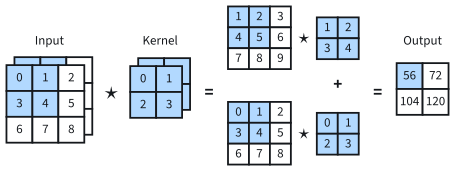
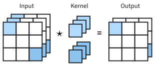
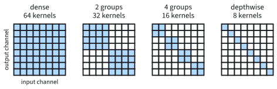
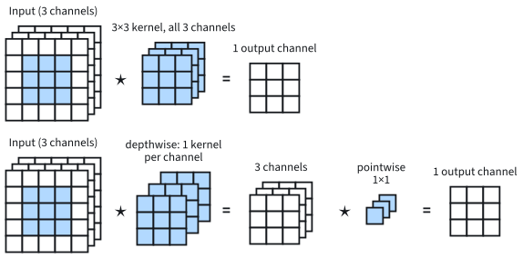

```{.python .input}
%load_ext d2lbook.tab
tab.interact_select('mxnet', 'pytorch', 'tensorflow', 'jax')
```

# Multiple Input and Multiple Output Channels
:label:`sec_channels`

A color image is not one grid of numbers but three: a $224\times 224$ RGB
image is a tensor of shape $3\times 224\times 224$, with one *channel* each
for red, green, and blue. The cross-correlation of :numref:`sec_conv_layer`
takes one grid and one kernel and returns one grid. It can therefore neither
look at all three colors at once nor detect more than one pattern. Both
matter. A boundary between a red and a green region of equal brightness is
visible only when the channels are compared, and a useful layer detects dozens
of patterns at every position (edges at several orientations, spots,
textures), each in a grid of its own.

The convolutional layer of :numref:`sec_why-conv` already allows for this:
each output channel adds up, over all input channels, a separate
$k_\textrm{h}\times k_\textrm{w}$ kernel applied to each. This section
implements that layer on top of the single-channel `corr2d` and counts what
it costs. A layer with $c_\textrm{i}$ input and $c_\textrm{o}$ output channels
has $c_\textrm{o} c_\textrm{i} k_\textrm{h} k_\textrm{w}$ weights, about
590,000 for a $3\times 3$ layer with 256 channels in and out, and its cost
grows with the product $c_\textrm{i} c_\textrm{o}$. The rest of the section
reduces that product: the $1\times 1$ convolution mixes channels without
looking at neighbors, and grouped and depthwise convolutions restrict which
channels are mixed.

```{.python .input #channels-multiple-input-and-multiple-output-channels}
%%tab mxnet
from d2l import mxnet as d2l
from mxnet import npx
from mxnet.gluon import nn
npx.set_np()
```

```{.python .input #channels-multiple-input-and-multiple-output-channels}
%%tab pytorch
from d2l import torch as d2l
import torch
from torch import nn
```

```{.python .input #channels-multiple-input-and-multiple-output-channels}
%%tab tensorflow
from d2l import tensorflow as d2l
import tensorflow as tf
```

```{.python .input #channels-multiple-input-and-multiple-output-channels}
%%tab jax
from d2l import jax as d2l
from flax import nnx
import jax
```

## Multiple Input Channels

With $c_\textrm{i}$ input channels, the kernel needs one
$k_\textrm{h}\times k_\textrm{w}$ grid of weights for every input channel, so
it becomes a tensor of shape $c_\textrm{i}\times k_\textrm{h}\times k_\textrm{w}$.
We cross-correlate each input channel with the matching kernel channel and add
the $c_\textrm{i}$ results. Writing $\mathbf{X}_c$ and $\mathbf{K}_c$ for
channel $c$ of the input and of the kernel, and $\mathbf{X}_c \star
\mathbf{K}_c$ for their two-dimensional cross-correlation :eqref:`eq_corr2d`,
which `corr2d` computes, the output is the single grid

$$\mathbf{Y} = \sum_{c=1}^{c_\textrm{i}} \mathbf{X}_c \star \mathbf{K}_c.$$

Each output value is thus a weighted sum over the same window in every
channel, with $c_\textrm{i} k_\textrm{h} k_\textrm{w}$ products.
:numref:`fig_conv_multi_in` works an example with two input channels. The
shaded first output element is
$(1\times1+2\times2+4\times3+5\times4)+(0\times0+1\times1+3\times2+4\times3)=56$.


:label:`fig_conv_multi_in`

The sum over channels is what lets a kernel compare colors. A $1\times 1$
kernel with weight $+1$ on the red channel and $-1$ on the green channel
outputs red minus green at every pixel: positive in red regions, negative in
green ones, and zero in gray ones, however bright. Where its sign flips
between neighboring pixels, a red region meets a green one. This holds even
when both regions are equally bright, so that a filter applied to the
brightness alone sees no edge there.

The implementation follows the formula: one call of `corr2d` per channel,
then a sum.

```{.python .input #channels-multiple-input-channels-1}
def corr2d_multi_in(X, K):
    """Cross-correlate each channel of X with its channel of K and add."""
    return sum(d2l.corr2d(x, k) for x, k in zip(X, K))
```

With the input and kernel of :numref:`fig_conv_multi_in`, the first output
element should be 56.

```{.python .input #channels-multiple-input-channels-2}
X = d2l.tensor([[[0.0, 1.0, 2.0], [3.0, 4.0, 5.0], [6.0, 7.0, 8.0]],
               [[1.0, 2.0, 3.0], [4.0, 5.0, 6.0], [7.0, 8.0, 9.0]]])
K = d2l.tensor([[[0.0, 1.0], [2.0, 3.0]], [[1.0, 2.0], [3.0, 4.0]]])

corr2d_multi_in(X, K)
```

## Multiple Output Channels
:label:`subsec_multi-output-channels`

A multi-input kernel produces one output grid: a feature map, which holds one
detector's responses at every position. To detect $c_\textrm{o}$
patterns, the layer uses $c_\textrm{o}$ such kernels, one per output channel,
each of shape $c_\textrm{i}\times k_\textrm{h}\times k_\textrm{w}$. Stacked,
they form a kernel tensor of shape
$c_\textrm{o}\times c_\textrm{i}\times k_\textrm{h}\times k_\textrm{w}$, and
output channel $o$ is

$$\mathbf{Y}_o = \sum_{c=1}^{c_\textrm{i}} \mathbf{X}_c \star \mathbf{K}_{o,c}, \quad o = 1, \ldots, c_\textrm{o}.$$

Every output channel reads every input channel, each through a kernel of its
own. This is the layer :eqref:`eq_conv-layer-channels` of
:numref:`sec_why-conv`, written channel by channel: $\mathbf{K}_{o,c}$ is its
$k_\textrm{h}\times k_\textrm{w}$ slice for input channel $c$ and output
channel $o$ (there called $d$). Networks usually increase the number of
channels as strides or pooling reduce the resolution, trading spatial detail
for more kinds of features at each position. The channels are trained
jointly, so one feature, such as an edge at some orientation, may be spread
over several channels instead of occupying one.

:begin_tab:`mxnet`
Gluon stores this kernel as
$c_\textrm{o}\times c_\textrm{i}\times k_\textrm{h}\times k_\textrm{w}$ and
its layers take channels-first inputs, (example, channel, height, width).
:end_tab:

:begin_tab:`pytorch`
PyTorch stores this kernel as
$c_\textrm{o}\times c_\textrm{i}\times k_\textrm{h}\times k_\textrm{w}$ and
its layers take channels-first inputs, (example, channel, height, width).
:end_tab:

:begin_tab:`tensorflow`
Keras stores this kernel as
$k_\textrm{h}\times k_\textrm{w}\times c_\textrm{i}\times c_\textrm{o}$, the
index order of :eqref:`eq_conv-layer-channels`, and its layers take
channels-last inputs, (example, height, width, channel).
:end_tab:

:begin_tab:`jax`
Flax stores this kernel as
$k_\textrm{h}\times k_\textrm{w}\times c_\textrm{i}\times c_\textrm{o}$, the
index order of :eqref:`eq_conv-layer-channels`, and its layers take
channels-last inputs, (example, height, width, channel).
:end_tab:

The implementation applies `corr2d_multi_in` once per output channel and
stacks the results.

```{.python .input #channels-multiple-output-channels-1}
def corr2d_multi_in_out(X, K):
    """Apply corr2d_multi_in once per output channel of K and stack."""
    return d2l.stack([corr2d_multi_in(X, k) for k in K], 0)
```

To test it, we build a kernel with three output channels from `K`, `K + 1`,
and `K + 2`.

```{.python .input #channels-multiple-output-channels-2}
K = d2l.stack((K, K + 1, K + 2), 0)
K.shape
```

The output has three channels.

```{.python .input #channels-multiple-output-channels-3}
corr2d_multi_in_out(X, K)
```

The first channel reproduces the output above, because its kernel is the
original `K`. Adding 1 to every weight adds to each output the sum of its
window over both input channels, which is 20 for the first element, so the
second channel starts at $56 + 20 = 76$.

### Parameters and Cost

With one bias per output channel, a convolutional layer has

$$c_\textrm{o} c_\textrm{i} k_\textrm{h} k_\textrm{w} + c_\textrm{o}$$

parameters. Each output value takes one multiply-add per weight of its output
channel, $c_\textrm{i} k_\textrm{h} k_\textrm{w}$ in total, so a layer with an
$h_\textrm{o}\times w_\textrm{o}$ output performs

$$h_\textrm{o} w_\textrm{o} \cdot c_\textrm{o} c_\textrm{i} k_\textrm{h} k_\textrm{w}$$

multiply-adds. Both counts grow with the product $c_\textrm{i} c_\textrm{o}$:
doubling the number of channels in every layer quadruples them. The cost, in
addition, grows with the number of output positions, since the same weights
are applied at each. The first layer from 3 to 64 channels with $3\times 3$
kernels in :numref:`sec_why-conv` has 1,792 parameters. A layer deeper in,
from 256 to 256 channels with $3\times 3$ kernels, has 590,080 parameters,
and on a $56\times 56$ output it performs
$56^2\cdot 589{,}824 \approx 1.8\times 10^9$ multiply-adds for a single
image. Training also keeps each layer's output,
$h_\textrm{o} w_\textrm{o} c_\textrm{o}$ values per example, for the backward
pass (:numref:`subsec_memory_during_training`). This activation memory is
largest in the early layers, where the resolution is high and the weights are few:
the 3-to-64-channel layer with a $224\times 224$ output keeps
$224^2\cdot 64 \approx 3.2\times 10^6$ values per example, against its 1,792
parameters. Reducing the factor $c_\textrm{i} c_\textrm{o}$ is the subject of
the rest of the section.

## The $1\times 1$ Convolution
:label:`subsec_1x1`

A $1\times 1$ kernel, $k_\textrm{h} = k_\textrm{w} = 1$, looks at a single
pixel and cannot detect spatial patterns. With several channels it still
computes something useful. At every position it maps the $c_\textrm{i}$ input
values to $c_\textrm{o}$ output values with the same
$c_\textrm{o}\times c_\textrm{i}$ matrix of weights: it is a fully connected
layer applied to each pixel separately, with weights shared across pixels.
It has $c_\textrm{o} c_\textrm{i}$ weights plus $c_\textrm{o}$ biases.
:numref:`fig_conv_1x1` shows a $1\times 1$ convolution from 3 input channels
to 2 output channels; input and output have the same height and width.


:label:`fig_conv_1x1`

Because the same matrix acts at every pixel, the whole layer is one matrix
product. We flatten the spatial axes of the input into a
$c_\textrm{i}\times hw$ matrix, multiply it by the kernel reshaped to
$c_\textrm{o}\times c_\textrm{i}$, and restore the spatial axes.

```{.python .input #channels-1-times-1-convolutional-layer-1}
def corr2d_multi_in_out_1x1(X, K):
    """A 1x1 convolution as one matrix product."""
    c_i, h, w = X.shape
    c_o = K.shape[0]
    Y = d2l.matmul(d2l.reshape(K, (c_o, c_i)), d2l.reshape(X, (c_i, h * w)))
    return d2l.reshape(Y, (c_o, h, w))
```

On random data the matrix product agrees with `corr2d_multi_in_out`.

```{.python .input #channels-1-times-1-convolutional-layer-2}
%%tab mxnet, pytorch
X = d2l.normal(0, 1, (3, 3, 3))
K = d2l.normal(0, 1, (2, 3, 1, 1))
Y1 = corr2d_multi_in_out_1x1(X, K)
Y2 = corr2d_multi_in_out(X, K)
float(d2l.reduce_sum(d2l.abs(Y1 - Y2)))
```

```{.python .input #channels-1-times-1-convolutional-layer-2}
%%tab tensorflow
X = d2l.normal((3, 3, 3), 0, 1)
K = d2l.normal((2, 3, 1, 1), 0, 1)
Y1 = corr2d_multi_in_out_1x1(X, K)
Y2 = corr2d_multi_in_out(X, K)
float(d2l.reduce_sum(d2l.abs(Y1 - Y2)))
```

```{.python .input #channels-1-times-1-convolutional-layer-2}
%%tab jax
X = jax.random.normal(d2l.get_key(), (3, 3, 3))
K = jax.random.normal(d2l.get_key(), (2, 3, 1, 1))
Y1 = corr2d_multi_in_out_1x1(X, K)
Y2 = corr2d_multi_in_out(X, K)
float(d2l.reduce_sum(d2l.abs(Y1 - Y2)))
```

The total absolute difference over the 18 outputs is zero or about
$10^{-6}$, the size of rounding errors in 32-bit floating-point arithmetic.

A $1\times 1$ convolution changes the number of channels cheaply, and deep
networks use it to reduce the cost of the spatial convolutions around it.
Take the $3\times 3$ layer on 256 channels from above. A $1\times 1$
convolution first reduces 256 channels to 64, the $3\times 3$ convolution
then works on 64 channels, and a second $1\times 1$ convolution restores 256.
The three layers have $16{,}384 + 36{,}864 + 16{,}384 = 69{,}632$ weights
against $589{,}824$, about 8.5 times fewer, and the multiply-adds fall by the
same factor. Such a *bottleneck* can only represent maps that pass through 64
channels, a restriction that networks such as ResNet accept for the savings.
A nonlinearity after a $1\times 1$ convolution makes it a small nonlinear
network applied at every pixel :cite:`Lin.Chen.Yan.2013`. Without one, it can
be folded into the next convolution, since two linear maps compose to one.

## Grouped, Depthwise, and Depthwise-Separable Convolutions
:label:`sec_depthwise_separable`

### Grouped Convolution

The factor $c_\textrm{i} c_\textrm{o}$ arises because every output channel
reads every input channel. A *grouped convolution* splits the input channels
into $g$ groups of $c_\textrm{i}/g$ channels and the output channels into $g$
groups of $c_\textrm{o}/g$, and lets each output group read only its own
input group. :numref:`fig_conv_groups` shows which input channels each output
channel reads. The dense pattern becomes block diagonal, with $g$ blocks of
size $(c_\textrm{o}/g)\times(c_\textrm{i}/g)$, and parameters and
multiply-adds fall from $c_\textrm{i} c_\textrm{o} k_\textrm{h} k_\textrm{w}$
to

$$g\cdot\frac{c_\textrm{i}}{g}\cdot\frac{c_\textrm{o}}{g}\, k_\textrm{h} k_\textrm{w} = \frac{c_\textrm{i} c_\textrm{o} k_\textrm{h} k_\textrm{w}}{g},$$

a factor of $g$. In exchange, no information flows between groups within the
layer. Networks built from grouped convolutions, such as ResNeXt
:cite:`Xie.Girshick.Dollar.ea.2017`, restore the exchange with
$1\times 1$ convolutions between grouped layers.


:label:`fig_conv_groups`

### Depthwise-Separable Convolution

With $g = c_\textrm{i} = c_\textrm{o}$, every group holds one channel. This
*depthwise convolution* filters each channel with its own $k\times k$ kernel
and mixes no channels at all, the opposite of the $1\times 1$ convolution,
which mixes channels and ignores neighbors. A depthwise $k\times k$
convolution followed by a *pointwise* $1\times 1$ convolution is a
*depthwise-separable convolution*
:cite:`chollet2017xception,howard2017mobilenet`.
:numref:`fig_conv_depthwise` contrasts it with the dense layer it replaces:
the depthwise stage looks at neighborhoods within each channel, and the
pointwise stage recombines the channels at each position.


:label:`fig_conv_depthwise`

For a $k\times k$ kernel and an $h\times w$ output, the dense convolution
performs $hw\cdot c_\textrm{i} c_\textrm{o} k^2$ multiply-adds. The separable
pair performs $hw\cdot c_\textrm{i} k^2$ in the depthwise stage and
$hw\cdot c_\textrm{i} c_\textrm{o}$ in the pointwise stage, so the cost
relative to the dense layer is

$$
\frac{h w \cdot c_\textrm{i} k^2 + h w \cdot c_\textrm{i} c_\textrm{o}}{h w \cdot c_\textrm{i} c_\textrm{o} k^2}
= \frac{1}{c_\textrm{o}} + \frac{1}{k^2}.
$$
:eqlabel:`eq_depthwise_sep_ratio`

The same ratio holds for the weights. For $k = 3$ and many output channels it
is close to $1/9$: the separable layer is nearly nine times cheaper.

The savings come from a restriction. The separable pair applies the
depthwise filter $\mathbf{D}_c$ to input channel $c$ and scales the result by
the pointwise weight $P_{o,c}$ before adding it to output channel $o$. It is
therefore the dense convolution with kernel
$\mathbf{K}_{o,c} = P_{o,c}\,\mathbf{D}_c$: all output channels see the same
spatial filter of each input channel, only scaled, while a dense layer may
use a different filter for every pair $(o, c)$. Efficient architectures accept
this restriction and spend the savings on more channels or more layers, as
:numref:`sec_efficient_cnns` shows.

We check the arithmetic with a dense $3\times 3$ convolution from 128 to 128
channels and its depthwise-separable factorization, without biases. Both map
the input to an output of the same shape, and
:eqref:`eq_depthwise_sep_ratio` predicts a ratio of parameter counts of
$(1/128 + 1/9)^{-1} \approx 8.4$.

:begin_tab:`tensorflow`
Keras layers take channels-last inputs, (example, height, width, channel),
so `X` below has shape $(1, 32, 32, c_\textrm{i})$, while the functions
written above put the channel first.
:end_tab:

:begin_tab:`jax`
Flax layers take channels-last inputs, (example, height, width, channel),
so `X` below has shape $(1, 32, 32, c_\textrm{i})$, while the functions
written above put the channel first.
:end_tab:

```{.python .input #channels-grouped-depthwise-and-depthwise-separable-convolutions}
%%tab mxnet
c_i, c_o, k = 128, 128, 3
X = d2l.normal(0, 1, (1, c_i, 32, 32))
dense = nn.Conv2D(c_o, kernel_size=k, padding=1, use_bias=False)
depthwise = nn.Conv2D(c_i, kernel_size=k, padding=1, groups=c_i,
                      use_bias=False)
pointwise = nn.Conv2D(c_o, kernel_size=1, use_bias=False)
for layer in (dense, depthwise, pointwise):
    layer.initialize()
assert dense(X).shape == pointwise(depthwise(X)).shape
p_dense = dense.weight.data().size
p_sep = depthwise.weight.data().size + pointwise.weight.data().size
p_dense, p_sep, p_dense / p_sep
```

```{.python .input #channels-grouped-depthwise-and-depthwise-separable-convolutions}
%%tab pytorch
c_i, c_o, k = 128, 128, 3
X = d2l.normal(0, 1, (1, c_i, 32, 32))
dense = nn.LazyConv2d(c_o, kernel_size=k, padding=1, bias=False)
depthwise = nn.LazyConv2d(c_i, kernel_size=k, padding=1, groups=c_i,
                          bias=False)
pointwise = nn.LazyConv2d(c_o, kernel_size=1, bias=False)
assert dense(X).shape == pointwise(depthwise(X)).shape
p_dense = dense.weight.numel()
p_sep = depthwise.weight.numel() + pointwise.weight.numel()
p_dense, p_sep, p_dense / p_sep
```

```{.python .input #channels-grouped-depthwise-and-depthwise-separable-convolutions}
%%tab tensorflow
c_i, c_o, k = 128, 128, 3
X = d2l.normal((1, 32, 32, c_i), 0, 1)
dense = tf.keras.layers.Conv2D(c_o, kernel_size=k, padding='same',
                               use_bias=False)
depthwise = tf.keras.layers.DepthwiseConv2D(kernel_size=k, padding='same',
                                            use_bias=False)
pointwise = tf.keras.layers.Conv2D(c_o, kernel_size=1, use_bias=False)
assert dense(X).shape == pointwise(depthwise(X)).shape
p_dense = dense.count_params()
p_sep = depthwise.count_params() + pointwise.count_params()
p_dense, p_sep, p_dense / p_sep
```

```{.python .input #channels-grouped-depthwise-and-depthwise-separable-convolutions}
%%tab jax
c_i, c_o, k = 128, 128, 3
X = jax.random.normal(d2l.get_key(), (1, 32, 32, c_i))
dense = nnx.Conv(c_i, c_o, kernel_size=(k, k), padding='SAME',
                 use_bias=False, rngs=nnx.Rngs(d2l.get_key()))
depthwise = nnx.Conv(c_i, c_i, kernel_size=(k, k), padding='SAME',
                     feature_group_count=c_i, use_bias=False,
                     rngs=nnx.Rngs(d2l.get_key()))
pointwise = nnx.Conv(c_i, c_o, kernel_size=(1, 1), use_bias=False,
                     rngs=nnx.Rngs(d2l.get_key()))
assert dense(X).shape == pointwise(depthwise(X)).shape
p_dense = dense.kernel[...].size
p_sep = depthwise.kernel[...].size + pointwise.kernel[...].size
p_dense, p_sep, p_dense / p_sep
```

The dense layer has 147,456 weights and the separable pair 17,536, a ratio of
8.4 as predicted.

:begin_tab:`mxnet`
In Gluon, `groups=c_i` turns `nn.Conv2D` into a depthwise convolution.
:end_tab:

:begin_tab:`pytorch`
In PyTorch, `groups=c_i` turns `nn.Conv2d` into a depthwise convolution;
any `groups` that divides both channel counts gives a grouped convolution.
:end_tab:

:begin_tab:`tensorflow`
Keras has a separate `DepthwiseConv2D` layer; grouped convolutions use the
`groups` argument of `Conv2D`.
:end_tab:

:begin_tab:`jax`
In Flax, `feature_group_count=c_i` turns `nnx.Conv` into a depthwise
convolution; it is the number of groups $g$.
:end_tab:

We can now build convolutional layers with any number of input and output
channels, count their parameters and multiply-adds, and reduce the cost of
mixing channels with $1\times 1$, grouped, and depthwise-separable layers.
The output of every such layer still shifts with its input pixel by pixel,
and :numref:`sec_pooling` summarizes neighborhoods so that small shifts of
the input change the output little.

## Summary

With several input channels, a convolution cross-correlates each input
channel with its own kernel and adds the results, which lets one kernel
combine evidence across channels such as colors. With several output
channels, the layer holds one such kernel per output channel, a tensor of
shape $c_\textrm{o}\times c_\textrm{i}\times k_\textrm{h}\times k_\textrm{w}$
with $c_\textrm{o} c_\textrm{i} k_\textrm{h} k_\textrm{w} + c_\textrm{o}$
parameters and $h_\textrm{o} w_\textrm{o} c_\textrm{o} c_\textrm{i} k_\textrm{h} k_\textrm{w}$
multiply-adds, so the cost grows with the product of the channel counts. A
$1\times 1$ convolution is a fully connected layer applied at every pixel and
changes the number of channels cheaply, as in bottlenecks. Grouped
convolutions divide the cost by the number of groups, and a depthwise
convolution followed by a $1\times 1$ convolution reduces it to a fraction
$1/c_\textrm{o} + 1/k^2$, at the price of a restricted, factored kernel.

## Exercises

1. **Composition of convolutions.** Two convolutional layers with stride
   1, no padding, and no nonlinearity in between have kernels of shape
   $c_\textrm{m} \times c_\textrm{i} \times k_1 \times k_1$ and
   $c_\textrm{o} \times c_\textrm{m} \times k_2 \times k_2$.
    1. Prove that their composition is a single convolution, and give the
       shape of its kernel.
    1. Compare the number of weights of the pair with that of the single
       convolution. For which intermediate width $c_\textrm{m}$ is the
       pair cheaper?
    1. As :numref:`sec_conv_layer` showed, three stacked single-channel
       $3 \times 3$ kernels have a $7 \times 7$ receptive field. Decide
       whether every single-channel $7 \times 7$ kernel is the composition
       of three $3 \times 3$ kernels, and justify the answer.

1. **Cost and memory accounting.** A convolution with kernel shape
   $c_\textrm{o}\times c_\textrm{i}\times k_\textrm{h}\times k_\textrm{w}$,
   total padding $(p_\textrm{h}, p_\textrm{w})$, and stride
   $(s_\textrm{h}, s_\textrm{w})$ is applied to an input of shape
   $c_\textrm{i}\times h\times w$. Let $h_\textrm{o}\times w_\textrm{o}$
   be the output shape given by :eqref:`eq_conv_output_shape` with
   $n_\textrm{h} = h$, $n_\textrm{w} = w$, and dilation 1.
    1. Starting from the multiply-add count of this section, count the
       multiplications and the additions of the forward propagation
       separately, bias included, in terms of $h_\textrm{o}$ and
       $w_\textrm{o}$. How does the count change when the padding is
       doubled?
    1. How many values do the input, the kernel, and the output occupy?
       Which of these tensors must the forward propagation keep for the
       backward propagation?
    1. Count the multiplications needed for the gradients with respect
       to the kernel and with respect to the input, and give the number
       of values these gradients occupy.

1. [code] **Multi-channel im2col.** Extend the patch matrix of
   :numref:`subsec_conv_matmul` to several input and output channels.
   Rebuild the two-channel `X` of :numref:`fig_conv_multi_in` and the
   three-output-channel `K` of :numref:`subsec_multi-output-channels`,
   since later cells of this section overwrite both. Build the patch
   matrix, whose rows are input patches of shape
   $c_\textrm{i} \times k_\textrm{h} \times k_\textrm{w}$ flattened in
   that order, and arrange `K` into a
   $c_\textrm{i} k_\textrm{h} k_\textrm{w} \times c_\textrm{o}$ kernel
   matrix whose rows follow the same order. Confirm that their product,
   rearranged into the shape of the output, reproduces
   `corr2d_multi_in_out(X, K)`.

    *Adapted from Simon Prince,
    [Understanding Deep Learning](https://udlbook.github.io/udlbook/),
    Problems 10.6 and 10.7.*

1. **Strip-buffered convolution.** A fast implementation of a stride-1
   $k \times k$ convolution copies a strip of input columns, spanning all
   $c_\textrm{i}$ channels and the full height, into fast memory. It
   computes output columns from the strip and then moves the strip right
   by as many columns as it computed. One scheme loads $k$ columns and
   computes one output column. The alternative loads $k + m - 1$ columns
   and computes $m$ output columns. Both schemes load their whole strip
   anew at every step.
    1. On average, how many times is each input column loaded under each
       scheme?
    1. What limits how large $m$ can be, and how does the load count of
       the previous sub-item change as $m$ grows?

1. **Depthwise-separable block.** Consider a block of two dense
   $3 \times 3$ convolutions, each with $c$ input and $c$ output channels,
   the building block of VGG (:numref:`sec_vgg`). Now replace each of the
   two convolutions by its depthwise-separable counterpart. Use no biases
   and padding that preserves the spatial size.
    1. Compute the number of parameters and the number of multiplications
       on an $h \times w$ input for both variants. Which stage of the
       separable block, depthwise or pointwise, accounts for most of these
       counts, and from which $c$ on?
    1. Give the separable block the same parameter budget as the dense
       block and let it use $c'$ channels instead of $c$. Solve for $c'$
       and state its limit relative to $c$ as $c$ grows. What does this
       suggest about how to spend the savings of the factorization?

1. **Channel permutation between groups.** ● Grouped layers can also be
   mixed without dense weights. Follow a grouped $k \times k$ convolution
   from $c_\textrm{i}$ to $c_\textrm{o}$ channels with $g$ groups by a
   second grouped convolution from $c_\textrm{o}$ to $c_\textrm{o}$
   channels with $g$ groups, and insert a fixed permutation of the
   $c_\textrm{o}$ intermediate channels between the two layers. Find the
   condition on $g$ and $c_\textrm{o}$ under which some permutation makes
   each output of the second layer depend on all $c_\textrm{i}$ input
   channels, and construct such a permutation when the condition holds.

:begin_tab:`mxnet`
[Discussions](https://d2l.discourse.group/t/69)
:end_tab:

:begin_tab:`pytorch`
[Discussions](https://d2l.discourse.group/t/70)
:end_tab:

:begin_tab:`tensorflow`
[Discussions](https://d2l.discourse.group/t/273)
:end_tab:

:begin_tab:`jax`
[Discussions](https://d2l.discourse.group/t/17998)
:end_tab:

<!-- slides -->

::: {.slide}
::: {.cover}
[Dive into Deep Learning · §6.4]{.kicker}

Multiple Input and Multiple Output Channels<br>**sums over channels · feature maps · parameter counts · 1×1, grouped, and depthwise layers**
:::
:::

::: {.slide title="One 3×3 Layer from 256 to 256 Channels Has 590,000 Weights"}
[The problem]{.kicker}

- A color image is three grids: $3\times 224\times 224$ for red, green,
  and blue.
- Single-channel cross-correlation takes one grid and returns one: it can
  neither compare colors nor detect more than one pattern.
- A real layer has $c_i$ input and $c_o$ output channels, and
  $c_o c_i k_h k_w$ weights.
- $256\to 256$ channels, $3\times 3$ kernels: 589,824 weights and
  $1.8\times 10^9$ multiply-adds per image on a $56\times 56$ output.

::: {.d2l-note}
Channels give a layer many detectors; their cost grows with
$c_i\cdot c_o$.
:::
:::

::: {.slide title="By the End of This Deck You Can"}
[Goals]{.kicker}

- compute a multi-channel cross-correlation by hand;
- give the shape of a layer's kernel tensor, and count its parameters and
  multiply-adds;
- write a $1\times 1$ convolution as one matrix product;
- compute the savings of a bottleneck, a grouped layer, and a
  depthwise-separable layer.

**Running example:** LeNet's second convolution, from 6 to 16 channels with
$5\times 5$ kernels and a $10\times 10$ output.
:::

::: {.slide title="Channels Turn One Detector per Layer into Many"}
[Where this fits]{.kicker}

::: {.cols .vc}
::: {.col}
| section | adds |
|---|---|
| From Fully Connected Layers to Convolutions | locality and translation equivariance give convolution |
| Convolutions for Images | cross-correlation, learning a kernel, receptive fields |
| Padding, Stride, and Dilation | output size and how far each unit sees |
| **Multiple Input and Multiple Output Channels** | **channels, 1 × 1 convolutions, cost** |
| Pooling | downsampling and tolerance to small shifts |
| Convolutional Neural Networks (LeNet) | a complete CNN on Fashion-MNIST |
:::

::: {.col .narrow}
- **Uses:** `corr2d`; output shapes from padding and stride.
- **Skips:** pooling (next deck); networks built from these layers (next
  chapter).
:::
:::
:::

::: {.slide}
::: {.divider}
[01]{.dnum}

[Input channels]{.dtitle}

[one kernel per input channel, then a sum]{.dsub}
:::
:::

::: {.slide title="A Multi-Input Kernel Adds One Cross-Correlation per Channel"}
[Input channels]{.kicker}

$\mathbf{Y} = \sum_{c=1}^{c_i} \mathbf{X}_c \star \mathbf{K}_c$, with
$\star$ the 2-D cross-correlation computed by `corr2d`, kernel shape
$c_i\times k_h\times k_w$:

{width=72%}

First output:
$(1{\cdot}1+2{\cdot}2+4{\cdot}3+5{\cdot}4)+(0{\cdot}0+1{\cdot}1+3{\cdot}2+4{\cdot}3)=56$.
:::

::: {.slide title="Summing over Channels Lets a Kernel Compare Colors"}
[Input channels]{.kicker}

- Take a $1\times 1$ kernel with weight $+1$ on red and $-1$ on green.
- Its output is red minus green at every pixel: positive in red regions,
  negative in green ones, zero in gray ones, however bright.
- Where the sign flips, red meets green, even if both are equally bright.
- A filter on the brightness alone sees no edge there.

::: {.d2l-note}
Each output value combines the same window in every input channel:
$c_i k_h k_w$ products.
:::
:::

::: {.slide title="Input Channels in Code: One corr2d per Channel"}
[Input channels]{.kicker}

@channels-multiple-input-channels-1

The input and kernel of the figure:

@!channels-multiple-input-channels-2
:::

::: {.slide title="Check: The Second Output Element"}
[Check]{.kicker}

Input channels $\begin{smallmatrix}0&1&2\\3&4&5\\6&7&8\end{smallmatrix}$
and $\begin{smallmatrix}1&2&3\\4&5&6\\7&8&9\end{smallmatrix}$, kernel
channels $\begin{smallmatrix}0&1\\2&3\end{smallmatrix}$ and
$\begin{smallmatrix}1&2\\3&4\end{smallmatrix}$. Compute the output in the
first row, second column.

::: {.fragment .fade-up}
::: {.d2l-note}
**Answer.** $(1{\cdot}0+2{\cdot}1+4{\cdot}2+5{\cdot}3) +
(2{\cdot}1+3{\cdot}2+5{\cdot}3+6{\cdot}4) = 25 + 47 = 72$.
:::
:::
:::

::: {.slide}
::: {.divider}
[02]{.dnum}

[Output channels]{.dtitle}

[one kernel per feature map]{.dsub}
:::
:::

::: {.slide title="One Kernel per Output Channel, One Feature Map Each"}
[Output channels]{.kicker}

$$\mathbf{Y}_o = \sum_{c=1}^{c_i} \mathbf{X}_c \star \mathbf{K}_{o,c},
\qquad o = 1, \ldots, c_o$$

- Kernel tensor of shape $c_o\times c_i\times k_h\times k_w$.
- Every output channel reads every input channel, each through a kernel of
  its own.
- Each output channel is a *feature map*: one detector's responses at every
  position.
- Channels usually grow as resolution shrinks: LeNet goes from 1 to 6 to 16
  channels.
:::

::: {.slide title="Output Channels in Code: Stack One Output per Kernel"}
[Output channels]{.kicker}

@channels-multiple-output-channels-1

- Kernels `K`, `K + 1`, `K + 2` give three channels whose first elements
  are 56, 76, and 96.
- Adding 1 to every weight adds the window's sum over both input channels,
  20 for the first window.
:::

::: {.slide title="Parameters Grow with the Product of Channel Counts"}
[Output channels]{.kicker}

parameters $= c_o c_i k_h k_w + c_o$, multiply-adds
$= h_o w_o\cdot c_o c_i k_h k_w$

| layer | parameters |
|---|---|
| $3\to 64$, $3\times 3$ | 1,792 |
| $256\to 256$, $3\times 3$ | 590,080 |

- Doubling all channel counts quadruples both.
- The $256\to 256$ layer on a $56\times 56$ output:
  $56^2\cdot 589{,}824\approx 1.8\times 10^9$ multiply-adds per image.
:::

::: {.slide title="Check: LeNet's Second Convolution"}
[Check]{.kicker}

From 6 to 16 channels, $5\times 5$ kernels, a $10\times 10$ output. How
many parameters? How many multiply-adds?

::: {.fragment .fade-up}
::: {.d2l-note}
**Answer.** $16\cdot 6\cdot 25 + 16 = 2{,}416$ parameters;
$10^2\cdot 16\cdot 6\cdot 25 = 240{,}000$ multiply-adds.
:::
:::
:::

::: {.slide}
::: {.divider}
[03]{.dnum}

[Cheaper channel mixing]{.dtitle}

[1×1, grouped, and depthwise-separable layers]{.dsub}
:::
:::

::: {.slide title="A 1×1 Convolution Is a Dense Layer Applied at Every Pixel"}
[Cheaper mixing]{.kicker}

{width=55%}

The same $c_o\times c_i$ matrix maps the channel vector at every position:
$c_o c_i$ weights and $c_o$ biases, no spatial pattern.
:::

::: {.slide title="A 1×1 Convolution Is One Matrix Product"}
[Cheaper mixing]{.kicker}

@channels-1-times-1-convolutional-layer-1

Total absolute difference from `corr2d_multi_in_out` on random data:

@!channels-1-times-1-convolutional-layer-2
:::

::: {.slide title="A 1×1 Bottleneck Has 8.5× Fewer Weights Than a 256-Channel 3×3 Layer"}
[Cheaper mixing]{.kicker}

| layer | weights |
|---|---|
| $1\times 1$, $256\to 64$ | 16,384 |
| $3\times 3$, $64\to 64$ | 36,864 |
| $1\times 1$, $64\to 256$ | 16,384 |
| **total** | **69,632** |
| one $3\times 3$, $256\to 256$ | 589,824 |

The multiply-adds fall by the same factor. The price: everything passes
through 64 channels (ResNet accepts it).
:::

::: {.slide title="g Groups Divide Parameters and Multiply-Adds by g"}
[Cheaper mixing]{.kicker}

{width=85%}

Each output group reads only its input group:
$c_i c_o k_h k_w/g$ weights. No information crosses groups within the
layer.
:::

::: {.slide title="Depthwise Filters Each Channel; Pointwise Mixes Them"}
[Cheaper mixing]{.kicker}

{width=66%}

Depthwise: $g = c_i = c_o$, one $k\times k$ filter per channel. Pointwise:
a $1\times 1$ convolution.
:::

::: {.slide title="A Separable Layer Costs About 1/k² of a Dense One"}
[Cheaper mixing]{.kicker}

$$\frac{hw\, c_i k^2 + hw\, c_i c_o}{hw\, c_i c_o k^2}
= \frac{1}{c_o} + \frac{1}{k^2}$$

- Same ratio for weights and for multiply-adds.
- $c_i = c_o = 128$, $k = 3$: $(1/128 + 1/9)^{-1}\approx 8.4$.

Dense weights, separable weights, ratio:

@!channels-grouped-depthwise-and-depthwise-separable-convolutions
:::

::: {.slide title="Separable Layers Express Only Factored Kernels"}
[Cheaper mixing]{.kicker}

- Depthwise filter $\mathbf{D}_c$ on input channel $c$, pointwise weight
  $P_{o,c}$ into output channel $o$.
- Together: the dense kernel $\mathbf{K}_{o,c} = P_{o,c}\,\mathbf{D}_c$.
- Every output channel sees the same spatial filter of each input channel,
  only scaled.
- A dense layer may use a different filter for every pair $(o, c)$.

::: {.d2l-note}
Efficient networks accept the restriction and spend the savings on more
channels or more layers.
:::
:::

::: {.slide title="Check: Separable Savings for 5×5 Kernels"}
[Check]{.kicker}

A $5\times 5$ convolution from 128 to 128 channels is replaced by its
depthwise-separable factorization. About how many times cheaper is it?

::: {.fragment .fade-up}
::: {.d2l-note}
**Answer.** $1/128 + 1/25 \approx 0.048$, so about $21\times$ cheaper.
Larger kernels gain more, because the depthwise term $1/k^2$ shrinks.
:::
:::
:::

::: {.slide title="Recap"}
[Wrap-up]{.kicker}

- Input channels: one kernel channel each, results added; kernels can
  compare colors (red minus green).
- Output channels: kernel $c_o\times c_i\times k_h\times k_w$,
  $c_o c_i k_h k_w + c_o$ parameters; LeNet's second layer has 2,416.
- Cost $h_o w_o c_o c_i k_h k_w$: $1.8\times 10^9$ multiply-adds for
  $256\to 256$, $3\times 3$ at $56\times 56$.
- $1\times 1$: a dense layer at every pixel; a bottleneck has $8.5\times$
  fewer weights.
- $g$ groups divide the cost by $g$; depthwise-separable costs
  $1/c_o + 1/k^2$ of dense, $8.4\times$ less at $c = 128$, $k = 3$.

Next: pooling, which summarizes neighborhoods.
:::
