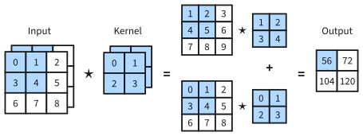
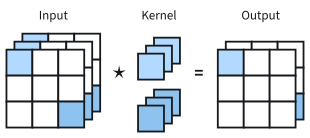

```{.python .input}
%load_ext d2lbook.tab
tab.interact_select('mxnet', 'pytorch', 'tensorflow', 'jax')
```

# Multiple Input and Multiple Output Channels
:label:`sec_channels`

Every kernel we have used so far has read one grid of numbers and produced
one. The edge detector of :numref:`sec_conv_layer` looked at a grayscale image
and found one kind of edge. Real images and real networks need more on both
sides. A color photograph stores three numbers per pixel, one *channel* each
for red, green, and blue, so a $224\times 224$ RGB image is a tensor of shape
$3\times 224\times 224$. A boundary between a red and a green region of equal
brightness is visible only when the channels are compared. And a useful layer
detects dozens of patterns at every position (edges at several orientations,
spots, textures), each in a grid of its own. How does one layer read several
input channels and produce several output channels, and what does that cost?

The convolutional layer of :numref:`sec_why-conv` already allows for this:
each output channel adds up, over all input channels, a separate
$k_\textrm{h}\times k_\textrm{w}$ kernel applied to each. This section
implements that layer on top of the single-channel `corr2d` and counts what
it costs. The count turns out to be governed by one quantity, the product
$c_\textrm{i} c_\textrm{o}$ of the two channel counts, and the rest of the
section asks how to make that product smaller.

```{.python .input #channels-multiple-input-and-multiple-output-channels}
%%tab mxnet
import math
import numpy as np
from mxnet import autograd, gluon, init, np as mnp, npx
from mxnet.gluon import nn
from d2l import mxnet as d2l
npx.set_np()
```

```{.python .input #channels-multiple-input-and-multiple-output-channels}
%%tab pytorch
import math
import numpy as np
import torch
from torch import nn
from torch.nn import functional as F
from d2l import torch as d2l
```

```{.python .input #channels-multiple-input-and-multiple-output-channels}
%%tab tensorflow
import math
import numpy as np
import tensorflow as tf
from d2l import tensorflow as d2l
```

```{.python .input #channels-multiple-input-and-multiple-output-channels}
%%tab jax
import math
import numpy as np
import jax
from jax import numpy as jnp
from flax import nnx
import optax
from d2l import jax as d2l
```

## Multiple Input Channels

Let us start with the input side. With $c_\textrm{i}$ input channels, the
kernel needs one $k_\textrm{h}\times k_\textrm{w}$ grid of weights for every
input channel, so it becomes a tensor of shape
$c_\textrm{i}\times k_\textrm{h}\times k_\textrm{w}$. We cross-correlate
each input channel with the matching kernel channel and add the
$c_\textrm{i}$ results. Writing $\mathbf{X}_c$ and $\mathbf{K}_c$ for
channel $c$ of the input and of the kernel, and $\mathbf{X}_c \star
\mathbf{K}_c$ for their two-dimensional cross-correlation :eqref:`eq_corr2d`,
which `corr2d` computes, the output is the single grid

$$\mathbf{Y} = \sum_{c=1}^{c_\textrm{i}} \mathbf{X}_c \star \mathbf{K}_c.$$

Each output value is thus a weighted sum over the same window in every
channel, with $c_\textrm{i} k_\textrm{h} k_\textrm{w}$ products.
:numref:`fig_conv_multi_in` works an example with two input channels. The
shaded first output element is
$(1\times1+2\times2+4\times3+5\times4)+(0\times0+1\times1+3\times2+4\times3)=56$.


:label:`fig_conv_multi_in`

Why add the channels? Because the sum is what lets a kernel compare colors.
A $1\times 1$ kernel with weight $+1$ on the red channel and $-1$ on the
green channel outputs red minus green at every pixel: positive in red
regions, negative in green ones, and zero in gray ones, however bright. Where
its sign flips between neighboring pixels, a red region meets a green one.
This holds even when both regions are equally bright, so that a filter
applied to the brightness alone sees no edge there.

The implementation is the formula read aloud: one call of `corr2d` per
channel, then a sum.

```{.python .input #channels-multiple-input-channels-1}
def corr2d_multi_in(X, K):
    """Cross-correlate each channel of X with its channel of K and add."""
    return sum(d2l.corr2d(x, k) for x, k in zip(X, K))
```

With the input and kernel of :numref:`fig_conv_multi_in`, the first output
element should be 56.

```{.python .input #channels-multiple-input-channels-2}
X = d2l.tensor([[[0.0, 1.0, 2.0], [3.0, 4.0, 5.0], [6.0, 7.0, 8.0]],
               [[1.0, 2.0, 3.0], [4.0, 5.0, 6.0], [7.0, 8.0, 9.0]]])
K = d2l.tensor([[[0.0, 1.0], [2.0, 3.0]], [[1.0, 2.0], [3.0, 4.0]]])

corr2d_multi_in(X, K)
```

## Multiple Output Channels
:label:`subsec_multi-output-channels`

A multi-input kernel, however many channels it reads, produces a single
feature map (:numref:`subsec_why-conv-channels`): the responses of one
detector. To detect $c_\textrm{o}$ patterns, the layer simply uses
$c_\textrm{o}$ such kernels, one per output channel, each of shape
$c_\textrm{i}\times k_\textrm{h}\times k_\textrm{w}$. Stacked,
they form a kernel tensor of shape
$c_\textrm{o}\times c_\textrm{i}\times k_\textrm{h}\times k_\textrm{w}$, and
output channel $o$ is

$$\mathbf{Y}_o = \sum_{c=1}^{c_\textrm{i}} \mathbf{X}_c \star \mathbf{K}_{o,c}, \quad o = 1, \ldots, c_\textrm{o}.$$

Every output channel reads every input channel, each through a kernel of its
own. It is worth remembering this dense wiring, since the cost of the layer
comes from it. This is the layer :eqref:`eq_conv-layer-channels` of
:numref:`sec_why-conv`, written channel by channel, with $\mathbf{K}_{o,c}$
its $k_\textrm{h}\times k_\textrm{w}$ slice for output channel $o$ and
input channel $c$. Networks usually increase the number of channels as
strides or pooling reduce the resolution: they give up spatial detail and
gain more kinds of features at each position.

:begin_tab:`mxnet`
Gluon stores the kernel in this order, channels first, as it does its
inputs.
:end_tab:

:begin_tab:`pytorch`
PyTorch stores the kernel in this order, channels first, as it does its
inputs.
:end_tab:

:begin_tab:`tensorflow`
Keras stores the kernel as
$k_\textrm{h}\times k_\textrm{w}\times c_\textrm{i}\times c_\textrm{o}$, the
reverse of the order used here, with the channels last, as in its inputs
(:numref:`sec_padding`).
:end_tab:

:begin_tab:`jax`
Flax stores the kernel as
$k_\textrm{h}\times k_\textrm{w}\times c_\textrm{i}\times c_\textrm{o}$, the
reverse of the order used here, with the channels last, as in its inputs
(:numref:`sec_padding`).
:end_tab:

The implementation applies `corr2d_multi_in` once per output channel and
stacks the results.

```{.python .input #channels-multiple-output-channels-1}
def corr2d_multi_in_out(X, K):
    """Apply corr2d_multi_in once per output channel of K and stack."""
    return d2l.stack([corr2d_multi_in(X, k) for k in K], 0)
```

To test it, we build a kernel with three output channels from `K`, `K + 1`,
and `K + 2`.

```{.python .input #channels-multiple-output-channels-2}
K = d2l.stack((K, K + 1, K + 2), 0)
K.shape
```

```{.python .input #channels-multiple-output-channels-3}
corr2d_multi_in_out(X, K)
```

The first channel reproduces the output above, because its kernel is the
original `K`. The second can be checked in the head. Adding 1 to every
weight adds to each output the sum of its window over both input channels,
which is 20 for the first element, so the second channel starts at
$56 + 20 = 76$.

### Parameters and Cost

Channels multiply the size of a layer. Before we design networks with many
of them, we should know by how much. With one bias per output channel, a
convolutional layer has

$$c_\textrm{o} c_\textrm{i} k_\textrm{h} k_\textrm{w} + c_\textrm{o}$$

parameters. For the first layer of a network this is a small number: the
layer from 3 to 64 channels with $3\times 3$ kernels in
:numref:`sec_why-conv` has 1,792 of them. A layer deeper in, from 256 to 256
channels with $3\times 3$ kernels, has 589,824 weights and 256 biases.

What does it cost to apply the layer? Each output value takes one
multiply-add per weight of its output channel,
$c_\textrm{i} k_\textrm{h} k_\textrm{w}$ in total, so a layer with an
$h_\textrm{o}\times w_\textrm{o}$ output performs

$$h_\textrm{o} w_\textrm{o} \cdot c_\textrm{o} c_\textrm{i} k_\textrm{h} k_\textrm{w}$$

multiply-adds. On a $56\times 56$ output, the 256-channel layer performs
$56^2\cdot 589{,}824 \approx 1.8\times 10^9$ of them for a single image.
Both counts grow with the product $c_\textrm{i} c_\textrm{o}$: doubling the
number of channels in every layer quadruples them. The computation grows, in
addition, with the number of output positions, since the same weights are
applied at each.

There is a third cost, and it is easy to overlook. Training keeps each
layer's output, $h_\textrm{o} w_\textrm{o} c_\textrm{o}$ values per example,
for the backward pass (:numref:`subsec_memory_during_training`). This
activation memory is largest in the early layers, where the resolution is
high and the weights are few. The 3-to-64-channel layer with a
$224\times 224$ output keeps $224^2\cdot 64 \approx 3.2\times 10^6$ values
per example, against its 1,792 parameters.

## The $1\times 1$ Convolution
:label:`subsec_1x1`

At first sight, a $1\times 1$ kernel, $k_\textrm{h} = k_\textrm{w} = 1$, is
a convolution in name only: it looks at a single pixel and cannot detect
spatial patterns. With several channels it still computes something useful,
as the red-minus-green kernel above did. At every position it maps the
$c_\textrm{i}$ input values to $c_\textrm{o}$ output values with the same
$c_\textrm{o}\times c_\textrm{i}$ matrix of weights: it is a fully connected
layer applied to each pixel separately, with weights shared across pixels.
:numref:`fig_conv_1x1` shows the case of 3 input and 2 output channels;
height and width are unchanged.


:label:`fig_conv_1x1`

Because the same matrix acts at every pixel, the whole layer is one matrix
product. We flatten the spatial axes of the input into a
$c_\textrm{i}\times hw$ matrix, multiply it by the kernel reshaped to
$c_\textrm{o}\times c_\textrm{i}$, and restore the spatial axes.

```{.python .input #channels-1-times-1-convolutional-layer-1}
def corr2d_multi_in_out_1x1(X, K):
    """A 1x1 convolution as one matrix product."""
    c_i, h, w = X.shape
    c_o = K.shape[0]
    Y = d2l.matmul(d2l.reshape(K, (c_o, c_i)), d2l.reshape(X, (c_i, h * w)))
    return d2l.reshape(Y, (c_o, h, w))
```

We compare the matrix product with `corr2d_multi_in_out` on random data.

```{.python .input #channels-1-times-1-convolutional-layer-2}
%%tab mxnet, pytorch
X = d2l.normal(0, 1, (3, 3, 3))
K = d2l.normal(0, 1, (2, 3, 1, 1))
Y1 = corr2d_multi_in_out_1x1(X, K)
Y2 = corr2d_multi_in_out(X, K)
float(d2l.reduce_sum(d2l.abs(Y1 - Y2)))
```

```{.python .input #channels-1-times-1-convolutional-layer-2}
%%tab tensorflow
X = d2l.normal((3, 3, 3), 0, 1)
K = d2l.normal((2, 3, 1, 1), 0, 1)
Y1 = corr2d_multi_in_out_1x1(X, K)
Y2 = corr2d_multi_in_out(X, K)
float(d2l.reduce_sum(d2l.abs(Y1 - Y2)))
```

```{.python .input #channels-1-times-1-convolutional-layer-2}
%%tab jax
X = jax.random.normal(d2l.get_key(), (3, 3, 3))
K = jax.random.normal(d2l.get_key(), (2, 3, 1, 1))
Y1 = corr2d_multi_in_out_1x1(X, K)
Y2 = corr2d_multi_in_out(X, K)
float(d2l.reduce_sum(d2l.abs(Y1 - Y2)))
```

The two computations agree up to rounding error.

What is such a layer good for? It changes the number of channels cheaply,
and deep networks use this to reduce the cost of the spatial convolutions
around it. Take the $3\times 3$ layer on 256 channels from above. A $1\times 1$
convolution first reduces 256 channels to 64, the $3\times 3$ convolution
then works on 64 channels, and a second $1\times 1$ convolution restores 256.
The three layers have $16{,}384 + 36{,}864 + 16{,}384 = 69{,}632$ weights
against $589{,}824$, about 8.5 times fewer, and the multiply-adds fall by the
same factor. Of course, such a *bottleneck* can only represent maps that
pass through 64 channels, a restriction that networks such as ResNet
(:numref:`sec_resnet`) accept for the savings.
A nonlinearity after a $1\times 1$ convolution makes it a small nonlinear
network applied at every pixel :cite:`Lin.Chen.Yan.2013`. Without one, it can
be folded into the next convolution, since two linear maps compose to one.

Two further ways to cut the cost restrict which input channels each output
channel reads: grouped convolutions, which ResNeXt uses
(:numref:`subsec_resnext`), and depthwise-separable convolutions, the
building block of efficient networks (:numref:`sec_depthwise_separable`).
We introduce each where a network first needs it.

All of these layers have one property that channels do
nothing about: the output still shifts with the input, pixel by pixel.
:numref:`sec_pooling` summarizes neighborhoods so that small shifts of the
input change the output little.

## Summary

With several input channels, a convolution cross-correlates each input
channel with its own kernel and adds the results, which lets one kernel
combine evidence across channels such as colors. With several output
channels, the layer holds one such kernel per output channel, a tensor of
shape $c_\textrm{o}\times c_\textrm{i}\times k_\textrm{h}\times k_\textrm{w}$
with $c_\textrm{o} c_\textrm{i} k_\textrm{h} k_\textrm{w} + c_\textrm{o}$
parameters and $h_\textrm{o} w_\textrm{o} c_\textrm{o} c_\textrm{i} k_\textrm{h} k_\textrm{w}$
multiply-adds, so the cost grows with the product of the channel counts. A
$1\times 1$ convolution is a fully connected layer applied at every pixel and
changes the number of channels cheaply, as in bottlenecks.

## Exercises

1. **Composition of convolutions.** Two convolutional layers with stride
   1, no padding, and no nonlinearity in between have kernels of shape
   $c_\textrm{m} \times c_\textrm{i} \times k_1 \times k_1$ and
   $c_\textrm{o} \times c_\textrm{m} \times k_2 \times k_2$.
    1. Prove that their composition is a single convolution, and give the
       shape of its kernel.
    1. Compare the number of weights of the pair with that of the single
       convolution. For which intermediate width $c_\textrm{m}$ is the
       pair cheaper?
    1. As :numref:`sec_conv_layer` showed, three stacked single-channel
       $3 \times 3$ kernels have a $7 \times 7$ receptive field. Decide
       whether every single-channel $7 \times 7$ kernel is the composition
       of three $3 \times 3$ kernels, and justify the answer.

1. **Three costs, three layers.** A network for $224\times 224$ RGB
   images begins with four $3\times 3$ convolutions with padding 1: from 3
   to 64 channels at stride 1, from 64 to 128 at stride 2, from 128 to 128
   at stride 1, and from 128 to 256 at stride 2.
    1. For each layer give the output shape, the number of weights, the
       number of multiply-adds per image, and the number of output values
       that training must keep for the backward pass.
    1. Which layer has the most weights, which performs the most
       multiply-adds, and which keeps the most output values? Explain why
       these are three different layers.
    1. The images are replaced by $448\times 448$ ones. Which of the three
       costs change, and by what factor?

1. [code] **Multi-channel im2col.** Extend the patch matrix of
   :numref:`subsec_conv_matmul` to several input and output channels.
   Rebuild the two-channel `X` of :numref:`fig_conv_multi_in` and the
   three-output-channel `K` of :numref:`subsec_multi-output-channels`,
   since later cells of this section overwrite both. Build the patch
   matrix, whose rows are input patches of shape
   $c_\textrm{i} \times k_\textrm{h} \times k_\textrm{w}$ flattened in
   that order, and arrange `K` into a
   $c_\textrm{i} k_\textrm{h} k_\textrm{w} \times c_\textrm{o}$ kernel
   matrix whose rows follow the same order. Confirm that their product,
   rearranged into the shape of the output, reproduces
   `corr2d_multi_in_out(X, K)`.

    *Adapted from Simon Prince,
    [Understanding Deep Learning](https://udlbook.github.io/udlbook/),
    Problems 10.6 and 10.7.*

:begin_tab:`mxnet`
[Discussions](https://d2l.discourse.group/t/69)
:end_tab:

:begin_tab:`pytorch`
[Discussions](https://d2l.discourse.group/t/70)
:end_tab:

:begin_tab:`tensorflow`
[Discussions](https://d2l.discourse.group/t/273)
:end_tab:

:begin_tab:`jax`
[Discussions](https://d2l.discourse.group/t/17998)
:end_tab:

<!-- slides -->

::: {.slide}
::: {.cover}
[Dive into Deep Learning · §6.4]{.kicker}

Multiple Input and Multiple Output Channels<br>**sums over channels · feature maps · parameter counts · 1×1 layers**
:::
:::

::: {.slide title="One 3×3 Layer from 256 to 256 Channels Has 590,000 Weights"}
[The problem]{.kicker}

- A color image is three grids: $3\times 224\times 224$ for red, green,
  and blue.
- Single-channel cross-correlation takes one grid and returns one: it can
  neither compare colors nor detect more than one pattern.
- A real layer has $c_i$ input and $c_o$ output channels, and
  $c_o c_i k_h k_w$ weights.
- $256\to 256$ channels, $3\times 3$ kernels: 589,824 weights and
  $1.8\times 10^9$ multiply-adds per image on a $56\times 56$ output.

::: {.d2l-note}
Channels give a layer many detectors; their cost grows with
$c_i\cdot c_o$.
:::
:::

::: {.slide title="By the End of This Deck You Can"}
[Goals]{.kicker}

- compute a multi-channel cross-correlation by hand;
- give the shape of a layer's kernel tensor, and count its parameters and
  multiply-adds;
- write a $1\times 1$ convolution as one matrix product;
- compute the savings of a $1\times 1$ bottleneck.

**Running example:** LeNet's second convolution, from 6 to 16 channels with
$5\times 5$ kernels and a $10\times 10$ output.
:::

::: {.slide title="Channels Turn One Detector per Layer into Many"}
[Where this fits]{.kicker}

::: {.cols .vc}
::: {.col}
| section | adds |
|---|---|
| From Fully Connected Layers to Convolutions | locality and translation equivariance give convolution |
| Convolutions for Images | cross-correlation, learning a kernel, receptive fields |
| Padding, Stride, and Dilation | output size and how far each unit sees |
| **Multiple Input and Multiple Output Channels** | **channels, 1 × 1 convolutions, cost** |
| Pooling | downsampling, tolerance to small shifts, global pooling |
| LeNet | a complete CNN on Fashion-MNIST, its learned features, the shuffle test |
:::

::: {.col .narrow}
- **Uses:** `corr2d`; output shapes from padding and stride.
- **Skips:** pooling (next deck); networks built from these layers (next
  chapter).
:::
:::
:::

::: {.slide}
::: {.divider}
[01]{.dnum}

[Input channels]{.dtitle}

[one kernel per input channel, then a sum]{.dsub}
:::
:::

::: {.slide title="A Multi-Input Kernel Adds One Cross-Correlation per Channel"}
[Input channels]{.kicker}

$\mathbf{Y} = \sum_{c=1}^{c_i} \mathbf{X}_c \star \mathbf{K}_c$, with
$\star$ the 2-D cross-correlation computed by `corr2d`, kernel shape
$c_i\times k_h\times k_w$:

{width=72%}

First output:
$(1{\cdot}1+2{\cdot}2+4{\cdot}3+5{\cdot}4)+(0{\cdot}0+1{\cdot}1+3{\cdot}2+4{\cdot}3)=56$.
:::

::: {.slide title="Summing over Channels Lets a Kernel Compare Colors"}
[Input channels]{.kicker}

- Take a $1\times 1$ kernel with weight $+1$ on red and $-1$ on green.
- Its output is red minus green at every pixel: positive in red regions,
  negative in green ones, zero in gray ones, however bright.
- Where the sign flips, red meets green, even if both are equally bright.
- A filter on the brightness alone sees no edge there.

::: {.d2l-note}
Each output value combines the same window in every input channel:
$c_i k_h k_w$ products.
:::
:::

::: {.slide title="Input Channels in Code: One corr2d per Channel"}
[Input channels]{.kicker}

@channels-multiple-input-channels-1

The input and kernel of the figure:

@!channels-multiple-input-channels-2
:::

::: {.slide title="Check: The Second Output Element"}
[Check]{.kicker}

Input channels $\begin{smallmatrix}0&1&2\\3&4&5\\6&7&8\end{smallmatrix}$
and $\begin{smallmatrix}1&2&3\\4&5&6\\7&8&9\end{smallmatrix}$, kernel
channels $\begin{smallmatrix}0&1\\2&3\end{smallmatrix}$ and
$\begin{smallmatrix}1&2\\3&4\end{smallmatrix}$. Compute the output in the
first row, second column.

::: {.fragment .fade-up}
::: {.d2l-note}
**Answer.** $(1{\cdot}0+2{\cdot}1+4{\cdot}2+5{\cdot}3) +
(2{\cdot}1+3{\cdot}2+5{\cdot}3+6{\cdot}4) = 25 + 47 = 72$.
:::
:::
:::

::: {.slide}
::: {.divider}
[02]{.dnum}

[Output channels]{.dtitle}

[one kernel per feature map]{.dsub}
:::
:::

::: {.slide title="One Kernel per Output Channel, One Feature Map Each"}
[Output channels]{.kicker}

$$\mathbf{Y}_o = \sum_{c=1}^{c_i} \mathbf{X}_c \star \mathbf{K}_{o,c},
\qquad o = 1, \ldots, c_o$$

- Kernel tensor of shape $c_o\times c_i\times k_h\times k_w$.
- Every output channel reads every input channel, each through a kernel of
  its own.
- Each output channel is a *feature map*: one detector's responses at every
  position.
- Channels usually grow as resolution shrinks: LeNet goes from 1 to 6 to 16
  channels.
:::

::: {.slide title="Output Channels in Code: Stack One Output per Kernel"}
[Output channels]{.kicker}

@channels-multiple-output-channels-1

- Kernels `K`, `K + 1`, `K + 2` give three channels whose first elements
  are 56, 76, and 96.
- Adding 1 to every weight adds the window's sum over both input channels,
  20 for the first window.
:::

::: {.slide title="Parameters Grow with the Product of Channel Counts"}
[Output channels]{.kicker}

parameters $= c_o c_i k_h k_w + c_o$, multiply-adds
$= h_o w_o\cdot c_o c_i k_h k_w$

| layer | parameters |
|---|---|
| $3\to 64$, $3\times 3$ | 1,792 |
| $256\to 256$, $3\times 3$ | 590,080 |

- Doubling all channel counts quadruples both.
- The $256\to 256$ layer on a $56\times 56$ output:
  $56^2\cdot 589{,}824\approx 1.8\times 10^9$ multiply-adds per image.
:::

::: {.slide title="Check: LeNet's Second Convolution"}
[Check]{.kicker}

From 6 to 16 channels, $5\times 5$ kernels, a $10\times 10$ output. How
many parameters? How many multiply-adds?

::: {.fragment .fade-up}
::: {.d2l-note}
**Answer.** $16\cdot 6\cdot 25 + 16 = 2{,}416$ parameters;
$10^2\cdot 16\cdot 6\cdot 25 = 240{,}000$ multiply-adds.
:::
:::
:::

::: {.slide}
::: {.divider}
[03]{.dnum}

[Cheaper channel mixing]{.dtitle}

[1×1 layers and bottlenecks]{.dsub}
:::
:::

::: {.slide title="A 1×1 Convolution Is a Dense Layer Applied at Every Pixel"}
[Cheaper mixing]{.kicker}

{width=55%}

The same $c_o\times c_i$ matrix maps the channel vector at every position:
$c_o c_i$ weights and $c_o$ biases, no spatial pattern.
:::

::: {.slide title="A 1×1 Convolution Is One Matrix Product"}
[Cheaper mixing]{.kicker}

@channels-1-times-1-convolutional-layer-1

Total absolute difference from `corr2d_multi_in_out` on random data:

@!channels-1-times-1-convolutional-layer-2
:::

::: {.slide title="A 1×1 Bottleneck Has 8.5× Fewer Weights Than a 256-Channel 3×3 Layer"}
[Cheaper mixing]{.kicker}

| layer | weights |
|---|---|
| $1\times 1$, $256\to 64$ | 16,384 |
| $3\times 3$, $64\to 64$ | 36,864 |
| $1\times 1$, $64\to 256$ | 16,384 |
| **total** | **69,632** |
| one $3\times 3$, $256\to 256$ | 589,824 |

The multiply-adds fall by the same factor. The restriction: everything
passes through 64 channels (ResNet accepts it).
:::

::: {.slide title="Recap"}
[Wrap-up]{.kicker}

- Input channels: one kernel channel each, results added; kernels can
  compare colors (red minus green).
- Output channels: kernel $c_o\times c_i\times k_h\times k_w$,
  $c_o c_i k_h k_w + c_o$ parameters; LeNet's second layer has 2,416.
- Cost $h_o w_o c_o c_i k_h k_w$: $1.8\times 10^9$ multiply-adds for
  $256\to 256$, $3\times 3$ at $56\times 56$.
- $1\times 1$: a dense layer at every pixel; a bottleneck has $8.5\times$
  fewer weights.

Next: pooling, which summarizes neighborhoods.
:::
