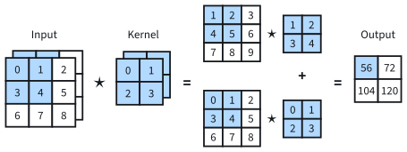
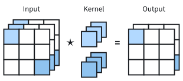

```{.python .input}
%load_ext d2lbook.tab
tab.interact_select('mxnet', 'pytorch', 'tensorflow', 'jax')
```

# Multiple Input and Multiple Output Channels
:label:`sec_channels`

So far our convolutions have mapped a single 2D grid to a single 2D grid. Real
images and hidden representations have multiple *channels* on both sides: an RGB
photograph is a $3 \times h \times w$ tensor (requiring cross-channel comparisons
to detect a red-on-green boundary of equal luminance), and a hidden layer
extracts dozens or hundreds of distinct feature maps in parallel.

As derived in :numref:`sec_why-conv` (:eqref:`eq_conv-layer-channels`), a layer
with $c_\textrm{i}$ input channels and $c_\textrm{o}$ output channels maintains
one $c_\textrm{i} \times k_\textrm{h} \times k_\textrm{w}$ kernel per output
channel, cross-correlating across all input channels and summing the results. In
this section, we implement multi-channel convolutions, account for their
parameter, FLOP, and activation-memory costs (governed by the product
$c_\textrm{i} c_\textrm{o}$), and introduce $1 \times 1$ bottleneck convolutions.
```{.python .input #channels-multiple-input-and-multiple-output-channels}
%%tab mxnet
import math
import numpy as np
from mxnet import autograd, gluon, init, np as mnp, npx
from mxnet.gluon import nn
from d2l import mxnet as d2l
npx.set_np()
```

```{.python .input #channels-multiple-input-and-multiple-output-channels}
%%tab pytorch
import math
import numpy as np
import torch
from torch import nn
from torch.nn import functional as F
from d2l import torch as d2l
```

```{.python .input #channels-multiple-input-and-multiple-output-channels}
%%tab tensorflow
import math
import numpy as np
import tensorflow as tf
from d2l import tensorflow as d2l
```

```{.python .input #channels-multiple-input-and-multiple-output-channels}
%%tab jax
import math
import numpy as np
import jax
from jax import numpy as jnp
from flax import nnx
import optax
from d2l import jax as d2l
```

## Multiple Input Channels

Let us begin with the input side. When the input contains $c_\textrm{i}$
channels, the kernel must supply one $k_\textrm{h}\times k_\textrm{w}$ filter
for each input channel, giving a third-order kernel tensor of shape
$c_\textrm{i}\times k_\textrm{h}\times k_\textrm{w}$. We cross-correlate
every input channel $\mathbf{X}_c$ with its corresponding kernel slice
$\mathbf{K}_c$ using the two-dimensional cross-correlation :eqref:`eq_corr2d`
(computed by `corr2d`) and sum the $c_\textrm{i}$ intermediate grids:

$$\mathbf{Y} = \sum_{c=1}^{c_\textrm{i}} \mathbf{X}_c \star \mathbf{K}_c.$$

Each entry of the resulting two-dimensional output is therefore a weighted sum
over the same spatial window across all input channels, combining
$c_\textrm{i} k_\textrm{h} k_\textrm{w}$ scalar products.
:numref:`fig_conv_multi_in` illustrates this calculation for two input
channels, where the shaded upper-left output entry equals
$(1\times1+2\times2+4\times3+5\times4)+(0\times0+1\times1+3\times2+4\times3)=56$.


:label:`fig_conv_multi_in`

Summing across channels is precisely what allows a kernel to compare
information carried by different channels, such as color. Consider a
$1\times 1$ kernel with weight $+1$ on the red channel and $-1$ on the green
channel: at every pixel it computes red minus green, producing positive values
in red regions, negative values in green regions, and zero in neutral gray
regions regardless of brightness. Wherever its sign flips between adjacent
pixels, a red region meets a green one---even if both regions have identical
luminance, in which case a grayscale brightness filter would see no edge at
all.

Implementing multi-input cross-correlation translates the formula directly
into Python: we call `corr2d` once per channel and sum the results.

```{.python .input #channels-multiple-input-channels-1}
def corr2d_multi_in(X, K):
    """Cross-correlate each channel of X with its channel of K and add."""
    return sum(d2l.corr2d(x, k) for x, k in zip(X, K))
```

Let us verify the implementation on the input and kernel tensors from
:numref:`fig_conv_multi_in`; the upper-left output entry should be 56.

```{.python .input #channels-multiple-input-channels-2}
X = d2l.tensor([[[0.0, 1.0, 2.0], [3.0, 4.0, 5.0], [6.0, 7.0, 8.0]],
               [[1.0, 2.0, 3.0], [4.0, 5.0, 6.0], [7.0, 8.0, 9.0]]])
K = d2l.tensor([[[0.0, 1.0], [2.0, 3.0]], [[1.0, 2.0], [3.0, 4.0]]])

corr2d_multi_in(X, K)
```

## Multiple Output Channels
:label:`subsec_multi-output-channels`

No matter how many input channels it reads, a single multi-input kernel
produces just one two-dimensional *feature map*
(:numref:`subsec_why-conv-channels`). To extract $c_\textrm{o}$ distinct
feature maps simultaneously, a convolutional layer maintains $c_\textrm{o}$
such kernels, each of shape
$c_\textrm{i}\times k_\textrm{h}\times k_\textrm{w}$. Stacking them along a
new axis yields a fourth-order kernel tensor of shape
$c_\textrm{o}\times c_\textrm{i}\times k_\textrm{h}\times k_\textrm{w}$,
where output channel $o$ is given by

$$\mathbf{Y}_o = \sum_{c=1}^{c_\textrm{i}} \mathbf{X}_c \star \mathbf{K}_{o,c}, \quad o = 1, \ldots, c_\textrm{o}.$$

Notice that every output channel connects to *every* input channel through its
own $k_\textrm{h}\times k_\textrm{w}$ slice $\mathbf{K}_{o,c}$; this dense
all-to-all channel wiring is the primary driver of the layer's computational
cost. Written channel by channel, this matches :eqref:`eq_conv-layer-channels`
from :numref:`sec_why-conv`. In typical CNN architectures, the number of
channels grows as spatial resolution shrinks via strides or pooling, trading
fine-grained spatial layout for richer, jointly learned feature descriptions
at each location.

:begin_tab:`mxnet`
Gluon stores kernels channels-first as $(c_\textrm{o}, c_\textrm{i}, k_\textrm{h}, k_\textrm{w})$.
:end_tab:

:begin_tab:`pytorch`
PyTorch stores kernels channels-first as $(c_\textrm{o}, c_\textrm{i}, k_\textrm{h}, k_\textrm{w})$.
:end_tab:

:begin_tab:`tensorflow`
Keras stores kernels channels-last as $(k_\textrm{h}, k_\textrm{w}, c_\textrm{i}, c_\textrm{o})$.
:end_tab:

:begin_tab:`jax`
Flax stores kernels channels-last as $(k_\textrm{h}, k_\textrm{w}, c_\textrm{i}, c_\textrm{o})$.
:end_tab:
To implement multi-channel output cross-correlation, we iterate over the
output kernels, apply `corr2d_multi_in` to each, and stack the resulting
feature maps along axis 0.

```{.python .input #channels-multiple-output-channels-1}
def corr2d_multi_in_out(X, K):
    """Apply corr2d_multi_in once per output channel of K and stack."""
    return d2l.stack([corr2d_multi_in(X, k) for k in K], 0)
```

Let us test this function by stacking `K`, `K + 1`, and `K + 2` into a kernel
tensor with three output channels.

```{.python .input #channels-multiple-output-channels-2}
K = d2l.stack((K, K + 1, K + 2), 0)
K.shape
```

Applying `corr2d_multi_in_out` to our two-channel input `X` and the stacked
$3 \times 2 \times 2 \times 2$ kernel `K` produces a three-channel output
tensor of shape $(3, 2, 2)$.

```{.python .input #channels-multiple-output-channels-3}
corr2d_multi_in_out(X, K)
```

The first output channel matches our earlier result because its kernel is the
original `K`. We can verify the second channel by mental arithmetic: adding 1
to every kernel weight increases each output entry by the sum of all elements
in its receptive window across both input channels. For the upper-left window
that sum is 20, so the second channel begins at $56 + 20 = 76$.

### Parameters and Cost

Adding channels gives a network expressive power, but it also scales up memory
and computation rapidly. Including one scalar bias per output channel, a
convolutional layer contains

$$c_\textrm{o} c_\textrm{i} k_\textrm{h} k_\textrm{w} + c_\textrm{o}$$

learnable parameters. Near the input of a network, this number is modest: the
$3\times 3$ layer mapping 3 RGB channels to 64 channels in
:numref:`sec_why-conv` has only 1,792 parameters. Deeper inside the network,
however, channel counts grow large: a $3\times 3$ layer mapping 256 channels
to 256 channels requires 589,824 weights plus 256 biases.

Turning to computational cost, each output element requires one multiply-add
for every weight in its output channel---$c_\textrm{i} k_\textrm{h} k_\textrm{w}$
in all. Across an output feature map of spatial size
$h_\textrm{o}\times w_\textrm{o}$ and $c_\textrm{o}$ output channels, the
layer performs

$$h_\textrm{o} w_\textrm{o} \cdot c_\textrm{o} c_\textrm{i} k_\textrm{h} k_\textrm{w}$$

multiply-adds. Applied to a $56\times 56$ feature map, our 256-to-256 layer
executes $56^2\cdot 589{,}824 \approx 1.8\times 10^9$ multiply-adds for a
single image. Both parameter count and arithmetic cost scale with the product
$c_\textrm{i} c_\textrm{o}$, meaning that doubling the width of every layer
quadruples both. Because the same weights are reused at every spatial
location, arithmetic cost also scales directly with the output area
$h_\textrm{o} w_\textrm{o}$.

A third resource cost is just as important during training yet easily
overlooked: *activation memory*. To compute gradients in the backward pass,
the framework must retain each layer's output activations, storing
$h_\textrm{o} w_\textrm{o} c_\textrm{o}$ numbers per training example
(:numref:`subsec_memory_during_training`). Unlike parameter memory, activation
memory is largest in the *earliest* layers, where spatial resolution is
highest even though parameter counts are tiny. For example, a 3-to-64 layer
producing a $224\times 224$ output must cache
$224^2\cdot 64 \approx 3.2\times 10^6$ activations per example---nearly two
thousand times more numbers than its 1,792 parameters.

## The $1\times 1$ Convolution
:label:`subsec_1x1`

At first glance, a $1\times 1$ convolution ($k_\textrm{h} = k_\textrm{w} = 1$)
might look pointless: because its spatial window covers only a single pixel,
it cannot detect edges, corners, or any other pattern spanning neighboring
locations. When multiple channels are present, however, it performs a very
useful operation---just as our red-minus-green color filter did earlier. At
every spatial coordinate $(i, j)$, a $1\times 1$ convolution multiplies the
$c_\textrm{i}$-dimensional channel vector by a shared
$c_\textrm{o}\times c_\textrm{i}$ weight matrix to produce a
$c_\textrm{o}$-dimensional output vector. In other words, it acts as a fully
connected layer applied independently at every pixel with weights tied across
all spatial positions. :numref:`fig_conv_1x1` depicts a $1\times 1$
convolution mapping 3 input channels to 2 output channels while leaving height
and width intact.


:label:`fig_conv_1x1`

Because the exact same linear map is applied at every pixel, we can compute
the entire $1\times 1$ convolution with a single matrix multiplication: we
reshape the input into a $c_\textrm{i}\times hw$ matrix, left-multiply by the
$c_\textrm{o}\times c_\textrm{i}$ kernel matrix, and reshape the output back
to $(c_\textrm{o}, h, w)$.

```{.python .input #channels-1-times-1-convolutional-layer-1}
def corr2d_multi_in_out_1x1(X, K):
    """A 1x1 convolution as one matrix product."""
    c_i, h, w = X.shape
    c_o = K.shape[0]
    Y = d2l.matmul(d2l.reshape(K, (c_o, c_i)), d2l.reshape(X, (c_i, h * w)))
    return d2l.reshape(Y, (c_o, h, w))
```

Let us verify on random inputs that this matrix-multiplication formulation
agrees with `corr2d_multi_in_out`.

```{.python .input #channels-1-times-1-convolutional-layer-2}
%%tab mxnet, pytorch
X = d2l.normal(0, 1, (3, 3, 3))
K = d2l.normal(0, 1, (2, 3, 1, 1))
Y1 = corr2d_multi_in_out_1x1(X, K)
Y2 = corr2d_multi_in_out(X, K)
float(d2l.reduce_sum(d2l.abs(Y1 - Y2)))
```

```{.python .input #channels-1-times-1-convolutional-layer-2}
%%tab tensorflow
X = d2l.normal((3, 3, 3), 0, 1)
K = d2l.normal((2, 3, 1, 1), 0, 1)
Y1 = corr2d_multi_in_out_1x1(X, K)
Y2 = corr2d_multi_in_out(X, K)
float(d2l.reduce_sum(d2l.abs(Y1 - Y2)))
```

```{.python .input #channels-1-times-1-convolutional-layer-2}
%%tab jax
X = jax.random.normal(d2l.get_key(), (3, 3, 3))
K = jax.random.normal(d2l.get_key(), (2, 3, 1, 1))
Y1 = corr2d_multi_in_out_1x1(X, K)
Y2 = corr2d_multi_in_out(X, K)
float(d2l.reduce_sum(d2l.abs(Y1 - Y2)))
```

As expected, the two results match up to floating-point rounding error.

Why are $1\times 1$ convolutions so ubiquitous in modern architectures? Their
main strength is adjusting channel dimensionality cheaply so that expensive
spatial convolutions can operate on narrower representations. Return to our
256-to-256 $3\times 3$ layer. Instead of applying $3\times 3$ kernels directly
to all 256 channels, we can use a $1\times 1$ convolution to project 256
channels down to 64, apply the $3\times 3$ convolution across those 64
channels, and use a second $1\times 1$ convolution to expand back to 256.
Together, the three layers use only
$16{,}384 + 36{,}864 + 16{,}384 = 69{,}632$ weights instead of $589{,}824$---a
reduction of roughly $8.5\times$ in both parameters and multiply-adds. Such a
*bottleneck* restricts intermediate spatial mixing to a 64-channel subspace, a
tradeoff that architectures such as ResNet (:numref:`sec_resnet`) happily make
in exchange for much greater depth. Placing an activation function after a
$1\times 1$ convolution turns it into a tiny nonlinear MLP evaluated at every
pixel :cite:`Lin.Chen.Yan.2013`; without a nonlinearity, consecutive linear
convolutions would simply collapse into a single linear map.

Two other architectural mechanisms reduce the $c_\textrm{i} c_\textrm{o}$
factor by restricting which input channels feed into each output channel:
*grouped convolutions*, popularized by ResNeXt (:numref:`subsec_resnext`), and
*depthwise-separable convolutions*, which underpin lightweight mobile models
(:numref:`sec_depthwise_separable`). We will introduce each in the next
chapter as we build the architectures that rely on them.

Notice that channels alone leave one basic property unchanged: convolutional
outputs still shift pixel-for-pixel whenever the input shifts. In
:numref:`sec_pooling`, we introduce pooling layers to summarize local
neighborhoods and build tolerance to small spatial shifts.

## Summary

To handle multi-channel inputs, a convolutional layer cross-correlates each
input channel with its own spatial kernel and sums the results, allowing a
single filter to integrate cues across channels such as color. To produce
$c_\textrm{o}$ output feature maps, the layer stacks $c_\textrm{o}$ such
multi-input kernels into a tensor of shape
$c_\textrm{o}\times c_\textrm{i}\times k_\textrm{h}\times k_\textrm{w}$,
incurring $c_\textrm{o} c_\textrm{i} k_\textrm{h} k_\textrm{w} + c_\textrm{o}$
parameters and
$h_\textrm{o} w_\textrm{o} c_\textrm{o} c_\textrm{i} k_\textrm{h} k_\textrm{w}$
multiply-adds---both proportional to $c_\textrm{i} c_\textrm{o}$---while
training must also store $h_\textrm{o} w_\textrm{o} c_\textrm{o}$ activations
per example. A $1\times 1$ convolution acts as a shared fully connected layer
at every pixel, letting architectures mix channels and construct parameter-
and compute-efficient bottlenecks.

## Exercises

1. **Composition of convolutions.** Two convolutional layers with stride
   1, no padding, and no nonlinearity in between have kernels of shape
   $c_\textrm{m} \times c_\textrm{i} \times k_1 \times k_1$ and
   $c_\textrm{o} \times c_\textrm{m} \times k_2 \times k_2$.
    1. Prove that their composition is a single convolution, and give the
       shape of its kernel.
    1. Compare the number of weights of the pair with that of the single
       convolution. For which intermediate width $c_\textrm{m}$ is the
       pair cheaper?
    1. As :numref:`sec_conv_layer` showed, three stacked single-channel
       $3 \times 3$ kernels have a $7 \times 7$ receptive field. Decide
       whether every single-channel $7 \times 7$ kernel is the composition
       of three $3 \times 3$ kernels, and justify the answer.

1. **Three costs, three layers.** A network for $224\times 224$ RGB
   images begins with four $3\times 3$ convolutions with padding 1: from 3
   to 64 channels at stride 1, from 64 to 128 at stride 2, from 128 to 128
   at stride 1, and from 128 to 256 at stride 2.
    1. For each layer give the output shape, the number of weights, the
       number of multiply-adds per image, and the number of output values
       that training must keep for the backward pass.
    1. Which layer has the most weights, which performs the most
       multiply-adds, and which keeps the most output values? Explain why
       these are three different layers.
    1. The images are replaced by $448\times 448$ ones. Which of the three
       costs change, and by what factor?

1. [code] **Multi-channel im2col.** Extend the patch matrix of
   :numref:`subsec_conv_matmul` to several input and output channels.
   Rebuild the two-channel `X` of :numref:`fig_conv_multi_in` and the
   three-output-channel `K` of :numref:`subsec_multi-output-channels`,
   since later cells of this section overwrite both. Build the patch
   matrix, whose rows are input patches of shape
   $c_\textrm{i} \times k_\textrm{h} \times k_\textrm{w}$ flattened in
   that order, and arrange `K` into a
   $c_\textrm{i} k_\textrm{h} k_\textrm{w} \times c_\textrm{o}$ kernel
   matrix whose rows follow the same order. Confirm that their product,
   rearranged into the shape of the output, reproduces
   `corr2d_multi_in_out(X, K)`.

    *Adapted from Simon Prince,
    [Understanding Deep Learning](https://udlbook.github.io/udlbook/),
    Problems 10.6 and 10.7.*

:begin_tab:`mxnet`
[Discussions](https://d2l.discourse.group/t/69)
:end_tab:

:begin_tab:`pytorch`
[Discussions](https://d2l.discourse.group/t/70)
:end_tab:

:begin_tab:`tensorflow`
[Discussions](https://d2l.discourse.group/t/273)
:end_tab:

:begin_tab:`jax`
[Discussions](https://d2l.discourse.group/t/17998)
:end_tab:

<!-- slides -->

::: {.slide}
::: {.cover}
[Dive into Deep Learning · §6.4]{.kicker}

Multiple Input and Multiple Output Channels<br>**multi-channel kernels · feature maps · compute & memory scaling · 1×1 bottlenecks**
:::
:::

::: {.slide title="Why Vision Networks Need Multi-Channel Tensors"}
[Motivation & The Quadratic Channel Scaling Wall]{.kicker}

::: {.cols .vc}
::: {.col}
- **Multi-channel inputs ($c_\textrm{i}$):** RGB images carry 3 channels per pixel; hidden stages carry $64\text{--}512$ parallel feature maps ($c_\textrm{o}$).
- **The $c_\textrm{i} c_\textrm{o}$ scaling wall:** Because every output channel connects to every input channel, a single $256 \to 256$ $3 \times 3$ layer demands **$590{,}080$ parameters** and **$1.85 \times 10^9$ MACs** at $56 \times 56$.
- **Solution preview:** $1 \times 1$ bottleneck projections cut both by $8.5\times$.
:::

::: {.col .fig .big}
@fig:ch06-cnn-channel-scaling-wall
:::
:::
:::

::: {.slide title="Cross-Correlation with Multiple Input Channels"}
[One Spatial Filter Slice per Input Channel, Then Sum]{.kicker}

When the input $\mathsf{X}$ has $c_\textrm{i}$ channels of shape $(c_\textrm{i}, n_\textrm{h}, n_\textrm{w})$, a single output channel's kernel $\mathsf{K}$ must have shape $(c_\textrm{i}, k_\textrm{h}, k_\textrm{w})$. We cross-correlate each channel $\mathbf{X}_c$ with its filter slice $\mathbf{K}_c$ and sum across all $c_\textrm{i}$ channels:

::: {.cols .vc}
::: {.col}
$$\mathbf{Y} = \sum_{c=1}^{c_\textrm{i}} \mathbf{X}_c \star \mathbf{K}_c$$

- **Scalar products per output pixel:** Each entry $[\mathbf{Y}]_{i,j}$ aggregates $c_\textrm{i} k_\textrm{h} k_\textrm{w}$ products across space and channels.
- **Shaded top-left output $(0,0)$ ($c_\textrm{i}=2$):**
  - Channel 0: $0{\cdot}0 + 1{\cdot}1 + 3{\cdot}2 + 4{\cdot}3 = 19$.
  - Channel 1: $1{\cdot}1 + 2{\cdot}2 + 4{\cdot}3 + 5{\cdot}4 = 37$.
  - Sum: $19 + 37 = 56$.
:::

::: {.col .fig}
{.nostretch width=100%}
:::
:::
:::

::: {.slide title="How Cross-Channel Summation Detects Color Opponency"}
[Why Spatial Filtering Alone Cannot See Equal-Luminance Edges]{.kicker}

::: {.cols .vc}
::: {.col}
$$[\mathbf{Y}]_{i,j} = [\mathbf{X}_{\textrm{R}}]_{i,j} - [\mathbf{X}_{\textrm{G}}]_{i,j}$$

- **Opponent color weighting:** Pairing $+1$ on Red with $-1$ on Green outputs $+1$ on red, $-1$ on green, and $0$ on neutral gray of any brightness.
- **Isoluminant edges:** Detects red-on-green boundaries where grayscale luminance is completely flat.
:::

::: {.col .fig}
@fig:ch06-cnn-color-opponency
:::
:::
:::

::: {.slide title="Implementing Multi-Input Cross-Correlation in Code"}
[Summing 2D Cross-Correlations Over the Channel Axis]{.kicker}

In Python, `corr2d_multi_in` zips the channel slices of `X` and `K`, calls `d2l.corr2d(x, k)` on each pair, and sums the resulting 2D grids:

@channels-multiple-input-channels-1

@channels-multiple-input-channels-2
:::

::: {.slide title="Multiple Output Channels: The 4D Kernel Tensor"}
[Extracting c_o Parallel Feature Maps]{.kicker}

::: {.cols .vc}
::: {.col}
$$\mathbf{Y}_o = u_o + \sum_{c=1}^{c_\textrm{i}} \mathbf{X}_c \star \mathbf{K}_{o, c}, \qquad o = 1, \ldots, c_\textrm{o}$$

- **4D filter bank $\mathsf{K} \in \mathbb{R}^{c_\textrm{o} \times c_\textrm{i} \times k_\textrm{h} \times k_\textrm{w}}$:** Stacks $c_\textrm{o}$ independent 3D kernels to produce $c_\textrm{o}$ output feature maps.
- **Memory layouts:** Depending on the framework, the channel axis comes first, $(B, C, H, W)$, or last, $(B, H, W, C)$; the arithmetic is identical.
:::

::: {.col .fig}
@fig:ch06-cnn-multi-out-4d
:::
:::
:::

::: {.slide title="Implementing Multi-Input, Multi-Output Convolution"}
[Stacking Output Feature Maps Along Axis 0]{.kicker}

Iterating `corr2d_multi_in(X, k)` over each 3D kernel `k` in the 4D tensor `K` and stacking along axis 0 produces the 3D output tensor $(c_\textrm{o}, h_\textrm{o}, w_\textrm{o})$:

@channels-multiple-output-channels-1

::: {.cols}
::: {.col}
@channels-multiple-output-channels-2
:::

::: {.col}
@channels-multiple-output-channels-3
:::
:::
:::

::: {.slide title="Mental-Math Verification of Multi-Channel Outputs"}
[Why Adding +1 to All Kernel Weights Adds 20 to Position (0,0)]{.kicker}

::: {.cols .vc}
::: {.col}
- **Linearity in the kernel:** Shifting every weight in $\mathsf{K}$ by $+c$ adds $c$ times the sum of all input elements inside the window.
- **Top-left $2 \times 2$ window sum:** $(0+1+3+4) + (1+2+4+5) = 20$.
- **Exact outputs at $(0,0)$:** Channel 0 gives $56$, Channel 1 ($\mathsf{K}+1$) gives $56 + 20 = 76$, and Channel 2 ($\mathsf{K}+2$) gives $56 + 40 = 96$.
:::

::: {.col .fig .big}
@fig:ch06-cnn-kernel-shift-linearity
:::
:::
:::

::: {.slide title="Three Distinct Resource Costs of a Convolutional Layer"}
[Parameters, Multiply-Adds (MACs), and Activation Memory]{.kicker}

::: {.cols .vc}
::: {.col}
- **1. Parameters:** $c_\textrm{o} c_\textrm{i} k_\textrm{h} k_\textrm{w} + c_\textrm{o}$ (independent of $H \times W$).
- **2. Multiply-Adds (MACs):** $h_\textrm{o} w_\textrm{o} \cdot c_\textrm{o} c_\textrm{i} k_\textrm{h} k_\textrm{w}$ (scales with output area $\times$ weights).
- **3. Activation RAM:** $B \cdot h_\textrm{o} w_\textrm{o} c_\textrm{o}$ cached during forward pass for backprop.
:::

::: {.col .fig .big}
@fig:ch06-cnn-three-resource-budgets
:::
:::
:::

::: {.slide title="Systems Pitfall: Where Memory and Compute Actually Live"}
[Early Stem Layers vs. Deep High-Channel Layers]{.kicker}

::: {.cols .vc}
::: {.col}
- **Early stem ($3 \to 64$ @ $224^2$):** Tiny weights ($1{,}792$ params = $7\textrm{ KB}$), huge cached activations ($3.21\textrm{M}$ = **$12.8\textrm{ MB/image}**).
- **Deep stage ($256 \to 256$ @ $56^2$):** Huge weights ($590\textrm{K}$ params = **$2.36\textrm{ MB}**), $4\times$ smaller activations ($3.2\textrm{ MB/image}$).
- **Training OOM rule:** GPU VRAM is dominated by **batch size $\times$ early high-res feature maps**.
:::

::: {.col .fig .big}
@fig:ch06-cnn-memory-vs-params-stages
:::
:::
:::

::: {.slide title="The 1×1 Convolution: A Per-Pixel Channel MLP"}
[Mixing Channels Without Spatial Aggregation]{.kicker}

At $k_\textrm{h} = k_\textrm{w} = 1$, the spatial window covers just a single pixel $(i, j)$—so what does a $1 \times 1$ convolution actually compute?

::: {.cols .vc}
::: {.col}
$$[\mathsf{Y}]_{o, i, j} = u_o + \sum_{c=1}^{c_\textrm{i}} [\mathbf{K}]_{o, c}\, [\mathsf{X}]_{c, i, j}$$

- **Shared dense layer across space:** At every pixel $(i, j)$, it multiplies the $c_\textrm{i}$-vector of input channels by the same $c_\textrm{o} \times c_\textrm{i}$ weight matrix $\mathbf{K}$.
- **Roles:** Cross-channel feature mixing, projecting channel count up or down ($c_\textrm{i} \to c_\textrm{o}$), and adding per-pixel nonlinearity (when followed by ReLU).
:::

::: {.col .fig}
{.nostretch width=100%}
:::
:::
:::

::: {.slide title="Implementing 1×1 Convolution as One Matrix Product"}
[Reshaping (c_i, H, W) to (c_i, H*W) Without im2col Duplication]{.kicker}

::: {.cols .vc}
::: {.col}
@channels-1-times-1-convolutional-layer-1

@channels-1-times-1-convolutional-layer-2
:::

::: {.col .fig}
@fig:ch06-cnn-1x1-matmul-reshape
:::
:::
:::

::: {.slide title="1×1 Bottlenecks: 8.5× Fewer Parameters & MACs"}
[Breaking the c_i * c_o Cost of Wide 3×3 Convolutions]{.kicker}

::: {.cols .vc}
::: {.col}
- **Direct $3 \times 3$ ($256 \to 256$):** Costs $589{,}824$ weights and $1.85 \times 10^9$ MACs at $56 \times 56$.
- **Bottleneck ($256 \xrightarrow{1\times 1} 64 \xrightarrow{3\times 3} 64 \xrightarrow{1\times 1} 256$):** Uses only $16{,}384 + 36{,}864 + 16{,}384 = 69{,}632$ weights (**$8.5\times$ reduction**).
- **Mandatory nonlinearities:** Interleaving ReLU prevents the 3 linear layers from collapsing into one rank-64 matrix.
:::

::: {.col .fig .big}
@fig:ch06-cnn-1x1-bottleneck-savings
:::
:::
:::

::: {.slide title="Beyond 1×1 Bottlenecks: Grouped & Depthwise Convs"}
[Factorizing All-to-All Channel Wiring in Modern CNNs]{.kicker}

::: {.cols .vc}
::: {.col}
- **Grouped convolution ($g$ groups):** Splits channels into $g$ independent groups, cutting weights and MACs by $g\times$ (ResNeXt, RegNet).
- **Depthwise-separable ($g = c_\textrm{i}$ + $1 \times 1$):** Decouples spatial filtering ($c_\textrm{i} k^2$) from channel mixing ($c_\textrm{o} c_\textrm{i}$), saving $\approx 8\text{--}9\times$ on $3 \times 3$ layers (MobileNet, ConvNeXt).
:::

::: {.col .fig .big}
@fig:ch06-cnn-grouped-depthwise-preview
:::
:::
:::

::: {.slide title="Concept Check: Multi-Channel Arithmetic & Scaling"}
[Concept Check]{.kicker}

Work out these three calculations:

1. **Hand cross-correlation:** For the two-channel $3 \times 3$ input and $2 \times 2$ kernel on Slide 3, we found $[\mathbf{Y}]_{0,0} = 19 + 37 = 56$. Compute the first-row, second-column entry $[\mathbf{Y}]_{0,1}$.
2. **LeNet's second conv layer:** Maps $c_\textrm{i} = 6$ to $c_\textrm{o} = 16$ channels with unpadded $5 \times 5$ kernels on a $14 \times 14$ input. What are the output shape, parameter count, and multiply-adds?
3. **Resolution doubling test:** If you double input image resolution from $224 \times 224$ to $448 \times 448$, by what exact factor do a convolutional layer's (a) parameters, (b) multiply-adds, and (c) activation memory change?

::: {.d2l-note .fragment .fade-up}
**Answers:**
(1) Channel 0 top-right window: $1{\cdot}0 + 2{\cdot}1 + 4{\cdot}2 + 5{\cdot}3 = 25$. Channel 1 top-right window: $2{\cdot}1 + 3{\cdot}2 + 5{\cdot}3 + 6{\cdot}4 = 47$. Sum: $25 + 47 = 72$.
(2) Output shape: $16 \times 10 \times 10$. Parameters: $16 \times 6 \times 25 + 16 = 2{,}416$. MACs: $10^2 \times 2{,}400 = 240{,}000$.
(3) (a) Parameters: **$1\times$** (unchanged); (b) Multiply-adds: **$4\times$** ($h_\textrm{o} w_\textrm{o}$ quadruples); (c) Activation memory: **$4\times$**.
:::
:::

::: {.slide title="Summary & Key Takeaways"}
[Section Synthesis]{.kicker}

| Concept / Mechanism | Mathematical / Tensor Form | Scaling Cost | Architectural Role |
|---|---|---|---|
| **Multi-Input Conv** | $\mathbf{Y} = \sum_{c=1}^{c_\textrm{i}} \mathbf{X}_c \star \mathbf{K}_c$ | $\mathsf{K} \in \mathbb{R}^{c_\textrm{i} \times k_\textrm{h} \times k_\textrm{w}}$ | Fuses color or multi-feature cues across channels |
| **Multi-Output Conv** | $\mathbf{Y}_o = u_o + \sum_{c=1}^{c_\textrm{i}} \mathbf{X}_c \star \mathbf{K}_{o,c}$ | $c_\textrm{o} c_\textrm{i} k_\textrm{h} k_\textrm{w} + c_\textrm{o}$ params | Extracts $c_\textrm{o}$ parallel feature maps; grows as $H, W$ shrink |
| **Compute & Memory** | $\textrm{MACs} = h_\textrm{o} w_\textrm{o} c_\textrm{o} c_\textrm{i} k_\textrm{h} k_\textrm{w}$ | $\textrm{Activations} = h_\textrm{o} w_\textrm{o} c_\textrm{o}$ | Early layers dominate RAM; deep wide layers dominate params |
| **$1 \times 1$ Convolution** | $\mathbf{Y} = \textrm{reshape}(\mathbf{K}\,\textrm{reshape}(\mathsf{X}))$ | $c_\textrm{o} c_\textrm{i} + c_\textrm{o}$ params | Per-pixel channel MLP; bottleneck projections cut cost $8.5\times$ |

::: {.d2l-note}
**Next (§6.5):** How to summarize local neighborhoods, absorb small spatial jitters, and collapse spatial feature maps into translation-invariant vectors via **pooling layers**.
:::
:::
