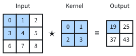
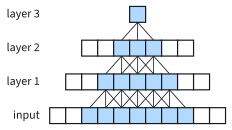
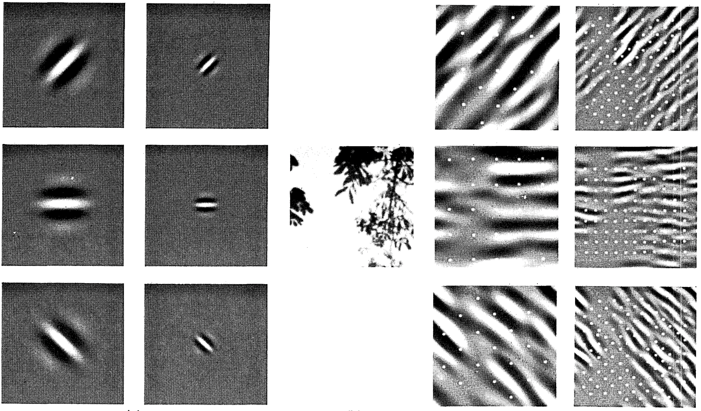

```{.python .input}
%load_ext d2lbook.tab
tab.interact_select('mxnet', 'pytorch', 'tensorflow', 'jax')
```

# Convolutions for Images
:label:`sec_conv_layer`

Suppose we want to find the vertical edges in a grayscale image, the places
where a bright region meets a dark one. Take an image of $6 \times 8$ pixels
that is white (value 1) except for a black band (value 0) in its middle four
columns. Subtracting from each pixel its right-hand neighbor gives $1$ where
white turns to black, $-1$ where black turns to white, and $0$ inside flat
regions. An edge can occur in any row and any column, so the same detector,
the two weights $(1, -1)$, must be applied at every position. Sliding it over
the image gives one output for each of the $6 \times 7$ positions at which the
$1 \times 2$ window fits, and these outputs form a map of the edges.

This is the operation that a convolutional layer computes: a small array of
weights, the kernel, is compared with every window of the image, and each
comparison yields one output. :numref:`sec_why-conv` derived this layer from
two requirements on a fully connected layer: that a shifted input produce a
shifted output, and that each output depend only on a small neighborhood. A
detector that we design by hand works for vertical edges, but a network needs
thousands of detectors, and nobody knows in advance which patterns they
should match. This section defines the operation, implements it,
applies it to the edge example, and then learns the kernel $(1, -1)$ from the
image and its edge map alone. It ends with how the operation is computed
efficiently and how much of the image a unit in a stack of such layers sees.

```{.python .input #conv-layer-convolutions-for-images}
%%tab mxnet
from d2l import mxnet as d2l
from mxnet import autograd, gluon, init, npx
from mxnet.gluon import nn
npx.set_np()
```

```{.python .input #conv-layer-convolutions-for-images}
%%tab pytorch
from d2l import torch as d2l
import torch
from torch import nn
from torch.nn import functional as F
```

```{.python .input #conv-layer-convolutions-for-images}
%%tab tensorflow
from d2l import tensorflow as d2l
import tensorflow as tf
```

```{.python .input #conv-layer-convolutions-for-images}
%%tab jax
from d2l import jax as d2l
from flax import nnx
from jax import numpy as jnp
```

## Cross-Correlation

### The Operation

We omit channels for now: the input $\mathbf{X}$ is a matrix of height
$n_\textrm{h}$ and width $n_\textrm{w}$, and the kernel $\mathbf{K}$ is a
matrix of height $k_\textrm{h}$ and width $k_\textrm{w}$. The kernel's shape
is also the shape of the *window*, the part of the input that the kernel
covers at one position. Place the window with its upper-left corner at input
position $(i, j)$, multiply the input elements under it elementwise with the
kernel, and sum. The result is the output at position $(i, j)$:

$$[\mathbf{Y}]_{i, j} = \sum_{a=0}^{k_\textrm{h}-1} \sum_{b=0}^{k_\textrm{w}-1} [\mathbf{K}]_{a, b}\, [\mathbf{X}]_{i+a, j+b}.$$
:eqlabel:`eq_corr2d`

This is the *two-dimensional cross-correlation* of $\mathbf{X}$ with
$\mathbf{K}$, which we write $\mathbf{Y} = \mathbf{X} \star \mathbf{K}$.
Indices start at 0 here, as in code. The layer of
:numref:`sec_why-conv` indexed the window by offsets from $-\Delta$ to
$\Delta$ around its center instead; the two conventions differ only by a
shift of the output by $\Delta$ positions.


:label:`fig_correlation`

In :numref:`fig_correlation` the input has shape $3 \times 3$ and the kernel
has shape $2 \times 2$. The window starts at the upper-left corner of the input
and slides one element at a time, from left to right and from top to bottom.
The window fits at four positions, which give the four outputs

$$
\begin{aligned}
0\times0+1\times1+3\times2+4\times3 &= 19,\\
1\times0+2\times1+4\times2+5\times3 &= 25,\\
3\times0+4\times1+6\times2+7\times3 &= 37,\\
4\times0+5\times1+7\times2+8\times3 &= 43.
\end{aligned}
$$

The output is smaller than the input because the window must lie inside the
input. Along each axis it fits at $n - k + 1$ positions, so the output has
shape

$$(n_\textrm{h}-k_\textrm{h}+1) \times (n_\textrm{w}-k_\textrm{w}+1).$$

The $3 \times 3$ input with a $2 \times 2$ kernel gives $2 \times 2$, the
$6 \times 8$ edge image with a $1 \times 2$ kernel gives $6 \times 7$, and a
$28 \times 28$ Fashion-MNIST image with a $5 \times 5$ kernel gives
$24 \times 24$. Adding a border of zeros around the input, called *padding*,
keeps the size unchanged; :numref:`sec_padding` treats it together with other
ways to control the output shape.

### Implementation

The function `corr2d` computes :eqref:`eq_corr2d` with two loops over the
output positions. It accepts an input tensor `X` and a kernel tensor `K` and
returns the output tensor `Y`.

```{.python .input #conv-layer-the-cross-correlation-operation-1}
%%tab mxnet
def corr2d(X, K):  #@save
    """Compute 2D cross-correlation."""
    h, w = K.shape
    Y = d2l.zeros((X.shape[0] - h + 1, X.shape[1] - w + 1))
    for i in range(Y.shape[0]):
        for j in range(Y.shape[1]):
            Y[i, j] = d2l.reduce_sum((X[i: i + h, j: j + w] * K))
    return Y
```

```{.python .input #conv-layer-the-cross-correlation-operation-1}
%%tab pytorch
def corr2d(X, K):  #@save
    """Compute 2D cross-correlation."""
    h, w = K.shape
    Y = d2l.zeros((X.shape[0] - h + 1, X.shape[1] - w + 1))
    for i in range(Y.shape[0]):
        for j in range(Y.shape[1]):
            Y[i, j] = d2l.reduce_sum((X[i: i + h, j: j + w] * K))
    return Y
```

```{.python .input #conv-layer-the-cross-correlation-operation-1}
%%tab tensorflow
def corr2d(X, K):  #@save
    """Compute 2D cross-correlation."""
    h, w = K.shape
    Y = tf.Variable(tf.zeros((X.shape[0] - h + 1, X.shape[1] - w + 1)))
    for i in range(Y.shape[0]):
        for j in range(Y.shape[1]):
            Y[i, j].assign(tf.reduce_sum(
                X[i: i + h, j: j + w] * K))
    return Y
```

```{.python .input #conv-layer-the-cross-correlation-operation-1}
%%tab jax
def corr2d(X, K):  #@save
    """Compute 2D cross-correlation."""
    h, w = K.shape
    Y = jnp.zeros((X.shape[0] - h + 1, X.shape[1] - w + 1))
    for i in range(Y.shape[0]):
        for j in range(Y.shape[1]):
            Y = Y.at[i, j].set((X[i:i + h, j:j + w] * K).sum())
    return Y
```

Does `corr2d` reproduce the four outputs of :numref:`fig_correlation`? We
construct its input and kernel and compare.

```{.python .input #conv-layer-the-cross-correlation-operation-2}
X = d2l.tensor([[0.0, 1.0, 2.0], [3.0, 4.0, 5.0], [6.0, 7.0, 8.0]])
K = d2l.tensor([[0.0, 1.0], [2.0, 3.0]])
corr2d(X, K)
```

The output matches the figure.

### Convolution and Cross-Correlation

The mathematical *convolution* of $\mathbf{X}$ with $\mathbf{K}$ reads the
input at $(i-a, j-b)$ instead of $(i+a, j+b)$, which amounts to flipping the
kernel horizontally and vertically (:numref:`sec_why-conv`). Cross-correlating
with $\mathbf{K}$ therefore gives the same output as convolving with the
flipped kernel $\mathbf{K}'$. For the input of :numref:`fig_correlation`, a
layer that computes true convolutions produces the outputs 19, 25, 37, and 43
with the kernel $\mathbf{K}' = \begin{bmatrix} 3 & 2 \\ 1 & 0 \end{bmatrix}$.
Since kernels are learned from data, such a layer would simply learn the
flipped kernel, and its outputs would be unchanged. Deep learning libraries
compute cross-correlations and call them convolutions, and we follow this
usage from now on.


## Convolutional Layers

### The Layer

A convolutional layer cross-correlates its input with a kernel and adds a
scalar bias. Its two parameters are the kernel and the bias. The kernel
starts from random values, drawn from $\mathcal{N}(0, 0.01^2)$ like the
weights of the MLP in :numref:`chap_perceptrons`, and the bias starts at
zero. The class `Conv2D` declares the two parameters in its
constructor, and its forward method calls `corr2d` and adds the bias. A layer
whose kernel has height $h$ and width $w$ is called an $h \times w$
convolutional layer.

```{.python .input #conv-layer-convolutional-layers}
%%tab mxnet
class Conv2D(nn.Block):
    def __init__(self, kernel_size):
        super().__init__()
        self.weight = gluon.Parameter('weight', shape=kernel_size,
                                      init=init.Normal(0.01))
        self.bias = gluon.Parameter('bias', shape=(1,), init=init.Zero())

    def forward(self, x):
        return corr2d(x, self.weight.data()) + self.bias.data()
```

```{.python .input #conv-layer-convolutional-layers}
%%tab pytorch
class Conv2D(nn.Module):
    def __init__(self, kernel_size):
        super().__init__()
        self.weight = nn.Parameter(0.01 * torch.randn(kernel_size))
        self.bias = nn.Parameter(torch.zeros(1))

    def forward(self, x):
        return corr2d(x, self.weight) + self.bias
```

```{.python .input #conv-layer-convolutional-layers}
%%tab tensorflow
class Conv2D(tf.keras.layers.Layer):
    def __init__(self, kernel_size):
        super().__init__()
        self.weight = self.add_weight(
            name='w', shape=kernel_size,
            initializer=tf.keras.initializers.RandomNormal(stddev=0.01))
        self.bias = self.add_weight(name='b', shape=(1,), initializer='zeros')

    def call(self, inputs):
        return corr2d(inputs, self.weight) + self.bias
```

```{.python .input #conv-layer-convolutional-layers}
%%tab jax
class Conv2D(nnx.Module):
    def __init__(self, kernel_size, rngs=None):
        rngs = nnx.Rngs(d2l.get_key()) if rngs is None else rngs
        self.weight = nnx.Param(
            nnx.initializers.normal(stddev=0.01)(rngs.params(), kernel_size))
        self.bias = nnx.Param(jnp.zeros(1))

    def __call__(self, x):
        return corr2d(x, self.weight) + self.bias
```

The number of parameters does not depend on the input. One $2 \times 2$ layer
with its five parameters applies to the $3 \times 3$ input `X` and to a
$6 \times 8$ image alike, and returns outputs of shape $2 \times 2$ and
$5 \times 7$.

```{.python .input #conv-layer-the-layer-1}
%%tab mxnet
layer = Conv2D((2, 2))
layer.initialize()
layer(X).shape, layer(d2l.ones((6, 8))).shape
```

```{.python .input #conv-layer-the-layer-1}
%%tab pytorch, tensorflow, jax
layer = Conv2D((2, 2))
layer(X).shape, layer(d2l.ones((6, 8))).shape
```

### Edge Detection
:label:`subsec_edge_detection`

We now run the edge detector of the opening. The image has $6 \times 8$
pixels; its middle four columns are black (0) and the rest is white (1).

```{.python .input #conv-layer-object-edge-detection-in-images-1}
%%tab mxnet, pytorch
X = d2l.ones((6, 8))
X[:, 2:6] = 0
X
```

```{.python .input #conv-layer-object-edge-detection-in-images-1}
%%tab tensorflow
X = tf.Variable(tf.ones((6, 8)))
X[:, 2:6].assign(tf.zeros(X[:, 2:6].shape))
X
```

```{.python .input #conv-layer-object-edge-detection-in-images-1}
%%tab jax
X = jnp.ones((6, 8))
X = X.at[:, 2:6].set(0)
X
```

The kernel has height 1 and width 2:

$$\mathbf{K} = \begin{bmatrix} 1 & -1 \end{bmatrix}.$$
:eqlabel:`eq_edge_kernel`

At position $(i, j)$ it computes $x_{i,j} - x_{i,j+1}$, the difference between
two horizontally adjacent pixels, which is 0 wherever they are equal. This is
a *finite difference*. For a smooth function $f(i, j)$ of the position, the
derivative along the horizontal axis is

$$\partial_j f(i,j) = \lim_{\epsilon \to 0} \frac{f(i,j+\epsilon) - f(i,j)}{\epsilon},$$

and taking $\epsilon = 1$ shows that $x_{i,j} - x_{i,j+1}$ approximates
$-\partial_j f(i,j)$. The kernel thus responds to changes of intensity along
each row.

```{.python .input #conv-layer-object-edge-detection-in-images-2}
K = d2l.tensor([[1.0, -1.0]])
```

Cross-correlating `X` with `K` gives the edge map `Y`.

```{.python .input #conv-layer-object-edge-detection-in-images-3}
Y = corr2d(X, K)
Y
```

The output is 1 in the column where white turns to black, $-1$ in the column
where black turns to white, and 0 everywhere else. The same kernel applied to
the transposed image, whose band is horizontal, should find nothing.

```{.python .input #conv-layer-object-edge-detection-in-images-4}
corr2d(d2l.transpose(X), K)
```

The output is zero everywhere: $(1, -1)$ detects only vertical edges. Edges in
other directions need other kernels, and so do corners, textures, and every
other pattern a network may need.

### Learning a Kernel
:label:`subsec_learning_kernel`

Designing every kernel by hand is impractical for larger kernels and for
stacks of layers, where we do not know which patterns the intermediate layers
should detect. Can gradient descent find the kernel from the input `X` and the
desired output `Y` alone? We start from a random $1 \times 2$ kernel, drawn
from $\mathcal{N}(0, 0.01^2)$, measure the squared error between the layer's
output and `Y`, summed over all 42 output positions, and take 10 gradient
steps with learning rate 0.03. Instead of `Conv2D` we use the framework's
built-in convolutional layer, which computes the same cross-correlation in one
fast operation and supports automatic differentiation in every framework. We
omit the bias, which the edge map does not need.

```{.python .input #conv-layer-learning-a-kernel-1}
%%tab mxnet
conv2d = nn.Conv2D(1, kernel_size=(1, 2), use_bias=False,
                   weight_initializer=init.Normal(0.01))
conv2d.initialize()
# Layers take (example, channel, height, width): one example, one channel
X = X.reshape(1, 1, 6, 8)
Y = Y.reshape(1, 1, 6, 7)
lr = 3e-2  # Learning rate

for i in range(10):
    with autograd.record():
        l = ((conv2d(X) - Y) ** 2).sum()
    l.backward()
    conv2d.weight.data()[:] -= lr * conv2d.weight.grad()
    if i % 3 == 0:
        print(f'step {i}, loss {float(l):.3f}')
```

```{.python .input #conv-layer-learning-a-kernel-1}
%%tab pytorch
conv2d = nn.Conv2d(1, 1, kernel_size=(1, 2), bias=False)
nn.init.normal_(conv2d.weight, std=0.01)
# Layers take (example, channel, height, width): one example, one channel
X = X.reshape((1, 1, 6, 8))
Y = Y.reshape((1, 1, 6, 7))
lr = 3e-2  # Learning rate

for i in range(10):
    l = ((conv2d(X) - Y) ** 2).sum()
    conv2d.zero_grad()
    l.backward()
    with torch.no_grad():
        conv2d.weight -= lr * conv2d.weight.grad
    if i % 3 == 0:
        print(f'step {i}, loss {l:.3f}')
```

```{.python .input #conv-layer-learning-a-kernel-1}
%%tab tensorflow
conv2d = tf.keras.layers.Conv2D(
    1, (1, 2), use_bias=False,
    kernel_initializer=tf.keras.initializers.RandomNormal(stddev=0.01))
# Layers take (example, height, width, channel): one example, one channel
X = tf.reshape(X, (1, 6, 8, 1))
Y = tf.reshape(Y, (1, 6, 7, 1))
lr = 3e-2  # Learning rate

for i in range(10):
    with tf.GradientTape() as tape:
        l = tf.reduce_sum((conv2d(X) - Y) ** 2)
    conv2d.kernel.assign_sub(lr * tape.gradient(l, conv2d.kernel))
    if i % 3 == 0:
        print(f'step {i}, loss {l:.3f}')
```

```{.python .input #conv-layer-learning-a-kernel-1}
%%tab jax
# padding='VALID' evaluates only where the window fits, as corr2d does
conv2d = nnx.Conv(1, 1, kernel_size=(1, 2), use_bias=False, padding='VALID',
                  kernel_init=nnx.initializers.normal(stddev=0.01),
                  rngs=nnx.Rngs(d2l.get_key()))
# Layers take (example, height, width, channel): one example, one channel
X = X.reshape((1, 6, 8, 1))
Y = Y.reshape((1, 6, 7, 1))
lr = 3e-2  # Learning rate

def loss(model, X, Y):
    return ((model(X) - Y) ** 2).sum()

for i in range(10):
    l, grads = nnx.value_and_grad(loss)(conv2d, X, Y)
    conv2d.kernel[...] -= lr * grads.kernel[...]
    if i % 3 == 0:
        print(f'step {i}, loss {l:.3f}')
```

Before the first step the loss is close to 12: the small random kernel
outputs nearly 0 everywhere, so each of the 12 edge positions misses its
target $\pm 1$ by about 1. After nine steps the loss is below 0.01. The
learned kernel is close to $(1, -1)$:

```{.python .input #conv-layer-learning-a-kernel-2}
%%tab mxnet
d2l.reshape(conv2d.weight.data(), (1, 2))
```

```{.python .input #conv-layer-learning-a-kernel-2}
%%tab pytorch
d2l.reshape(conv2d.weight.data, (1, 2))
```

```{.python .input #conv-layer-learning-a-kernel-2}
%%tab tensorflow
d2l.reshape(conv2d.kernel, (1, 2))
```

```{.python .input #conv-layer-learning-a-kernel-2}
%%tab jax
conv2d.kernel[...].reshape((1, 2))
```

Both weights are within about 0.02 of the hand-designed detector. Nothing in
the training procedure was specific to edges: given the outputs it should
produce, gradient descent finds the kernel. In a deep network nobody supplies
the intermediate outputs either, and the kernels of every layer are learned
from the loss at the end of the network.


## Convolution as Matrix Multiplication
:label:`subsec_conv_matmul`

Every output element in :numref:`fig_correlation` is a dot product: the
kernel, flattened into a vector of length $k_\textrm{h} k_\textrm{w}$, times
the input patch under the window, flattened the same way. If we extract each
of the $(n_\textrm{h}-k_\textrm{h}+1)(n_\textrm{w}-k_\textrm{w}+1)$ patches
that the window visits, flatten it into a row, and stack the rows, we obtain a
matrix with one row per output position. The whole cross-correlation then
becomes a single product of this patch matrix with the flattened kernel. The
rearrangement is called *im2col*, since it turns image patches into the
columns (here rows) of a matrix.

This rewriting is one way to compute convolutions fast. GPUs and other
accelerators are built around dense matrix multiplication, and libraries often
lower convolutions to explicit or implicit matrix products; depending on the
shapes and the hardware they may also choose other algorithms. The explicit
form costs memory, since each input element is copied into up to
$k_\textrm{h} k_\textrm{w}$ rows. We build the patch matrix for the input and
kernel of :numref:`fig_correlation` and check that one matrix product
reproduces `corr2d`.

```{.python .input #conv-layer-convolution-as-matrix-multiplication-1}
X = d2l.tensor([[0.0, 1.0, 2.0], [3.0, 4.0, 5.0], [6.0, 7.0, 8.0]])
K = d2l.tensor([[0.0, 1.0], [2.0, 3.0]])
h, w = K.shape
p_h, p_w = X.shape[0] - h + 1, X.shape[1] - w + 1
patches = d2l.stack([d2l.reshape(X[i:i + h, j:j + w], (-1,))
                     for i in range(p_h) for j in range(p_w)])
Y_mat = d2l.reshape(d2l.matmul(patches, d2l.reshape(K, (-1, 1))), (p_h, p_w))
Y_mat, d2l.reduce_sum(d2l.abs(Y_mat - corr2d(X, K)))
```

The sum of absolute differences is zero: the single matrix product and the
loops of `corr2d` compute the same output.

:begin_tab:`pytorch`
PyTorch exposes this rearrangement directly:
`F.unfold` extracts the patch matrix
(transposed, and with batch and channel dimensions),
so any convolution can be written as unfold,
matrix multiplication, and reshape.
:end_tab:

```{.python .input #conv-layer-convolution-as-matrix-multiplication-2}
%%tab pytorch
X_batch = d2l.reshape(X, (1, 1, 3, 3))
patches_unfold = F.unfold(X_batch, kernel_size=(2, 2))[0].T
torch.allclose(patches_unfold, patches)
```

The same idea also works in the opposite direction. Instead of unfolding the
input, we can unroll the kernel into a sparse, banded matrix that multiplies
the flattened image; the exercises explore this view.

## Feature Maps and Receptive Fields

The output of a convolutional layer is called a feature map: it records, for
every location, how strongly the feature that the kernel detects is present
there, and the next layer takes it as input (:numref:`subsec_why-conv-channels`).
The edge map `Y` is a feature map for vertical edges. For an element $x$ of
some layer, its *receptive field* is the set of elements of all previous
layers that can affect $x$ during forward propagation.

### Stacked Layers

In :numref:`fig_correlation` the receptive field of the shaded output 19 is
the four shaded input elements. Call the $2 \times 2$ output $\mathbf{Y}$, and
add a second $2 \times 2$ convolutional layer that takes $\mathbf{Y}$ as input
and outputs a single element $z$. The receptive field of $z$ on $\mathbf{Y}$
is all four elements of $\mathbf{Y}$, and on the input it is all nine input
elements. Stacking layers lets an element respond to a larger region of the
input.

The growth follows a simple count. A layer with a $k \times k$ kernel reaches
$k - 1$ positions beyond a single position of its input, so each layer widens
the receptive field by $k - 1$. Starting from one pixel, an element at the top
of a stack of $L$ layers with kernel sizes $k_1, \ldots, k_L$ has a receptive
field of side length

$$r = 1 + \sum_{i=1}^{L} (k_i - 1).$$

For $L$ stacked $3 \times 3$ layers each layer adds 2, so the stack sees
$(2L + 1) \times (2L + 1)$ input pixels: two layers cover $5 \times 5$ and
three cover $7 \times 7$ (:numref:`fig_conv_receptive_field`). Deep stacks of
small kernels can therefore replace single large ones: three $3 \times 3$
layers match the receptive field of one $7 \times 7$ layer with fewer
parameters, $27$ weights instead of $49$ per pair of input and output
channels, and with three nonlinearities instead of one.


:label:`fig_conv_receptive_field`

### Effective Receptive Fields

The count $r$ gives the theoretical receptive field: the set of inputs that
can affect an activation at all. Their influence is not uniform.
:citet:`Luo.Li.Urtasun.ea.2016` measured the *effective* receptive field
through gradients: in both randomly initialized and trained networks it
concentrates near the center of the theoretical region, with a roughly
Gaussian profile. Larger kernels and more layers enlarge the set of possible
inputs; they do not guarantee that the network uses all of it equally.

Receptive fields take their name from neurophysiology. Recordings from the
visual cortex of several animal species
:cite:`Hubel.Wiesel.1959,Hubel.Wiesel.1962,Hubel.Wiesel.1968` found that
neurons in its early stages respond to edges and related shapes in a small
region of the visual field. :citet:`Field.1987` later modeled these responses
on natural images with what are, in effect, convolution kernels
(:numref:`field_visual`). Features computed by deeper layers of networks
trained on image classification correspond to responses in later stages of
the visual system :cite:`Kuzovkin.Vicente.Petton.ea.2018`. The analogy
motivated the design. It does not show that a particular network works like
the brain.


:label:`field_visual`

We can now compute a convolutional layer, train its kernel, and count how far
a stack of layers sees. Two limits remain: every layer shrinks the image and
uses the pixels near its border less often than those in the middle, and a
single-channel kernel detects only one pattern.

## Summary

A convolutional layer cross-correlates its input with a small kernel and adds
a bias: every output element is the sum of the elementwise product of the
kernel with one window of the input, and the window visits every position
where it fits. The same two weights $(1, -1)$ then find a vertical edge
wherever it occurs, and gradient descent recovers these weights from an image
and its edge map, as it learns the kernels of every layer of a CNN from the
loss. Mathematical convolution flips the kernel, which makes no difference
when the kernel is learned. The operation can be written as one matrix
product, which is how accelerators compute it efficiently. Stacking layers
enlarges the region of the input that each unit sees, by $k - 1$ pixels per
layer with a $k \times k$ kernel.

## Exercises

1. [code] **Diagonal edges.** Construct a $6 \times 6$ image `X` whose
   entries are $1$ on and below the main diagonal and $0$ above it. Let
   $\mathbf{K}$ be the kernel of :eqref:`eq_edge_kernel`.
    1. Apply $\mathbf{K}$ and $\mathbf{K}^\top$ to `X` with `corr2d`.
       Give the positions and signs of the nonzero entries of each
       output, and explain them from the pixel differences that each
       kernel computes.
    1. Let $\mathbf{A}$ be any input and $\mathbf{B}$ any kernel. Show
       that cross-correlating $\mathbf{A}^\top$ with $\mathbf{B}$ gives
       the transpose of cross-correlating $\mathbf{A}$ with
       $\mathbf{B}^\top$. What does this identity predict for `corr2d`
       applied to the transpose of `X` with $\mathbf{K}$?

1. [code] **Hand-designed kernels.** Design some kernels manually.
    1. Given a directional vector $\mathbf{v} = (v_1, v_2)$, derive an
       edge-detection kernel that detects edges orthogonal to $\mathbf{v}$,
       i.e., edges in the direction $(v_2, -v_1)$.
    1. Derive a finite difference operator for the second derivative.
       Which structures in images respond most strongly to it?
    1. What is the minimum size of a kernel to obtain a derivative of
       order $d$?
    1. How would you design a blur kernel? Why might you want to use such
       a kernel?
    1. Load a single image, convert it to one channel, and downsample it
       to about $100 \times 100$ pixels, since `corr2d` loops over every
       output pixel in Python. Apply three kernels with `corr2d`: the edge
       detector, the blur kernel, and a sharpening kernel defined as twice
       the identity kernel minus the blur kernel, where the identity
       kernel has a $1$ at its center and $0$ elsewhere. Display each
       result next to the original.

    *Adapted from Stanford CS231n,
    [Assignment 2](https://cs231n.github.io/assignments2024/assignment2/),
    ConvolutionalNetworks notebook.*

1. [code] **Convolution as a banded matrix.** The patch matrix of
   :numref:`subsec_conv_matmul` unfolds the input. The opposite
   construction unrolls the kernel. Let $\mathbf{X}$ be a $4 \times 4$
   input, $\mathbf{K}$ a $3 \times 3$ kernel, and $\textrm{vec}(\cdot)$
   the row-by-row flattening.
    1. Construct the $4 \times 16$ matrix $\mathbf{W}$ with
       $\mathbf{W}\,\textrm{vec}(\mathbf{X}) = \textrm{vec}(\mathbf{Y})$,
       where $\mathbf{Y}$ is the cross-correlation of $\mathbf{X}$ with
       $\mathbf{K}$. How many nonzero entries does each row have, and how
       many distinct values appear in $\mathbf{W}$?
    1. Build $\mathbf{W}$ in code from `K` and confirm that the product
       reproduces `corr2d(X, K)`.
    1. For an $n \times n$ input and a $k \times k$ kernel, count the
       entries of $\mathbf{W}$ stored as a dense array, the nonzero
       entries of $\mathbf{W}$, and the entries of the patch matrix. How
       does each count grow with $n$?
    1. Keep the sparsity pattern of $\mathbf{W}$ but give every row its
       own $k^2$ values. The result is a locally connected layer: the
       fourth-order tensor $\mathsf{V}$ of :eqref:`eq_mlp_fourth_order`
       restricted to a $k \times k$ window of offsets $(a, b)$, before
       translation equivariance ties the weights. For an $n \times n$
       input, count the parameters of this layer, of a fully connected
       layer with the same input and output shapes, and of the
       convolution.

    *Adapted from CMU 11-785,
    [Homework 2 Part 1](https://deeplearning.cs.cmu.edu/S21/index.html).*

1. [code] **Effective receptive field.** The theoretical receptive
   field $r$ of this section bounds which inputs *can* influence an
   output; the effective receptive field measures how much
   they actually do :cite:`Luo.Li.Urtasun.ea.2016`. Build a stack of $L$
   single-channel $3 \times 3$ convolutional layers with no
   padding, no bias, and no nonlinearity on a $32 \times 32$ input, using
   the built-in layer of :numref:`subsec_learning_kernel`. Draw every
   kernel entry independently from a standard normal distribution.

   For $L = 3$ and a single draw of the kernels, backpropagate a unit
   gradient from an output unit near the center of the last layer to the
   input and plot the magnitude of the input gradient. Compare its support
   with the $7 \times 7$ theoretical receptive field, and say where the
   magnitude is largest.
   :exlabel:`ex_conv-layer-effective-receptive-field`

1. [code] **Backward pass of a convolution.** ● Let $\mathbf{Y}$ be the
   single-channel cross-correlation of an input $\mathbf{X}$ with a kernel
   $\mathbf{K}$, as computed by `corr2d`, and let $\ell$ be a scalar loss
   that depends on $\mathbf{X}$ and $\mathbf{K}$ only through $\mathbf{Y}$.
    1. Derive $\partial \ell/\partial \mathbf{K}$ and
       $\partial \ell/\partial \mathbf{X}$ in terms of
       $\partial \ell/\partial \mathbf{Y}$, in the style of the
       backpropagation equations of :numref:`sec_backprop`.
    1. Implement your expression for $\partial \ell/\partial \mathbf{K}$
       without automatic differentiation for the loss
       $\ell = \sum_{i,j} G_{ij} Y_{ij}$, where $\mathbf{G}$ is a fixed
       random matrix of the shape of $\mathbf{Y}$. Compare it with a
       centered finite-difference gradient on a small random `X` and `K`
       in single precision. Report the largest relative error for step
       sizes $10^{-2}$, $10^{-3}$, and $10^{-4}$, and explain how the
       error changes with the step size.
    1. Check your expression for $\partial \ell/\partial \mathbf{K}$
       against the kernel gradient that automatic differentiation
       computes in the experiment of :numref:`subsec_learning_kernel`.

    *Adapted from Michael Nielsen,
    [Neural Networks and Deep Learning](http://neuralnetworksanddeeplearning.com/chap6.html),
    Chapter 6, and Stanford CS231n,
    [Assignment 2](https://cs231n.github.io/assignments2024/assignment2/),
    ConvolutionalNetworks notebook.*

1. [code] **Effective width versus depth.** ● Use the stack of $L$ random
   linear layers of problem :exref:`ex_conv-layer-effective-receptive-field`.
    1. Average the squared input gradient over 500 draws of the kernels,
       for $L = 3$ and for $L = 10$. Sum each averaged map over its rows
       and normalize the resulting column profile to sum to one. How does
       the ratio of the profile's standard deviation to the theoretical
       side length $2L + 1$ change with depth?
    1. Show that the expected squared input gradient, summed over rows,
       is proportional to the convolution of $L$ copies of the vector
       $(1, 1, 1)$. Derive how the standard deviation of the normalized
       profile grows with $L$.

:begin_tab:`mxnet`
[Discussions](https://d2l.discourse.group/t/65)
:end_tab:

:begin_tab:`pytorch`
[Discussions](https://d2l.discourse.group/t/66)
:end_tab:

:begin_tab:`tensorflow`
[Discussions](https://d2l.discourse.group/t/271)
:end_tab:

:begin_tab:`jax`
[Discussions](https://d2l.discourse.group/t/17996)
:end_tab:

<!-- slides -->

::: {.slide}
::: {.cover}
[Dive into Deep Learning · §6.2]{.kicker}

Convolutions for Images<br>**cross-correlation · edge detection · learned kernels · receptive fields**
:::
:::

::: {.slide title="One Two-Weight Detector Finds a Vertical Edge Anywhere"}
[The problem]{.kicker}

A $6 \times 8$ image: white (1), with a black band (0) in its middle four
columns.

- Subtract each pixel's right neighbor: $x_{i,j} - x_{i,j+1}$.
- $+1$ where white turns black, $-1$ where black turns white, 0 elsewhere.
- The edge can be in any row or column: apply the same weights $(1, -1)$
  at all $6 \times 7$ positions.

::: {.d2l-note}
A network needs thousands of such detectors, and nobody knows them in
advance. Can it learn them?
:::
:::

::: {.slide title="By the End of This Deck You Can"}
[Goals]{.kicker}

- compute a 2-D cross-correlation by hand and predict its output shape;
- implement it with two loops and wrap it as a layer with a bias;
- detect vertical edges with the kernel $(1, -1)$, then learn that kernel
  by gradient descent;
- write cross-correlation as one matrix product (im2col);
- compute the receptive field of a stack of layers.

**Running example:** Fashion-MNIST, model against model; a $5 \times 5$
kernel on a $28 \times 28$ image has 25 weights and gives a $24 \times 24$
map.
:::

::: {.slide title="The Layer Derived in the Last Deck, Now Computed"}
[Where this fits]{.kicker}

::: {.cols .vc}
::: {.col}
| section | adds |
|---|---|
| From Fully Connected Layers to Convolutions | locality and translation equivariance give convolution |
| **Convolutions for Images** | **cross-correlation, learning a kernel, receptive fields** |
| Padding, Stride, and Dilation | output size and how far each unit sees |
| Multiple Input and Multiple Output Channels | channels, 1 × 1 convolutions, cost |
| Pooling | downsampling and tolerance to small shifts |
| Convolutional Neural Networks (LeNet) | a complete CNN on Fashion-MNIST |
:::

::: {.col .narrow}
- **Uses:** the convolutional layer (one kernel shared by all locations);
  gradient descent; autograd.
- **Skips:** padding and channels (later decks).
:::
:::
:::

::: {.slide title="Cross-Correlation Slides the Kernel and Sums Elementwise Products"}
[Cross-correlation]{.kicker}

$\mathbf{Y} = \mathbf{X} \star \mathbf{K}$, the *cross-correlation*:

$$[\mathbf{Y}]_{i, j} = \sum_{a=0}^{k_\textrm{h}-1} \sum_{b=0}^{k_\textrm{w}-1} [\mathbf{K}]_{a, b}\, [\mathbf{X}]_{i+a, j+b}$$

{width=70%}

Window at the upper-left corner: $0\cdot0+1\cdot1+3\cdot2+4\cdot3 = 19$.
:::

::: {.slide title="Check: The Other Three Outputs"}
[Check]{.kicker}

Input $\begin{bmatrix} 0 & 1 & 2 \\ 3 & 4 & 5 \\ 6 & 7 & 8 \end{bmatrix}$,
kernel $\begin{bmatrix} 0 & 1 \\ 2 & 3 \end{bmatrix}$. The first output is
19. What are the other three, and what is the output shape for a
$28 \times 28$ image and a $5 \times 5$ kernel?

::: {.fragment .fade-up}
::: {.d2l-note}
**Answer.** $25, 37, 43$. The window fits at $n - k + 1$ positions per
axis: $24 \times 24$.
:::
:::
:::

::: {.slide title="Two Loops Compute the Cross-Correlation"}
[Cross-correlation]{.kicker}

@conv-layer-the-cross-correlation-operation-1

Output shape $(n_\textrm{h}-k_\textrm{h}+1) \times (n_\textrm{w}-k_\textrm{w}+1)$:
the window must fit inside the input.
:::

::: {.slide title="corr2d Reproduces the Figure"}
[Cross-correlation]{.kicker}

@conv-layer-the-cross-correlation-operation-2

Padding the input with zeros (next deck) keeps the size unchanged.
:::

::: {.slide title="Convolution Flips the Kernel, Which Learning Makes Irrelevant"}
[Cross-correlation]{.kicker}

- Convolution reads $\mathbf{X}$ at $(i-a, j-b)$; cross-correlation at
  $(i+a, j+b)$.
- Cross-correlating with $\begin{bmatrix} 0 & 1 \\ 2 & 3 \end{bmatrix}$ =
  convolving with $\begin{bmatrix} 3 & 2 \\ 1 & 0 \end{bmatrix}$: both
  give 19, 25, 37, 43.
- A convolving layer would learn the flipped kernel.

::: {.d2l-note}
Libraries compute cross-correlation and call it convolution.
:::
:::

::: {.slide title="A Convolutional Layer Is corr2d Plus a Bias"}
[Layer]{.kicker}

@conv-layer-convolutional-layers

Kernel from $\mathcal{N}(0, 0.01^2)$, bias zero.
:::

::: {.slide title="Five Parameters Serve Every Input Size"}
[Layer]{.kicker}

One $2 \times 2$ layer applied to a $3 \times 3$ input and to a
$6 \times 8$ image:

@!conv-layer-the-layer-1

Output $(n_\textrm{h}-1) \times (n_\textrm{w}-1)$; the parameter count
depends only on the kernel.
:::

::: {.slide title="The Kernel (1, −1) Is a Finite Difference"}
[Edge detection]{.kicker}

@!conv-layer-object-edge-detection-in-images-1

- At $(i, j)$: $x_{i,j} - x_{i,j+1} \approx -\partial_j f(i, j)$.
- Zero wherever horizontal neighbors are equal.
:::

::: {.slide title="The Edge Map Marks Both Sides of the Band"}
[Edge detection]{.kicker}

@!conv-layer-object-edge-detection-in-images-3

- $+1$: white to black; $-1$: black to white.
- On the transposed image (a horizontal band) the output is all zeros:
  $(1, -1)$ sees only vertical edges.
:::

::: {.slide title="Gradient Descent Recovers (1, −1) from the Image and Its Edge Map"}
[Learning a kernel]{.kicker}

- Start: $1 \times 2$ kernel from $\mathcal{N}(0, 0.01^2)$, no bias.
- Loss: squared error summed over the 42 outputs; 10 steps, learning
  rate 0.03.

@!conv-layer-learning-a-kernel-1

@!conv-layer-learning-a-kernel-2
:::

::: {.slide title="Check: Why Does the Loss Start Near 12?"}
[Check]{.kicker}

The kernel starts near zero. Why is the initial loss about 12, and what
would it be if the black band reached the right border of the image?

::: {.fragment .fade-up}
::: {.d2l-note}
**Answer.** The output is nearly 0, and each of the 12 edge positions
(2 per row, 6 rows) misses its target $\pm 1$ by 1. With the band at the
border, each row has one edge: about 6.
:::
:::
:::

::: {.slide title="Cross-Correlation Is One Matrix Product"}
[im2col]{.kicker}

Flatten every window into a row, stack the rows, multiply by the
flattened kernel:

@conv-layer-convolution-as-matrix-multiplication-1

Accelerators are built for dense matrix products; the price is up to
$k_\textrm{h} k_\textrm{w}$ copies of each input element.
:::

::: {.slide title="F.unfold Extracts the Same Patch Matrix" only="pytorch"}
[im2col]{.kicker}

@conv-layer-convolution-as-matrix-multiplication-2

Convolution = unfold, matrix product, reshape.
:::

::: {.slide title="Each Stacked 3 × 3 Layer Widens the Receptive Field by 2"}
[Receptive fields]{.kicker}

*Receptive field* of a unit: the inputs that can affect it.

{width=50%}

- $L$ layers with kernels $k_i$: side $r = 1 + \sum_i (k_i - 1)$.
- $L$ layers of $3 \times 3$: $(2L+1) \times (2L+1)$.
:::

::: {.slide title="Three 3 × 3 Layers See as Far as One 7 × 7 Layer"}
[Receptive fields]{.kicker}

| | receptive field | weights per channel pair | nonlinearities |
|---|---|---|---|
| one $7 \times 7$ layer | $7 \times 7$ | 49 | 1 |
| three $3 \times 3$ layers | $7 \times 7$ | 27 | 3 |

::: {.d2l-note}
Deep stacks of small kernels: the same reach, fewer weights, more
nonlinearity.
:::
:::

::: {.slide title="Check: How Deep to See a Whole Fashion-MNIST Image?"}
[Check]{.kicker}

How many stacked $3 \times 3$ layers does a unit need before its
receptive field covers a $28 \times 28$ image? How many with
$5 \times 5$ kernels?

::: {.fragment .fade-up}
::: {.d2l-note}
**Answer.** $2L + 1 \geq 28$ gives $L = 14$; with $5 \times 5$ kernels
$4L + 1 \geq 28$ gives $L = 7$. Skipping positions (stride, next deck)
reaches farther with fewer layers.
:::
:::
:::

::: {.slide title="The Effective Receptive Field Is Smaller Than the Theoretical One"}
[Receptive fields]{.kicker}

- The formula counts inputs that *can* affect a unit.
- Gradients show how much they *do*: the influence concentrates near the
  center with a roughly Gaussian profile, in random and trained networks
  (Luo et al., 2016).
- Bigger kernels and more layers enlarge the possible region; the network
  need not use all of it.
:::

::: {.slide title="Early Visual Cortex Responds to Local Edges"}
[Receptive fields]{.kicker}

{width=80%}

Filters modeled on cortical receptive fields (Field, 1987). An analogy
that motivated the design, not evidence that a CNN works like the brain.
:::

::: {.slide title="Recap"}
[Wrap-up]{.kicker}

- **Cross-correlation:** slide the kernel, multiply, sum; output
  $(n_\textrm{h}-k_\textrm{h}+1) \times (n_\textrm{w}-k_\textrm{w}+1)$.
- **Layer:** `corr2d` plus a bias; parameters independent of image size.
- **Edges:** $(1, -1)$ marks vertical edges with $\pm 1$; gradient descent
  learns it from the edge map, loss 12 to below 0.01 in nine steps.
- **im2col:** one matrix product.
- **Receptive field:** $r = 1 + \sum_i (k_i - 1)$; three $3 \times 3$
  layers see $7 \times 7$.

**Next:** padding, stride, and dilation, to control the output size and
the receptive field.
:::
