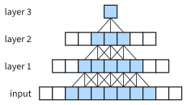

```{.python .input}
%load_ext d2lbook.tab
tab.interact_select('mxnet', 'pytorch', 'tensorflow', 'jax')
```

# Convolutions for Images
:label:`sec_conv_layer`

In :numref:`sec_why-conv`, we derived the convolutional layer on paper from two
geometric principles: translation equivariance and locality. Now let's see what
that formula actually computes on an image—and whether gradient descent can
discover useful kernels automatically from data.

Consider locating vertical edges where a bright region meets a dark one.
Subtracting each pixel's right-hand neighbor ($[\mathbf{X}]_{i,j} - [\mathbf{X}]_{i,j+1}$)
yields zero inside uniform regions, $+1$ where white transitions to black, and
$-1$ where black returns to white. Sweeping the two-weight detector $(1, -1)$
across every valid image location produces an *edge map*. In this section, we
implement two-dimensional cross-correlation, test our hand-crafted edge
detector, let gradient descent *learn* $(1, -1)$ directly from data, show how
frameworks compute convolutions via matrix multiplication (*im2col*), and
derive how stacking layers widens a unit's receptive field.
```{.python .input #conv-layer-convolutions-for-images}
%%tab mxnet
import math
import numpy as np
from mxnet import autograd, gluon, init, np as mnp, npx
from mxnet.gluon import nn
from d2l import mxnet as d2l
npx.set_np()
```

```{.python .input #conv-layer-convolutions-for-images}
%%tab pytorch
import math
import numpy as np
import torch
from torch import nn
from torch.nn import functional as F
from d2l import torch as d2l
```

```{.python .input #conv-layer-convolutions-for-images}
%%tab tensorflow
import math
import numpy as np
import tensorflow as tf
from d2l import tensorflow as d2l
```

```{.python .input #conv-layer-convolutions-for-images}
%%tab jax
import math
import numpy as np
import jax
from jax import numpy as jnp
from flax import nnx
import optax
from d2l import jax as d2l
```

## Cross-Correlation

### The Operation

Leaving channels aside for the moment, let the input $\mathbf{X}$ be an
$n_\textrm{h} \times n_\textrm{w}$ matrix and the kernel $\mathbf{K}$ be a
$k_\textrm{h} \times k_\textrm{w}$ matrix. The kernel defines a sliding
*window* of shape $k_\textrm{h} \times k_\textrm{w}$. Placing the window's
upper-left corner at $(i, j)$, we multiply the covered input patch elementwise
with $\mathbf{K}$ and sum the products to produce the output entry at $(i, j)$:

$$[\mathbf{Y}]_{i, j} = \sum_{a=0}^{k_\textrm{h}-1} \sum_{b=0}^{k_\textrm{w}-1} [\mathbf{K}]_{a, b}\, [\mathbf{X}]_{i+a, j+b}.$$
:eqlabel:`eq_corr2d`

This is the *two-dimensional cross-correlation* of $\mathbf{X}$ with
$\mathbf{K}$, written $\mathbf{Y} = \mathbf{X} \star \mathbf{K}$ with
zero-based indices matching code. Whereas :numref:`sec_why-conv` centered
offsets symmetrically from $-\Delta$ to $\Delta$, anchoring at the upper-left
corner differs only by a fixed shift of $\Delta$ while naturally handling
even-sized kernels—such as a $2 \times 2$ kernel or our $1 \times 2$ edge
detector—that have no center pixel.


:label:`fig_correlation`

In :numref:`fig_correlation`, we slide a $2 \times 2$ kernel across a
$3 \times 3$ input one pixel at a time, left to right and top to bottom. The
window fits cleanly at four positions, yielding the $2 \times 2$ output:

$$
\begin{aligned}
0\times0+1\times1+3\times2+4\times3 &= 19,\\
1\times0+2\times1+4\times2+5\times3 &= 25,\\
3\times0+4\times1+6\times2+7\times3 &= 37,\\
4\times0+5\times1+7\times2+8\times3 &= 43.
\end{aligned}
$$

Notice that the output shrinks slightly along each axis because the kernel must
stay wholly inside the input. Fitting a width-$k$ window into length $n$ leaves
$n - k + 1$ valid positions, so the output shape is

$$(n_\textrm{h}-k_\textrm{h}+1) \times (n_\textrm{w}-k_\textrm{w}+1).$$

Thus a $3 \times 3$ input with a $2 \times 2$ kernel yields $2 \times 2$, a
$6 \times 8$ image with a $1 \times 2$ kernel yields $6 \times 7$, and a
$28 \times 28$ Fashion-MNIST image with a $5 \times 5$ kernel yields
$24 \times 24$. Whenever we want to preserve spatial dimensions, we surround the
input with a border of zeros (*padding*), which we examine alongside strides and
dilation in :numref:`sec_padding`.

### Implementation

We implement :eqref:`eq_corr2d` directly in `corr2d` using a pair of loops over
every output coordinate.

```{.python .input #conv-layer-the-cross-correlation-operation-1}
%%tab mxnet
def corr2d(X, K):  #@save
    """Compute 2D cross-correlation."""
    h, w = K.shape
    Y = d2l.zeros((X.shape[0] - h + 1, X.shape[1] - w + 1))
    for i in range(Y.shape[0]):
        for j in range(Y.shape[1]):
            Y[i, j] = d2l.reduce_sum((X[i: i + h, j: j + w] * K))
    return Y
```

```{.python .input #conv-layer-the-cross-correlation-operation-1}
%%tab pytorch
def corr2d(X, K):  #@save
    """Compute 2D cross-correlation."""
    h, w = K.shape
    Y = d2l.zeros((X.shape[0] - h + 1, X.shape[1] - w + 1))
    for i in range(Y.shape[0]):
        for j in range(Y.shape[1]):
            Y[i, j] = d2l.reduce_sum((X[i: i + h, j: j + w] * K))
    return Y
```

```{.python .input #conv-layer-the-cross-correlation-operation-1}
%%tab tensorflow
def corr2d(X, K):  #@save
    """Compute 2D cross-correlation."""
    h, w = K.shape
    # Build Y from its entries, so that gradients flow through it
    return tf.stack([
        tf.stack([tf.reduce_sum(X[i: i + h, j: j + w] * K)
                  for j in range(X.shape[1] - w + 1)])
        for i in range(X.shape[0] - h + 1)])
```

```{.python .input #conv-layer-the-cross-correlation-operation-1}
%%tab jax
def corr2d(X, K):  #@save
    """Compute 2D cross-correlation."""
    h, w = K.shape
    Y = jnp.zeros((X.shape[0] - h + 1, X.shape[1] - w + 1))
    for i in range(Y.shape[0]):
        for j in range(Y.shape[1]):
            Y = Y.at[i, j].set((X[i:i + h, j:j + w] * K).sum())
    return Y
```

To verify `corr2d` against our hand calculation in :numref:`fig_correlation`,
we construct the $3 \times 3$ input tensor `X` and $2 \times 2$ kernel `K` and
evaluate `corr2d(X, K)`.

```{.python .input #conv-layer-the-cross-correlation-operation-2}
X = d2l.tensor([[0.0, 1.0, 2.0], [3.0, 4.0, 5.0], [6.0, 7.0, 8.0]])
K = d2l.tensor([[0.0, 1.0], [2.0, 3.0]])
corr2d(X, K)
```

The output reproduces :numref:`fig_correlation` entry for entry (and as shown in
:numref:`sec_why-conv`, strict mathematical convolution with a flipped kernel
$\mathbf{K}'$ learns the exact same family of layers, so we follow standard
deep learning terminology and call cross-correlation "convolution").


## Convolutional Layers

### The Layer

A two-dimensional convolutional layer cross-correlates its input with a learned
kernel and adds a scalar bias. Just like our MLP weights in
:numref:`chap_perceptrons`, we initialize the kernel from
$\mathcal{N}(0, 0.01^2)$ and the bias to zero. Below, `Conv2D` registers both
parameters and invokes `corr2d` in its forward pass; a layer with a kernel of
height $h$ and width $w$ is called an $h \times w$ convolutional layer.

```{.python .input #conv-layer-convolutional-layers}
%%tab mxnet
class Conv2D(nn.Block):
    def __init__(self, kernel_size):
        super().__init__()
        self.weight = gluon.Parameter('weight', shape=kernel_size,
                                      init=init.Normal(0.01))
        self.bias = gluon.Parameter('bias', shape=(1,), init=init.Zero())

    def forward(self, x):
        return corr2d(x, self.weight.data()) + self.bias.data()
```

```{.python .input #conv-layer-convolutional-layers}
%%tab pytorch
class Conv2D(nn.Module):
    def __init__(self, kernel_size):
        super().__init__()
        self.weight = nn.Parameter(0.01 * torch.randn(kernel_size))
        self.bias = nn.Parameter(torch.zeros(1))

    def forward(self, x):
        return corr2d(x, self.weight) + self.bias
```

```{.python .input #conv-layer-convolutional-layers}
%%tab tensorflow
class Conv2D(tf.keras.layers.Layer):
    def __init__(self, kernel_size):
        super().__init__()
        self.weight = self.add_weight(
            name='w', shape=kernel_size,
            initializer=tf.keras.initializers.RandomNormal(stddev=0.01))
        self.bias = self.add_weight(name='b', shape=(1,), initializer='zeros')

    def call(self, inputs):
        return corr2d(inputs, self.weight) + self.bias
```

```{.python .input #conv-layer-convolutional-layers}
%%tab jax
class Conv2D(nnx.Module):
    def __init__(self, kernel_size, rngs=None):
        rngs = nnx.Rngs(d2l.get_key()) if rngs is None else rngs
        self.weight = nnx.Param(
            nnx.initializers.normal(stddev=0.01)(rngs.params(), kernel_size))
        self.bias = nnx.Param(jnp.zeros(1))

    def __call__(self, x):
        return corr2d(x, self.weight) + self.bias
```

Unlike a dense layer, a convolutional layer is not locked to a fixed input
resolution because its parameters depend only on the kernel size. The exact same
$2 \times 2$ layer (5 parameters total) processes both our $3 \times 3$ tensor
`X` and a $6 \times 8$ image, returning outputs of shapes $2 \times 2$ and
$5 \times 7$:

```{.python .input #conv-layer-the-layer-1}
%%tab mxnet
layer = Conv2D((2, 2))
layer.initialize()
layer(X).shape, layer(d2l.ones((6, 8))).shape
```

```{.python .input #conv-layer-the-layer-1}
%%tab pytorch, tensorflow, jax
layer = Conv2D((2, 2))
layer(X).shape, layer(d2l.ones((6, 8))).shape
```

### Edge Detection
:label:`subsec_edge_detection`

Now let's test the vertical edge detector from the introduction on a
$6 \times 8$ synthetic image whose middle four columns are black (`0`) and outer
columns are white (`1`).

```{.python .input #conv-layer-object-edge-detection-in-images-1}
%%tab mxnet, pytorch
X = d2l.ones((6, 8))
X[:, 2:6] = 0
X
```

```{.python .input #conv-layer-object-edge-detection-in-images-1}
%%tab tensorflow
X = tf.Variable(tf.ones((6, 8)))
X[:, 2:6].assign(tf.zeros(X[:, 2:6].shape))
X
```

```{.python .input #conv-layer-object-edge-detection-in-images-1}
%%tab jax
X = jnp.ones((6, 8))
X = X.at[:, 2:6].set(0)
X
```

We define the $1 \times 2$ kernel

$$\mathbf{K} = \begin{bmatrix} 1 & -1 \end{bmatrix}.$$
:eqlabel:`eq_edge_kernel`

At every position $(i, j)$, this computes the horizontal *finite difference*
$[\mathbf{X}]_{i,j} - [\mathbf{X}]_{i,j+1}$—a discrete approximation (up to sign)
of the horizontal derivative of brightness, which vanishes across flat regions
and spikes wherever intensity jumps.

```{.python .input #conv-layer-object-edge-detection-in-images-2}
K = d2l.tensor([[1.0, -1.0]])
```

Cross-correlating the $6 \times 8$ stripe image `X` with the $1 \times 2$
horizontal-difference kernel `K` via `corr2d(X, K)` produces the $6 \times 7$
edge map `Y`:

```{.python .input #conv-layer-object-edge-detection-in-images-3}
Y = corr2d(X, K)
Y
```

Sure enough, `Y` fires `+1` along the white-to-black boundary, `-1` along the
black-to-white boundary, and `0` everywhere else. Applying the exact same kernel
to the transposed image (turning the vertical stripe into a horizontal one)
yields all zeros:

```{.python .input #conv-layer-object-edge-detection-in-images-4}
corr2d(d2l.transpose(X), K)
```

Clearly `[1, -1]` responds strictly to vertical edges. Detecting horizontal
edges, diagonals, corners, or textures requires different kernels altogether.

### Learning a Kernel
:label:`subsec_learning_kernel`

Hand-crafting `[1, -1]` is easy when we know the exact feature we want, yet no
engineer can specify thousands of intermediate filters across a deep network by
hand. Can gradient descent recover the kernel `[1, -1]` from the input–output
pair `(X, Y)` alone? Let's test this using each framework's built-in 2D
convolutional layer (with bias omitted and weights initialized from
$\mathcal{N}(0, 0.01^2)$), minimizing squared error summed across all 42 output
entries over 10 gradient steps at learning rate $0.03$. Because built-in layers
expect 4D tensors including batch and channel axes (:numref:`sec_channels`), we
reshape `X` and `Y` accordingly.

```{.python .input #conv-layer-learning-a-kernel-1}
%%tab mxnet
conv2d = nn.Conv2D(1, kernel_size=(1, 2), use_bias=False,
                   weight_initializer=init.Normal(0.01))
conv2d.initialize()
# Layers take (example, channel, height, width): one example, one channel
X = X.reshape(1, 1, 6, 8)
Y = Y.reshape(1, 1, 6, 7)
lr = 3e-2  # Learning rate

for i in range(10):
    with autograd.record():
        l = ((conv2d(X) - Y) ** 2).sum()
    l.backward()
    conv2d.weight.data()[:] -= lr * conv2d.weight.grad()
    if i % 3 == 0:
        print(f'step {i}, loss {float(l):.3f}')
```

```{.python .input #conv-layer-learning-a-kernel-1}
%%tab pytorch
conv2d = nn.Conv2d(1, 1, kernel_size=(1, 2), bias=False)
nn.init.normal_(conv2d.weight, std=0.01)
# Layers take (example, channel, height, width): one example, one channel
X = X.reshape((1, 1, 6, 8))
Y = Y.reshape((1, 1, 6, 7))
lr = 3e-2  # Learning rate

for i in range(10):
    l = ((conv2d(X) - Y) ** 2).sum()
    conv2d.zero_grad()
    l.backward()
    with torch.no_grad():
        conv2d.weight -= lr * conv2d.weight.grad
    if i % 3 == 0:
        print(f'step {i}, loss {l:.3f}')
```

```{.python .input #conv-layer-learning-a-kernel-1}
%%tab tensorflow
conv2d = tf.keras.layers.Conv2D(
    1, (1, 2), use_bias=False,
    kernel_initializer=tf.keras.initializers.RandomNormal(stddev=0.01))
# Layers take (example, height, width, channel): one example, one channel
X = tf.reshape(X, (1, 6, 8, 1))
Y = tf.reshape(Y, (1, 6, 7, 1))
lr = 3e-2  # Learning rate

for i in range(10):
    with tf.GradientTape() as tape:
        l = tf.reduce_sum((conv2d(X) - Y) ** 2)
    conv2d.kernel.assign_sub(lr * tape.gradient(l, conv2d.kernel))
    if i % 3 == 0:
        print(f'step {i}, loss {l:.3f}')
```

```{.python .input #conv-layer-learning-a-kernel-1}
%%tab jax
# padding='VALID' evaluates only where the window fits, as corr2d does
conv2d = nnx.Conv(1, 1, kernel_size=(1, 2), use_bias=False, padding='VALID',
                  kernel_init=nnx.initializers.normal(stddev=0.01),
                  rngs=nnx.Rngs(d2l.get_key()))
# Layers take (example, height, width, channel): one example, one channel
X = X.reshape((1, 6, 8, 1))
Y = Y.reshape((1, 6, 7, 1))
lr = 3e-2  # Learning rate

def loss(model, X, Y):
    return ((model(X) - Y) ** 2).sum()

for i in range(10):
    l, grads = nnx.value_and_grad(loss)(conv2d, X, Y)
    conv2d.kernel[...] -= lr * grads.kernel[...]
    if i % 3 == 0:
        print(f'step {i}, loss {l:.3f}')
```

Initially the loss sits near 12 (the near-zero random kernel misses all 12
$\pm 1$ edge pixels by roughly 1), and within just nine steps it drops below
0.01. Let's inspect the learned kernel:

```{.python .input #conv-layer-learning-a-kernel-2}
%%tab mxnet
d2l.reshape(conv2d.weight.data(), (1, 2))
```

```{.python .input #conv-layer-learning-a-kernel-2}
%%tab pytorch
d2l.reshape(conv2d.weight.data, (1, 2))
```

```{.python .input #conv-layer-learning-a-kernel-2}
%%tab tensorflow
d2l.reshape(conv2d.kernel, (1, 2))
```

```{.python .input #conv-layer-learning-a-kernel-2}
%%tab jax
conv2d.kernel[...].reshape((1, 2))
```

Both entries land within roughly 0.02 of `[1, -1]`! Nothing in this loop knew
anything about edges: given a loss signal, gradient descent discovered the
filter on its own. Here we supervised the single layer directly with `Y`; in a
deep CNN, backpropagation learns every layer's kernels end to end from the final
task loss alone.


## Convolution as Matrix Multiplication
:label:`subsec_conv_matmul`

While the nested loops in `corr2d` make the math transparent, visiting one
output pixel at a time in Python is far too slow for real workloads. In
practice, frameworks recast cross-correlation as a single large matrix
multiplication—the exact operation GPUs execute at peak speed. Notice that every
output entry in :numref:`fig_correlation` is simply the dot product of the
flattened $k_\textrm{h} k_\textrm{w}$-element kernel with the corresponding
flattened input window. Extracting all
$(n_\textrm{h}-k_\textrm{h}+1)(n_\textrm{w}-k_\textrm{w}+1)$ windows and
stacking them as rows yields a patch matrix; multiplying it by the flattened
kernel computes the entire cross-correlation in one shot. This standard layout
transformation is called *im2col* ("image to columns"—or rows here).

The trade-off is extra workspace memory, since each interior pixel is duplicated
into up to $k_\textrm{h} k_\textrm{w}$ patches. Let's verify on
:numref:`fig_correlation` that this single matrix multiply matches `corr2d`
exactly:

```{.python .input #conv-layer-convolution-as-matrix-multiplication-1}
X = d2l.tensor([[0.0, 1.0, 2.0], [3.0, 4.0, 5.0], [6.0, 7.0, 8.0]])
K = d2l.tensor([[0.0, 1.0], [2.0, 3.0]])
h, w = K.shape
h_o, w_o = X.shape[0] - h + 1, X.shape[1] - w + 1
patches = d2l.stack([d2l.reshape(X[i:i + h, j:j + w], (-1,))
                     for i in range(h_o) for j in range(w_o)])
Y_mat = d2l.reshape(d2l.matmul(patches, d2l.reshape(K, (-1, 1))), (h_o, w_o))
Y_mat, d2l.reduce_sum(d2l.abs(Y_mat - corr2d(X, K)))
```

The discrepancy is identically zero: one matrix product reproduces `corr2d`
perfectly.

Equivalently, we can unroll the *kernel* instead of the input into a sparse
banded matrix $\mathbf{W}$ multiplying the flattened image—the exact 2D analog
of panel (c) in :numref:`fig_why_conv_weight_sharing`, where every row repeats
the same handful of kernel weights. Seeing a convolution as a structured dense
layer brings us full circle to the derivation of :numref:`sec_why-conv` (and the
exercises build $\mathbf{W}$ explicitly).

## Feature Maps and Receptive Fields

A single convolutional layer sees only a patch the size of its kernel, whereas
recognizing whole objects demands integrating context across much wider areas.
Recall from :numref:`subsec_why-conv-channels` that a convolutional layer's
output is called a *feature map* (like our vertical edge map `Y`). For any
element $x$ in a feature map, its *receptive field* is the region of the input
image (or of an earlier layer) whose values can influence $x$ during forward
propagation—borrowing the neurophysiology term from :numref:`field_visual`.

### Stacked Layers

In :numref:`fig_correlation`, the shaded output `19` has a $2 \times 2$ receptive
field covering the top-left four pixels of $\mathbf{X}$. Now stack a *second*
$2 \times 2$ convolutional layer on top of the $2 \times 2$ output $\mathbf{Y}$
to produce a single scalar $z$: $z$ depends on all four elements of $\mathbf{Y}$,
which together depend on all nine elements of $\mathbf{X}$. Stacking layers
expands the receptive field smoothly with depth.

How quickly does it grow? Each $k \times k$ convolutional layer reaches $k - 1$
pixels farther than a single element of its input, so stacking $L$ layers with
kernel sizes $k_1, \ldots, k_L$ yields a receptive field of side length

$$r = 1 + \sum_{i=1}^{L} (k_i - 1).$$

For a stack of $L$ consecutive $3 \times 3$ layers, each layer adds 2 pixels,
covering $(2L + 1) \times (2L + 1)$ inputs—$5 \times 5$ after two layers and
$7 \times 7$ after three (:numref:`fig_conv_receptive_field`). This linear
growth is actually a blessing rather than a reason to reach for huge kernels:
three stacked $3 \times 3$ layers achieve the same $7 \times 7$ receptive field
as a single $7 \times 7$ layer using far fewer parameters ($3 \times 9 = 27$
weights vs. 49 per channel pair) while interleaving three nonlinearities instead
of one.


:label:`fig_conv_receptive_field`

### Effective Receptive Fields

Keep in mind that $r$ measures the *theoretical* receptive field—every input
pixel with *any* path to an output unit—without saying how strongly each pixel
actually contributes. Measuring input gradients directly,
:citet:`Luo.Li.Urtasun.ea.2016` showed that the *effective* receptive field
decays sharply away from the center in a roughly Gaussian bell curve, in both
untrained and trained networks. Deep units can theoretically see far across the
image, but their sensitivity concentrates heavily near the center.

Two practical gaps remain in our basic layer: every unpadded convolution shrinks
spatial dimensions while under-sampling border pixels, and a single kernel
detects only one pattern. We address spatial sizing and borders next in
:numref:`sec_padding`, and multi-channel feature maps in :numref:`sec_channels`.

## Summary

A convolutional layer applies two-dimensional cross-correlation with a learned
kernel plus a scalar bias, sliding the kernel across every valid window of the
input. A simple $1 \times 2$ finite-difference kernel `[1, -1]` detects vertical
edges anywhere in an image—and gradient descent recovers those exact weights
from input–output data alone, just as deep CNNs learn entire hierarchies of
filters end to end. Mathematical convolution flips the kernel, making no
difference once kernels are learned. Hardware libraries evaluate convolutions
efficiently as matrix multiplications (*im2col*), and stacking $L$ convolutional
layers widens each unit's receptive field linearly by $k_i - 1$ per layer.

## Exercises

1. [code] **Hand-designed kernels.** Design some kernels manually.
    1. Given a directional vector $\mathbf{v} = (v_1, v_2)$, derive an
       edge-detection kernel that detects edges orthogonal to $\mathbf{v}$,
       i.e., edges in the direction $(v_2, -v_1)$.
    1. Derive a finite difference operator for the second derivative.
       Which structures in images respond most strongly to it?
    1. What is the minimum size of a kernel to obtain a derivative of
       order $d$?
    1. How would you design a blur kernel? Why might you want to use such
       a kernel?
    1. Load a photograph, convert it to one channel, and downsample it to
       about $100 \times 100$ pixels (`corr2d` loops in Python). Apply the
       edge detector, the blur kernel, and the sharpening kernel "twice
       the identity minus the blur", and display each result next to the
       original. What does the edge map of a photograph show that the
       edge map of the black band could not?

    *Adapted from Stanford CS231n,
    [Assignment 2](https://cs231n.github.io/assignments2024/assignment2/),
    ConvolutionalNetworks notebook.*

2. [code] **Convolution as a banded matrix.** The patch matrix of
   :numref:`subsec_conv_matmul` unfolds the input. The opposite
   construction unrolls the kernel. Let $\mathbf{X}$ be a $4 \times 4$
   input, $\mathbf{K}$ a $3 \times 3$ kernel, and $\textrm{vec}(\cdot)$
   the row-by-row flattening.
    1. Construct the $4 \times 16$ matrix $\mathbf{W}$ with
       $\mathbf{W}\,\textrm{vec}(\mathbf{X}) = \textrm{vec}(\mathbf{Y})$,
       where $\mathbf{Y}$ is the cross-correlation of $\mathbf{X}$ with
       $\mathbf{K}$. How many nonzero entries does each row have, and how
       many distinct values appear in $\mathbf{W}$?
    1. Build $\mathbf{W}$ in code from `K` and confirm that the product
       reproduces `corr2d(X, K)`.
    1. For an $n \times n$ input and a $k \times k$ kernel, count the
       entries of $\mathbf{W}$ stored as a dense array, the nonzero
       entries of $\mathbf{W}$, and the entries of the patch matrix. How
       does each count grow with $n$?
    1. Keep the sparsity pattern of $\mathbf{W}$ but give every row its
       own $k^2$ values. The result is a locally connected layer: the
       fourth-order tensor $\mathsf{V}$ of :eqref:`eq_mlp_fourth_order`
       restricted to a $k \times k$ window of offsets $(a, b)$, before
       translation equivariance ties the weights. For an $n \times n$
       input, count the parameters of this layer, of a fully connected
       layer with the same input and output shapes, and of the
       convolution.

    *Adapted from CMU 11-785,
    [Homework 2 Part 1](https://deeplearning.cs.cmu.edu/S21/index.html).*

3. [code] **Effective receptive field.** ● The theoretical receptive
   field $r$ of this section bounds which inputs *can* influence an
   output; the effective receptive field measures how much
   they actually do :cite:`Luo.Li.Urtasun.ea.2016`. Build a stack of $L$
   single-channel $3 \times 3$ convolutional layers with no
   padding, no bias, and no nonlinearity on a $32 \times 32$ input, using
   the built-in layer of :numref:`subsec_learning_kernel`. Draw every
   kernel entry independently from a standard normal distribution.
    1. For $L = 3$ and a single draw of the kernels, backpropagate a unit
       gradient from an output unit near the center of the last layer to
       the input and plot the magnitude of the input gradient. Compare its
       support with the $7 \times 7$ theoretical receptive field, and say
       where the magnitude is largest.
    1. Average the squared input gradient over 500 draws of the kernels,
       for $L = 3$ and for $L = 10$. Sum each averaged map over its rows
       and normalize the resulting column profile to sum to one. How does
       the ratio of the profile's standard deviation to the theoretical
       side length $2L + 1$ change with depth?
    1. Show that the expected squared input gradient, summed over rows,
       is proportional to the convolution of $L$ copies of the vector
       $(1, 1, 1)$. Derive how the standard deviation of the normalized
       profile grows with $L$.

4. [code] **Backward pass of a convolution.** ● Let $\mathbf{Y}$ be the
   single-channel cross-correlation of an input $\mathbf{X}$ with a kernel
   $\mathbf{K}$, as computed by `corr2d`, and let $\ell$ be a scalar loss
   that depends on $\mathbf{X}$ and $\mathbf{K}$ only through $\mathbf{Y}$.
    1. Derive $\partial \ell/\partial \mathbf{K}$ and
       $\partial \ell/\partial \mathbf{X}$ in terms of
       $\partial \ell/\partial \mathbf{Y}$, in the style of the
       backpropagation equations of :numref:`sec_backprop`.
    1. Implement your expression for $\partial \ell/\partial \mathbf{K}$
       without automatic differentiation for the loss
       $\ell = \sum_{i,j} G_{ij} Y_{ij}$, where $\mathbf{G}$ is a fixed
       random matrix of the shape of $\mathbf{Y}$. Compare it with a
       centered finite-difference gradient with step size $10^{-2}$ on a
       small random `X` and `K`, and report the largest relative error.
    1. Check your expression for $\partial \ell/\partial \mathbf{K}$
       against the kernel gradient that automatic differentiation
       computes in the experiment of :numref:`subsec_learning_kernel`.

    *Adapted from Michael Nielsen,
    [Neural Networks and Deep Learning](http://neuralnetworksanddeeplearning.com/chap6.html),
    Chapter 6, and Stanford CS231n,
    [Assignment 2](https://cs231n.github.io/assignments2024/assignment2/),
    ConvolutionalNetworks notebook.*

:begin_tab:`mxnet`
[Discussions](https://d2l.discourse.group/t/65)
:end_tab:

:begin_tab:`pytorch`
[Discussions](https://d2l.discourse.group/t/66)
:end_tab:

:begin_tab:`tensorflow`
[Discussions](https://d2l.discourse.group/t/271)
:end_tab:

:begin_tab:`jax`
[Discussions](https://d2l.discourse.group/t/17996)
:end_tab:

<!-- slides -->

::: {.slide}
::: {.cover}
[Dive into Deep Learning · §6.2]{.kicker}

Convolutions for Images<br>**2D cross-correlation · edge detection · learned kernels · im2col · receptive fields**
:::
:::

::: {.slide title="Detecting Local Edges Across an Image"}
[Motivation & Core Mental Model]{.kicker}

::: {.cols .vc}
::: {.col}
- **Synthetic $6 \times 8$ test image:** White outer columns (`1`) surrounding a 4-column black vertical band (`0`).
- **Horizontal finite difference:** Sweeping $\mathbf{K} = [1, -1]$ computes $[\mathbf{X}]_{i,j} - [\mathbf{X}]_{i,j+1}$, firing `+1` at white-to-black and `-1` at black-to-white edges.
- **Learning vs. hand-crafting:** Deep CNNs discover thousands of such kernels automatically via gradient descent.
:::

::: {.col .fig .big}
@fig:ch06-cnn-vertical-edge-motiv
:::
:::
:::

::: {.slide title="The 2D Cross-Correlation Operation"}
[Sliding-Window Inner Products]{.kicker}

Given an $n_\textrm{h} \times n_\textrm{w}$ input matrix $\mathbf{X}$ and a $k_\textrm{h} \times k_\textrm{w}$ kernel $\mathbf{K}$, the 2D cross-correlation $\mathbf{Y} = \mathbf{X} \star \mathbf{K}$ places the window's top-left corner at $(i, j)$ and sums elementwise products:

::: {.cols .vc}
::: {.col}
$$[\mathbf{Y}]_{i, j} = \sum_{a=0}^{k_\textrm{h}-1} \sum_{b=0}^{k_\textrm{w}-1} [\mathbf{K}]_{a, b}\, [\mathbf{X}]_{i+a, j+b}$$

- **Top-left anchor:** Zero-based indices $a, b \ge 0$ match array indexing in code and handle even-sized kernels (like $2 \times 2$ or $1 \times 2$) cleanly.
- **Shaded top-left output $(0,0)$:**
  $0\cdot 0 + 1\cdot 1 + 3\cdot 2 + 4\cdot 3 = 19$.
:::

::: {.col .fig}
{.nostretch width=100%}
:::
:::
:::

::: {.slide title="Valid Window Positions and Output Spatial Shape"}
[Why Unpadded Convolutions Shrink the Grid]{.kicker}

::: {.cols .vc}
::: {.col}
$$\textrm{Output shape} = (n_\textrm{h} - k_\textrm{h} + 1) \times (n_\textrm{w} - k_\textrm{w} + 1)$$

- **Valid window placements:** A $k_\textrm{h} \times k_\textrm{w}$ window fits inside an $n_\textrm{h} \times n_\textrm{w}$ grid at $n - k + 1$ positions per axis.
- **Shape examples:** $3 \times 3 \star 2 \times 2 \to 2 \times 2$ ($19, 25, 37, 43$); $28 \times 28 \star 5 \times 5 \to 24 \times 24$.
:::

::: {.col .fig}
@fig:ch06-cnn-valid-window-shrinkage
:::
:::
:::

::: {.slide title="Implementing 2D Cross-Correlation in Code"}
[Direct Nested-Loop Implementation]{.kicker}

The function `corr2d` allocates the $(n_\textrm{h} - k_\textrm{h} + 1) \times (n_\textrm{w} - k_\textrm{w} + 1)$ output tensor and computes each entry as the sum of `X[i:i+h, j:j+w] * K`:

@conv-layer-the-cross-correlation-operation-1

::: {.d2l-note}
Each iteration slices a $k_\textrm{h} \times k_\textrm{w}$ sub-window of `X`, multiplies elementwise with `K`, and reduces via `sum`.
:::
:::

::: {.slide title="Verifying corr2d and the Flipped-Kernel Equivalence"}
[Cross-Correlation vs. Mathematical Convolution]{.kicker}

::: {.cols .vc}
::: {.col}
@conv-layer-the-cross-correlation-operation-2

- **180° flipped kernel $\mathbf{K}'$:** Cross-correlating with $\mathbf{K}$ equals convolving with $[\mathbf{K}']_{a,b} = [\mathbf{K}]_{-a,-b}$.
- **Identical learned class:** Frameworks compute cross-correlation and call it `Conv2D`.
:::

::: {.col .fig}
@fig:ch06-cnn-flipped-kernel-equiv
:::
:::
:::

::: {.slide title="Building a 2D Convolutional Layer Module"}
[Learnable Kernel Weights Plus Scalar Bias]{.kicker}

A convolutional layer wraps `corr2d` with a learnable $k_\textrm{h} \times k_\textrm{w}$ weight parameter (initialized from $\mathcal{N}(0, 0.01^2)$) and a scalar bias (initialized to $0$):

@conv-layer-convolutional-layers
:::

::: {.slide title="Resolution Independence of Convolutional Layers"}
[Fixed Parameters Across Arbitrary Input Sizes]{.kicker}

::: {.cols .vc}
::: {.col}
@conv-layer-the-layer-1

- **Decoupled from $H \times W$:** The exact same 5 parameters ($2 \times 2$ kernel + 1 bias) process $3 \times 3$, $6 \times 8$, or megapixel inputs without reshaping weights.
:::

::: {.col .fig}
@fig:ch06-cnn-resolution-independence
:::
:::
:::

::: {.slide title="Constructing a Synthetic Vertical-Edge Image"}
[A 6×8 Binary Test Pattern]{.kicker}

Let's construct the $6 \times 8$ test image `X` with ones on the left and right borders and zeros across the middle four columns (`X[:, 2:6] = 0`):

@conv-layer-object-edge-detection-in-images-1

- **Piecewise-constant columns:** Intensity is constant (`1` or `0`) within columns $0\text{--}1$, $2\text{--}5$, and $6\text{--}7$, jumping only between columns $1 \to 2$ and $5 \to 6$.
:::

::: {.slide title="Applying the Horizontal Finite-Difference Kernel"}
[Detecting Vertical Edges with K = [1, -1]]{.kicker}

Cross-correlating `X` with the $1 \times 2$ kernel $\mathbf{K} = \begin{bmatrix} 1 & -1 \end{bmatrix}$ computes $[\mathbf{Y}]_{i,j} = [\mathbf{X}]_{i,j} - [\mathbf{X}]_{i,j+1}$ at every horizontal pair:

@conv-layer-object-edge-detection-in-images-2

@conv-layer-object-edge-detection-in-images-3

- **Signed edge map:** Column 1 fires `+1` (white-to-black transition), column 5 fires `-1` (black-to-white transition), and all constant interior columns evaluate to `0`.
:::

::: {.slide title="Orientation Selectivity of Edge Kernels"}
[Why One Kernel Cannot Detect All Orientations]{.kicker}

::: {.cols .vc}
::: {.col}
@conv-layer-object-edge-detection-in-images-4

- **Blind to horizontal edges:** Transposing `X` (`X.T`) makes horizontal neighbors identical, so $[1, -1]$ outputs all zeros.
- **Filter banks (§{sec_channels}):** Vision layers learn parallel channels for horizontal, vertical, and diagonal orientations.
:::

::: {.col .fig}
@fig:ch06-cnn-orientation-selectivity
:::
:::
:::

::: {.slide title="Learning an Edge Detector via Gradient Descent"}
[Supervising a Built-In Conv2d Layer on (X, Y)]{.kicker}

::: {.cols .vc}
::: {.col}
@conv-layer-learning-a-kernel-1
:::

::: {.col .fig .narrow}
@fig:ch06-cnn-learning-edge-loop

- **4D framework tensors:** Reshape `X` and `Y` to 4D tensors (one example, one channel) and minimize $\mathcal{L} = \|\hat{\mathbf{Y}} - \mathbf{Y}\|_2^2$ at $\eta = 0.03$.
:::

:::
:::

::: {.slide title="Inspecting the Learned Kernel Weights"}
[Why Initial Loss Is 12 and Converges to [1, -1]]{.kicker}

::: {.cols .vc}
::: {.col}
@conv-layer-learning-a-kernel-2

- **Why loss starts at $12.0$:** Near-zero weights predict $\hat{Y} \approx 0$, missing the twelve $\pm 1$ edge pixels in `Y` ($12 \times 1^2 = 12$).
- **Convergence in 9 steps:** SGD recovers $[0.99, -0.99]$ automatically from data.
:::

::: {.col .fig}
@fig:ch06-cnn-kernel-gd-convergence
:::
:::
:::

::: {.slide title="Fast Execution: Convolution via Matrix Multiplication"}
[The im2col (Image-to-Columns) Transformation]{.kicker}

::: {.cols .vc}
::: {.col}
@conv-layer-convolution-as-matrix-multiplication-1

- **Single dense GEMM:** Flatten each $k_\textrm{h} \times k_\textrm{w}$ window into a row of `patches` $\in \mathbb{R}^{(h_\textrm{o} w_\textrm{o}) \times (k_\textrm{h} k_\textrm{w})}$ and multiply by $\textrm{vec}(\mathbf{K})$.
:::

::: {.col .fig}
@fig:ch06-cnn-im2col-gemm

- **Trade-off:** Peak GPU Tensor Core speed at the cost of $k_\textrm{h} k_\textrm{w}\times$ patch workspace duplication.
:::
:::
:::

::: {.slide title="Dual View: Unrolling the Kernel into a Banded Matrix"}
[Toeplitz Weight Matrix Multiplication]{.kicker}

Instead of unfolding the input image into duplicated patches, we can unroll the *kernel* into a sparse banded matrix $\mathbf{W}$ that multiplies the flattened input vector $\textrm{vec}(\mathbf{X})$:

{.nostretch width=46% fig-align="center"}

- **Matrix–vector form:** $\textrm{vec}(\mathbf{Y}) = \mathbf{W}\,\textrm{vec}(\mathbf{X})$, where $\mathbf{W}$ has $(n_\textrm{h}-k_\textrm{h}+1)(n_\textrm{w}-k_\textrm{w}+1)$ rows and $n_\textrm{h} n_\textrm{w}$ columns.
- **Connection to §{sec_why-conv} and backprop:** Every row of $\mathbf{W}$ holds the same $k_\textrm{h} k_\textrm{w}$ kernel entries shifted across columns (panel c), making the backward pass with respect to $\mathbf{X}$ simply multiplication by $\mathbf{W}^\top$ (a transposed convolution).
:::

::: {.slide title="Feature Maps and Receptive Fields Across Depth"}
[Linear Receptive-Field Growth in Stacked Layers]{.kicker}

A unit's **receptive field** is the region of the original input image whose pixels can influence that unit's activation during forward propagation:

::: {.cols .vc}
::: {.col}
- **Single layer ($L=1$):** A $k_1 \times k_1$ kernel sees a $k_1 \times k_1$ input patch.
- **Stacking $L$ stride-1 layers:** Layer $i$ with kernel size $k_i$ reaches $k_i - 1$ pixels farther along each axis than a single element of layer $i-1$:
  $$r = 1 + \sum_{i=1}^{L} (k_i - 1)$$
- **$L$ stacked $3 \times 3$ layers:** Each layer adds $3 - 1 = 2$ pixels, giving side length $r = 2L + 1$ ($3 \to 5 \to 7$).
:::

::: {.col .fig}
{.nostretch width=100%}
:::
:::
:::

::: {.slide title="Why Deep Stacks of 3×3 Kernels Beat One Large Kernel"}
[Parameter Efficiency & Nonlinear Expressivity]{.kicker}

::: {.cols .vc}
::: {.col}
- **Matched $7 \times 7$ receptive field:** Three stacked $3 \times 3$ layers ($r = 1 + 2 + 2 + 2 = 7$) see the exact same $7 \times 7$ patch as one $7 \times 7$ layer.
- **45% fewer parameters:** $3 \times 9 c^2 = 27 c^2$ weights instead of $49 c^2$ across $c$ channels.
- **Richer expressivity:** Compounds **3 nonlinear activations** instead of 1 (the core VGG design rule in §{sec_blocks}).
:::

::: {.col .fig .big}
@fig:ch06-cnn-stacked-3x3-vs-7x7
:::
:::
:::

::: {.slide title="Theoretical vs. Effective Receptive Fields"}
[Gaussian Decay of Sensitivity Away from the Center]{.kicker}

::: {.cols .vc}
::: {.col}
- **Theoretical RF ($r = 2L+1$):** Bounding box of all pixels with *at least one* path to the output unit.
- **Central Limit Theorem:** Center pixels connect via exponentially many paths, whereas corner pixels connect via only **1 path**.
- **Effective RF (Luo et al., 2016):** Input gradient magnitude $\partial y / \partial \mathbf{X}$ decays in a Gaussian bell curve with std $\sigma \propto \sqrt{L}$.
:::

::: {.col .fig .big}
@fig:ch06-cnn-effective-rf-gaussian
:::
:::
:::

::: {.slide title="Concept Check: Cross-Correlation & Receptive Fields"}
[Concept Check]{.kicker}

Test your understanding of output shapes, `im2col`, and receptive-field arithmetic:

1. **im2col matrix dimensions:** You apply an unpadded $3 \times 3$ single-channel kernel to a $10 \times 10$ image via `im2col`. What is the output spatial shape, and what are the exact dimensions of the `patches` matrix and flattened kernel vector?
2. **Depth to span Fashion-MNIST:** At stride 1, how many stacked $3 \times 3$ layers are required so a single unit's theoretical receptive field spans an entire $28 \times 28$ image? How many with $5 \times 5$ layers?
3. **Edge-loss boundary shift:** In our $6 \times 8$ vertical-edge learning experiment, why did the loss start at $\approx 12$, and what would the initial loss be if the black band extended all the way to the right edge (`X[:, 2:8] = 0`)?

::: {.d2l-note .fragment .fade-up}
**Answers:**
(1) Output shape is $(10-3+1) \times (10-3+1) = 8 \times 8$ ($64$ outputs). The `patches` matrix has shape $(64, 9)$ and multiplies the $(9, 1)$ kernel vector.
(2) For $3 \times 3$: $2L + 1 \ge 28 \implies L = 14$ layers. For $5 \times 5$: $4L + 1 \ge 28 \implies L = 7$ layers.
(3) Each of the 6 rows had two $\pm 1$ edges ($6 \times 2 \times 1^2 = 12$). Extending the black band to the right border eliminates the right-hand black-to-white edge, leaving one edge per row and halving the initial loss to $\approx 6$.
:::
:::

::: {.slide title="Summary & Key Takeaways"}
[Section Synthesis]{.kicker}

::: {.cols .vc}
::: {.col}
- **2D Cross-Correlation & Edge Learning:** Slides $\mathbf{K}$ across valid windows ($(n_\textrm{h}-k_\textrm{h}+1)\times(n_\textrm{w}-k_\textrm{w}+1)$); SGD learns $[1, -1]$ in 9 steps.
- **im2col Matrix Multiply:** Trades $k_\textrm{h} k_\textrm{w}\times$ patch duplication for peak GPU GEMM throughput.
- **Stacked Receptive Fields:** $r = 1 + \sum (k_i - 1) = 2L+1$ for $3 \times 3$ stacks, with Gaussian center sensitivity.
:::

::: {.col .fig .big}
@fig:ch06-cnn-conv-layer-summary
:::
:::
:::
