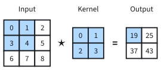
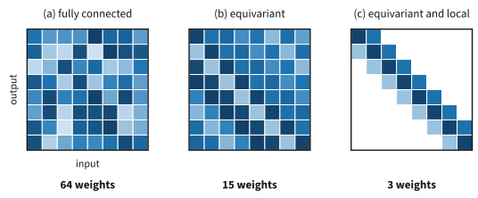
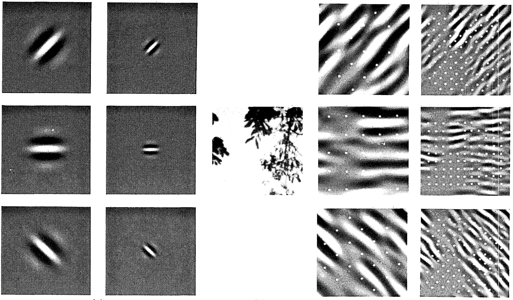

```{.python .input}
%load_ext d2lbook.tab
tab.interact_select('mxnet', 'pytorch', 'tensorflow', 'jax')
```

# Convolutions for Images
:label:`sec_conv_layer`

In :numref:`sec_why-conv`, we derived the convolutional layer on paper from two
geometric principles: translation equivariance and locality. Now let's see what
that formula actually computes on an image—and whether gradient descent can
discover useful kernels automatically from data.

Consider locating vertical edges where a bright region meets a dark one.
Subtracting each pixel's right-hand neighbor ($[\mathbf{X}]_{i,j} - [\mathbf{X}]_{i,j+1}$)
yields zero inside uniform regions, $+1$ where white transitions to black, and
$-1$ where black returns to white. Sweeping the two-weight detector $(1, -1)$
across every valid image location produces an *edge map*. In this section, we
implement two-dimensional cross-correlation, test our hand-crafted edge
detector, let gradient descent *learn* $(1, -1)$ directly from data, show how
frameworks compute convolutions via matrix multiplication (*im2col*), and
derive how stacking layers widens a unit's receptive field.
```{.python .input #conv-layer-convolutions-for-images}
%%tab mxnet
import math
import numpy as np
from mxnet import autograd, gluon, init, np as mnp, npx
from mxnet.gluon import nn
from d2l import mxnet as d2l
npx.set_np()
```

```{.python .input #conv-layer-convolutions-for-images}
%%tab pytorch
import math
import numpy as np
import torch
from torch import nn
from torch.nn import functional as F
from d2l import torch as d2l
```

```{.python .input #conv-layer-convolutions-for-images}
%%tab tensorflow
import math
import numpy as np
import tensorflow as tf
from d2l import tensorflow as d2l
```

```{.python .input #conv-layer-convolutions-for-images}
%%tab jax
import math
import numpy as np
import jax
from jax import numpy as jnp
from flax import nnx
import optax
from d2l import jax as d2l
```

## Cross-Correlation

### The Operation

Leaving channels aside for the moment, let the input $\mathbf{X}$ be an
$n_\textrm{h} \times n_\textrm{w}$ matrix and the kernel $\mathbf{K}$ be a
$k_\textrm{h} \times k_\textrm{w}$ matrix. The kernel defines a sliding
*window* of shape $k_\textrm{h} \times k_\textrm{w}$. Placing the window's
upper-left corner at $(i, j)$, we multiply the covered input patch elementwise
with $\mathbf{K}$ and sum the products to produce the output entry at $(i, j)$:

$$[\mathbf{Y}]_{i, j} = \sum_{a=0}^{k_\textrm{h}-1} \sum_{b=0}^{k_\textrm{w}-1} [\mathbf{K}]_{a, b}\, [\mathbf{X}]_{i+a, j+b}.$$
:eqlabel:`eq_corr2d`

This is the *two-dimensional cross-correlation* of $\mathbf{X}$ with
$\mathbf{K}$, written $\mathbf{Y} = \mathbf{X} \star \mathbf{K}$ with
zero-based indices matching code. Whereas :numref:`sec_why-conv` centered
offsets symmetrically from $-\Delta$ to $\Delta$, anchoring at the upper-left
corner differs only by a fixed shift of $\Delta$ while naturally handling
even-sized kernels—such as a $2 \times 2$ kernel or our $1 \times 2$ edge
detector—that have no center pixel.


:label:`fig_correlation`

In :numref:`fig_correlation`, we slide a $2 \times 2$ kernel across a
$3 \times 3$ input one pixel at a time, left to right and top to bottom. The
window fits cleanly at four positions, yielding the $2 \times 2$ output:

$$
\begin{aligned}
0\times0+1\times1+3\times2+4\times3 &= 19,\\
1\times0+2\times1+4\times2+5\times3 &= 25,\\
3\times0+4\times1+6\times2+7\times3 &= 37,\\
4\times0+5\times1+7\times2+8\times3 &= 43.
\end{aligned}
$$

Notice that the output shrinks slightly along each axis because the kernel must
stay wholly inside the input. Fitting a width-$k$ window into length $n$ leaves
$n - k + 1$ valid positions, so the output shape is

$$(n_\textrm{h}-k_\textrm{h}+1) \times (n_\textrm{w}-k_\textrm{w}+1).$$

Thus a $3 \times 3$ input with a $2 \times 2$ kernel yields $2 \times 2$, a
$6 \times 8$ image with a $1 \times 2$ kernel yields $6 \times 7$, and a
$28 \times 28$ Fashion-MNIST image with a $5 \times 5$ kernel yields
$24 \times 24$. Whenever we want to preserve spatial dimensions, we surround the
input with a border of zeros (*padding*), which we examine alongside strides and
dilation in :numref:`sec_padding`.

### Implementation

We implement :eqref:`eq_corr2d` directly in `corr2d` using a pair of loops over
every output coordinate.

```{.python .input #conv-layer-the-cross-correlation-operation-1}
%%tab mxnet
def corr2d(X, K):  #@save
    """Compute 2D cross-correlation."""
    h, w = K.shape
    Y = d2l.zeros((X.shape[0] - h + 1, X.shape[1] - w + 1))
    for i in range(Y.shape[0]):
        for j in range(Y.shape[1]):
            Y[i, j] = d2l.reduce_sum((X[i: i + h, j: j + w] * K))
    return Y
```

```{.python .input #conv-layer-the-cross-correlation-operation-1}
%%tab pytorch
def corr2d(X, K):  #@save
    """Compute 2D cross-correlation."""
    h, w = K.shape
    Y = d2l.zeros((X.shape[0] - h + 1, X.shape[1] - w + 1))
    for i in range(Y.shape[0]):
        for j in range(Y.shape[1]):
            Y[i, j] = d2l.reduce_sum((X[i: i + h, j: j + w] * K))
    return Y
```

```{.python .input #conv-layer-the-cross-correlation-operation-1}
%%tab tensorflow
def corr2d(X, K):  #@save
    """Compute 2D cross-correlation."""
    h, w = K.shape
    # Build Y from its entries, so that gradients flow through it
    return tf.stack([
        tf.stack([tf.reduce_sum(X[i: i + h, j: j + w] * K)
                  for j in range(X.shape[1] - w + 1)])
        for i in range(X.shape[0] - h + 1)])
```

```{.python .input #conv-layer-the-cross-correlation-operation-1}
%%tab jax
def corr2d(X, K):  #@save
    """Compute 2D cross-correlation."""
    h, w = K.shape
    Y = jnp.zeros((X.shape[0] - h + 1, X.shape[1] - w + 1))
    for i in range(Y.shape[0]):
        for j in range(Y.shape[1]):
            Y = Y.at[i, j].set((X[i:i + h, j:j + w] * K).sum())
    return Y
```

Let's verify `corr2d` against our hand calculation from :numref:`fig_correlation`:

```{.python .input #conv-layer-the-cross-correlation-operation-2}
X = d2l.tensor([[0.0, 1.0, 2.0], [3.0, 4.0, 5.0], [6.0, 7.0, 8.0]])
K = d2l.tensor([[0.0, 1.0], [2.0, 3.0]])
corr2d(X, K)
```

The output reproduces :numref:`fig_correlation` entry for entry (and as shown in
:numref:`sec_why-conv`, strict mathematical convolution with a flipped kernel
$\mathbf{K}'$ learns the exact same family of layers, so we follow standard
deep learning terminology and call cross-correlation "convolution").


## Convolutional Layers

### The Layer

A two-dimensional convolutional layer cross-correlates its input with a learned
kernel and adds a scalar bias. Just like our MLP weights in
:numref:`chap_perceptrons`, we initialize the kernel from
$\mathcal{N}(0, 0.01^2)$ and the bias to zero. Below, `Conv2D` registers both
parameters and invokes `corr2d` in its forward pass; a layer with a kernel of
height $h$ and width $w$ is called an $h \times w$ convolutional layer.

```{.python .input #conv-layer-convolutional-layers}
%%tab mxnet
class Conv2D(nn.Block):
    def __init__(self, kernel_size):
        super().__init__()
        self.weight = gluon.Parameter('weight', shape=kernel_size,
                                      init=init.Normal(0.01))
        self.bias = gluon.Parameter('bias', shape=(1,), init=init.Zero())

    def forward(self, x):
        return corr2d(x, self.weight.data()) + self.bias.data()
```

```{.python .input #conv-layer-convolutional-layers}
%%tab pytorch
class Conv2D(nn.Module):
    def __init__(self, kernel_size):
        super().__init__()
        self.weight = nn.Parameter(0.01 * torch.randn(kernel_size))
        self.bias = nn.Parameter(torch.zeros(1))

    def forward(self, x):
        return corr2d(x, self.weight) + self.bias
```

```{.python .input #conv-layer-convolutional-layers}
%%tab tensorflow
class Conv2D(tf.keras.layers.Layer):
    def __init__(self, kernel_size):
        super().__init__()
        self.weight = self.add_weight(
            name='w', shape=kernel_size,
            initializer=tf.keras.initializers.RandomNormal(stddev=0.01))
        self.bias = self.add_weight(name='b', shape=(1,), initializer='zeros')

    def call(self, inputs):
        return corr2d(inputs, self.weight) + self.bias
```

```{.python .input #conv-layer-convolutional-layers}
%%tab jax
class Conv2D(nnx.Module):
    def __init__(self, kernel_size, rngs=None):
        rngs = nnx.Rngs(d2l.get_key()) if rngs is None else rngs
        self.weight = nnx.Param(
            nnx.initializers.normal(stddev=0.01)(rngs.params(), kernel_size))
        self.bias = nnx.Param(jnp.zeros(1))

    def __call__(self, x):
        return corr2d(x, self.weight) + self.bias
```

Unlike a dense layer, a convolutional layer is not locked to a fixed input
resolution because its parameters depend only on the kernel size. The exact same
$2 \times 2$ layer (5 parameters total) processes both our $3 \times 3$ tensor
`X` and a $6 \times 8$ image, returning outputs of shapes $2 \times 2$ and
$5 \times 7$:

```{.python .input #conv-layer-the-layer-1}
%%tab mxnet
layer = Conv2D((2, 2))
layer.initialize()
layer(X).shape, layer(d2l.ones((6, 8))).shape
```

```{.python .input #conv-layer-the-layer-1}
%%tab pytorch, tensorflow, jax
layer = Conv2D((2, 2))
layer(X).shape, layer(d2l.ones((6, 8))).shape
```

### Edge Detection
:label:`subsec_edge_detection`

Now let's test the vertical edge detector from the introduction on a
$6 \times 8$ synthetic image whose middle four columns are black (`0`) and outer
columns are white (`1`).

```{.python .input #conv-layer-object-edge-detection-in-images-1}
%%tab mxnet, pytorch
X = d2l.ones((6, 8))
X[:, 2:6] = 0
X
```

```{.python .input #conv-layer-object-edge-detection-in-images-1}
%%tab tensorflow
X = tf.Variable(tf.ones((6, 8)))
X[:, 2:6].assign(tf.zeros(X[:, 2:6].shape))
X
```

```{.python .input #conv-layer-object-edge-detection-in-images-1}
%%tab jax
X = jnp.ones((6, 8))
X = X.at[:, 2:6].set(0)
X
```

We define the $1 \times 2$ kernel

$$\mathbf{K} = \begin{bmatrix} 1 & -1 \end{bmatrix}.$$
:eqlabel:`eq_edge_kernel`

At every position $(i, j)$, this computes the horizontal *finite difference*
$[\mathbf{X}]_{i,j} - [\mathbf{X}]_{i,j+1}$—a discrete approximation (up to sign)
of the horizontal derivative of brightness, which vanishes across flat regions
and spikes wherever intensity jumps.

```{.python .input #conv-layer-object-edge-detection-in-images-2}
K = d2l.tensor([[1.0, -1.0]])
```

Cross-correlating `X` with `K` produces the edge map `Y`:

```{.python .input #conv-layer-object-edge-detection-in-images-3}
Y = corr2d(X, K)
Y
```

Sure enough, `Y` fires `+1` along the white-to-black boundary, `-1` along the
black-to-white boundary, and `0` everywhere else. Applying the exact same kernel
to the transposed image (turning the vertical stripe into a horizontal one)
yields all zeros:

```{.python .input #conv-layer-object-edge-detection-in-images-4}
corr2d(d2l.transpose(X), K)
```

Clearly `[1, -1]` responds strictly to vertical edges. Detecting horizontal
edges, diagonals, corners, or textures requires different kernels altogether.

### Learning a Kernel
:label:`subsec_learning_kernel`

Hand-crafting `[1, -1]` is easy when we know the exact feature we want, yet no
engineer can specify thousands of intermediate filters across a deep network by
hand. Can gradient descent recover the kernel `[1, -1]` from the input–output
pair `(X, Y)` alone? Let's test this using each framework's built-in 2D
convolutional layer (with bias omitted and weights initialized from
$\mathcal{N}(0, 0.01^2)$), minimizing squared error summed across all 42 output
entries over 10 gradient steps at learning rate $0.03$. Because built-in layers
expect 4D tensors including batch and channel axes (:numref:`sec_channels`), we
reshape `X` and `Y` accordingly.

```{.python .input #conv-layer-learning-a-kernel-1}
%%tab mxnet
conv2d = nn.Conv2D(1, kernel_size=(1, 2), use_bias=False,
                   weight_initializer=init.Normal(0.01))
conv2d.initialize()
# Layers take (example, channel, height, width): one example, one channel
X = X.reshape(1, 1, 6, 8)
Y = Y.reshape(1, 1, 6, 7)
lr = 3e-2  # Learning rate

for i in range(10):
    with autograd.record():
        l = ((conv2d(X) - Y) ** 2).sum()
    l.backward()
    conv2d.weight.data()[:] -= lr * conv2d.weight.grad()
    if i % 3 == 0:
        print(f'step {i}, loss {float(l):.3f}')
```

```{.python .input #conv-layer-learning-a-kernel-1}
%%tab pytorch
conv2d = nn.Conv2d(1, 1, kernel_size=(1, 2), bias=False)
nn.init.normal_(conv2d.weight, std=0.01)
# Layers take (example, channel, height, width): one example, one channel
X = X.reshape((1, 1, 6, 8))
Y = Y.reshape((1, 1, 6, 7))
lr = 3e-2  # Learning rate

for i in range(10):
    l = ((conv2d(X) - Y) ** 2).sum()
    conv2d.zero_grad()
    l.backward()
    with torch.no_grad():
        conv2d.weight -= lr * conv2d.weight.grad
    if i % 3 == 0:
        print(f'step {i}, loss {l:.3f}')
```

```{.python .input #conv-layer-learning-a-kernel-1}
%%tab tensorflow
conv2d = tf.keras.layers.Conv2D(
    1, (1, 2), use_bias=False,
    kernel_initializer=tf.keras.initializers.RandomNormal(stddev=0.01))
# Layers take (example, height, width, channel): one example, one channel
X = tf.reshape(X, (1, 6, 8, 1))
Y = tf.reshape(Y, (1, 6, 7, 1))
lr = 3e-2  # Learning rate

for i in range(10):
    with tf.GradientTape() as tape:
        l = tf.reduce_sum((conv2d(X) - Y) ** 2)
    conv2d.kernel.assign_sub(lr * tape.gradient(l, conv2d.kernel))
    if i % 3 == 0:
        print(f'step {i}, loss {l:.3f}')
```

```{.python .input #conv-layer-learning-a-kernel-1}
%%tab jax
# padding='VALID' evaluates only where the window fits, as corr2d does
conv2d = nnx.Conv(1, 1, kernel_size=(1, 2), use_bias=False, padding='VALID',
                  kernel_init=nnx.initializers.normal(stddev=0.01),
                  rngs=nnx.Rngs(d2l.get_key()))
# Layers take (example, height, width, channel): one example, one channel
X = X.reshape((1, 6, 8, 1))
Y = Y.reshape((1, 6, 7, 1))
lr = 3e-2  # Learning rate

def loss(model, X, Y):
    return ((model(X) - Y) ** 2).sum()

for i in range(10):
    l, grads = nnx.value_and_grad(loss)(conv2d, X, Y)
    conv2d.kernel[...] -= lr * grads.kernel[...]
    if i % 3 == 0:
        print(f'step {i}, loss {l:.3f}')
```

Initially the loss sits near 12 (the near-zero random kernel misses all 12
$\pm 1$ edge pixels by roughly 1), and within just nine steps it drops below
0.01. Let's inspect the learned kernel:

```{.python .input #conv-layer-learning-a-kernel-2}
%%tab mxnet
d2l.reshape(conv2d.weight.data(), (1, 2))
```

```{.python .input #conv-layer-learning-a-kernel-2}
%%tab pytorch
d2l.reshape(conv2d.weight.data, (1, 2))
```

```{.python .input #conv-layer-learning-a-kernel-2}
%%tab tensorflow
d2l.reshape(conv2d.kernel, (1, 2))
```

```{.python .input #conv-layer-learning-a-kernel-2}
%%tab jax
conv2d.kernel[...].reshape((1, 2))
```

Both entries land within roughly 0.02 of `[1, -1]`! Nothing in this loop knew
anything about edges: given a loss signal, gradient descent discovered the
filter on its own. Here we supervised the single layer directly with `Y`; in a
deep CNN, backpropagation learns every layer's kernels end to end from the final
task loss alone.


## Convolution as Matrix Multiplication
:label:`subsec_conv_matmul`

While the nested loops in `corr2d` make the math transparent, visiting one
output pixel at a time in Python is far too slow for real workloads. In
practice, frameworks recast cross-correlation as a single large matrix
multiplication—the exact operation GPUs execute at peak speed. Notice that every
output entry in :numref:`fig_correlation` is simply the dot product of the
flattened $k_\textrm{h} k_\textrm{w}$-element kernel with the corresponding
flattened input window. Extracting all
$(n_\textrm{h}-k_\textrm{h}+1)(n_\textrm{w}-k_\textrm{w}+1)$ windows and
stacking them as rows yields a patch matrix; multiplying it by the flattened
kernel computes the entire cross-correlation in one shot. This standard layout
transformation is called *im2col* ("image to columns"—or rows here).

The trade-off is extra workspace memory, since each interior pixel is duplicated
into up to $k_\textrm{h} k_\textrm{w}$ patches. Let's verify on
:numref:`fig_correlation` that this single matrix multiply matches `corr2d`
exactly:

```{.python .input #conv-layer-convolution-as-matrix-multiplication-1}
X = d2l.tensor([[0.0, 1.0, 2.0], [3.0, 4.0, 5.0], [6.0, 7.0, 8.0]])
K = d2l.tensor([[0.0, 1.0], [2.0, 3.0]])
h, w = K.shape
h_o, w_o = X.shape[0] - h + 1, X.shape[1] - w + 1
patches = d2l.stack([d2l.reshape(X[i:i + h, j:j + w], (-1,))
                     for i in range(h_o) for j in range(w_o)])
Y_mat = d2l.reshape(d2l.matmul(patches, d2l.reshape(K, (-1, 1))), (h_o, w_o))
Y_mat, d2l.reduce_sum(d2l.abs(Y_mat - corr2d(X, K)))
```

The discrepancy is identically zero: one matrix product reproduces `corr2d`
perfectly.

Equivalently, we can unroll the *kernel* instead of the input into a sparse
banded matrix $\mathbf{W}$ multiplying the flattened image—the exact 2D analog
of panel (c) in :numref:`fig_why_conv_weight_sharing`, where every row repeats
the same handful of kernel weights. Seeing a convolution as a structured dense
layer brings us full circle to the derivation of :numref:`sec_why-conv` (and the
exercises build $\mathbf{W}$ explicitly).

## Feature Maps and Receptive Fields

A single convolutional layer sees only a patch the size of its kernel, whereas
recognizing whole objects demands integrating context across much wider areas.
Recall from :numref:`subsec_why-conv-channels` that a convolutional layer's
output is called a *feature map* (like our vertical edge map `Y`). For any
element $x$ in a feature map, its *receptive field* is the region of the input
image (or of an earlier layer) whose values can influence $x$ during forward
propagation—borrowing the neurophysiology term from :numref:`field_visual`.

### Stacked Layers

In :numref:`fig_correlation`, the shaded output `19` has a $2 \times 2$ receptive
field covering the top-left four pixels of $\mathbf{X}$. Now stack a *second*
$2 \times 2$ convolutional layer on top of the $2 \times 2$ output $\mathbf{Y}$
to produce a single scalar $z$: $z$ depends on all four elements of $\mathbf{Y}$,
which together depend on all nine elements of $\mathbf{X}$. Stacking layers
expands the receptive field smoothly with depth.

How quickly does it grow? Each $k \times k$ convolutional layer reaches $k - 1$
pixels farther than a single element of its input, so stacking $L$ layers with
kernel sizes $k_1, \ldots, k_L$ yields a receptive field of side length

$$r = 1 + \sum_{i=1}^{L} (k_i - 1).$$

For a stack of $L$ consecutive $3 \times 3$ layers, each layer adds 2 pixels,
covering $(2L + 1) \times (2L + 1)$ inputs—$5 \times 5$ after two layers and
$7 \times 7$ after three (:numref:`fig_conv_receptive_field`). This linear
growth is actually a blessing rather than a reason to reach for huge kernels:
three stacked $3 \times 3$ layers achieve the same $7 \times 7$ receptive field
as a single $7 \times 7$ layer using far fewer parameters ($3 \times 9 = 27$
weights vs. 49 per channel pair) while interleaving three nonlinearities instead
of one.


:label:`fig_conv_receptive_field`

### Effective Receptive Fields

Keep in mind that $r$ measures the *theoretical* receptive field—every input
pixel with *any* path to an output unit—without saying how strongly each pixel
actually contributes. Measuring input gradients directly,
:citet:`Luo.Li.Urtasun.ea.2016` showed that the *effective* receptive field
decays sharply away from the center in a roughly Gaussian bell curve, in both
untrained and trained networks. Deep units can theoretically see far across the
image, but their sensitivity concentrates heavily near the center.

Two practical gaps remain in our basic layer: every unpadded convolution shrinks
spatial dimensions while under-sampling border pixels, and a single kernel
detects only one pattern. We address spatial sizing and borders next in
:numref:`sec_padding`, and multi-channel feature maps in :numref:`sec_channels`.

## Summary

A convolutional layer applies two-dimensional cross-correlation with a learned
kernel plus a scalar bias, sliding the kernel across every valid window of the
input. A simple $1 \times 2$ finite-difference kernel `[1, -1]` detects vertical
edges anywhere in an image—and gradient descent recovers those exact weights
from input–output data alone, just as deep CNNs learn entire hierarchies of
filters end to end. Mathematical convolution flips the kernel, making no
difference once kernels are learned. Hardware libraries evaluate convolutions
efficiently as matrix multiplications (*im2col*), and stacking $L$ convolutional
layers widens each unit's receptive field linearly by $k_i - 1$ per layer.

## Exercises

1. [code] **Hand-designed kernels.** Design some kernels manually.
    1. Given a directional vector $\mathbf{v} = (v_1, v_2)$, derive an
       edge-detection kernel that detects edges orthogonal to $\mathbf{v}$,
       i.e., edges in the direction $(v_2, -v_1)$.
    1. Derive a finite difference operator for the second derivative.
       Which structures in images respond most strongly to it?
    1. What is the minimum size of a kernel to obtain a derivative of
       order $d$?
    1. How would you design a blur kernel? Why might you want to use such
       a kernel?
    1. Load a photograph, convert it to one channel, and downsample it to
       about $100 \times 100$ pixels (`corr2d` loops in Python). Apply the
       edge detector, the blur kernel, and the sharpening kernel "twice
       the identity minus the blur", and display each result next to the
       original. What does the edge map of a photograph show that the
       edge map of the black band could not?

    *Adapted from Stanford CS231n,
    [Assignment 2](https://cs231n.github.io/assignments2024/assignment2/),
    ConvolutionalNetworks notebook.*

2. [code] **Convolution as a banded matrix.** The patch matrix of
   :numref:`subsec_conv_matmul` unfolds the input. The opposite
   construction unrolls the kernel. Let $\mathbf{X}$ be a $4 \times 4$
   input, $\mathbf{K}$ a $3 \times 3$ kernel, and $\textrm{vec}(\cdot)$
   the row-by-row flattening.
    1. Construct the $4 \times 16$ matrix $\mathbf{W}$ with
       $\mathbf{W}\,\textrm{vec}(\mathbf{X}) = \textrm{vec}(\mathbf{Y})$,
       where $\mathbf{Y}$ is the cross-correlation of $\mathbf{X}$ with
       $\mathbf{K}$. How many nonzero entries does each row have, and how
       many distinct values appear in $\mathbf{W}$?
    1. Build $\mathbf{W}$ in code from `K` and confirm that the product
       reproduces `corr2d(X, K)`.
    1. For an $n \times n$ input and a $k \times k$ kernel, count the
       entries of $\mathbf{W}$ stored as a dense array, the nonzero
       entries of $\mathbf{W}$, and the entries of the patch matrix. How
       does each count grow with $n$?
    1. Keep the sparsity pattern of $\mathbf{W}$ but give every row its
       own $k^2$ values. The result is a locally connected layer: the
       fourth-order tensor $\mathsf{V}$ of :eqref:`eq_mlp_fourth_order`
       restricted to a $k \times k$ window of offsets $(a, b)$, before
       translation equivariance ties the weights. For an $n \times n$
       input, count the parameters of this layer, of a fully connected
       layer with the same input and output shapes, and of the
       convolution.

    *Adapted from CMU 11-785,
    [Homework 2 Part 1](https://deeplearning.cs.cmu.edu/S21/index.html).*

3. [code] **Effective receptive field.** ● The theoretical receptive
   field $r$ of this section bounds which inputs *can* influence an
   output; the effective receptive field measures how much
   they actually do :cite:`Luo.Li.Urtasun.ea.2016`. Build a stack of $L$
   single-channel $3 \times 3$ convolutional layers with no
   padding, no bias, and no nonlinearity on a $32 \times 32$ input, using
   the built-in layer of :numref:`subsec_learning_kernel`. Draw every
   kernel entry independently from a standard normal distribution.
    1. For $L = 3$ and a single draw of the kernels, backpropagate a unit
       gradient from an output unit near the center of the last layer to
       the input and plot the magnitude of the input gradient. Compare its
       support with the $7 \times 7$ theoretical receptive field, and say
       where the magnitude is largest.
    1. Average the squared input gradient over 500 draws of the kernels,
       for $L = 3$ and for $L = 10$. Sum each averaged map over its rows
       and normalize the resulting column profile to sum to one. How does
       the ratio of the profile's standard deviation to the theoretical
       side length $2L + 1$ change with depth?
    1. Show that the expected squared input gradient, summed over rows,
       is proportional to the convolution of $L$ copies of the vector
       $(1, 1, 1)$. Derive how the standard deviation of the normalized
       profile grows with $L$.

4. [code] **Backward pass of a convolution.** ● Let $\mathbf{Y}$ be the
   single-channel cross-correlation of an input $\mathbf{X}$ with a kernel
   $\mathbf{K}$, as computed by `corr2d`, and let $\ell$ be a scalar loss
   that depends on $\mathbf{X}$ and $\mathbf{K}$ only through $\mathbf{Y}$.
    1. Derive $\partial \ell/\partial \mathbf{K}$ and
       $\partial \ell/\partial \mathbf{X}$ in terms of
       $\partial \ell/\partial \mathbf{Y}$, in the style of the
       backpropagation equations of :numref:`sec_backprop`.
    1. Implement your expression for $\partial \ell/\partial \mathbf{K}$
       without automatic differentiation for the loss
       $\ell = \sum_{i,j} G_{ij} Y_{ij}$, where $\mathbf{G}$ is a fixed
       random matrix of the shape of $\mathbf{Y}$. Compare it with a
       centered finite-difference gradient with step size $10^{-2}$ on a
       small random `X` and `K`, and report the largest relative error.
    1. Check your expression for $\partial \ell/\partial \mathbf{K}$
       against the kernel gradient that automatic differentiation
       computes in the experiment of :numref:`subsec_learning_kernel`.

    *Adapted from Michael Nielsen,
    [Neural Networks and Deep Learning](http://neuralnetworksanddeeplearning.com/chap6.html),
    Chapter 6, and Stanford CS231n,
    [Assignment 2](https://cs231n.github.io/assignments2024/assignment2/),
    ConvolutionalNetworks notebook.*

:begin_tab:`mxnet`
[Discussions](https://d2l.discourse.group/t/65)
:end_tab:

:begin_tab:`pytorch`
[Discussions](https://d2l.discourse.group/t/66)
:end_tab:

:begin_tab:`tensorflow`
[Discussions](https://d2l.discourse.group/t/271)
:end_tab:

:begin_tab:`jax`
[Discussions](https://d2l.discourse.group/t/17996)
:end_tab:

<!-- slides -->

::: {.slide}
::: {.cover}
[Dive into Deep Learning · §6.2]{.kicker}

Convolutions for Images<br>**cross-correlation · edge detection · learned kernels · receptive fields**
:::
:::

::: {.slide title="One Two-Weight Detector Finds a Vertical Edge Anywhere"}
[The problem]{.kicker}

A $6 \times 8$ image: white (1), with a black band (0) in its middle four
columns.

- Subtract each pixel's right neighbor: $[\mathbf{X}]_{i,j} - [\mathbf{X}]_{i,j+1}$.
- $+1$ where white turns black, $-1$ where black turns white, 0 elsewhere.
- The edge can be in any row or column: apply the same weights $(1, -1)$
  at all $6 \times 7$ positions.

::: {.d2l-note}
A network needs thousands of such detectors, and nobody knows them in
advance. Can it learn them?
:::
:::

::: {.slide title="By the End of This Deck You Can"}
[Goals]{.kicker}

- compute a 2-D cross-correlation by hand and predict its output shape;
- implement it with two loops and wrap it as a layer with a bias;
- detect vertical edges with the kernel $(1, -1)$, then learn that kernel
  by gradient descent;
- write cross-correlation as one matrix product (im2col);
- compute the receptive field of a stack of layers.

**Running example:** Fashion-MNIST, model against model; a $5 \times 5$
kernel on a $28 \times 28$ image has 25 weights and gives a $24 \times 24$
map.
:::

::: {.slide title="The Layer Derived in the Last Deck, Now Computed"}
[Where this fits]{.kicker}

::: {.cols .vc}
::: {.col}
| section | adds |
|---|---|
| From Fully Connected Layers to Convolutions | locality and translation equivariance give convolution |
| **Convolutions for Images** | **cross-correlation, learning a kernel, receptive fields** |
| Padding, Stride, and Dilation | output size and how far each unit sees |
| Multiple Input and Multiple Output Channels | channels, 1 × 1 convolutions, cost |
| Pooling | downsampling, tolerance to small shifts, global pooling |
| LeNet | a complete CNN on Fashion-MNIST, its learned features, the shuffle test |
:::

::: {.col .narrow}
- **Uses:** the convolutional layer (one kernel shared by all locations);
  gradient descent; autograd.
- **Skips:** padding and channels (later decks).
:::
:::
:::

::: {.slide title="Cross-Correlation Slides the Kernel and Sums Elementwise Products"}
[Cross-correlation]{.kicker}

$\mathbf{Y} = \mathbf{X} \star \mathbf{K}$, the *cross-correlation*:

$$[\mathbf{Y}]_{i, j} = \sum_{a=0}^{k_\textrm{h}-1} \sum_{b=0}^{k_\textrm{w}-1} [\mathbf{K}]_{a, b}\, [\mathbf{X}]_{i+a, j+b}$$

{width=70%}

Window at the upper-left corner: $0\cdot0+1\cdot1+3\cdot2+4\cdot3 = 19$.
:::

::: {.slide title="Check: The Other Three Outputs"}
[Check]{.kicker}

Input $\begin{bmatrix} 0 & 1 & 2 \\ 3 & 4 & 5 \\ 6 & 7 & 8 \end{bmatrix}$,
kernel $\begin{bmatrix} 0 & 1 \\ 2 & 3 \end{bmatrix}$. The first output is
19. What are the other three, and what is the output shape for a
$28 \times 28$ image and a $5 \times 5$ kernel?

::: {.fragment .fade-up}
::: {.d2l-note}
**Answer.** $25, 37, 43$. The window fits at $n - k + 1$ positions per
axis: $24 \times 24$.
:::
:::
:::

::: {.slide title="Two Loops Compute the Cross-Correlation"}
[Cross-correlation]{.kicker}

@conv-layer-the-cross-correlation-operation-1

Output shape $(n_\textrm{h}-k_\textrm{h}+1) \times (n_\textrm{w}-k_\textrm{w}+1)$:
the window must fit inside the input.
:::

::: {.slide title="corr2d Reproduces the Figure"}
[Cross-correlation]{.kicker}

@conv-layer-the-cross-correlation-operation-2

Padding the input with zeros (next deck) keeps the size unchanged.
:::

::: {.slide title="Convolution Flips the Kernel, Which Learning Makes Irrelevant"}
[Cross-correlation]{.kicker}

- Convolution reads $\mathbf{X}$ at $(i-a, j-b)$; cross-correlation at
  $(i+a, j+b)$.
- Cross-correlating with $\begin{bmatrix} 0 & 1 \\ 2 & 3 \end{bmatrix}$ =
  convolving with $\begin{bmatrix} 3 & 2 \\ 1 & 0 \end{bmatrix}$: both
  give 19, 25, 37, 43.
- A convolving layer would learn the flipped kernel.

::: {.d2l-note}
Libraries compute cross-correlation and call it convolution.
:::
:::

::: {.slide title="A Convolutional Layer Is corr2d Plus a Bias"}
[Layer]{.kicker}

@conv-layer-convolutional-layers

Kernel from $\mathcal{N}(0, 0.01^2)$, bias zero.
:::

::: {.slide title="Five Parameters Serve Every Input Size"}
[Layer]{.kicker}

One $2 \times 2$ layer applied to a $3 \times 3$ input and to a
$6 \times 8$ image:

@!conv-layer-the-layer-1

Output $(n_\textrm{h}-1) \times (n_\textrm{w}-1)$; the parameter count
depends only on the kernel.
:::

::: {.slide title="The Kernel (1, −1) Is a Finite Difference"}
[Edge detection]{.kicker}

@!conv-layer-object-edge-detection-in-images-1

- At $(i, j)$: $[\mathbf{X}]_{i,j} - [\mathbf{X}]_{i,j+1}$, up to sign
  the derivative of the brightness along the row.
- Zero wherever horizontal neighbors are equal.
:::

::: {.slide title="The Edge Map Marks Both Sides of the Band"}
[Edge detection]{.kicker}

@!conv-layer-object-edge-detection-in-images-3

- $+1$: white to black; $-1$: black to white.
- On the transposed image (a horizontal band) the output is all zeros:
  $(1, -1)$ sees only vertical edges.
:::

::: {.slide title="Gradient Descent Recovers (1, −1) from the Image and Its Edge Map"}
[Learning a kernel]{.kicker}

- Start: $1 \times 2$ kernel from $\mathcal{N}(0, 0.01^2)$, no bias.
- Loss: squared error summed over the 42 outputs; 10 steps, learning
  rate 0.03.

@!conv-layer-learning-a-kernel-1

@!conv-layer-learning-a-kernel-2
:::

::: {.slide title="Check: Why Does the Loss Start Near 12?"}
[Check]{.kicker}

The kernel starts near zero. Why is the initial loss about 12, and what
would it be if the black band reached the right border of the image?

::: {.fragment .fade-up}
::: {.d2l-note}
**Answer.** The output is nearly 0, and each of the 12 edge positions
(2 per row, 6 rows) misses its target $\pm 1$ by 1. With the band at the
border, each row has one edge: about 6.
:::
:::
:::

::: {.slide title="Cross-Correlation Is One Matrix Product"}
[im2col]{.kicker}

Flatten every window into a row, stack the rows, multiply by the
flattened kernel:

@conv-layer-convolution-as-matrix-multiplication-1

Accelerators are built for dense matrix products. The patch matrix copies
each input element into up to $k_\textrm{h} k_\textrm{w}$ rows.
:::

::: {.slide title="Unrolling the Kernel Instead Gives Back the Banded Weight Matrix"}
[im2col]{.kicker}

{width=80%}

- Flatten the image, not the patches: $\mathbf{W}\,\textrm{vec}(\mathbf{X}) = \textrm{vec}(\mathbf{Y})$.
- Every row of $\mathbf{W}$ holds the same few kernel weights, as in
  panel (c).

::: {.d2l-note}
A convolution is a fully connected layer whose weight matrix has this
pattern.
:::
:::

::: {.slide title="Each Stacked 3 × 3 Layer Widens the Receptive Field by 2"}
[Receptive fields]{.kicker}

*Receptive field* of a unit: the inputs that can affect it.

{width=50%}

- $L$ layers with kernels $k_i$: side $r = 1 + \sum_i (k_i - 1)$.
- $L$ layers of $3 \times 3$: $(2L+1) \times (2L+1)$.
:::

::: {.slide title="Three 3 × 3 Layers See as Far as One 7 × 7 Layer"}
[Receptive fields]{.kicker}

| | receptive field | weights per channel pair | nonlinearities |
|---|---|---|---|
| one $7 \times 7$ layer | $7 \times 7$ | 49 | 1 |
| three $3 \times 3$ layers | $7 \times 7$ | 27 | 3 |

::: {.d2l-note}
Deep stacks of small kernels: the same reach, fewer weights, more
nonlinearity.
:::
:::

::: {.slide title="Check: How Deep to See a Whole Fashion-MNIST Image?"}
[Check]{.kicker}

How many stacked $3 \times 3$ layers does a unit need before its
receptive field covers a $28 \times 28$ image? How many with
$5 \times 5$ kernels?

::: {.fragment .fade-up}
::: {.d2l-note}
**Answer.** $2L + 1 \geq 28$ gives $L = 14$; with $5 \times 5$ kernels
$4L + 1 \geq 28$ gives $L = 7$. Skipping positions (stride, next deck)
reaches farther with fewer layers.
:::
:::
:::

::: {.slide title="The Effective Receptive Field Is Smaller Than the Theoretical One"}
[Receptive fields]{.kicker}

- The formula counts inputs that *can* affect a unit.
- Gradients show how much they *do*: the influence concentrates near the
  center with a roughly Gaussian profile, in random and trained networks
  (Luo et al., 2016).
- Bigger kernels and more layers enlarge the possible region; the network
  need not use all of it.
:::

::: {.slide title="Early Visual Cortex Responds to Local Edges"}
[Receptive fields]{.kicker}

{width=80%}

Filters modeled on cortical receptive fields (Field, 1987). An analogy
that motivated the design, not evidence that a CNN works like the brain.
:::

::: {.slide title="Recap"}
[Wrap-up]{.kicker}

- **Cross-correlation:** slide the kernel, multiply, sum; output
  $(n_\textrm{h}-k_\textrm{h}+1) \times (n_\textrm{w}-k_\textrm{w}+1)$.
- **Layer:** `corr2d` plus a bias; parameters independent of image size.
- **Edges:** $(1, -1)$ marks vertical edges with $\pm 1$; gradient descent
  learns it from the edge map, loss 12 to below 0.01 in nine steps.
- **im2col:** one matrix product; unrolling the kernel gives the banded
  weight matrix of the derivation.
- **Receptive field:** $r = 1 + \sum_i (k_i - 1)$; three $3 \times 3$
  layers see $7 \times 7$.

**Next:** padding, stride, and dilation, to control the output size and
the receptive field.
:::
