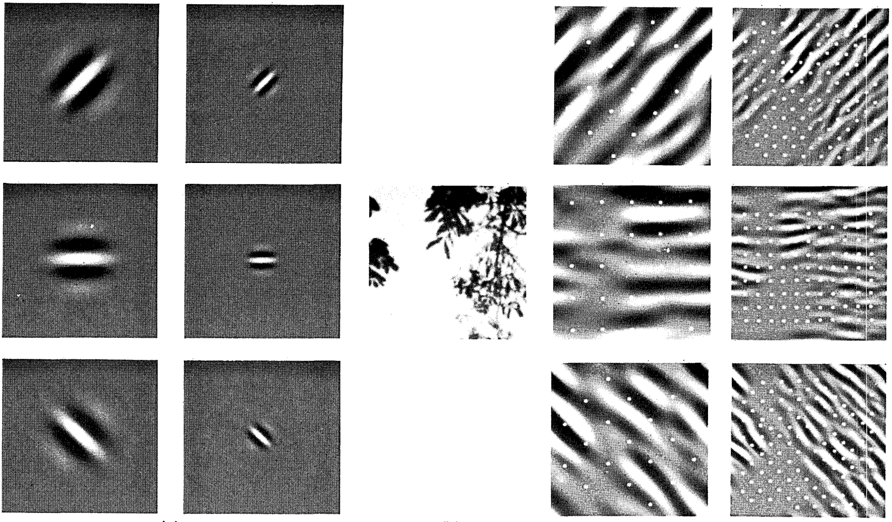

# Convolutional Neural Networks
:label:`chap_cnn`

Every image classifier we have built so far has ignored the spatial geometry of
images, flattening a two-dimensional pixel grid into a one-dimensional vector.
The MLP in :numref:`chap_perceptrons` treats a $28 \times 28$ Fashion-MNIST
photo as an unordered list of 784 numbers: if we applied the same fixed random
permutation to the pixels of every image and retrained, the MLP would reach the
exact same accuracy—even though the scrambled images would look like pure static
to human eyes. Humans recognize a sneaker by its outline and textures, which
are patterns formed by *neighboring* pixels, and an outline carries the same
meaning wherever in the frame it appears.

Neuroscience offered an early clue. In classic experiments on cats and monkeys,
Hubel and Wiesel discovered that neurons in the early visual cortex respond to
oriented edges and bars within localized patches of the visual field—each
neuron's *receptive field*
:cite:`Hubel.Wiesel.1959,Hubel.Wiesel.1962,Hubel.Wiesel.1968`. Later,
:citet:`Field.1987` modeled these responses on natural images using a small bank
of local filters swept across every image location (:numref:`field_visual`).


:label:`field_visual`

Inspired by these findings, Fukushima's Neocognitron :cite:`Fukushima.1980`
organized local detectors into hierarchical layers repeated across space, and
LeCun and collaborators showed how to train such architectures end to end via
backpropagation to recognize handwritten ZIP codes
:cite:`LeCun.Boser.Denker.ea.1989,LeCun.Jackel.Bottou.ea.1995`. Deeper layers of
trained vision networks even exhibit representational parallels with higher
stages of the primate visual pathway :cite:`Kuzovkin.Vicente.Petton.ea.2018`, though
biology served as architectural inspiration rather than a blueprint for silicon
computation.

At the heart of these architectures lies the *convolutional layer*, which slides
a small shared kernel of weights across every neighborhood of an image. Each
output unit depends only on nearby pixels, and shifting the input simply shifts
the output, building locality and translation equivariance directly into the
network while slashing parameter counts by orders of magnitude. These
*convolutional neural networks* (CNNs) drove the watershed breakthrough on
ImageNet :cite:`Deng.Dong.Socher.ea.2009,Krizhevsky.Sutskever.Hinton.2012` and
remain a cornerstone of computer vision alongside vision transformers
(:numref:`chap_transformers`).

This chapter derives and builds CNNs from first principles in three steps. We
begin by showing that enforcing locality and translation equivariance on a dense
layer leaves convolution as the unique linear choice (:numref:`sec_why-conv`),
then implement two-dimensional cross-correlation, learn an edge-detecting kernel
by gradient descent, recast convolution as matrix multiplication (*im2col*), and
trace how stacked layers widen receptive fields (:numref:`sec_conv_layer`). Next,
we control spatial resolution, field of view, and feature capacity through
padding, stride, and dilation (:numref:`sec_padding`), multi-channel filter
banks and $1 \times 1$ bottlenecks (:numref:`sec_channels`), and local and
global pooling (:numref:`sec_pooling`). Finally, we assemble these pieces into
LeNet (:numref:`sec_lenet`), compare it against our MLP on Fashion-MNIST,
inspect its learned first-layer filters, and test both models on pixel-shuffled
images to isolate the contribution of spatial inductive bias. Modern deep
convolutional architectures follow in :numref:`chap_modern_cnn`.

```toc
:maxdepth: 2

why-conv
conv-layer
padding-and-strides
channels
pooling
lenet
```

## Resources and Further Reading {.unnumbered}

The resources below accompany the sections of this chapter; each names the
section it goes with. All are freely accessible online except where noted.

**Books**

- [Deep Learning (Goodfellow, Bengio & Courville)](https://www.deeplearningbook.org/): free HTML; Chapter 9 develops sparse interactions, parameter sharing, and equivariance in detail (:numref:`sec_why-conv`, :numref:`sec_pooling`).
- [Understanding Deep Learning (Simon J. D. Prince)](https://udlbook.github.io/udlbook/): free PDF; Chapter 10 covers convolutions, stride, dilation, and receptive fields with clear geometric figures (:numref:`sec_conv_layer`, :numref:`sec_padding`).
- [Neural Networks and Deep Learning (Michael Nielsen)](http://neuralnetworksanddeeplearning.com/chap6.html): free online; Chapter 6 introduces convolutional layers, shared weights, and pooling from first principles (:numref:`sec_conv_layer`, :numref:`sec_pooling`).

**Courses and video lectures**

- [Stanford CS231n: Deep Learning for Computer Vision](https://cs231n.github.io/convolutional-networks/): free notes; the "Convolutional Networks" module (layer arithmetic, parameter counting, layer patterns) is a widely used online companion to this chapter (:numref:`sec_padding`, :numref:`sec_channels`).
- [Michigan EECS 498-007: Deep Learning for Computer Vision (Justin Johnson)](https://web.eecs.umich.edu/~justincj/teaching/eecs498/): free lecture videos working through convolution and pooling arithmetic at this chapter's pace (:numref:`sec_conv_layer`, :numref:`sec_pooling`).

**Tutorials, notes, and interactive**

- [A guide to convolution arithmetic for deep learning (Dumoulin & Visin, 2016)](https://arxiv.org/abs/1603.07285): free, with companion [animations](https://github.com/vdumoulin/conv_arithmetic); visual reference for padding, stride, dilation, and transposed convolutions (:numref:`sec_padding`).
- [CNN Explainer (Wang et al., Polo Club)](https://poloclub.github.io/cnn-explainer/): interactive browser convnet for inspecting activations, kernels, and receptive fields (:numref:`sec_channels`, :numref:`sec_lenet`).
- [Computing Receptive Fields of Convolutional Neural Networks (Araujo, Norris & Sim, 2019, *Distill*)](https://distill.pub/2019/computing-receptive-fields/): derives the closed-form receptive-field arithmetic introduced in :numref:`sec_conv_layer`, including strided and multi-path cases.
- [Conv Nets: A Modular Perspective (Chris Olah)](https://colah.github.io/posts/2014-07-Conv-Nets-Modular/): short classic building intuition for convolution as structured weight sharing (:numref:`sec_why-conv`).
- [Image Kernels Explained Visually (Victor Powell)](https://setosa.io/ev/image-kernels/): interactive tool for sliding hand-designed kernels over an image, complementing :numref:`sec_conv_layer`.
- [Feature Visualization (Olah, Mordvintsev & Schubert, 2017, *Distill*)](https://distill.pub/2017/feature-visualization/): visual exploration of what convnet units respond to, accompanying :numref:`sec_lenet`.

**Foundational papers**

- [Gradient-Based Learning Applied to Document Recognition (LeCun, Bottou, Bengio & Haffner, 1998, *Proc. IEEE*)](http://yann.lecun.com/exdb/publis/pdf/lecun-98.pdf): free PDF; the LeNet-5 paper behind :numref:`sec_lenet`.
- [Backpropagation Applied to Handwritten Zip Code Recognition (LeCun et al., 1989, *Neural Computation*)](https://doi.org/10.1162/neco.1989.1.4.541): the first convnet trained end to end with backpropagation (paywalled) (:numref:`sec_lenet`).
- [Neocognitron (Fukushima, 1980, *Biological Cybernetics*)](https://doi.org/10.1007/BF00344251): the pre-backpropagation ancestor of alternating convolution and pooling stages (paywalled) (:numref:`sec_pooling`).
- [Receptive fields, binocular interaction and functional architecture in the cat's visual cortex (Hubel & Wiesel, 1962, *J. Physiology*)](https://pmc.ncbi.nlm.nih.gov/articles/PMC1359523/): free (PMC); the biological root of local receptive fields and hierarchical feature detection (:numref:`sec_why-conv`).

<!-- slides -->

::: {.slide}
::: {.cover}
[Dive into Deep Learning · §6]{.kicker}

Convolutional Neural Networks: Geometry-Aware Vision Layers<br>**locality · translation equivariance · cross-correlation · padding · channels · pooling · LeNet**
:::
:::

::: {.slide title="Flattening Images Destroys Spatial Geometry"}
[Motivation & Inductive Bias]{.kicker}

::: {.cols .vc}
::: {.col}
- **Permutation blindness:** Scrambling all 784 pixels of Fashion-MNIST with one fixed permutation leaves an MLP's accuracy unchanged ($\approx 87\%$).
- **Parameter explosion at scale:** A 1-megapixel RGB dense layer needs $(3 \times 10^6)^2 = 9 \times 10^{12}$ weights (**36 TB** in `float32`).
- **Geometric prior:** Enforcing **locality** and **translation equivariance** collapses trillions of weights into a shared kernel of a few hundred parameters.
:::

::: {.col .fig .big}
@fig:ch06-cnn-flatten-vs-grid
:::
:::
:::

::: {.slide title="Receptive Fields in Biological and Silicon Vision"}
[From Visual Cortex to ConvNets]{.kicker}

Hubel and Wiesel discovered that early visual cortex neurons respond to oriented edges within localized *receptive fields*, inspiring hierarchical filter banks swept across space:

::: {.cols .vc}
::: {.col .fig}
{.nostretch width=100%}
:::

::: {.col}
- **Local filter bank (left $\to$ right):** Six oriented edge filters convolved with a natural image produce sparse activation maps that highlight local contours at different orientations and scales.
- **End-to-end learning:** Rather than hand-crafting filter banks, convolutional neural networks (CNNs) learn the kernel weights across all layers simultaneously via backpropagation.
:::
:::
:::

::: {.slide title="Mathematical and Architectural Roadmap of Chapter §{num:chap_cnn}"}
[Chapter Architecture]{.kicker}

::: {.cols .vc}
::: {.col}
- **§§{sec_why-conv}–§{num:sec_conv_layer} (Symmetry & Conv Layer):** Translation equivariance and locality yield 2D cross-correlation $\mathbf{Y} = \mathbf{X} \star \mathbf{K}$, executed via `im2col` GEMM.
- **§§{sec_padding}–§{num:sec_channels} (Geometry & Channels):** Padding $p$, stride $s$, dilation $d$, 4D filter banks $(c_\textrm{o}, c_\textrm{i}, k_\textrm{h}, k_\textrm{w})$, and $1 \times 1$ bottlenecks.
- **§§{sec_pooling}–§{num:sec_lenet} (Pooling & LeNet):** Parameter-free pooling and end-to-end LeNet verification against our MLP.
:::

::: {.col .fig .big}
@fig:ch06-cnn-roadmap-pipeline
:::
:::
:::

::: {.slide title="Concrete Benchmarks Across Chapter §{num:chap_cnn}"}
[Quantitative Anchors]{.kicker}

::: {.cols .vc}
::: {.col}
- **Resolution-independent weights:** A $3 \times 3$ RGB-to-64-channel stem uses $1{,}792$ parameters at any image resolution; $1 \times 1$ bottlenecks cut deep $3 \times 3$ cost by $8.5\times$.
- **Geometric reach & shift tolerance:** Strides $(2,2,1)$ or dilations $(1,2,4)$ double 3-layer reach from $r=7$ to $r=15$; $2 \times 2$ pooling absorbs $50\%$ of 1-px shifts.
- **LeNet resource split:** Convolutions hold $4.2\%$ of weights yet perform $85.9\%$ of MACs.
:::

::: {.col .fig .big}
@fig:ch06-cnn-benchmarks-overview
:::
:::
:::

::: {.slide title="Concept Check & Chapter Study Strategy"}
[Check & Synthesis]{.kicker}

::: {.cols .vc}
::: {.col}
- **1. Resolution scaling ($224^2 \to 448^2$):** How do parameter count, MACs, and activation RAM scale when height and width double?
- **2. Inductive bias test:** Why does a CNN beat an MLP on natural images, yet lose that advantage under a fixed random pixel permutation?
- **Answer:** Parameters stay **$1\times$** (fixed by $c_\textrm{o}, c_\textrm{i}, k$), while MACs and activations scale **$4\times$** with area $H \times W$. Shuffling destroys 2D locality.
:::

::: {.col .fig .big}
@fig:ch06-cnn-resolution-scaling
:::
:::
:::
