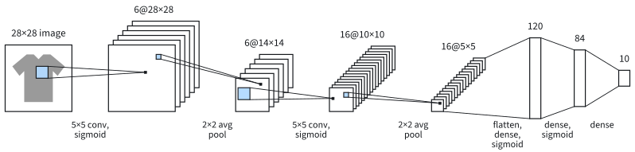
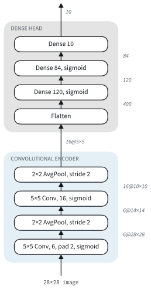

```{.python .input}
%load_ext d2lbook.tab
tab.interact_select('mxnet', 'pytorch', 'tensorflow', 'jax')
```

# Convolutional Neural Networks (LeNet)
:label:`sec_lenet`

The MLP of :numref:`sec_mlp-implementation` classifies Fashion-MNIST images
with about 87% validation accuracy after 30 epochs, using about 204,000
parameters. It flattens each $28\times28$ image into a vector of 784 numbers
before its first layer. Shuffling the pixels in the same way in every image
would therefore not change what it can learn: the MLP does not know which
pixels are neighbors, and it must learn a pattern separately at every
position where the pattern can occur. The convolutional layers of this
chapter keep the spatial layout and use the same kernel at every position,
so they need far fewer parameters. This section builds a complete
classifier from convolutions, pooling, and fully connected layers and asks
whether it is also more accurate than the MLP, under the same loss,
optimizer, and number of epochs.

The network we build is *LeNet*, after Yann LeCun, who developed it with his
colleagues at AT&T Bell Labs to recognize handwritten digits
:cite:`LeCun.Bottou.Bengio.ea.1998`. It was the result of a decade of work
that began with an early convolutional network for images trained end to
end by backpropagation :cite:`LeCun.Boser.Denker.ea.1989`. LeNet-5, the version of 1998, reached an
error rate below 1% on handwritten digits, on par with the support vector
machines of the time, and variants of it read the handwritten amounts on
bank checks in commercial systems. It showed that a network trained from
examples could replace a hand-engineered recognition pipeline.

```{.python .input #lenet-convolutional-neural-networks-lenet}
%%tab mxnet
from d2l import mxnet as d2l
from mxnet import init, npx
from mxnet.gluon import nn
npx.set_np()
```

```{.python .input #lenet-convolutional-neural-networks-lenet}
%%tab pytorch
from d2l import torch as d2l
import torch
from torch import nn
```

```{.python .input #lenet-convolutional-neural-networks-lenet}
%%tab tensorflow
from d2l import tensorflow as d2l
import tensorflow as tf
```

```{.python .input #lenet-convolutional-neural-networks-lenet}
%%tab jax
from d2l import jax as d2l
from flax import nnx
from jax import numpy as jnp
```

## The LeNet Architecture

LeNet consists of two parts, shown in :numref:`img_lenet`: a convolutional
encoder with two convolutional layers, and a dense block with three fully
connected layers.


:label:`img_lenet`

Each convolutional block consists of a convolutional layer with a
$5\times5$ kernel, a sigmoid activation, and $2\times2$ average pooling with
stride 2. The first convolutional layer has 6 output channels and the second
has 16, so the number of channels grows while each pooling layer halves the
height and the width. The encoder's output has shape (batch size, channels,
height, width) in MXNet and PyTorch; TensorFlow and JAX put the channels
last.

The dense block needs one vector per example, so we first flatten the
encoder's output into a matrix with one row per example. Its three fully
connected layers have 120, 84, and 10 outputs. The last layer has one output
per class, as in softmax regression.

This is the common teaching version of LeNet-5, not an exact reproduction.
The network of 1998 had the same alternating convolutions and pooling and
the same 6, 16, 120, and 84 channels and hidden units, but it used a scaled
tanh as activation, pooling with a trainable weight and bias, partial
connections between the two convolutional layers, and radial-basis output
units. It also took $32\times32$ images, larger than the $28\times28$ MNIST
digits it classified, so that features near the border of a digit, such as
the end of a stroke, could fall at the center of the receptive field of a
unit in the last convolutional layer. Our first convolutional layer pads
its $28\times28$ input by two pixels on each side, which gives it the same
$32\times32$ extent and the $28\times28$ output of the original.

In a framework, LeNet is a `Sequential` container of these layers. We use
Xavier initialization (:numref:`subsec_xavier`) for the weights and zero
biases in all four frameworks.

:begin_tab:`mxnet`
`initialize(init.Xavier())` draws the weights from Xavier's uniform
distribution; the biases start at zero, Gluon's default.
:end_tab:

:begin_tab:`pytorch`
Lazy layers have no weights until the first minibatch fixes their shapes, so
the model cannot initialize them in its constructor. As in
:numref:`sec_lazy_init`, the `Trainer` runs one minibatch through the model
and then calls the model's `weight_init` method on every layer. For LeNet
this method applies `init_cnn`, which draws Xavier-uniform weights, and sets
the biases to zero.
:end_tab:

:begin_tab:`tensorflow`
Xavier initialization, under the name `glorot_uniform`, and zero biases are
the Keras defaults for convolutional and dense layers, so the model needs no
initialization code.
:end_tab:

:begin_tab:`jax`
NNX layers draw their weights in the constructor. We pass Xavier's uniform
initializer to each layer; the biases start at zero, the Flax default.
:end_tab:

```{.python .input #lenet-1}
%%tab pytorch
def init_cnn(module):  #@save
    """Initialize weights for CNNs."""
    if type(module) == nn.Linear or type(module) == nn.Conv2d:
        nn.init.xavier_uniform_(module.weight)
```

```{.python .input #lenet-2}
%%tab mxnet
class LeNet(d2l.Classifier):  #@save
    """The layout of LeNet-5, with sigmoid activations and average pooling."""
    def __init__(self, lr=0.1, num_classes=10):
        super().__init__()
        self.save_hyperparameters()
        self.net = nn.Sequential()
        self.net.add(
            nn.Conv2D(6, kernel_size=5, padding=2), nn.Activation('sigmoid'),
            nn.AvgPool2D(pool_size=2, strides=2),
            nn.Conv2D(16, kernel_size=5), nn.Activation('sigmoid'),
            nn.AvgPool2D(pool_size=2, strides=2),
            nn.Flatten(),
            nn.Dense(120), nn.Activation('sigmoid'),
            nn.Dense(84), nn.Activation('sigmoid'),
            nn.Dense(num_classes))
        self.net.initialize(init.Xavier())
```

```{.python .input #lenet-2}
%%tab pytorch
class LeNet(d2l.Classifier):  #@save
    """The layout of LeNet-5, with sigmoid activations and average pooling."""
    def __init__(self, lr=0.1, num_classes=10):
        super().__init__()
        self.save_hyperparameters()
        self.net = nn.Sequential(
            nn.LazyConv2d(6, kernel_size=5, padding=2), nn.Sigmoid(),
            nn.AvgPool2d(kernel_size=2, stride=2),
            nn.LazyConv2d(16, kernel_size=5), nn.Sigmoid(),
            nn.AvgPool2d(kernel_size=2, stride=2),
            nn.Flatten(),
            nn.LazyLinear(120), nn.Sigmoid(),
            nn.LazyLinear(84), nn.Sigmoid(),
            nn.LazyLinear(num_classes))

    def weight_init(self, module):
        # The Trainer calls this after the first minibatch fixed the shapes
        init_cnn(module)  # Xavier-uniform weights
        if type(module) in (nn.Linear, nn.Conv2d):
            nn.init.zeros_(module.bias)
```

```{.python .input #lenet-2}
%%tab tensorflow
class LeNet(d2l.Classifier):  #@save
    """The layout of LeNet-5, with sigmoid activations and average pooling."""
    def __init__(self, lr=0.1, num_classes=10):
        super().__init__()
        self.save_hyperparameters()
        self.net = tf.keras.models.Sequential([
            tf.keras.layers.Conv2D(6, kernel_size=5, padding='same'),
            tf.keras.layers.Activation('sigmoid'),
            tf.keras.layers.AvgPool2D(pool_size=2, strides=2),
            tf.keras.layers.Conv2D(16, kernel_size=5),
            tf.keras.layers.Activation('sigmoid'),
            tf.keras.layers.AvgPool2D(pool_size=2, strides=2),
            tf.keras.layers.Flatten(),
            tf.keras.layers.Dense(120), tf.keras.layers.Activation('sigmoid'),
            tf.keras.layers.Dense(84), tf.keras.layers.Activation('sigmoid'),
            tf.keras.layers.Dense(num_classes)])
```

```{.python .input #lenet-2}
%%tab jax
class LeNet(d2l.Classifier):  #@save
    """The layout of LeNet-5, with sigmoid activations and average pooling."""
    def __init__(self, lr=0.1, num_classes=10, kernel_init=None, rngs=None):
        super().__init__()
        self.save_hyperparameters(ignore=['rngs', 'kernel_init'])
        rngs = nnx.Rngs(d2l.get_key()) if rngs is None else rngs
        kernel_init = (nnx.initializers.xavier_uniform() if kernel_init is None
                       else kernel_init)

        def avg_pool(x):  # 2x2 windows, stride 2
            return nnx.avg_pool(x, window_shape=(2, 2), strides=(2, 2))

        def flatten(x):
            return x.reshape((x.shape[0], -1))

        self.net = nnx.Sequential(
            nnx.Conv(1, 6, kernel_size=(5, 5), padding=2,
                     kernel_init=kernel_init, rngs=rngs), nnx.sigmoid,
            avg_pool,
            nnx.Conv(6, 16, kernel_size=(5, 5), padding='VALID',
                     kernel_init=kernel_init, rngs=rngs), nnx.sigmoid,
            avg_pool,
            flatten,
            nnx.Linear(400, 120, kernel_init=kernel_init, rngs=rngs),
            nnx.sigmoid,
            nnx.Linear(120, 84, kernel_init=kernel_init, rngs=rngs),
            nnx.sigmoid,
            nnx.Linear(84, num_classes, kernel_init=kernel_init, rngs=rngs))
```

## Layer Shapes

:numref:`img_lenet_vert` lists the layers in compressed notation, with the
shape of the tensor that passes between them. To check that the code builds
this network, we pass a single-channel $28 \times 28$ image through it and
print the output shape after each layer. The method `layer_summary` does this
for any classifier whose layers sit in a sequential container `net`; the
next chapter uses it for larger networks.


:label:`img_lenet_vert`

```{.python .input #lenet-3}
%%tab mxnet, pytorch
@d2l.add_to_class(d2l.Classifier)  #@save
def layer_summary(self, X_shape):
    X = d2l.randn(*X_shape)
    for layer in self.net:
        X = layer(X)
        print(layer.__class__.__name__, 'output shape:\t', X.shape)
        
model = LeNet()
model.layer_summary((1, 1, 28, 28))
```

```{.python .input #lenet-3}
%%tab tensorflow
@d2l.add_to_class(d2l.Classifier)  #@save
def layer_summary(self, X_shape):
    X = d2l.normal(X_shape)
    for layer in self.net.layers:
        X = layer(X)
        print(layer.__class__.__name__, 'output shape:\t', X.shape)

model = LeNet()
model.layer_summary((1, 28, 28, 1))
```

```{.python .input #lenet-3}
%%tab jax
@d2l.add_to_class(d2l.Classifier)  #@save
def layer_summary(self, X_shape):
    X = jnp.zeros(X_shape)
    for layer in self.net.layers:
        X = layer(X)
        print(layer.__class__.__name__, 'output shape:\t', X.shape)

model = LeNet()
model.layer_summary((1, 28, 28, 1))
```

The shapes follow the rules of :numref:`sec_padding`. A $5\times5$ kernel
without padding shrinks the height and the width by 4. The first
convolutional layer pads by 2 on each side and keeps $28\times28$; the second
has no padding and turns $14\times14$ into $10\times10$. Each pooling layer
halves the height and the width, from 28 to 14 and from 10 to 5. Meanwhile
the number of channels grows from 1 to 6 to 16, so the encoder trades spatial
resolution for channels. The flattened output has $16 \times 5 \times 5 =
400$ entries, and the fully connected layers reduce it to 120, 84, and
finally one output per class.

## Parameters and Multiply-Adds

The shapes give the size and the cost of every layer. A convolutional layer
with $c_\textrm{i}$ input channels, $c_\textrm{o}$ output channels, and a
$k\times k$ kernel has $c_\textrm{i} c_\textrm{o} k^2$ weights and
$c_\textrm{o}$ biases. It applies each weight once at every output position,
so it performs $c_\textrm{i} c_\textrm{o} k^2$ multiply-adds per output
position. A fully connected layer uses each of its weights once per example.
:numref:`tab_lenet_cost` applies these counts to LeNet.

:Parameters and multiply-adds per example of the layers of LeNet. Pooling and activation layers have no parameters.
:label:`tab_lenet_cost`

| layer | output | parameters | multiply-adds |
|:--|:--|--:|--:|
| $5\times5$ convolution, 1 to 6 channels | 6@28×28 | $150 + 6 = 156$ | $150 \times 784 = 117{,}600$ |
| $5\times5$ convolution, 6 to 16 channels | 16@10×10 | $2{,}400 + 16 = 2{,}416$ | $2{,}400 \times 100 = 240{,}000$ |
| fully connected, 400 to 120 | 120 | $48{,}000 + 120 = 48{,}120$ | $48{,}000$ |
| fully connected, 120 to 84 | 84 | $10{,}080 + 84 = 10{,}164$ | $10{,}080$ |
| fully connected, 84 to 10 | 10 | $840 + 10 = 850$ | $840$ |
| total | | $61{,}706$ | $416{,}520$ |

The two kinds of layers divide the work in opposite ways. The convolutional
layers hold 4% of the parameters and perform 86% of the multiply-adds,
because each of their weights is used at every position of a feature map.
The first fully connected layer holds 78% of the parameters and performs 12%
of the multiply-adds. Compared with the MLP, which has 203,530 parameters and
performs about 203,000 multiply-adds per image, LeNet has fewer than a third
of the parameters and performs about twice the arithmetic.

## Training

We now train LeNet on Fashion-MNIST with the loss and the optimizer of the
MLP, cross-entropy minimized by minibatch stochastic gradient descent, for
the same 30 epochs, with minibatches of 128 images.

The learning rate needs more care than for the MLP. The derivative of the
sigmoid, $\sigma'(x) = \sigma(x)(1 - \sigma(x))$, is at most $1/4$. The
gradient that reaches the weights of the first convolutional layer passes
backward through four sigmoids, after each of the four hidden layers, and
each multiplies it by at most $1/4$. At the MLP's learning rate of 0.1, LeNet
therefore learns slowly: its validation accuracy stays at chance for the
first two to four epochs and reaches only about 73% after 10. We use a
learning rate of 2.0 instead, twenty times larger.

The `Trainer` moves the model and every minibatch to the GPU, if there is
one, as in :numref:`subsec_device_aware_trainer`.

```{.python .input #lenet-training}
trainer = d2l.Trainer(max_epochs=30, num_gpus=1)
data = d2l.FashionMNIST(batch_size=128)
model = LeNet(lr=2.0)
trainer.fit(model, data)
```

Even at this learning rate the validation accuracy can stay at chance, 10%,
before it climbs; how long it stays there varies from run to run, from no
epoch at all to several, in every framework. After 30 epochs LeNet reaches a
validation accuracy of about 88--90%, against about 87% for the MLP, with fewer than a third of the
MLP's parameters. A convolution kernel learns a local pattern once and
detects it at every position, whereas the MLP must learn the pattern
separately for each position at which it occurs.

## Summary

LeNet combines a convolutional encoder, in which the resolution shrinks while
the number of channels grows, with a small fully connected head. Its
convolutional layers hold few parameters and do most of the arithmetic; the
first fully connected layer holds most of the parameters. Trained with the
loss, the optimizer, and the 30 epochs of the MLP of
:numref:`sec_mlp-implementation`, it reaches about 88--90% validation
accuracy on Fashion-MNIST, against about 87% for the MLP, with fewer than a
third of the MLP's parameters. Its sigmoid activations need a learning rate
twenty times that of the MLP, because each sigmoid shrinks the backward
gradient by a factor of at least four.

The encoder followed by a classifier head remains the organization of most
convolutional networks, although modern networks replace most of LeNet's
components:

:Component substitutions from LeNet to modern CNNs.
:label:`tab_lenet_modern`

| LeNet (this section) | Modern (2020s) | Effect of the change |
|:--|:--|:--|
| sigmoid activation | ReLU or GELU | gradients that survive depth instead of shrinking at every layer |
| average pooling | max-pooling or strided convolution | selective or learned local downsampling |
| no normalization | batch or layer normalization | stable activation scales, so much deeper stacks train |
| dense head on flattened features | global average pooling plus one linear layer | removes most of the parameters (the $400 \times 120$ block here) |
| Xavier initialization | He initialization | variance matched to the ReLU |

The next chapter makes these changes one at a time, starting with AlexNet
(:numref:`sec_alexnet`), and asks what each one contributes as networks grow
much deeper.

## Exercises

1. [code] **Modern components.** Retrain `LeNet` with the changes below,
   using the training settings of this section, and compare the
   validation accuracy of each variant after 30 epochs with that of
   `LeNet`.
    1. Replace average pooling with max-pooling.
    1. Replace the sigmoid activations with ReLU. If the loss diverges or
       the accuracy stays at chance, lower the learning rate until training
       succeeds, and report the learning rate you used.
    1. Make both changes together, and call the result the modernized
       LeNet. Which of the two changes accounts for most of the difference
       in accuracy?
    1. ● At initialization, measure for `LeNet` and for the modernized
       LeNet the norm of the gradient of the loss with respect to the first
       convolutional kernel, and the standard deviation of the logits
       across a minibatch. The derivation of Xavier initialization in
       :numref:`subsec_xavier` assumes inputs with zero mean and no
       nonlinearity. Use the mean of the sigmoid's output and its slope
       $\sigma'(0) = 1/4$ to explain your measurements, the learning
       rate that `LeNet` needs, and the epochs at chance at the start of
       its training.
   :exlabel:`ex_lenet-modern-components`

1. [code] **Original MNIST.** Write an `MNIST` data class by adapting
   `d2l.FashionMNIST`, and train both `LeNet` and the MLP of
   :numref:`sec_mlp-implementation` on it, with the settings that each
   uses for Fashion-MNIST. :citet:`LeCun.Bottou.Bengio.ea.1998` report a
   test error rate below 1% for LeNet-5 on MNIST.
    1. Compare the test error rate of `LeNet` with this figure.
    1. For each dataset, compute the difference and the ratio of the test
       error rates of the two networks. :numref:`sec_fashion_mnist` states
       that MNIST makes differences among model classes less visible. Does
       each of the two measures support this statement?

1. [code] **Activation maps.** Train the modernized LeNet of
   problem :exref:`ex_lenet-modern-components` and extract the feature maps of its first and second
   convolutional layers, each taken after its ReLU.
    1. Display them for test images from two different classes, for
       example pullovers and coats.
    1. Measure the maximum activation of each of the two layers on
       Fashion-MNIST test images, on out-of-distribution photos such as a
       cat or a car, and on uniform random noise. Convert each photo to a
       $28 \times 28$ grayscale image, and keep every input in $[0, 1]$,
       the pixel range of `d2l.FashionMNIST`. Do the maxima for photos and
       noise fall inside or clearly outside the range observed on
       Fashion-MNIST test images?

1. [code] **Overfitting sanity check.** Before trusting a full training
   run, check that a network can memorize a small dataset. Fix a subset
   of 50 Fashion-MNIST training images and train on it with all 50
   images in one minibatch, for at most 500 gradient steps.
    1. For both `LeNet` and the modernized LeNet of problem :exref:`ex_lenet-modern-components`,
       record the number of steps until training accuracy exceeds 99%. If
       a network does not get there, diagnose which architectural or
       optimization choice is responsible.
    1. Name one bug that this check would catch and one that it would
       miss, and explain why the check cannot detect the second.

    *Adapted from Stanford CS231n,
    [Assignment 2](https://cs231n.github.io/assignments2024/assignment2/),
    Convolutional Networks notebook.*

1. **Equivariance versus augmentation.** A stride-1 convolution on an
   infinite grid is exactly translation equivariant.
    1. Go through the layers of `LeNet` in order. Name each component that
       breaks exact translation equivariance of the feature maps, and the
       components that prevent the final prediction from being
       translation invariant.
    1. Explain why training `LeNet` on translated copies of its training
       images can improve test accuracy even though its convolutional
       layers share weights across all locations.

    *Adapted from Michael Nielsen,
    [Neural Networks and Deep Learning](http://neuralnetworksanddeeplearning.com/chap6.html),
    Chapter 6.*

1. [code] **The dense head.** ● :numref:`tab_lenet_cost` shows that the
   first fully connected layer holds 78% of LeNet's parameters.
    1. Replace the entire dense head, from the flatten through the output
       layer, by global average pooling followed by a single linear layer
       from 16 to 10 units. How many parameters does the network now
       have? Before training, predict whether the validation accuracy
       changes by more than one percentage point relative to `LeNet`; then
       retrain and compare.
    1. Instead connect the flattened 400-dimensional convolutional output
       directly to a ten-way linear output layer. How many parameters does
       this network have? Retrain, and compare the accuracy of the two
       reduced heads with each other and with your prediction. What does
       the comparison say about where LeNet's capacity is used?

    *Adapted from Michael Nielsen,
    [Neural Networks and Deep Learning](http://neuralnetworksanddeeplearning.com/chap6.html),
    Chapter 6.*

:begin_tab:`mxnet`
[Discussions](https://d2l.discourse.group/t/73)
:end_tab:

:begin_tab:`pytorch`
[Discussions](https://d2l.discourse.group/t/74)
:end_tab:

:begin_tab:`tensorflow`
[Discussions](https://d2l.discourse.group/t/275)
:end_tab:

:begin_tab:`jax`
[Discussions](https://d2l.discourse.group/t/18000)
:end_tab:

<!-- slides -->

::: {.slide}
::: {.cover}
[Dive into Deep Learning · §6.6]{.kicker}

LeNet<br>**convolutional encoder · layer shapes · parameters and multiply-adds · training against the MLP**
:::
:::

::: {.slide title="The MLP Reaches 87% with 204k Parameters and Ignores Which Pixels Are Neighbors"}
[The problem]{.kicker}

- The MLP flattens each 28×28 Fashion-MNIST image into 784 numbers.
- Shuffling the pixels the same way in every image would not change what
  it can learn.
- It must learn a pattern separately at every position where it occurs.
- 784 → 256 → 10: 203,530 parameters, **≈ 87%** validation accuracy
  after 30 epochs.

::: {.d2l-note .warn}
Can a network that keeps the 2-D layout do better with fewer parameters?
:::
:::

::: {.slide title="By the End of This Deck You Can"}
[Goals]{.kicker}

- trace the shapes through a stack of convolutions and pooling;
- count the parameters and multiply-adds of every layer;
- build LeNet as a sequential container;
- choose a learning rate for a network of sigmoids;
- compare LeNet with the MLP under the same training budget.

**Running example:** one 28×28 Fashion-MNIST image, and a table of
parameters, multiply-adds, and accuracy for the MLP and LeNet.
:::

::: {.slide title="Putting the Pieces Together, After Pooling"}
[Where this fits]{.kicker}

::: {.cols .vc}
::: {.col}
| section | adds |
|---|---|
| From Fully Connected Layers to Convolutions | locality and translation equivariance give convolution |
| Convolutions for Images | cross-correlation, learning a kernel, receptive fields |
| Padding, Stride, and Dilation | output size and how far each unit sees |
| Multiple Input and Multiple Output Channels | channels, 1 × 1 convolutions, cost |
| Pooling | downsampling and tolerance to small shifts |
| **Convolutional Neural Networks (LeNet)** | **a complete CNN on Fashion-MNIST** |
:::

::: {.col .narrow}
- **Uses:** every layer of this chapter; the MLP, `Classifier`, and
  `Trainer`; Xavier initialization.
- **Skips:** ReLU, normalization, and deeper networks (next chapter).
:::
:::
:::

::: {.slide}
::: {.divider}
[01]{.dnum}

[The LeNet Architecture]{.dtitle}

[two convolutional blocks and a dense head]{.dsub}
:::
:::

::: {.slide title="LeNet Maps a 28×28 Image to 10 Scores with 62k Parameters"}
[Architecture]{.kicker}

{width=95%}

Spatial size shrinks, channels grow: a convolutional **encoder**, then a
fully connected **head**.
:::

::: {.slide title="Two Convolutional Blocks, Then Three Fully Connected Layers"}
[Architecture]{.kicker}

- Conv 5×5, 1 → 6 channels, padding 2 (28 → 28), sigmoid
- Average pool 2×2, stride 2 → 14×14
- Conv 5×5, 6 → 16 channels, no padding (14 → 10), sigmoid
- Average pool 2×2, stride 2 → 5×5
- Flatten: 16·5·5 = 400 → 120 → 84 → 10 logits, sigmoids between

Initialization: Xavier weights, zero biases, in every framework.
:::

::: {.slide title="This Is LeNet-5's Layout, Not LeNet-5"}
[Architecture]{.kicker}

LeNet-5 (LeCun, Bottou, Bengio, Haffner, 1998) had the same layout and
widths 6, 16, 120, 84, but

- a scaled tanh, $1.7159 \tanh(2x/3)$, instead of the sigmoid;
- pooling with a trainable weight and bias;
- partial connections between the two convolutional layers;
- radial-basis output units.

::: {.d2l-note}
It took **32×32** inputs for 28×28 digits. Our padding of 2 gives the
first layer the same extent and the same 28×28 output.
:::
:::

::: {.slide title="LeNet Is One Sequential Container" only="mxnet"}
[Architecture]{.kicker}

```{.python #lenet-exercises-1}
self.net.add(
    nn.Conv2D(6, kernel_size=5, padding=2), nn.Activation('sigmoid'),
    nn.AvgPool2D(pool_size=2, strides=2),
    nn.Conv2D(16, kernel_size=5), nn.Activation('sigmoid'),
    nn.AvgPool2D(pool_size=2, strides=2),
    nn.Flatten(),
    nn.Dense(120), nn.Activation('sigmoid'),
    nn.Dense(84), nn.Activation('sigmoid'),
    nn.Dense(num_classes))
self.net.initialize(init.Xavier())
```
:::

::: {.slide title="LeNet Is One Sequential Container" only="pytorch"}
[Architecture]{.kicker}

```{.python #lenet-exercises-2}
self.net = nn.Sequential(
    nn.LazyConv2d(6, kernel_size=5, padding=2), nn.Sigmoid(),
    nn.AvgPool2d(kernel_size=2, stride=2),
    nn.LazyConv2d(16, kernel_size=5), nn.Sigmoid(),
    nn.AvgPool2d(kernel_size=2, stride=2),
    nn.Flatten(),
    nn.LazyLinear(120), nn.Sigmoid(),
    nn.LazyLinear(84), nn.Sigmoid(),
    nn.LazyLinear(num_classes))
```
:::

::: {.slide title="LeNet Is One Sequential Container" only="tensorflow"}
[Architecture]{.kicker}

```{.python #lenet-exercises-3}
layers = tf.keras.layers
self.net = tf.keras.models.Sequential([
    layers.Conv2D(6, kernel_size=5, padding='same'),
    layers.Activation('sigmoid'), layers.AvgPool2D(2, strides=2),
    layers.Conv2D(16, kernel_size=5),
    layers.Activation('sigmoid'), layers.AvgPool2D(2, strides=2),
    layers.Flatten(),
    layers.Dense(120), layers.Activation('sigmoid'),
    layers.Dense(84), layers.Activation('sigmoid'),
    layers.Dense(num_classes)])
```

Excerpt of the class; `layers` abbreviates `tf.keras.layers`.
:::

::: {.slide title="LeNet Is One Sequential Container" only="jax"}
[Architecture]{.kicker}

```{.python #lenet-exercises-4}
self.net = nnx.Sequential(
    nnx.Conv(1, 6, kernel_size=(5, 5), padding=2, **init), nnx.sigmoid,
    avg_pool,
    nnx.Conv(6, 16, kernel_size=(5, 5), padding='VALID', **init),
    nnx.sigmoid, avg_pool,
    flatten,
    nnx.Linear(400, 120, **init), nnx.sigmoid,
    nnx.Linear(120, 84, **init), nnx.sigmoid,
    nnx.Linear(84, num_classes, **init))
```

Excerpt of the class: `init` stands for `kernel_init=xavier_uniform()`
and `rngs`; `avg_pool` and `flatten` are two-line functions.
:::

::: {.slide title="Xavier Init, Applied After the First Minibatch" only="pytorch"}
[Architecture]{.kicker}

Lazy layers learn their shapes from the first minibatch. The `Trainer`
then calls the model's `weight_init` on every layer. LeNet's applies
`init_cnn` and sets every bias to zero:

@lenet-1
:::

::: {.slide}
::: {.divider}
[02]{.dnum}

[Shapes, Parameters, and Multiply-Adds]{.dtitle}

[where the weights live, and where the arithmetic happens]{.dsub}
:::
:::

::: {.slide title="The Encoder Trades Resolution for Channels"}
[Shapes]{.kicker}

::: {.cols .vc}
::: {.col .narrow}
{width=55%}
:::

::: {.col}
`layer_summary` on one 28×28 image:

@!lenet-3
:::
:::
:::

::: {.slide title="Check: 6@14×14 Through Sixteen 5×5 Filters"}
[Check]{.kicker}

No padding, stride 1. Output shape? Parameters? Multiply-adds?

::: {.fragment .fade-up}
::: {.d2l-note}
**Answer.** $14 - 5 + 1 = 10$: **16@10×10**. Weights
$6 \cdot 16 \cdot 25 = 2{,}400$, plus 16 biases. Each weight is used at
all $10 \cdot 10$ positions: **240,000** multiply-adds.
:::
:::
:::

::: {.slide title="Convolutions Hold 4% of the Parameters and Do 86% of the Arithmetic"}
[Parameters and multiply-adds]{.kicker}

| layer | parameters | multiply-adds |
|---|--:|--:|
| conv 5×5, 1 → 6 | 156 | 117,600 |
| conv 5×5, 6 → 16 | 2,416 | 240,000 |
| dense 400 → 120 | **48,120** (78%) | 48,000 |
| dense 120 → 84 | 10,164 | 10,080 |
| dense 84 → 10 | 850 | 840 |
| total | 61,706 | 416,520 |

A convolution weight is used at every position; a dense weight once per
image.
:::

::: {.slide title="LeNet Has a Third of the MLP's Parameters and Twice Its Arithmetic"}
[Parameters and multiply-adds]{.kicker}

| | MLP (784 → 256 → 10) | LeNet |
|---|--:|--:|
| parameters | 203,530 | 61,706 |
| multiply-adds per image | ≈ 0.20M | ≈ 0.42M |

::: {.d2l-note .rule}
Weight sharing decouples the two: parameters scale with the kernel,
arithmetic with the kernel times the number of positions.
:::
:::

::: {.slide}
::: {.divider}
[03]{.dnum}

[Training]{.dtitle}

[same loss, optimizer, and epochs as the MLP]{.dsub}
:::
:::

::: {.slide title="Four Sigmoids Shrink the Gradient: Learning Rate 2.0 Instead of 0.1"}
[Training]{.kicker}

- $\sigma'(x) = \sigma(x)(1 - \sigma(x)) \le \tfrac14$.
- The gradient reaching the first convolution passes backward through
  **four** sigmoids, each multiplying it by at most ¼.
- At the MLP's rate 0.1: chance for 2–4 epochs, ≈ 73% validation
  accuracy after 10.

**Use 2.0, twenty times the MLP's rate.**
:::

::: {.slide title="Same Loss, Optimizer, and 30 Epochs as the MLP"}
[Training]{.kicker}

Cross-entropy, minibatch SGD, 128 images per minibatch; only the model
and the learning rate change:

@-lenet-training
:::

::: {.slide title="Validation Accuracy Climbs to About 90% After a Short Plateau"}
[Training]{.kicker}

@!lenet-training

At chance (10%) for up to several epochs, then about 88–90% after 30.
:::

::: {.slide title="LeNet Beats the MLP with a Third of the Parameters"}
[Training]{.kicker}

| | MLP | LeNet |
|---|--:|--:|
| parameters | 203,530 | 61,706 |
| multiply-adds per image | ≈ 0.20M | ≈ 0.42M |
| learning rate | 0.1 | 2.0 |
| validation accuracy, 30 epochs | ≈ 87% | ≈ 88–90% |

**A kernel learns a local pattern once and detects it at every position.**
:::

::: {.slide title="Thirty Years Changed the Components, Not the Template"}
[Beyond this deck]{.kicker}

| LeNet | modern CNNs |
|---|---|
| sigmoid | ReLU, GELU |
| average pooling | max-pooling, strided convolution |
| no normalization | batch or layer normalization |
| dense head on flattened features | global average pooling + 1 linear layer |
| Xavier initialization | He initialization |

The next chapter makes these changes one at a time. The *encoder + head*
organization stays.
:::

::: {.slide title="Check: A 3×3 Convolution, 64 → 128 Channels, on 56×56"}
[Check]{.kicker}

Padding 1, stride 1. Parameters? Multiply-adds per image?

::: {.fragment .fade-up}
::: {.d2l-note}
**Answer.** Weights $64 \cdot 128 \cdot 9 = 73{,}728$, plus 128 biases.
Output 128@56×56, so $73{,}728 \cdot 3{,}136 \approx 231$M multiply-adds:
about 550 times all of LeNet, with more parameters than all of LeNet.
:::
:::
:::

::: {.slide title="Recap"}
[Wrap-up]{.kicker}

- **LeNet:** conv encoder (28×28 → 5×5, 1 → 16 channels) → flatten →
  120 → 84 → 10.
- **Counting:** a conv layer has $c_\textrm{i} c_\textrm{o} k^2$ weights
  and uses each at every output position.
- **Split:** convolutions 4% of the 61,706 parameters and 86% of the
  416,520 multiply-adds.
- **Training:** sigmoids need learning rate 2.0, twenty times the MLP's.
- **Result:** ≈ 88–90% against ≈ 87% for the MLP, with a third of the
  parameters.

**Next:** modern convolutional networks, one component at a time.
:::
