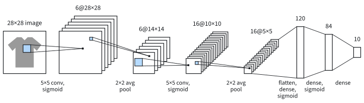
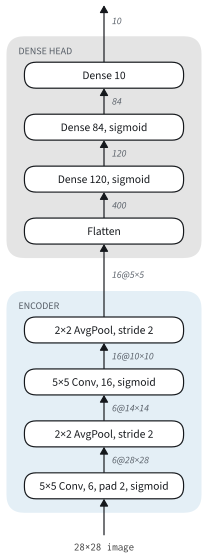

```{.python .input}
%load_ext d2lbook.tab
tab.interact_select('mxnet', 'pytorch', 'tensorflow', 'jax')
```

# LeNet
:label:`sec_lenet`

We now have all the building blocks of a convolutional neural network in hand:
convolutional layers (:numref:`sec_conv_layer`), padding and stride
(:numref:`sec_padding`), multiple channels (:numref:`sec_channels`), and
pooling (:numref:`sec_pooling`). It is time to assemble them into a complete
image classifier and put our earlier arguments to the test: does respecting
two-dimensional spatial structure actually outperform a standard MLP?

Our baseline is the MLP from :numref:`sec_mlp-implementation`, which reaches
roughly 87% validation accuracy on Fashion-MNIST after 30 epochs. Whereas the
MLP flattens each image into 784 unordered numbers (:numref:`sec_why-conv`),
a CNN preserves the pixel grid and applies shared local kernels across every
spatial position. To compare the two architectures fairly, we train our CNN
with the same cross-entropy loss, SGD optimizer, and 30-epoch budget. Because
a single accuracy number never tells the whole story, we will also inspect
the filters learned by the first convolutional layer and run a controlled
experiment on pixel-shuffled images to verify where the CNN's advantage
originates.

The architecture we implement is *LeNet*, named after Yann LeCun, who
developed it with colleagues at AT&T Bell Labs to recognize handwritten digits
:cite:`LeCun.Bottou.Bengio.ea.1998`. It marked the culmination of a decade of
research that began with one of the earliest end-to-end convolutional networks
trained by backpropagation :cite:`LeCun.Boser.Denker.ea.1989`. By 1998,
LeNet-5 achieved error rates below 1% on handwritten digits—rivaling the
support vector machines that dominated machine learning at the time—and
variants of it were deployed commercially to read handwritten amounts on bank
checks and ATM deposits. LeNet provided early, compelling proof that an
end-to-end learned network could replace carefully hand-engineered vision
pipelines.

```{.python .input #lenet-convolutional-neural-networks-lenet}
%%tab mxnet
import math
import numpy as np
from mxnet import autograd, gluon, init, np as mnp, npx
from mxnet.gluon import nn
from d2l import mxnet as d2l
npx.set_np()
```

```{.python .input #lenet-convolutional-neural-networks-lenet}
%%tab pytorch
import math
import numpy as np
import torch
from torch import nn
from torch.nn import functional as F
from d2l import torch as d2l
```

```{.python .input #lenet-convolutional-neural-networks-lenet}
%%tab tensorflow
import math
import numpy as np
import tensorflow as tf
from d2l import tensorflow as d2l
```

```{.python .input #lenet-convolutional-neural-networks-lenet}
%%tab jax
import math
import numpy as np
import jax
from jax import numpy as jnp
from flax import nnx
import optax
from d2l import jax as d2l
```

## The LeNet Architecture

At a high level, LeNet divides cleanly into two stages, illustrated in
:numref:`img_lenet`: a *convolutional encoder* built from two convolutional
blocks, followed by a *dense classification head* consisting of three fully
connected layers.


:label:`img_lenet`

Each convolutional block pairs a $5\times5$ convolutional layer and a sigmoid
activation with a $2\times2$ average-pooling layer of stride 2. The first
convolutional layer outputs 6 channels and the second outputs 16.

:begin_tab:`mxnet, pytorch`
The encoder output has channels-first shape `(batch_size, channels, height, width)`.
:end_tab:

:begin_tab:`tensorflow, jax`
The encoder output has channels-last shape `(batch_size, height, width, channels)`.
:end_tab:
To connect the convolutional encoder to the dense block, we flatten each
example's spatial feature maps into a single vector, producing a
two-dimensional matrix with one row per minibatch example. Three fully
connected layers then project this vector through 120 and 84 hidden units to
10 output logits---one per class, just as in softmax regression.

Note that this is the standard pedagogical version of LeNet-5 rather than a
bit-for-bit historical replica. It preserves the 1998 network's alternating
convolutions and pooling as well as its layer widths (6, 16, 120, and 84),
while simplifying legacy details that are rarely used today (such as a scaled
$\tanh$ activation, learnable pooling scales and biases, sparse channel wiring
between the two convolutions, and radial-basis-function output units). One
historical detail does remain visible in our code: the original LeNet-5 took
$32\times32$ inputs, whereas MNIST and Fashion-MNIST images are $28\times28$
(originally cropped by two pixels on every side to save storage). Adding two
pixels of padding to our first convolutional layer restores the same
$28\times28$ output dimensions after the first $5\times5$ convolution.

With modern deep learning frameworks, assembling LeNet requires only a single
`Sequential` block. We initialize all layer weights with Xavier initialization
(:numref:`subsec_xavier`) and set biases to zero.

```{.python .input #lenet-1}
%%tab pytorch
def init_cnn(module):  #@save
    """Initialize weights for CNNs."""
    if type(module) == nn.Linear or type(module) == nn.Conv2d:
        nn.init.xavier_uniform_(module.weight)
```

```{.python .input #lenet-2}
%%tab mxnet
class LeNet(d2l.Classifier):  #@save
    """The layout of LeNet-5, with sigmoid activations and average pooling."""
    def __init__(self, lr=0.1, num_classes=10):
        super().__init__()
        self.save_hyperparameters()
        self.net = nn.Sequential()
        self.net.add(
            nn.Conv2D(6, kernel_size=5, padding=2), nn.Activation('sigmoid'),
            nn.AvgPool2D(pool_size=2, strides=2),
            nn.Conv2D(16, kernel_size=5), nn.Activation('sigmoid'),
            nn.AvgPool2D(pool_size=2, strides=2),
            nn.Flatten(),
            nn.Dense(120), nn.Activation('sigmoid'),
            nn.Dense(84), nn.Activation('sigmoid'),
            nn.Dense(num_classes))
        self.net.initialize(init.Xavier())
```

```{.python .input #lenet-2}
%%tab pytorch
class LeNet(d2l.Classifier):  #@save
    """The layout of LeNet-5, with sigmoid activations and average pooling."""
    def __init__(self, lr=0.1, num_classes=10):
        super().__init__()
        self.save_hyperparameters()
        self.net = nn.Sequential(
            nn.LazyConv2d(6, kernel_size=5, padding=2), nn.Sigmoid(),
            nn.AvgPool2d(kernel_size=2, stride=2),
            nn.LazyConv2d(16, kernel_size=5), nn.Sigmoid(),
            nn.AvgPool2d(kernel_size=2, stride=2),
            nn.Flatten(),
            nn.LazyLinear(120), nn.Sigmoid(),
            nn.LazyLinear(84), nn.Sigmoid(),
            nn.LazyLinear(num_classes))

    def weight_init(self, module):
        # The Trainer calls this after the first minibatch fixed the shapes
        init_cnn(module)  # Xavier-uniform weights
        if type(module) in (nn.Linear, nn.Conv2d) and module.bias is not None:
            nn.init.zeros_(module.bias)
```

```{.python .input #lenet-2}
%%tab tensorflow
class LeNet(d2l.Classifier):  #@save
    """The layout of LeNet-5, with sigmoid activations and average pooling."""
    def __init__(self, lr=0.1, num_classes=10):
        super().__init__()
        self.save_hyperparameters()
        self.net = tf.keras.models.Sequential([
            tf.keras.layers.Conv2D(6, kernel_size=5, padding='same'),
            tf.keras.layers.Activation('sigmoid'),
            tf.keras.layers.AvgPool2D(pool_size=2, strides=2),
            tf.keras.layers.Conv2D(16, kernel_size=5),
            tf.keras.layers.Activation('sigmoid'),
            tf.keras.layers.AvgPool2D(pool_size=2, strides=2),
            tf.keras.layers.Flatten(),
            tf.keras.layers.Dense(120), tf.keras.layers.Activation('sigmoid'),
            tf.keras.layers.Dense(84), tf.keras.layers.Activation('sigmoid'),
            tf.keras.layers.Dense(num_classes)])
```

```{.python .input #lenet-2}
%%tab jax
class LeNet(d2l.Classifier):  #@save
    """The layout of LeNet-5, with sigmoid activations and average pooling."""
    def __init__(self, lr=0.1, num_classes=10, kernel_init=None, rngs=None):
        super().__init__()
        self.save_hyperparameters(ignore=['rngs', 'kernel_init'])
        rngs = nnx.Rngs(d2l.get_key()) if rngs is None else rngs
        kernel_init = (nnx.initializers.xavier_uniform() if kernel_init is None
                       else kernel_init)

        def avg_pool(x):  # 2x2 windows, stride 2
            return nnx.avg_pool(x, window_shape=(2, 2), strides=(2, 2))

        def flatten(x):
            return x.reshape((x.shape[0], -1))

        self.net = nnx.Sequential(
            nnx.Conv(1, 6, kernel_size=(5, 5), padding=2,
                     kernel_init=kernel_init, rngs=rngs), nnx.sigmoid,
            avg_pool,
            nnx.Conv(6, 16, kernel_size=(5, 5), padding='VALID',
                     kernel_init=kernel_init, rngs=rngs), nnx.sigmoid,
            avg_pool,
            flatten,
            nnx.Linear(400, 120, kernel_init=kernel_init, rngs=rngs),
            nnx.sigmoid,
            nnx.Linear(120, 84, kernel_init=kernel_init, rngs=rngs),
            nnx.sigmoid,
            nnx.Linear(84, num_classes, kernel_init=kernel_init, rngs=rngs))
```

## Layer Shapes

Because a single mismatched padding value or a forgotten flatten layer shifts
every downstream tensor shape, it is good practice to verify intermediate
shapes before starting training. :numref:`img_lenet_vert` diagrams LeNet in
compressed notation alongside the expected tensor shape at each boundary. To
check that our implementation matches this diagram, we pass a single-channel
$28 \times 28$ dummy tensor through the model and print the output shape after
each layer. We package this diagnostic as a `layer_summary` method on
`d2l.Classifier` so that we can reuse it for deeper architectures in the next
chapter.


:label:`img_lenet_vert`

```{.python .input #lenet-3}
%%tab mxnet, pytorch
@d2l.add_to_class(d2l.Classifier)  #@save
def layer_summary(self, X_shape):
    X = d2l.randn(*X_shape)
    for layer in self.net:
        X = layer(X)
        name = getattr(layer, '__name__', type(layer).__name__)
        print(f'{name:<22} {tuple(X.shape)}')

model = LeNet()
model.layer_summary((1, 1, 28, 28))
```

```{.python .input #lenet-3}
%%tab tensorflow
@d2l.add_to_class(d2l.Classifier)  #@save
def layer_summary(self, X_shape):
    X = d2l.normal(X_shape)
    for layer in self.net.layers:
        X = layer(X)
        name = getattr(layer, '__name__', type(layer).__name__)
        print(f'{name:<22} {tuple(X.shape)}')

model = LeNet()
model.layer_summary((1, 28, 28, 1))
```

```{.python .input #lenet-3}
%%tab jax
@d2l.add_to_class(d2l.Classifier)  #@save
def layer_summary(self, X_shape):
    X = jnp.zeros(X_shape)
    for layer in self.net.layers:
        X = layer(X)
        # Activations and pooling are plain functions: print their names
        name = getattr(layer, '__name__', type(layer).__name__)
        print(f'{name:<22} {tuple(X.shape)}')

model = LeNet()
model.layer_summary((1, 28, 28, 1))
```

The printed shapes match :numref:`img_lenet_vert` exactly and follow our
output-shape rules from :numref:`sec_padding`. An unpadded $5\times5$ kernel
reduces height and width by 4: our first convolutional layer adds 2 pixels of
padding per side to preserve the $28\times28$ resolution, whereas the second
uses no padding and shrinks $14\times14$ to $10\times10$. Each $2\times2$
average-pooling layer halves both spatial dimensions ($28 \to 14$ and
$10 \to 5$). Meanwhile, channel depth expands from 1 to 6 to 16 as the encoder
trades spatial resolution for richer feature representations. Flattening the
final $16 \times 5 \times 5$ tensor yields a 400-dimensional vector, which the
dense block progressively compresses down to 10 class logits.

## Parameters and Multiply-Adds

With every layer's output shape verified, we can tally both parameter memory
and arithmetic cost. Recall from :numref:`subsec_multi-output-channels` that a
convolutional layer with $c_\textrm{i}$ input channels, $c_\textrm{o}$ output
channels, and a $k\times k$ kernel stores $c_\textrm{i} c_\textrm{o} k^2$
weights plus $c_\textrm{o}$ biases, and reuses every weight once per output
spatial location. By contrast, a fully connected layer uses each weight only
once per example. :numref:`tab_lenet_cost` breaks down these figures across
LeNet.

:Parameters and multiply-adds per example of the layers of LeNet. Pooling and activation layers have no parameters.
:label:`tab_lenet_cost`

| layer | output | parameters | multiply-adds |
|:--|:--|--:|--:|
| $5\times5$ convolution, 1 to 6 channels | 6@28×28 | $150 + 6 = 156$ | $150 \times 784 = 117{,}600$ |
| $5\times5$ convolution, 6 to 16 channels | 16@10×10 | $2{,}400 + 16 = 2{,}416$ | $2{,}400 \times 100 = 240{,}000$ |
| fully connected, 400 to 120 | 120 | $48{,}000 + 120 = 48{,}120$ | $48{,}000$ |
| fully connected, 120 to 84 | 84 | $10{,}080 + 84 = 10{,}164$ | $10{,}080$ |
| fully connected, 84 to 10 | 10 | $840 + 10 = 850$ | $840$ |
| total | | $61{,}706$ | $416{,}520$ |

The breakdown highlights a striking division between memory and computation
that recurs throughout CNN design. The two convolutional layers account for
just 4% of LeNet's parameters yet perform 86% of its multiply-adds, because
every kernel weight is evaluated across an entire spatial grid. Conversely,
the first fully connected layer alone holds 78% of the parameters while
contributing only 12% of the arithmetic. Compared with our earlier Fashion-MNIST
MLP (203,530 parameters and roughly 203,000 multiply-adds per image), LeNet
uses fewer than a third as many parameters while performing roughly twice as
much computation.

## Training

Just as with the MLP, we train LeNet by minimizing cross-entropy loss with
minibatch SGD for 30 epochs, using a minibatch size of 128 (half the MLP's
256). One hyperparameter, however, must change substantially: the learning
rate. Because the derivative of the sigmoid activation never exceeds $1/4$
(:numref:`subsec_activation-functions`), gradients flowing back to the first
convolutional layer are attenuated by four successive sigmoids. At the MLP's
learning rate of 0.1, training crawls: validation accuracy lingers near chance
for the first two to four epochs and climbs only to about 73% after 10 epochs.
We therefore raise the learning rate to 2.0 (an empirically tuned factor of
twenty, reflecting the smaller gradient scale).

As in :numref:`subsec_device_aware_trainer`, `d2l.Trainer` automatically
dispatches training to a GPU when one is available.

```{.python .input #lenet-training}
trainer = d2l.Trainer(max_epochs=30, num_gpus=1)
data = d2l.FashionMNIST(batch_size=128)
model = LeNet(lr=2.0)
trainer.fit(model, data)
```

After 30 epochs, LeNet achieves roughly 88--90% validation accuracy,
improving on the MLP's ~87% despite having less than a third as many
parameters.

Look closely at the beginning of the training curve, too. Depending purely on
the random initialization, accuracy sometimes climbs immediately, while in
other runs it hovers at chance (10%) with the loss pinned near
$\ln 10 \approx 2.3$ for a few epochs before suddenly taking off. During that
initial plateau, the network predicts nearly identical uniform probabilities
for every image: after passing through four sigmoid layers, input-dependent
variations in the logits are initially too tiny to separate the classes. We
quantify this vanishing-signal effect in an exercise below, and we will see
the same plateau resurface in our pixel-shuffling experiment.

### The Learned Features

For softmax regression, we could visualize each class's weights directly as a
$28\times28$ template image (:numref:`sec_softmax_scratch`), and similarly
each hidden unit of an MLP weighted fixed pixel locations
(:numref:`sec_mlp-implementation`). A convolutional kernel, by contrast, is
not tied to any particular pixel—it is just a $5\times5$ patch of weights that
is hard to interpret in isolation. To understand what the first convolutional
layer has discovered, we visualize both the six learned $5\times5$ kernels
(top row) and the resulting post-sigmoid feature maps for a validation sneaker
and shirt (rows below), scaling each panel independently from its minimum
(black) to its maximum (white).

```{.python .input #lenet-the-learned-features-1}
X, y = trainer.prepare_batch(next(iter(data.val_dataloader())))
labels = d2l.numpy(y)
X = d2l.stack([X[int(np.argmax(labels == c))] for c in (7, 6)], 0)
```

```{.python .input #lenet-the-learned-features-2}
%%tab mxnet
maps = model.net[1](model.net[0](X))  # The first convolution and its sigmoid
images, maps = d2l.numpy(X[:, 0]), d2l.numpy(maps)
kernels = d2l.numpy(model.net[0].weight.data()[:, 0])  # Six 5x5 kernels
```

```{.python .input #lenet-the-learned-features-2}
%%tab pytorch
maps = model.net[1](model.net[0](X))  # The first convolution and its sigmoid
images, maps = d2l.numpy(X[:, 0]), d2l.numpy(maps)
kernels = d2l.numpy(model.net[0].weight[:, 0])  # Six 5x5 kernels
```

```{.python .input #lenet-the-learned-features-2}
%%tab tensorflow
layers = model.net.layers
maps = layers[1](layers[0](X))  # The first convolution and its sigmoid
# Channels-last to channels-first, so that maps[k, c] is one 28x28 map
images, maps = d2l.numpy(X[..., 0]), d2l.numpy(maps).transpose(0, 3, 1, 2)
kernels = d2l.numpy(layers[0].kernel)[:, :, 0].transpose(2, 0, 1)
```

```{.python .input #lenet-the-learned-features-2}
%%tab jax
layers = model.net.layers
maps = layers[1](layers[0](X))  # The first convolution and its sigmoid
# Channels-last to channels-first, so that maps[k, c] is one 28x28 map
images, maps = d2l.numpy(X[..., 0]), d2l.numpy(maps).transpose(0, 3, 1, 2)
kernels = d2l.numpy(layers[0].kernel[...])[:, :, 0].transpose(2, 0, 1)
```

```{.python .input #lenet-the-learned-features-3}
names = data.text_labels([7, 6])
axes = d2l.show_images(
    [kernels[0], *kernels, images[0], *maps[0], images[1], *maps[1]], 3, 7,
    titles=['', *[f'channel {c}' for c in range(1, 7)],
            names[0], *[''] * 6, names[1], *[''] * 6], cmap='gray')
axes[0].set_visible(False)  # No kernel above the input images
```

Across training runs, two distinct families of feature maps consistently
emerge. Some channels act as local brightness or foreground detectors,
reproducing the filled silhouette of the garment (either bright on dark or
inverted). The remaining channels light up selectively along the garment's
contours—especially its left or right boundaries. Examining their $5\times5$
kernels reveals how they do it: bright columns paired beside dark columns,
forming learned, multi-row relatives of the hand-crafted $(1, -1)$ vertical
edge kernel from :numref:`subsec_edge_detection`. Earlier, we had to supply
an explicit target edge map for gradient descent to learn an edge filter; here,
given nothing but raw garment pixels and class labels, LeNet discovers on its
own that edges and silhouettes are useful building blocks for visual
classification. (The exact assignment of roles across the six channels varies
from run to run.)

### Shuffled Pixels

How much weight should we put on a 1--3 percentage point gain over the MLP?
Taken alone, that margin could be noisy: the MLP's validation accuracy
fluctuates by roughly a point from epoch to epoch
(:numref:`sec_mlp-implementation`), and LeNet also differs in depth,
activation function, and learning rate. A cleaner controlled experiment
strips away the single piece of information that only convolutions exploit:
spatial adjacency. Returning to the thought experiment from the chapter
introduction, we draw one fixed random permutation of the 784 pixel positions
and apply that exact same reordering to every training and validation image.

```{.python .input #lenet-shuffled-pixels-1}
perm = np.random.permutation(28 * 28)  # One fixed order for every image

def shuffle_pixels(images):
    """Rearrange the 784 pixels of every image into the order perm."""
    return images.reshape(len(images), -1)[:, perm].reshape(images.shape)
```

```{.python .input #lenet-shuffled-pixels-2}
%%tab mxnet
data_shuffled = d2l.FashionMNIST(batch_size=128)
data_shuffled.train, data_shuffled.val = [
    data_shuffled.to_dataset(shuffle_pixels(images), labels)
    for images, labels in (data_shuffled.read(train=True),
                           data_shuffled.read(train=False))]
```

```{.python .input #lenet-shuffled-pixels-2}
%%tab pytorch
data_shuffled = d2l.FashionMNIST(batch_size=128)
for split in (data_shuffled.train, data_shuffled.val):
    split.data = shuffle_pixels(split.data)  # The stored 8-bit images
```

```{.python .input #lenet-shuffled-pixels-2}
%%tab tensorflow, jax
data_shuffled = d2l.FashionMNIST(batch_size=128)
data_shuffled.train, data_shuffled.val = [
    (shuffle_pixels(images), labels)
    for images, labels in (data_shuffled.train, data_shuffled.val)]
```

To human eyes, the permuted garments look like pure static.

```{.python .input #lenet-shuffled-pixels-3}
data_shuffled.visualize(next(iter(data_shuffled.val_dataloader())))
```

An MLP is completely blind to this permutation, and we do not even need to
retrain it to prove why: permuting the input coordinates merely reorders the
columns of its first weight matrix $\mathbf{W}^{(1)}$. Since every weight is
initialized identically and independently, training on shuffled pixels is
statistically identical to training on the original images, yielding the same
~87% accuracy. For LeNet, however, shuffling destroys spatial locality: every
$5\times5$ kernel now reads 25 pixels scattered randomly across the original
garment. Let us retrain LeNet with the exact same settings on the shuffled
dataset and plot both validation curves side by side.

```{.python .input #lenet-shuffled-pixels-4}
curves = {'pixels in place': trainer.history['val_acc']}
trainer.board.display = False
trainer.fit(LeNet(lr=2.0), data_shuffled)
curves['pixels shuffled'] = trainer.history['val_acc']
d2l.plot(list(range(1, trainer.max_epochs + 1)), list(curves.values()),
         'epoch', 'validation accuracy', legend=list(curves))
for name, acc in curves.items():  # A single epoch can land a point low
    print(f'{name}: {sum(acc[-5:]) / 5:.3f} averaged over the last 5 epochs')
```

On shuffled pixels, LeNet drops several percentage points to around 85--86% in
a typical run—at or slightly below the MLP. Once spatial neighborhood
structure is destroyed, LeNet's advantage vanishes, confirming that its edge
over the MLP comes directly from its convolutional inductive bias.

Notice that the initial chance-level plateau can reappear here as well, and
just as unpredictably. While it rarely exceeds a few epochs on ordered images,
on shuffled images an unlucky initialization can occasionally leave the model
stuck near chance for much of the 30-epoch run, depressing final accuracy even
further. That instability stems from stacking four sigmoid activations rather
than from the pixel ordering itself; even in runs that escape the plateau
immediately, LeNet on shuffled pixels never surpasses the MLP.

Finally, let us connect LeNet back to the symmetry principles of
:numref:`sec_why-conv`. Idealized image classifiers would have strictly
translation-equivariant feature layers and a strictly translation-invariant
output, yet LeNet achieves neither exactly: padded convolutions break
equivariance near borders, pooling absorbs only shifts that stay within a
pooling block (:numref:`sec_pooling`), and flattening the final $5\times5$
maps assigns distinct dense weights to every spatial cell. LeNet's shift
tolerance is therefore only partial—sufficient for Fashion-MNIST, where every
garment is neatly centered, though inadequate for unconstrained scenes.

Taken together, our two experiments demonstrate that a CNN can match and
outperform an MLP using less than a third as many parameters, precisely
because weight sharing lets each kernel learn a local visual pattern once and
detect it anywhere on the grid. On tiny $28\times28$ images, that efficiency
is a modest bonus; on the megapixel photographs discussed in
:numref:`sec_why-conv`, where a single dense layer demands a billion weights,
the same principle determines whether a model can be built at all. Making deep
convolutional networks *easy to train* at scale is the next challenge—and the
sluggish, erratic convergence of LeNet's four sigmoid layers already hints at
why modern architectures had to evolve far beyond 1998.

## Summary

LeNet pairs a convolutional encoder—which progressively trades spatial
resolution for deeper channel representations—with a three-layer fully
connected classifier head. Its convolutional layers hold just 4% of the
parameters yet perform 86% of the multiply-adds, whereas the first dense layer
alone accounts for 78% of the parameters. Trained under the same 30-epoch SGD
setup as the MLP of :numref:`sec_mlp-implementation`, LeNet reaches ~88--90%
validation accuracy on Fashion-MNIST (versus ~87% for the MLP) with fewer than
a third of the parameters, automatically learning silhouette and vertical-edge
filters from class labels alone. Shuffling pixel positions erases that gain,
isolating spatial locality as its source. At the same time, propagating
gradients through four sigmoid layers forces a much larger learning rate (2.0
rather than 0.1) and causes unpredictable early training plateaus.

While the overall encoder-plus-head blueprint remains foundational, almost
every individual component of LeNet has since been modernized: ReLUs replaced
sigmoids, max-pooling and strided convolutions replaced average pooling,
global average pooling followed by a single linear layer replaced heavy dense
heads, and normalization layers stabilized deep training. In the next chapter,
beginning with AlexNet (:numref:`sec_alexnet`), we trace these architectural
advances one by one as networks scale up in depth, width, and resolution.

## Exercises

1. [code] **Modern components.** Retrain `LeNet` with the changes below,
   using the training settings of this section, and compare the
   validation accuracy of each variant after 30 epochs with that of
   `LeNet`.
    1. Replace average pooling with max-pooling.
    1. Replace the sigmoid activations with ReLU. If the loss diverges or
       the accuracy stays at chance, lower the learning rate until training
       succeeds, and report the learning rate you used.
    1. Make both changes together, and call the result the modernized
       LeNet. Which of the two changes accounts for most of the difference
       in accuracy?
    1. ● With the weights the model has at the start of training, measure
       for `LeNet` and for the modernized LeNet the norm of the gradient of
       the loss with respect to the first convolutional kernel, and the
       standard deviation of the logits across a minibatch. The derivation
       of Xavier initialization in :numref:`subsec_xavier` assumes inputs
       with zero mean and no nonlinearity. Use the mean of the sigmoid's
       output and its slope
       $\sigma'(0) = 1/4$ to explain your measurements, the learning
       rate that `LeNet` needs, and the epochs at chance at the start of
       its training.
   :exlabel:`ex_lenet-modern-components`

2. [code] **Original MNIST.** Write an `MNIST` data class by adapting
   `d2l.FashionMNIST`, and train both `LeNet` and the MLP of
   :numref:`sec_mlp-implementation` on it, with the settings that each
   uses for Fashion-MNIST. :citet:`LeCun.Bottou.Bengio.ea.1998` report a
   test error rate below 1% for LeNet-5 on MNIST.
    1. Compare the validation error rate of `LeNet` with this figure. The
       two are measured on the same images: as for Fashion-MNIST, our
       validation set is the dataset's official test set.
    1. For each dataset, compute the difference and the ratio of the
       validation error rates of the two networks. :numref:`sec_fashion_mnist` states
       that MNIST makes differences among model classes less visible. Does
       each of the two measures support this statement?

3. [code] **Deeper feature maps.** The text drew the feature maps of the
   first convolutional layer.
    1. Display the 16 feature maps of the second convolutional layer of
       the trained `LeNet`, after its sigmoid, for validation images of
       two classes that are easily confused, for example pullovers and
       coats. Can you still say what a channel responds to? Which channels
       differ most between the two classes?
    1. Train the modernized LeNet of problem
       :exref:`ex_lenet-modern-components` and measure the maximum
       activation of each of its two convolutional layers, taken after the
       ReLU, on Fashion-MNIST validation images, on out-of-distribution
       photos such as a cat or a car, and on uniform random noise. Convert
       each photo to a $28 \times 28$ grayscale image, and keep every
       input in $[0, 1]$, the pixel range of `d2l.FashionMNIST`. Do the
       maxima for photos and noise fall inside or clearly outside the
       range observed on the validation images?

4. [code] **Shifted garments.** The text argued that `LeNet` is only
   partly tolerant to shifts.
    1. Shift every validation image by one, two, and four pixels to the
       right, filling the vacated columns with zeros, and measure the
       validation accuracy of the trained `LeNet` on each shifted set.
       Which shifts does the network tolerate? Relate what you find to
       the two pooling layers and to the dense head.
    1. Explain why training `LeNet` on translated copies of its training
       images can improve the accuracy on shifted validation images even
       though its convolutional layers share weights across all
       locations.

    *Adapted from Michael Nielsen,
    [Neural Networks and Deep Learning](http://neuralnetworksanddeeplearning.com/chap6.html),
    Chapter 6.*

5. [code] **The dense head.** ● :numref:`tab_lenet_cost` shows that the
   first fully connected layer holds 78% of LeNet's parameters.
    1. Replace the entire dense head, from the flatten through the output
       layer, by global average pooling followed by a single linear layer
       from 16 to 10 units. How many parameters does the network now
       have? Before training, predict whether the validation accuracy
       changes by more than one percentage point relative to `LeNet`; then
       retrain and compare.
    1. Instead connect the flattened 400-dimensional convolutional output
       directly to a ten-way linear output layer. How many parameters does
       this network have? Retrain, and compare the accuracy of the two
       reduced heads with each other and with your prediction. What does
       the comparison say about where LeNet's capacity is used?

    *Adapted from Michael Nielsen,
    [Neural Networks and Deep Learning](http://neuralnetworksanddeeplearning.com/chap6.html),
    Chapter 6.*

:begin_tab:`mxnet`
[Discussions](https://d2l.discourse.group/t/73)
:end_tab:

:begin_tab:`pytorch`
[Discussions](https://d2l.discourse.group/t/74)
:end_tab:

:begin_tab:`tensorflow`
[Discussions](https://d2l.discourse.group/t/275)
:end_tab:

:begin_tab:`jax`
[Discussions](https://d2l.discourse.group/t/18000)
:end_tab:

<!-- slides -->

::: {.slide}
::: {.cover}
[Dive into Deep Learning · §6.6]{.kicker}

Convolutional Neural Networks (LeNet)<br>**convolutional encoder · dense head · parameter vs. FLOP split · learned filters · pixel-shuffle test**
:::
:::

::: {.slide title="Pitting a Spatial CNN Against Our Flattened MLP"}
[Motivation & The Fashion-MNIST Benchmark]{.kicker}

We now assemble every component of Chapter 6—convolutions, padding, multi-channel feature maps, and pooling—into **LeNet** (LeCun et al., 1998) and compare it directly against our Chapter 5 MLP:

- **The MLP baseline ($784 \to 256 \to 10$):** Flattens every $28 \times 28$ image into 784 unordered numbers, using **$203{,}530$ parameters** ($\approx 200{,}704$ in the first layer alone) to reach **$\approx 87\%$** validation accuracy after 30 epochs.
- **The LeNet hypothesis:** Preserving the 2D grid and sharing $5 \times 5$ local kernels across all spatial positions should generalize better using a fraction of the parameters.
- **Isolating the spatial prior:** Beyond comparing accuracy on ordered images, we will apply a fixed random permutation to all 784 pixels to test whether LeNet's advantage truly comes from 2D spatial locality.
:::

::: {.slide title="The LeNet Architecture: Encoder Plus Dense Head"}
[Two Convolutional Blocks Followed by Three Dense Layers]{.kicker}

LeNet divides into a **convolutional encoder** (trading spatial resolution $28 \to 14 \to 10 \to 5$ for channel depth $1 \to 6 \to 16$) and a **dense classification head** ($400 \to 120 \to 84 \to 10$):

{.nostretch width=92% fig-align="center"}

- **Convolutional Block 1:** $5 \times 5$ conv ($1 \to 6$ channels, $p=2, s=1$) $\to$ Sigmoid $\to$ $2 \times 2$ AvgPool ($s=2$).
- **Convolutional Block 2:** $5 \times 5$ conv ($6 \to 16$ channels, $p=0, s=1$) $\to$ Sigmoid $\to$ $2 \times 2$ AvgPool ($s=2$).
- **Dense Head:** Flatten ($16 \times 5 \times 5 = 400$) $\to$ Dense ($120$) $\to$ Sigmoid $\to$ Dense ($84$) $\to$ Sigmoid $\to$ Dense ($10$).
:::

::: {.slide title="Historical LeNet-5 (1998) vs. Our Pedagogical LeNet"}
[Why the First Layer Uses Padding p = 2 on 28×28 Images]{.kicker}

Our implementation preserves the 1998 network's exact layer widths ($6, 16, 120, 84$) and alternating conv/pool template while modernizing legacy 1990s heuristics:

| Architectural Component | Original LeNet-5 (LeCun et al., 1998) | Our Pedagogical LeNet |
|---|---|---|
| **Input image resolution** | $32 \times 32$ grayscale ($p = 0 \to 28 \times 28$) | $28 \times 28$ with **$p = 2$** ($\to 28 \times 28$) |
| **Nonlinearity** | Scaled tangent $1.7159 \tanh(\frac{2}{3}x)$ | Standard $\sigma(x) = (1 + e^{-x})^{-1}$ |
| **Subsampling / Pooling** | $2 \times 2$ sum + trainable scale & bias + $\tanh$ | Parameter-free $2 \times 2$ average pooling ($s=2$) |
| **Conv2 channel wiring** | Sparse subset of $6 \to 16$ channel pairs | Standard all-to-all $6 \times 16 \times 5 \times 5$ tensor |
| **Output layer & loss** | Euclidean Radial Basis Function (RBF) units | Linear logits ($84 \to 10$) + softmax cross-entropy |
:::

::: {.slide title="Implementing LeNet as a Sequential Module"}
[Xavier Uniform Weight Initialization and Sequential Layer Stack]{.kicker}

We initialize all convolutional and linear weights with Xavier uniform initialization and stack the encoder and dense head inside a single `Sequential` container:

@lenet-2
:::

::: {.slide title="Tracing Tensor Shapes Through LeNet"}
[Verifying Spatial Shrinkage and Channel Expansion Before Training]{.kicker}

A single mismatched padding or stride shifts every downstream shape and breaks the flatten boundary ($16 \times 5 \times 5 = 400$). Our `layer_summary` diagnostic traces a dummy $(1, 1, 28, 28)$ tensor layer by layer:

::: {.cols .vc}
::: {.col}
@lenet-3
:::

::: {.col .fig}
{.nostretch width=52% fig-align="center"}
:::
:::
:::

::: {.slide title="Where Parameters Live vs. Where FLOPs Happen"}
[The Fundamental Memory–Compute Asymmetry of CNNs]{.kicker}

Tallying parameters ($c_\textrm{o} c_\textrm{i} k^2 + c_\textrm{o}$) and multiply-adds ($h_\textrm{o} w_\textrm{o} c_\textrm{o} c_\textrm{i} k^2$) across LeNet reveals a stark division of labor between convolutional and fully connected layers:

| Layer | Output Shape | Parameters | % Params | Multiply-Adds (MACs) | % MACs |
|---|---|--:|--:|--:|--:|
| **Conv1 ($5 \times 5$, $1 \to 6$, $p=2$)** | $6 \times 28 \times 28$ | $150 + 6 = 156$ | $0.3\%$ | $150 \times 784 = 117{,}600$ | $28.2\%$ |
| **Conv2 ($5 \times 5$, $6 \to 16$, $p=0$)** | $16 \times 10 \times 10$ | $2{,}400 + 16 = 2{,}416$ | $3.9\%$ | $2{,}400 \times 100 = 240{,}000$ | $57.6\%$ |
| **Dense1 ($400 \to 120$)** | $120$ | $48{,}000 + 120 = 48{,}120$ | **$78.0\%$** | $48{,}000$ | $11.5\%$ |
| **Dense2 ($120 \to 84$)** | $84$ | $10{,}080 + 84 = 10{,}164$ | $16.5\%$ | $10{,}080$ | $2.4\%$ |
| **Dense3 ($84 \to 10$)** | $10$ | $840 + 10 = 850$ | $1.4\%$ | $840$ | $0.2\%$ |
| **Total LeNet** | — | **$61{,}706$** | $100\%$ | **$416{,}520$** | $100\%$ |

::: {.d2l-note .rule}
**The 4% / 86% rule:** The two convolutional layers hold just **4.2% of the parameters** yet perform **85.9% of the arithmetic** (because each kernel weight is reused at $784$ or $100$ spatial locations), whereas the first dense layer holds **78% of the parameters** and does only **11.5% of the arithmetic**!
:::
:::

::: {.slide title="Pitfall: Four Sigmoids and Vanishing Gradients"}
[Why LeNet Needs Learning Rate 2.0 Instead of the MLP's 0.1]{.kicker}

Training LeNet with the MLP's learning rate ($\eta = 0.1$) stalls near chance ($10\%$ accuracy) for several epochs. Why do four stacked sigmoid layers attenuate early-layer gradients so severely?

- **Bounded sigmoid derivative:** For $\sigma(x) = (1 + e^{-x})^{-1}$, the derivative $\sigma'(x) = \sigma(x)(1 - \sigma(x))$ peaks at $x = 0$ with maximum value **$\sigma'(0) = \tfrac{1}{4}$**.
- **Four-layer chain-rule attenuation:** To reach Conv1, backpropagated gradients must pass through **four** sigmoid derivatives (Dense2, Dense1, Conv2, Conv1), shrinking the gradient scale by at least $(1/4)^4 = 1/256$!
- **Forward signal collapse & initial plateau:** At Xavier initialization, passing zero-mean activations through $\sigma(x) \approx \tfrac{1}{2} + \tfrac{1}{4}x$ crushes input-dependent variance across the four layers, pinning logits near uniform probabilities ($\mathcal{L} \approx \ln 10 \approx 2.30$) until weights grow large enough to escape the plateau.
- **Practical fix for classical LeNet:** Raising the SGD learning rate $20\times$ from $\eta = 0.1$ to **$\eta = 2.0$** compensates for the attenuated gradient norm (modern CNNs replace sigmoids with **ReLU** and use normalization layers).
:::

::: {.slide title="Training LeNet on Fashion-MNIST"}
[30 Epochs of Minibatch SGD (Batch Size 128, lr = 2.0)]{.kicker}

We train LeNet under the exact same 30-epoch budget and cross-entropy loss as our Chapter 5 MLP:

@lenet-training

- **Better accuracy with $3.3\times$ fewer parameters:** After an initial 1–3 epoch sigmoid plateau at $\mathcal{L} \approx 2.3$, validation accuracy climbs to **$\approx 88\text{--}90\%$**, beating the MLP ($\approx 87\%$) with only $61{,}706$ parameters vs. $203{,}530$.
:::

::: {.slide title="Extracting First-Layer Kernels and Feature Maps"}
[Probing Conv1 on a Validation Sneaker and Shirt]{.kicker}

Unlike a dense layer's $28 \times 28$ global templates, Conv1 learns six $5 \times 5$ local kernels. To see what each channel detects, we extract the $6$ learned $5 \times 5$ kernels alongside their post-sigmoid $28 \times 28$ feature maps on a sneaker and a shirt:

@lenet-the-learned-features-1

@lenet-the-learned-features-2
:::

::: {.slide title="Visualizing LeNet's Learned Edge & Silhouette Filters"}
[Emergence of Oriented Edge Detectors from Class Labels Alone]{.kicker}

Plotting the six $5 \times 5$ kernels (top row) above their $28 \times 28$ feature maps (rows 2 and 3) reveals two complementary detector families:

@lenet-the-learned-features-3

- **Foreground / silhouette detectors:** Several channels smooth and threshold intensity, capturing the filled bright-on-dark (or inverted dark-on-bright) silhouette of the sneaker and shirt.
- **Oriented contour detectors:** Other kernels place bright weights beside dark weights—discovering $5 \times 5$ relatives of our hand-crafted $[1, -1]$ edge detector from §6.2 purely from 10-way garment labels!
:::

::: {.slide title="Controlled Experiment: The Pixel-Shuffling Test"}
[Destroying Spatial Adjacency with One Fixed Random Permutation]{.kicker}

Does LeNet beat the MLP because of its 2D convolutional inductive bias, or merely because of its depth, learning rate, or parameter count? Let's apply **one fixed random permutation** `perm` of $\{0, \dots, 783\}$ to every training and validation image:

@lenet-shuffled-pixels-1

@lenet-shuffled-pixels-2

- **Exact permutation invariance of the MLP:** For an MLP, permuting input pixels by $\mathbf{P}$ simply permutes the columns of $\mathbf{W}^{(1)}$ ($\mathbf{X}\mathbf{P}\mathbf{W}^{(1)} = \mathbf{X}(\mathbf{P}\mathbf{W}^{(1)})$). Since $\mathbf{W}^{(1)}$ is initialized i.i.d., SGD on shuffled pixels follows the **exact same distribution of trajectories** ($\approx 87\%$ accuracy).
- **Destruction of locality for LeNet:** Every $5 \times 5$ window in Conv1 now groups 25 pixels scattered randomly across the garment.
:::

::: {.slide title="Visualizing Pixel-Shuffled Fashion-MNIST Garments"}
[Same Information Content, Zero Local Geometry]{.kicker}

Every permuted image still contains the exact same 784 pixel intensities in a consistent coordinate order, yet looks like pure white noise to human vision:

@lenet-shuffled-pixels-3
:::

::: {.slide title="Ordered vs. Shuffled Pixels: The Spatial Prior"}
[Retraining LeNet on Shuffled Fashion-MNIST]{.kicker}

Retraining LeNet (`lr = 2.0`, 30 epochs) on the pixel-shuffled dataset and plotting validation accuracy alongside the ordered-pixel run isolates the value of spatial locality:

@lenet-shuffled-pixels-4

- **Loss of the convolutional advantage:** Shuffling pixels drops LeNet's validation accuracy by **3–4 percentage points** (down to $\approx 85\text{--}86\%$, at or below the MLP's $87\%$) and makes the early sigmoid plateau longer and more erratic.
:::

::: {.slide title="Where LeNet Falls Short of Shift Invariance"}
[Boundary Effects, Local Pooling Blocks, and the Dense Flatten Head]{.kicker}

Why is LeNet only *partially* shift-tolerant rather than strictly translation invariant as derived on the infinite grid in §6.1?

1. **Zero-padded border effects:** Conv1 uses $p = 2$ zero padding, so shifting a garment near the edge changes how many zeros enter its windows (§6.3).
2. **Local stride-2 pooling boundaries:** Each $2 \times 2$, stride-2 average pool absorbs 1-pixel shifts that stay inside a $2 \times 2$ block, but jumps when a feature crosses a block boundary (§6.5).
3. **Flattening into the dense head ($16 \times 5 \times 5 \to 400 \to 120$):** Because `Dense(120)` assigns **independent weights** to each of the $5 \times 5 = 25$ spatial cells of Conv2's output, shifting the $5 \times 5$ map by 1 cell (= 4 input pixels) routes activations to completely different dense weights!

::: {.d2l-note}
Modern CNNs (Chapter 7) replace the heavy flattened dense head ($78\%$ of LeNet's parameters) with **Global Average Pooling** ($16 \times 5 \times 5 \to 16$) followed by a single linear layer ($16 \to 10$), slashing parameters from $61{,}706 \to 2{,}742$ while enforcing spatial invariance across the $5 \times 5$ grid.
:::
:::

::: {.slide title="Thirty Years of Evolution: LeNet to Modern CNNs"}
[Same Encoder-Plus-Head Blueprint, Modernized Components]{.kicker}

While LeNet's encoder-plus-head blueprint remains foundational, Chapter 7 modernizes every individual building block to scale to deep high-resolution vision:

| Component | Classical LeNet (1998) | Modern CNNs (AlexNet $\to$ ResNet $\to$ ConvNeXt) | Why It Changed |
|---|---|---|---|
| **Activation** | Sigmoid ($\sigma'(x) \le 1/4$) | ReLU, GELU | Eliminates $(1/4)^L$ vanishing gradient attenuation |
| **Initialization** | Xavier uniform | He (Kaiming) variance scaling | Accounts for ReLU zeroing out half of activations |
| **Downsampling** | $2 \times 2$ Average Pooling | Max-Pooling or Stride-2 Convolutions | Preserves peak activations or learns downsampling weights |
| **Normalization** | None | BatchNorm or LayerNorm + Residual skips | Stabilizes signal and gradient variance at $100+$ layers |
| **Classifier Head** | Flatten ($400$) + 3 Dense layers | Global Average Pooling + 1 Linear layer | Removes $>75\%$ of parameters and spatial head overfitting |
:::

::: {.slide title="Concept Check: LeNet Architecture & Cost"}
[Concept Check]{.kicker}

Test your understanding of full-network parameter/FLOP accounting and architectural design:

1. **Global Average Pooling head replacement:** In LeNet, replace `Flatten + Dense(120) + Dense(84) + Dense(10)` after the $16 \times 5 \times 5$ pooling output with Global Average Pooling ($\to 16$) and a single linear layer ($16 \to 10$). How many total parameters does the entire modified network have?
2. **Scaling up to a modern conv layer:** A single $3 \times 3$ conv layer ($p=1, s=1$) maps $64 \to 128$ channels on a $56 \times 56$ feature map. How do its parameters and MACs compare with *all of LeNet combined* ($61{,}706$ params, $416{,}520$ MACs)?
3. **ReLU modernization:** If you replace LeNet's four sigmoid activations with ReLU, why must you *lower* the learning rate from $\eta = 2.0$ back to $\eta \approx 0.05\text{--}0.1$?

::: {.d2l-note .fragment .fade-up}
**Answers:**
(1) Conv1 ($156$) + Conv2 ($2{,}416$) + Linear $16 \to 10$ ($16 \times 10 + 10 = 170$) = **$2{,}742$ parameters** ($22.5\times$ smaller than LeNet's $61{,}706$, removing $95.6\%$ of the weights!).
(2) Parameters: $128 \times 64 \times 9 + 128 = 73{,}856$ ($1.2\times$ all of LeNet). MACs: $56^2 \times 73{,}728 = 231{,}211{,}008$ (**$555\times$ all of LeNet**!).
(3) Unlike sigmoid ($\sigma'(x) \le 1/4$), ReLU has derivative $1$ for all active units ($x > 0$), so gradients are no longer attenuated by $(1/4)^4 = 1/256$; at $\eta = 2.0$, unattenuated ReLU gradients cause immediate weight explosion.
:::
:::

::: {.slide title="Summary & Key Takeaways: MLP vs. LeNet"}
[Section & Chapter Synthesis]{.kicker}

| Metric / Component | Chapter 5 MLP ($784 \to 256 \to 10$) | Classical LeNet (1998 Layout) | Modern CNNs (Chapter 7 Preview) |
|---|---|---|---|
| **Parameters** | $203{,}530$ ($98.6\%$ in layer 1) | **$61{,}706$** ($4.2\%$ conv, $95.8\%$ dense) | Bottlenecks + Global Avg Pool head |
| **Multiply-Adds / Image** | $\approx 203{,}000$ | **$416{,}520$** ($85.9\%$ in conv layers) | Dominated by spatial conv layers |
| **Activation & LR** | ReLU, $\eta = 0.1$ | Sigmoid ($\sigma' \le 1/4$), $\eta = 2.0$ | ReLU / GELU + BatchNorm / LayerNorm |
| **Downsampling & Head** | None (flattens input at start) | $2 \times 2$ AvgPool + 3-layer dense head | Strided conv / MaxPool + Global Avg Pool |
| **Fashion-MNIST (Ordered)** | $\approx 87\%$ | **$\approx 88\text{--}90\%$** ($3.3\times$ fewer params) | $> 92\%$ with deeper residual stages |
| **Fashion-MNIST (Shuffled)** | $\approx 87\%$ (permutation-invariant) | **$\approx 85\text{--}86\%$** (locality destroyed) | Drops sharply without spatial grid |
:::
