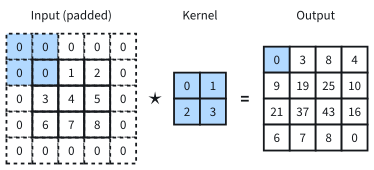
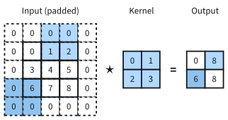

```{.python .input}
%load_ext d2lbook.tab
tab.interact_select('mxnet', 'pytorch', 'tensorflow', 'jax')
```

# Padding, Stride, and Dilation
:label:`sec_padding`

In :numref:`sec_conv_layer`, our convolutional layer evaluated its kernel only
at positions where the entire kernel fits inside the input. As a result, the
output shrinks by one less than the kernel size along each axis. For a single
layer, losing a pixel or two barely registers, but in a deep network the
spatial dimensions of every feature map become a central design choice, with
two competing demands pulling in opposite directions. On the one hand, we want
to prevent a deep stack of layers from steadily whittling away the borders of
the image. On the other hand, we often want to shrink the spatial resolution
deliberately so that units near the top of the network can see the whole image
without requiring hundreds of layers.

To see the first issue concretely, consider starting with a $240\times 240$
image and passing it through ten layers of $5\times 5$ convolutions. Because
each layer shaves two pixels off every side, the feature map shrinks to
$200\times 200$---slicing away roughly 30% of the image area and discarding
any useful information near the borders. The second issue is the mirror image:
if a network keeps every layer at full resolution, it must evaluate the kernel
at every pixel in every layer, while each unit's view expands by only a few
pixels per layer. In yet other settings, such as pixel-level labeling, we want
both a wide field of view and a full-resolution output, without paying the
parameter cost of a huge kernel.

Three geometric controls on a convolutional layer let us navigate these
tradeoffs. *Padding* adds a border of extra pixels around the input so that
the kernel can be centered even on edge pixels. *Stride* advances the sliding
window by more than one pixel at a time, downsampling the output. *Dilation*
spaces the kernel's weights apart so a small kernel spans a wider footprint.
Deriving the resulting output shapes is largely a matter of counting valid
window positions; the deeper consequence is how quickly the receptive field
grows with depth, where these three mechanisms behave quite differently. As in
:numref:`sec_conv_layer`, we focus here on single-channel inputs and introduce
multiple channels in :numref:`sec_channels`.

```{.python .input #padding-and-strides-padding-and-stride}
%%tab mxnet
import math
import numpy as np
from mxnet import autograd, gluon, init, np as mnp, npx
from mxnet.gluon import nn
from d2l import mxnet as d2l
npx.set_np()
```

```{.python .input #padding-and-strides-padding-and-stride}
%%tab pytorch
import math
import numpy as np
import torch
from torch import nn
from torch.nn import functional as F
from d2l import torch as d2l
```

```{.python .input #padding-and-strides-padding-and-stride}
%%tab tensorflow
import math
import numpy as np
import tensorflow as tf
from d2l import tensorflow as d2l
```

```{.python .input #padding-and-strides-padding-and-stride}
%%tab jax
import math
import numpy as np
import jax
from jax import numpy as jnp
from flax import nnx
import optax
from d2l import jax as d2l
```

## Padding

### Boundary Pixels

Even before successive layers trim away the perimeter of an image, pixels near
the border are heavily underutilized. :numref:`img_conv_reuse` counts how many
sliding windows cover each pixel for an unpadded convolution. With a
$k\times k$ kernel, any interior pixel at least $k-1$ steps from every border
participates in $k^2$ windows, whereas an edge pixel appears in at most $k$
windows and a corner pixel in only one. For a $5\times 5$ kernel, an interior
pixel contributes to 25 output locations while a corner pixel contributes to
just one, meaning that an object near the corner barely registers in the next
layer. Without intervention, each layer draws disproportionately from the
center of its input.


:label:`img_conv_reuse`

### Zero Padding

The simplest remedy is to surround the input with a border of extra filler
pixels—typically zeros—before sliding the kernel across it, a technique known
as *padding*. In :numref:`img_conv_pad`, adding one row of zeros to the top
and bottom and one column to the left and right expands a $3\times 3$ input
into a $5\times 5$ grid, allowing a $2\times 2$ kernel to produce a
$4\times 4$ output rather than a $2\times 2$ one. The shaded upper-left output
element combines three padded zeros with the corner of the original input:
$0\times0+0\times1+0\times2+0\times3=0$.


:label:`img_conv_pad`

Following the convention used in deep learning frameworks, we count padding
per side: $p_\textrm{h}$ rows added above and $p_\textrm{h}$ below the input,
and $p_\textrm{w}$ columns added to the left and to the right. The padded
input then has shape
$(n_\textrm{h}+2p_\textrm{h})\times(n_\textrm{w}+2p_\textrm{w})$, yielding
an output of shape

$$(n_\textrm{h}+2p_\textrm{h}-k_\textrm{h}+1)\times(n_\textrm{w}+2p_\textrm{w}-k_\textrm{w}+1).$$

Each row of padding on either side adds one row to the output, and each column
adds one column. Because the kernel removes $k_\textrm{h}-1$ rows and
$k_\textrm{w}-1$ columns, setting $p_\textrm{h}=(k_\textrm{h}-1)/2$ and
$p_\textrm{w}=(k_\textrm{w}-1)/2$ preserves the exact input height and width.
This is by far the most common choice in practice: a stack of shape-preserving
layers maintains the same spatial resolution at every depth, making network
architectures much easier to design and reason about.

Notice that dividing $k-1$ by two explains why CNNs almost always use odd
kernel sizes---such as 1, 3, 5, or 7, paired with paddings of 0, 1, 2, or 3.
An odd kernel has a well-defined center pixel, so symmetric padding places the
window computing output `Y[i, j]` directly centered on input pixel `X[i, j]`,
keeping the input and output grids aligned. For an even kernel, $k_\textrm{h}-1$
is odd, so preserving the spatial dimensions requires asymmetric padding (one
extra row on one side compared to the other) and shifts the output grid by
half a pixel relative to the input.

To verify these output-shape formulas in code, we first define a small helper.
Because built-in convolutional layers expect four-dimensional inputs carrying
batch and channel axes, `comp_conv2d` inserts two singleton dimensions around
a 2D input, applies the layer, and strips those extra dimensions from the
result.

```{.python .input #padding-and-strides-zero-padding-1}
%%tab mxnet
def comp_conv2d(conv2d, X):
    """Apply a convolutional layer to a single-channel 2D input."""
    conv2d.initialize()
    Y = conv2d(X.reshape((1, 1) + X.shape))  # input (1, 1, h, w)
    return Y.reshape(Y.shape[2:])
```

```{.python .input #padding-and-strides-zero-padding-1}
%%tab pytorch
def comp_conv2d(conv2d, X):
    """Apply a convolutional layer to a single-channel 2D input."""
    Y = conv2d(X.reshape((1, 1) + X.shape))  # input (1, 1, h, w)
    return Y.reshape(Y.shape[2:])
```

```{.python .input #padding-and-strides-zero-padding-1}
%%tab tensorflow
def comp_conv2d(conv2d, X):
    """Apply a convolutional layer to a single-channel 2D input."""
    Y = conv2d(tf.reshape(X, (1,) + X.shape + (1,)))  # input (1, h, w, 1)
    return tf.reshape(Y, Y.shape[1:3])
```

```{.python .input #padding-and-strides-zero-padding-1}
%%tab jax
def comp_conv2d(conv2d, X):
    """Apply a convolutional layer to a single-channel 2D input."""
    Y = conv2d(X.reshape((1,) + X.shape + (1,)))  # input (1, h, w, 1)
    return Y.reshape(Y.shape[1:3])
```

For a $3\times 3$ kernel, shape-preserving padding requires $p = (3-1)/2 = 1$
(`padding=1` in code). Applying this layer to an $8\times 8$ input should
leave the spatial shape unchanged at $8\times 8$.

```{.python .input #padding-and-strides-padding-1}
%%tab mxnet
X = mnp.random.uniform(size=(8, 8))
conv2d = nn.Conv2D(1, kernel_size=3, padding=1)
comp_conv2d(conv2d, X).shape
```

```{.python .input #padding-and-strides-padding-1}
%%tab pytorch
X = torch.rand(size=(8, 8))
conv2d = nn.LazyConv2d(1, kernel_size=3, padding=1)
comp_conv2d(conv2d, X).shape
```

```{.python .input #padding-and-strides-padding-1}
%%tab tensorflow
X = tf.random.uniform(shape=(8, 8))
conv2d = tf.keras.layers.Conv2D(1, kernel_size=3, padding='same')
comp_conv2d(conv2d, X).shape
```

```{.python .input #padding-and-strides-padding-1}
%%tab jax
X = jax.random.uniform(d2l.get_key(), shape=(8, 8))
conv2d = nnx.Conv(1, 1, kernel_size=(3, 3), padding=1,
                  rngs=nnx.Rngs(d2l.get_key()))
comp_conv2d(conv2d, X).shape
```

:begin_tab:`tensorflow`
Keras `Conv2D` accepts only `padding='valid'`, which means no padding, and
`padding='same'`, which pads so that the output has $\lceil n/s\rceil$ rows
and columns for stride $s$. At stride 1 and odd kernel sizes this is the
symmetric padding $(k-1)/2$ used above. Other amounts of padding take a
separate `ZeroPadding2D` layer, which pads each side by a given amount,
followed by `padding='valid'`, as in the stride examples below. Keras layers
take channels-last inputs: (example, height, width, channel).
:end_tab:

:begin_tab:`jax`
`nnx.Conv` accepts `'SAME'`, `'VALID'`, one integer for every side, as used
above, or one integer per spatial axis. It also accepts `'REFLECT'` and
`'CIRCULAR'`, which pad with mirrored or wrapped-around values. Its default
is `padding='SAME'`, so the code passes `'VALID'` wherever no padding is
wanted. Its inputs are channels-last: (example, height, width, channel).
:end_tab:

### Padding Values
:label:`subsec_padding_values`

Zero padding implicitly assumes that the image is surrounded by black pixels
outside its frame. More formally, padding specifies a *boundary condition*---a
rule for supplying values beyond the image border where no measurement exists.
To see how zero padding affects the output, let us pad a uniform $5\times 5$
image of all ones with one pixel of zeros on each side and cross-correlate it
with a $3\times 3$ kernel of all ones using `corr2d` from
:numref:`sec_conv_layer`. Each output entry then counts how many true image
pixels fall inside its window.

```{.python .input #padding-and-strides-padding-values}
%%tab mxnet
img = d2l.ones((5, 5))
d2l.corr2d(mnp.pad(img, 1), d2l.ones((3, 3)))
```

```{.python .input #padding-and-strides-padding-values}
%%tab pytorch
img = d2l.ones((5, 5))
d2l.corr2d(F.pad(img, (1, 1, 1, 1)), d2l.ones((3, 3)))
```

```{.python .input #padding-and-strides-padding-values}
%%tab tensorflow
img = d2l.ones((5, 5))
d2l.corr2d(tf.pad(img, [[1, 1], [1, 1]]), d2l.ones((3, 3)))
```

```{.python .input #padding-and-strides-padding-values}
%%tab jax
img = d2l.ones((5, 5))
d2l.corr2d(jnp.pad(img, 1), d2l.ones((3, 3)))
```

The interior outputs equal 9, edge outputs drop to 6, and corner outputs drop
to 4: even though the original image is completely uniform, the layer sees a
dark frame around it. That artificial frame propagates inward through
subsequent layers, which can learn to use it as an implicit positional cue; at
the same time, boundary artifacts can create blind spots near the edges where
the network responds weakly :cite:`Alsallakh.Kokhlikyan.Miglani.ea.2020`. Two
common alternatives avoid introducing zeros: *reflect padding* mirrors pixels
across the border, while *replicate padding* repeats the border values
outward. Both map a constant image to a constant output, making them popular
in image-generation and restoration networks where border darkening would
appear directly in the generated pixels. In classification networks, however,
zero padding remains the standard choice because it is simple and can be
applied implicitly by fast kernels without allocating a larger padded tensor.

## Stride

### Strided Convolution

Keeping a $224\times 224$ image at full resolution throughout a network is
both expensive and slow to aggregate global context: every channel contains
50,176 spatial positions per layer, and since each $3\times 3$ convolution
expands a unit's view by only two pixels, more than 100 layers would be needed
before a single unit could see the entire image. Stepping the convolution
window across the input in larger increments solves both problems at once,
reducing the spatial resolution and shrinking the depth needed for global
context.

Until now, our sliding window has advanced one pixel at a time across each
row and down each column. We call the step size along the height and width the
*stride*. With vertical stride $s_\textrm{h}$ and horizontal stride
$s_\textrm{w}$, the layer evaluates the kernel only at every $s_\textrm{h}$-th
row and every $s_\textrm{w}$-th column, cutting the number of output elements
by roughly a factor of $s_\textrm{h} s_\textrm{w}$. :numref:`img_conv_stride`
illustrates a vertical stride of 3 and a horizontal stride of 2 on the padded
input from :numref:`img_conv_pad` (an asymmetric choice that makes the two
axes easy to distinguish). Each shaded output matches the color of the window
that produced it: the blue entry equals
$0\times0+0\times1+1\times2+2\times3=8$ from a window shifted two columns to
the right of the first, and the orange entry equals
$0\times0+6\times1+0\times2+0\times3=6$ from a window shifted three rows down.
Stepping two more columns to the right would push the window past the right
edge of the padded input, leaving two outputs per row.


:label:`img_conv_stride`

To determine the output height in general, note that the window starts at row 0
of the padded input and must fit entirely within the
$n_\textrm{h}+2p_\textrm{h}$ padded rows. Its valid starting rows are
$0, s_\textrm{h}, 2s_\textrm{h}, \ldots$ up to
$n_\textrm{h}+2p_\textrm{h}-k_\textrm{h}$. Applying the same reasoning to
the width gives an output shape of

$$\left(\left\lfloor\frac{n_\textrm{h}+2p_\textrm{h}-k_\textrm{h}}{s_\textrm{h}}\right\rfloor+1\right)\times\left(\left\lfloor\frac{n_\textrm{w}+2p_\textrm{w}-k_\textrm{w}}{s_\textrm{w}}\right\rfloor+1\right).$$

Here the floor term counts how many full steps the window can take after its
initial placement, and the $+1$ accounts for that starting position. Checking
:numref:`img_conv_stride` yields $\lfloor 3/3\rfloor+1=2$ rows and
$\lfloor 3/2\rfloor+1=2$ columns, and setting $s_\textrm{h}=s_\textrm{w}=1$
recovers our earlier padding formula. When we pair stride with
shape-preserving padding ($2p_\textrm{h}=k_\textrm{h}-1$), the output height
simplifies to
$\lfloor (n_\textrm{h}-1)/s_\textrm{h}\rfloor+1=\lceil n_\textrm{h}/s_\textrm{h}\rceil$:
a stride of $s$ divides the spatial resolution by $s$, rounding up.

By far the most common downsampling layer in modern CNNs uses a $3\times 3$
kernel with padding 1 and stride 2. Applied to our $8\times 8$ input, it
halves both spatial dimensions to $4\times 4$.

```{.python .input #padding-and-strides-stride-1}
%%tab mxnet
conv2d = nn.Conv2D(1, kernel_size=3, padding=1, strides=2)
comp_conv2d(conv2d, X).shape
```

```{.python .input #padding-and-strides-stride-1}
%%tab pytorch
conv2d = nn.LazyConv2d(1, kernel_size=3, padding=1, stride=2)
comp_conv2d(conv2d, X).shape
```

```{.python .input #padding-and-strides-stride-1}
%%tab tensorflow
conv2d = tf.keras.Sequential([
    tf.keras.layers.ZeroPadding2D(padding=1),
    tf.keras.layers.Conv2D(1, kernel_size=3, padding='valid', strides=2)])
comp_conv2d(conv2d, X).shape
```

```{.python .input #padding-and-strides-stride-1}
%%tab jax
conv2d = nnx.Conv(1, 1, kernel_size=(3, 3), padding=1, strides=2,
                  rngs=nnx.Rngs(d2l.get_key()))
comp_conv2d(conv2d, X).shape
```

:begin_tab:`tensorflow`
At stride 2 on an input of even size, `padding='same'` pads one row and
column at the bottom and right but none at the top and left, so output $i$
is centered on input pixel $2i+1$ rather than $2i$. `ZeroPadding2D(1)`
followed by `padding='valid'` pads both sides by 1.
:end_tab:

Height and width need not share the same kernel size, padding, or stride; the
output-shape formula applies independently to each axis.

An important special case occurs when the stride equals the kernel size and
padding is zero: the windows then partition the input into non-overlapping
tiles. For instance, a $16\times 16$ convolution with stride 16 splits a
$224\times 224$ image into a $14\times 14$ grid of patches and projects each
patch to a vector of channel outputs. This *patchify* stem is how vision
transformers convert images into sequences of tokens, and several modern CNNs
open with the same operation.

When height and width share the same settings, we drop the subscripts and
simply write $p$ and $s$. Unless specified otherwise, a convolutional layer
defaults to stride 1 and zero padding ($p=0$).

:begin_tab:`jax`
`nnx.Conv` is the exception: its default is `padding='SAME'`.
:end_tab:

### Stride and the Receptive Field
:label:`subsec_stride_rf`

In :numref:`sec_conv_layer`, we saw that at stride 1 each $k\times k$ layer
expands the receptive field by $k-1$ pixels per axis, producing only linear
growth with depth. Stride accelerates this growth dramatically. After a layer
with stride 2, adjacent entries in its output correspond to locations two
pixels apart in the original image; consequently, a subsequent $3\times 3$
kernel widens the receptive field by $(3-1)\cdot 2=4$ input pixels rather than
2. More generally, a single step in the input to layer $i$ spans
$\prod_{j<i} s_j$ pixels of the original image, so a unit at the top of an
$L$-layer stack with kernel sizes $k_i$ and strides $s_i$ has a receptive
field of width

$$r = 1 + \sum_{i=1}^{L} (k_i - 1) \prod_{j=1}^{i-1} s_j,$$
:eqlabel:`eq_receptive_field`

where the empty product for $i = 1$ is defined as 1. Each layer contributes
the span of its kernel measured in original image pixels; setting all strides
to 1 reduces every term to $k_i-1$, recovering the linear count from
:numref:`sec_conv_layer`. Notice that padding does not enter the formula:
padding determines which output locations exist, not how wide a patch each
unit observes. Comparing two three-layer stacks of $3\times 3$ convolutions,
strides $(1, 1, 1)$ give $r = 1+2+2+2 = 7$, whereas strides $(2, 2, 1)$ more
than double the reach to $r = 1+2+4+8 = 15$.

Because each stride multiplies the effective reach of every layer above it,
the receptive field grows geometrically whenever downsampling continues. After
five stride-2 stages---typical in image classifiers operating on
$224\times 224$ inputs---a single step in the feature map spans 32 input
pixels, enabling top-level units to view the entire image in only a handful of
layers.

## Dilation
:label:`sec_dilation`

### Dilated Convolution

Strided convolutions buy a wide receptive field at the expense of spatial
resolution. For some tasks, however, we want both a wide context and an output
at every input pixel. Simply enlarging the kernel would give a wider view, but
its parameter count and compute cost grow quadratically with kernel size.
Whereas padding and stride control *where* the kernel is placed, dilation
modifies the *spacing of the kernel itself*: a *dilated convolution*
:cite:`yu2016dilated` inserts gaps between adjacent weights so that they are
evaluated $d$ pixels apart, where $d$ is the *dilation* rate. A $k\times k$
kernel with dilation $d$ still contains only $k^2$ learnable weights, yet
spans an *effective kernel size* of

$$k' = k + (k-1)(d-1) = d(k-1)+1$$

pixels along each axis, skipping $d-1$ pixels between consecutive taps. Setting
$d=1$ recovers the ordinary dense convolution. :numref:`fig_conv_dilation`
contrasts a $3\times 3$ kernel at $d=1$ and $d=2$: at dilation 2, the same
nine weights cover a $5\times 5$ footprint by sampling every other pixel,
while still requiring only nine multiplications per output location.


:label:`fig_conv_dilation`

As far as output dimensions are concerned, a dilated kernel behaves identically
to a dense kernel of size $k'$. Replacing $k$ with $k' = d(k-1)+1$ in our
strided formula yields a single unified expression for the output size along
an axis with arbitrary padding, stride, and dilation:

$$\left\lfloor\frac{n+2p-d(k-1)-1}{s}\right\rfloor+1,$$
:eqlabel:`eq_conv_output_shape`

which applies independently to height and width with their respective
parameters $n$, $k$, $p$, $s$, and $d$. Setting $d=1$ reproduces the strided
formula, and setting $s=1$ and $p=0$ brings us all the way back to $n-k+1$.
On our $8\times 8$ input, a $3\times 3$ kernel with dilation 2 should therefore
produce the same $4\times 4$ output shape as a dense $5\times 5$ kernel.

```{.python .input #padding-and-strides-dilation}
%%tab mxnet
conv2d = nn.Conv2D(1, kernel_size=3, dilation=2)
conv5 = nn.Conv2D(1, kernel_size=5)
comp_conv2d(conv2d, X).shape, comp_conv2d(conv5, X).shape
```

```{.python .input #padding-and-strides-dilation}
%%tab pytorch
conv2d = nn.LazyConv2d(1, kernel_size=3, dilation=2)
conv5 = nn.LazyConv2d(1, kernel_size=5)
comp_conv2d(conv2d, X).shape, comp_conv2d(conv5, X).shape
```

```{.python .input #padding-and-strides-dilation}
%%tab tensorflow
conv2d = tf.keras.layers.Conv2D(1, kernel_size=3, dilation_rate=2)
conv5 = tf.keras.layers.Conv2D(1, kernel_size=5)
comp_conv2d(conv2d, X).shape, comp_conv2d(conv5, X).shape
```

```{.python .input #padding-and-strides-dilation}
%%tab jax
conv2d = nnx.Conv(1, 1, kernel_size=(3, 3), padding='VALID',
                  kernel_dilation=2, rngs=nnx.Rngs(d2l.get_key()))
conv5 = nnx.Conv(1, 1, kernel_size=(5, 5), padding='VALID',
                 rngs=nnx.Rngs(d2l.get_key()))
comp_conv2d(conv2d, X).shape, comp_conv2d(conv5, X).shape
```

### Dilation and the Receptive Field

At stride 1, a dilated layer widens the receptive field by $k'-1 = d(k-1)$
pixels, so :eqref:`eq_receptive_field` still holds once each $k_i$ is replaced
by its effective size $k'_i$. If we double the dilation rate at each layer,
$d_i = 1, 2, 4, \ldots, 2^{L-1}$, a stack of $L$ layers with $3\times 3$
kernels attains a receptive field of width
$1 + 2(1 + 2 + \cdots + 2^{L-1}) = 2^{L+1}-1$. Just like a strided stack, its
receptive field grows exponentially with depth, yet every layer retains the
full spatial resolution of the input.

:numref:`fig_conv_rf_towers` illustrates these two strategies side by side.
Panel (a) shows our strided stack with strides $(2, 2, 1)$: the three layers
add $2$, $4$, and $8$ pixels to the top unit's view, reaching 15 input pixels
in total. Panel (b) achieves the exact same 15-pixel receptive field using
stride 1 and dilations $(1, 2, 4)$, wiring the top unit to the input through
the identical pattern of connections. The sole difference is spatial density:
the strided stack retains only every fourth spatial position, whereas the
dilated stack evaluates all of them. Indeed, without padding and with shared
weights, the strided stack's output is simply every fourth entry of the
dilated stack's output, even when elementwise nonlinearities are applied after
every layer. That makes dilated convolutions especially valuable for *dense
prediction* tasks such as semantic segmentation, where we must assign a class
label to every pixel while still drawing on broad surrounding context
:cite:`yu2016dilated`. The tradeoff is computation and memory, because every
layer must process full-resolution feature maps; an alternative is to
downsample with strides and later recover spatial resolution using learned
upsampling layers.


:label:`fig_conv_rf_towers`

So far, every example in this section has operated on a single-channel input
with a single kernel. Real-world images contain multiple color channels, and
useful hidden layers detect dozens or hundreds of distinct patterns at once.
We lift both restrictions in :numref:`sec_channels`.

## Summary

Without padding, a convolution shrinks its input by $k-1$ pixels along each
axis and samples border pixels in far fewer windows than interior ones. Adding
$(k-1)/2$ pixels of padding to each side of an odd kernel preserves the input
shape and keeps each output centered on its corresponding input pixel, though
zero padding introduces a boundary condition that deep layers can detect.
Using a stride $s > 1$ evaluates only every $s$-th window position, reducing
spatial resolution and computation by roughly a factor of $s$ per axis while
causing the receptive field of higher layers to grow geometrically. Finally,
dilation $d$ spaces a kernel's weights across an effective footprint of
$d(k-1)+1$, expanding the receptive field exponentially at full resolution
without adding parameters. All three mechanisms are captured by a single
output-shape formula, :eqref:`eq_conv_output_shape`.

## Exercises

1. [code] **Mirror padding.** Mirror padding, also called reflect padding,
   extends a tensor by reflecting its entries about the border without
   repeating the border entry: padding the vector $(1, 2, 3)$ by one entry
   on each side gives $(2, 1, 2, 3, 2)$.
    1. Implement mirror padding by one entry on every side of a
       two-dimensional tensor, and check the result by hand on a
       $3 \times 3$ tensor with distinct entries.
    1. Repeat the computation of :numref:`subsec_padding_values` with
       mirror padding instead of zero padding, and explain the result.
    1. Take the $5\times 5$ ramp $x_{ij} = j$ and the $3\times 3$ kernel
       whose entries all equal $\frac{1}{9}$. Show that in the interior the
       output equals the input. Compute the outputs in the first and last
       columns under zero padding and under mirror padding, and find a way
       to pad that reproduces the ramp exactly.

1. **Benefits of stride.** A $3 \times 3$ convolution with one pixel of
   padding on every side is applied to a single-channel $64 \times 64$
   input.
    1. Count the multiplications this layer performs at stride 1 and at
       stride 2. By what factor does stride 2 reduce the cost of a second,
       stride-1 layer of the same kind placed after this one?
    1. Four such layers are stacked. Use :eqref:`eq_receptive_field` to compute
       the receptive field of one output element when all four layers have
       stride 1 and when the first two have stride 2. An object in the
       image is 20 pixels wide. Which of the two stacks has units that can
       see all of it at once?

1. **Stride as sampling.** For a length-6 one-dimensional input, write the
   $4 \times 6$ weight matrix of a stride-1, kernel-3 convolution in the
   banded-matrix form of :numref:`subsec_conv_matmul`, and the
   $2 \times 4$ zero--one matrix that keeps every other entry of a
   length-4 vector. Show that composing the two reproduces the matrix of
   the stride-2, kernel-3 convolution.

    *Adapted from Simon Prince,
    [Understanding Deep Learning](https://udlbook.github.io/udlbook/),
    Problem 10.15.*

1. **Dilation and gridding.** A network stacks four $3 \times 3$
   convolutions with stride 1. The doubling dilation schedule
   $(1, 2, 4, 8)$ gives one output element a receptive field of side $31$.
   Compare it with the constant schedule $(4, 4, 4, 4)$.
    1. Use :eqref:`eq_receptive_field`, with each kernel replaced by its
       effective size, to compute the receptive field of the constant
       schedule.
    1. For each schedule, determine which pixels inside the receptive
       field the output actually depends on, and count them. A schedule
       whose output depends only on a sparse lattice within its receptive
       field is said to exhibit *gridding*.
    1. Give one reason gridding is harmful for dense prediction tasks such
       as segmentation.
    1. ● State a condition on the dilations $d_1, \ldots, d_L$ of a stack
       of $3 \times 3$ convolutions with stride 1 that guarantees that the
       output depends on every pixel of its receptive field, and show that
       the condition suffices.

1. **Strides versus dilations.** Consider the two one-dimensional stacks of
   :numref:`fig_conv_rf_towers`, without padding, with kernels
   $\mathbf{w}_1, \mathbf{w}_2, \mathbf{w}_3$ of size 3 shared by both
   stacks and an elementwise nonlinearity after every layer.
    1. Write the output of each stack at position $i$ as a function of the
       input, and show that the output of the strided stack at position $i$
       equals the output of the dilated stack at position $4i$.
    1. For an input of length $n$, count the multiplications each stack
       performs, ignoring the border.
    1. Generalize the first part: which dilations reproduce a stack with
       strides $s_1, \ldots, s_L$?

1. **Fractional stride.** ● Read a stride of $\frac{1}{2}$ as moving the
   convolution window by half an input element per output element.
    1. Evaluate :eqref:`eq_conv_output_shape` at $d = 1$,
       $s = \frac{1}{2}$, and $p = (k - 1)/2$ for an odd kernel size $k$.
       How does the output height compare with the input height?
    1. Describe how to compute this output with an ordinary stride-1
       convolution applied to a modified input, and check that your
       construction gives the same output height.
    1. Name a task in which a network needs this operation, and say where
       in the network it would be placed.

1. **Shapes through a stem.** A $224\times 224$ image passes through four
   layers: a $7\times 7$ convolution with padding 3 and stride 2, a
   $3\times 3$ convolution with padding 1 and stride 2, and two
   $3\times 3$ convolutions with padding 1 and stride 1.
    1. Give the height of the output of every layer.
    1. Use :eqref:`eq_receptive_field` to compute the receptive field of a
       unit of the last layer. What fraction of the image's width does it
       see?
    1. Replace the first two layers by a single $4\times 4$ convolution
       with stride 4 and no padding, the patchify layer of this section.
       Give the output height and the receptive field again. Do neighboring
       windows of the first layer still overlap?

:begin_tab:`mxnet`
[Discussions](https://d2l.discourse.group/t/67)
:end_tab:

:begin_tab:`pytorch`
[Discussions](https://d2l.discourse.group/t/68)
:end_tab:

:begin_tab:`tensorflow`
[Discussions](https://d2l.discourse.group/t/272)
:end_tab:

:begin_tab:`jax`
[Discussions](https://d2l.discourse.group/t/17997)
:end_tab:

<!-- slides -->

::: {.slide}
::: {.cover}
[Dive into Deep Learning · §6.3]{.kicker}

Padding, Stride, and Dilation<br>**output shape · border pixels · downsampling · receptive field**
:::
:::

::: {.slide title="Ten 5×5 Layers Shrink a 240×240 Image to 200×200"}
[The problem]{.kicker}

- Unpadded, a $k\times k$ kernel fits at $n-k+1$ positions per axis:
  $240 \to 236 \to \cdots \to 200$, 30% of the area lost at the border.
- The border is underused even before: a $5\times 5$ kernel covers an
  interior pixel 25 times, a corner pixel once.
- At $224\times 224$, each $3\times 3$ layer widens the view by 2 pixels:
  over 100 layers before a unit sees the whole image.

::: {.d2l-note}
Padding keeps the size, stride reduces it on purpose, and dilation widens
the view without adding weights.
:::
:::

::: {.slide title="By the End of This Deck You Can"}
[Goals]{.kicker}

- compute the output shape for any padding $p$, stride $s$, and
  dilation $d$;
- choose padding that keeps the shape, and say why kernels are odd;
- predict what zero padding does at the border;
- compute the receptive field of a stack with strides and dilations;
- choose among the preserve, halve, and patchify layers.

**Running example:** one $28\times 28$ Fashion-MNIST image and a
$5\times 5$ kernel: $24\times 24$ unpadded, $28\times 28$ with 2 pixels of
padding per side, $14\times 14$ with stride 2 added.
:::

::: {.slide title="Padding, Stride, and Dilation Set the Shape and Reach of a Convolution"}
[Where this fits]{.kicker}

::: {.cols .vc}
::: {.col}
| section | adds |
|---|---|
| From Fully Connected Layers to Convolutions | locality and translation equivariance give convolution |
| Convolutions for Images | cross-correlation, learning a kernel, receptive fields |
| **Padding, Stride, and Dilation** | **output size and how far each unit sees** |
| Multiple Input and Multiple Output Channels | channels, 1 × 1 convolutions, cost |
| Pooling | downsampling, tolerance to small shifts, global pooling |
| LeNet | a complete CNN on Fashion-MNIST, its learned features, the shuffle test |
:::

::: {.col .narrow}
- **Uses:** cross-correlation, `corr2d`, receptive field.
- **Skips:** channels (next deck); learned upsampling.
:::
:::
:::

::: {.slide}
::: {.divider}
[01]{.dnum}

[Padding]{.dtitle}

[keeping the shape and the border]{.dsub}
:::
:::

::: {.slide title="Corner Pixels Lie in One Window, Interior Pixels in k²"}
[Padding]{.kicker}

{width=85%}

Each layer draws most of its evidence from the center of its input; after a
few layers the border is gone.
:::

::: {.slide title="Padding Adds a Border So the Kernel Fits at the Edge"}
[Padding]{.kicker}

{width=62%}

With $p$ rows or columns of padding on **each side**, an axis of $n$ pixels
gives $n + 2p - k + 1$ outputs.

Each padding row adds one output row; $p = (k - 1)/2$ keeps the shape.
:::

::: {.slide title="Odd Kernels Pad Evenly and Keep Each Output Centered"}
[Padding]{.kicker}

- Shape-preserving padding is $p = (k-1)/2$ on each side: kernels 1, 3, 5,
  7 pad 0, 1, 2, 3.
- The output `Y[i, j]` then comes from the window centered on `X[i, j]`.
- Even $k$ must pad one side more, and the output shifts by half a pixel.

**Running example:** $28\times 28$, $5\times 5$ kernel, $p = 2$:
$28\times 28$ out, as in LeNet's first layer.
:::

::: {.slide title="Padding Keeps an 8×8 Input at 8×8"}
[Padding]{.kicker}

A $3\times 3$ kernel with $p = (3-1)/2 = 1$, which is `padding=1` in code:

@padding-and-strides-padding-1
:::

::: {.slide title="Zero Padding Makes a Uniform Image Dark at the Border"}
[Padding]{.kicker}

A $5\times 5$ image of ones, zero padding 1, a $3\times 3$ kernel of ones:

::: {.cols .vc}
::: {.col}
@!padding-and-strides-padding-values
:::

::: {.col .narrow}
- Each output counts the image pixels in its window: 9, 6, or 4.
- Reflect and replicate padding keep a uniform image uniform.
:::
:::
:::

::: {.slide title="Check: Three Unpadded 5×5 Layers on a 28×28 Image"}
[Check]{.kicker}

What shape comes out? Which padding keeps $28\times 28$ through all three
layers?

::: {.fragment .fade-up}
::: {.d2l-note}
**Answer.** $28 \to 24 \to 20 \to 16$, so $16\times 16$. Padding $p = 2$
on each side at every layer keeps $28\times 28$.
:::
:::
:::

::: {.slide}
::: {.divider}
[02]{.dnum}

[Stride]{.dtitle}

[evaluating every s-th window]{.dsub}
:::
:::

::: {.slide title="Stride s Evaluates Every s-th Window"}
[Stride]{.kicker}

{width=55%}

Each output has the color of its window: blue is
$0{\cdot}0+0{\cdot}1+1{\cdot}2+2{\cdot}3=8$, orange is
$0{\cdot}0+6{\cdot}1+0{\cdot}2+0{\cdot}3=6$. A third window per row would
leave the padded input.
:::

::: {.slide title="Output Size Is ⌊(n + 2p − k)/s⌋ + 1"}
[Stride]{.kicker}

$$\Big\lfloor\frac{n+2p-k}{s}\Big\rfloor + 1$$

- Steps the window can take, plus its first position.
- The figure: $\lfloor 3/3\rfloor+1 = 2$ rows, $\lfloor 3/2\rfloor+1 = 2$
  columns.
- With $2p = k - 1$: $\lceil n/s\rceil$, so stride $s$ divides the
  resolution by $s$.
- **Running example:** $n=28$, $k=5$, $p=2$, $s=2$ gives
  $\lfloor 27/2\rfloor+1 = 14$; multiply-adds per channel drop from
  $28^2\cdot 25 = 19{,}600$ to $14^2\cdot 25 = 4{,}900$.
:::

::: {.slide title="Stride in Code: 8×8 Becomes 4×4"}
[Stride]{.kicker}

@padding-and-strides-stride-1

Height and width may differ in kernel, padding, and stride; the formula
applies to each axis separately.
:::

::: {.slide title="Three Settings Cover Most Layers"}
[Stride]{.kicker}

| | kernel | padding per side | stride | output |
|---|---|---|---|---|
| **preserve** | 3 | 1 | 1 | $n \times n$ |
| **halve** | 3 | 1 | 2 | $\lceil n/2\rceil \times \lceil n/2\rceil$ |
| **patchify** | $k$ | 0 | $k$ | $\lfloor n/k\rfloor \times \lfloor n/k\rfloor$ |

- *Preserve* mixes features at full resolution.
- *Halve* is the standard downsampling layer.
- *Patchify* tiles the input: $16\times 16$ with stride 16 cuts a
  $224\times 224$ image into $14\times 14$ patches, as vision transformers
  do.
:::

::: {.slide title="Each Stride Multiplies the Reach of All Later Kernels"}
[Stride]{.kicker}

$$r = 1 + \sum_{i=1}^{L}(k_i - 1)\prod_{j<i} s_j$$

- $r$: side of the receptive field, the input pixels one top unit can see;
  layer $i$ has kernel size $k_i$ and stride $s_i$.
- Three $3\times 3$ layers at stride 1: $r = 1+2+2+2 = 7$.
- Strides 2, 2, 1: $r = 1+2+4+8 = 15$.

::: {.d2l-note}
The receptive field grows geometrically for as long as the network keeps
striding: five halvings multiply a kernel's reach by 32.
:::
:::

::: {.slide}
::: {.divider}
[03]{.dnum}

[Dilation]{.dtitle}

[a wider view with the same weights]{.dsub}
:::
:::

::: {.slide title="Dilation Spreads Nine Weights over a 5×5 Window"}
[Dilation]{.kicker}

{width=62%}

Weights $d$ pixels apart: effective size $k' = d(k-1)+1$, still $k^2$
weights and $k^2$ multiplications per output.
:::

::: {.slide title="One Formula for Padding, Stride, and Dilation"}
[Dilation]{.kicker}

$$\Big\lfloor\frac{n + 2p - d(k-1) - 1}{s}\Big\rfloor + 1 \qquad\textrm{per axis}$$

A $3\times 3$ kernel at dilation 2 and a dense $5\times 5$ kernel both
take $8\times 8$ to $4\times 4$:

@padding-and-strides-dilation
:::

::: {.slide title="Strides 2, 2, 1 and Dilations 1, 2, 4 See the Same 15 Pixels"}
[Dilation]{.kicker}

{width=80%}

Same connections, but the strided stack keeps every fourth position and the
dilated stack all of them, as segmentation needs.
:::

::: {.slide title="Check: A 7×7 Stride-2 Layer on a 224×224 Image"}
[Check]{.kicker}

Kernel 7, padding 3 on each side, stride 2. What is the output size? A
$3\times 3$ layer at stride 1 follows: how far do its units see?

::: {.fragment .fade-up}
::: {.d2l-note}
**Answer.** $\lfloor (224-7+6)/2\rfloor+1 = 112$. Receptive field
$r = 1 + 6 + 2\cdot 2 = 11$ pixels.
:::
:::
:::

::: {.slide title="Recap"}
[Wrap-up]{.kicker}

- Unpadded: $n \to n-k+1$; a corner pixel lies in 1 window, an interior
  pixel in $k^2$.
- Padding $p = (k-1)/2$ per side keeps the shape, for odd $k$; zero padding
  darkens the border (9, 6, 4).
- Stride $s$: $\lfloor (n+2p-k)/s\rfloor+1$ outputs; $28 \to 14$ cuts the
  multiply-adds 4×; the receptive field grows geometrically.
- Dilation $d$: effective size $d(k-1)+1$; dilations 1, 2, 4 reach 15
  pixels at full resolution.
- One formula: $\lfloor (n+2p-d(k-1)-1)/s\rfloor+1$.

Next: several input and output channels.
:::
