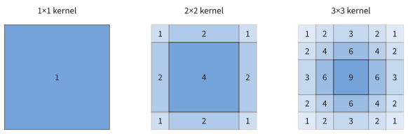
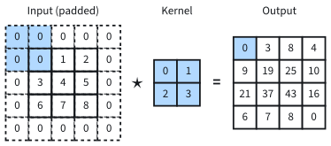
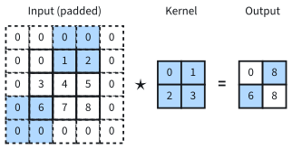
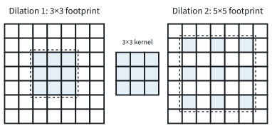
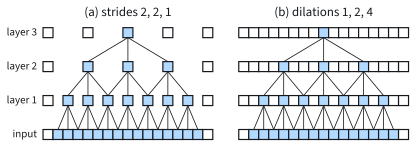

```{.python .input}
%load_ext d2lbook.tab
tab.interact_select('mxnet', 'pytorch', 'tensorflow', 'jax')
```

# Padding, Stride, and Dilation
:label:`sec_padding`

A cross-correlation can only be evaluated where the kernel fits inside the
input. An $n_\textrm{h}\times n_\textrm{w}$ input and a
$k_\textrm{h}\times k_\textrm{w}$ kernel therefore give an output of shape
$(n_\textrm{h}-k_\textrm{h}+1) \times (n_\textrm{w}-k_\textrm{w}+1)$, as the
$3\times 3$ input and $2\times 2$ kernel of :numref:`fig_correlation` give a
$2\times 2$ output. One layer loses little, but the losses add up: ten layers
with $5\times 5$ kernels shrink a $240\times 240$ image to $200\times 200$,
which removes 30% of its area, all of it at the border. The border was
already underused before it was cut away. A $5\times 5$ kernel covers each
interior pixel in 25 windows but a corner pixel in only one, so an object near
the corner of an image barely reaches the next layer.

At other times we want a layer to shrink its input on purpose. A network that
keeps a $224\times 224$ image at full resolution computes 50,176 outputs per
channel in every layer. Since each $3\times 3$ layer widens the region a unit
sees by only two pixels, such a network would need more than 100 layers
before a single unit could see the whole image, as a classifier must. We may
also want one kernel to see a wide region without the weights and the
computation of a large kernel.

Three settings of a convolutional layer address these needs. *Padding* adds a
border of extra pixels around the input, so that the kernel can be placed at
the edge. *Stride* moves the window by more than one pixel at a time.
*Dilation* spaces the kernel's weights apart. Each setting changes the output
shape by a formula we derive below, and each changes how far a unit in a deep
network sees. We stay with single-channel inputs, as in
:numref:`sec_conv_layer`, and add channels in :numref:`sec_channels`.

```{.python .input #padding-and-strides-padding-and-stride}
%%tab mxnet
from d2l import mxnet as d2l
from mxnet import np as mnp, npx
from mxnet.gluon import nn
npx.set_np()
```

```{.python .input #padding-and-strides-padding-and-stride}
%%tab pytorch
from d2l import torch as d2l
import torch
from torch import nn
from torch.nn import functional as F
```

```{.python .input #padding-and-strides-padding-and-stride}
%%tab tensorflow
from d2l import tensorflow as d2l
import tensorflow as tf
```

```{.python .input #padding-and-strides-padding-and-stride}
%%tab jax
from d2l import jax as d2l
from flax import nnx
import jax
from jax import numpy as jnp
```

## Padding

### Boundary Pixels

:numref:`img_conv_reuse` counts the windows that contain each pixel. With a
$k\times k$ kernel, a pixel at least $k-1$ pixels away from every border lies
in $k^2$ windows, a pixel on an edge in at most $k$, and a corner pixel in a
single one. Each layer thus draws most of its evidence from the center of its
input, and the next layer receives an input from which the border has been
cut away.


:label:`img_conv_reuse`

### Zero Padding

The remedy is to enlarge the input by a border of extra pixels before applying
the kernel, usually pixels of value zero. This is called *padding*. In
:numref:`img_conv_pad`, one row of zeros above and below and one column on
either side turn the $3\times 3$ input into a $5\times 5$ one, and the
$2\times 2$ kernel now produces a $4\times 4$ output instead of a
$2\times 2$ one. The shaded first output element is computed entirely from
padding and the input's corner: $0\times0+0\times1+0\times2+0\times3=0$.


:label:`img_conv_pad`

If we add $p_\textrm{h}$ rows of padding in total, split between top and
bottom, and $p_\textrm{w}$ columns in total, split between left and right,
the padded input has shape $(n_\textrm{h}+p_\textrm{h})\times
(n_\textrm{w}+p_\textrm{w})$, and the output has shape

$$(n_\textrm{h}-k_\textrm{h}+p_\textrm{h}+1)\times(n_\textrm{w}-k_\textrm{w}+p_\textrm{w}+1).$$

Each row of padding adds one row to the output, and each column adds one
column. Setting $p_\textrm{h}=k_\textrm{h}-1$ and $p_\textrm{w}=k_\textrm{w}-1$
gives the output the shape of the input. A stack of such layers keeps its
resolution however deep it is, which makes the shape of every layer easy to
predict.

The kernel size decides whether this padding can be split evenly. For an odd
$k_\textrm{h}$, the total $k_\textrm{h}-1$ is even, and we pad
$(k_\textrm{h}-1)/2$ rows on each side. The window that computes the output
`Y[i, j]` is then centered on the input `X[i, j]`: the output is aligned with
the input. For an even $k_\textrm{h}$, one side receives
$\lceil p_\textrm{h}/2\rceil$ rows and the other $\lfloor p_\textrm{h}/2\rfloor$,
and the output is shifted by half a pixel. This is why CNNs almost always use
odd kernels, of size 1, 3, 5, or 7 with padding 0, 1, 2, or 3 on each side.

To check the formula in code, we need a helper. Convolutional layers expect
a minibatch of examples with several channels, so `comp_conv2d` adds two
dimensions of size 1 to a two-dimensional input, applies the layer, and
removes them again.

```{.python .input #padding-and-strides-zero-padding-1}
%%tab mxnet
def comp_conv2d(conv2d, X):
    """Apply a convolutional layer to a single-channel 2D input."""
    conv2d.initialize()
    Y = conv2d(X.reshape((1, 1) + X.shape))  # input (1, 1, h, w)
    return Y.reshape(Y.shape[2:])
```

```{.python .input #padding-and-strides-zero-padding-1}
%%tab pytorch
def comp_conv2d(conv2d, X):
    """Apply a convolutional layer to a single-channel 2D input."""
    Y = conv2d(X.reshape((1, 1) + X.shape))  # input (1, 1, h, w)
    return Y.reshape(Y.shape[2:])
```

```{.python .input #padding-and-strides-zero-padding-1}
%%tab tensorflow
def comp_conv2d(conv2d, X):
    """Apply a convolutional layer to a single-channel 2D input."""
    Y = conv2d(tf.reshape(X, (1,) + X.shape + (1,)))  # input (1, h, w, 1)
    return tf.reshape(Y, Y.shape[1:3])
```

```{.python .input #padding-and-strides-zero-padding-1}
%%tab jax
def comp_conv2d(conv2d, X):
    """Apply a convolutional layer to a single-channel 2D input."""
    Y = conv2d(X.reshape((1,) + X.shape + (1,)))  # input (1, h, w, 1)
    return Y.reshape(Y.shape[1:3])
```

An $8\times 8$ input, a $3\times 3$ kernel, and one pixel of padding on every
side ($p_\textrm{h}=p_\textrm{w}=2$ in total; padding arguments in code count
the rows or columns on each side, here 1) should give an $8\times 8$ output.

```{.python .input #padding-and-strides-padding-1}
%%tab mxnet
X = mnp.random.uniform(size=(8, 8))
conv2d = nn.Conv2D(1, kernel_size=3, padding=1)
comp_conv2d(conv2d, X).shape
```

```{.python .input #padding-and-strides-padding-1}
%%tab pytorch
X = torch.rand(size=(8, 8))
conv2d = nn.LazyConv2d(1, kernel_size=3, padding=1)
comp_conv2d(conv2d, X).shape
```

```{.python .input #padding-and-strides-padding-1}
%%tab tensorflow
X = tf.random.uniform(shape=(8, 8))
conv2d = tf.keras.layers.Conv2D(1, kernel_size=3, padding='same')
comp_conv2d(conv2d, X).shape
```

```{.python .input #padding-and-strides-padding-1}
%%tab jax
X = jax.random.uniform(d2l.get_key(), shape=(8, 8))
conv2d = nnx.Conv(1, 1, kernel_size=(3, 3), padding=1,
                  rngs=nnx.Rngs(d2l.get_key()))
comp_conv2d(conv2d, X).shape
```

Height and width are padded independently. A kernel of height 5 and width 3
keeps the $8\times 8$ shape with two rows of padding above and below and one
column on either side.

```{.python .input #padding-and-strides-padding-2}
%%tab mxnet
conv2d = nn.Conv2D(1, kernel_size=(5, 3), padding=(2, 1))
comp_conv2d(conv2d, X).shape
```

```{.python .input #padding-and-strides-padding-2}
%%tab pytorch
conv2d = nn.LazyConv2d(1, kernel_size=(5, 3), padding=(2, 1))
comp_conv2d(conv2d, X).shape
```

```{.python .input #padding-and-strides-padding-2}
%%tab tensorflow
conv2d = tf.keras.layers.Conv2D(1, kernel_size=(5, 3), padding='same')
comp_conv2d(conv2d, X).shape
```

```{.python .input #padding-and-strides-padding-2}
%%tab jax
conv2d = nnx.Conv(1, 1, kernel_size=(5, 3), padding=(2, 1),
                  rngs=nnx.Rngs(d2l.get_key()))
comp_conv2d(conv2d, X).shape
```

:begin_tab:`tensorflow`
Keras `Conv2D` accepts only `padding='valid'`, which means no padding, and
`padding='same'`, which pads so that the output has $\lceil n/s\rceil$ rows
and columns for stride $s$. At stride 1 and odd kernel sizes this is the
symmetric padding $(k-1)/2$ used above. Other amounts of padding take a
separate `ZeroPadding2D` layer, which pads each side by a given amount,
followed by `padding='valid'`, as in the stride examples below. Keras layers
take channels-last inputs: (example, height, width, channel).
:end_tab:

:begin_tab:`jax`
`nnx.Conv` accepts `'SAME'`, `'VALID'`, one integer for every side, or one
integer per spatial axis, as used above. It also accepts `'REFLECT'` and
`'CIRCULAR'`, which pad with mirrored or wrapped-around values. Its default
is `padding='SAME'`, so the code passes `'VALID'` wherever no padding is
wanted. Its inputs are channels-last: (example, height, width, channel).
:end_tab:

### Padding Values
:label:`subsec_padding_values`

Zero padding treats the image as if it were black outside its frame. This is
a *boundary condition*: a choice of values beyond the border, which the image
itself does not provide. To see its effect, we cross-correlate a uniformly
bright $5\times 5$ image of ones, padded by one pixel of zeros on every side,
with a $3\times 3$ kernel of ones, using `corr2d` from
:numref:`sec_conv_layer`. Each output then counts the image pixels in its
window.

```{.python .input #padding-and-strides-padding-values}
%%tab mxnet
img = d2l.ones((5, 5))
d2l.corr2d(mnp.pad(img, 1), d2l.ones((3, 3)))
```

```{.python .input #padding-and-strides-padding-values}
%%tab pytorch
img = d2l.ones((5, 5))
d2l.corr2d(F.pad(img, (1, 1, 1, 1)), d2l.ones((3, 3)))
```

```{.python .input #padding-and-strides-padding-values}
%%tab tensorflow
img = d2l.ones((5, 5))
d2l.corr2d(tf.pad(img, [[1, 1], [1, 1]]), d2l.ones((3, 3)))
```

```{.python .input #padding-and-strides-padding-values}
%%tab jax
img = d2l.ones((5, 5))
d2l.corr2d(jnp.pad(img, 1), d2l.ones((3, 3)))
```

The interior outputs are 9, those along the edges 6, and those in the corners
4: the layer sees a dark frame around an image that has none. The frame
travels inward through later layers, which can learn to detect it, and the
resulting artifacts near the border can leave parts of the input to which the
network barely responds :cite:`Alsallakh.Kokhlikyan.Miglani.ea.2020`. Two
other boundary conditions are common. *Reflect padding* mirrors the rows and
columns next to the border, and *replicate padding* repeats the border pixels
themselves. Both keep a uniform image uniform, and image-generation networks
often use them because a dark frame would be visible in their output. Zero
padding remains the default in classifiers: it is cheap, and libraries apply
it without building a larger tensor.

## Stride

### Strided Convolution

So far the window has moved one pixel at a time, to the right and then down.
The number of rows and columns it moves per step is the *stride*. With stride
$s_\textrm{h}$ along the height and $s_\textrm{w}$ along the width, the layer
evaluates only every $s_\textrm{h}$-th row and every $s_\textrm{w}$-th column
of window positions, so it computes about $s_\textrm{h} s_\textrm{w}$ times
fewer outputs. :numref:`img_conv_stride` uses stride 3 along the height and 2
along the width on the padded input of :numref:`img_conv_pad`. The two shaded
outputs are $0\times0+0\times1+1\times2+2\times3=8$, whose window lies two
columns to the right of the first window, and
$0\times0+6\times1+0\times2+0\times3=6$, whose window lies three rows below
it. Moving two more columns to the right would put the window partly
outside the padded input, so each row has two outputs.


:label:`img_conv_stride`

To count the outputs along the height, note that the window starts in row 0 of
the padded input and that its last row must stay inside the
$n_\textrm{h}+p_\textrm{h}$ rows. The possible starting rows are
$0, s_\textrm{h}, 2s_\textrm{h}, \ldots$, up to $n_\textrm{h}+p_\textrm{h}-k_\textrm{h}$,
so with the same count for the width the output shape is

$$\left(\left\lfloor\frac{n_\textrm{h}-k_\textrm{h}+p_\textrm{h}}{s_\textrm{h}}\right\rfloor+1\right)\times\left(\left\lfloor\frac{n_\textrm{w}-k_\textrm{w}+p_\textrm{w}}{s_\textrm{w}}\right\rfloor+1\right).$$

The fraction counts the steps the window can take and the $+1$ counts its
starting position. For :numref:`img_conv_stride` this gives
$\lfloor 3/3\rfloor+1=2$ rows and $\lfloor 3/2\rfloor+1=2$ columns, and at
stride 1 it is the padding formula. With shape-preserving padding,
$p_\textrm{h}=k_\textrm{h}-1$, the number of rows is
$\lfloor (n_\textrm{h}-1)/s_\textrm{h}\rfloor+1=\lceil n_\textrm{h}/s_\textrm{h}\rceil$:
stride $s$ divides the resolution by $s$, rounding up.

The most common strided layer has a $3\times 3$ kernel, padding 1 on each
side, and stride 2. It halves an $8\times 8$ input to $4\times 4$.

```{.python .input #padding-and-strides-stride-1}
%%tab mxnet
conv2d = nn.Conv2D(1, kernel_size=3, padding=1, strides=2)
comp_conv2d(conv2d, X).shape
```

```{.python .input #padding-and-strides-stride-1}
%%tab pytorch
conv2d = nn.LazyConv2d(1, kernel_size=3, padding=1, stride=2)
comp_conv2d(conv2d, X).shape
```

```{.python .input #padding-and-strides-stride-1}
%%tab tensorflow
conv2d = tf.keras.Sequential([
    tf.keras.layers.ZeroPadding2D(padding=1),
    tf.keras.layers.Conv2D(1, kernel_size=3, padding='valid', strides=2)])
comp_conv2d(conv2d, X).shape
```

```{.python .input #padding-and-strides-stride-1}
%%tab jax
conv2d = nnx.Conv(1, 1, kernel_size=(3, 3), padding=1, strides=2,
                  rngs=nnx.Rngs(d2l.get_key()))
comp_conv2d(conv2d, X).shape
```

:begin_tab:`tensorflow`
At stride 2 on an input of even size, `padding='same'` pads one row and
column at the bottom and right but none at the top and left, so output $i$
is centered on input pixel $2i+1$ rather than $2i$. `ZeroPadding2D(1)`
followed by `padding='valid'` pads both sides by 1.
:end_tab:

The settings can also differ between the axes. A $3\times 5$ kernel with
padding $(0, 1)$ on each side and stride $(3, 4)$ gives
$\lfloor (8-3+0)/3\rfloor+1=2$ rows and $\lfloor (8-5+2)/4\rfloor+1=2$
columns.

```{.python .input #padding-and-strides-stride-2}
%%tab mxnet
conv2d = nn.Conv2D(1, kernel_size=(3, 5), padding=(0, 1), strides=(3, 4))
comp_conv2d(conv2d, X).shape
```

```{.python .input #padding-and-strides-stride-2}
%%tab pytorch
conv2d = nn.LazyConv2d(1, kernel_size=(3, 5), padding=(0, 1), stride=(3, 4))
comp_conv2d(conv2d, X).shape
```

```{.python .input #padding-and-strides-stride-2}
%%tab tensorflow
conv2d = tf.keras.Sequential([
    tf.keras.layers.ZeroPadding2D(padding=(0, 1)),
    tf.keras.layers.Conv2D(1, kernel_size=(3, 5), padding='valid',
                           strides=(3, 4))])
comp_conv2d(conv2d, X).shape
```

```{.python .input #padding-and-strides-stride-2}
%%tab jax
conv2d = nnx.Conv(1, 1, kernel_size=(3, 5), padding=(0, 1), strides=(3, 4),
                  rngs=nnx.Rngs(d2l.get_key()))
comp_conv2d(conv2d, X).shape
```

When the stride equals the kernel size and there is no padding, the windows
tile the input without overlap. A $16\times 16$ kernel with stride 16 cuts a
$224\times 224$ image into a $14\times 14$ grid of patches and maps each patch
to one output per channel. This *patchify* layer is how vision transformers
turn an image into a sequence of patches, and some convolutional networks
begin the same way.

When height and width use the same setting, we speak of padding $p$ and
stride $s$.

:begin_tab:`mxnet`
`nn.Conv2D` defaults to padding 0 and stride 1.
:end_tab:

:begin_tab:`pytorch`
`nn.LazyConv2d` defaults to padding 0 and stride 1.
:end_tab:

:begin_tab:`tensorflow`
`tf.keras.layers.Conv2D` defaults to `padding='valid'`, no padding, and
stride 1.
:end_tab:

:begin_tab:`jax`
`nnx.Conv` defaults to `padding='SAME'` and stride 1.
:end_tab:

### Stride and the Receptive Field
:label:`subsec_stride_rf`

The receptive field of a unit, as defined in :numref:`sec_conv_layer`, is
the set of input pixels that can affect its value. A $k\times k$ layer at
stride 1 widens it by $k-1$ pixels along each axis, so $L$ stacked
$3\times 3$ layers see a region of side $2L+1$, which grows only linearly
with depth. After a layer with stride 2, neighboring positions of its output
lie two input pixels apart, and a $3\times 3$ kernel applied to that output
reaches $2\times 2=4$ input pixels further instead of 2. In general, one step
in the input of layer $i$ spans $\prod_{j<i} s_j$ pixels of the original
input, and the top unit of a stack of $L$ layers with kernel sizes $k_i$ and
strides $s_i$ has a receptive field of side

$$r = 1 + \sum_{i=1}^{L} (k_i - 1) \prod_{j=1}^{i-1} s_j,$$
:eqlabel:`eq_receptive_field`

where the empty product for $i = 1$ equals 1. Each layer adds the extent of
its kernel, measured in pixels of the original input; at stride 1 every term
is $k_i-1$, as in :numref:`sec_conv_layer`. Padding does not appear, because it changes
which outputs exist, not how far each one sees. For three $3\times 3$ layers,
stride 1 everywhere gives $r = 1+2+2+2 = 7$, while strides 2, 2, 1 give
$r = 1+2+4+8 = 15$. The strided stack is drawn in panel (a) of
:numref:`fig_conv_rf_towers` below. Every stride multiplies the reach of all
later kernels, so a downsampling network's receptive field grows
geometrically with depth, which is how classifiers see the whole image after
a few dozen layers.

## Dilation
:label:`sec_dilation`

### Dilated Convolution

Padding and stride change where the kernel is applied. Dilation changes the
kernel's footprint itself: a *dilated convolution* :cite:`yu2016dilated`
places the kernel's weights $d$ pixels apart instead of at adjacent pixels,
where $d$ is the *dilation*. A $k\times k$ kernel with dilation $d$ still
has $k^2$ weights, but along each axis they now span

$$k' = k + (k-1)(d-1) = d(k-1)+1$$

pixels, the *effective kernel size*. Along each axis, $d-1$ pixels are
skipped between neighboring weights, and $d=1$ is the ordinary convolution.
:numref:`fig_conv_dilation` shows a $3\times 3$ kernel at dilations 1 and 2.
At dilation 2 the nine weights spread over a $5\times 5$ footprint, skipping
every other pixel, while each output still takes nine multiplications.


:label:`fig_conv_dilation`

For output shapes, a dilated kernel behaves like a dense kernel of its
effective size. Substituting $k'$ for $k$ in the strided formula gives the
output shape for padding, stride, and dilation together:

$$\left(\left\lfloor\frac{n_\textrm{h}+p_\textrm{h}-d_\textrm{h}(k_\textrm{h}-1)-1}{s_\textrm{h}}\right\rfloor+1\right)\times\left(\left\lfloor\frac{n_\textrm{w}+p_\textrm{w}-d_\textrm{w}(k_\textrm{w}-1)-1}{s_\textrm{w}}\right\rfloor+1\right).$$
:eqlabel:`eq_conv_output_shape`

With dilation 1 this is the strided formula, and with stride 1 and no padding
the $n-k+1$ rule we started from. On our $8\times 8$ input, a $3\times 3$
kernel at dilation 2 and a dense $5\times 5$ kernel should both give a
$4\times 4$ output.

```{.python .input #padding-and-strides-dilation}
%%tab mxnet
conv2d = nn.Conv2D(1, kernel_size=3, dilation=2)
conv5 = nn.Conv2D(1, kernel_size=5)
comp_conv2d(conv2d, X).shape, comp_conv2d(conv5, X).shape
```

```{.python .input #padding-and-strides-dilation}
%%tab pytorch
conv2d = nn.LazyConv2d(1, kernel_size=3, dilation=2)
conv5 = nn.LazyConv2d(1, kernel_size=5)
comp_conv2d(conv2d, X).shape, comp_conv2d(conv5, X).shape
```

```{.python .input #padding-and-strides-dilation}
%%tab tensorflow
conv2d = tf.keras.layers.Conv2D(1, kernel_size=3, dilation_rate=2)
conv5 = tf.keras.layers.Conv2D(1, kernel_size=5)
comp_conv2d(conv2d, X).shape, comp_conv2d(conv5, X).shape
```

```{.python .input #padding-and-strides-dilation}
%%tab jax
conv2d = nnx.Conv(1, 1, kernel_size=(3, 3), padding='VALID',
                  kernel_dilation=2, rngs=nnx.Rngs(d2l.get_key()))
conv5 = nnx.Conv(1, 1, kernel_size=(5, 5), padding='VALID',
                 rngs=nnx.Rngs(d2l.get_key()))
comp_conv2d(conv2d, X).shape, comp_conv2d(conv5, X).shape
```

### Dilation and the Receptive Field

A dilated layer at stride 1 widens the receptive field by $k'-1 = d(k-1)$
pixels, so :eqref:`eq_receptive_field` holds with each $k_i$ replaced by its
effective size. Doubling the dilation from layer to layer,
$d_i = 1, 2, 4, \ldots, 2^{L-1}$, gives $L$ layers of $3\times 3$ kernels a
receptive field of side
$1 + 2(1 + 2 + \cdots + 2^{L-1}) = 2^{L+1}-1$. It grows exponentially with
depth, like that of a strided stack, but every layer keeps the resolution of
the input.

:numref:`fig_conv_rf_towers` compares the two ways to reach far. With three
layers of size 3, strides 2, 2, 1 and dilations 1, 2, 4 both give a receptive
field of 15 pixels, and the top unit depends on the input through the same
connections. The strided stack keeps only every fourth position; the dilated
stack computes all of them. Without padding and with the same weights, the
strided stack returns exactly every fourth output of the dilated stack, even
with nonlinearities between the layers: dilation is a strided stack that
discards nothing. This matters for *dense prediction* tasks such as semantic
segmentation, which assigns a label to every pixel and thus needs both wide
context and full resolution, and dilated convolutions are widely used there
:cite:`yu2016dilated`. Their cost is that every layer computes its outputs at
full resolution. A network that downsamples with strides can instead restore
the resolution at its end with learned upsampling, the transposed
convolution of :numref:`sec_transposed_conv`.


:label:`fig_conv_rf_towers`

When height and width use the same dilation, we speak of dilation $d$; by
default it is 1. We can now predict the output shape of a single-channel
layer under any padding, stride, and dilation, and how far its units see.
Real inputs, however, have several channels, and a layer should produce
several feature maps, which is the subject of :numref:`sec_channels`.

## Summary

A convolution shrinks its input by $k-1$ pixels along each axis and uses
border pixels in fewer windows than interior ones. Padding by $k-1$ in total,
split evenly for odd kernels, keeps the shape and centers each output on its
input pixel; zero padding imposes a boundary condition that the network can
detect. Stride $s$ evaluates every $s$-th window, divides the resolution and
the cost by about $s$ along each axis, and makes the receptive field of later
layers grow geometrically. Dilation $d$ spreads a kernel's weights to an
effective size $d(k-1)+1$, which enlarges the receptive field at full
resolution and at constant cost per output. One formula,
:eqref:`eq_conv_output_shape`, gives the output shape for all three.

## Exercises

1. [code] **Mirror padding.** Mirror padding, also called reflect padding,
   extends a tensor by reflecting its entries about the border without
   repeating the border entry: padding the vector $(1, 2, 3)$ by one entry
   on each side gives $(2, 1, 2, 3, 2)$.
    1. Implement mirror padding by one entry on every side of a
       two-dimensional tensor, and check the result by hand on a
       $3 \times 3$ tensor with distinct entries.
    1. Repeat the computation of :numref:`subsec_padding_values` with
       mirror padding instead of zero padding, and explain the result.
    1. Take the $5\times 5$ ramp $x_{ij} = j$ and the $3\times 3$ kernel
       whose entries all equal $\frac{1}{9}$. Show that in the interior the
       output equals the input. Compute the outputs in the first and last
       columns under zero padding and under mirror padding, and find a way
       to pad that reproduces the ramp exactly.

1. **Benefits of stride.** A $3 \times 3$ convolution with one pixel of
   padding on every side is applied to a single-channel $64 \times 64$
   input.
    1. Count the multiplications this layer performs at stride 1 and at
       stride 2. By what factor does stride 2 reduce the cost of a second,
       stride-1 layer of the same kind placed after this one?
    1. Four such layers are stacked. Use :eqref:`eq_receptive_field` to compute
       the receptive field of one output element when all four layers have
       stride 1 and when the first two have stride 2. Use the comparison to
       give one statistical benefit of a stride larger than 1.

1. **Stride as sampling.** For a length-6 one-dimensional input, write the
   $4 \times 6$ weight matrix of a stride-1, kernel-3 convolution in the
   banded-matrix form of :numref:`subsec_conv_matmul`, and the
   $2 \times 4$ zero--one matrix that keeps every other entry of a
   length-4 vector. Show that composing the two reproduces the matrix of
   the stride-2, kernel-3 convolution.

    *Adapted from Simon Prince,
    [Understanding Deep Learning](https://udlbook.github.io/udlbook/),
    Problem 10.15.*

1. **Dilation and gridding.** A network stacks four $3 \times 3$
   convolutions with stride 1. The doubling dilation schedule
   $(1, 2, 4, 8)$ gives one output element a receptive field of side $31$.
   Compare it with the constant schedule $(4, 4, 4, 4)$.
    1. Use :eqref:`eq_receptive_field`, with each kernel replaced by its
       effective size, to compute the receptive field of the constant
       schedule.
    1. For each schedule, determine which pixels inside the receptive
       field the output actually depends on, and count them. A schedule
       whose output depends only on a sparse lattice within its receptive
       field is said to exhibit *gridding*.
    1. Give one reason gridding is harmful for dense prediction tasks such
       as segmentation.

1. **Strides versus dilations.** Consider the two one-dimensional stacks of
   :numref:`fig_conv_rf_towers`, without padding, with kernels
   $\mathbf{w}_1, \mathbf{w}_2, \mathbf{w}_3$ of size 3 shared by both
   stacks and an elementwise nonlinearity after every layer.
    1. Write the output of each stack at position $i$ as a function of the
       input, and show that the output of the strided stack at position $i$
       equals the output of the dilated stack at position $4i$.
    1. For an input of length $n$, count the multiplications each stack
       performs, ignoring the border.
    1. Generalize the first part: which dilations reproduce a stack with
       strides $s_1, \ldots, s_L$?

1. **Fractional stride.** ● Read a stride of $\frac{1}{2}$ as moving the
   convolution window by half an input element per output element.
    1. Evaluate :eqref:`eq_conv_output_shape` at $d_\textrm{h} = 1$,
       $s_\textrm{h} = \frac{1}{2}$, and $p_\textrm{h} = k_\textrm{h} - 1$.
       How does the output height compare with the input height?
    1. Describe how to compute this output with an ordinary stride-1
       convolution applied to a modified input, and check that your
       construction gives the same output height.
    1. Name a task in which a network needs this operation, and say where
       in the network it would be placed.

1. **Gridding-free dilations.** ● A network stacks $L$ convolutions of
   size $3 \times 3$ with stride 1 and dilations $d_1, \ldots, d_L$. State
   a condition on $d_1, \ldots, d_L$ that guarantees the output depends on
   every pixel of its receptive field, so that the stack does not exhibit
   gridding, and show that the condition suffices.

:begin_tab:`mxnet`
[Discussions](https://d2l.discourse.group/t/67)
:end_tab:

:begin_tab:`pytorch`
[Discussions](https://d2l.discourse.group/t/68)
:end_tab:

:begin_tab:`tensorflow`
[Discussions](https://d2l.discourse.group/t/272)
:end_tab:

:begin_tab:`jax`
[Discussions](https://d2l.discourse.group/t/17997)
:end_tab:

<!-- slides -->

::: {.slide}
::: {.cover}
[Dive into Deep Learning · §6.3]{.kicker}

Padding, Stride, and Dilation<br>**output shape · border pixels · downsampling · receptive field**
:::
:::

::: {.slide title="Ten 5×5 Layers Shrink a 240×240 Image to 200×200"}
[The problem]{.kicker}

- Unpadded, a $k\times k$ kernel fits at $n-k+1$ positions per axis:
  $240 \to 236 \to \cdots \to 200$, 30% of the area lost at the border.
- The border is underused even before: a $5\times 5$ kernel covers an
  interior pixel 25 times, a corner pixel once.
- At $224\times 224$, each $3\times 3$ layer widens the view by 2 pixels:
  over 100 layers before a unit sees the whole image.

::: {.d2l-note}
Padding keeps the size, stride reduces it on purpose, and dilation widens
the view without adding weights.
:::
:::

::: {.slide title="By the End of This Deck You Can"}
[Goals]{.kicker}

- compute the output shape for any padding $p$, stride $s$, and
  dilation $d$;
- choose padding that keeps the shape, and say why kernels are odd;
- predict what zero padding does at the border;
- compute the receptive field of a stack with strides and dilations;
- choose among the preserve, halve, and patchify layers.

**Running example:** one $28\times 28$ Fashion-MNIST image and a
$5\times 5$ kernel: $24\times 24$ unpadded, $28\times 28$ with 2 pixels of
padding per side, $14\times 14$ with stride 2 added.
:::

::: {.slide title="Padding, Stride, and Dilation Set the Shape and Reach of a Convolution"}
[Where this fits]{.kicker}

::: {.cols .vc}
::: {.col}
| section | adds |
|---|---|
| From Fully Connected Layers to Convolutions | locality and translation equivariance give convolution |
| Convolutions for Images | cross-correlation, learning a kernel, receptive fields |
| **Padding, Stride, and Dilation** | **output size and how far each unit sees** |
| Multiple Input and Multiple Output Channels | channels, 1 × 1 convolutions, cost |
| Pooling | downsampling and tolerance to small shifts |
| Convolutional Neural Networks (LeNet) | a complete CNN on Fashion-MNIST |
:::

::: {.col .narrow}
- **Uses:** cross-correlation, `corr2d`, receptive field.
- **Skips:** channels (next deck); transposed convolution for upsampling
  (computer vision chapter).
:::
:::
:::

::: {.slide}
::: {.divider}
[01]{.dnum}

[Padding]{.dtitle}

[keeping the shape and the border]{.dsub}
:::
:::

::: {.slide title="Corner Pixels Lie in One Window, Interior Pixels in k²"}
[Padding]{.kicker}

{width=85%}

Each layer draws most of its evidence from the center of its input; after a
few layers the border is gone.
:::

::: {.slide title="Padding Adds a Border So the Kernel Fits at the Edge"}
[Padding]{.kicker}

{width=62%}

With $p_h$ rows and $p_w$ columns of padding in total:
$\;(n_h - k_h + p_h + 1)\times(n_w - k_w + p_w + 1)$.

Each padding row adds one output row; $p = k - 1$ keeps the shape.
:::

::: {.slide title="Odd Kernels Pad Evenly and Keep Each Output Centered"}
[Padding]{.kicker}

- Shape-preserving padding is $p = k - 1$ in total; for odd $k$ that is
  $(k-1)/2$ on each side: kernels 1, 3, 5, 7 pad 0, 1, 2, 3.
- The output `Y[i, j]` then comes from the window centered on `X[i, j]`.
- Even $k$ pads one side more and shifts the output by half a pixel.

**Running example:** $28\times 28$, $5\times 5$ kernel, 2 pixels per side:
$28\times 28$ out, as in LeNet's first layer.
:::

::: {.slide title="Padding Keeps an 8×8 Input at 8×8"}
[Padding]{.kicker}

A $3\times 3$ kernel with padding 1, then a $5\times 3$ kernel with padding
$(2, 1)$:

@padding-and-strides-padding-1

@padding-and-strides-padding-2
:::

::: {.slide title="Zero Padding Makes a Uniform Image Dark at the Border"}
[Padding]{.kicker}

A $5\times 5$ image of ones, zero padding 1, a $3\times 3$ kernel of ones:

::: {.cols .vc}
::: {.col}
@!padding-and-strides-padding-values
:::

::: {.col .narrow}
- Each output counts the image pixels in its window: 9, 6, or 4.
- Reflect and replicate padding keep a uniform image uniform.
:::
:::
:::

::: {.slide title="Check: Three Unpadded 5×5 Layers on a 28×28 Image"}
[Check]{.kicker}

What shape comes out? Which padding keeps $28\times 28$ through all three
layers?

::: {.fragment .fade-up}
::: {.d2l-note}
**Answer.** $28 \to 24 \to 20 \to 16$, so $16\times 16$. Two pixels of
padding on each side ($p = 4$ in total) at every layer keep $28\times 28$.
:::
:::
:::

::: {.slide}
::: {.divider}
[02]{.dnum}

[Stride]{.dtitle}

[evaluating every s-th window]{.dsub}
:::
:::

::: {.slide title="Stride s Evaluates Every s-th Window"}
[Stride]{.kicker}

{width=55%}

The shaded outputs are $0{\cdot}0+0{\cdot}1+1{\cdot}2+2{\cdot}3=8$ and
$0{\cdot}0+6{\cdot}1+0{\cdot}2+0{\cdot}3=6$. A third window per row would
leave the padded input.
:::

::: {.slide title="Output Size Is ⌊(n − k + p)/s⌋ + 1"}
[Stride]{.kicker}

$$\Big\lfloor\frac{n-k+p}{s}\Big\rfloor + 1$$

- Steps the window can take, plus its first position.
- The figure: $\lfloor 3/3\rfloor+1 = 2$ rows, $\lfloor 3/2\rfloor+1 = 2$
  columns.
- With $p = k - 1$: $\lceil n/s\rceil$, so stride $s$ divides the
  resolution by $s$.
- **Running example:** $n=28$, $k=5$, $p=4$, $s=2$ gives
  $\lfloor 27/2\rfloor+1 = 14$; multiply-adds per channel drop from
  $28^2\cdot 25 = 19{,}600$ to $14^2\cdot 25 = 4{,}900$.
:::

::: {.slide title="Stride in Code: 8×8 Becomes 4×4 or 2×2"}
[Stride]{.kicker}

@padding-and-strides-stride-1

Kernel $3\times 5$, padding $(0, 1)$, stride $(3, 4)$:
$\lfloor 5/3\rfloor+1 = 2$, $\lfloor 5/4\rfloor+1 = 2$.

@padding-and-strides-stride-2
:::

::: {.slide title="Three Settings Cover Most Layers"}
[Stride]{.kicker}

| | kernel | padding per side | stride | output |
|---|---|---|---|---|
| **preserve** | 3 | 1 | 1 | $n \times n$ |
| **halve** | 3 | 1 | 2 | $\lceil n/2\rceil \times \lceil n/2\rceil$ |
| **patchify** | $k$ | 0 | $k$ | $\lfloor n/k\rfloor \times \lfloor n/k\rfloor$ |

- *Preserve* mixes features at full resolution.
- *Halve* is the standard downsampling layer.
- *Patchify* tiles the input: $16\times 16$ with stride 16 cuts a
  $224\times 224$ image into $14\times 14$ patches, as vision transformers
  do.
:::

::: {.slide title="Each Stride Multiplies the Reach of All Later Kernels"}
[Stride]{.kicker}

$$r = 1 + \sum_{i=1}^{L}(k_i - 1)\prod_{j<i} s_j$$

- $r$: side of the receptive field, the input pixels one top unit can see;
  layer $i$ has kernel size $k_i$ and stride $s_i$.
- Three $3\times 3$ layers at stride 1: $r = 1+2+2+2 = 7$.
- Strides 2, 2, 1: $r = 1+2+4+8 = 15$.

::: {.d2l-note}
Downsampling makes the receptive field grow geometrically with depth.
:::
:::

::: {.slide}
::: {.divider}
[03]{.dnum}

[Dilation]{.dtitle}

[a wider view with the same weights]{.dsub}
:::
:::

::: {.slide title="Dilation Spreads Nine Weights over a 5×5 Window"}
[Dilation]{.kicker}

{width=62%}

Weights $d$ pixels apart: effective size $k' = d(k-1)+1$, still $k^2$
weights and $k^2$ multiplications per output.
:::

::: {.slide title="One Formula for Padding, Stride, and Dilation"}
[Dilation]{.kicker}

$$\Big\lfloor\frac{n + p - d(k-1) - 1}{s}\Big\rfloor + 1$$

A $3\times 3$ kernel at dilation 2 and a dense $5\times 5$ kernel both
take $8\times 8$ to $4\times 4$:

@padding-and-strides-dilation
:::

::: {.slide title="Strides 2, 2, 1 and Dilations 1, 2, 4 See the Same 15 Pixels"}
[Dilation]{.kicker}

{width=80%}

Same connections, but the strided stack keeps every fourth position and the
dilated stack all of them, as segmentation needs.
:::

::: {.slide title="Check: A 7×7 Stride-2 Layer on a 224×224 Image"}
[Check]{.kicker}

Kernel 7, padding 3 on each side, stride 2. What is the output size? A
$3\times 3$ layer at stride 1 follows: how far do its units see?

::: {.fragment .fade-up}
::: {.d2l-note}
**Answer.** $\lfloor (224-7+6)/2\rfloor+1 = 112$. Receptive field
$r = 1 + 6 + 2\cdot 2 = 11$ pixels.
:::
:::
:::

::: {.slide title="Recap"}
[Wrap-up]{.kicker}

- Unpadded: $n \to n-k+1$; a corner pixel lies in 1 window, an interior
  pixel in $k^2$.
- Padding $p = k-1$ keeps the shape; odd $k$ splits it evenly; zero padding
  darkens the border (9, 6, 4).
- Stride $s$: $\lfloor (n-k+p)/s\rfloor+1$ outputs; $28 \to 14$ cuts the
  multiply-adds 4×; the receptive field grows geometrically.
- Dilation $d$: effective size $d(k-1)+1$; dilations 1, 2, 4 reach 15
  pixels at full resolution.
- One formula: $\lfloor (n+p-d(k-1)-1)/s\rfloor+1$.

Next: several input and output channels.
:::
