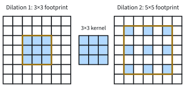
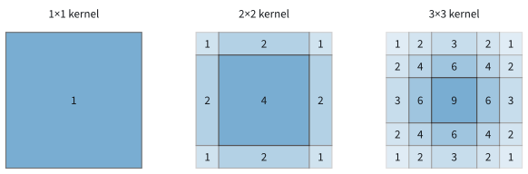
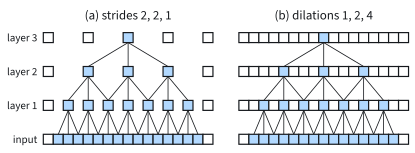

```{.python .input}
%load_ext d2lbook.tab
tab.interact_select('mxnet', 'pytorch', 'tensorflow', 'jax')
```

# Padding, Stride, and Dilation
:label:`sec_padding`

An unpadded $k \times k$ convolution shrinks its input by $k - 1$ pixels along
each axis (:numref:`sec_conv_layer`). Across ten $5 \times 5$ layers, a
$240 \times 240$ image shrinks to $200 \times 200$, discarding 30% of its area
along the borders. Yet keeping every layer at full resolution with stride 1 has
the opposite problem: each $3 \times 3$ layer widens a unit's receptive field by
only two pixels, requiring over a hundred layers to span a $224 \times 224$
image. And in dense prediction tasks like semantic segmentation, we want *both*
a wide field of view and full spatial resolution without the quadratic cost of
huge kernels.

Three geometric controls navigate these trade-offs: *padding* surrounds the
input with a border so kernels can center on edge pixels and preserve spatial
dimensions; *stride* steps the window by more than one pixel to downsample
feature maps and accelerate receptive-field growth; and *dilation* spaces kernel
weights apart so a small kernel spans a wider footprint at full resolution.
```{.python .input #padding-and-strides-padding-and-stride}
%%tab mxnet
import math
import numpy as np
from mxnet import autograd, gluon, init, np as mnp, npx
from mxnet.gluon import nn
from d2l import mxnet as d2l
npx.set_np()
```

```{.python .input #padding-and-strides-padding-and-stride}
%%tab pytorch
import math
import numpy as np
import torch
from torch import nn
from torch.nn import functional as F
from d2l import torch as d2l
```

```{.python .input #padding-and-strides-padding-and-stride}
%%tab tensorflow
import math
import numpy as np
import tensorflow as tf
from d2l import tensorflow as d2l
```

```{.python .input #padding-and-strides-padding-and-stride}
%%tab jax
import math
import numpy as np
import jax
from jax import numpy as jnp
from flax import nnx
import optax
from d2l import jax as d2l
```

## Padding

### Boundary Pixels

Even before successive layers trim away the perimeter of an image, pixels near
the border are heavily underutilized. :numref:`img_conv_reuse` counts how many
sliding windows cover each pixel for an unpadded convolution. With a
$k\times k$ kernel, any interior pixel at least $k-1$ steps from every border
participates in $k^2$ windows, whereas an edge pixel appears in at most $k$
windows and a corner pixel in only one. For a $5\times 5$ kernel, an interior
pixel contributes to 25 output locations while a corner pixel contributes to
just one, meaning that an object near the corner barely registers in the next
layer. Without intervention, each layer draws disproportionately from the
center of its input.


:label:`img_conv_reuse`

### Zero Padding

The simplest remedy is to surround the input with a border of extra filler
pixels—typically zeros—before sliding the kernel across it, a technique known
as *padding*. In :numref:`img_conv_pad`, adding one row of zeros to the top
and bottom and one column to the left and right expands a $3\times 3$ input
into a $5\times 5$ grid, allowing a $2\times 2$ kernel to produce a
$4\times 4$ output rather than a $2\times 2$ one. The shaded upper-left output
element combines three padded zeros with the corner of the original input:
$0\times0+0\times1+0\times2+0\times3=0$.


:label:`img_conv_pad`

Following the convention used in deep learning frameworks, we count padding
per side: $p_\textrm{h}$ rows added above and $p_\textrm{h}$ below the input,
and $p_\textrm{w}$ columns added to the left and to the right. The padded
input then has shape
$(n_\textrm{h}+2p_\textrm{h})\times(n_\textrm{w}+2p_\textrm{w})$, yielding
an output of shape

$$(n_\textrm{h}+2p_\textrm{h}-k_\textrm{h}+1)\times(n_\textrm{w}+2p_\textrm{w}-k_\textrm{w}+1).$$

Each row of padding on either side adds one row to the output, and each column
adds one column. Because the kernel removes $k_\textrm{h}-1$ rows and
$k_\textrm{w}-1$ columns, setting $p_\textrm{h}=(k_\textrm{h}-1)/2$ and
$p_\textrm{w}=(k_\textrm{w}-1)/2$ preserves the exact input height and width.
This is by far the most common choice in practice: a stack of shape-preserving
layers maintains the same spatial resolution at every depth, making network
architectures much easier to design and reason about.

Notice that dividing $k-1$ by two explains why CNNs almost always use odd
kernel sizes---such as 1, 3, 5, or 7, paired with paddings of 0, 1, 2, or 3.
An odd kernel has a well-defined center pixel, so symmetric padding places the
window computing output `Y[i, j]` directly centered on input pixel `X[i, j]`,
keeping the input and output grids aligned. For an even kernel, $k_\textrm{h}-1$
is odd, so preserving the spatial dimensions requires asymmetric padding (one
extra row on one side compared to the other) and shifts the output grid by
half a pixel relative to the input.

To verify these output-shape formulas in code, we first define a small helper.
Because built-in convolutional layers expect four-dimensional inputs carrying
batch and channel axes, `comp_conv2d` inserts two singleton dimensions around
a 2D input, applies the layer, and strips those extra dimensions from the
result.

```{.python .input #padding-and-strides-zero-padding-1}
%%tab mxnet
def comp_conv2d(conv2d, X):
    """Apply a convolutional layer to a single-channel 2D input."""
    conv2d.initialize()
    Y = conv2d(X.reshape((1, 1) + X.shape))  # input (1, 1, h, w)
    return Y.reshape(Y.shape[2:])
```

```{.python .input #padding-and-strides-zero-padding-1}
%%tab pytorch
def comp_conv2d(conv2d, X):
    """Apply a convolutional layer to a single-channel 2D input."""
    Y = conv2d(X.reshape((1, 1) + X.shape))  # input (1, 1, h, w)
    return Y.reshape(Y.shape[2:])
```

```{.python .input #padding-and-strides-zero-padding-1}
%%tab tensorflow
def comp_conv2d(conv2d, X):
    """Apply a convolutional layer to a single-channel 2D input."""
    Y = conv2d(tf.reshape(X, (1,) + X.shape + (1,)))  # input (1, h, w, 1)
    return tf.reshape(Y, Y.shape[1:3])
```

```{.python .input #padding-and-strides-zero-padding-1}
%%tab jax
def comp_conv2d(conv2d, X):
    """Apply a convolutional layer to a single-channel 2D input."""
    Y = conv2d(X.reshape((1,) + X.shape + (1,)))  # input (1, h, w, 1)
    return Y.reshape(Y.shape[1:3])
```

For a $3\times 3$ kernel, shape-preserving padding requires $p = (3-1)/2 = 1$
(`padding=1` in code). Applying this layer to an $8\times 8$ input should
leave the spatial shape unchanged at $8\times 8$.

```{.python .input #padding-and-strides-padding-1}
%%tab mxnet
X = mnp.random.uniform(size=(8, 8))
conv2d = nn.Conv2D(1, kernel_size=3, padding=1)
comp_conv2d(conv2d, X).shape
```

```{.python .input #padding-and-strides-padding-1}
%%tab pytorch
X = torch.rand(size=(8, 8))
conv2d = nn.LazyConv2d(1, kernel_size=3, padding=1)
comp_conv2d(conv2d, X).shape
```

```{.python .input #padding-and-strides-padding-1}
%%tab tensorflow
X = tf.random.uniform(shape=(8, 8))
conv2d = tf.keras.layers.Conv2D(1, kernel_size=3, padding='same')
comp_conv2d(conv2d, X).shape
```

```{.python .input #padding-and-strides-padding-1}
%%tab jax
X = jax.random.uniform(d2l.get_key(), shape=(8, 8))
conv2d = nnx.Conv(1, 1, kernel_size=(3, 3), padding=1,
                  rngs=nnx.Rngs(d2l.get_key()))
comp_conv2d(conv2d, X).shape
```

:begin_tab:`tensorflow`
Keras `Conv2D` takes `padding='valid'` (no padding) or `padding='same'` (output size $\lceil n/s \rceil$, which equals symmetric padding $(k-1)/2$ at stride 1 for odd $k$); custom padding widths use `ZeroPadding2D` before `padding='valid'`. Inputs are channels-last: `(batch, height, width, channel)`.
:end_tab:

:begin_tab:`jax`
`nnx.Conv` defaults to `padding='SAME'` and also accepts `'VALID'`, an integer (or per-axis tuple), `'REFLECT'`, or `'CIRCULAR'`. Inputs are channels-last: `(batch, height, width, channel)`.
:end_tab:
### Padding Values
:label:`subsec_padding_values`

Zero padding implicitly assumes that the image is surrounded by black pixels
outside its frame. More formally, padding specifies a *boundary condition*---a
rule for supplying values beyond the image border where no measurement exists.
To see how zero padding affects the output, let us pad a uniform $5\times 5$
image of all ones with one pixel of zeros on each side and cross-correlate it
with a $3\times 3$ kernel of all ones using `corr2d` from
:numref:`sec_conv_layer`. Each output entry then counts how many true image
pixels fall inside its window.

```{.python .input #padding-and-strides-padding-values}
%%tab mxnet
img = d2l.ones((5, 5))
d2l.corr2d(mnp.pad(img, 1), d2l.ones((3, 3)))
```

```{.python .input #padding-and-strides-padding-values}
%%tab pytorch
img = d2l.ones((5, 5))
d2l.corr2d(F.pad(img, (1, 1, 1, 1)), d2l.ones((3, 3)))
```

```{.python .input #padding-and-strides-padding-values}
%%tab tensorflow
img = d2l.ones((5, 5))
d2l.corr2d(tf.pad(img, [[1, 1], [1, 1]]), d2l.ones((3, 3)))
```

```{.python .input #padding-and-strides-padding-values}
%%tab jax
img = d2l.ones((5, 5))
d2l.corr2d(jnp.pad(img, 1), d2l.ones((3, 3)))
```

The interior outputs equal 9, edge outputs drop to 6, and corner outputs drop
to 4: even though the original image is completely uniform, the layer sees a
dark frame around it. That artificial frame propagates inward through
subsequent layers, which can learn to use it as an implicit positional cue; at
the same time, boundary artifacts can create blind spots near the edges where
the network responds weakly :cite:`Alsallakh.Kokhlikyan.Miglani.ea.2020`. Two
common alternatives avoid introducing zeros: *reflect padding* mirrors pixels
across the border, while *replicate padding* repeats the border values
outward. Both map a constant image to a constant output, making them popular
in image-generation and restoration networks where border darkening would
appear directly in the generated pixels. In classification networks, however,
zero padding remains the standard choice because it is simple and can be
applied implicitly by fast kernels without allocating a larger padded tensor.

## Stride

### Strided Convolution

Keeping a $224\times 224$ image at full resolution throughout a network is
both expensive and slow to aggregate global context: every channel contains
50,176 spatial positions per layer, and since each $3\times 3$ convolution
expands a unit's view by only two pixels, more than 100 layers would be needed
before a single unit could see the entire image. Stepping the convolution
window across the input in larger increments solves both problems at once,
reducing the spatial resolution and shrinking the depth needed for global
context.

Until now, our sliding window has advanced one pixel at a time across each
row and down each column. We call the step size along the height and width the
*stride*. With vertical stride $s_\textrm{h}$ and horizontal stride
$s_\textrm{w}$, the layer evaluates the kernel only at every $s_\textrm{h}$-th
row and every $s_\textrm{w}$-th column, cutting the number of output elements
by roughly a factor of $s_\textrm{h} s_\textrm{w}$. :numref:`img_conv_stride`
illustrates a vertical stride of 3 and a horizontal stride of 2 on the padded
input from :numref:`img_conv_pad` (an asymmetric choice that makes the two
axes easy to distinguish). Each shaded output matches the color of the window
that produced it: the blue entry equals
$0\times0+0\times1+1\times2+2\times3=8$ from a window shifted two columns to
the right of the first, and the orange entry equals
$0\times0+6\times1+0\times2+0\times3=6$ from a window shifted three rows down.
Stepping two more columns to the right would push the window past the right
edge of the padded input, leaving two outputs per row.


:label:`img_conv_stride`

To determine the output height in general, note that the window starts at row 0
of the padded input and must fit entirely within the
$n_\textrm{h}+2p_\textrm{h}$ padded rows. Its valid starting rows are
$0, s_\textrm{h}, 2s_\textrm{h}, \ldots$ up to
$n_\textrm{h}+2p_\textrm{h}-k_\textrm{h}$. Applying the same reasoning to
the width gives an output shape of

$$\left(\left\lfloor\frac{n_\textrm{h}+2p_\textrm{h}-k_\textrm{h}}{s_\textrm{h}}\right\rfloor+1\right)\times\left(\left\lfloor\frac{n_\textrm{w}+2p_\textrm{w}-k_\textrm{w}}{s_\textrm{w}}\right\rfloor+1\right).$$

Here the floor term counts how many full steps the window can take after its
initial placement, and the $+1$ accounts for that starting position. Checking
:numref:`img_conv_stride` yields $\lfloor 3/3\rfloor+1=2$ rows and
$\lfloor 3/2\rfloor+1=2$ columns, and setting $s_\textrm{h}=s_\textrm{w}=1$
recovers our earlier padding formula. When we pair stride with
shape-preserving padding ($2p_\textrm{h}=k_\textrm{h}-1$), the output height
simplifies to
$\lfloor (n_\textrm{h}-1)/s_\textrm{h}\rfloor+1=\lceil n_\textrm{h}/s_\textrm{h}\rceil$:
a stride of $s$ divides the spatial resolution by $s$, rounding up.

By far the most common downsampling layer in modern CNNs uses a $3\times 3$
kernel with padding 1 and stride 2. Applied to our $8\times 8$ input, it
halves both spatial dimensions to $4\times 4$.

```{.python .input #padding-and-strides-stride-1}
%%tab mxnet
conv2d = nn.Conv2D(1, kernel_size=3, padding=1, strides=2)
comp_conv2d(conv2d, X).shape
```

```{.python .input #padding-and-strides-stride-1}
%%tab pytorch
conv2d = nn.LazyConv2d(1, kernel_size=3, padding=1, stride=2)
comp_conv2d(conv2d, X).shape
```

```{.python .input #padding-and-strides-stride-1}
%%tab tensorflow
conv2d = tf.keras.Sequential([
    tf.keras.layers.ZeroPadding2D(padding=1),
    tf.keras.layers.Conv2D(1, kernel_size=3, padding='valid', strides=2)])
comp_conv2d(conv2d, X).shape
```

```{.python .input #padding-and-strides-stride-1}
%%tab jax
conv2d = nnx.Conv(1, 1, kernel_size=(3, 3), padding=1, strides=2,
                  rngs=nnx.Rngs(d2l.get_key()))
comp_conv2d(conv2d, X).shape
```

:begin_tab:`tensorflow`
At stride 2 on an input of even size, `padding='same'` pads one row and
column at the bottom and right but none at the top and left, so output $i$
is centered on input pixel $2i+1$ rather than $2i$. `ZeroPadding2D(1)`
followed by `padding='valid'` pads both sides by 1.
:end_tab:

Height and width need not share the same kernel size, padding, or stride; the
output-shape formula applies independently to each axis.

An important special case occurs when the stride equals the kernel size and
padding is zero: the windows then partition the input into non-overlapping
tiles. For instance, a $16\times 16$ convolution with stride 16 splits a
$224\times 224$ image into a $14\times 14$ grid of patches and projects each
patch to a vector of channel outputs. This *patchify* stem is how vision
transformers convert images into sequences of tokens, and several modern CNNs
open with the same operation.

When height and width share the same settings, we drop the subscripts and
simply write $p$ and $s$. Unless specified otherwise, a convolutional layer
defaults to stride 1 and zero padding ($p=0$).

:begin_tab:`jax`
In `nnx.Conv`, however, the default is `padding='SAME'`.
:end_tab:

### Stride and the Receptive Field
:label:`subsec_stride_rf`

In :numref:`sec_conv_layer`, we saw that at stride 1 each $k\times k$ layer
expands the receptive field by $k-1$ pixels per axis, producing only linear
growth with depth. Stride accelerates this growth dramatically. After a layer
with stride 2, adjacent entries in its output correspond to locations two
pixels apart in the original image; consequently, a subsequent $3\times 3$
kernel widens the receptive field by $(3-1)\cdot 2=4$ input pixels rather than
2. More generally, a single step in the input to layer $i$ spans
$\prod_{j<i} s_j$ pixels of the original image, so a unit at the top of an
$L$-layer stack with kernel sizes $k_i$ and strides $s_i$ has a receptive
field of width

$$r = 1 + \sum_{i=1}^{L} (k_i - 1) \prod_{j=1}^{i-1} s_j,$$
:eqlabel:`eq_receptive_field`

where the empty product for $i = 1$ is defined as 1. Each layer contributes
the span of its kernel measured in original image pixels; setting all strides
to 1 reduces every term to $k_i-1$, recovering the linear count from
:numref:`sec_conv_layer`. Notice that padding does not enter the formula:
padding determines which output locations exist, not how wide a patch each
unit observes. Comparing two three-layer stacks of $3\times 3$ convolutions,
strides $(1, 1, 1)$ give $r = 1+2+2+2 = 7$, whereas strides $(2, 2, 1)$ more
than double the reach to $r = 1+2+4+8 = 15$.

Because each stride multiplies the effective reach of every layer above it,
the receptive field grows geometrically whenever downsampling continues. After
five stride-2 stages---typical in image classifiers operating on
$224\times 224$ inputs---a single step in the feature map spans 32 input
pixels, enabling top-level units to view the entire image in only a handful of
layers.

## Dilation
:label:`sec_dilation`

### Dilated Convolution

Strided convolutions buy a wide receptive field at the expense of spatial
resolution. For some tasks, however, we want both a wide context and an output
at every input pixel. Simply enlarging the kernel would give a wider view, but
its parameter count and compute cost grow quadratically with kernel size.
Whereas padding and stride control *where* the kernel is placed, dilation
modifies the *spacing of the kernel itself*: a *dilated convolution*
:cite:`yu2016dilated` inserts gaps between adjacent weights so that they are
evaluated $d$ pixels apart, where $d$ is the *dilation* rate. A $k\times k$
kernel with dilation $d$ still contains only $k^2$ learnable weights, yet
spans an *effective kernel size* of

$$k' = k + (k-1)(d-1) = d(k-1)+1$$

pixels along each axis, skipping $d-1$ pixels between consecutive taps. Setting
$d=1$ recovers the ordinary dense convolution. :numref:`fig_conv_dilation`
contrasts a $3\times 3$ kernel at $d=1$ and $d=2$: at dilation 2, the same
nine weights cover a $5\times 5$ footprint by sampling every other pixel,
while still requiring only nine multiplications per output location.


:label:`fig_conv_dilation`

As far as output dimensions are concerned, a dilated kernel behaves identically
to a dense kernel of size $k'$. Replacing $k$ with $k' = d(k-1)+1$ in our
strided formula yields a single unified expression for the output size along
an axis with arbitrary padding, stride, and dilation:

$$\left\lfloor\frac{n+2p-d(k-1)-1}{s}\right\rfloor+1,$$
:eqlabel:`eq_conv_output_shape`

which applies independently to height and width with their respective
parameters $n$, $k$, $p$, $s$, and $d$. Setting $d=1$ reproduces the strided
formula, and setting $s=1$ and $p=0$ brings us all the way back to $n-k+1$.
On our $8\times 8$ input, a $3\times 3$ kernel with dilation 2 should therefore
produce the same $4\times 4$ output shape as a dense $5\times 5$ kernel.

```{.python .input #padding-and-strides-dilation}
%%tab mxnet
conv2d = nn.Conv2D(1, kernel_size=3, dilation=2)
conv5 = nn.Conv2D(1, kernel_size=5)
comp_conv2d(conv2d, X).shape, comp_conv2d(conv5, X).shape
```

```{.python .input #padding-and-strides-dilation}
%%tab pytorch
conv2d = nn.LazyConv2d(1, kernel_size=3, dilation=2)
conv5 = nn.LazyConv2d(1, kernel_size=5)
comp_conv2d(conv2d, X).shape, comp_conv2d(conv5, X).shape
```

```{.python .input #padding-and-strides-dilation}
%%tab tensorflow
conv2d = tf.keras.layers.Conv2D(1, kernel_size=3, dilation_rate=2)
conv5 = tf.keras.layers.Conv2D(1, kernel_size=5)
comp_conv2d(conv2d, X).shape, comp_conv2d(conv5, X).shape
```

```{.python .input #padding-and-strides-dilation}
%%tab jax
conv2d = nnx.Conv(1, 1, kernel_size=(3, 3), padding='VALID',
                  kernel_dilation=2, rngs=nnx.Rngs(d2l.get_key()))
conv5 = nnx.Conv(1, 1, kernel_size=(5, 5), padding='VALID',
                 rngs=nnx.Rngs(d2l.get_key()))
comp_conv2d(conv2d, X).shape, comp_conv2d(conv5, X).shape
```

### Dilation and the Receptive Field

At stride 1, a dilated layer widens the receptive field by $k'-1 = d(k-1)$
pixels, so :eqref:`eq_receptive_field` still holds once each $k_i$ is replaced
by its effective size $k'_i$. If we double the dilation rate at each layer,
$d_i = 1, 2, 4, \ldots, 2^{L-1}$, a stack of $L$ layers with $3\times 3$
kernels attains a receptive field of width
$1 + 2(1 + 2 + \cdots + 2^{L-1}) = 2^{L+1}-1$. Just like a strided stack, its
receptive field grows exponentially with depth, yet every layer retains the
full spatial resolution of the input.

:numref:`fig_conv_rf_towers` illustrates these two strategies side by side.
Panel (a) shows our strided stack with strides $(2, 2, 1)$: the three layers
add $2$, $4$, and $8$ pixels to the top unit's view, reaching 15 input pixels
in total. Panel (b) achieves the exact same 15-pixel receptive field using
stride 1 and dilations $(1, 2, 4)$, wiring the top unit to the input through
the identical pattern of connections. The sole difference is spatial density:
the strided stack retains only every fourth spatial position, whereas the
dilated stack evaluates all of them. Indeed, without padding and with shared
weights, the strided stack's output is simply every fourth entry of the
dilated stack's output, even when elementwise nonlinearities are applied after
every layer. That makes dilated convolutions especially valuable for *dense
prediction* tasks such as semantic segmentation, where we must assign a class
label to every pixel while still drawing on broad surrounding context
:cite:`yu2016dilated`. The tradeoff is computation and memory, because every
layer must process full-resolution feature maps; an alternative is to
downsample with strides and later recover spatial resolution using learned
upsampling layers.


:label:`fig_conv_rf_towers`

So far, every example in this section has operated on a single-channel input
with a single kernel. Real-world images contain multiple color channels, and
useful hidden layers detect dozens or hundreds of distinct patterns at once.
We lift both restrictions in :numref:`sec_channels`.

## Summary

Without padding, a convolution shrinks its input by $k-1$ pixels along each
axis and samples border pixels in far fewer windows than interior ones. Adding
$(k-1)/2$ pixels of padding to each side of an odd kernel preserves the input
shape and keeps each output centered on its corresponding input pixel, though
zero padding introduces a boundary condition that deep layers can detect.
Using a stride $s > 1$ evaluates only every $s$-th window position, reducing
spatial resolution and computation by roughly a factor of $s$ per axis while
causing the receptive field of higher layers to grow geometrically. Finally,
dilation $d$ spaces a kernel's weights across an effective footprint of
$d(k-1)+1$, expanding the receptive field exponentially at full resolution
without adding parameters. All three mechanisms are captured by a single
output-shape formula, :eqref:`eq_conv_output_shape`.

## Exercises

1. [code] **Mirror padding.** Mirror padding, also called reflect padding,
   extends a tensor by reflecting its entries about the border without
   repeating the border entry: padding the vector $(1, 2, 3)$ by one entry
   on each side gives $(2, 1, 2, 3, 2)$.
    1. Implement mirror padding by one entry on every side of a
       two-dimensional tensor, and check the result by hand on a
       $3 \times 3$ tensor with distinct entries.
    1. Repeat the computation of :numref:`subsec_padding_values` with
       mirror padding instead of zero padding, and explain the result.
    1. Take the $5\times 5$ ramp $x_{ij} = j$ and the $3\times 3$ kernel
       whose entries all equal $\frac{1}{9}$. Show that in the interior the
       output equals the input. Compute the outputs in the first and last
       columns under zero padding and under mirror padding, and find a way
       to pad that reproduces the ramp exactly.

2. **Dilation and gridding.** A network stacks four $3 \times 3$
   convolutions with stride 1. The doubling dilation schedule
   $(1, 2, 4, 8)$ gives one output element a receptive field of side $31$.
   Compare it with the constant schedule $(4, 4, 4, 4)$.
    1. Use :eqref:`eq_receptive_field`, with each kernel replaced by its
       effective size, to compute the receptive field of the constant
       schedule.
    1. For each schedule, determine which pixels inside the receptive
       field the output actually depends on, and count them. A schedule
       whose output depends only on a sparse lattice within its receptive
       field is said to exhibit *gridding*.
    1. Give one reason gridding is harmful for dense prediction tasks such
       as segmentation.
    1. ● State a condition on the dilations $d_1, \ldots, d_L$ of a stack
       of $3 \times 3$ convolutions with stride 1 that guarantees that the
       output depends on every pixel of its receptive field, and show that
       the condition suffices.

3. **Strides versus dilations.** Consider the two one-dimensional stacks of
   :numref:`fig_conv_rf_towers`, without padding, with kernels
   $\mathbf{w}_1, \mathbf{w}_2, \mathbf{w}_3$ of size 3 shared by both
   stacks and an elementwise nonlinearity after every layer.
    1. Write the output of each stack at position $i$ as a function of the
       input, and show that the output of the strided stack at position $i$
       equals the output of the dilated stack at position $4i$.
    1. For an input of length $n$, count the multiplications each stack
       performs, ignoring the border.
    1. Generalize the first part: which dilations reproduce a stack with
       strides $s_1, \ldots, s_L$?

4. **Shapes through a stem.** A $224\times 224$ image passes through four
   layers: a $7\times 7$ convolution with padding 3 and stride 2, a
   $3\times 3$ convolution with padding 1 and stride 2, and two
   $3\times 3$ convolutions with padding 1 and stride 1.
    1. Give the height of the output of every layer.
    1. Use :eqref:`eq_receptive_field` to compute the receptive field of a
       unit of the last layer. What fraction of the image's width does it
       see?
    1. Replace the first two layers by a single $4\times 4$ convolution
       with stride 4 and no padding, the patchify layer of this section.
       Give the output height and the receptive field again. Do neighboring
       windows of the first layer still overlap?

:begin_tab:`mxnet`
[Discussions](https://d2l.discourse.group/t/67)
:end_tab:

:begin_tab:`pytorch`
[Discussions](https://d2l.discourse.group/t/68)
:end_tab:

:begin_tab:`tensorflow`
[Discussions](https://d2l.discourse.group/t/272)
:end_tab:

:begin_tab:`jax`
[Discussions](https://d2l.discourse.group/t/17997)
:end_tab:

<!-- slides -->

::: {.slide}
::: {.cover}
[Dive into Deep Learning · §6.3]{.kicker}

Padding, Stride, and Dilation<br>**boundary control · spatial downsampling · dilated footprints · receptive-field growth**
:::
:::

::: {.slide title="Three Geometric Dilemmas of Basic Convolutions"}
[Motivation & Spatial Trade-Offs]{.kicker}

::: {.cols .vc}
::: {.col}
- **Border erosion $\to$ Padding ($p$):** Ten unpadded $5 \times 5$ layers shrink a $240 \times 240$ image to $200 \times 200$ (losing 30% of its area); padding $p = (k-1)/2$ preserves resolution.
- **Slow linear RF growth $\to$ Stride ($s$):** Stride-1 $3 \times 3$ layers need $>110$ layers to span $224 \times 224$; stride $s > 1$ grows reach geometrically.
- **Full-res context $\to$ Dilation ($d$):** Spaces kernel taps $d$ pixels apart without adding parameters.
:::

::: {.col .fig .big}
@fig:ch06-cnn-border-erosion
:::
:::
:::

::: {.slide title="Why Unpadded Convolutions Under-Sample Border Pixels"}
[Boundary Pixel Utilization]{.kicker}

Even in a single unpadded $k \times k$ layer, pixels near the edge of the frame participate in far fewer sliding windows than interior pixels:

{.nostretch width=62% fig-align="center"}

- **Interior vs. corner disparity:** Any interior pixel at distance $\ge k-1$ from the border participates in $k^2$ windows ($25$ windows for a $5 \times 5$ kernel), an edge pixel appears in at most $k$ windows, and a corner pixel appears in **only 1 window**.
- **Cumulative center bias:** Across stacked layers, unpadded convolutions exponentially down-weight information located near the perimeter of the image.
:::

::: {.slide title="Zero Padding Restores Borders and Output Dimensions"}
[Symmetric Per-Side Padding]{.kicker}

Surrounding the input with $p_\textrm{h}$ rows of zeros on both top and bottom and $p_\textrm{w}$ columns on both left and right expands the effective input grid to $(n_\textrm{h} + 2p_\textrm{h}) \times (n_\textrm{w} + 2p_\textrm{w})$:

::: {.cols .vc}
::: {.col}
$$\textrm{Output shape} = (n_\textrm{h} + 2p_\textrm{h} - k_\textrm{h} + 1) \times (n_\textrm{w} + 2p_\textrm{w} - k_\textrm{w} + 1)$$

- **Shape-preserving ("same") padding:** Setting $p_\textrm{h} = (k_\textrm{h}-1)/2$ and $p_\textrm{w} = (k_\textrm{w}-1)/2$ cancels the $k - 1$ shrinkage so the output matches $n_\textrm{h} \times n_\textrm{w}$.
- **Example ($3 \times 3$ input, $p=1$, $2 \times 2$ kernel):** Padding expands $3 \times 3 \to 5 \times 5$, yielding a $4 \times 4$ output instead of $2 \times 2$.
:::

::: {.col .fig}
{.nostretch width=100%}
:::
:::
:::

::: {.slide title="Why Convolutional Kernels Are Almost Always Odd"}
[Grid Alignment Under Symmetric Padding]{.kicker}

::: {.cols .vc}
::: {.col}
- **Odd $k \in \{1, 3, 5, 7\}$:** $k - 1$ is even, so $p = (k-1)/2$ pads both sides equally and centers every window on input pixel $(i, j)$.
- **Why even $k$ is awkward:** $k - 1$ is odd, forcing asymmetric padding ($p_{\textrm{left}} \ne p_{\textrm{right}}$) and a half-pixel coordinate shift between layers.
:::

::: {.col .fig .big}
@fig:ch06-cnn-odd-vs-even-kernel
:::
:::
:::

::: {.slide title="Verifying Shape-Preserving Padding in Code"}
[Batch-and-Channel Wrapper Helper]{.kicker}

Built-in 2D convolutional layers expect 4D tensors carrying batch and channel axes. Our helper `comp_conv2d` wraps a 2D matrix $(H, W)$ with singleton batch/channel dimensions and returns the 2D spatial output:

@padding-and-strides-zero-padding-1

@padding-and-strides-padding-1
:::

::: {.slide title="Boundary Pitfalls: Zero Padding as a Dark Frame"}
[Implicit Positional Leakage vs. Reflect/Replicate Padding]{.kicker}

::: {.cols .vc}
::: {.col}
@padding-and-strides-padding-values

- **Border darkening ($9 \to 6 \to 4$):** Zero padding creates an artificial dark frame that leaks absolute spatial position to deep layers.
- **Generative fix:** Reflect or replicate padding preserves constant intensity up to the border.
:::

::: {.col .fig}
@fig:ch06-cnn-padding-dark-frame
:::
:::
:::

::: {.slide title="Strided Convolutions: Downsampling the Grid"}
[Stepping the Sliding Window by s > 1 Pixels]{.kicker}

Instead of evaluating the kernel at every pixel ($s = 1$), a vertical stride $s_\textrm{h}$ and horizontal stride $s_\textrm{w}$ shift the window by $s_\textrm{h}$ rows and $s_\textrm{w}$ columns per step:

::: {.cols .vc}
::: {.col}
- **Example ($s_\textrm{h} = 3$, $s_\textrm{w} = 2$ on padded $3 \times 3$):**
  - Top-left window (gray): $0\cdot 0 + 0\cdot 1 + 0\cdot 2 + 0\cdot 3 = 0$.
  - Shift 2 columns right (blue): $0\cdot 0 + 0\cdot 1 + 1\cdot 2 + 2\cdot 3 = 8$.
  - Shift 3 rows down (orange): $0\cdot 0 + 6\cdot 1 + 0\cdot 2 + 0\cdot 3 = 6$.
- **Compute savings:** Evaluating every $s$-th row and column cuts output activations and multiply-adds by a factor of $s_\textrm{h} s_\textrm{w}$.
:::

::: {.col .fig}
{.nostretch width=100%}
:::
:::
:::

::: {.slide title="Deriving the Strided Output-Shape Formula"}
[Counting Valid Steps Plus the Starting Position]{.kicker}

::: {.cols .vc}
::: {.col}
$$h_\textrm{o} = \left\lfloor \frac{n_\textrm{h} + 2p_\textrm{h} - k_\textrm{h}}{s_\textrm{h}} \right\rfloor + 1$$

- **Step counting:** After placing the first window of size $k$ at index $0$, the remaining $n + 2p - k$ pixels fit $\lfloor (n+2p-k)/s \rfloor$ steps of size $s$.
- **With "same" padding ($2p = k - 1$):** Simplifies to $h_\textrm{o} = \lceil n / s \rceil$, cleanly dividing resolution by $s$.
:::

::: {.col .fig}
@fig:ch06-cnn-stride-step-derivation
:::
:::
:::

::: {.slide title="Strided Downsampling in Code and Design Patterns"}
[Three Canonical Padding-and-Stride Regimes]{.kicker}

::: {.cols .vc}
::: {.col}
@padding-and-strides-stride-1

- **Three standard regimes:** Preserve resolution ($k=3, p=1, s=1$), halve resolution at stage boundaries ($k=3, p=1, s=2$), or partition into non-overlapping tokens ($p=0, s=k$).
:::

::: {.col .fig}
@fig:ch06-cnn-three-stride-regimes
:::
:::
:::

::: {.slide title="Geometric Receptive-Field Growth Under Stride"}
[How Early Strides Multiply All Downstream Kernels]{.kicker}

::: {.cols .vc}
::: {.col}
$$r = 1 + \sum_{i=1}^{L} (k_i - 1) \prod_{j=1}^{i-1} s_j$$

- **Cumulative multiplier $\prod_{j < i} s_j$:** Every early stride multiplies the spatial reach of all layers above it (and is independent of padding $p$).
- **Linear vs. geometric reach:** Three $3 \times 3$ layers cover $r = 7$ at $s=(1,1,1)$ vs. $r = 15$ at $s=(2,2,1)$.
:::

::: {.col .fig}
@fig:ch06-cnn-geometric-rf-stride
:::
:::
:::

::: {.slide title="Dilated Convolutions: Expanding Footprints at Stride 1"}
[Spacing Kernel Taps Apart by Dilation Rate d]{.kicker}

When a task demands a wide receptive field *without* losing spatial resolution (e.g., per-pixel semantic segmentation), **dilation** inserts spaces of $d - 1$ pixels between adjacent kernel taps:

::: {.cols .vc}
::: {.col}
- **Effective kernel size $k'$:** A $k \times k$ kernel with dilation rate $d$ spans:
  $$k' = k + (k - 1)(d - 1) = d(k - 1) + 1$$
- **Zero extra parameters or FLOPs:** At $d = 2$, a $3 \times 3$ kernel spans a $5 \times 5$ footprint ($k' = 2(2)+1 = 5$) using only **$9$ weights and $9$ multiply-adds** per pixel instead of $25$.
:::

::: {.col .fig}
{.nostretch width=100%}
:::
:::
:::

::: {.slide title="Unified Shape Formula: Padding, Stride & Dilation"}
[Substituting Effective Kernel Size k' = d(k - 1) + 1]{.kicker}

Replacing $k$ with $k' = d(k - 1) + 1$ in the strided output-shape formula yields one master equation governing every convolutional layer along an axis:

$$n_\textrm{out} = \left\lfloor \frac{n + 2p - d(k - 1) - 1}{s} \right\rfloor + 1$$

@padding-and-strides-dilation

- **Sanity check:** On an $8 \times 8$ unpadded input ($p=0, s=1$), a $3 \times 3$ kernel at dilation $d=2$ has effective size $k' = 5$ and produces the exact same $4 \times 4$ output shape as a dense $5 \times 5$ kernel.
:::

::: {.slide title="Strided vs. Dilated Towers: Reach vs. Density"}
[Comparing Strides (2, 2, 1) Against Dilations (1, 2, 4)]{.kicker}

Replacing $k_i - 1$ with $k'_i - 1 = d_i(k_i - 1)$ in our receptive-field formula shows that doubling dilation rates $d_i = 2^{i-1}$ at stride 1 grows the receptive field **exponentially** ($r = 2^{L+1} - 1$ for $3 \times 3$ kernels):

{.nostretch width=60% fig-align="center"}

- **(a) Strided tower ($s = 2, 2, 1$, $d = 1, 1, 1$):** Reaches $r = 1 + 2 + 4 + 8 = 15$ input pixels, subsampling to every 4th spatial location ($16\times$ cheaper in 2D).
- **(b) Dilated tower ($s = 1, 1, 1$, $d = 1, 2, 4$):** Reaches the exact same $r = 1 + 2(1) + 2(2) + 2(4) = 15$ input pixels through identical tap wiring, while evaluating **every spatial position** at full resolution.
:::

::: {.slide title="Systems Pitfall: Dilation Gridding Artifacts"}
[Why Constant Dilation Schedules Create Blind Lattices]{.kicker}

::: {.cols .vc}
::: {.col}
- **The gridding hazard:** Constant dilation $d = (4, 4, 4, 4)$ samples only offsets $(i+4a, j+4b)$—reading just $81$ of $1{,}089$ pixels ($7.4\%$) inside its $33 \times 33$ box!
- **Blind to thin structures:** Small objects falling between the $4$-pixel lattice lines never touch a weight.
- **Exponential fix:** Doubling schedule $d = (1, 2, 4, 8)$ bridges every gap for $100\%$ dense coverage ($r = 31$).
:::

::: {.col .fig .big}
@fig:ch06-cnn-dilation-gridding
:::
:::
:::

::: {.slide title="Concept Check: Shapes and Receptive Fields"}
[Concept Check]{.kicker}

Test your mastery of the unified shape and receptive-field equations:

1. **Unpadded vs. padded stack:** What output shape comes out when a $28 \times 28$ image passes through three unpadded $5 \times 5$ layers at stride 1? What per-side padding $p$ preserves $28 \times 28$ through all three?
2. **ResNet-style stem:** A $224 \times 224$ image passes through a $7 \times 7$ conv ($p=3, s=2$) followed by a $3 \times 3$ conv ($p=1, s=2$). What is the output spatial shape after each layer, and what is the receptive field $r$ of a unit after the second layer?
3. **Dilated shape-preserving padding:** For a $3 \times 3$ kernel with dilation $d = 4$ and stride $s = 1$, what per-side padding $p$ preserves the input height and width?

::: {.d2l-note .fragment .fade-up}
**Answers:**
(1) Each unpadded $5 \times 5$ layer subtracts $4$ pixels: $28 \to 24 \to 20 \to 16$ ($16 \times 16$). Padding $p = (5-1)/2 = 2$ on each side keeps $28 \times 28$.
(2) Layer 1 output: $\lfloor(224+6-7)/2\rfloor + 1 = 112 \times 112$. Layer 2 output: $\lfloor(112+2-3)/2\rfloor + 1 = 56 \times 56$. Receptive field after Layer 2: $r = 1 + (7-1)(1) + (3-1)(2) = 1 + 6 + 4 = 11$ pixels.
(3) The effective kernel size is $k' = 4(3-1)+1 = 9$, so shape-preserving padding requires $p = (k'-1)/2 = 4$ pixels per side.
:::
:::

::: {.slide title="Summary & Key Takeaways"}
[Section Synthesis]{.kicker}

| Hyperparameter | Effect on Output Size $n_\textrm{out}$ | Effect on Receptive Field $r$ | Systems & Architectural Role |
|---|---|---|---|
| **Padding ($p$ per side)** | Adds $2p$ to effective input length | None ($r$ is independent of $p$) | Prevents border shrinkage; $p = (k-1)/2$ preserves $H \times W$ at $s=1$ |
| **Stride ($s$)** | Divides output length by $s$ ($\approx \lceil n/s \rceil$) | Multiplies reach of all subsequent layers by $s$ | Cuts activations & MACs by $s^2$; grows RF geometrically |
| **Dilation ($d$)** | Expands kernel $k \to k' = d(k-1)+1$ | Adds $d(k-1) \prod_{j<i} s_j$ to $r$ | Exponential RF growth at full resolution ($0$ extra params) |
| **Master Formula** | $\lfloor (n + 2p - d(k-1) - 1)/s \rfloor + 1$ | $1 + \sum_{i=1}^L d_i(k_i - 1)\prod_{j<i} s_j$ | Governs all 1D, 2D, and 3D convolutional & pooling layers |

::: {.d2l-note}
**Next (§{sec_channels}):** Extending convolutions from single-channel 2D grids to 3D stacks of input and output channels, accounting for the $c_\textrm{i} c_\textrm{o}$ compute/memory cost, and building $1 \times 1$ bottleneck layers.
:::
:::
