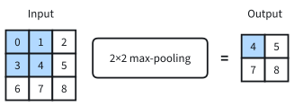

```{.python .input}
%load_ext d2lbook.tab
tab.interact_select('mxnet', 'pytorch', 'tensorflow', 'jax')
```

# Pooling
:label:`sec_pooling`

Whether an image shows a shirt or a sneaker is a question about the whole
image, so the receptive field of some unit near the top of the network, the
input region that can influence it (:numref:`sec_conv_layer`), has to cover
all of it. A $3\times3$ convolution with stride 1 widens the receptive field
by two pixels, so after $L$ such layers a unit sees a $(2L+1)\times(2L+1)$
patch. Covering a $28\times28$ Fashion-MNIST image takes fourteen layers. If
every second layer is followed by a $2\times2$ step that halves the
resolution, each later kernel reaches twice as far in the input
(:numref:`subsec_stride_rf`), and each $2\times2$ window adds its own extent
(:eqref:`eq_receptive_field` with $k=s=2$). Six $3\times3$ convolutions with
two such steps then see a $32\times32$ patch.

A second problem appears at the bottom of the network. The edge detector of
:numref:`sec_conv_layer` responds at the pixel where the edge lies. Shift the
image by one pixel, as happens whenever the object or the camera moves
slightly, and the response moves by one pixel too. A classifier should not
change its mind because of such a shift.

A *pooling layer* addresses both problems. It replaces each small window of
its input by one summary value, the maximum or the average, and has no
parameters. With windows of size 2 and stride 2 it halves the resolution, and
the maximum of a window does not change when a response moves within it. The
shape rules of padding and stride (:numref:`sec_padding`) carry over; only
the value used for padding changes. The network of the next section, LeNet,
alternates convolutions with pooling.

```{.python .input #pooling}
%%tab mxnet
from d2l import mxnet as d2l
from mxnet import npx
from mxnet.gluon import nn
npx.set_np()
```

```{.python .input #pooling}
%%tab pytorch
from d2l import torch as d2l
import torch
from torch import nn
```

```{.python .input #pooling}
%%tab tensorflow
from functools import partial
from d2l import tensorflow as d2l
import tensorflow as tf
```

```{.python .input #pooling}
%%tab jax
from functools import partial
from d2l import jax as d2l
from flax import nnx
import jax
from jax import numpy as jnp
```

## Maximum Pooling and Average Pooling

A pooling operator slides a window of fixed shape, the *pooling window*, over
its input, like the kernel of a convolution. At each position it computes one
output from the entries under the window. Unlike a convolution, it has no
kernel and therefore no parameters: *maximum pooling* (*max-pooling* for
short) outputs the largest entry in the window, and *average pooling* outputs
their mean.

Average pooling dates to the earliest CNNs. It is a form of image
downsampling that, instead of keeping every second pixel, averages
neighboring pixels and so smooths out variation from pixel to pixel.
Max-pooling was proposed in cognitive neuroscience as a model of how the
visual cortex might aggregate evidence hierarchically for object recognition
:cite:`Riesenhuber.Poggio.1999`, and an earlier version had been used in
speech recognition :cite:`Yamaguchi.Sakamoto.Akabane.ea.1990`. The
Neocognitron :cite:`Fukushima.1980` summarized neighborhoods earlier still.
It alternated layers of feature detectors with layers of complex cells. A
complex cell responded when one detector fired anywhere in a small
neighborhood, so its output tolerated small shifts of the input. In the
networks of the 2010s, max-pooling became the usual choice between
convolutions, and average pooling the usual choice at the end of a network.


:label:`fig_pooling`

In :numref:`fig_pooling` a $2\times2$ window slides over a $3\times3$ input
with stride 1, from the upper left, left to right and top to bottom. It fits
at two positions along each axis, so the output is $2\times2$, and each output
entry is the maximum of the four entries under the window:

$$
\begin{aligned}
\max(0, 1, 3, 4) &= 4,\\
\max(1, 2, 4, 5) &= 5,\\
\max(3, 4, 6, 7) &= 7,\\
\max(4, 5, 7, 8) &= 8.
\end{aligned}
$$

Each output is the largest entry in its window. Small changes to the entries
that are the largest in no window, here 0, 1, 2, 3, and 6, leave the output
unchanged. A pooling layer with a $k_\textrm{h} \times k_\textrm{w}$ window
works the same way.

The function `pool2d` implements the forward computation. It has the loop
structure of `corr2d` in :numref:`sec_conv_layer`, with the multiply-and-sum
over the window replaced by a maximum or a mean. The argument `stride` moves
the window by more than one position at a time; we need it below.

```{.python .input #pooling-maximum-pooling-and-average-pooling-1}
%%tab mxnet, pytorch
def pool2d(X, pool_size, mode='max', stride=1):
    k_h, k_w = pool_size
    Y = d2l.zeros(((X.shape[0] - k_h) // stride + 1,
                   (X.shape[1] - k_w) // stride + 1))
    for i in range(Y.shape[0]):
        for j in range(Y.shape[1]):
            window = X[i * stride: i * stride + k_h,
                       j * stride: j * stride + k_w]
            Y[i, j] = window.max() if mode == 'max' else window.mean()
    return Y
```

```{.python .input #pooling-maximum-pooling-and-average-pooling-1}
%%tab tensorflow
def pool2d(X, pool_size, mode='max', stride=1):
    k_h, k_w = pool_size
    reduce = tf.reduce_max if mode == 'max' else tf.reduce_mean
    # Build Y from its entries, so that gradients flow through it
    return tf.stack([
        tf.stack([reduce(X[i: i + k_h, j: j + k_w])
                  for j in range(0, X.shape[1] - k_w + 1, stride)])
        for i in range(0, X.shape[0] - k_h + 1, stride)])
```

```{.python .input #pooling-maximum-pooling-and-average-pooling-1}
%%tab jax
def pool2d(X, pool_size, mode='max', stride=1):
    k_h, k_w = pool_size
    Y = jnp.zeros(((X.shape[0] - k_h) // stride + 1,
                   (X.shape[1] - k_w) // stride + 1))
    for i in range(Y.shape[0]):
        for j in range(Y.shape[1]):
            window = X[i * stride: i * stride + k_h,
                       j * stride: j * stride + k_w]
            Y = Y.at[i, j].set(window.max() if mode == 'max'
                               else window.mean())
    return Y
```

Applied to the input of :numref:`fig_pooling`, `pool2d` should return
4, 5, 7, and 8.

```{.python .input #pooling-maximum-pooling-and-average-pooling-2}
X = d2l.tensor([[0.0, 1.0, 2.0], [3.0, 4.0, 5.0], [6.0, 7.0, 8.0]])
pool2d(X, (2, 2))
```

Average pooling of the same input returns the four window means, 2, 3, 5,
and 6. Each window holds the numbers $a, a+1, a+3, a+4$ for some $a$, so its
mean $a+2$ lies 2 below its maximum $a+4$.

```{.python .input #pooling-maximum-pooling-and-average-pooling-3}
pool2d(X, (2, 2), 'avg')
```

## Tolerance to Small Shifts

Pooling with a window of $2\times2$ and stride 2 splits its input into
disjoint $2\times2$ blocks and reduces each block to one number. Consider a
feature map with a single response of value 1, such as the output of an edge
detector at an isolated edge, and move the response by one pixel at a time.
We compute the max-pooled and the average-pooled outputs for three positions
of the response in row 1 of a $4\times4$ map.

```{.python .input #pooling-tolerance-to-small-shifts}
def single_response(i, j, n=4):
    """An n x n feature map that is 1 at (i, j) and 0 elsewhere."""
    return d2l.tensor([[float(r == i and c == j) for c in range(n)]
                       for r in range(n)])

for j in range(3):
    Z = single_response(1, j)
    print(f'response at (1, {j}): max',
          d2l.numpy(pool2d(Z, (2, 2), stride=2)).tolist(),
          'avg', d2l.numpy(pool2d(Z, (2, 2), 'avg', stride=2)).tolist())
```

Moving the response from column 0 to column 1 changes neither output: both
positions lie in the same block. Moving it on to column 2 crosses into the
next block, and the output moves with it. A one-pixel shift of a single
response is therefore absorbed when the response stays inside its block,
which happens for half of all horizontal positions, and it moves the pooled
output by one position otherwise. Pooling makes a representation *tolerant*
to some small shifts. It does not make it invariant to them.

The two kinds of pooling differ in what they report. Max-pooling reports
the response at full strength, 1, wherever it falls in the block: it answers
whether the feature is present somewhere in the window. Average pooling
reports 0.25, because the response covers one of the four positions: it
measures how much of the window the feature fills, so a strong but isolated
response is diluted by its neighbors.

A stride of 2 keeps one value per block, so the output can jump under a
one-pixel shift, as at the block boundary above. In the extreme case, keeping
every second pixel of a pattern that alternates from pixel to pixel,
$1, 0, 1, 0, \ldots$, gives all ones or all zeros, depending on a shift by
one pixel. This error, which arises when a signal changes faster than the
samples can follow, is called *aliasing*. It affects every stride-2
downsampler, pooled or convolutional. Smoothing the input before subsampling
reduces it :cite:`zhang2019making`, and an exercise below works it out.

## Padding and Stride

The pooling layers of the frameworks take a window shape, a stride, and a
padding, with the meaning they have for convolutions (:numref:`sec_padding`).
With $p_\textrm{h}$ rows of padding in total and stride $s_\textrm{h}$, a
window of height $k_\textrm{h}$ on an input of height $n_\textrm{h}$ gives an
output of height

$$\left\lfloor\frac{n_\textrm{h}-k_\textrm{h}+p_\textrm{h}}{s_\textrm{h}}\right\rfloor+1,$$

where the fraction counts the steps the window can take and the 1 counts its
starting position. The width follows in the same way. The frameworks expect
four-dimensional input, so
we put the $4\times4$ matrix of the numbers 0 to 15 into a tensor with one
example and one channel.

:begin_tab:`tensorflow`
TensorFlow prefers, and is optimized for, the *channels-last* layout
(batch, height, width, channels).
:end_tab:

:begin_tab:`jax`
Flax layers take the *channels-last* layout (batch, height, width,
channels).
:end_tab:

```{.python .input #pooling-padding-and-stride-1}
%%tab mxnet, pytorch
X = d2l.reshape(d2l.arange(16, dtype=d2l.float32), (1, 1, 4, 4))
X
```

```{.python .input #pooling-padding-and-stride-1}
%%tab tensorflow, jax
X = d2l.reshape(d2l.arange(16, dtype=d2l.float32), (1, 4, 4, 1))
X
```

Pooling summarizes a region, so the usual stride equals the window shape:
the windows then tile the input without overlapping. A $3\times3$ window on
the $4\times4$ input fits once, and the output is the maximum of the
top-left $3\times3$ block, 10. Pooling has no parameters, so the layer needs
no initialization.

:begin_tab:`mxnet`
The stride of `nn.MaxPool2D` defaults to the window shape.
:end_tab:

:begin_tab:`pytorch`
The stride of `nn.MaxPool2d` defaults to the window shape.
:end_tab:

:begin_tab:`tensorflow`
The stride of `tf.keras.layers.MaxPool2D` defaults to the window shape.
:end_tab:

:begin_tab:`jax`
The stride of `nnx.max_pool` defaults to 1, so the code passes `strides`
equal to the window shape.
:end_tab:

```{.python .input #pooling-padding-and-stride-2}
%%tab mxnet
pool = nn.MaxPool2D(3)
pool(X)
```

```{.python .input #pooling-padding-and-stride-2}
%%tab pytorch
pool = nn.MaxPool2d(3)
pool(X)
```

```{.python .input #pooling-padding-and-stride-2}
%%tab tensorflow
pool = tf.keras.layers.MaxPool2D(3)
pool(X)
```

```{.python .input #pooling-padding-and-stride-2}
%%tab jax
nnx.max_pool(X, window_shape=(3, 3), strides=(3, 3))
```

Overlapping windows need an explicit stride. With one row and one column of
padding on each side and stride 2, the output is
$\lfloor(4-3+2)/2\rfloor+1 = 2$ entries high and wide.

:begin_tab:`tensorflow`
Keras pooling layers accept only `padding='valid'` (no padding) and
`padding='same'`, which puts any odd row or column of padding at the bottom
and right. For one row and one column on every side we use the function
`tf.nn.max_pool2d`, which takes the padding of each axis explicitly.
:end_tab:

:begin_tab:`jax`
`nnx.max_pool` takes the padding of each spatial axis as a (before, after)
pair.
:end_tab:

```{.python .input #pooling-padding-and-stride-3}
%%tab mxnet
pool = nn.MaxPool2D(3, padding=1, strides=2)
pool(X)
```

```{.python .input #pooling-padding-and-stride-3}
%%tab pytorch
pool = nn.MaxPool2d(3, padding=1, stride=2)
pool(X)
```

```{.python .input #pooling-padding-and-stride-3}
%%tab tensorflow
pool = partial(tf.nn.max_pool2d, ksize=3, strides=2,
               padding=[[0, 0], [1, 1], [1, 1], [0, 0]])
pool(X)
```

```{.python .input #pooling-padding-and-stride-3}
%%tab jax
pool = partial(nnx.max_pool, window_shape=(3, 3), strides=(2, 2),
               padding=((1, 1), (1, 1)))
pool(X)
```

Which value fills the padding? A convolution pads with zeros, which add
nothing to a weighted sum. For a maximum, the neutral value is $-\infty$:
padded positions then never win, and each output is the maximum of the real
entries under its window. Here the windows cover the real entries in rows
and columns $\{0, 1\}$ and $\{1, 2, 3\}$, so the outputs are 5, 7, 13, and
15. Padding with $-\infty$ also keeps a property that every maximum has:
adding a constant to every input entry adds the same constant to every
output. We check it on `X - 16`, whose entries all lie below zero.

```{.python .input #pooling-padding-and-stride-5}
pool(X - 16)
```

Each output is 16 below the previous one. Zero padding would have produced
0 in the three windows that touch the padding, since 0 exceeds every real
entry there.

Average pooling has no neutral padding value. If the padded positions count
as zeros in the mean, they pull the outputs at the border toward 0; the
alternative is to average only the real entries under each window.

:begin_tab:`mxnet`
`nn.AvgPool2D` counts the padded zeros by default
(`count_include_pad=True`); `count_include_pad=False` averages only the real
entries.
:end_tab:

:begin_tab:`pytorch`
`nn.AvgPool2d` counts the padded zeros by default
(`count_include_pad=True`); `count_include_pad=False` averages only the real
entries.
:end_tab:

:begin_tab:`tensorflow`
`tf.keras.layers.AvgPool2D` with `padding='same'` averages only the real
entries under each window.
:end_tab:

:begin_tab:`jax`
`nnx.avg_pool` counts the padded zeros by default
(`count_include_pad=True`); `count_include_pad=False` averages only the real
entries.
:end_tab:

Pooling windows can also have different heights and widths, here a
$2\times3$ window with stride $(2, 3)$ and one column of padding on the
left and right.

```{.python .input #pooling-padding-and-stride-4}
%%tab mxnet
nn.MaxPool2D((2, 3), padding=(0, 1), strides=(2, 3))(X)
```

```{.python .input #pooling-padding-and-stride-4}
%%tab pytorch
nn.MaxPool2d((2, 3), padding=(0, 1), stride=(2, 3))(X)
```

```{.python .input #pooling-padding-and-stride-4}
%%tab tensorflow
tf.nn.max_pool2d(X, ksize=(2, 3), strides=(2, 3),
                 padding=[[0, 0], [0, 0], [1, 1], [0, 0]])
```

```{.python .input #pooling-padding-and-stride-4}
%%tab jax
nnx.max_pool(X, window_shape=(2, 3), strides=(2, 3),
             padding=((0, 0), (1, 1)))
```

## Multiple Channels

A convolutional layer sums over its input channels: every output channel
reads all of them. A pooling layer instead pools each input channel
separately, so its output has as many channels as its input. To check this,
we concatenate `X` and `X + 1` along the channel axis to obtain an input
with two channels.

```{.python .input #pooling-multiple-channels-1}
%%tab mxnet, pytorch
X = d2l.concat((X, X + 1), 1)
X
```

```{.python .input #pooling-multiple-channels-1}
%%tab tensorflow, jax
X = d2l.concat([X, X + 1], 3)  # the channel axis is last
X
```

The pooling layer with padding 1 and stride 2 from above returns two
channels: the first holds the outputs computed earlier, 5, 7, 13, and 15,
and the second the same values plus 1.

```{.python .input #pooling-multiple-channels-2}
pool(X)
```

:begin_tab:`tensorflow`
The result is in the channels-last layout, so the two channels appear side
by side in the last axis.
:end_tab:

:begin_tab:`jax`
The result is in the channels-last layout, so the two channels appear side
by side in the last axis.
:end_tab:

## Summary

Pooling replaces each window of its input by its maximum or its mean. It has
no parameters, it pools each channel separately, and its output shape follows
the padding and stride rules of convolutions; max-pooling pads with
$-\infty$, so padding never changes a maximum. A $2\times2$ window with
stride 2 halves the resolution, which lets every later kernel reach twice as
far, and it absorbs a shift of a response that stays inside its window, but
not one that crosses into the next. Max-pooling keeps the strength of the
strongest response; average pooling dilutes it over the window.

Later networks often halve the resolution with a convolution of stride 2
instead, which learns how to combine the entries of a window rather than
fixing the combination to a maximum or a mean. Pooling then remains in a
second role, *global average pooling*, which averages each channel over all
positions of the final feature map :cite:`Lin.Chen.Yan.2013`. The next
section puts convolutions and pooling together into a complete classifier.

## Exercises

1. [code] **Average pooling as convolution.** Express
   $k_\textrm{h} \times k_\textrm{w}$ average pooling with stride
   $(s_\textrm{h}, s_\textrm{w})$ as a convolution. Give the kernel, and
   state how the convolution must be structured across channels so that
   each channel is pooled separately, as pooling layers do. On the input
   of :numref:`fig_pooling`, verify that your convolution reproduces
   `pool2d(X, (2, 2), 'avg')`.

1. **Receptive field and cost of downsampling.** Consider $3\times3$
   convolutions with stride 1 and padding 1, with 64 input and 64 output
   channels, on a $224\times224$ input.
    1. How many such layers does a stack need before the receptive field
       of a unit at its top covers the whole image?
    1. Now insert $2\times2$ max-pooling with stride 2 after every second
       convolutional layer. How many convolutional layers are needed now?
    1. Count the multiply-adds of the two stacks, and the comparisons that
       the pooling layers perform. Which part of the cost does pooling
       remove, and what does it cost itself?

1. **Pooling alternatives.**
    1. Do we need a separate minimum-pooling layer, or can it be expressed
       through an operation already in this section?
    1. *Softmax pooling* with temperature $\tau > 0$ replaces the window
       entries $x_1, \ldots, x_m$ by their softmax-weighted average
       $$\sum_{i=1}^m x_i \frac{\exp(x_i / \tau)}{\sum_{j=1}^m \exp(x_j / \tau)}.$$
       Find its limits as $\tau \to 0$ and as $\tau \to \infty$. Give one
       cost that softmax pooling adds relative to max-pooling.

1. **Aliasing and blur-pool.** Naive stride-2 downsampling keeps
   every second entry of its input. Measure frequency in cycles per input
   sample, so that the one-dimensional signals $(1, 0, 1, 0, 1, 0)$ and
   $(0, 1, 0, 1, 0, 1)$ both have frequency $\tfrac{1}{2}$.
    1. Apply naive stride-2 downsampling to both signals, which differ by
       a shift of one position, and compare the two outputs. Why is this
       behavior called *aliasing*?
    1. Which input frequencies can a stride-2 subsampler represent
       faithfully?
    1. Blur-pool :cite:`zhang2019making` counteracts aliasing by applying
       a small averaging filter before subsampling. Work out what
       blur-pool with a two-tap box filter
       $(\tfrac{1}{2}, \tfrac{1}{2})$ computes on the two signals above.
       Which pooling operation from this section does it coincide with?

1. [code] **Backward pass of max-pooling.** Derive the gradient of
   two-dimensional max-pooling with respect to its input, for a
   $k_\textrm{h} \times k_\textrm{w}$ window and stride equal to the
   window size, and implement it without automatic differentiation.
   Verify against the gradient that automatic differentiation computes
   through the built-in max-pooling operation of this section on a small
   random tensor, to a relative error below $10^{-4}$.

    *Adapted from Stanford CS231n,
    [Assignment 2](https://cs231n.github.io/assignments2024/assignment2/),
    ConvolutionalNetworks, naive max-pooling backward pass.*

1. **Max-pooling via ReLU.** ●
    1. Prove that max-pooling cannot be implemented by a convolution
       alone.
    1. Express $\max(a, b)$ using only affine operations and
       $\textrm{ReLU}(x) = \max(0, x)$.
    1. Use this to implement max-pooling as a stack of convolutions and
       ReLU layers.
    1. Count the channels per layer and the ReLU layers that your
       construction uses for a $2 \times 2$ window and for a
       $3 \times 3$ window. How does the number of ReLU layers grow with
       the number of entries in the window?

:begin_tab:`mxnet`
[Discussions](https://d2l.discourse.group/t/71)
:end_tab:

:begin_tab:`pytorch`
[Discussions](https://d2l.discourse.group/t/72)
:end_tab:

:begin_tab:`tensorflow`
[Discussions](https://d2l.discourse.group/t/274)
:end_tab:

:begin_tab:`jax`
[Discussions](https://d2l.discourse.group/t/17999)
:end_tab:

<!-- slides -->

::: {.slide}
::: {.cover}
[Dive into Deep Learning · §6.5]{.kicker}

Pooling<br>**max and average · tolerance to small shifts · padding with −∞ · one channel at a time**
:::
:::

::: {.slide title="Fourteen 3×3 Layers Before a Unit Sees a Whole 28×28 Image"}
[The problem]{.kicker}

- A $3\times3$ convolution with stride 1 widens the *receptive field*
  (the input region that can affect a unit) by 2: after $L$ layers,
  $(2L+1)\times(2L+1)$.
- "Shirt or sneaker?" is a question about the whole image: $2L+1 \ge 28$
  needs $L = 14$.
- An edge detector responds at the pixel of the edge: shift the image by
  one pixel and the response moves too.

::: {.d2l-note .warn}
Halve the resolution after every second layer and six $3\times3$ layers
already see $32\times32$.
:::
:::

::: {.slide title="By the End of This Deck You Can"}
[Goals]{.kicker}

- compute max- and average pooling of a small input by hand;
- predict which one-pixel shifts a $2\times2$, stride-2 pool absorbs;
- predict output shapes from window, padding, and stride;
- say why max-pooling pads with $-\infty$;
- count the channels and parameters of a pooling layer.

**Running example:** the $3\times3$ input $0, \ldots, 8$, then the
$4\times4$ input $0, \ldots, 15$.

**Idea:** replace each small window by its maximum or mean.
:::

::: {.slide title="Shrinking the Feature Maps, Between Channels and LeNet"}
[Where this fits]{.kicker}

::: {.cols .vc}
::: {.col}
| section | adds |
|---|---|
| From Fully Connected Layers to Convolutions | locality and translation equivariance give convolution |
| Convolutions for Images | cross-correlation, learning a kernel, receptive fields |
| Padding, Stride, and Dilation | output size and how far each unit sees |
| Multiple Input and Multiple Output Channels | channels, 1 × 1 convolutions, cost |
| **Pooling** | **downsampling and tolerance to small shifts** |
| Convolutional Neural Networks (LeNet) | a complete CNN on Fashion-MNIST |
:::

::: {.col .narrow}
- **Uses:** the sliding window of `corr2d`; the output-shape formula
  with padding and stride.
- **Skips:** downsampling with learned weights (strided convolutions,
  next chapter).
:::
:::
:::

::: {.slide}
::: {.divider}
[01]{.dnum}

[Maximum and Average Pooling]{.dtitle}

[a window, a reduction, no parameters]{.dsub}
:::
:::

::: {.slide title="Max-Pooling Replaces Each Window by Its Largest Entry"}
[Maximum and average pooling]{.kicker}

{width=70%}

- The other windows give $\max(1,2,4,5)=5$, $\max(3,4,6,7)=7$,
  $\max(4,5,7,8)=8$.
- Average pooling takes the mean instead: 2, 3, 5, 6.
- Entries that are the largest in no window (0, 1, 2, 3, 6) do not
  affect the output.
:::

::: {.slide title="Pooling Is the Loop of Cross-Correlation with Max or Mean"}
[Maximum and average pooling]{.kicker}

@pooling-maximum-pooling-and-average-pooling-1

::: {.d2l-note}
No kernel, so nothing to learn: a pooling layer has **zero parameters**.
:::
:::

::: {.slide title="The Implementation Reproduces the Figure"}
[Maximum and average pooling]{.kicker}

Max-pooling of the $3\times3$ input: 4, 5, 7, 8.

@!pooling-maximum-pooling-and-average-pooling-2

Average pooling: each window holds $a, a{+}1, a{+}3, a{+}4$, so its mean
$a+2$ lies 2 below its maximum $a+4$.

@!pooling-maximum-pooling-and-average-pooling-3
:::

::: {.slide}
::: {.divider}
[02]{.dnum}

[Tolerance to Small Shifts]{.dtitle}

[what a 2×2, stride-2 pool absorbs, and what it does not]{.dsub}
:::
:::

::: {.slide title="A Response That Stays in Its 2×2 Block Leaves the Pooled Output Unchanged"}
[Tolerance to small shifts]{.kicker}

A $4\times4$ map with a single 1, moved along row 1; $2\times2$ windows,
stride 2:

@!pooling-tolerance-to-small-shifts

- Column 0 → 1: same block, **same output**.
- Column 1 → 2: next block, the output **moves**.
:::

::: {.slide title="Half of All One-Pixel Shifts Are Absorbed, the Other Half Move the Output"}
[Tolerance to small shifts]{.kicker}

- Blocks are 2 pixels wide: a response at an even column stays in its
  block when it moves right; at an odd column it crosses.
- Pooling gives **tolerance**, not invariance.
- The jump at a block boundary is *aliasing*; it affects every stride-2
  downsampler, pooled or convolutional. Blurring before subsampling
  reduces it (Zhang, 2019).

::: {.d2l-note .rule}
Max reports the response at full strength (1); average dilutes it over
the window (0.25).
:::
:::

::: {.slide title="Check: How Often Does a 3×3, Stride-3 Pool Absorb a One-Pixel Shift?"}
[Check]{.kicker}

A single response sits at a random column of a feature map. It moves one
pixel to the right. With $3\times3$ windows and stride 3, how often is the
pooled output unchanged? With $2\times2$ and stride 2?

::: {.fragment .fade-up}
::: {.d2l-note}
**Answer.** It stays in its block unless it sits in the last column of
the block: 2 of 3 positions for width 3, 1 of 2 for width 2. Wider
windows absorb more shifts and keep less resolution.
:::
:::
:::

::: {.slide}
::: {.divider}
[03]{.dnum}

[Padding, Stride, and Channels]{.dtitle}

[the shape rules of convolutions, with one new padding value]{.dsub}
:::
:::

::: {.slide title="With Stride Equal to the Window, Pooling Windows Tile the Input"}
[Padding and stride]{.kicker}

The usual pooling stride is the window shape: no window overlaps another.
On the $4\times4$ input $0, \ldots, 15$:

@pooling-padding-and-stride-2

A $3\times3$ window fits once: the output is $\max$ of the top-left
$3\times3$ block, 10.
:::

::: {.slide title="Padding and Stride Follow the Convolution Formula"}
[Padding and stride]{.kicker}

Output height $\lfloor (n - k + p)/s \rfloor + 1$, with $p$ rows of
padding in total. Here $n=4$, $k=3$, one row on each side ($p=2$), $s=2$:
$\lfloor 3/2 \rfloor + 1 = 2$.

@pooling-padding-and-stride-3
:::

::: {.slide title="Max-Pooling Pads with −∞, So Padding Never Wins"}
[Padding and stride]{.kicker}

Adding a constant to every input must add it to every output. On `X - 16`
(all entries below 0):

@pooling-padding-and-stride-5

- Each output is $5, 7, 13, 15$ minus 16.
- Zero padding would give 0 in the three windows that touch the padding.
- Average pooling has no neutral value: counted padded zeros pull border
  means toward 0, unless the layer averages only the real entries.
:::

::: {.slide title="Each Channel Is Pooled Separately" except="tensorflow,jax"}
[Channels]{.kicker}

A convolution sums over its input channels; pooling does not. Stack `X`
and `X + 1` as two channels and pool:

@!pooling-multiple-channels-2

Two channels in, two channels out: 5, 7, 13, 15 and the same plus 1.
:::

::: {.slide title="Each Channel Is Pooled Separately" only="tensorflow,jax"}
[Channels]{.kicker}

A convolution sums over its input channels; pooling does not. Stack `X`
and `X + 1` as two channels (last axis) and pool:

@!pooling-multiple-channels-2

Channels last: each innermost pair is one position, channel 1 then
channel 2. Channel 1 holds 5, 7, 13, 15; channel 2 the same plus 1.
:::

::: {.slide title="Check: What Does a 2×2, Stride-2 Max-Pool Do to 6@28×28?"}
[Check]{.kicker}

Output shape, number of parameters, and number of comparisons?

::: {.fragment .fade-up}
::: {.d2l-note}
**Answer.** $6@14\times14$, 1,176 outputs. **Zero** parameters. Each
output takes 3 comparisons among 4 entries: 3,528 comparisons, against
117,600 multiply-adds for the $5\times5$, 1→6 convolution that produced
the input.
:::
:::
:::

::: {.slide title="Later Networks Learn Their Downsampling and Pool Once at the End"}
[Beyond this deck]{.kicker}

- A **convolution with stride 2** also halves the resolution, but learns
  how to combine each window instead of fixing max or mean.
- **Global average pooling** averages each channel over all positions of
  the last feature map: one number per channel, input to a linear
  classifier.
- Max-pooling between convolutions remains in some networks, mostly near
  the input.
:::

::: {.slide title="Recap"}
[Wrap-up]{.kicker}

- **Pooling** replaces each window by its max or mean; no parameters;
  one channel at a time.
- **Shapes** follow the convolution formula; stride = window tiles the
  input.
- **Padding** for max-pooling is $-\infty$: pooling `X - 16` returns the
  outputs minus 16.
- **Tolerance:** a $2\times2$, stride-2 pool absorbs a one-pixel shift
  that stays in its block, half of all positions.
- **Reach:** halving the resolution lets later kernels see twice as far:
  6 layers instead of 14 to cover $28\times28$.

**Next:** LeNet puts convolutions and pooling together into a classifier.
:::
