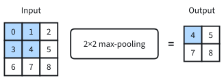
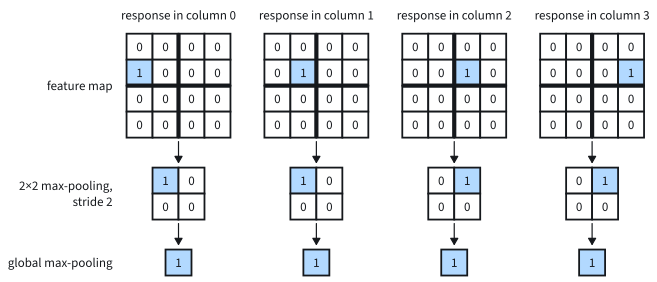

```{.python .input}
%load_ext d2lbook.tab
tab.interact_select('mxnet', 'pytorch', 'tensorflow', 'jax')
```

# Pooling
:label:`sec_pooling`

The layers of the previous sections answer local questions. The edge
detector of :numref:`sec_conv_layer` reports, position by position, whether an
edge lies there. A classifier must answer a question about the whole image:
does this Fashion-MNIST picture show a shirt or a sneaker? This section asks
how a network gets from many local answers to one global answer. Two things
are needed.

The first is reach: some unit near the top of the network must have a
receptive field (:numref:`sec_conv_layer`) that covers the whole image. At
full resolution this takes patience, namely fourteen $3\times3$ layers for a
$28\times28$ Fashion-MNIST image. We already know the remedy, which is to
reduce the resolution on the way up (:numref:`subsec_stride_rf`). With two
halvings, six such layers are enough.

The second is new. The edge detector responds at the pixel where the edge
lies. Shift the image by one pixel, as happens whenever the object or the
camera moves slightly, and the response moves by one pixel too. A
classifier's answer should not change because of such a shift.

A *pooling layer* halves the resolution as a stride does, but it also decides
what to keep. It replaces each small window of its input by one summary
value, the maximum or the average. The maximum of a window does not change
when a response moves within it, and this is what bears on the second
problem. How much it helps is something we can measure, and the answer is
less than the word "invariance", often used of pooling, suggests. Invariance
proper takes a window as large as the feature map, and even then the border
has a say.

```{.python .input #pooling}
%%tab mxnet
import math
import numpy as np
from mxnet import autograd, gluon, init, np as mnp, npx
from mxnet.gluon import nn
from d2l import mxnet as d2l
npx.set_np()
```

```{.python .input #pooling}
%%tab pytorch
import math
import numpy as np
import torch
from torch import nn
from torch.nn import functional as F
from d2l import torch as d2l
```

```{.python .input #pooling}
%%tab tensorflow
import math
import numpy as np
import tensorflow as tf
from d2l import tensorflow as d2l
```

```{.python .input #pooling}
%%tab jax
import math
import numpy as np
import jax
from jax import numpy as jnp
from flax import nnx
import optax
from d2l import jax as d2l
```

```{.python .input #pooling-1}
%%tab tensorflow, jax
from functools import partial
```

## Maximum Pooling and Average Pooling

A pooling operator slides a window of fixed shape, the *pooling window*, over
its input, like the kernel of a convolution. At each position it computes one
output from the entries under the window. Unlike a convolution, it has no
kernel and therefore nothing to learn: *maximum pooling* (*max-pooling* for
short) outputs the largest entry in the window, and *average pooling* outputs
their mean.


:label:`fig_pooling`

In :numref:`fig_pooling` a $2\times2$ window slides over a $3\times3$ input
with stride 1, from the upper left, left to right and top to bottom. It fits
at two positions along each axis, so the output is $2\times2$, and each output
entry is the maximum of the four entries under the window:

$$
\begin{aligned}
\max(0, 1, 3, 4) &= 4,\\
\max(1, 2, 4, 5) &= 5,\\
\max(3, 4, 6, 7) &= 7,\\
\max(4, 5, 7, 8) &= 8.
\end{aligned}
$$

Note that five of the nine entries, namely 0, 1, 2, 3, and 6, are the
largest in no window. Small changes to them leave the output unchanged: a
maximum takes no notice of the entries that lose. A pooling layer with a
$k_\textrm{h} \times k_\textrm{w}$ window works the same way.

The function `pool2d` implements the forward computation. It has the loop
structure of `corr2d` in :numref:`sec_conv_layer`, with the multiply-and-sum
over the window replaced by a maximum or a mean. The argument `stride` moves
the window by more than one position at a time; we need it below.

```{.python .input #pooling-maximum-pooling-and-average-pooling-1}
%%tab mxnet, pytorch
def pool2d(X, pool_size, mode='max', stride=1):
    k_h, k_w = pool_size
    Y = d2l.zeros(((X.shape[0] - k_h) // stride + 1,
                   (X.shape[1] - k_w) // stride + 1))
    for i in range(Y.shape[0]):
        for j in range(Y.shape[1]):
            window = X[i * stride: i * stride + k_h,
                       j * stride: j * stride + k_w]
            Y[i, j] = window.max() if mode == 'max' else window.mean()
    return Y
```

```{.python .input #pooling-maximum-pooling-and-average-pooling-1}
%%tab tensorflow
def pool2d(X, pool_size, mode='max', stride=1):
    k_h, k_w = pool_size
    reduce = tf.reduce_max if mode == 'max' else tf.reduce_mean
    # Build Y from its entries, so that gradients flow through it
    return tf.stack([
        tf.stack([reduce(X[i: i + k_h, j: j + k_w])
                  for j in range(0, X.shape[1] - k_w + 1, stride)])
        for i in range(0, X.shape[0] - k_h + 1, stride)])
```

```{.python .input #pooling-maximum-pooling-and-average-pooling-1}
%%tab jax
def pool2d(X, pool_size, mode='max', stride=1):
    k_h, k_w = pool_size
    Y = jnp.zeros(((X.shape[0] - k_h) // stride + 1,
                   (X.shape[1] - k_w) // stride + 1))
    for i in range(Y.shape[0]):
        for j in range(Y.shape[1]):
            window = X[i * stride: i * stride + k_h,
                       j * stride: j * stride + k_w]
            Y = Y.at[i, j].set(window.max() if mode == 'max'
                               else window.mean())
    return Y
```

Applied to the input of :numref:`fig_pooling`, `pool2d` should return
4, 5, 7, and 8.

```{.python .input #pooling-maximum-pooling-and-average-pooling-2}
X = d2l.tensor([[0.0, 1.0, 2.0], [3.0, 4.0, 5.0], [6.0, 7.0, 8.0]])
pool2d(X, (2, 2))
```

Average pooling of the same input returns the four window means, 2, 3, 5,
and 6.

```{.python .input #pooling-maximum-pooling-and-average-pooling-3}
pool2d(X, (2, 2), 'avg')
```

## Tolerance to Small Shifts

How much of a shift does pooling absorb? Let us try the simplest case there
is. Pooling with a window of $2\times2$ and stride 2 splits its input into
disjoint $2\times2$ blocks and reduces each block to one number. Consider a
feature map with a single response of value 1, such as the output of an edge
detector at an isolated edge, and move the response by one pixel at a time.
We compute the max-pooled and the average-pooled outputs for three positions
of the response in row 1 of a $4\times4$ map.

```{.python .input #pooling-tolerance-to-small-shifts}
def single_response(i, j, n=4):
    """An n x n feature map that is 1 at (i, j) and 0 elsewhere."""
    return d2l.tensor([[float(r == i and c == j) for c in range(n)]
                       for r in range(n)])

for j in range(3):
    Z = single_response(1, j)
    print(f'response at (1, {j}): max',
          d2l.numpy(pool2d(Z, (2, 2), stride=2)).tolist(),
          'avg', d2l.numpy(pool2d(Z, (2, 2), 'avg', stride=2)).tolist())
```

Moving the response from column 0 to column 1 changes neither output: both
positions lie in the same block. Moving it on to column 2 crosses into the
next block, and the output moves with it. A one-pixel shift of a single
response is therefore absorbed when the response stays inside its block,
which happens for half of all horizontal positions, and it moves the pooled
output by one position otherwise. Pooling makes a representation *tolerant*
to some small shifts. It does not make it invariant to them.
:numref:`fig_pooling_shift` draws the max-pooled outputs for all four
positions of the response.


:label:`fig_pooling_shift`

The two kinds of pooling differ in what they report. Max-pooling reports
the response at full strength, 1, wherever it falls in the block: it answers
whether the feature is present somewhere in the window. Average pooling
reports 0.25, because the response covers one of the four positions: it
measures how much of the window the feature fills, so a strong but isolated
response is diluted by its neighbors.

A stride of 2 keeps one value per block, so the output can jump under a
one-pixel shift, as at the block boundary above. In the extreme case, keeping
every second pixel of a pattern that alternates from pixel to pixel,
$1, 0, 1, 0, \ldots$, gives all ones or all zeros, depending on a shift by
one pixel. This error, which arises when a signal changes faster than the
samples can follow, is called *aliasing*. It affects every stride-2
downsampler, pooled or convolutional. Smoothing the input before subsampling
reduces it :cite:`zhang2019making`, and an exercise below works it out.

Tolerance to shifts is what this operation was invented for. The
Neocognitron :cite:`Fukushima.1980` followed each layer of feature detectors
by a layer of cells that responded when a detector fired anywhere in a small
neighborhood. An early form of max-pooling was used in speech recognition
:cite:`Yamaguchi.Sakamoto.Akabane.ea.1990`, and the operation was later
proposed as a model of how the visual cortex aggregates evidence for object
recognition :cite:`Riesenhuber.Poggio.1999`.

## Global Pooling

What, then, about the invariance that :numref:`sec_why-conv` asked of the
final answer, whether Waldo is anywhere in the scene? A window of fixed size
cannot deliver it, as we have just seen. A window that covers the whole
feature map can: the maximum over all positions, or the mean, is the same
wherever in the map the response lies (bottom row of
:numref:`fig_pooling_shift`). This is *global pooling*, and it reduces each
channel to one number.

For a single response on a bare map this is true by definition, and no
experiment is needed. In a network, however, global pooling summarizes the
output of a convolution, and a convolution follows a shift only away from
the border (:numref:`sec_why-conv`). To see what the border does, we move
the single response through all four columns once more and apply a
$3\times3$ kernel of ones with one pixel of zero padding, which copies the
response into every output whose window contains it. Then we pool the result
globally.

```{.python .input #pooling-global-pooling-1}
%%tab mxnet
pad = lambda Z: mnp.pad(Z, 1)  # One pixel of zeros on every side
```

```{.python .input #pooling-global-pooling-1}
%%tab pytorch
pad = lambda Z: F.pad(Z, (1, 1, 1, 1))  # One pixel of zeros on every side
```

```{.python .input #pooling-global-pooling-1}
%%tab tensorflow
pad = lambda Z: tf.pad(Z, [[1, 1], [1, 1]])  # One pixel of zeros per side
```

```{.python .input #pooling-global-pooling-1}
%%tab jax
pad = lambda Z: jnp.pad(Z, 1)  # One pixel of zeros on every side
```

```{.python .input #pooling-global-pooling-2}
for j in range(4):
    H = d2l.numpy(d2l.corr2d(pad(single_response(1, j)), d2l.ones((3, 3))))
    print(f'response at (1, {j}): global max {H.max():.2f}, '
          f'global mean {H.mean():.4f}')
```

The global maximum is 1 wherever the response lies. The global mean,
however, is not constant. Nine windows contain a response in column 1 or 2,
but only six contain one in the border columns 0 and 3, which is the count
of :numref:`img_conv_reuse`, and the mean falls from $9/16$ to $6/16$. The
conclusion holds beyond this small map: convolutions followed by global
pooling are invariant to shifts that keep the content away from the border,
and only approximately invariant to the others.

In the networks of :numref:`chap_modern_cnn` the two tasks of pooling part
ways. Halving the resolution is often left to a convolution with stride 2,
which learns how to combine the entries of a window instead of fixing the
combination to a maximum or a mean, and the network usually ends in *global
average pooling* :cite:`Lin.Chen.Yan.2013`. LeNet, in the next section, does
neither.

## Padding and Stride

Here there is little to learn. The pooling layers of the frameworks take a
window shape, a stride, and a padding, with the meaning they have for
convolutions, and the output shape follows the same rule
(:numref:`sec_padding`): with $p$ rows of padding on each side and stride
$s$, a window of height $k$ on an input of height $n$ gives
$\lfloor(n+2p-k)/s\rfloor+1$ rows, and likewise for the columns. Only one
thing is new, the value that fills the padding. The frameworks expect
four-dimensional input, so we put the $4\times4$ matrix of the numbers 0 to
15 into a tensor with one example and one channel.

```{.python .input #pooling-padding-and-stride-1}
%%tab mxnet, pytorch
# (example, channel, height, width)
X = d2l.reshape(d2l.arange(16, dtype=d2l.float32), (1, 1, 4, 4))
X
```

```{.python .input #pooling-padding-and-stride-1}
%%tab tensorflow, jax
# (example, height, width, channel), as in the previous sections
X = d2l.reshape(d2l.arange(16, dtype=d2l.float32), (1, 4, 4, 1))
X
```

Pooling summarizes a region, so the usual stride equals the window shape:
the windows then tile the input without overlapping. A $3\times3$ window on
the $4\times4$ input fits once, and the output is the maximum of the
top-left $3\times3$ block, 10. With no parameters, the layer needs no
initialization either.

```{.python .input #pooling-padding-and-stride-2}
%%tab mxnet
pool = nn.MaxPool2D(3)  # The stride defaults to the window shape
pool(X)
```

```{.python .input #pooling-padding-and-stride-2}
%%tab pytorch
pool = nn.MaxPool2d(3)  # The stride defaults to the window shape
pool(X)
```

```{.python .input #pooling-padding-and-stride-2}
%%tab tensorflow
pool = tf.keras.layers.MaxPool2D(3)  # The stride defaults to the window
pool(X)
```

```{.python .input #pooling-padding-and-stride-2}
%%tab jax
# The stride of nnx.max_pool defaults to 1, so we set it to the window shape
nnx.max_pool(X, window_shape=(3, 3), strides=(3, 3))
```

Overlapping windows need an explicit stride. With padding 1 and stride 2,
the output is $\lfloor(4+2-3)/2\rfloor+1 = 2$ entries high and wide.

```{.python .input #pooling-padding-and-stride-3}
%%tab mxnet
pool = nn.MaxPool2D(3, padding=1, strides=2)
pool(X)
```

```{.python .input #pooling-padding-and-stride-3}
%%tab pytorch
pool = nn.MaxPool2d(3, padding=1, stride=2)
pool(X)
```

```{.python .input #pooling-padding-and-stride-3}
%%tab tensorflow
# Keras pooling layers pad only 'valid' or 'same'; tf.nn.max_pool2d takes
# the padding of each axis explicitly
pool = partial(tf.nn.max_pool2d, ksize=3, strides=2,
               padding=[[0, 0], [1, 1], [1, 1], [0, 0]])
pool(X)
```

```{.python .input #pooling-padding-and-stride-3}
%%tab jax
# One (before, after) pair of padding for each spatial axis
pool = partial(nnx.max_pool, window_shape=(3, 3), strides=(2, 2),
               padding=((1, 1), (1, 1)))
pool(X)
```

Which value fills the padding? A convolution pads with zeros, which add
nothing to a weighted sum. For a maximum, the neutral value is $-\infty$:
padded positions then never win, and each output is the maximum of the real
entries under its window. Here the windows cover the real entries in rows
and columns $\{0, 1\}$ and $\{1, 2, 3\}$, so the outputs are 5, 7, 13, and
15. Padding with $-\infty$ also keeps a property that every maximum has:
adding a constant to every input entry adds the same constant to every
output. We check it on `X - 16`, whose entries all lie below zero.

```{.python .input #pooling-padding-and-stride-5}
pool(X - 16)
```

Each output is 16 below the previous one, as it should be. Zero padding
would have produced 0 in the three windows that touch the padding, since 0
exceeds every real entry there.

Average pooling is less fortunate: it has no neutral padding value. If the
padded positions count as zeros in the mean, they pull the outputs at the
border toward 0; the alternative is to average only the real entries under
each window.

:begin_tab:`mxnet, pytorch, jax`
Average pooling here counts the padded zeros by default
(`count_include_pad=True`); `count_include_pad=False` averages only the real
entries.
:end_tab:

:begin_tab:`tensorflow`
`tf.keras.layers.AvgPool2D` with `padding='same'` averages only the real
entries under each window.
:end_tab:

## Multiple Channels

A convolutional layer sums over its input channels
(:numref:`sec_channels`): every output channel reads all of them. A pooling
layer does nothing of the kind. It pools each input channel separately, so
its output has as many channels as its input. To check this, we concatenate
`X` and `X + 1` along the channel axis to obtain an input with two channels.

```{.python .input #pooling-multiple-channels-1}
%%tab mxnet, pytorch
X = d2l.concat((X, X + 1), 1)
X
```

```{.python .input #pooling-multiple-channels-1}
%%tab tensorflow, jax
X = d2l.concat([X, X + 1], 3)  # the channel axis is last
X
```

The pooling layer with padding 1 and stride 2 from above returns two
channels: the first holds the outputs computed earlier, 5, 7, 13, and 15,
and the second the same values plus 1.

```{.python .input #pooling-multiple-channels-2}
pool(X)
```

:begin_tab:`tensorflow, jax`
The result is in the channels-last layout, so the two channels appear side
by side in the last axis.
:end_tab:

A pooling layer finds nothing by itself. It has no weights, and whatever it
summarizes, a convolution before it had to detect. The parts are now all on
the table: a layer that detects, settings for its shape and reach, channels,
and a summary of neighborhoods. What remains is to see whether, put
together and trained, they classify images better than the MLP did.

## Summary

Pooling replaces each window of its input by its maximum or its mean. It has
no parameters, it pools each channel separately, and its output shape follows
the padding and stride rules of convolutions; max-pooling pads with
$-\infty$, so padding never changes a maximum. A $2\times2$ window with
stride 2 halves the resolution, and it absorbs a shift of a response that
stays inside its window, but not one that crosses into the next. Max-pooling
keeps the strength of the strongest response; average pooling dilutes it
over the window. Only a window as large as the feature map, global pooling,
removes the position of a response altogether, and after a padded
convolution it does so only up to the border.

## Exercises

1. [code] **Average pooling as convolution.** Express
   $k_\textrm{h} \times k_\textrm{w}$ average pooling with stride
   $(s_\textrm{h}, s_\textrm{w})$ on an input with $c$ channels as a
   convolution with $c$ output channels. Give the kernel
   $\mathbf{K}_{o,c}$ for $o = c$ and for $o \neq c$, so that each channel
   is pooled separately, as pooling layers do. On the input
   of :numref:`fig_pooling`, verify that your convolution reproduces
   `pool2d(X, (2, 2), 'avg')`.

1. **Receptive field and cost of downsampling.** Consider $3\times3$
   convolutions with stride 1 and padding 1, with 64 input and 64 output
   channels, on a $224\times224$ input.
    1. How many such layers does a stack need before the receptive field
       of a unit at its top covers the whole image?
    1. Now insert $2\times2$ max-pooling with stride 2 after every second
       convolutional layer. How many convolutional layers are needed now?
    1. Count the multiply-adds of the two stacks, and the comparisons that
       the pooling layers perform. Which part of the cost does pooling
       remove, and what does it cost itself?

1. **Pooling alternatives.**
    1. Do we need a separate minimum-pooling layer, or can it be expressed
       through an operation already in this section?
    1. *Softmax pooling* with temperature $\tau > 0$ replaces the window
       entries $x_1, \ldots, x_m$ by their softmax-weighted average
       $$\sum_{i=1}^m x_i \frac{\exp(x_i / \tau)}{\sum_{j=1}^m \exp(x_j / \tau)}.$$
       Find its limits as $\tau \to 0$ and as $\tau \to \infty$. Give one
       cost that softmax pooling adds relative to max-pooling.

1. **Aliasing and blur-pool.** Naive stride-2 downsampling keeps
   every second entry of its input. Measure frequency in cycles per input
   sample, so that the one-dimensional signals $(1, 0, 1, 0, 1, 0)$ and
   $(0, 1, 0, 1, 0, 1)$ both have frequency $\tfrac{1}{2}$.
    1. Apply naive stride-2 downsampling to both signals, which differ by
       a shift of one position, and compare the two outputs. Why is this
       behavior called *aliasing*?
    1. Which input frequencies can a stride-2 subsampler represent
       faithfully?
    1. Blur-pool :cite:`zhang2019making` counteracts aliasing by applying
       a small averaging filter before subsampling. Work out what
       blur-pool with a two-tap box filter
       $(\tfrac{1}{2}, \tfrac{1}{2})$ computes on the two signals above.
       Which pooling operation from this section does it coincide with?

1. [code] **Backward pass of max-pooling.** Derive the gradient of
   two-dimensional max-pooling with respect to its input, for a
   $k_\textrm{h} \times k_\textrm{w}$ window and stride equal to the
   window size, and implement it without automatic differentiation.
   Verify against the gradient that automatic differentiation computes
   through the built-in max-pooling operation of this section on a small
   random tensor, to a relative error below $10^{-4}$.

    *Adapted from Stanford CS231n,
    [Assignment 2](https://cs231n.github.io/assignments2024/assignment2/),
    ConvolutionalNetworks, naive max-pooling backward pass.*

1. **Max-pooling via ReLU.** ● A convolution is linear, so it cannot
   compute a maximum by itself.
    1. Express $\max(a, b)$ using only affine operations and
       $\textrm{ReLU}(x) = \max(0, x)$.
    1. Use this to implement max-pooling as a stack of convolutions and
       ReLU layers.
    1. Count the channels per layer and the ReLU layers that your
       construction uses for a $2 \times 2$ window and for a
       $3 \times 3$ window. How does the number of ReLU layers grow with
       the number of entries in the window?

:begin_tab:`mxnet`
[Discussions](https://d2l.discourse.group/t/71)
:end_tab:

:begin_tab:`pytorch`
[Discussions](https://d2l.discourse.group/t/72)
:end_tab:

:begin_tab:`tensorflow`
[Discussions](https://d2l.discourse.group/t/274)
:end_tab:

:begin_tab:`jax`
[Discussions](https://d2l.discourse.group/t/17999)
:end_tab:

<!-- slides -->

::: {.slide}
::: {.cover}
[Dive into Deep Learning · §6.5]{.kicker}

Pooling<br>**max and average · tolerance to small shifts · global pooling · padding with −∞**
:::
:::

::: {.slide title="Shift the Image by One Pixel and Every Response Moves by One Pixel"}
[The problem]{.kicker}

- Convolutions answer local questions: is there an edge *here*?
- "Shirt or sneaker?" is one question about the whole $28\times28$ image.
- Reach is settled: fourteen $3\times3$ layers at full resolution, six
  with two halvings (the receptive-field formula with strides).
- New: an edge detector responds at the pixel of the edge. A one-pixel
  shift of the image moves every response, yet the answer must not change.

::: {.d2l-note .warn}
Pooling halves the resolution and decides what to keep: the maximum or the
mean of each window.
:::
:::

::: {.slide title="By the End of This Deck You Can"}
[Goals]{.kicker}

- compute max- and average pooling of a small input by hand;
- predict which one-pixel shifts a $2\times2$, stride-2 pool absorbs;
- say what global pooling removes, and what the border leaves;
- predict output shapes from window, padding, and stride;
- say why max-pooling pads with $-\infty$;
- count the channels and parameters of a pooling layer.

**Running example:** the $3\times3$ input $0, \ldots, 8$, then the
$4\times4$ input $0, \ldots, 15$.

**Idea:** replace each small window by its maximum or mean.
:::

::: {.slide title="Shrinking the Feature Maps, Between Channels and LeNet"}
[Where this fits]{.kicker}

::: {.cols .vc}
::: {.col}
| section | adds |
|---|---|
| From Fully Connected Layers to Convolutions | locality and translation equivariance give convolution |
| Convolutions for Images | cross-correlation, learning a kernel, receptive fields |
| Padding, Stride, and Dilation | output size and how far each unit sees |
| Multiple Input and Multiple Output Channels | channels, 1 × 1 convolutions, cost |
| **Pooling** | **downsampling, tolerance to small shifts, global pooling** |
| LeNet | a complete CNN on Fashion-MNIST, its learned features, the shuffle test |
:::

::: {.col .narrow}
- **Uses:** the sliding window of `corr2d`; the output-shape formula
  with padding and stride.
- **Skips:** downsampling with learned weights (strided convolutions,
  next chapter).
:::
:::
:::

::: {.slide}
::: {.divider}
[01]{.dnum}

[Maximum and Average Pooling]{.dtitle}

[a window, a reduction, no parameters]{.dsub}
:::
:::

::: {.slide title="Max-Pooling Replaces Each Window by Its Largest Entry"}
[Maximum and average pooling]{.kicker}

{width=70%}

- The other windows give $\max(1,2,4,5)=5$, $\max(3,4,6,7)=7$,
  $\max(4,5,7,8)=8$.
- Average pooling takes the mean instead: 2, 3, 5, 6.
- Entries that are the largest in no window (0, 1, 2, 3, 6) do not
  affect the output.
:::

::: {.slide title="Pooling Is the Loop of Cross-Correlation with Max or Mean"}
[Maximum and average pooling]{.kicker}

@pooling-maximum-pooling-and-average-pooling-1

::: {.d2l-note}
No kernel, so nothing to learn: a pooling layer has **zero parameters**.
:::
:::

::: {.slide title="The Implementation Reproduces the Figure"}
[Maximum and average pooling]{.kicker}

Max-pooling of the $3\times3$ input: 4, 5, 7, 8.

@!pooling-maximum-pooling-and-average-pooling-2

Average pooling returns the four window means, 2, 3, 5, 6:

@!pooling-maximum-pooling-and-average-pooling-3
:::

::: {.slide}
::: {.divider}
[02]{.dnum}

[Tolerance to Small Shifts]{.dtitle}

[what a 2×2, stride-2 pool absorbs, and what it does not]{.dsub}
:::
:::

::: {.slide title="A Response That Stays in Its 2×2 Block Leaves the Pooled Output Unchanged"}
[Tolerance to small shifts]{.kicker}

A $4\times4$ map with a single 1, moved along row 1; $2\times2$ windows,
stride 2:

@!pooling-tolerance-to-small-shifts

- Column 0 → 1: same block, **same output**.
- Column 1 → 2: next block, the output **moves**.
:::

::: {.slide title="Half of All One-Pixel Shifts Are Absorbed, the Other Half Move the Output"}
[Tolerance to small shifts]{.kicker}

- Blocks are 2 pixels wide: a response at an even column stays in its
  block when it moves right; at an odd column it crosses.
- Pooling gives **tolerance**, not invariance.
- The jump at a block boundary is *aliasing*; it affects every stride-2
  downsampler, pooled or convolutional. Blurring before subsampling
  reduces it (Zhang, 2019).

::: {.d2l-note .rule}
Max reports the response at full strength (1); average dilutes it over
the window (0.25).
:::
:::

::: {.slide title="Check: How Often Does a 3×3, Stride-3 Pool Absorb a One-Pixel Shift?"}
[Check]{.kicker}

A single response sits at a random column of a feature map. It moves one
pixel to the right. With $3\times3$ windows and stride 3, how often is the
pooled output unchanged? With $2\times2$ and stride 2?

::: {.fragment .fade-up}
::: {.d2l-note}
**Answer.** It stays in its block unless it sits in the last column of
the block: 2 of 3 positions for width 3, 1 of 2 for width 2. Wider
windows absorb more shifts and keep less resolution.
:::
:::
:::

::: {.slide title="Only a Window over the Whole Map Removes the Position"}
[Global pooling]{.kicker}

{width=80%}

Top: one response in columns 0 to 3. Middle: its $2\times2$ max-pool
jumps at the block boundary. Bottom: the maximum over all positions never
moves.

::: {.d2l-note}
*Global pooling* reduces each channel to one number: equivariant maps in,
an invariant answer out.
:::
:::

::: {.slide title="After a Padded Convolution, the Global Mean Depends on the Column"}
[Global pooling]{.kicker}

The same response in columns 0 to 3; a $3\times3$ kernel of ones with zero
padding 1; then the maximum and the mean over all 16 outputs:

@!pooling-global-pooling-2

::: {.d2l-note .rule}
Nine windows contain an interior response (mean 9/16), six a border one
(6/16). Convolution plus global pooling is invariant only to shifts that
stay away from the border.
:::
:::

::: {.slide}
::: {.divider}
[03]{.dnum}

[Padding, Stride, and Channels]{.dtitle}

[the shape rules of convolutions, with one new padding value]{.dsub}
:::
:::

::: {.slide title="With Stride Equal to the Window, Pooling Windows Tile the Input"}
[Padding and stride]{.kicker}

The usual pooling stride is the window shape: no window overlaps another.
On the $4\times4$ input $0, \ldots, 15$:

@pooling-padding-and-stride-2

A $3\times3$ window fits once: the output is $\max$ of the top-left
$3\times3$ block, 10.
:::

::: {.slide title="Padding and Stride Follow the Convolution Formula"}
[Padding and stride]{.kicker}

Output height $\lfloor (n + 2p - k)/s \rfloor + 1$, with $p$ rows of
padding on each side. Here $n=4$, $k=3$, $p=1$, $s=2$:
$\lfloor 3/2 \rfloor + 1 = 2$.

@pooling-padding-and-stride-3
:::

::: {.slide title="Max-Pooling Pads with −∞, So Padding Never Wins"}
[Padding and stride]{.kicker}

Adding a constant to every input must add it to every output. On `X - 16`
(all entries below 0):

@pooling-padding-and-stride-5

- Each output is $5, 7, 13, 15$ minus 16.
- Zero padding would give 0 in the three windows that touch the padding.
- Average pooling has no neutral value: counted padded zeros pull border
  means toward 0, unless the layer averages only the real entries.
:::

::: {.slide title="Each Channel Is Pooled Separately" except="tensorflow,jax"}
[Channels]{.kicker}

A convolution sums over its input channels; pooling does not. Stack `X`
and `X + 1` as two channels and pool:

@!pooling-multiple-channels-2

Two channels in, two channels out: 5, 7, 13, 15 and the same plus 1.
:::

::: {.slide title="Each Channel Is Pooled Separately" only="tensorflow,jax"}
[Channels]{.kicker}

A convolution sums over its input channels; pooling does not. Stack `X`
and `X + 1` as two channels (last axis) and pool:

@!pooling-multiple-channels-2

Channels last: each innermost pair is one position, channel 1 then
channel 2. Channel 1 holds 5, 7, 13, 15; channel 2 the same plus 1.
:::

::: {.slide title="Check: What Does a 2×2, Stride-2 Max-Pool Do to 6@28×28?"}
[Check]{.kicker}

Output shape, number of parameters, and number of comparisons?

::: {.fragment .fade-up}
::: {.d2l-note}
**Answer.** $6@14\times14$, 1,176 outputs. **Zero** parameters. Each
output takes 3 comparisons among 4 entries: 3,528 comparisons, against
117,600 multiply-adds for the $5\times5$, 1→6 convolution that produced
the input.
:::
:::
:::

::: {.slide title="Later Networks Learn Their Downsampling and Pool Once at the End"}
[Beyond this deck]{.kicker}

Pooling does two jobs, and later networks give them to different layers.

- **Halving the resolution:** often a convolution with stride 2, which
  learns how to combine each window instead of fixing max or mean.
- **Removing the position:** global average pooling of the last feature
  map, one number per channel, followed by a linear classifier.
- LeNet, in the next deck, does neither: it pools locally and ends in
  dense layers.
:::

::: {.slide title="Recap"}
[Wrap-up]{.kicker}

- **Pooling** replaces each window by its max or mean; no parameters;
  one channel at a time.
- **Shapes** follow the convolution formula; stride = window tiles the
  input.
- **Padding** for max-pooling is $-\infty$: pooling `X - 16` returns the
  outputs minus 16.
- **Tolerance:** a $2\times2$, stride-2 pool absorbs a one-pixel shift
  that stays in its block, half of all positions.
- **Global pooling:** the maximum over the whole map is 1 in every column;
  after a padded convolution the mean is 9/16 inside and 6/16 at the
  border.

**Next:** LeNet puts convolutions and pooling together into a classifier.
:::
