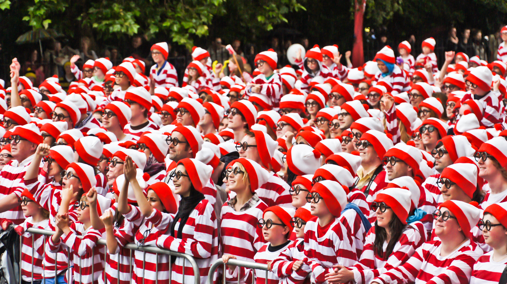
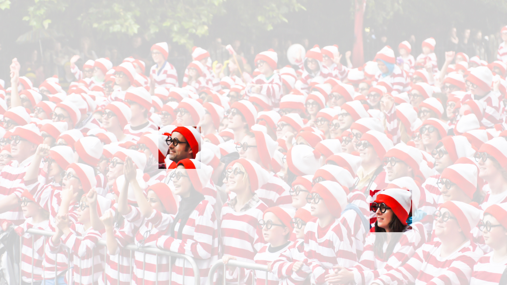
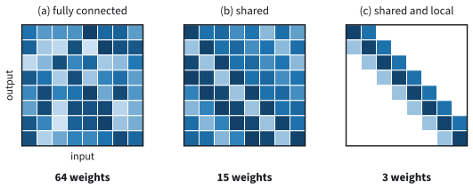

# From Fully Connected Layers to Convolutions
:label:`sec_why-conv`

The MLP of :numref:`chap_perceptrons` treats its input as a list of numbers
in no particular order. If we permuted the pixels of every image in the same
way, it would learn just as well. For tabular data, whose columns have no
natural order, this is appropriate. For images it discards the most useful
thing we know about them: which pixels are neighbors.

The cost shows up in the number of parameters. Consider a classifier that
tells cats from dogs in one-megapixel grayscale photographs. Each input
has $10^6$ dimensions, so even a hidden layer of only 1000 units needs
$10^6 \times 10^3 = 10^9$ weights. In 32-bit floating point these weights
alone take 4 GB, before gradients and optimizer state are stored. A billion
parameters are also far more than any collection of labeled pet photographs
could determine. People nevertheless tell cats from dogs with ease, because
photographs are far from arbitrary vectors: nearby pixels are related, and a
whisker looks like a whisker wherever it appears in the photograph.

This section turns these two observations into constraints on a fully
connected layer. We start from a layer that maps a $1000 \times 1000$ image to
a hidden representation of the same size, which has $10^{12}$ weights.
Requiring that a shifted input produce a shifted output reduces this to about
$4 \times 10^6$ weights. Requiring that each hidden unit look only at a small
neighborhood reduces it to a few hundred. The layer that remains is a
convolution, and the following sections compute it, learn its weights from
data, and build a classifier from it.

## Equivariance and Invariance

The children's game "Where's Waldo" (:numref:`img_waldo`) shows what a vision
system needs. Each picture contains a crowd of people and activities, and
somewhere among them is Waldo. What Waldo looks like does not depend on where
he stands. A detector can therefore scan the scene and give every patch a
score for how likely it is to contain Waldo, using the same scoring rule for
every patch. Many object detection :cite:`Girshick.Donahue.Darrell.ea.2014`
and semantic segmentation :cite:`Long.Shelhamer.Darrell.2015` systems work in
this way.

:width:`400px`
:label:`img_waldo`

This suggests three requirements for the layers of a vision network:

1. The earliest layers should respond in the same way to the same patch,
   wherever it appears. If the input is shifted, their output should shift by
   the same amount. This property is called *translation equivariance*.
1. The earliest layers should look only at small regions and ignore the
   content of distant ones. This is the *locality* principle.
1. Deeper layers should combine these local responses into features of
   longer range, and eventually into a prediction for the whole image.

To state the first requirement precisely, let $T_v$ shift an image by an
offset $v = (v_1, v_2)$, so that the pixel at $(i, j)$ moves to
$(i + v_1, j + v_2)$: $[T_v \mathbf{X}]_{i,j} = [\mathbf{X}]_{i-v_1, j-v_2}$.
A function $f$ that maps an image to an image is *translation equivariant* if
shifting its input shifts its output by the same amount. A function that maps
an image to a prediction is *translation invariant* if shifting its input
leaves the output unchanged:

$$
\begin{aligned} f(T_v \mathbf{X}) &= T_v f(\mathbf{X}) && \textrm{(equivariance)},\\ f(T_v \mathbf{X}) &= f(\mathbf{X}) && \textrm{(invariance)}.\end{aligned}
$$
:eqlabel:`eq_equivariance_invariance`

Equivariance keeps track of *where* a pattern is, and invariance discards it.
A Waldo detector should be equivariant: its map of scores should move with
Waldo. The answer to the question "is Waldo in the scene?" should be
invariant. We obtain it in a final step that aggregates the equivariant map
over all locations, for instance by taking its maximum.

A shift needs a convention at the border of the image, where content leaves
the frame and nothing enters it. In this section we avoid the question by
placing the image on an infinite grid of pixels, indexed by all pairs of
integers, with zeros everywhere outside the image. A shift then moves the
image across the grid and loses nothing. On a finite image equivariance holds
only away from the border, a point to which :numref:`sec_padding` returns.

## Constraints on the Fully Connected Layer

Take an input image $\mathbf{X}$ and a hidden representation $\mathbf{H}$ that
are matrices of the same shape, and keep both spatially organized:
$[\mathbf{X}]_{k,l}$ is the pixel at location $(k,l)$, and
$[\mathbf{H}]_{i,j}$ is the hidden unit at location $(i,j)$. In a fully
connected layer every hidden unit receives every pixel, each with its own
weight. A weight then needs four indices, two for the hidden unit and two for
the pixel, so the weights form a fourth-order tensor $\mathsf{W}$. With a
matrix of biases $\mathbf{U}$, the layer computes

$$
\begin{aligned} [\mathbf{H}]_{i, j} &= [\mathbf{U}]_{i, j} + \sum_k \sum_l [\mathsf{W}]_{i, j, k, l}  [\mathbf{X}]_{k, l}\\ &=  [\mathbf{U}]_{i, j} + \sum_a \sum_b [\mathsf{V}]_{i, j, a, b}  [\mathbf{X}]_{i+a, j+b}.\end{aligned}
$$
:eqlabel:`eq_mlp_fourth_order`

The second line only renames the weights. It measures the position of a pixel
relative to the hidden unit, with offsets $a = k - i$ and $b = l - j$ that
take positive and negative values, and sets
$[\mathsf{V}]_{i, j, a, b} = [\mathsf{W}]_{i, j, i+a, j+b}$. The layer is the
same, but both constraints are easy to state in terms of offsets. Mapping a
$1000 \times 1000$ image to a $1000 \times 1000$ hidden representation takes
$10^6 \times 10^6 = 10^{12}$ weights in this single layer, about a million
times the number of training images we could plausibly collect for a pet
classifier.

:numref:`fig_why_conv_weight_sharing` shows what the two constraints do to
the weights of a layer on a one-dimensional signal of eight samples, where
the weights form an ordinary $8 \times 8$ matrix.

:label:`fig_why_conv_weight_sharing`

### Translation Equivariance

We first impose translation equivariance :cite:`Zhang.ea.1988`. We show that
a layer of the form :eqref:`eq_mlp_fourth_order` is equivariant exactly when
its weights and its bias do not depend on the location $(i, j)$ of the hidden
unit.

**Proposition.** Let the input and the hidden representation live on the
infinite grid, with indices running over all integers, and let the input have
finitely many nonzero pixels. The layer :eqref:`eq_mlp_fourth_order`
is translation equivariant for every shift $v$ if and only if there are a
scalar $u$ and a matrix $\mathbf{K}$ such that $[\mathbf{U}]_{i,j} = u$ and
$[\mathsf{V}]_{i,j,a,b} = [\mathbf{K}]_{a,b}$ for all $i, j, a, b$.

**Proof.** If neither the weights nor the bias depend on $(i, j)$, shifting the
input by $v$ shifts the output by $v$:

$$[f(T_v \mathbf{X})]_{i,j} = u + \sum_a \sum_b [\mathbf{K}]_{a,b} [\mathbf{X}]_{i - v_1 + a, j - v_2 + b} = [f(\mathbf{X})]_{i - v_1, j - v_2} = [T_v f(\mathbf{X})]_{i,j}.$$

Conversely, suppose that the layer is equivariant. The all-zero image is
unchanged by every shift, and the layer maps it to $\mathbf{U}$. Hence
$\mathbf{U} = T_v \mathbf{U}$ for every $v$, and the bias is a constant $u$.
Subtracting $u$ from both sides of the equivariance condition shows that the
weighted sum alone is equivariant too. Now feed it the image with a single 1
at pixel $(k, l)$ and zeros elsewhere. Its response at $(i, j)$ is the weight
$[\mathsf{W}]_{i,j,k,l}$. Shifting this image by $v$ moves the 1 to
$(k + v_1, l + v_2)$, and equivariance requires the response to shift by $v$
as well: $[\mathsf{W}]_{i, j, k+v_1, l+v_2} = [\mathsf{W}]_{i-v_1, j-v_2, k, l}$.
Choosing $(k, l) = (a, b)$ and $v = (i, j)$ gives
$[\mathsf{V}]_{i,j,a,b} = [\mathsf{W}]_{i,j,i+a,j+b} = [\mathsf{W}]_{0,0,a,b}$,
which does not depend on $(i, j)$. $\blacksquare$

In words, a single bright pixel reveals the weights. The weight that connects
the hidden unit at $(i,j)$ to the pixel at $(i+a, j+b)$ must equal the weight
that connects the unit at $(0,0)$ to the pixel at $(a,b)$, because the two
pairs differ only by a shift. With shared weights the layer simplifies to

$$[\mathbf{H}]_{i, j} = u + \sum_a\sum_b [\mathbf{K}]_{a, b}  [\mathbf{X}]_{i+a, j+b}.$$

Every hidden unit computes the same weighted sum of the pixels around it, so
the layer compares one pattern, $\mathbf{K}$, with the image at every
location. The matrix $\mathbf{K}$ needs one weight per offset instead of one
per pair of locations. For a $1000 \times 1000$ image surrounded by zeros,
only the offsets $a$ and $b$ from $-999$ to $999$ ever meet a nonzero pixel,
so $\mathbf{K}$ has $1999^2 \approx 4 \times 10^6$ weights instead of
$10^{12}$. Time-delay neural
networks for speech recognition were among the first models to share weights
across positions in this way :cite:`Waibel.Hanazawa.Hinton.ea.1989`.

### Locality

We next impose locality: the hidden unit at $(i, j)$ should depend only on
pixels within distance $\Delta$ of $(i, j)$ along each axis. This means
$[\mathbf{K}]_{a, b} = 0$ whenever $|a| > \Delta$ or $|b| > \Delta$, and the
layer becomes

$$[\mathbf{H}]_{i, j} = u + \sum_{a = -\Delta}^{\Delta} \sum_{b = -\Delta}^{\Delta} [\mathbf{K}]_{a, b}  [\mathbf{X}]_{i+a, j+b}.$$
:eqlabel:`eq_conv-layer`

Each hidden unit is a weighted sum of the $(2\Delta+1) \times (2\Delta+1)$
window of pixels centered at its own location, with the same weights at every
location. The layer has $(2\Delta+1)^2$ weights and one bias: 9 weights for
$\Delta = 1$ and 121 for $\Delta = 5$. Typical values of $\Delta$ are below
10, so a few hundred weights replace the $4 \times 10^6$ of the shared layer
and the $10^{12}$ of the fully connected one, while the hidden representation
keeps the size of the image.

Equation :eqref:`eq_conv-layer` defines a *convolutional layer*. Networks that
contain convolutional layers are called *convolutional neural networks*
(CNNs). The matrix $\mathbf{K}$ is the layer's *convolution kernel*, also
called its *filter*, and its entries are the layer's weights. Local feature
detectors that are shared across positions go back to the Neocognitron
:cite:`Fukushima.1980`.

The reduction from $10^{12}$ to a few hundred parameters comes from
restricting the class of functions, not from a more economical way to
represent the same functions. A convolutional layer can represent a mapping
only if that mapping is local and translation equivariant. When these
assumptions match the data, as they do for edges and textures in natural
images, the model needs far fewer examples and generalizes better. When they
do not, for instance when the same local pattern calls for a different
response at different locations, the model may fail even to fit its training
data. A single layer also sees only a window of width $2\Delta + 1$. Stacking
convolutional layers with nonlinearities between them lets deeper units depend
on larger regions of the image and represent larger structures.

## Convolution and Cross-Correlation

The name comes from mathematics, where the *convolution* of two functions
$f, g: \mathbb{R}^d \to \mathbb{R}$ :cite:`Rudin.1973` is

$$(f * g)(\mathbf{x}) = \int f(\mathbf{z}) g(\mathbf{x}-\mathbf{z}) d\mathbf{z}.$$

It measures the overlap between $f$ and a copy of $g$ that is flipped and
shifted by $\mathbf{x}$. For functions on the integers the integral becomes a
sum, $(f * g)(i) = \sum_a f(a) g(i-a)$, and for functions on a
two-dimensional grid it becomes

$$(f * g)(i, j) = \sum_a\sum_b f(a, b) g(i-a, j-b).$$
:eqlabel:`eq_2d-conv-discrete`

The layer :eqref:`eq_conv-layer` reads the image at $(i+a, j+b)$ rather than
at $(i-a, j-b)$. Substituting $-a$ for $a$ and $-b$ for $b$ in its sum shows
that it computes the convolution of the image with the flipped kernel
$[\mathbf{K}']_{a,b} = [\mathbf{K}]_{-a,-b}$:

$$\sum_{a}\sum_{b} [\mathbf{K}]_{a, b}  [\mathbf{X}]_{i+a, j+b} = \sum_{a}\sum_{b} [\mathbf{K}']_{a, b}  [\mathbf{X}]_{i-a, j-b} = (\mathbf{K}' * \mathbf{X})(i, j).$$

The operation without the flip is called *cross-correlation*. Because the
kernel is learned, a layer that cross-correlates with $\mathbf{K}$ and a layer
that convolves with $\mathbf{K}'$ represent the same functions. Deep learning
libraries compute cross-correlation and call it convolution, and this book
follows that usage.

## Channels
:label:`subsec_why-conv-channels`

So far the input and the hidden representation were single matrices. A color
image has three values per pixel, its red, green, and blue intensities. It is
therefore a third-order tensor $\mathsf{X}$ of shape height × width × 3, for
instance $1024 \times 1024 \times 3$, with entries $[\mathsf{X}]_{i,j,c}$. The
first two axes are spatial. The third, the *channel* axis, assigns a vector of
values to every location. A kernel for such an input has one weight for every
offset and every input channel, and the hidden unit at $(i, j)$ sums over the
window and over all input channels.

One kernel produces one map of responses and detects one kind of pattern. A
kernel that matches Waldo's appearance yields a map that peaks where he
stands (:numref:`fig_waldo_mask`). A useful layer detects many patterns at
once: edges in different directions, textures, colors. The hidden
representation therefore becomes a third-order tensor $\mathsf{H}$ as well, a
stack of maps with one *output channel* per pattern. Each output channel $d$
has its own kernel and its own bias $u_d$, which gives the kernel a fourth
index:

$$[\mathsf{H}]_{i,j,d} = u_d + \sum_{a = -\Delta}^{\Delta} \sum_{b = -\Delta}^{\Delta} \sum_c [\mathsf{K}]_{a, b, c, d} [\mathsf{X}]_{i+a, j+b, c}.$$
:eqlabel:`eq_conv-layer-channels`

Here $c$ runs over the input channels and $d$ indexes the output channels.
Each output channel is a spatial map of one learned feature, which is why the
channels of a hidden representation are also called *feature maps*; the next
layer takes the whole stack as its input. With $c_\textrm{i}$ input channels
and $c_\textrm{o}$ output channels the layer has
$(2\Delta+1)^2 c_\textrm{i} c_\textrm{o}$ weights and $c_\textrm{o}$ biases.
A layer with a $3 \times 3$ kernel from an RGB image to 64 channels has
$9 \cdot 3 \cdot 64 + 64 = 1{,}792$ parameters, whatever the size of the
image.

Nothing in this derivation depends on the grid having two axes. On a
one-dimensional grid, such as the samples of an audio signal or the tokens
of a text, the kernel slides along one axis; on a three-dimensional grid,
such as the frames of a video or a medical scan, it slides along three.
:numref:`sec_sentiment_cnn` classifies text with one-dimensional
convolutions.

:width:`400px`
:label:`fig_waldo_mask`

Equation :eqref:`eq_conv-layer-channels` is the convolutional layer that the
rest of the chapter builds on. Several questions remain open. A finite image
has borders, where the window does not fit. Deeper units should see more of
the image than one window. And the network must eventually turn its maps into
a single answer, such as whether Waldo is *anywhere* in the scene. The
following sections take up these questions, starting with the computation of
:eqref:`eq_conv-layer` in code.

## Summary

Treating an image as an unordered vector makes a fully connected layer
enormous: mapping a megapixel image to a hidden representation of the same
size takes $10^{12}$ weights. Two assumptions about images reduce this to a
few hundred. Translation equivariance forces every location to use the same
kernel, as we proved for linear layers on an infinite grid, and locality
restricts the kernel to a small window. The resulting layer computes a
cross-correlation, which deep learning calls a convolution, and channels let
one layer detect many patterns at once. The savings come from restricting the
function class. On an infinite grid, a stack of convolutional layers followed
by a head that aggregates over all locations, for instance by a maximum,
cannot represent a classifier whose
label changes when the same object moves from the left half of the image to
the right.

## Exercises

1. **Commutativity of convolution.**
    1. Prove that the convolution of :eqref:`eq_2d-conv-discrete` is
       commutative, i.e., $f * g = g * f$.
    1. Define the cross-correlation
       $(f \star g)(i, j) = \sum_a \sum_b f(i+a, j+b)\, g(a, b)$, the
       operation of :eqref:`eq_conv-layer` with input $f$ and kernel $g$. Express $(g \star f)(i, j)$
       through values of $f \star g$, and decide from this expression
       whether cross-correlation is commutative.
1. **Convolutions for audio.** Audio data is often represented as a
   one-dimensional sequence of samples.
    1. Derive the one-dimensional analog of :eqref:`eq_conv-layer`.
    1. Name one audio task for which a layer that is local and
       translation equivariant in time is a good fit, and one for which
       it is not. Justify each choice.
    1. A spectrogram represents a recording as a two-dimensional array
       whose axes are time and frequency, with frequency on a linear
       scale in hertz. For each axis, state whether translation
       equivariance is a reasonable assumption, and justify your answer
       from what a shift along that axis does to the sound. Then answer
       the same question for a frequency axis on a logarithmic scale.
1. **Convolutions on text.** Represent a sentence as a sequence of word
   vectors, so that each word occupies one position and the entries of
   its vector act as channels. Apply one-dimensional convolutional
   layers, the analog of :eqref:`eq_conv-layer-channels`, with
   nonlinearities in between.
    1. Take $\Delta = 1$. In the sentence "The movie that my friends
       recommended last week was not good," the verb "was" agrees with
       "movie." How many stacked layers are needed before a single output
       depends on both words? How does this number grow with the distance
       between two words?
    1. Apply a single layer followed by a ReLU and sum its output over
       all positions to obtain a sentence representation. State whether
       "the dog bit the man" and "the man bit the dog" receive the same
       representation for $\Delta = 0$ and for $\Delta = 1$. Which
       word-order information does this representation keep, and which
       does it discard?
1. **Equivariance versus invariance.** A convolutional classifier computes
   feature maps $h(\mathsf{X})$ with stacked layers of
   :eqref:`eq_conv-layer-channels` and nonlinearities in between, and then
   a prediction $g(h(\mathsf{X}))$ with a head $g$.
    1. Assume a periodic grid, which wraps around so that the column after
       the last one is the first one again; on it, $h$ is translation
       equivariant by the argument of the proposition. Let $g$ average each channel of $h(\mathsf{X})$ over all locations.
       Using :eqref:`eq_equivariance_invariance`, show that the prediction
       is translation invariant.
    1. An image shows a single digit in one of the nine cells of a
       $3 \times 3$ grid, and the task is to name the cell. Explain why
       the classifier of the first part cannot solve this task. Describe
       a head $g$ that solves it from the same feature maps
       $h(\mathsf{X})$.
1. **Boundary effects.** A $\Delta = 1$ kernel, i.e., a $3 \times 3$
   kernel, is applied to an $n \times n$ image only at the positions where
   the whole window lies inside the image, so the output has $(n-2)^2$
   positions.
    1. Count the output positions that use at least one boundary input
       pixel, i.e., a pixel with $i \in \{0, n-1\}$ or
       $j \in \{0, n-1\}$, where indices run from $0$ to $n-1$.
       Evaluate the fraction of all output positions for $n = 28$ and
       $n = 5$, and state its limit as $n \to \infty$.
    1. Count the output positions to which each of three input pixels
       contributes: the corner pixel $(0, 0)$, a boundary pixel $(0, j)$
       with $2 \leq j \leq n-3$, and an interior pixel $(i, j)$ with
       $2 \leq i, j \leq n-3$.
    1. Stack $L$ such layers on an image with odd $n \geq 4L + 1$. To how
       many outputs of the last layer does a corner pixel of the input
       contribute, and to how many does the center pixel contribute?
1. **Rotation equivariance.** ● The proposition of this section derived
   weight sharing from equivariance to shifts. Ask the same of rotations.
   On the infinite grid of the proposition, let $R$ rotate an image by
   $90^\circ$ about the origin,
   $[R\mathbf{X}]_{i,j} = [\mathbf{X}]_{-j,i}$.
    1. Show that the convolutional layer :eqref:`eq_conv-layer` satisfies
       $f(R\mathbf{X}) = R f(\mathbf{X})$ for every image $\mathbf{X}$ if
       and only if $[\mathbf{K}]_{a,b} = [\mathbf{K}]_{-b,a}$ for all
       offsets $(a, b)$.
    1. For $\Delta = 1$, how many free weights does such a kernel have?
       Show that its response to an image does not change when the image
       is rotated by $90^\circ$ about the pixel being evaluated, so that it
       cannot tell a vertical edge from a horizontal one.
    1. Instead of constraining one kernel, use four output channels whose
       kernels are copies of one unconstrained kernel $\mathbf{K}$, rotated
       by $0^\circ$, $90^\circ$, $180^\circ$, and $270^\circ$. Show that
       rotating the input rotates every output map and permutes the four
       channels cyclically. What does this layer keep that the constrained
       kernel of the first part loses?

[Discussions](https://d2l.discourse.group/t/64)

<!-- slides -->

::: {.slide}
::: {.cover}
[Dive into Deep Learning · §6.1]{.kicker}

From Fully Connected Layers to Convolutions **translation equivariance · locality · weight sharing · channels**
:::
:::

::: {.slide title="A Dense Layer on a Megapixel Photo Needs a Billion Weights"}
[The problem]{.kicker}

Tell cats from dogs in one-megapixel grayscale photographs:

- Each input has $10^6$ pixels. A hidden layer of only 1000 units needs
  $10^6 \times 10^3 = 10^9$ weights: 4 GB in float32.
- Keep the hidden layer at full resolution ($1000 \times 1000$) and it
  needs $10^{12}$.
- No collection of labeled pet photos can determine that many numbers.

::: {.d2l-note}
A dense layer ignores which pixels are neighbors. Images are not arbitrary
vectors: build that knowledge into the layer.
:::
:::

::: {.slide title="By the End of This Deck You Can"}
[Goals]{.kicker}

- state translation equivariance and invariance with a shift operator;
- prove that equivariance forces one kernel shared by all locations;
- count the weights at each step: $10^{12} \to 4 \times 10^6 \to (2\Delta+1)^2$;
- write the convolutional layer with input and output channels and count
  its parameters;
- explain why deep learning's "convolution" is a cross-correlation.

**Running example:** Fashion-MNIST, model against model. The MLP of the
Multilayer Perceptron chapter has 203,530 parameters; its first layer alone
has 200,704 weights.
:::

::: {.slide title="Constraints on the MLP Come First, Code Follows"}
[Where this fits]{.kicker}

::: {.cols .vc}
::: {.col}
| section | adds |
|---|---|
| **From Fully Connected Layers to Convolutions** | **locality and translation equivariance give convolution** |
| Convolutions for Images | cross-correlation, learning a kernel, receptive fields |
| Padding, Stride, and Dilation | output size and how far each unit sees |
| Multiple Input and Multiple Output Channels | channels, 1 × 1 convolutions, cost |
| Pooling | downsampling and tolerance to small shifts |
| Convolutional Neural Networks (LeNet) | a complete CNN on Fashion-MNIST |
:::

::: {.col .narrow}
- **Uses:** the fully connected layer and the MLP; parameter counting.
- **Skips:** code (next deck); borders, padding, and stride.
:::
:::
:::

::: {.slide title="Waldo Looks the Same Wherever He Stands"}
[Equivariance]{.kicker}

{width=46%}

Score every patch with the **same** Waldo detector. Detection and
segmentation systems work this way.

- **Translation equivariance:** shift the input, the score map shifts with it.
- **Locality:** early layers look at small patches only.
:::

::: {.slide title="Equivariant Layers Move with the Input; Invariant Heads Do Not"}
[Equivariance]{.kicker}

Shift by $v$: $[T_v \mathbf{X}]_{i,j} = [\mathbf{X}]_{i-v_1, j-v_2}$.

$$\begin{aligned} f(T_v \mathbf{X}) &= T_v f(\mathbf{X}) && \textrm{(equivariance)}\\ f(T_v \mathbf{X}) &= f(\mathbf{X}) && \textrm{(invariance)}\end{aligned}$$

- The score map should be equivariant: it keeps *where* Waldo is.
- "Is Waldo in the scene?" should be invariant: aggregate the map, e.g.,
  take its maximum.
- Exact on an infinite grid with zeros outside the image; on a finite image,
  only away from the border.
:::

::: {.slide title="A Grid-to-Grid Dense Layer Has a Fourth-Order Weight Tensor"}
[Constraints]{.kicker}

$$[\mathbf{H}]_{i, j} = [\mathbf{U}]_{i, j} + \sum_a \sum_b [\mathsf{V}]_{i, j, a, b}  [\mathbf{X}]_{i+a, j+b}$$

- $(i, j)$: hidden unit; $(a, b)$: offset of the pixel from it.
- $\mathsf{V}$: one weight per hidden unit and offset; $\mathbf{U}$: one
  bias per hidden unit.
- $1000 \times 1000 \to 1000 \times 1000$: $10^{12}$ weights.
:::

::: {.slide title="Two Constraints Shrink 64 Weights to 15, Then to 3"}
[Constraints]{.kicker}

{width=92%}

A 1-D signal of 8 samples; rows are hidden units, equal colors equal
weights.
:::

::: {.slide title="I. Shared Weights Make the Layer Equivariant"}
[Constraints]{.kicker}

Suppose $[\mathsf{V}]_{i,j,a,b} = [\mathbf{K}]_{a,b}$ and
$[\mathbf{U}]_{i,j} = u$. Then

$$[f(T_v \mathbf{X})]_{i,j} = u + \sum_{a,b} [\mathbf{K}]_{a,b} [\mathbf{X}]_{i - v_1 + a, j - v_2 + b} = [f(\mathbf{X})]_{i - v_1, j - v_2}.$$

The right side is $[T_v f(\mathbf{X})]_{i,j}$: the output shifted by $v$.
:::

::: {.slide title="II. A Single Bright Pixel Shows That Weights Must Be Shared"}
[Constraints]{.kicker}

Infinite grid, zeros outside the image; the layer is equivariant for every
shift $v$.

- Zero image: $f(\mathbf{0}) = \mathbf{U}$ and $T_v \mathbf{0} = \mathbf{0}$,
  so $\mathbf{U} = T_v \mathbf{U}$: the bias is constant.
- Image with a 1 at $(k, l)$: the response at $(i, j)$ is
  $[\mathsf{W}]_{i,j,k,l}$, and equivariance gives
  $[\mathsf{W}]_{i,j,k+v_1,l+v_2} = [\mathsf{W}]_{i-v_1,j-v_2,k,l}$.
- Take $(k, l) = (a, b)$, $v = (i, j)$:
  $[\mathsf{V}]_{i,j,a,b} = [\mathsf{W}]_{0,0,a,b}$.

::: {.d2l-note}
Equivariant $\iff$ one kernel $\mathbf{K}$ and one bias $u$ everywhere.
:::
:::

::: {.slide title="Locality Leaves (2Δ+1)² Weights"}
[Constraints]{.kicker}

Set $[\mathbf{K}]_{a,b} = 0$ for $|a| > \Delta$ or $|b| > \Delta$:

$$[\mathbf{H}]_{i, j} = u + \sum_{a = -\Delta}^{\Delta} \sum_{b = -\Delta}^{\Delta} [\mathbf{K}]_{a, b}  [\mathbf{X}]_{i+a, j+b}.$$

- A **convolutional layer**; $\mathbf{K}$ is its *kernel* or *filter*.
- $\Delta = 1$: 9 weights; $\Delta = 5$: 121; the image keeps its size.
- $10^{12} \to 4 \times 10^6 \to$ a few hundred.
:::

::: {.slide title="Check: How Many Weights at 28 × 28?"}
[Check]{.kicker}

A Fashion-MNIST image, $28 \times 28$, mapped to a $28 \times 28$ hidden
representation. Count the weights of the fully connected layer, of the
shared layer, and of a local layer with a $5 \times 5$ kernel.

::: {.fragment .fade-up}
::: {.d2l-note}
**Answer.** $784^2 = 614{,}656$; with zeros outside the image, offsets
$-27, \ldots, 27$ give $55^2 = 3{,}025$; a $5 \times 5$ kernel has 25.
:::
:::
:::

::: {.slide title="The Savings Come from Restricting the Function Class"}
[Inductive bias]{.kicker}

- A convolutional layer represents only **local, translation-equivariant**
  maps.
- Right for edges and textures: fewer examples, better generalization.
- Wrong when position matters: "in which cell of a $3 \times 3$ grid is the
  digit?" A shared kernel plus an averaging head cannot answer it.
- One layer sees a window of width $2\Delta + 1$; depth widens the view.
:::

::: {.slide title="Deep Learning's Convolution Is a Cross-Correlation"}
[Convolution]{.kicker}

$$(f * g)(i, j) = \sum_{a,b} f(a, b)\, g(i-a, j-b) \qquad \textrm{(convolution)}$$

The layer reads $\mathbf{X}$ at $(i+a, j+b)$: a *cross-correlation*. With
the flipped kernel $[\mathbf{K}']_{a,b} = [\mathbf{K}]_{-a,-b}$,

$$\sum_{a,b} [\mathbf{K}]_{a, b}  [\mathbf{X}]_{i+a, j+b} = (\mathbf{K}' * \mathbf{X})(i, j).$$

The kernel is learned, so both describe the same layers; libraries say
"convolution".
:::

::: {.slide title="Each Output Channel Has Its Own Kernel over All Input Channels"}
[Channels]{.kicker}

$$[\mathsf{H}]_{i,j,d} = u_d + \sum_{a = -\Delta}^{\Delta} \sum_{b = -\Delta}^{\Delta} \sum_c [\mathsf{K}]_{a, b, c, d} [\mathsf{X}]_{i+a, j+b, c}$$

- $c$: input channel (red, green, blue); $d$: output channel, one per
  learned pattern.
- Output channels are *feature maps*: edges, textures, colors.
- Parameters: $(2\Delta+1)^2 c_\textrm{i} c_\textrm{o} + c_\textrm{o}$,
  independent of the image size.
:::

::: {.slide title="A Waldo Detector Is One Output Channel"}
[Channels]{.kicker}

{width=46%}

A kernel that matches Waldo yields a map that peaks where he stands.
Whether he is *anywhere* needs an invariant step that aggregates the map.
:::

::: {.slide title="Check: Parameters of a First Layer"}
[Check]{.kicker}

A $3 \times 3$ convolution maps an RGB image to 64 channels. How many
parameters does it have for a $224 \times 224$ image, and for a
$1024 \times 1024$ one? Compare with the 200,704 first-layer weights of the
Fashion-MNIST MLP.

::: {.fragment .fade-up}
::: {.d2l-note}
**Answer.** $9 \cdot 3 \cdot 64 + 64 = 1{,}792$ for both sizes: the count
does not depend on the image. That is about 1% of the MLP's first layer,
which sees only $28 \times 28$ pixels.
:::
:::
:::

::: {.slide title="Recap"}
[Wrap-up]{.kicker}

- A dense layer on a megapixel grid: $10^{12}$ weights.
- **Equivariance** $\iff$ one shared kernel: $4 \times 10^6$ weights
  (proved with a single bright pixel).
- **Locality**: a $(2\Delta+1)^2$ window, a few hundred weights.
- The layer computes a cross-correlation; libraries call it convolution.
- **Channels**: $(2\Delta+1)^2 c_\textrm{i} c_\textrm{o} + c_\textrm{o}$
  parameters; each output channel is a feature map.

**Next:** cross-correlation in code, an edge detector, and a kernel learned
from data.
:::
