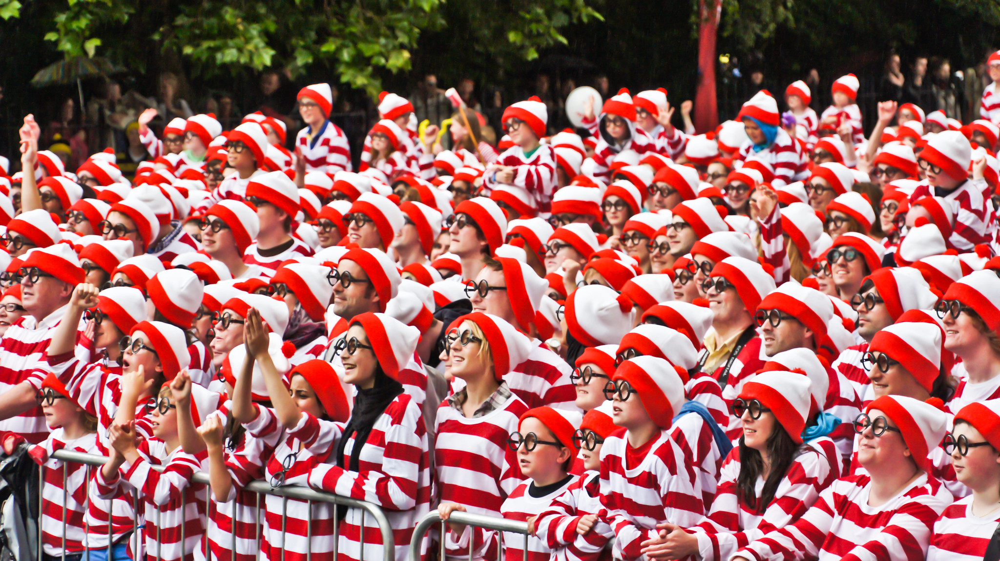

# From Fully Connected Layers to Convolutions
:label:`sec_why-conv`

The multilayer perceptrons of :numref:`chap_perceptrons` flatten every image
into an unordered vector of numbers—appropriate for tabular data, but wasteful
for images because flattening discards which pixels sit next to one another.
On a one-megapixel ($1000 \times 1000$) grayscale photograph, even a modest
1,000-unit hidden layer demands $10^6 \times 10^3 = 10^9$ weights (4 GB in
fp32), and a full-resolution $1000 \times 1000$ hidden map demands $10^{12}$
weights! Yet natural images are nothing like arbitrary million-dimensional
vectors: neighboring pixels are strongly correlated (*locality*), and a visual
feature such as a whisker carries the same meaning wherever it appears in the
frame (*translation equivariance*).

What happens if we impose those two geometric principles directly on a dense
layer mapping a 2D pixel grid to a 2D hidden grid? Translation equivariance
alone slashes $10^{12}$ weights down to roughly $4 \times 10^6$, and restricting
each hidden unit to a small local neighborhood cuts them further to a few
hundred. What survives both constraints is a *convolutional layer*.

## Equivariance and Invariance

The children's game "Where's Waldo" (:numref:`img_waldo`) captures the exact
challenge of visual perception. Each busy scene teems with distractions, with
Waldo hiding somewhere unexpected—yet *what Waldo looks like* does not depend on
*where he stands*. We can therefore sweep a single Waldo detector across the
image, scoring every patch by how strongly it matches Waldo using the exact same
rule at every position. Modern object detection
:cite:`Girshick.Donahue.Darrell.ea.2014` and semantic segmentation
:cite:`Long.Shelhamer.Darrell.2015` pipelines build directly on this idea.

:width:`400px`
:label:`img_waldo`

This intuition points to two guiding principles for the early layers of a vision
network:

1. They should respond identically to the same local patch regardless of where
   it appears, so shifting the input shifts the output by the same amount.
1. They should attend only to small local neighborhoods without worrying about
   distant parts of the image—the *locality* principle.

Subsequent layers can then compose these local responses into progressively
larger, more abstract patterns, culminating in a whole-image prediction.

To formalize the first principle, let $T_v$ denote the shift operator that
translates an image by an offset $v = (v_1, v_2)$, moving pixel $(i, j)$ to
$(i + v_1, j + v_2)$ so that
$[T_v \mathbf{X}]_{i,j} = [\mathbf{X}]_{i-v_1, j-v_2}$. An image-to-image
mapping $f$ is *translation equivariant* if shifting its input shifts its output
by the exact same vector, whereas an image-to-label mapping is *translation
invariant* if shifting its input leaves its output completely unchanged:

$$
\begin{aligned} f(T_v \mathbf{X}) &= T_v f(\mathbf{X}) && \textrm{(equivariance)},\\ f(T_v \mathbf{X}) &= f(\mathbf{X}) && \textrm{(invariance)}.\end{aligned}
$$
:eqlabel:`eq_equivariance_invariance`

:numref:`fig_why_conv_equivariance` illustrates translation equivariance as a
commuting diagram. Here $f$ matches a small template against every window of the
image—the exact operation we are about to derive. Shifting first and matching
second produces the identical map as matching first and shifting second.

:label:`fig_why_conv_equivariance`

Notice the clean division of labor: *equivariance* preserves *where* a pattern
appears, whereas *invariance* discards location. A Waldo detector should be
equivariant so its score map tracks Waldo across the scene; answering the
yes-or-no question "is Waldo in this picture?" should be invariant, achieved at
the end by aggregating the equivariant map across space (for instance, taking
its maximum).

## Constraints on the Fully Connected Layer

Both constraints become crystal clear in one dimension, where we can draw the
entire weight matrix. Consider an eight-sample signal $x_0, \ldots, x_7$ mapped
by a fully connected layer to eight hidden units,
$h_i = u_i + \sum_k W_{i,k} x_k$. Its $8 \times 8$ weight matrix has 64
independent entries, shown in panel (a) of :numref:`fig_why_conv_weight_sharing`.

:label:`fig_why_conv_weight_sharing`

What does translation equivariance impose on $\mathbf{W}$? Ignoring biases for a
moment (our proof below shows all biases must coincide), feed in a unit impulse
with a single 1 at sample $k$: the layer outputs column $k$ of $\mathbf{W}$.
Shift that impulse to $k + 1$, and the layer outputs column $k + 1$.
Equivariance insists that column $k + 1$ must equal column $k$ shifted down by
one row, i.e., $W_{i+1, k+1} = W_{i, k}$. Consequently, $\mathbf{W}$ must be
constant along every diagonal (a *Toeplitz* matrix), as in panel (b). Each
diagonal corresponds to a single relative offset $a = k - i$, collapsing 64 free
weights down to just 15 (offsets $-7$ through $7$).

Locality prunes almost all of those remaining 15 weights. Restricting each
hidden unit to look only at neighbors within distance 1 zeroes out every offset
outside $\{-1, 0, 1\}$, leaving just 3 shared weights repeated across every row
in panel (c). The layer now sweeps one tiny 3-weight template across the entire
signal. That is the entire derivation in miniature; moving to 2D images simply
adds a second spatial index.

For images, both the input $\mathbf{X}$ and the hidden representation
$\mathbf{H}$ are two-dimensional grids, with input pixel $[\mathbf{X}]_{k,l}$ at
$(k, l)$ and hidden unit $[\mathbf{H}]_{i,j}$ at $(i, j)$. Connecting every
hidden unit to every pixel turns the weights into a fourth-order tensor
$\mathsf{W}$ alongside a bias matrix $\mathbf{U}$:

$$[\mathbf{H}]_{i, j} = [\mathbf{U}]_{i, j} + \sum_k \sum_l [\mathsf{W}]_{i, j, k, l}  [\mathbf{X}]_{k, l}.$$

Because both constraints depend on where a pixel sits *relative* to hidden unit
$(i, j)$, let's re-index by offsets $a = k - i$ and $b = l - j$, defining
$[\mathsf{V}]_{i, j, a, b} = [\mathsf{W}]_{i, j, i+a, j+b}$:

$$[\mathbf{H}]_{i, j} = [\mathbf{U}]_{i, j} + \sum_a \sum_b [\mathsf{V}]_{i, j, a, b}  [\mathbf{X}]_{i+a, j+b}.$$
:eqlabel:`eq_mlp_fourth_order`

Here $a$ and $b$ span both positive and negative offsets. This re-indexing is
purely cosmetic—we are simply reading $\mathsf{W}$ along its diagonals without
reducing parameters yet. On a $1000 \times 1000$ image mapped to a
$1000 \times 1000$ hidden grid, this single layer still demands
$10^6 \times 10^6 = 10^{12}$ weights.

### Translation Equivariance

Just as in one dimension, a layer of the form :eqref:`eq_mlp_fourth_order` is
translation equivariant if and only if its weights and bias are independent of
location $(i, j)$. Checking that shared weights yield equivariance takes one
line; the converse is what makes convolution unavoidable—equivariance leaves no
other linear option.

To handle boundaries cleanly (where a shift pushes pixels off the edge of a
finite frame), we embed the image on an infinite grid padded with zeros outside
its support so no information ever leaves the grid. On finite images,
equivariance holds strictly away from borders, a detail we address in
:numref:`sec_padding`.

**Proposition.** Let the input (with finitely many nonzero pixels) and the
hidden representation live on the infinite grid. The layer
:eqref:`eq_mlp_fourth_order` is translation equivariant for every shift $v$ if
and only if there exist a scalar $u$ and a matrix $\mathbf{K}$ such that
$[\mathbf{U}]_{i,j} = u$ and $[\mathsf{V}]_{i,j,a,b} = [\mathbf{K}]_{a,b}$ for
all $i, j, a, b$.

**Proof.** If neither weights nor bias depend on $(i, j)$, then shifting the
input by $v$ directly shifts the output by $v$:

$$[f(T_v \mathbf{X})]_{i,j} = u + \sum_a \sum_b [\mathbf{K}]_{a,b} [\mathbf{X}]_{i - v_1 + a, j - v_2 + b} = [f(\mathbf{X})]_{i - v_1, j - v_2} = [T_v f(\mathbf{X})]_{i,j}.$$

Conversely, assume the layer is equivariant. The all-zero image is invariant
under every shift and maps to $\mathbf{U}$, forcing $\mathbf{U} = T_v \mathbf{U}$
for all $v$, so the bias must be a constant $u$. Subtracting $u$ from both sides
shows that the linear part alone is also equivariant. Feed in an image with a
single 1 at $(k, l)$ and zeros elsewhere: its response at $(i, j)$ is
$[\mathsf{W}]_{i,j,k,l}$. Shifting that impulse by $v$ moves it to
$(k + v_1, l + v_2)$, and equivariance requires
$[\mathsf{W}]_{i, j, k+v_1, l+v_2} = [\mathsf{W}]_{i-v_1, j-v_2, k, l}$.
Setting $(k, l) = (a, b)$ and $v = (i, j)$ yields
$[\mathsf{V}]_{i,j,a,b} = [\mathsf{W}]_{i,j,i+a,j+b} = [\mathsf{W}]_{0,0,a,b}$,
which is independent of $(i, j)$. $\blacksquare$

In short, probing the layer with a single bright pixel forces every location to
share the exact same weights, collapsing the layer to

$$[\mathbf{H}]_{i, j} = u + \sum_a\sum_b [\mathbf{K}]_{a, b}  [\mathbf{X}]_{i+a, j+b}.$$

Every hidden unit now applies the same pattern $\mathbf{K}$ centered at its own
coordinates. On a $1000 \times 1000$ zero-padded image, only offsets
$a, b \in [-999, 999]$ ever touch a nonzero pixel, slashing $10^{12}$ weights
down to $1999^2 \approx 4 \times 10^6$.

### Locality

Four million weights for a single filter is still far too many, and most of
those weights link a hidden unit to pixels clear across the image. Enforcing
*locality*—requiring $[\mathbf{H}]_{i,j}$ to depend only on pixels within
distance $\Delta$ along each axis—sets $[\mathbf{K}]_{a, b} = 0$ whenever
$|a| > \Delta$ or $|b| > \Delta$, giving

$$[\mathbf{H}]_{i, j} = u + \sum_{a = -\Delta}^{\Delta} \sum_{b = -\Delta}^{\Delta} [\mathbf{K}]_{a, b}  [\mathbf{X}]_{i+a, j+b}.$$
:eqlabel:`eq_conv-layer`

Each hidden unit now computes a weighted sum over a
$(2\Delta+1) \times (2\Delta+1)$ local window centered at $(i, j)$, using just
$(2\Delta+1)^2$ shared weights and one bias: 9 weights for $\Delta = 1$ (a
$3 \times 3$ window), or 121 for $\Delta = 5$. Because $\Delta$ is typically
well below 10, a few dozen or hundred weights replace $4 \times 10^6$ while
preserving the full spatial resolution of the hidden map.

Equation :eqref:`eq_conv-layer` defines a *convolutional layer*, the building
block of *convolutional neural networks* (CNNs). The shared matrix $\mathbf{K}$
is called the *convolution kernel* or *filter*. Early pioneers of spatial and
temporal weight sharing included time-delay neural networks for speech
recognition :cite:`Waibel.Hanazawa.Hinton.ea.1989` and the shift-invariant
networks of :citet:`Zhang.ea.1988`.

Crucially, the parameter count shrank from $10^{12}$ to $(2\Delta + 1)^2$ by
restricting the hypothesis class to local, translation-equivariant mappings.
This built-in *inductive bias* (:numref:`sec_generalization_deep`) dramatically
improves sample efficiency whenever features are local and position-independent
(such as edges and textures), though a single layer cannot distinguish identical
patches by absolute position alone (e.g., an eye near the top of a passport
photo versus a nostril lower down). Stacking multiple layers with nonlinearities
allows deeper units to integrate context across progressively wider regions.

## Convolution and Cross-Correlation

Strictly speaking, the name "convolution" in deep learning is a slight misnomer.
In mathematics, the discrete *convolution* of two 1D functions is
$(f * g)(i) = \sum_a f(a) g(i-a)$ (with an integral on $\mathbb{R}^d$),
measuring the overlap between $f$ and a *flipped*, shifted copy of $g$. In two
dimensions,

$$(f * g)(i, j) = \sum_a\sum_b f(a, b) g(i-a, j-b).$$
:eqlabel:`eq_2d-conv-discrete`

Compare this with :eqref:`eq_conv-layer`, which indexes $\mathbf{X}$ at
$(i + a, j + b)$ rather than $(i - a, j - b)$. Substituting $-a$ for $a$ and
$-b$ for $b$ reveals that :eqref:`eq_conv-layer` is the mathematical
convolution of $\mathbf{X}$ with the flipped kernel
$[\mathbf{K}']_{a,b} = [\mathbf{K}]_{-a,-b}$:

$$\sum_{a}\sum_{b} [\mathbf{K}]_{a, b}  [\mathbf{X}]_{i+a, j+b} = \sum_{a}\sum_{b} [\mathbf{K}']_{a, b}  [\mathbf{X}]_{i-a, j-b} = (\mathbf{K}' * \mathbf{X})(i, j).$$

The unflipped operation is properly called *cross-correlation*. Because CNN
kernels are learned from data, the distinction has no effect on expressive
power: a layer that cross-correlates with $\mathbf{K}$ learns the exact same
family of functions as one that convolves with $\mathbf{K}'$. Deep learning
frameworks compute cross-correlation and call it convolution, and we follow
that standard convention throughout this book.

## Channels
:label:`subsec_why-conv-channels`

So far we treated both inputs and hidden maps as single grayscale grids. Real
color photographs have three intensity values per pixel—red, green, and blue—so
an image is a third-order tensor $\mathsf{X}$ of shape
$3 \times \textrm{height} \times \textrm{width}$ with entries
$[\mathsf{X}]_{c,i,j}$. The leading *channel* axis attaches a feature vector to
every spatial pixel, and a kernel sums over both the local spatial window and
all input channels.

Just as importantly, a single kernel produces only a single response map—like
the Waldo score map in :numref:`fig_waldo_mask`—capturing just one visual
pattern. Rich visual representations require detecting many patterns in
parallel (oriented edges, corners, color contrasts, textures), so the hidden
representation $\mathsf{H}$ also becomes a third-order tensor stacked along an
*output channel* axis. Each output channel $o$ has its own learned kernel slice
and bias $u_o$, turning $\mathsf{K}$ into a fourth-order tensor:

$$[\mathsf{H}]_{o,i,j} = u_o + \sum_c \sum_{a = -\Delta}^{\Delta} \sum_{b = -\Delta}^{\Delta} [\mathsf{K}]_{o, c, a, b} [\mathsf{X}]_{c, i+a, j+b}.$$
:eqlabel:`eq_conv-layer-channels`

Here $c$ indexes input channels and $o$ indexes output channels; we keep this
output-before-input channel convention throughout the chapter. Because each
output channel maps where a particular learned feature occurs across the grid,
hidden channels are also called *feature maps*, and the entire stack feeds into
the next layer. With $c_\textrm{i}$ input channels and $c_\textrm{o}$ output
channels, the layer requires $(2\Delta+1)^2 c_\textrm{i} c_\textrm{o}$ weights
and $c_\textrm{o}$ biases. A $3 \times 3$ layer mapping an RGB image to 64
feature maps therefore has just $9 \cdot 3 \cdot 64 + 64 = 1{,}792$
parameters—completely independent of the image's resolution!

:width:`400px`
:label:`fig_waldo_mask`

Nothing in this derivation is tied to two dimensions: the exact same logic
yields 1D convolutions sliding across audio samples or text tokens, and 3D
convolutions sliding across video frames or volumetric medical scans.

Equation :eqref:`eq_conv-layer-channels` is the foundation for the rest of this
chapter. Because we derived it on an idealized infinite grid, three practical
issues remain: handling finite image borders, expanding how much of the image
deeper units can see, and aggregating spatial feature maps into a single
image-level decision (like whether Waldo appears *anywhere* in the scene).
First, however, let's bring :eqref:`eq_conv-layer` to life in code.

## Summary

Flattening an image into an unstructured vector makes dense layers intractably
large—$10^{12}$ weights to map a megapixel image to an equal-sized hidden grid.
Two natural assumptions about images collapse that count to a few hundred:
*translation equivariance* forces every spatial position to share one kernel
(as proved on the infinite grid), and *locality* restricts that kernel to a
small window. The resulting layer computes cross-correlation (universally called
convolution in deep learning), and stacking multiple input and output channels
lets a single layer detect many visual patterns simultaneously while keeping
parameter counts independent of image size. Those gains stem directly from
inductive bias: a convolutional layer trades away arbitrary position-dependent
mappings for strong generalization on spatially structured data.

## Exercises

1. **Weight sharing on a ring.** Repeat the argument of
   :numref:`fig_why_conv_weight_sharing` for a signal of four samples on a
   periodic grid, where the sample after the last one is the first one
   again, so that a shift loses nothing.
    1. Feed the layer a single 1 at each sample in turn and write down the
       $4 \times 4$ weight matrix of a translation-equivariant layer. How
       many free weights does it have? Compare with the
       $2 \cdot 4 - 1 = 7$ offsets of four samples surrounded by zeros.
    1. Impose locality with offsets $-1$, $0$, and $1$. Which entries of
       the matrix are nonzero, and which of them have no counterpart in
       panel (c) of the figure?
2. **Commutativity of convolution.**
    1. Prove that the convolution of :eqref:`eq_2d-conv-discrete` is
       commutative, i.e., $f * g = g * f$.
    1. Define the cross-correlation
       $(f \star g)(i, j) = \sum_a \sum_b f(i+a, j+b)\, g(a, b)$, the
       operation of :eqref:`eq_conv-layer` with input $f$ and kernel $g$. Express $(g \star f)(i, j)$
       through values of $f \star g$, and decide from this expression
       whether cross-correlation is commutative.
3. **Convolutions for audio.** Audio data is often represented as a
   one-dimensional sequence of samples.
    1. Derive the one-dimensional analog of :eqref:`eq_conv-layer`.
    1. Name one audio task for which a layer that is local and
       translation equivariant in time is a good fit, and one for which
       it is not. Justify each choice.
    1. A spectrogram represents a recording as a two-dimensional array
       whose axes are time and frequency, with frequency on a linear
       scale in hertz. For each axis, state whether translation
       equivariance is a reasonable assumption, and justify your answer
       from what a shift along that axis does to the sound. Then answer
       the same question for a frequency axis on a logarithmic scale.
4. **Equivariance versus invariance.** A convolutional classifier computes
   feature maps $h(\mathsf{X})$ with stacked layers of
   :eqref:`eq_conv-layer-channels` and nonlinearities in between, and then
   a prediction $g(h(\mathsf{X}))$ with a head $g$.
    1. Assume a periodic grid, which wraps around so that the column after
       the last one is the first one again; on it, $h$ is translation
       equivariant by the argument of the proposition. Let $g$ average each channel of $h(\mathsf{X})$ over all locations.
       Using :eqref:`eq_equivariance_invariance`, show that the prediction
       is translation invariant.
    1. An image shows a single digit in one of the nine cells of a
       $3 \times 3$ grid, and the task is to name the cell. Explain why
       the classifier of the first part cannot solve this task. Describe
       a head $g$ that solves it from the same feature maps
       $h(\mathsf{X})$.
5. **Rotation equivariance.** ● The proposition of this section derived
   weight sharing from equivariance to shifts. Ask the same of rotations.
   On the infinite grid of the proposition, let $R$ rotate an image by
   $90^\circ$ about the origin,
   $[R\mathbf{X}]_{i,j} = [\mathbf{X}]_{-j,i}$.
    1. Show that the convolutional layer :eqref:`eq_conv-layer` satisfies
       $f(R\mathbf{X}) = R f(\mathbf{X})$ for every image $\mathbf{X}$ if
       and only if $[\mathbf{K}]_{a,b} = [\mathbf{K}]_{-b,a}$ for all
       offsets $(a, b)$.
    1. For $\Delta = 1$, how many free weights does such a kernel have?
       Show that its response to an image does not change when the image
       is rotated by $90^\circ$ about the pixel being evaluated, so that it
       cannot tell a vertical edge from a horizontal one.
    1. Instead of constraining one kernel, use four output channels whose
       kernels are copies of one unconstrained kernel $\mathbf{K}$, rotated
       by $0^\circ$, $90^\circ$, $180^\circ$, and $270^\circ$. Show that
       rotating the input rotates every output map and permutes the four
       channels cyclically. What does this layer keep that the constrained
       kernel of the first part loses?

[Discussions](https://d2l.discourse.group/t/64)

<!-- slides -->

::: {.slide}
::: {.cover}
[Dive into Deep Learning · §6.1]{.kicker}

From Fully Connected Layers to Convolutions **translation equivariance · locality · weight sharing · channels**
:::
:::

::: {.slide title="A Dense Layer on a Megapixel Photo Needs a Billion Weights"}
[The problem]{.kicker}

Tell cats from dogs in one-megapixel grayscale photographs:

- Each input has $10^6$ pixels. A hidden layer of only 1000 units needs
  $10^6 \times 10^3 = 10^9$ weights: 4 GB in float32.
- Keep the hidden layer at full resolution ($1000 \times 1000$) and it
  needs $10^{12}$.
- No collection of labeled pet photos can determine that many numbers.

::: {.d2l-note}
A dense layer ignores which pixels are neighbors. Images are not arbitrary
vectors: build that knowledge into the layer.
:::
:::

::: {.slide title="By the End of This Deck You Can"}
[Goals]{.kicker}

- state translation equivariance and invariance with a shift operator;
- prove that equivariance forces one kernel shared by all locations;
- count the weights at each step: $10^{12} \to 4 \times 10^6 \to (2\Delta+1)^2$;
- write the convolutional layer with input and output channels and count
  its parameters;
- explain why deep learning's "convolution" is a cross-correlation.

**Running example:** Fashion-MNIST, model against model. The MLP of the
Multilayer Perceptron chapter has 203,530 parameters; its first layer alone
has 200,704 weights.
:::

::: {.slide title="Constraints on the MLP Come First, Code Follows"}
[Where this fits]{.kicker}

::: {.cols .vc}
::: {.col}
| section | adds |
|---|---|
| **From Fully Connected Layers to Convolutions** | **locality and translation equivariance give convolution** |
| Convolutions for Images | cross-correlation, learning a kernel, receptive fields |
| Padding, Stride, and Dilation | output size and how far each unit sees |
| Multiple Input and Multiple Output Channels | channels, 1 × 1 convolutions, cost |
| Pooling | downsampling, tolerance to small shifts, global pooling |
| LeNet | a complete CNN on Fashion-MNIST, its learned features, the shuffle test |
:::

::: {.col .narrow}
- **Uses:** the fully connected layer and the MLP; parameter counting.
- **Skips:** code (next deck); borders, padding, and stride.
:::
:::
:::

::: {.slide title="Waldo Looks the Same Wherever He Stands"}
[Equivariance]{.kicker}

{width=46%}

Score every patch with the **same** Waldo detector. Detection and
segmentation systems work this way.

- **Translation equivariance:** shift the input, the score map shifts with it.
- **Locality:** early layers look at small patches only.
:::

::: {.slide title="Equivariant Layers Move with the Input; Invariant Heads Do Not"}
[Equivariance]{.kicker}

Shift by $v$: $[T_v \mathbf{X}]_{i,j} = [\mathbf{X}]_{i-v_1, j-v_2}$.

$$\begin{aligned} f(T_v \mathbf{X}) &= T_v f(\mathbf{X}) && \textrm{(equivariance)}\\ f(T_v \mathbf{X}) &= f(\mathbf{X}) && \textrm{(invariance)}\end{aligned}$$

- The score map should be equivariant: it keeps *where* Waldo is.
- "Is Waldo in the scene?" should be invariant: aggregate the map, e.g.,
  take its maximum.
:::

::: {.slide title="Shift Then Compare Equals Compare Then Shift"}
[Equivariance]{.kicker}

{width=62%}

$f$ compares a $2\times 2$ patch with every window; the response is 4 where
they match. Shift by $v = (3, 2)$.

::: {.d2l-note}
Both paths around the square end in the same map: the response moves with
the patch.
:::
:::

::: {.slide title="In One Dimension, Two Constraints Shrink 64 Weights to 15, Then to 3"}
[Constraints]{.kicker}

{width=92%}

8 samples in, 8 hidden units out; equal colors are equal weights. A single 1
at sample $k$ returns column $k$. Equivariance: each column is its left
neighbor moved down by one. Locality: only offsets $-1, 0, 1$.
:::

::: {.slide title="On an Image, the Same Layer Has a Fourth-Order Weight Tensor"}
[Constraints]{.kicker}

$$[\mathbf{H}]_{i, j} = [\mathbf{U}]_{i, j} + \sum_a \sum_b [\mathsf{V}]_{i, j, a, b}  [\mathbf{X}]_{i+a, j+b}$$

- $(i, j)$: hidden unit; $(a, b)$: offset of the pixel from it.
- $\mathsf{V}$: one weight per hidden unit and offset; $\mathbf{U}$: one
  bias per hidden unit.
- $1000 \times 1000 \to 1000 \times 1000$: $10^{12}$ weights.
:::

::: {.slide title="I. Shared Weights Make the Layer Equivariant"}
[Constraints]{.kicker}

Suppose $[\mathsf{V}]_{i,j,a,b} = [\mathbf{K}]_{a,b}$ and
$[\mathbf{U}]_{i,j} = u$. Then

$$[f(T_v \mathbf{X})]_{i,j} = u + \sum_{a,b} [\mathbf{K}]_{a,b} [\mathbf{X}]_{i - v_1 + a, j - v_2 + b} = [f(\mathbf{X})]_{i - v_1, j - v_2}.$$

The right side is $[T_v f(\mathbf{X})]_{i,j}$: the output shifted by $v$.
:::

::: {.slide title="II. A Single Bright Pixel Shows That Weights Must Be Shared"}
[Constraints]{.kicker}

Infinite grid, zeros outside the image; the layer is equivariant for every
shift $v$.

- Zero image: $f(\mathbf{0}) = \mathbf{U}$ and $T_v \mathbf{0} = \mathbf{0}$,
  so $\mathbf{U} = T_v \mathbf{U}$: the bias is constant.
- Image with a 1 at $(k, l)$: the response at $(i, j)$ is
  $[\mathsf{W}]_{i,j,k,l}$, and equivariance gives
  $[\mathsf{W}]_{i,j,k+v_1,l+v_2} = [\mathsf{W}]_{i-v_1,j-v_2,k,l}$.
- Take $(k, l) = (a, b)$, $v = (i, j)$:
  $[\mathsf{V}]_{i,j,a,b} = [\mathsf{W}]_{0,0,a,b}$.

::: {.d2l-note}
Equivariant $\iff$ one kernel $\mathbf{K}$ and one bias $u$ everywhere.
:::
:::

::: {.slide title="Locality Leaves (2Δ+1)² Weights"}
[Constraints]{.kicker}

Set $[\mathbf{K}]_{a,b} = 0$ for $|a| > \Delta$ or $|b| > \Delta$:

$$[\mathbf{H}]_{i, j} = u + \sum_{a = -\Delta}^{\Delta} \sum_{b = -\Delta}^{\Delta} [\mathbf{K}]_{a, b}  [\mathbf{X}]_{i+a, j+b}.$$

- A **convolutional layer**; $\mathbf{K}$ is its *kernel* or *filter*.
- $\Delta = 1$: 9 weights; $\Delta = 5$: 121; the image keeps its size.
- $10^{12} \to 4 \times 10^6 \to$ a few hundred.
:::

::: {.slide title="Check: How Many Weights at 28 × 28?"}
[Check]{.kicker}

A Fashion-MNIST image, $28 \times 28$, mapped to a $28 \times 28$ hidden
representation. Count the weights of the fully connected layer, of the
shared layer, and of a local layer with a $5 \times 5$ kernel.

::: {.fragment .fade-up}
::: {.d2l-note}
**Answer.** $784^2 = 614{,}656$; with zeros outside the image, offsets
$-27, \ldots, 27$ give $55^2 = 3{,}025$; a $5 \times 5$ kernel has 25.
:::
:::
:::

::: {.slide title="The Savings Come from Restricting the Function Class"}
[Inductive bias]{.kicker}

- A convolutional layer represents only **local, translation-equivariant**
  maps.
- Right for edges and textures: fewer examples, better generalization.
- Wrong when position matters: in a passport photo a dark blob high up is
  an eye and one lower down a nostril, yet the layer must respond to both
  alike.
- One layer sees a window of width $2\Delta + 1$; depth widens the view.
:::

::: {.slide title="Deep Learning's Convolution Is a Cross-Correlation"}
[Convolution]{.kicker}

$$(f * g)(i, j) = \sum_{a,b} f(a, b)\, g(i-a, j-b) \qquad \textrm{(convolution)}$$

The layer reads $\mathbf{X}$ at $(i+a, j+b)$: a *cross-correlation*. With
the flipped kernel $[\mathbf{K}']_{a,b} = [\mathbf{K}]_{-a,-b}$,

$$\sum_{a,b} [\mathbf{K}]_{a, b}  [\mathbf{X}]_{i+a, j+b} = (\mathbf{K}' * \mathbf{X})(i, j).$$

The kernel is learned, so both describe the same layers; libraries say
"convolution".
:::

::: {.slide title="Each Output Channel Has Its Own Kernel over All Input Channels"}
[Channels]{.kicker}

$$[\mathsf{H}]_{o,i,j} = u_o + \sum_c \sum_{a = -\Delta}^{\Delta} \sum_{b = -\Delta}^{\Delta} [\mathsf{K}]_{o, c, a, b} [\mathsf{X}]_{c, i+a, j+b}$$

- $c$: input channel (red, green, blue); $o$: output channel, one per
  learned pattern.
- Output channels are *feature maps*: edges, textures, colors.
- Parameters: $(2\Delta+1)^2 c_\textrm{i} c_\textrm{o} + c_\textrm{o}$,
  independent of the image size.
:::

::: {.slide title="A Waldo Detector Is One Output Channel"}
[Channels]{.kicker}

{width=46%}

A kernel that matches Waldo yields a map that peaks where he stands.
Whether he is *anywhere* needs an invariant step that aggregates the map.
:::

::: {.slide title="Check: Parameters of a First Layer"}
[Check]{.kicker}

A $3 \times 3$ convolution maps an RGB image to 64 channels. How many
parameters does it have for a $224 \times 224$ image, and for a
$1024 \times 1024$ one? Compare with the 200,704 first-layer weights of the
Fashion-MNIST MLP.

::: {.fragment .fade-up}
::: {.d2l-note}
**Answer.** $9 \cdot 3 \cdot 64 + 64 = 1{,}792$ for both sizes: the count
does not depend on the image. That is about 1% of the MLP's first layer,
which sees only $28 \times 28$ pixels.
:::
:::
:::

::: {.slide title="Recap"}
[Wrap-up]{.kicker}

- A dense layer on a megapixel grid: $10^{12}$ weights.
- **Equivariance** $\iff$ one shared kernel: $4 \times 10^6$ weights
  (proved with a single bright pixel).
- **Locality**: a $(2\Delta+1)^2$ window, a few hundred weights.
- The layer computes a cross-correlation; libraries call it convolution.
- **Channels**: $(2\Delta+1)^2 c_\textrm{i} c_\textrm{o} + c_\textrm{o}$
  parameters; each output channel is a feature map.

**Next:** cross-correlation in code, an edge detector, and a kernel learned
from data.
:::
