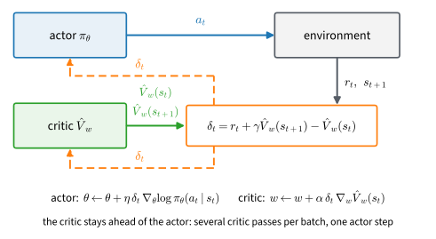
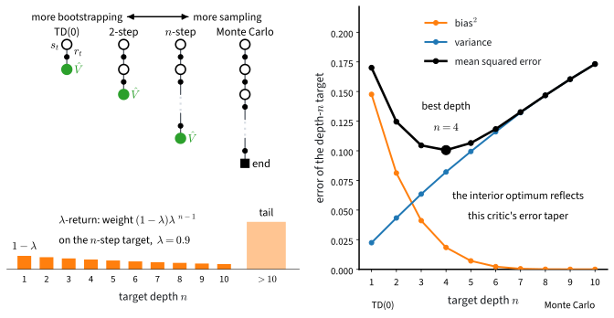

# Actor-Critic Methods and Multi-Step Returns
:label:`sec_actorcritic`

The agent of :numref:`sec_deeprl` learns to balance the pole, but it learns late. Each of its updates waits for eight whole episodes, up to 4,000 steps of balancing, and only then asks of every action whether the rest of its episode went better than expected. The Q-learning agent of :numref:`sec_qlearning` needed no such patience: it changed one table entry after every transition, using its own estimate of what came next in place of the rest of the episode. Can a policy-gradient agent learn the same way?

It can, and the piece it needs is already in hand. The learned baseline $\hat{V}$ of :numref:`sec_deeprl` is trained to predict the reward-to-go, the discounted sum of the rewards that follow a state. If it predicts the rest of the episode, the agent need not wait for it: one reward plus the prediction at the next state can stand in for the sampled tail. The policy then becomes the *actor* and the value estimate its *critic*. :citet:`Barto.Sutton.Anderson.1983` built the first such pair for this very cart-pole problem, and the "adaptive critic element" of their paper gave the critic its name.

The substitution trades the randomness of the future for the error of the critic. This section works out that trade: what a single transition can tell the actor, how much of the sampled tail to keep, and how the trade comes out on CartPole, where the critic's error turns out to matter more than the variance it removes. Every method in the rest of this chapter carries a critic of some kind, and the estimator built here, a geometric mix of one-step and many-step targets, is the one they use.

```{.python .input #actor-critic-actor-critic-and-the-credit-assignment-dial-1}
%%tab pytorch
%matplotlib inline
from d2l import torch as d2l
import gymnasium as gym
import numpy as np
import torch
from torch import nn
torch.set_num_threads(1)
```

```{.python .input #actor-critic-actor-critic-and-the-credit-assignment-dial-1}
%%tab jax
%matplotlib inline
from d2l import jax as d2l
from flax import nnx
import gymnasium as gym
import jax
from jax import numpy as jnp
import numpy as np
import optax
```

We keep the task and the agent of :numref:`sec_deeprl`. CartPole's state is four numbers, the cart's position and velocity and the pole's angle and angular velocity; its two actions push the cart left or right; every step with the pole up pays $1$; and an episode is cut off after 500 steps, so the largest possible return is 500. The discount is $\gamma = 0.99$. The agent is `ActorCritic.mlp`, a policy network and a value network with one hidden layer of 64 units each, each with its own Adam optimizer. Every training run below takes 150 updates of eight episodes each, up to 600,000 environment steps. The new hyperparameter `critic_steps` sets how many regression passes the critic takes per batch, and `grad_clip` caps the norm of the actor's gradient; both are explained with the training loop.

```{.python .input #actor-critic-actor-critic-and-the-credit-assignment-dial-2}
%%tab pytorch, jax
gamma, num_updates, batch_episodes = 0.99, 150, 8
num_seeds, critic_steps, grad_clip = 3, 20, 0.5
if tab.selected('pytorch'):
    def cartpole_agent(seed):
        torch.manual_seed(seed)
        return d2l.ActorCritic.mlp(4, 2)
if tab.selected('jax'):
    def cartpole_agent(seed):
        return d2l.ActorCritic.mlp(4, 2, rngs=nnx.Rngs(seed))
```

## The Temporal-Difference Advantage

### Bootstrapping the Reward-to-Go

To see what the critic can replace, write out one step of the reward-to-go:

$$\hat{G}_t = r_t + \gamma\, \hat{G}_{t+1}.$$

The learned baseline is regressed toward the reward-to-go, so $\hat{V}(s_{t+1})$ predicts the very quantity that $\hat{G}_{t+1}$ samples. Instead of waiting for the sample, we substitute the prediction, $\hat{G}_t \approx r_t + \gamma \hat{V}(s_{t+1})$. The weight on the score at step $t$ was $\hat{G}_t - \hat{V}(s_t)$; after the substitution it becomes

$$\delta_t = r_t + \gamma\, \hat{V}(s_{t+1}) - \hat{V}(s_t),$$
:eqlabel:`eq_td_error_v`

with $\hat{V}(s_{t+1}) = 0$ when $s_{t+1}$ is terminal. This *temporal-difference (TD) error* compares two predictions of the same return: one made at $s_t$, and one made a step later with a real reward in hand.

The TD error of :numref:`sec_qlearning` had the same form with one difference. Q-learning bootstraps on the best continuation, $\max_{a'} \hat{Q}(s', a')$, because it estimates the optimal values; here the bootstrap is the current policy's own continuation value, as in the SARSA target of that section. The terminal mask follows `terminated`, not `truncated`: a time limit stops the observation without ending the task, so the value of the state at a cut is not zero (:numref:`sec_mdp`). `td_target` computes the target $r_t + \gamma \hat{V}(s_{t+1})$ for every transition of a `Batch`, the flat record of transitions and episode boundaries that `d2l.rollout` fills (:numref:`sec_policygradient`), from any function that maps states to values. It returns a NumPy array, so the critic's gradient does not flow through the target.

```{.python .input #actor-critic-the-td-error}
%%tab pytorch, jax
@d2l.add_to_class(d2l.Batch)  #@save
def td_target(self, bootstrap, gamma):
    """r_t + gamma (1 - terminated) V(s'), by a numpy bootstrap."""
    return self.rew + gamma * (1 - self.term) * bootstrap(self.next_obs)
```

As in the per-step estimator of :numref:`sec_baselines`, the actor's update omits the factor $\gamma^t$ that would discount late steps of an episode relative to early ones.

### One Transition by Hand

Three numbers show what the new weight says. Suppose the critic predicts $100$ at every state, the value $1/(1-\gamma)$ of balancing forever at $\gamma = 0.99$. On a step on which the pole stays up, $\delta_t = 1 + 0.99 \cdot 100 - 100 = 0$: the step went as predicted, and the action taken is neither encouraged nor discouraged. On the step on which the pole falls, the episode terminates, the bootstrap is masked, and $\delta_t = 1 - 100 = -99$: the action that ended the episode is pushed down hard.

A freshly initialized critic predicts values near $0$ everywhere. Then every step gives $\delta_t \approx 1$, whether its action kept the pole up or dropped it. Every action taken is pushed up by the same amount, and the actor learns little until the critic can tell the two apart.

### An Exact Critic Gives the Advantage

With a perfect critic, the TD error estimates the same quantity as the Monte Carlo weight. Suppose for a moment that $\hat{V} = V^\pi$. The action value satisfies $Q^\pi(s, a) = r(s, a) + \gamma \sum_{s'} P(s' \mid s, a)\, V^\pi(s')$, the Bellman equation of :numref:`sec_valueiter` written with $V^\pi$. Averaging :eqref:`eq_td_error_v` over the next state therefore gives

$$\mathbb{E}\big[ \delta_t \mid s_t, a_t \big] = r(s_t, a_t) + \gamma \sum_{s'} P(s' \mid s_t, a_t)\, V^{\pi}(s') - V^{\pi}(s_t) = Q^{\pi}(s_t, a_t) - V^{\pi}(s_t).$$

The right-hand side is the advantage $A^\pi(s_t, a_t)$, how much better the action taken is than the policy's average at that state. The learned baseline of :numref:`sec_baselines` estimated it with $\hat{G}_t - \hat{V}(s_t)$. One transition, with one reward and two critic evaluations, gives an unbiased sample of the advantage, where the Monte Carlo weight needed the entire rest of the episode.

During training $\hat{V}$ is not equal to $V^\pi$, and then $\delta_t$ is a biased estimate of the advantage. The zero-mean identity of :numref:`sec_baselines` says that anything fixed before the action may be subtracted from the weight without moving the gradient's mean. It covers $\hat{V}(s_t)$, which depends on the current state only. It does not cover $\hat{V}(s_{t+1})$, which depends on the action through the next state, so the critic's error at the states the actions lead to enters the update as bias (exercise :exref:`ex_actor-critic-why-baseline-argument-does`). This bias comes on top of the one that dropping $\gamma^t$ already introduced relative to the per-step estimator of :numref:`sec_baselines`.

The critic's own update is sampled policy evaluation. Policy evaluation in :numref:`sec_valueiter` applied the Bellman expectation backup, whose fixed point is $V^\pi$. Regressing $\hat{V}(s_t)$ toward $r_t + \gamma \hat{V}(s_{t+1})$ replaces that expectation by one sampled transition, just as Q-learning replaced the optimality backup by a sample. The critic estimates the value of the current policy and the actor improves the policy against that estimate, so actor-critic is an approximate form of the generalized policy iteration of :numref:`sec_valueiter`. Because the regression target contains $\hat{V}$ itself, the gradient is taken through the prediction $\hat{V}(s_t)$ and not through the target. Such an update is called a *semi-gradient* step: its expected update is not the gradient of any fixed objective.

### The Chain Example

How much variance does the bootstrap remove, and how much bias does it add? A small chain answers both in closed form. Take ten states $0, 1, \ldots, 9$. From state $s$ the agent always moves to $s+1$, and the transition out of state $9$ ends the episode and pays $1$. Every reward carries independent Gaussian noise of standard deviation $\sigma = 0.15$, and $\gamma = 0.97$. The critic is wrong by $e(s) = 0.5\,(1 - s/9)^2$: badly at the start, not at all at the end. TD learning from a zero initialization tends to produce errors of this shape, because the reward at the end reaches the late states first.

A target that samples $n$ rewards and then bootstraps from the critic at state $n$ inherits the critic's error there, discounted, and the noise of $n$ rewards. Its bias and variance are

$$\textrm{bias} = \gamma^n e(n), \qquad \textrm{variance} = \sigma^2\, \frac{1 - \gamma^{2n}}{1 - \gamma^2},$$

for $n \leq 9$; the Monte Carlo target, $n = 10$, has no bias. At $n = 1$ the bias is $0.38$ and the variance $0.02$; at $n = 10$ the bias is zero and the variance $0.17$. The mean squared error, bias squared plus variance, falls from $0.17$ at $n = 1$ to $0.10$ at $n = 4$ and rises back to $0.17$ at $n = 10$.

The best depth lies in the interior because deeper targets bootstrap from better-known states. A critic wrong by the same $0.5$ at every state would make the error monotone over the bootstrapped depths (exercise :exref:`ex_actor-critic-optimal-bootstrap-depth`). :numref:`fig_rl_td_mc_spectrum` draws the family of targets and the measured curves.


:label:`fig_rl_td_mc_spectrum`

## The Actor-Critic Update

### Two Updates from One Number

Both learners now update from the same scalar. Write $w$ for the critic's parameters and $\hat{V}_w$ for the critic. After the transition $(s_t, a_t, r_t, s_{t+1})$ the two updates are

$$w \leftarrow w + \alpha\, \delta_t\, \nabla_w \hat{V}_w(s_t), \qquad \theta \leftarrow \theta + \eta\, \delta_t\, \nabla_\theta \log \pi_\theta(a_t \mid s_t),$$
:eqlabel:`eq_actor_critic`

with step size $\alpha$ for the critic, as for TD learning in :numref:`sec_qlearning`, and $\eta$ for the actor, as for the policy gradient in :numref:`sec_policygradient`. The critic's update is the semi-gradient step toward the one-step target. The actor's update is the policy-gradient step of :numref:`sec_baselines` with $\delta_t$ as the weight. One number does both jobs: $\delta_t$ tells the critic how wrong its prediction was, and it tells the actor whether the action just taken turned out better or worse than the critic expected (:numref:`fig_rl_actor_critic_loop`). Because $\delta_t$ needs a single transition, :eqref:`eq_actor_critic` can be applied at every step while the agent acts, the way Q-learning updated its table, and nothing has to terminate before learning starts.


:label:`fig_rl_actor_critic_loop`

The critic's target moves with both networks. An actor step changes the values the critic should predict, and a critic step changes its own targets. If the actor moves faster than the critic can follow, the actor is weighted by the errors of a stale critic. :citet:`Konda.Tsitsiklis.2000` proved that actor-critic converges, for linear critics and decaying step sizes, when the critic's step sizes shrink more slowly than the actor's, so that the critic keeps up with the current policy. The loop below gets the same effect by giving the critic several regression passes per batch.

### The Batched Loop

The code does not apply :eqref:`eq_actor_critic` after every transition. It keeps the eight-episode batches of :numref:`sec_deeprl` and changes what happens to each batch. The critic first takes `critic_steps` regression passes toward the batch's one-step targets, recomputing the targets from the current critic before every pass. Regression toward targets that contain the regressor's own predictions is called *fitted TD*, and recomputing the targets makes them a moving target. The actor then takes one step weighted by the TD errors of the refitted critic. We call this loop a batched one-step actor-critic. Its best-known relative, A2C :cite:`Mnih.Badia.Mirza.ea.2016`, weights the same score by $n$-step advantages, adds an entropy bonus, and takes one joint gradient step per rollout collected from many environments in parallel.

The actor's weight is the raw TD error, not normalized within the batch as the Monte Carlo weight of :numref:`sec_deeprl` was, because of the way Adam scales its steps. Adam divides each gradient coordinate by the square root of a running average of its past squares, an average that with the default decay remembers about a thousand steps, longer than our 150 updates. Its first steps therefore have about the same size whatever the scale of the weights, and later steps shrink only when the gradients shrink below their early size. As the critic improves, the TD errors fall from a standard deviation of about $3$ early in training to around $0.1$ near the ceiling, by then mostly the critic's own noise, and Adam's steps fall with them, about eightfold over a run. Normalized TD errors would keep the gradient near its early size, and Adam would keep taking large steps in directions set by that noise (exercise :exref:`ex_actor-critic-gradient-norms`).

Early in training the raw weights, and with them the actor's gradient, are larger than a normalized weight would give. We cap the gradient's norm at $0.5$, a common value. Under Adam the cap does not limit the size of a step; it limits how much these large early batches count in Adam's running averages. `policy_step_clip` is the `policy_step` of :numref:`sec_imitation`, one gradient step on the weighted log-probabilities of the batch's actions, with the cap added; it returns the norm measured before the cap.

```{.python .input #actor-critic-a2c-by-name-1}
%%tab pytorch
def policy_step_clip(ac, obs, act, weight, clip=grad_clip):
    """d2l.policy_step with the actor's gradient norm capped at `clip`;
    returns the norm measured before the cap."""
    obs, act = torch.as_tensor(obs), torch.as_tensor(act)
    loss = -(torch.as_tensor(weight) * ac.log_prob(obs, act)).mean()
    ac.opt_pi.zero_grad()
    loss.backward()
    gnorm = nn.utils.clip_grad_norm_(ac.policy.parameters(), clip)
    ac.opt_pi.step()
    return float(gnorm)
```

```{.python .input #actor-critic-a2c-by-name-1}
%%tab jax
@nnx.jit
def _actor_pass(ac, obs, act, adv, n, clip):
    """d2l._policy_pass with the gradient norm capped at `clip`; returns
    the norm before the cap. Padded rows carry adv = 0 and add nothing."""
    grads = nnx.grad(lambda policy: -(adv * ac.log_prob(obs, act, policy))
                     .sum() / n)(ac.policy)
    gnorm = optax.global_norm(grads)
    grads = jax.tree.map(lambda g: g * jnp.minimum(1.0, clip / gnorm), grads)
    ac.opt_pi.update(ac.policy, grads)
    return gnorm

def policy_step_clip(ac, obs, act, weight, clip=grad_clip):
    """d2l.policy_step with the actor's gradient norm capped at `clip`;
    returns the norm measured before the cap."""
    n = len(weight)
    size = d2l._bucket(n)
    return float(_actor_pass(ac, d2l._pad(obs, size), d2l._pad(act, size),
                             d2l._pad(np.float32(weight), size), n, clip))
```

:begin_tab:`jax`
`policy_step_clip` pads its batch to a bucket length with `d2l._pad` and `d2l._bucket`, as `d2l.policy_step` does, so that the compiled `_actor_pass` is reused across batches of different lengths; the zero weights of the padded rows keep them out of the loss.
:end_tab:

`train_ac` is the loop. `d2l.fit_value` (:numref:`sec_deeprl`) takes one Adam step on the squared error between the critic's predictions and a target vector, and `ac.value_np` evaluates the critic on a batch of states. After every update the loop yields the number of environment steps taken so far, the batch's mean return, and the actor's gradient norm before the cap.

```{.python .input #actor-critic-a2c-by-name-5}
%%tab pytorch, jax
def train_ac(seed, ac, num_updates=num_updates):
    """Batched one-step actor-critic; yields (steps, return, grad norm)."""
    rng, env = np.random.default_rng(seed), gym.make('CartPole-v1')
    env.reset(seed=seed)
    steps = 0
    for _ in range(num_updates):
        batch = d2l.rollout(env, ac.act, batch_episodes, rng)
        for _ in range(critic_steps):   # fresh target, one pass, repeat
            d2l.fit_value(ac, batch.obs, batch.td_target(ac.value_np, gamma))
        delta = batch.td_target(ac.value_np, gamma) - ac.value_np(batch.obs)
        gnorm = policy_step_clip(ac, batch.obs, batch.act, delta)   # raw
        steps += len(batch)
        yield steps, float(batch.episode_returns().mean()), gnorm
```

Fitting the critic before computing the actor's weights is a choice. A2C and most GAE implementations compute the TD errors with the critic that was current when the batch was collected, and update both networks afterward. With one critic step per rollout, as in A2C, the order hardly matters. With twenty passes per batch it does: the refitted critic is much closer to $V^\pi$ on the batch's own states, so the actor's weights carry less of the critic's error. In our runs the other order reached the ceiling about as fast when it worked, but about one seed in four stalled or collapsed, against about one in twenty for the order used here (exercise :exref:`ex_actor-critic-critic-passes` repeats the comparison).

Fresh batches help the critic in a second way. Each batch comes from the current policy and from the states it visits, so a critic error that matters to the current behavior is likely to meet relevant transitions in the next batch. This feedback does not guarantee convergence: semi-gradient TD with a nonlinear critic can diverge even on its own policy's data :cite:`Tsitsiklis.VanRoy.1997`. Trained on replayed transitions of older policies, the same update combines function approximation, bootstrapping and off-policy data, the *deadly triad* of :citet:`Sutton.Barto.2018`, and divergence becomes common; :numref:`sec_dqn` takes up that case.

### Bootstrapped and Monte Carlo Weights on CartPole

Does the bootstrapped weight learn faster than the Monte Carlo weight it replaces? The reference is REINFORCE with a learned baseline, the loop of :numref:`sec_deeprl`, with three changes so that only the weight differs between the two arms. The agent comes from the caller, the actor's step goes through `policy_step_clip`, and the critic takes the same `critic_steps` regression passes per batch, here toward the fixed Monte Carlo targets $\hat{G}_t$. As in :numref:`sec_deeprl`, `truncation_bootstrap` adds the critic's discounted value at a time-limit cut to the reward-to-go, and `d2l.normalize` standardizes the weights within the batch.

```{.python .input #actor-critic-a2c-by-name-4}
%%tab pytorch, jax
def train_reinforce(seed, ac, num_updates=num_updates):
    """REINFORCE with a learned baseline; yields as train_ac does."""
    rng, env = np.random.default_rng(seed), gym.make('CartPole-v1')
    env.reset(seed=seed)
    steps = 0
    for _ in range(num_updates):
        batch = d2l.rollout(env, ac.act, batch_episodes, rng)
        G = (batch.reward_to_go(gamma)
             + batch.truncation_bootstrap(gamma, ac.value_np))   # time limits
        w = d2l.normalize(G - ac.value_np(batch.obs))
        gnorm = policy_step_clip(ac, batch.obs, batch.act, w)
        d2l.fit_value(ac, batch.obs, G, num_steps=critic_steps)
        steps += len(batch)
        yield steps, float(batch.episode_returns().mean()), gnorm
```

We train three seeds of each and plot the batch's mean return against the number of environment steps, the measure of cost that the rest of the chapter uses. `d2l.plot_curves` (:numref:`sec_utils`) draws the median over seeds with a band from the lowest to the highest seed. Seeds take different numbers of steps per update, so `d2l.on_grid` first interpolates every run onto a common grid of steps.

```{.python .input #actor-critic-a2c-by-name-6}
%%tab pytorch, jax
runs = {'REINFORCE + baseline': np.array(
    [list(train_reinforce(s, cartpole_agent(s))) for s in range(num_seeds)])}
```

```{.python .input #actor-critic-a2c-by-name-9}
%%tab pytorch, jax
runs['actor-critic'] = np.array(
    [list(train_ac(s, cartpole_agent(s))) for s in range(num_seeds)])
grid = np.arange(0, 250_001, 5_000)
d2l.plot_curves({name: d2l.on_grid(r, grid, 1) for name, r in runs.items()},
                xlabel='environment steps', ylabel='mean return of the batch',
                x=grid, reference=500)
```

To read the plot by seed, we count the steps each run takes until the mean return of its last ten batches first reaches 450, and how often the cap on the actor's gradient was active:

```{.python .input #actor-critic-bootstrapped-and-monte-carlo-weights-on-cartpole-1}
%%tab pytorch, jax
def steps_to(run, level=450, window=10):
    """Env steps at which the mean return of the last `window` batches
    first reaches `level`; inf if it never does."""
    mean = np.convolve(run[:, 1], np.ones(window) / window, 'valid')
    hit = np.flatnonzero(mean >= level)
    return run[hit[0] + window - 1, 0] if len(hit) else np.inf

for name, r in runs.items():
    k = [f'{steps_to(run) / 1000:.0f}' for run in r]
    print(f'{name:>20}: 450 after {", ".join(k)} thousand steps; '
          f'cap active {(r[:, :, 2] > grad_clip).mean():.0%}')
```

The Monte Carlo weight reaches the ceiling first. With the same twenty critic passes per batch, REINFORCE gets there first on nearly every seed we have tried, with a fifth to a third fewer environment steps than actor-critic, which arrives 20 to 30 updates later. Once there, REINFORCE stays: its running mean does not fall back, while the few runs that end below the ceiling are actor-critic's. The cap is active on a fifth to two fifths of actor-critic's updates and on none of REINFORCE's, whose normalized weights keep the gradient small.

On CartPole the bootstrap does not even make the runs steadier. The reward is a deterministic $+1$ per step, and the bootstrap at the time limit already replaces the long tail of every cut episode by the critic's value, so the Monte Carlo weight is far less noisy than its worst case. What remains is the critic's bias, and it is largest while the critic is young, the phase in which actor-critic falls behind. The uniform $\delta_t \approx 1$ of an untrained critic is the extreme case.

### The Two Weights on Shared Batches

If the bootstrap does not speed up learning here, what does it change? We measure both weights on the same batches. The cell below reruns `train_ac` for one seed and, at every update, records the standard deviation of the TD error and of the Monte Carlo advantage `A_mc`, the weight of `train_reinforce` before normalization.

```{.python .input #actor-critic-why-the-critic-s-moving-target-is-survivable-here-and-fatal-later}
%%tab pytorch, jax
rng, env = np.random.default_rng(0), gym.make('CartPole-v1')
ac = cartpole_agent(0)
env.reset(seed=0)
trace = []   # per update: std of the TD error, std of the MC advantage
for _ in range(num_updates):
    b = d2l.rollout(env, ac.act, batch_episodes, rng)
    for _ in range(critic_steps):
        d2l.fit_value(ac, b.obs, b.td_target(ac.value_np, gamma))
    V = ac.value_np(b.obs)
    delta = b.td_target(ac.value_np, gamma) - V
    A_mc = (b.reward_to_go(gamma)   # G of train_reinforce, minus V
            + b.truncation_bootstrap(gamma, ac.value_np) - V)
    trace.append((delta.std(), A_mc.std()))
    policy_step_clip(ac, b.obs, b.act, delta)
trace = np.array(trace)
```

```{.python .input #actor-critic-why-the-critic-s-moving-target-is-survivable-here-and-fatal-later-1}
%%tab pytorch, jax
for name, rows in (('first 10', trace[:10]), ('last 50', trace[-50:])):
    print(f'{name:>8} updates: std of the TD error {np.median(rows[:, 0]):.2f}'
          f', of the MC advantage {np.median(rows[:, 1]):.2f}')
print(f'median variance ratio, MC over TD: '
      f'{np.median((trace[:, 1] / trace[:, 0]) ** 2):.0f}x')
d2l.plot_curves({'TD error': trace[:, 0] ** 2, 'MC advantage': trace[:, 1] ** 2},
                xlabel='update', ylabel='variance of the weight', smooth=10,
                yscale='log')
```

On the same transitions, the Monte Carlo advantage has about three times the TD error's standard deviation in the first updates, a variance about ten times larger, and over the whole run its variance is a few tens of times the TD error's; the plot's scale is logarithmic. The TD error depends on one reward and one transition; the Monte Carlo advantage depends on every reward and transition left in the episode. Both variances drop sharply once nearly every episode reaches the 500-step cut: the TD error's because the critic is then accurate, the Monte Carlo advantage's because the bootstrap replaces the tail of every cut episode by the critic's value.

The variance saving is real, but on CartPole it is not what limits learning. REINFORCE averages eight episodes per update and normalizes its weights, and with a well-fitted baseline that suffices; the critic's bias, by contrast, slows every update until the critic catches up. Adding unit Gaussian noise to every reward, or updating after every single episode, did not reverse the comparison in our runs.

The bootstrap's lasting advantage is structural: the TD error needs one transition, so an update can come before the episode ends. In a continuing task the return never arrives, and in a task whose episodes last thousands of steps, eight episodes per update take tens of thousands of steps. There a critic is the only option (exercise :exref:`ex_actor-critic-fully-online` builds the fully online form). Between these extremes lies a dial: bootstrap after several steps instead of one, and keep most of the variance saving while taking on less of the critic's bias.

## Multi-Step Returns and GAE

### n-Step Returns

The one-step target and the Monte Carlo return are the endpoints of a family. Include $n$ sampled rewards and then bootstrap from the critic:

$$\hat{G}^{(n)}_t = r_t + \gamma\, r_{t+1} + \cdots + \gamma^{n-1} r_{t+n-1} + \gamma^n\, \hat{V}(s_{t+n}),$$
:eqlabel:`eq_nstep_return`

and use $\hat{G}^{(n)}_t-\hat{V}(s_t)$ as the advantage estimate. For $n=1$ this is $\delta_t$; when $n$ reaches the end of the episode, it is the Monte Carlo advantage. Each additional step discounts the critic's error by another factor $\gamma$ and evaluates it at a later state, and adds another sampled reward and transition. This is the trade of the chain example, where $n = 4$ balanced the two.

### The $\lambda$-Return and the Telescoping Identity

Rather than pick one depth, we can average them all, with geometric weights that make the average computable:

$$\hat{A}^{\textrm{GAE}}_t = (1 - \lambda) \sum_{n=1}^{\infty} \lambda^{n-1} \big( \hat{G}^{(n)}_t - \hat{V}(s_t) \big), \qquad \lambda \in [0, 1].$$
:eqlabel:`eq_lambda_return`

The weights $(1-\lambda)\lambda^{n-1}$ sum to one. At $\lambda = 0$ all weight is on the one-step estimate. On an episode that terminates, every depth past the end equals the Monte Carlo advantage, so as $\lambda \to 1$ the mixture tends to the Monte Carlo advantage. Written this way, the estimator seems to need every depth computed separately. It does not, because the mixture collapses.

**Proposition.** The mixture is a discounted sum of TD errors:

$$
\hat{A}^{\textrm{GAE}}_t = \sum_{l=0}^{\infty} (\gamma\lambda)^l\, \delta_{t+l}.
$$
:eqlabel:`eq_gae_deltas`

**Proof.** Each depth telescopes into TD errors: $\sum_{l=0}^{n-1} \gamma^l \delta_{t+l} = \sum_{l=0}^{n-1} \gamma^l r_{t+l} + \gamma^n \hat{V}(s_{t+n}) - \hat{V}(s_t) = \hat{G}^{(n)}_t - \hat{V}(s_t)$, the interior $\hat{V}$ terms cancelling in pairs. Substitute this into :eqref:`eq_lambda_return` and swap the two sums: the pair $(n, l)$ with $l < n$ contributes $(1-\lambda)\lambda^{n-1} \gamma^l \delta_{t+l}$, so $\hat{A}^{\textrm{GAE}}_t = \sum_{l \ge 0} \gamma^l \delta_{t+l}\, (1-\lambda) \sum_{n \ge l+1} \lambda^{n-1}$. The inner geometric sum is $\lambda^l$. $\blacksquare$

The identity turns an average over all depths into one backward pass over the episode, linear in its length, which is how implementations compute it :cite:`Schulman.Moritz.Levine.ea.2016`. On an episodic task the sums stop at termination, where $\hat{V} = 0$ and no rewards follow, so every $\delta$ past the end is zero and the infinite sum is also the finite one.

### GAE as a Backward Scan

The sum :eqref:`eq_gae_deltas` is an algorithm for *generalized advantage estimation* (GAE): compute the TD errors, then accumulate them backward with factor $\gamma\lambda$, restarting at every episode boundary. The method `Batch.backward_scan` of :numref:`sec_baselines`, which computes the reward-to-go by the recurrence $\hat{G}_t = r_t + \gamma \hat{G}_{t+1}$, already implements this recurrence; only its input and its factor change.

```{.python .input #actor-critic-gae-in-one-old-function-1}
%%tab pytorch, jax
@d2l.add_to_class(d2l.Batch)  #@save
def gae(self, value_fn, gamma, lam):
    """GAE(gamma, lam): the reward-to-go scan, run on the TD errors."""
    delta = self.td_target(value_fn, gamma) - value_fn(self.obs)
    return self.backward_scan(delta, gamma * lam)
```

Both endpoints are identities that we can check on a batch. At $\lambda = 0$ the scan returns the TD errors themselves. At $\lambda = 1$, on episodes that terminate, the telescoping runs to termination and returns the reward-to-go minus the baseline, the Monte Carlo advantage of :numref:`sec_baselines`.

```{.python .input #actor-critic-gae-in-one-old-function-2}
%%tab pytorch, jax
env = gym.make('CartPole-v1')
env.reset(seed=0)
fresh = cartpole_agent(0)
b = d2l.rollout(env, fresh.act, 8, np.random.default_rng(0))
V = fresh.value_np(b.obs)
delta = b.td_target(fresh.value_np, gamma) - V
assert np.allclose(b.gae(fresh.value_np, gamma, 0.0), delta)
assert np.allclose(b.gae(fresh.value_np, gamma, 1.0),
                   b.reward_to_go(gamma) - V, atol=1e-4)
print('lambda = 0 is the TD error; lambda = 1 is the Monte Carlo advantage')
```

The $\lambda = 1$ identity needs episodes that terminate. On an episode cut off by the time limit, `gae` bootstraps the missing future through its last TD error, while `reward_to_go` treats the future as empty until `truncation_bootstrap` adds it back; the untrained policy above drops the pole long before the cut, so the assertion holds. The same backward sum has an online form, TD($\lambda$), which keeps a decaying *eligibility trace* per critic parameter and suits agents that learn from a stream without storing episodes :cite:`Sutton.1988,Elsayed.Vasan.Mahmood.2024`.

## Bias and Variance of the $\lambda$-Return

### The $\lambda$ Sweep

Which $\lambda$ trains best? `train_gae` is `train_ac` with the dial exposed: the actor is weighted by the GAE advantage `A`, and the critic is fitted toward the $\lambda$-return `A + V`. It builds its own agent, so that `d2l.run_seeds` can run it once per seed and stack the curves. It also normalizes the actor's weights, because near $\lambda = 1$ they have the scale of the Monte Carlo advantage, with a variance of order $100$, and raw weights would hit the cap at large $\lambda$ and not at small $\lambda$. The budget is short, 50 updates of four episodes, so the comparison shows which estimator helps an agent whose critic is still being learned.

```{.python .input #actor-critic-measuring-the-dial-1}
%%tab pytorch, jax
lams = [0.0, 0.5, 0.9, 0.95, 1.0]

def train_gae(seed, lam, num_updates=50, batch_episodes=4):
    """train_ac with the dial exposed. The weights are normalized: near
    lam=1 they have the Monte Carlo scale, and every lam steps alike."""
    rng, env = np.random.default_rng(seed), gym.make('CartPole-v1')
    ac = cartpole_agent(seed)
    env.reset(seed=seed)
    for _ in range(num_updates):
        batch = d2l.rollout(env, ac.act, batch_episodes, rng)
        for _ in range(critic_steps):
            d2l.fit_value(ac, batch.obs, batch.gae(ac.value_np, gamma, lam)
                          + ac.value_np(batch.obs))
        A = batch.gae(ac.value_np, gamma, lam)
        policy_step_clip(ac, batch.obs, batch.act, d2l.normalize(A))
        yield float(batch.episode_returns().mean())

sweep = {lam: d2l.run_seeds(train_gae, 5, lam=lam) for lam in lams}
```

```{.python .input #actor-critic-measuring-the-dial-2}
%%tab pytorch, jax
for lam, r in sweep.items():
    best = np.array([np.convolve(c, np.ones(20) / 20, 'valid').max()
                     for c in r])
    print(f'lambda = {lam:4}: best 20-update window, '
          f'median {np.median(best):5.1f}, seeds {np.round(np.sort(best))}')
d2l.plot_curves({f'lambda = {lam:g}': np.median(r, axis=0)
                 for lam, r in sweep.items()},
                xlabel='update', ylabel='median return of the batch',
                smooth=10, reference=500)
```

In the median over seeds, $\lambda = 0$ and $\lambda = 0.5$ reach a best 20-update window of about 150 to 250, far below the ceiling, while $\lambda \geq 0.9$ reaches about twice as high. Individual seeds overlap across this divide, so we compare medians. On a short budget the critic is wrong for most of training, and the estimators that lean on it least learn fastest. This is the comparison of the previous section seen from the other end: on CartPole a young critic's bias costs more than the variance it removes.

### A Frozen-Policy Probe

Training curves mix the quality of the estimator with optimization and changing data. To examine the estimator alone, we freeze a partly trained agent, draw many batches at its fixed parameters, and compare the policy-gradient estimate of each $\lambda$ with a reference. The reference is the mean of the $\lambda = 1$ estimates over all draws. When the episodes terminate before the time limit, this approximates the unbiased Monte Carlo gradient without a model of the environment (exercise :exref:`ex_actor-critic-lambda-return-recursion` treats truncated episodes). `grad_vec` returns the gradient of one batch's weighted log-probabilities as a flat vector, and `freeze` trains a fresh agent for 40 updates of `train_ac`, about a quarter of a full run, when its critic is still wrong.

```{.python .input #actor-critic-measuring-the-dial-3}
%%tab pytorch, jax
if tab.selected('pytorch'):
    def grad_vec(ac, b, w):
        loss = -(torch.as_tensor(w) * ac.log_prob(
            torch.as_tensor(b.obs), torch.as_tensor(b.act))).mean()
        g = torch.autograd.grad(loss, list(ac.policy.parameters()))
        return np.concatenate([x.numpy().ravel() for x in g])
if tab.selected('jax'):
    @nnx.jit
    def _grad_tree(ac, obs, act, adv, n):
        return nnx.grad(lambda policy: -(adv * ac.log_prob(
            obs, act, policy)).sum() / n)(ac.policy)

    def grad_vec(ac, b, w):   # padded + jitted: 1000 calls per agent
        size = d2l._bucket(len(w))
        g = _grad_tree(ac, d2l._pad(b.obs, size), d2l._pad(b.act, size),
                       d2l._pad(np.float32(w), size), len(w))
        return np.concatenate([np.asarray(x).ravel()
                               for x in jax.tree.leaves(g)])

def freeze(seed, warmup=40):
    """An agent after `warmup` updates of train_ac: its critic still wrong."""
    ac = cartpole_agent(seed)
    for _ in train_ac(seed, ac, num_updates=warmup):
        pass
    return ac
```

`probe` draws 200 batches of four episodes at a frozen agent and returns, for every $\lambda$, the bias of the mean estimate and the variance of a single estimate, both relative to the squared length of the reference. Their sum, bias squared plus variance, is the expected squared error of one draw.

```{.python .input #actor-critic-measuring-the-dial-4}
%%tab pytorch, jax
def probe(ac, seed, num_draws=200):
    """Relative bias and variance of the batch gradient for every lambda,
    against the mean of the lambda = 1 estimates."""
    rng, env = np.random.default_rng(seed), gym.make('CartPole-v1')
    env.reset(seed=seed)
    draws = {lam: [] for lam in lams}
    for _ in range(num_draws):
        b = d2l.rollout(env, ac.act, 4, rng)
        for lam in lams:
            draws[lam].append(grad_vec(ac, b, b.gae(ac.value_np, gamma, lam)))
    u = {lam: np.stack(d) for lam, d in draws.items()}
    u_ref = u[1.0].mean(axis=0)   # the many-rollout reference
    bias = [np.linalg.norm(u[l].mean(0) - u_ref) for l in lams]
    var = [((u[l] - u[l].mean(0)) ** 2).sum(1).mean() for l in lams]
    return (np.array(bias) / np.linalg.norm(u_ref),
            np.array(var) / (u_ref ** 2).sum())
```

One frozen agent is a single draw from many possible ones, and the best $\lambda$ for one agent depends on how wrong its particular critic is. We therefore freeze eight agents and report, per $\lambda$, the median over agents of the bias, of the variance, and of the error divided by the same agent's error at $\lambda = 1$:

```{.python .input #actor-critic-a-frozen-policy-probe-1}
%%tab pytorch, jax
stats = np.array([probe(freeze(s), s) for s in range(8)])  # agent, stat, lam
err = stats[:, 0] ** 2 + stats[:, 1]
ratio = err / err[:, -1:]
for i, lam in enumerate(lams):
    print(f'lambda = {lam:4}: bias {np.median(stats[:, 0, i]):4.2f}, '
          f'variance {np.median(stats[:, 1, i]):4.2f}, '
          f'error / error at 1: {np.median(ratio[:, i]):4.2f}')
hits = np.isin(np.array(lams)[err.argmin(axis=1)], [0.9, 0.95]).sum()
print(f'{hits} of {len(stats)} agents have their smallest error at lambda = 0.9 '
      f'or 0.95')
```

Across the eight frozen agents, the median error is smallest at $\lambda = 0.9$ or $0.95$, about half the error at $\lambda = 1$ and below the error at $\lambda = 0$. From $\lambda = 0$ to $\lambda = 1$ the bias falls to zero and the variance rises more than tenfold, most of the rise in the last step, where the weight $(\gamma\lambda)^l$ of distant TD errors stops decaying. Individual agents vary: most have their smallest error at $0.9$ or $0.95$, but in some the critic is accurate enough that a smaller $\lambda$ wins. The $\lambda = 1$ row has zero bias by construction, because its own mean is the reference. The common default in PPO implementations is $\lambda = 0.95$ :cite:`Schulman.Wolski.Dhariwal.ea.2017`.

### The Source of the Interior Optimum

Why should the best $\lambda$ lie strictly between the endpoints? A perfect critic gives the answer by contrast.

**Proposition.** Let the critic be exact, $\hat{V} = V^\pi$, and let episodes have no time limit. Then every $\lambda$ gives an unbiased estimate of $A^\pi(s_t, a_t)$, and

$$
\mathbb{E}\big[ (\hat{A}^{\textrm{GAE}}_t)^2 \mid s_t, a_t \big] = \sum_{l \geq 0} (\gamma\lambda)^{2l}\, \mathbb{E}\big[ \delta_{t+l}^2 \mid s_t, a_t \big],
$$

so the error of the estimate is smallest at $\lambda = 0$.

**Proof.** With an exact critic the TD error at any state has mean zero given that state: $\mathbb{E}[\delta_{t+l} \mid s_{t+l}] = \sum_a \pi(a \mid s_{t+l})\, Q^\pi(s_{t+l}, a) - V^\pi(s_{t+l}) = 0$, by the identity of the previous section averaged over the action. By the Markov property this holds also given the whole history up to $s_{t+l}$, which for $l \geq 1$ includes $s_t$, $a_t$ and every earlier TD error. So every term with $l \geq 1$ in :eqref:`eq_gae_deltas` has mean zero given $(s_t, a_t)$, and the estimate's mean is $\mathbb{E}[\delta_t \mid s_t, a_t] = A^\pi(s_t, a_t)$. For $k < l$ the cross term $\mathbb{E}[\delta_{t+k}\, \delta_{t+l} \mid s_t, a_t]$ vanishes for the same reason, leaving the sum of squares. Each squared term is nonnegative and its weight $(\gamma\lambda)^{2l}$ grows with $\lambda$, while the mean does not change, so the mean squared error grows with $\lambda$. $\blacksquare$

With an exact critic, the sampled tail only adds noise, and the one-step TD error is best. An interior optimum therefore measures the critic's error: it exists because the critic is wrong, and it should move toward $\lambda = 0$ as the critic improves, which exercise :exref:`ex_actor-critic-bias-of-gae` tests at a frozen policy. The default $\lambda = 0.95$ is in this sense a statement about how accurate critics usually are during training.

### A Critic or a Group Baseline

A learned critic is one way to estimate the advantage. :numref:`sec_baselines` met another, the group baseline, which compares several samples from the same start state with one another. Which one to use follows from the trade of this section. A critic is the better estimator where rewards arrive at every step, episodes are long, and states are cheap to evaluate: its error shrinks as it learns, and it lets an update come before the episode ends. A group baseline is the better estimator where each episode ends in a single reward and samples are expensive, as when a language model answers a prompt and a checker grades the answer. A critic would have to predict the final grade from every prefix of every response, a hard regression problem of its own, while the other responses to the same prompt give a baseline with no second network. GRPO, whose weights :numref:`sec_baselines` derived, makes this choice.

Deployed actor-critic implementations also do not collect whole episodes. They step many environments in parallel for a fixed number of steps, cut every segment there whether or not its episodes have ended, and update. The cut is handled like a time limit: the last TD error of an unfinished segment bootstraps from the critic's value at the cut, which is what `td_target` does on a truncated episode, and the backward scan of `gae` restarts at every cut. Fixed-length segments make the interval between updates independent of the episode length, the structural property of the bootstrap that whole-episode batches leave unused.

We can now update a policy from a single transition and choose how much of the sampled tail to keep: the TD error for one step, the $\lambda$-return for a geometric mix of all depths, and GAE to compute the mix in one backward pass. On CartPole the best choice keeps most of the tail, $\lambda$ near $0.95$, because the critic is young for much of training. Two limits of :numref:`sec_deeprl` remain: every batch is used for one actor step and then discarded, and nothing bounds how far that step moves the policy. :numref:`sec_ppo` takes up both.

## Summary

An actor-critic method weights the policy gradient by the TD error of a learned critic instead of the sampled return. With an exact critic the TD error is an unbiased one-transition sample of the advantage; with a learned one it trades the variance of the sampled tail for the critic's bias, and the critic's own update is a semi-gradient step of sampled policy evaluation. On CartPole, with equal critic budgets, the Monte Carlo weight reaches the ceiling in fewer environment steps, because the young critic's bias does more harm than the variance it removes; the bootstrap's lasting advantage is that an update needs no finished episode. The $n$-step returns and the $\lambda$-return interpolate between the two weights, and GAE computes the $\lambda$-return as a backward scan of TD errors. At a frozen policy the error is smallest near $\lambda = 0.9$ to $0.95$; with an exact critic it would be smallest at $\lambda = 0$, so the interior optimum measures the critic's error.

## Exercises

1. **Bias of the bootstrapped weight.** The conditional zero-mean identity of
   :numref:`sec_baselines` allows any function $b(s_t)$ of the current state
   to be subtracted from the weight of the score
   $\boldsymbol{\psi}_t = \nabla_\theta \log \pi_\theta(a_t \mid s_t)$
   without biasing the gradient. Write
   $e(s) = \hat{V}(s) - V^{\pi}(s)$ for the critic's error, with
   $e = 0$ at terminal states, where both values are zero.
    1. Show that the TD error of :eqref:`eq_td_error_v` splits as
       $\delta_t = \delta^{\pi}_t + \gamma\, e(s_{t+1}) - e(s_t)$,
       where $\delta^{\pi}_t$ is the TD error of the exact critic $V^{\pi}$.
       The identity removes one of the two error terms. For the other one,
       which step of the identity's proof fails?
    1. Show that the bias of the step-$t$ term
       $\mathbb{E}[\delta_t\, \boldsymbol{\psi}_t]$ relative to
       $\mathbb{E}[A^{\pi}(s_t, a_t)\, \boldsymbol{\psi}_t]$ is
       $\gamma\, \mathbb{E}\big[\bar{e}(s_t, a_t)\, \boldsymbol{\psi}_t\big]$
       with $\bar{e}(s, a) = \mathbb{E}[e(s_{t+1}) \mid s_t = s, a_t = a]$.
       Under what condition on $e$ does the bias vanish? Is
       $\hat{V} = V^{\pi}$ necessary for it?
    1. Let the critic overestimate every nonterminal state by the same
       constant $c > 0$. At a state where one action ends the episode and
       the other does not, which action does the bias favor, and what
       changes for $c < 0$? On CartPole, which pays $1$ per step, a freshly
       initialized critic predicts values near zero while $V^{\pi}$ is
       positive. In which direction does this model predict the bias to
       push the policy early in training?
   :exlabel:`ex_actor-critic-why-baseline-argument-does`
1. [code] **Optimal bootstrap depth.** Take the chain example of this
   section: $\sigma = 0.15$, $\gamma = 0.97$, and the critic error
   $e(s) = 0.5\,(1 - s/9)^2$.
    1. Derive the bias $\gamma^n e(n)$ and the variance
       $\sigma^2 (1 - \gamma^{2n}) / (1 - \gamma^2)$ of the depth-$n$
       target from state $0$. Then simulate $20{,}000$ rollouts of every
       depth, compare the measured mean squared errors with the formulas,
       and confirm the optimum $n = 4$.
    1. Replace the critic's error by the constant $e(s) = 0.5$ at every
       nonterminal state. Show that for $n \leq 9$ the mean squared error
       is

       $$\frac{\sigma^2}{1 - \gamma^2} + \gamma^{2n} \Big( 0.25 - \frac{\sigma^2}{1 - \gamma^2} \Big),$$

       so that it is monotone over the bootstrapped depths for every
       $\sigma$. Does it remain monotone once the Monte Carlo target
       $n = 10$ is included? Which depths can be optimal for such a
       critic, and which one is optimal at $\sigma = 0.15$?
    1. Return to the tapered error and find the optimal depth for
       $\sigma = 0.04$ and for $\sigma = 0.3$. Explain the direction in
       which the optimum moves.
   :exlabel:`ex_actor-critic-optimal-bootstrap-depth`
1. [code] **Critic passes and the order of the updates.** `train_ac` gives
   the critic `critic_steps` regression passes per batch and recomputes
   `td_target` before every pass.
    1. Rerun `train_ac` with `critic_steps` in $\{1, 5, 20\}$, two seeds
       each, and plot the curves. How does the number of passes change the
       speed of learning and the behavior near the ceiling of $500$?
    1. Compute the target once per batch instead, and fit it with
       `d2l.fit_value(ac, batch.obs, target, num_steps=critic_steps)`.
       Train the same two seeds at $20$ passes. Ignoring generalization
       between states, how many steps back along an episode can a reward's
       influence on $\hat{V}$ travel during one batch with a fixed target?
       How many steps can it travel at most with a target recomputed before
       every pass? Use the two answers to explain the difference between
       the fixed-target and the recomputed-target curves at $20$ passes.
    1. Move the line that computes `delta` above the critic's passes, so
       that the actor is weighted by the TD errors of the critic that was
       current when the batch was collected. Train ten seeds under each
       order and count the runs whose last ten batches average below 300.
       Why does the order matter more with twenty passes than with one?
   :exlabel:`ex_actor-critic-critic-passes`
1. **The $\lambda$-return recursion.** Write
   $G^{\lambda}_t = \hat{A}^{\textrm{GAE}}_t + \hat{V}(s_t)$ for the target
   on which `train_gae` fits the critic.
    1. From :eqref:`eq_gae_deltas`, show that
       $\hat{A}^{\textrm{GAE}}_t = \delta_t + \gamma \lambda\, \hat{A}^{\textrm{GAE}}_{t+1}$
       within an episode, and conclude that at a nonterminal step that is
       not the last of its episode

       $$G^{\lambda}_t = r_t + \gamma \big( (1 - \lambda)\, \hat{V}(s_{t+1}) + \lambda\, G^{\lambda}_{t+1} \big).$$

       What does the recursion become at the last step of an episode that
       terminates, and at the last step of an episode that the time limit
       truncates?
    1. Let an episode be truncated after $T$ steps, and let $s_T$ be its
       last `next_obs`. Show that at step $t$ of this episode
       `b.gae(value_fn, gamma, 1.0)` exceeds
       `b.reward_to_go(gamma) - value_fn(b.obs)` by exactly
       $\gamma^{T-t}\, \hat{V}(s_T)$. For general $\lambda$, compute the
       derivative of $G^{\lambda}_t$ with respect to $\hat{V}(s_T)$. Which
       steps of a truncated episode does the critic's value at the
       truncation point influence when $\lambda < 1$?
    1. The weight of $\delta_{t+l}$ in :eqref:`eq_gae_deltas` is
       $(\gamma \lambda)^l$. Derive the half-life $\tau$, the number of
       steps after which this weight has fallen to half its value at
       $l = 0$, and evaluate it at $\gamma = 0.99$ for
       $\lambda \in \{0.5, 0.9, 0.95, 1\}$. The variance that the
       frozen-policy probe prints grows most between $\lambda = 0.95$ and
       $\lambda = 1$. Relate this to the half-lives.

   *Adapted from Richard S. Sutton and Andrew G. Barto,
   [Reinforcement Learning: An Introduction](http://incompleteideas.net/book/RLbook2020.pdf),
   Exercises 12.1 and 12.2.*
   :exlabel:`ex_actor-critic-lambda-return-recursion`
1. [extended] **Fully online.** ● The update :eqref:`eq_actor_critic` can
   be applied after every transition, with no batch at all: one critic step
   toward the single target $r_t + \gamma\, \hat{V}(s_{t+1})$, masked at
   termination, and one actor step weighted by $\delta_t$ itself, as in
   `train_ac`.
    1. Implement this variant with `d2l.fit_value` and `policy_step_clip`
       applied to arrays of length one. Count the environment steps
       of one run of `train_ac` and give the online variant the same number.
       Train three seeds at the default learning rate of `ActorCritic.mlp`
       and at one ten times smaller, passed as `lr` inside `cartpole_agent`,
       and compare the curves with those of `train_ac`.
    1. Successive updates now come from successive states of one episode.
       What goes wrong? A replay buffer stores past transitions and trains
       on minibatches drawn uniformly from them. Which of the failures would
       it address? Why can the actor's score-function update not simply
       train on replayed transitions?
    1. Parallel environments decorrelate the data without a replay buffer
       :cite:`Mnih.Badia.Mirza.ea.2016`. Step eight CartPole environments in
       lockstep and update on each slice of eight transitions, one from each
       environment. Which of the failures does this repair, and which does
       it leave?
   :exlabel:`ex_actor-critic-fully-online`
1. [code] **Gradient norms and the cap.** ● The norm that
   `policy_step_clip` reports is that of
   $\hat{\mathbf{g}} = \frac{1}{N} \sum_t \hat{A}_t\, \boldsymbol{\psi}_t$,
   where $\hat{A}_t$ is the actor's weight, the normalized Monte Carlo
   advantage in `train_reinforce` and the raw TD error in `train_ac`, and
   $\boldsymbol{\psi}_t = \nabla_\theta \log \pi_\theta(a_t \mid s_t)$.
   The last column of `runs` records it for every update.
    1. Compare the median norm of the two arms in `runs`. Treat the $N$
       terms as independent and identically distributed and show that

       $$\mathbb{E}\big[\|\hat{\mathbf{g}}\|^2\big] = \big\|\mathbb{E}[\hat{A}_t\, \boldsymbol{\psi}_t]\big\|^2 + \frac{1}{N} \Big( \mathbb{E}\big[\|\hat{A}_t\, \boldsymbol{\psi}_t\|^2\big] - \big\|\mathbb{E}[\hat{A}_t\, \boldsymbol{\psi}_t]\big\|^2 \Big).$$

       Split the weight into its signal $\mathbb{E}[\hat{A}_t \mid s_t, a_t] - \mathbb{E}[\hat{A}_t \mid s_t]$
       and the rest, and show that only the signal contributes to
       $\mathbb{E}[\hat{A}_t\, \boldsymbol{\psi}_t]$. What does a large
       remainder of a unit-variance weight do to the norm?
    1. At the agent `freeze(0)`, draw 50 batches of eight episodes with
       `d2l.rollout`. For each batch, compute the norm of
       `grad_vec(ac, b, d2l.normalize(w))` for the TD error and for the
       Monte Carlo advantage `b.reward_to_go(gamma) - ac.value_np(b.obs)`,
       and again after randomly permuting each weight vector within the
       batch. Normalizing both weights removes the difference in scale
       that `train_ac`'s raw TD error carries. What does the permutation
       remove? How does the norm of each estimator compare with that of its
       permuted version?
    1. Modify `train_ac` to record in every batch the standard deviation
       of `delta` and the norm of the change in the actor's parameters made
       by the step. Train ten seeds under three rules: as written, with
       `clip=float('inf')`, and with `d2l.normalize(delta)` as the weight.
       Compare the parameter change over the first ten and the last fifty
       updates under each rule, and count the runs that fall below a
       running mean of 300 after reaching 475. Use the recorded standard
       deviations and Adam's per-coordinate scaling to explain why
       normalizing a weight that shrinks toward critic noise can hurt late
       in training, and what the cap changes under Adam.
   :exlabel:`ex_actor-critic-gradient-norms`
1. [code] **Correlation of the two weights.** ● Suppose the critic is
   exact, $\hat{V} = V^{\pi}$, and the episodes have no time limit.
    1. With the identity
       $\hat{G}_t - \hat{V}(s_t) = \delta_t + \gamma \big( \hat{G}_{t+1} - \hat{V}(s_{t+1}) \big)$
       and the proposition on the interior optimum, show that the
       covariance of $\delta_t$ with the Monte Carlo advantage equals the
       variance of $\delta_t$, so that their correlation is the square root
       of the ratio of the two variances.
    1. Extend the cell that fills `trace` to record also the correlation
       $q$ of `delta` with `A_mc` in every batch, and write
       $v_{\textrm{TD}}$ and $v_{\textrm{MC}}$ for the two variances.
       Compute $\kappa = q \sqrt{v_{\textrm{MC}} / v_{\textrm{TD}}} - 1$,
       the covariance of $\delta_t$ with the remaining tail in units of the
       variance of $\delta_t$, and plot it against the update. It is zero
       for an exact critic. How does $\kappa$ behave early and late in
       training?
   :exlabel:`ex_actor-critic-uncorrelated-td-errors`
1. [code] **Bias of GAE.** ● Problem
   :exref:`ex_actor-critic-why-baseline-argument-does` found the bias of
   the weight $\delta_t$ in terms of the critic's error
   $e = \hat{V} - V^{\pi}$. This problem extends the result to
   every $\lambda$; take episodes that terminate, with $e = 0$ at
   and after termination.
    1. Show that

       $$\hat{A}^{\textrm{GAE}}_t = \sum_{l \geq 0} (\gamma \lambda)^l\, \delta^{\pi}_{t+l} - e(s_t) + (1 - \lambda) \sum_{k \geq 1} \gamma^k \lambda^{k-1}\, e(s_{t+k}),$$

       where $\delta^{\pi}$ is the TD error of $V^{\pi}$. With the
       proposition on the interior optimum, conclude that the bias of the
       step-$t$ term of the gradient estimate is
       $\mathbf{b}(\lambda) = (1 - \lambda) \sum_{k \geq 1} \gamma^k \lambda^{k-1}\, \mathbf{c}_k$
       with $\mathbf{c}_k = \mathbb{E}[e(s_{t+k})\, \boldsymbol{\psi}_t]$.
    1. Suppose $\mathbf{c}_k = q^{k-1} \mathbf{c}_1$ for a fixed vector
       $\mathbf{c}_1$ and some $0 \leq q \leq 1$: the action's influence
       on the critic's error at later states decays geometrically. Show that
       $\|\mathbf{b}(\lambda)\| / \|\mathbf{b}(0)\| = (1 - \lambda) / (1 - \gamma \lambda q)$,
       and evaluate this ratio for the values in `lams` at $\gamma = 0.99$
       with $q = 1$ and $q = 0.9$. For each of the eight agents of the
       frozen-policy probe, divide its bias at each $\lambda$ by its bias
       at $\lambda = 0$ and compare the results with the predicted ratios.
       Which $q$ fits? If a ratio exceeds $1$, what does that say about the
       vectors $\mathbf{c}_k$?
    1. Hold the policy of `freeze(0)` fixed and keep fitting only its
       critic: run 50 further batches of the critic's passes without the
       actor's step, and repeat the probe. How do the relative bias and the
       $\lambda$ with the smallest one-draw error move as the critic is
       fitted longer at a fixed policy? Does the measured optimum move
       toward the $\lambda = 0$ that the proposition predicts for an exact
       critic?
   :exlabel:`ex_actor-critic-bias-of-gae`
1. **A critic on a one-step task.** The verifier task of :numref:`sec_mdp`
   is an episode of one step: the prompt $x$ is the state, the response
   $y$ the action, and the episode terminates with reward $r(x, y)$, one
   for a correct answer and zero otherwise.
    1. Write the TD error of a critic $\hat{V}(x)$ on this task and show
       that it is the reward minus a per-prompt baseline. Which value of
       $\hat{V}(x)$ is the exact critic, and how does its TD error compare
       with the group-centered weight of :numref:`sec_baselines` for a
       group of $K$ responses to the same prompt?
    1. What can a learned critic do on this task that the group baseline
       cannot, and what does it cost? Consider a policy that changes after
       every update and a critic fitted from the same samples.
    1. Now let the response be generated one token at a time, with the
       reward only after the last token. With an exact critic of every
       prefix, which TD errors along a response are nonzero, and what must
       the critic predict that the group baseline never needs?
   :exlabel:`ex_actor-critic-verifier-critic`

[Discussions](https://d2l.discourse.group/t/36801)

<!-- slides -->

::: {.slide}
::: {.cover}
[Dive into Deep Learning · §15.1]{.kicker}

Actor-Critic Methods and Multi-Step Returns<br>
**the TD error as an advantage · one transition by hand · actor and critic from one number · CartPole with equal critic budgets · n-step and λ-returns · GAE · bias and variance measured**
:::
:::

::: {.slide title="One REINFORCE Update Waits for Up to 4,000 Steps"}
[The problem]{.kicker}

- REINFORCE with a learned baseline on CartPole: eight episodes per update,
  up to 500 steps each.
- The weight $\hat G_t - \hat V(s_t)$ of every action needs the rest of its
  episode.
- Q-learning changed its table after every transition, using its own
  estimate of what came next.

::: {.d2l-note}
**Can a policy-gradient agent learn from one transition, and what does it cost?**
:::
:::

::: {.slide title="By the End of This Deck You Can"}
[Goals]{.kicker}

- compute a TD error by hand and say when it equals the advantage;
- write the actor and critic updates and the batched loop;
- read a fair comparison of bootstrapped and Monte Carlo weights;
- derive GAE as a backward scan of TD errors;
- explain why the best $\lambda$ lies between $0$ and $1$.

**Running example:** CartPole: four state numbers, two actions, $+1$ per
step, cut at 500 steps; $\gamma = 0.99$. **Idea:** let the critic's
prediction stand in for the rest of the episode.
:::

::: {.slide title="A Critic Replaces the Wait for the Episode's End"}
[Where this fits]{.kicker}

::: {.cols .vc}
::: {.col}
| section | adds |
|---|---|
| **Actor-Critic Methods and Multi-Step Returns** | **a critic in place of the sampled tail** |
| Trust Regions and Proximal Policy Optimization | several bounded steps per batch |
| KL-Regularized Policy Optimization | a leash to a reference policy |
| Deep Q-Networks | replayed transitions, a target network |
| Soft Actor-Critic | continuous actions, entropy, replay |
| Learned Models and Planning | a learned model to plan in |
| Offline Reinforcement Learning | a fixed log, no new actions |
| Reinforcement Learning for Sequence Generation | tokens as actions, a checker as reward |
:::

::: {.col .narrow}
- **Uses:** REINFORCE with a learned baseline on CartPole; Q-learning's TD
  error; the reward-to-go scan.
- **Skips:** reusing a batch and bounding the step (next deck); replay.
:::
:::
:::

::: {.slide title="Substitute the Critic's Prediction for the Sampled Tail"}
$$\hat G_t = r_t + \gamma\, \hat G_{t+1}
\quad\Rightarrow\quad
\hat G_t \approx r_t + \gamma\, \hat V(s_{t+1})$$

$$\delta_t = r_t + \gamma\, \hat V(s_{t+1}) - \hat V(s_t), \qquad
\hat V(\textrm{terminal}) = 0$$

@actor-critic-the-td-error

The mask follows `terminated`: at a time-limit cut the future is not zero.
:::

::: {.slide title="One Transition by Hand: δ Is 0 on a Balanced Step and −99 on a Fall"}
A critic that predicts $100 = 1/(1-\gamma)$ at every state:

- the pole stays up: $\delta = 1 + 0.99 \cdot 100 - 100 = 0$;
  as predicted, the action is left alone;
- the pole falls, the episode terminates: $\delta = 1 - 100 = -99$;
  the action that ended the episode is pushed down hard.

::: {.d2l-note}
The TD error says how much better the step went than the critic expected.
:::
:::

::: {.slide title="With an Exact Critic, the TD Error Is an Unbiased Advantage Sample"}
If $\hat V = V^\pi$, average over the next state:

$$\mathbb{E}[\delta_t \mid s_t, a_t]
= r(s_t, a_t) + \gamma\, \mathbb{E}\big[V^\pi(s_{t+1}) \mid s_t, a_t\big] - V^\pi(s_t)
= Q^\pi(s_t, a_t) - V^\pi(s_t)$$

- One reward and two critic calls instead of the rest of the episode.
- A wrong critic: $\hat V(s_t)$ acts as a baseline and does no harm;
  $\hat V(s_{t+1})$ depends on $a_t$, so its error biases the update.
- The critic's update is sampled policy evaluation, a *semi-gradient* step:
  no gradient flows through the target.
:::

::: {.slide title="On a Ten-State Chain, Bootstrapping after Four Steps Is Best"}
{width=80%}

Critic error $e(s) = 0.5(1 - s/9)^2$, reward noise $\sigma = 0.15$,
$\gamma = 0.97$: bias $\gamma^n e(n)$, variance
$\sigma^2 (1 - \gamma^{2n}) / (1 - \gamma^2)$. The error is $0.17$ at
$n = 1$, $0.10$ at $n = 4$, $0.17$ at $n = 10$.
:::

::: {.slide title="Check: What Does an Untrained Critic Tell the Actor?"}
[Check]{.kicker}

A freshly initialized critic predicts $0$ at every state. What is $\delta$
on a step that keeps the pole up, and on the step that drops it? What does
the actor learn from these weights?

::: {.fragment .fade-up}
$\delta \approx 1$ on both. Every action taken is pushed up by the same
amount, so the actor learns little until the critic can tell the two
steps apart.
:::
:::

::: {.slide title="One TD Error Updates Both the Critic and the Actor"}
$$w \leftarrow w + \alpha\, \delta_t\, \nabla_w \hat V_w(s_t), \qquad
\theta \leftarrow \theta + \eta\, \delta_t\,
\nabla_\theta \log \pi_\theta(a_t \mid s_t)$$

{width=80%}

Applicable after every transition. The critic must keep up with the actor:
several critic passes per batch.
:::

::: {.slide title="The Batched Loop Refits the Critic, Then Steps the Actor on Raw TD Errors"}
@actor-critic-a2c-by-name-5
:::

::: {.slide title="Three Choices in the Loop, Each with a Measured Reason"}
- **Fit, then evaluate.** Twenty passes bring the critic close to
  $V^\pi$ on the batch's states. Computing $\delta$ before the passes
  failed on about one seed in four, against one in twenty.
- **Raw $\delta$, not normalized.** Adam's steps shrink as $\delta$ shrinks
  toward critic noise, about eightfold over a run; normalized, they would
  stay large on noise.
- **Cap the actor's gradient at $0.5$.** Under Adam this limits how much
  the large early batches count, not the step size.

A2C differs: $n$-step advantages, an entropy bonus, one joint step per
rollout over many parallel environments.
:::

::: {.slide title="With Equal Critic Budgets, the Monte Carlo Weight Reaches 500 First"}
@!actor-critic-a2c-by-name-9

@!actor-critic-bootstrapped-and-monte-carlo-weights-on-cartpole-1
:::

::: {.slide title="On CartPole the Young Critic's Bias Outweighs the Variance It Removes"}
- REINFORCE reaches the ceiling first on nearly every seed, with a fifth to
  a third fewer environment steps, and stays there.
- CartPole's tail is tame: rewards are a deterministic $+1$, and the
  time-limit bootstrap replaces the tail of every cut episode.
- Actor-critic lags while its critic is young: 20 to 30 more updates.

::: {.d2l-note}
The bootstrap does not speed up learning here; what it removes is variance.
:::
:::

::: {.slide title="On Shared Batches the TD Error's Variance Is a Few Tens of Times Smaller"}
@!actor-critic-why-the-critic-s-moving-target-is-survivable-here-and-fatal-later-1

The TD error needs one reward and one transition, so an update can come
before the episode ends: the only option for continuing tasks and very
long episodes.
:::

::: {.slide title="n-Step Returns and the λ-Return Interpolate between δ and Monte Carlo"}
$$\hat G^{(n)}_t = r_t + \gamma\, r_{t+1} + \cdots + \gamma^{n-1} r_{t+n-1}
+ \gamma^n\, \hat V(s_{t+n})$$

$$\hat A^{\textrm{GAE}}_t = (1 - \lambda) \sum_{n \geq 1} \lambda^{n-1}
\big( \hat G^{(n)}_t - \hat V(s_t) \big)$$

- $n = 1$ or $\lambda = 0$: the TD error $\delta_t$.
- $n$ to the end, or $\lambda \to 1$ on terminating episodes: the Monte
  Carlo advantage.
:::

::: {.slide title="The λ-Return Telescopes into a Discounted Sum of TD Errors"}
**I.** Interior values cancel in pairs:
$\sum_{l < n} \gamma^l \delta_{t+l} = \hat G^{(n)}_t - \hat V(s_t)$.

**II.** Swap the sums: $\gamma^l \delta_{t+l}$ appears for every $n > l$,
with total weight $(1 - \lambda) \sum_{n > l} \lambda^{n-1} = \lambda^l$.

$$\boxed{\ \hat A^{\textrm{GAE}}_t = \sum_{l \geq 0} (\gamma\lambda)^l\, \delta_{t+l}\ }$$

One backward pass over the episode, linear in its length.
:::

::: {.slide title="GAE Is the Reward-to-Go Scan Run on TD Errors"}
@actor-critic-gae-in-one-old-function-1

@!actor-critic-gae-in-one-old-function-2

The scan restarts at every episode end; at a time-limit cut the last
$\delta$ bootstraps from $\hat V$.
:::

::: {.slide title="Check: How Far Ahead Does λ = 0.95 Look?"}
[Check]{.kicker}

At $\gamma = 0.99$, after how many steps has the weight $(\gamma\lambda)^l$
of a later TD error fallen to half, for $\lambda = 0.95$? And for
$\lambda = 1$?

::: {.fragment .fade-up}
$l = \ln 2 / (-\ln 0.9405) \approx 11$ steps for $\lambda = 0.95$; about
69 steps for $\lambda = 1$. Most of the variance comes from the last step
of the dial.
:::
:::

::: {.slide title="On a Short Budget, Low λ Loses Because the Early Critic Is Biased"}
@!actor-critic-measuring-the-dial-2
:::

::: {.slide title="At Eight Frozen Agents, the Error Is Smallest at λ = 0.9 to 0.95"}
@!actor-critic-a-frozen-policy-probe-1

- From $\lambda = 0$ to $1$: bias falls to zero, variance rises
  more than $10\times$, most of it in the last step.
- Agents vary; the common default is $\lambda = 0.95$.
:::

::: {.slide title="An Exact Critic Would Make λ = 0 Best"}
With $\hat V = V^\pi$: $\mathbb{E}[\delta_{t+l} \mid s_{t+l}] = 0$, so every
$\lambda$ is unbiased and the cross terms vanish:

$$\mathbb{E}\big[(\hat A^{\textrm{GAE}}_t)^2 \mid s_t, a_t\big]
= \sum_{l \geq 0} (\gamma\lambda)^{2l}\, \mathbb{E}\big[\delta_{t+l}^2 \mid s_t, a_t\big]$$

The error grows with $\lambda$.

::: {.d2l-note}
An interior optimum measures the critic's error, and moves toward
$\lambda = 0$ as the critic improves.
:::
:::

::: {.slide title="A Critic Suits Dense Rewards; a Group Baseline Suits One Final Reward"}
| | learned critic | group baseline |
|---|---|---|
| reward | at every step | once, at the end |
| episodes | long, or never ending | one response |
| cost | a second network and its bias | several samples per start |
| example | CartPole, robots | a language model graded by a checker |

Practice: fixed-length segments from parallel environments, bootstrapped
at the cut like a time limit.
:::

::: {.slide title="Check: Your Critic Is Nearly Exact. Raise λ or Lower It?"}
[Check]{.kicker}

Late in a long run the critic's error is small at every state. Should
$\lambda$ move up toward $1$ or down toward $0$?

::: {.fragment .fade-up}
Down. With an exact critic the sampled tail adds only noise, and the
one-step TD error has the least variance.
:::
:::

::: {.slide title="Wrap-up"}
[Wrap-up]{.kicker}

- $\delta_t = r_t + \gamma \hat V(s_{t+1}) - \hat V(s_t)$: $0$ on a balanced
  step and $-99$ on a fall under a critic predicting $100$.
- Exact critic: $\delta_t$ is an unbiased advantage sample; a learned one
  adds bias through $\hat V(s_{t+1})$.
- CartPole, equal critic budgets: Monte Carlo first, with a fifth to a third
  fewer steps; the TD error's variance is a few tens of times smaller.
- GAE $= \sum_l (\gamma\lambda)^l \delta_{t+l}$, one backward scan; error
  smallest near $\lambda = 0.9$ to $0.95$, the common default.

**Next:** each batch still serves one actor step, and nothing bounds that
step. Reuse a batch for several bounded steps.
:::
