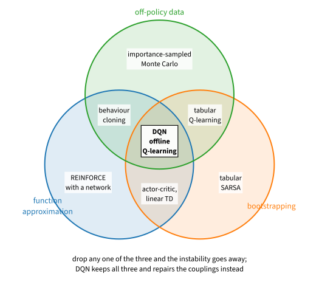
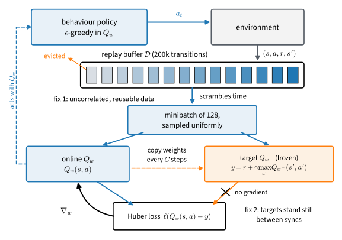
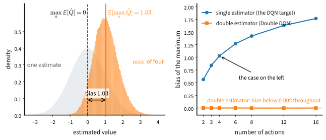

# Deep Q-Networks
:label:`sec_dqn`

A Deep Q-Network (DQN) replaces the tabular action-value function of Q-learning with a neural network :cite:`mnih2013playing,mnih2015human`. Unlike supervised regression, its bootstrapped targets depend on the function being trained. Consecutive transitions are correlated, and data in a replay buffer may have been collected by older policies. Together, function approximation, bootstrapping, and off-policy data can make value learning unstable.

DQN addresses two of these interactions with an experience-replay buffer and a target network. We introduce both mechanisms on CartPole, ablate the target network, and compare learned values with bounds implied by the task. The final part measures maximization bias and derives Double DQN, which separates action selection from evaluation.

```{.python .input #dqn-deep-q-networks-1}
%%tab pytorch
%matplotlib inline
from d2l import torch as d2l
import gymnasium as gym
import numpy as np
import torch
from torch import nn
torch.set_num_threads(1)
```

```{.python .input #dqn-deep-q-networks-1}
%%tab jax
%matplotlib inline
from d2l import jax as d2l
from flax import nnx
import gymnasium as gym
import jax
from jax import numpy as jnp
import numpy as np
import optax
```

We again use CartPole with discount $0.99$, but specify the training budget as $50{,}000$ environment steps because episode length changes as the policy improves. The agent takes one gradient step after every two environment steps. Its Q-network maps a state to one value per action, and the greedy action is the corresponding argmax.

```{.python .input #dqn-deep-q-networks-2}
%%tab pytorch, jax
gamma, num_env_steps, num_seeds = 0.99, 50_000, 3
buffer_size, batch_size, lr = 200_000, 128, 1e-3
train_freq, sync_every, warmup, grad_clip = 2, 250, 1_000, 10.0
epsilon = d2l.linear_schedule(1.0, 0.05, 10_000)
if tab.selected('pytorch'):
    def make_qnet():
        return nn.Sequential(nn.Linear(4, 128), nn.ReLU(),
                             nn.Linear(128, 128), nn.ReLU(),
                             nn.Linear(128, 2))
if tab.selected('jax'):
    def make_qnet(rngs):
        return nnx.Sequential(nnx.Linear(4, 128, rngs=rngs), jax.nn.relu,
                              nnx.Linear(128, 128, rngs=rngs), jax.nn.relu,
                              nnx.Linear(128, 2, rngs=rngs))
```

## Sources of Instability

### The Semi-Gradient Update

Replace the table of :numref:`sec_qlearning` by a network $Q_w$ and the update stays what it was, a semi-gradient step toward the bootstrapped target. Sample transitions $(s, a, r, s')$, form

$$y = r + \gamma\, \big(1 - \mathbf{1}(s' \textrm{ terminal})\big) \max_{a'} Q_w(s', a'),$$

hold $y$ fixed, and take one optimizer step on the regression loss between $Q_w(s,a)$ and $y$. Unlike the policy-gradient objective of :numref:`sec_deeprl`, this is ordinary supervised regression. A decreasing loss shows that the network is fitting its current targets, but it does not show that those targets are accurate.

For a table, Q-learning is a stochastic approximation to the Bellman contraction analyzed in :numref:`sec_valueiter` and :numref:`sec_qlearning`. Function approximation adds a projection onto the functions represented by the network, weighted by the data's visitation distribution. The composition of this projection with the Bellman backup need not be a contraction. Even with linear features, the combination of bootstrapping and off-policy data can diverge :cite:`Tsitsiklis.VanRoy.1997`.

### Correlated Data

Consecutive transitions from one episode are strongly correlated: the cart and pole change only slightly from one step to the next. Training on this stream can repeatedly update a narrow region of state space. Because shared parameters change predictions at many states at once (:numref:`fig_rl_table_vs_network`), these updates may degrade values learned elsewhere. A tabular method changes only the visited entry, so correlation mainly reduces sampling efficiency; with function approximation, it can also produce interference.

### Moving Targets

The second coupling is in the targets. The target $y$ contains $Q_w$, so every
optimizer step changes both the regressor and its target. In actor--critic, new
batches come from the current policy and may expose critic errors in the states
that policy visits, although this does not guarantee convergence. Replay instead
uses older transitions. A bootstrapping error can therefore persist across many
updates before the behavior policy revisits the affected states.

### The Deadly Triad
:label:`subsec_dqn-deadly-triad`

The three ingredients are *function approximation*, *bootstrapping*, and *off-policy data*. Figure :numref:`fig_rl_deadly_triad` locates familiar algorithms by which ingredients they use. Removing function approximation gives tabular Q-learning, which converges under the conditions of :numref:`sec_qlearning`. Removing bootstrapping gives neural REINFORCE with Monte Carlo targets and an unbiased policy gradient. Removing off-policy data gives methods such as SARSA and on-policy actor--critic.

These comparisons do not imply that every method using only two ingredients converges. Nonlinear on-policy temporal-difference learning can also diverge, and positive results require assumptions about step sizes, coverage, and representation. The term *deadly triad* refers to the particularly difficult combination of all three ingredients :cite:`Sutton.Barto.2018,vanHasselt.Doron.Strub.ea.2018`.

Baird's counterexample isolates this combination in a seven-state linear problem :cite:`Baird.1995`. Every reward is zero, so the true value function is zero and can be represented exactly by $w=0$. The experiment uses expected temporal-difference updates, eliminating sampling noise, but weights the seven states according to an off-policy distribution while evaluating a policy that always transitions to state seven:

```{.python .input #dqn-the-deadly-triad}
%%tab pytorch, jax
w = np.ones(8)                             # eight weights for seven states
w[6] = 10.0                                # the classic starting point
Phi = np.zeros((7, 8))                     # linear values v = Phi w
Phi[:6, :6], Phi[:6, 7] = 2 * np.eye(6), 1.0   # v(i) = 2 w_i + w_8
Phi[6, 6], Phi[6, 7] = 1.0, 2.0                # v(7) = w_7 + 2 w_8
sup = []
for _ in range(1000):
    v = Phi @ w                            # every reward is 0
    delta = gamma * v[6] - v               # the next state is always state 7
    w += 0.01 * (delta[:, None] * Phi).mean(0)   # uniform state weighting
    sup.append(np.abs(w).max())
print(f'sup norm of w after 0, 500, 1000 sweeps: 10, {sup[499]:.0f}, '
      f'{sup[-1]:.0f}')
print(f'the value the weights claim for state 7: {(Phi @ w)[6]:.0f}, '
      f'true value 0')
d2l.plot(np.arange(1, 1001), sup, 'sweeps over all seven states',
         'sup norm of w', yscale='log')
```

The weights grow approximately exponentially: after a thousand sweeps, their
sup norm has increased from $10$ to $335$, and the estimated value of state 7
is $677$ although its true value is zero. This deterministic expected-update
calculation has no sampling error, and reducing the step size slows but does not
remove the divergence. Since the true value function is representable, the
cause is not an approximation error. It lies in the semi-gradient dynamics:
under the off-policy weighting, the expected update has a direction along
which the weights grow :cite:`Sutton.Barto.2018`. Reweighting the updates by the evaluated
policy's visitation distribution converges in this example (exercise :exref:`ex_dqn-baird-on-policy`).

Replay and target networks do not remove an element of the triad. They reduce
temporal correlation and slow target changes, which often improves empirical
stability but does not restore a general convergence guarantee.


:label:`fig_rl_deadly_triad`

## Replay and Target Networks

:numref:`fig_rl_dqn_dataflow` draws the whole machine; the two subsections that follow walk its two ideas.

![Deep Q-learning as a data flow. The behavior policy acts with the online network; transitions enter the replay buffer, and uniformly sampled minibatches scramble time, which makes the data nearly independent and reusable. The regression target is computed by a frozen copy of the network, refreshed every $C$ steps, so the targets stand still between syncs. The gradient flows along exactly one path, into the online network; the marked edge from the frozen copy carries no gradient. The drawn buffer is full and evicting its oldest entries, the steady state of a long run; in this section's runs the 50,000-step budget never fills the 200,000-slot ring, so nothing is evicted.](../img/mdl-rl-dqn-dataflow.svg)
:label:`fig_rl_dqn_dataflow`

### Experience Replay and Off-Policy Updates

The standard remedy for temporal correlation is an *experience replay buffer* :cite:`Lin.1992`. Transitions are stored in a finite array, and training minibatches are sampled uniformly from that array. A minibatch therefore combines transitions collected at different times, and each transition may be used in several updates. This is valid for Q-learning because the target for $(s,a,r,s')$ does not depend on the policy that selected $a$. The same property will be central to the distinction between on-policy and off-policy learning in :numref:`sec_offline`.

```{.python .input #dqn-replay-and-the-off-policy-licence}
%%tab pytorch, jax
class ReplayBuffer:  #@save
    """A ring of transitions in preallocated numpy; sample() returns a Batch."""
    def __init__(self, capacity, obs_dim):
        self.obs = np.zeros((capacity, obs_dim), np.float32)
        self.act = np.zeros(capacity, np.int64)
        self.rew = np.zeros(capacity, np.float32)
        self.next_obs = np.zeros((capacity, obs_dim), np.float32)
        self.term = np.zeros(capacity, np.float32)
        self.capacity, self.size, self.ptr = capacity, 0, 0

    def add(self, obs, act, rew, next_obs, term):
        i = self.ptr
        self.obs[i], self.act[i], self.rew[i] = obs, act, rew
        self.next_obs[i], self.term[i] = next_obs, term
        self.ptr, self.size = (i + 1) % self.capacity, min(self.size + 1,
                                                           self.capacity)

    def __len__(self):
        return self.size

    def sample(self, batch_size, rng):
        i = rng.integers(self.size, size=batch_size)
        return d2l.Batch(self.obs[i], self.act[i], self.rew[i],
                         self.next_obs[i], self.term[i],
                         np.array([batch_size]))
```

Two details of the container matter. Its capacity is $200{,}000$ transitions, larger than the $50{,}000$-step training budget, so no transition is evicted in these experiments; exercise :exref:`ex_dqn-shrink-buffer` studies a smaller buffer. In addition, `sample` returns a `Batch` without episode structure. Consequently, `reward_to_go` and `gae` are not defined for such a batch, whereas `td_target` requires only individual transitions. This is why replay combines naturally with one-step bootstrapping. The target below is the same `batch.td_target` used by the actor-critic critic.

### The Target Network

The repair for moving targets is the *target network* :cite:`mnih2015human`: a frozen copy $Q_{w^-}$ of the online network computes every bootstrap,

$$y = r + \gamma\, \big(1 - \mathbf{1}(s' \textrm{ terminal})\big) \max_{a'} Q_{w^-}(s', a'),$$
:eqlabel:`eq_dqn_target`

and synchronize the copy with the online weights, $w^-\leftarrow w$, every $C$ environment steps, here every 250. Between synchronizations, the target is fixed and the online network solves an ordinary regression problem. The feedback from predictions to targets now occurs once per synchronization rather than once per gradient step. The actor--critic method in :numref:`sec_actorcritic` updates its target from the newest critic because each batch contains fresh on-policy data. Replay removes that freshness, so DQN instead accepts stale targets to reduce the rate at which the regression problem changes.

The regression update uses two distinct controls. The Huber loss is quadratic near zero and linear for large residuals, so it bounds the derivative of the loss with respect to the prediction. The parameter gradient also contains $\nabla_w Q_w(s,a)$, which the Huber loss does not bound. Global norm clipping therefore bounds the norm of the complete parameter gradient before the optimizer uses it, including a large gradient produced by the simultaneous residual changes that may follow a target-network synchronization.

```{.python .input #dqn-the-target-network-1}
%%tab pytorch
def q_values(qnet, obs):
    """The acting forward: numpy in, numpy out, no gradient recorded."""
    with torch.inference_mode():
        return qnet(torch.as_tensor(obs)).numpy()

def fit_q(qnet, opt, batch, y):
    """One clipped Huber regression step of Q_w(s, a) toward the fixed y."""
    pred = qnet(torch.as_tensor(batch.obs)).gather(
        -1, torch.as_tensor(batch.act)[:, None]).squeeze(-1)
    loss = nn.functional.huber_loss(pred, torch.as_tensor(y))
    opt.zero_grad()
    loss.backward()
    nn.utils.clip_grad_norm_(qnet.parameters(), grad_clip)
    opt.step()

def q_step(qnet, target, opt, batch):
    """The DQN update: the critic's own td_target, bootstrapped by the copy."""
    fit_q(qnet, opt, batch, batch.td_target(
        lambda s: q_values(target, s).max(-1), gamma))
```

```{.python .input #dqn-the-target-network-1}
%%tab jax
def fit_q(qnet, opt, obs, act, y):
    """One Huber regression step of Q_w(s, a) toward the fixed y; traced
    inside the jitted steps, with the norm clip in the optimizer chain."""
    _, grads = nnx.value_and_grad(lambda q: optax.huber_loss(
        jnp.take_along_axis(q(obs), act[:, None], -1).squeeze(-1),
        y).mean())(qnet)
    opt.update(qnet, grads)

@nnx.jit
def q_step(qnet, target, opt, obs, act, rew, next_obs, term):
    """The DQN update. The target line is Batch.td_target's expression,
    computed inside the compiled step (:numref:`sec_compilation`)."""
    fit_q(qnet, opt, obs, act,
          rew + gamma * (1 - term) * target(next_obs).max(-1))

_q_forward, _cached = nnx.jit(lambda net, obs: net(obs)), {}

def q_values(qnet, obs):
    """The acting forward: compiled once, module traversal cached, because
    the loop below calls it once per environment step."""
    if id(qnet) not in _cached:
        _cached[id(qnet)] = nnx.cached_partial(_q_forward, qnet)
    return np.asarray(_cached[id(qnet)](jnp.asarray(obs)))
```

One hairline detail separates the two tabs. The pytorch update literally calls `batch.td_target`, the structural thesis in a single line; the jax update runs a couple of hundred thousand times and is compiled, and a compiled function cannot call back into a numpy method, so it computes the same expression inline (:numref:`sec_compilation`). The next cell certifies that "the same expression" is not a figure of speech, on a buffer filled by a random policy through the `rollout` helper both chapters share:

```{.python .input #dqn-the-target-network-2}
%%tab pytorch
rng, env = np.random.default_rng(0), gym.make('CartPole-v1')
env.reset(seed=0)
data = d2l.rollout(env, lambda s, r: int(r.integers(2)), 20, rng)
buffer = ReplayBuffer(buffer_size, 4)
for i in range(len(data)):
    buffer.add(data.obs[i], data.act[i], data.rew[i],
               data.next_obs[i], data.term[i])
b = buffer.sample(batch_size, rng)
torch.manual_seed(0)
tnet = make_qnet()
with torch.inference_mode():
    y = (torch.as_tensor(b.rew) + gamma * (1 - torch.as_tensor(b.term))
         * tnet(torch.as_tensor(b.next_obs)).max(-1).values).numpy()
print(np.allclose(y, b.td_target(lambda s: q_values(tnet, s).max(-1), gamma)))
```

```{.python .input #dqn-the-target-network-2}
%%tab jax
rng, env = np.random.default_rng(0), gym.make('CartPole-v1')
env.reset(seed=0)
data = d2l.rollout(env, lambda s, r: int(r.integers(2)), 20, rng)
buffer = ReplayBuffer(buffer_size, 4)
for i in range(len(data)):
    buffer.add(data.obs[i], data.act[i], data.rew[i],
               data.next_obs[i], data.term[i])
b = buffer.sample(batch_size, rng)
tnet = make_qnet(nnx.Rngs(0))
y = np.asarray(jnp.asarray(b.rew) + gamma * (1 - jnp.asarray(b.term))
               * tnet(jnp.asarray(b.next_obs)).max(-1))
print(np.allclose(y, b.td_target(lambda s: q_values(tnet, s).max(-1), gamma)))
```

Now the training loop, and it is short because everything it needs already exists: `epsilon_greedy` and `linear_schedule` from :numref:`sec_qlearning`, the buffer and step above. One switch controls the experiment of this section. With `use_target=True` the copy refreshes every `sync_every` steps; with `use_target=False` it refreshes every step, which makes the copy the online network in all but name, the naive recipe with no target network at all. The generator yields, at every episode's end, the step count, the episode's return, and one diagnostic we will need later: the network's value estimate $\max_a Q_w(s_0, a)$ at the centered start state $s_0 = \mathbf{0}$.

```{.python .input #dqn-the-target-network-3}
%%tab pytorch
def train_dqn(seed, qnet, use_target=True, step=None):
    """DQN on CartPole; yields (env step, episode return, max_a Q(s0, a))."""
    step = q_step if step is None else step
    rng, env = np.random.default_rng(seed), gym.make('CartPole-v1')
    target = make_qnet()
    target.load_state_dict(qnet.state_dict())
    opt = torch.optim.Adam(qnet.parameters(), lr=lr)
    buffer, s0 = ReplayBuffer(buffer_size, 4), np.zeros(4, np.float32)
    obs, ep_return = env.reset(seed=seed)[0], 0.0
    sync = sync_every if use_target else 1
    for t in range(1, num_env_steps + 1):
        a = d2l.epsilon_greedy(q_values(qnet, obs), epsilon(t), rng)
        next_obs, rew, terminated, truncated, _ = env.step(a)
        buffer.add(obs, a, rew, next_obs, float(terminated))
        obs, ep_return = next_obs, ep_return + rew
        if terminated or truncated:
            yield t, ep_return, q_values(qnet, s0).max()
            obs, ep_return = env.reset()[0], 0.0
        if len(buffer) >= warmup and t % train_freq == 0:
            step(qnet, target, opt, buffer.sample(batch_size, rng))
        if t % sync == 0:
            target.load_state_dict(qnet.state_dict())
```

```{.python .input #dqn-the-target-network-3}
%%tab jax
def train_dqn(seed, qnet, use_target=True, step=None):
    """DQN on CartPole; yields (env step, episode return, max_a Q(s0, a)).
    The jitted step's module traversal is cached once per run."""
    step = q_step if step is None else step
    rng, env = np.random.default_rng(seed), gym.make('CartPole-v1')
    target = nnx.clone(qnet)
    opt = nnx.Optimizer(qnet, optax.chain(
        optax.clip_by_global_norm(grad_clip), optax.adam(lr)), wrt=nnx.Param)
    step_fn = nnx.cached_partial(step, qnet, target, opt)
    buffer, s0 = ReplayBuffer(buffer_size, 4), np.zeros(4, np.float32)
    obs, ep_return = env.reset(seed=seed)[0], 0.0
    sync = sync_every if use_target else 1
    for t in range(1, num_env_steps + 1):
        a = d2l.epsilon_greedy(q_values(qnet, obs), epsilon(t), rng)
        next_obs, rew, terminated, truncated, _ = env.step(a)
        buffer.add(obs, a, rew, next_obs, float(terminated))
        obs, ep_return = next_obs, ep_return + rew
        if terminated or truncated:
            yield t, ep_return, q_values(qnet, s0).max()
            obs, ep_return = env.reset()[0], 0.0
        if len(buffer) >= warmup and t % train_freq == 0:
            b = buffer.sample(batch_size, rng)
            step_fn(jnp.asarray(b.obs), jnp.asarray(b.act),
                    jnp.asarray(b.rew), jnp.asarray(b.next_obs),
                    jnp.asarray(b.term))
        if t % sync == 0:
            nnx.update(target, nnx.state(qnet, nnx.Param))
```

Note what the buffer stores: `terminated`, never `truncated`. A CartPole episode cut off at 500 steps ends in a state with a future, and :numref:`sec_qlearning` established that masking the bootstrap there teaches the network that surviving is worthless; exercise :exref:`ex_dqn-terminated-not-done` traces exactly what would go wrong.

### Ablating the Target Network
:label:`subsec_dqn-ablation`

Three seeds per arm, everything identical except the switch. The networks are caller-owned, as in :numref:`sec_actorcritic`, so later cells can audit the trained agents:

```{.python .input #dqn-the-ablation-1}
%%tab pytorch, jax
if tab.selected('pytorch'):
    def new_qnet(seed):
        torch.manual_seed(seed)
        return make_qnet()
if tab.selected('jax'):
    def new_qnet(seed):
        return make_qnet(nnx.Rngs(seed))

arms = ('DQN', 'no target network')
qnets = {arm: [new_qnet(seed) for seed in range(num_seeds)] for arm in arms}
runs = {arm: [list(train_dqn(seed, qnets[arm][seed],
                             use_target=arm == 'DQN'))
              for seed in range(num_seeds)] for arm in arms}
```

Each run yields one tuple per episode, and seeds finish different numbers of episodes, so the right x axis is the one the budget is written in. We resample every curve onto a common grid of environment steps and plot the seed bands:

```{.python .input #dqn-the-ablation-2}
%%tab pytorch, jax
grid = np.arange(1, num_env_steps // 1000 + 1) * 1000

def on_grid(arm, col):
    """Resample each seed's per-episode series onto the env-step grid."""
    return np.stack([np.interp(grid, np.asarray(r)[:, 0], np.asarray(r)[:, col])
                     for r in runs[arm]])

d2l.plot_curves({arm: on_grid(arm, 1) for arm in runs},
                xlabel='thousand environment steps',
                ylabel='return of the behavior policy', smooth=5,
                reference=500)
```

The two variants differ only in whether the bootstrap uses a target network. With a target network, every seed improves from the random policy's return of about 20, although learning remains variable and no seed remains at the maximum return of 500. The behavior-policy curve cannot reach 500 consistently because the final exploration rate is $\epsilon=0.05$, which forces a random action on approximately one step in twenty. Without a target network, returns improve briefly and then collapse for every seed in both framework implementations. The online network then supplies its own changing targets, and the poor greedy policy collects data that reinforces the same estimates. The separate greedy evaluation below removes exploratory actions from the comparison.

Because the return keeps falling off its peaks and climbing back, the summary statistic you choose matters more than it should, and the next cell computes the candidates rather than asserting them. For each seed we take every trailing 20-episode average the run contains, and report the best one, the final one, and the one the run would have reported had we stopped it fifty episodes earlier:

```{.python .input #dqn-the-ablation-3}
%%tab pytorch, jax
def windows(returns, k=20):
    """All trailing k-episode averages of a run, in order."""
    return np.convolve(returns, np.ones(k) / k, 'valid')

for arm in runs:
    w = [windows(np.asarray(r)[:, 1]) for r in runs[arm]]
    best = np.array([x.max() for x in w])
    final = np.array([x[-1] for x in w])
    early = np.array([x[-51] for x in w])
    print(f'{arm:>18}: best 20-episode window per seed {np.round(best)}\n'
          f'{"":>18}  final window {np.round(final)} '
          f'(spread {np.ptp(final):.0f})\n'
          f'{"":>18}  fifty episodes earlier {np.round(early)}')
```

The final-window return varies by more than one hundred points across seeds,
and the value fifty episodes earlier differs again. It therefore describes the
state of each training run at the stopping time rather than a stable endpoint.
Selecting the best window after observing the entire curve introduces
optimistic selection bias; reporting its seed spread does not remove that bias.

For evaluation, we predeclare a budget of $50{,}000$ environment steps and
then evaluate the resulting policy separately. This separates the policy from
the exploration noise in the training return and avoids choosing a stopping
point after inspecting the curves.

The behavior return combines policy quality with the effect of $\epsilon$-greedy exploration. After the fixed training budget, we therefore evaluate the greedy policy separately with $\epsilon=0$:

```{.python .input #dqn-the-ablation-4}
%%tab pytorch, jax
env = gym.make('CartPole-v1')
for arm in arms:
    for seed in range(num_seeds):
        env.reset(seed=100 + seed)
        qnet = qnets[arm][seed]
        score = d2l.evaluate(env, lambda s, r: int(q_values(qnet, s).argmax()),
                             num_episodes=100)
        print(f'{arm:>18}, seed {seed}: greedy return over 100 episodes '
              f'{score:.0f}')
```

Without exploratory actions, some seeds achieve the maximum return of 500, while others score far below their recent behavior returns. The final greedy policy is a single snapshot of an oscillatory training process, so evaluation depends on the point at which training stops. Across frameworks and seeds, the greedy returns range from roughly 90 to 500. Every run without a target network fails almost immediately.

To distinguish value instability from policy instability, the training loop records $\max_a Q_w(s_0,a)$ at the centered start state. The code masks bootstrapping only on `terminated`; it continues to bootstrap across the 500-step time limit, and the state contains no time coordinate. It therefore learns the continuing-task value in which the time limit ends data collection but not the underlying process.

In this formulation, a policy that balances the pole indefinitely has value $1/(1-\gamma)=100$ from the start. The dashed line marks this ceiling:

```{.python .input #dqn-the-ablation-5}
%%tab pytorch, jax
ceiling = 1 / (1 - gamma)
d2l.plot_curves({'DQN': on_grid('DQN', 2)},
                xlabel='thousand environment steps',
                ylabel='value estimate at the start state',
                reference=ceiling)
print(f'continuing-task ceiling: {ceiling:.0f}; the no-target arm ends at ' +
      ', '.join(f'{np.asarray(r)[-1, 2]:.0e}' for r in
                runs['no target network']))
```

For DQN, the recorded start-state estimate remains within tens of points of the continuing-task ceiling across frameworks and seeds. The corresponding return curves still oscillate because small changes in action values can change the greedy action and produce a substantially different policy. This trace concerns only $s_0$ and does not certify that every Q-value is stable or accurate.

The scale nevertheless separates the two ablations. DQN ends near $10^2$, whereas the version without a target network exceeds $10^8$. The latter clearly diverges. Some DQN seeds settle above the ceiling of 100. Since no policy can exceed that value under the objective implemented here, those estimates demonstrate overestimation.

The next experiment isolates the maximization bias that produces this effect.

## Overestimation

### Measuring the Maximization Bias
:label:`subsec_dqn-max-bias`

The target :eqref:`eq_dqn_target` maximizes estimated action values. For noisy estimates, $E[\max_{a'}\hat{Q}(s',a')]\geq\max_{a'}E[\hat{Q}(s',a')]$, with strict inequality when noise can change the maximizing action. :numref:`sec_qlearning` demonstrated this bias in a table, and :numref:`sec_regularized` showed that the hard maximum is the $\beta\to0$ limit of the soft backup. Function approximation can feed the resulting bias back into subsequent targets :cite:`Thrun.Schwartz.1993`.

The following simulation gives four actions the same true value of zero and adds independent unit noise to each estimate. The single estimator selects and evaluates an action with the same noisy values. The double estimator selects with one set of noisy values and evaluates with an independent set :cite:`vanHasselt.2010`:

```{.python .input #dqn-the-max-bias-measured}
%%tab pytorch, jax
rng = np.random.default_rng(0)
est = rng.standard_normal((100_000, 4))     # four values, all truly zero
second = rng.standard_normal((100_000, 4))  # an independent second estimate
sel = est.argmax(1)
print(f'single estimator, E[max of the estimates]: {est.max(1).mean():.3f}')
print(f'select with one, evaluate with the other: '
      f'{second[np.arange(100_000), sel].mean():+.3f}')
```

The maximum of four unit-noise estimates has about one unit of upward
bias. With independent selection and evaluation estimates, the evaluator's
noise has zero conditional mean for the selected action, and the measured
bias is near zero. :numref:`fig_rl_max_bias` shows that the single-estimator
bias grows with the number of actions while the independent double
estimator remains near zero. In DQN, shared parameters and bootstrapping
can propagate this bias to other states; a fixed offline dataset also
removes the corrective effect of new interaction (:numref:`sec_offline`).


:label:`fig_rl_max_bias`

### Double DQN
:label:`subsec_dqn-double-dqn`

The double estimator requires two value estimates, and DQN already maintains an online network and a target network. Double DQN uses the online network to select the action and the target network to evaluate it :cite:`Hasselt.Guez.Silver.2016`:

$$y = r + \gamma\, \big(1 - \mathbf{1}(s' \textrm{ terminal})\big)\ Q_{w^-}\big(s',\ \underset{a'}{\mathrm{argmax}}\ Q_w(s', a')\big).$$
:eqlabel:`eq_double_dqn`

An action selected by an overestimate in the online network is therefore
not evaluated by that same output. The target copy is correlated with the
online network, so Double DQN only approximates the independent double
estimator analyzed above. It reuses the two forward passes already
required by DQN; the change to `q_step` is three lines:

```{.python .input #dqn-double-dqn-in-three-lines-1}
%%tab pytorch
def q_step_double(qnet, target, opt, batch):
    """q_step with selection split from evaluation, eq_double_dqn."""
    sel = q_values(qnet, batch.next_obs).argmax(-1)
    fit_q(qnet, opt, batch, batch.td_target(
        lambda s: q_values(target, s)[np.arange(len(s)), sel], gamma))
```

```{.python .input #dqn-double-dqn-in-three-lines-1}
%%tab jax
@nnx.jit
def q_step_double(qnet, target, opt, obs, act, rew, next_obs, term):
    """q_step with selection split from evaluation, eq_double_dqn."""
    sel = qnet(next_obs).argmax(-1)
    fit_q(qnet, opt, obs, act, rew + gamma * (1 - term) * jnp.take_along_axis(
        target(next_obs), sel[:, None], -1).squeeze(-1))
```

The training loop changes only the update function; data collection, replay,
target synchronization, and evaluation remain fixed. We use the same logged
diagnostic for the comparison:

```{.python .input #dqn-double-dqn-in-three-lines-2}
%%tab pytorch, jax
qnets['Double DQN'] = [new_qnet(seed) for seed in range(num_seeds)]
runs['Double DQN'] = [list(train_dqn(seed, qnets['Double DQN'][seed],
                                     step=q_step_double))
                      for seed in range(num_seeds)]
```

```{.python .input #dqn-double-dqn-in-three-lines-3}
%%tab pytorch, jax
d2l.plot_curves({arm: on_grid(arm, 2) for arm in ('DQN', 'Double DQN')},
                xlabel='thousand environment steps',
                ylabel='value estimate at the start state',
                reference=ceiling)
for arm in ('DQN', 'Double DQN'):
    print(f'{arm:>10}: final value estimate at s0, per seed: '
          f'{np.round([np.asarray(r)[-1, 2] for r in runs[arm]], 1)}')
```

The Double DQN estimates usually end a few points below the DQN estimates, with the largest reductions in seeds that had moved furthest above the ceiling. Their seed bands overlap during most of training. CartPole has only two actions, and :numref:`fig_rl_max_bias` shows that maximization bias grows with the number of actions. The effect is therefore expected to be small here.

On Atari, with as many as eighteen actions, Double DQN changes scores substantially :cite:`Hasselt.Guez.Silver.2016`. The same distinction becomes important in offline learning, where inflated actions cannot be corrected by new interaction (:numref:`sec_offline`). At this CartPole budget, any difference in return remains within variation across seeds.

## The DQN Lineage

### Extensions and Successors

Several later methods modify individual components of DQN. An $n$-step target uses several observed rewards before bootstrapping, as developed in :numref:`sec_actorcritic`. Prioritized replay samples transitions according to their temporal-difference error rather than uniformly :cite:`Schaul.Quan.Antonoglou.ea.2016`; its advantage decreases as replay buffers become larger and more diverse. A dueling network represents $Q$ as a state value plus action advantages :cite:`Wang.Schaul.Hessel.ea.2016`.

Distributional methods estimate the return distribution rather than only its mean :cite:`Bellemare.Dabney.Munos.2017`. In tabular and linear settings, their expected update for the mean coincides with the ordinary update, so their empirical benefit depends on the interaction with nonlinear function approximation. Rainbow combines six extensions and reports an ablation of their individual contributions :cite:`Hessel.Modayil.vanHasselt.ea.2018`.

PQN provides a contrasting design: with LayerNorm and batches collected from parallel environments, deep Q-learning can train without a replay buffer or target network :cite:`Gallici.Fellows.Ellis.ea.2025`. Replay and target networks are therefore one solution to correlated data and moving targets, not necessary components of every stable deep Q-learning system.

### DQN in Modern Practice

Vanilla DQN is mainly useful here as a simple setting in which to study two problems of deep value learning: moving bootstrap targets and maximization bias. It also establishes how a learner can use transitions collected by a different policy. Since the policy requires an argmax over actions, the basic method is restricted to discrete action spaces; actor-based methods extend related ideas to continuous control. :numref:`sec_offline` considers the limiting case in which all learning uses a fixed dataset and no further interaction is allowed.

## Summary

With function approximation, bootstrapping, and off-policy data, Q-learning can diverge even when the value class contains the correct solution. Experience replay reduces temporal correlation and reuses transitions, while a target network holds bootstrap targets fixed between updates. These mechanisms improve stability but do not restore the tabular convergence theorem. DQN also inherits maximization bias. Double DQN reduces this bias by selecting an action with the online network and evaluating it with the target network.

**Experimental scope.** Baird's counterexample and the synthetic maximization-bias calculation are deterministic. The CartPole ablation uses three seeds per method and framework for $50{,}000$ environment steps. Every run without a target network diverges beyond $10^8$ in value, while the target-network runs learn but remain variable. Fixed-budget greedy evaluation is reported separately from exploratory training return. At two actions, the effect of Double DQN on return is smaller than the variation across runs.

## Exercises

1. [code] **Baird under on-policy weighting.** The computation of Baird's
   counterexample in :numref:`subsec_dqn-deadly-triad` weights the seven
   states equally through `.mean(0)`. In matrix form, one sweep is
   $\mathbf{w} \leftarrow \mathbf{w} + \alpha A \mathbf{w}$ with $\alpha = 0.01$ and

   $$A = \Phi^\top D (\gamma P - I) \Phi,$$

   where $D$ is the diagonal matrix of the state weights and $P$ is the
   transition matrix of the evaluated policy, every row of which puts all
   probability on state 7.
    1. Compute the eigenvalues of $A$ for $D = I/7$. Compare $1 + \alpha\lambda$,
       for the eigenvalue $\lambda$ with the largest real part, with the
       per-sweep growth factor of the sup norm of $\mathbf{w}$ late in a run
       of $20{,}000$ sweeps.
    1. The evaluated policy moves to state 7 and stays there, so its
       visitation distribution puts all weight on state 7. Rerun the
       iteration with this weighting. To which weights and which state values
       does it converge, and how do these values compare with the true
       values?
    1. Mix the two weightings, $\mathbf{d} = (1 - p)\,\mathbf{1}/7 + p\,\mathbf{e}_7$,
       and find by bisection the smallest $p$ for which no eigenvalue of $A$
       has a positive real part, for $\gamma \in \{0.9, 0.95, 0.99\}$.
       Because `Phi` has eight columns but only seven rows, $A$ always has
       the eigenvalue $0$, and rounding can give it a real part of order
       $10^{-17}$; count real parts below $10^{-10}$ as zero. How does the
       amount of off-policy weight that the iteration tolerates depend on the
       discount?
   :exlabel:`ex_dqn-baird-on-policy`

1. **Huber loss and norm clipping.** `fit_q` regresses with the Huber loss
   of threshold 1, $\ell(e) = e^2/2$ for $|e| \leq 1$ and
   $\ell(e) = |e| - 1/2$ otherwise, where $e = Q_w(s, a) - y$ is the residual
   of one transition, and averages it over the $B$ transitions of a
   minibatch. The update then rescales the minibatch gradient to norm
   `grad_clip` $= 10$ whenever its norm exceeds 10 and passes it to Adam.
    1. Show that $\ell'(e) = \max\big(-1, \min(1, e)\big)$. In which sense
       is Huber regression squared-loss regression with clipped residuals?
    1. Show that the gradient of the minibatch loss with respect to $w$ has
       norm at most $\max_i \|\nabla_w Q_w(s_i, a_i)\|$. How can this bound
       grow during training while every residual stays the same?
    1. Adam divides a running average of the gradients by the square root
       of a running average of their squares. Apart from the small constant
       it adds for numerical stability, multiplying every gradient of a run
       by one constant therefore leaves its steps unchanged. Which gradient
       sequences does the norm clip change? How does it change the Adam
       steps that follow a single gradient of very large norm, such as one
       that may follow a target-network synchronization?
    1. An Adam step moves each parameter by roughly the learning rate, here
       $10^{-3}$, whatever the size of its gradient. The run without a target
       network takes about $25{,}000$ such steps, and its start-state values
       reach about $10^8$. Estimate how far one parameter can travel during
       the run, and explain how steps of that size can produce values of
       $10^8$ in the three linear layers of `make_qnet`, whose hidden layers
       have 128 units.

1. **Terminated, not done.** `train_dqn` stores `float(terminated)`, so a
   transition into CartPole's 500-step time limit still bootstraps. Consider
   an implementation that stores `float(terminated or truncated)` instead.
    1. Which stored transitions does the change affect while the greedy
       policy still fails within a few hundred steps, and which once every
       episode reaches the limit?
    1. The observation contains no clock, so the network cannot tell a state
       at step 499 from a similar balanced state at step 50. Model its
       estimate on balanced states by a single number $q$, the estimate of
       the one-state task of exercise
       :exref:`ex_qlearning-truncation-termination`a of
       :numref:`sec_qlearning`, which pays reward 1 at every step. Evaluate
       the value that this exercise found for the faulty mask at $H = 500$
       and $\gamma = 0.99$. The start-state value plot of
       :numref:`subsec_dqn-ablation` marks $1/(1 - \gamma)$ as the ceiling.
       Compare $q$ with the value of the start state of a 500-step episode
       when the remaining time is known, $(1 - \gamma^{H})/(1 - \gamma)$.
       Which of the two is the ceiling of the faulty implementation for a
       network without a clock? What would a final estimate of $94$
       indicate?
   :exlabel:`ex_dqn-terminated-not-done`

1. [code] **Maximization bias in closed form.** Let the estimates
   $X_1, \ldots, X_m$ of $m$ actions with the same true value $0$ be jointly
   normal with variance $\sigma^2$ each.
    1. For $m = 2$ and independent estimates, show that
       $E[\max(X_1, X_2)] = \sigma/\sqrt{\pi}$, using
       $\max(x, y) = (x + y)/2 + |x - y|/2$.
    1. The outputs of one network share its hidden layers, so their errors
       are correlated. For $m = 2$ and correlation $c$ between $X_1$ and
       $X_2$, show that the bias becomes $\sigma \sqrt{(1 - c)/\pi}$.
    1. In Double DQN, the target network evaluates the action that the online
       network selects, and the errors of the two networks are correlated.
       Model the evaluating estimate of action $a$ as
       $Y_a = \rho X_a + \sqrt{1 - \rho^2}\, Z_a$, where $Z_1, \ldots, Z_m$
       have mean zero and variance $\sigma^2$ each and are independent of
       $X_1, \ldots, X_m$, so that $Y_a$ has variance $\sigma^2$ and
       correlation $\rho$ with $X_a$. Show that the bias of
       $Y_{\mathrm{argmax}_a X_a}$ is $\rho\, E[\max_a X_a]$.
    1. Check parts (a) and (c) by modifying the simulation of
       :numref:`subsec_dqn-max-bias`: use two actions, and draw the second
       estimate as `rho * est + np.sqrt(1 - rho**2) * noise` with fresh
       standard normal `noise`, for $\rho \in \{0, 0.5, 0.9\}$.
   :exlabel:`ex_dqn-max-bias-closed-form`

1. [code] **Replay reuse and buffer capacity.** ● Once the buffer holds
   `warmup` transitions, `train_dqn` takes one gradient step on
   `batch_size` $= 128$ uniformly sampled transitions every `train_freq`
   $= 2$ environment steps. With the default capacity, no transition is
   evicted.
    1. Show that a transition stored at step $\tau \geq 1000$ is sampled about
       $64 \ln(50{,}000/\tau)$ times in expectation over the run, and evaluate
       this for $\tau \in \{1000, 25{,}000, 49{,}000\}$. Data from which phase
       of training dominate the updates?
    1. With a capacity of 500 transitions, how often is a transition sampled
       in expectation while it stays in the full buffer? Compare this with
       part (a).
    1. Set `buffer_size` to $500$ and to $5000$, and lower `warmup` to 500
       for the smaller capacity, because `train_dqn` waits until the buffer
       holds `warmup` transitions. Train one seed for each capacity and
       compare the return curve and the start-state value trace with the
       default run. At which stage of training does the damage appear?
    1. A small buffer both correlates the transitions of a minibatch and
       discards old states. To separate the two effects, keep the default
       capacity and change `ReplayBuffer.sample` to return `batch_size`
       consecutive transitions from a uniformly drawn start index. Compare
       this run with the run at capacity 500. Which of the two effects
       accounts for the damage of part (c)?
   :exlabel:`ex_dqn-shrink-buffer`

1. [code] **The sync period.** ● `train_dqn` copies the online weights into
   the target network every `sync_every` $= 250$ environment steps, which is
   every 125 gradient steps.
    1. Suppose that every reward is 1, that all values start at zero, and that
       the online network fits its targets exactly between two
       synchronizations. Show that after $n$ synchronizations no value
       exceeds $(1 - \gamma^n)/(1 - \gamma)$. Evaluate this bound at the end
       of the budget for `sync_every` $\in \{10, 50, 250, 1000, 5000\}$,
       counting the synchronizations that follow the first gradient step.
    1. Rerun the DQN arm with these five values, two seeds each, and record
       the greedy evaluation after the budget and the start-state value
       trace. Which end of the sweep behaves like the run without a target
       network? At which end does the bound of part (a) limit what the run
       can reach?
    1. With `sync_every` $= 250$, the final start-state values printed in
       :numref:`subsec_dqn-double-dqn` exceed the bound of part (a). Which
       assumption of part (a) fails, and what does the excess say about how
       the network obtains its values?
   :exlabel:`ex_dqn-sync-period`

1. **n-step targets from replay.** ● Several successors of DQN replace the
   one-step target :eqref:`eq_dqn_target` by an $n$-step target in the manner
   of :eqref:`eq_nstep_return`,

   $$y^{(n)}_t = \sum_{i=0}^{n-1} \gamma^i r_{t+i} + \gamma^n \max_{a'} Q_{w^-}(s_{t+n}, a'),$$

   written here for an episode that continues past step $t + n$.
    1. `ReplayBuffer.sample` returns isolated transitions. What must the
       buffer store, and how must `sample` choose its indices, so that
       $y^{(n)}_t$ can be formed?
    1. Write $y^{(n)}_t$ for an episode that terminates at step $t + j$ with
       $j < n$. How does it change when the episode is truncated at step
       $t + j$ instead?
    1. The actions $a_{t+1}, \ldots, a_{t+n-1}$ were chosen by the
       $\epsilon$-greedy behavior policy of an older network. For $n = 2$ and
       $Q_{w^-} = Q^*$, write $E[y^{(2)}_t \mid s_t, a_t]$ and show that it
       equals the one-step target of $Q^*$ only if $a_{t+1}$ is greedy for
       $Q^*$ with probability one. Which policy's value does the $n$-step
       target estimate?
    1. The $n$-step returns of :numref:`sec_actorcritic` did not raise the
       question of part (c). Why not?

1. **Prioritized sampling.** ● Prioritized replay
   :cite:`Schaul.Quan.Antonoglou.ea.2016` samples stored transition $i$ with
   probability $P(i)$ instead of $1/N$ and multiplies its loss by a weight
   $u_i$. Let $\mathbf{g}_i$ be the gradient of the loss of transition $i$,
   so that uniform replay estimates
   $\bar{\mathbf{g}} = \frac{1}{N} \sum_i \mathbf{g}_i$.
    1. Show that a single sampled transition with weight
       $u_i = 1/\big(N P(i)\big)$ gives an unbiased estimate of
       $\bar{\mathbf{g}}$.
    1. Find the distribution $P$ that minimizes the expected squared error
       $E\|u_i \mathbf{g}_i - \bar{\mathbf{g}}\|^2$ of this estimate. For the
       squared loss, $\mathbf{g}_i = e_i \nabla_w Q_w(s_i, a_i)$ with residual
       $e_i$. Under which condition is sampling in proportion to $|e_i|$
       optimal?
    1. :citet:`Schaul.Quan.Antonoglou.ea.2016` sample with
       $P(i) \propto (|e_i| + c)^{\alpha}$ for a small constant $c > 0$, and
       use the weights
       $u_i = \big(N P(i)\big)^{-\beta}$ divided by $\max_j u_j$, with
       $\beta$ annealed toward 1 over training. Which of the two changes to
       the weights of part (a) affects only the step size, and which changes
       the point to which the updates converge?

1. [code] **Baird with a target network.** ●● DQN computes its bootstrap
   from a frozen copy of the weights. In the computation of Baird's
   counterexample in :numref:`subsec_dqn-deadly-triad`, compute `delta` from
   a copy `w_target` as `gamma * (Phi @ w_target)[6] - Phi @ w`, and set
   `w_target = w.copy()` every $k$ sweeps.
    1. Run $100{,}000$ sweeps for $k \in \{1, 10, 30, 100, 300, 1000\}$ and
       plot both the sup norm of $\mathbf{w}$ and the largest value error
       $\max_i |(\Phi \mathbf{w})_i|$. For which $k$ does the iteration
       converge, and how does its speed depend on $k$? Why does the sup norm
       of $\mathbf{w}$ not approach zero where the values do?
    1. Show that the seven rows of `Phi` are linearly independent, so that
       every vector of target values is represented exactly by some
       $\mathbf{w}$. Deduce that if the regression between two
       synchronizations were solved exactly, each synchronization would map
       the values $\mathbf{v}$ to $\gamma P \mathbf{v}$ under every positive
       state weighting. Use this to explain both ends of part (a).
    1. In the counterexample of Tsitsiklis and Van Roy, two nonterminal
       states have values $w$ and $2w$ for one weight $w$, and every reward is
       zero. The first state moves to the second, and the second stays where
       it is with probability $1 - \eta$ and terminates otherwise. Weight both
       states equally. Show that exact least-squares regression to the targets
       of a frozen weight $w_k$ gives
       $w_{k+1} = \gamma (6 - 4\eta)\, w_k / 5$, and that the semi-gradient
       iteration without a target network diverges under the same condition
       on $\gamma$ and $\eta$.
    1. Both examples contain all three ingredients of the triad. Which
       property of the function class separates the example that a target
       network repairs from the one that it cannot repair?

    *Adapted from Richard S. Sutton and Andrew G. Barto,
    [Reinforcement Learning: An Introduction](http://incompleteideas.net/book/RLbook2020.pdf),
    Example 11.1.*
   :exlabel:`ex_dqn-baird-target-network`

1. [extended] **LayerNorm instead of a target network.** ●●
   :citet:`Gallici.Fellows.Ellis.ea.2025` prove that a sufficiently wide
   Q-network with LayerNorm, trained with an $\ell_2$ penalty on its
   final-layer weights, satisfies a stability condition for
   temporal-difference learning without a target network, even on off-policy
   data. In their experiments, LayerNorm alone sufficed in every environment
   except Baird's counterexample.
    1. Insert a LayerNorm after each hidden linear layer of `make_qnet`,
       before the ReLU, and rerun the arm without a target network on three
       seeds. Compare the start-state value traces and the greedy evaluations
       with both arms of :numref:`subsec_dqn-ablation`.
    1. Add the same layers to the DQN arm, which keeps its target network.
       What does LayerNorm change there?
    1. If a seed of part (a) still diverges, add an $\ell_2$ penalty on the
       weights of the last linear layer and find the smallest coefficient
       that prevents divergence. What does a large coefficient do to the
       learned values?
    1. The theorem concerns sufficiently wide networks and a regularized
       update. Which of its assumptions does your experiment satisfy? Which
       outcomes of parts (a) to (c) would contradict the paper's claim, and
       which would only fall outside its scope?

[Discussions](https://d2l.discourse.group/)

<!-- slides -->

::: {.slide}
::: {.cover}
[Dive into Deep Learning · §15.4]{.kicker}

Deep Q-Networks<br>
**instability under function approximation · experience replay and target networks · termination and truncation · maximization bias and Double DQN**
:::
:::

::: {.slide title="Sources of Instability"}
Unlike the policy-gradient target, the Q-learning target depends on the
function being trained:

$$y = r + \gamma\, \big(1 - \mathbf{1}(s' \textrm{ terminal})\big)
\max_{a'} Q_w(s', a')$$

- The tabular convergence argument, based on stochastic approximation to a
  contraction, no longer applies after projection onto a function class
  :cite:`Tsitsiklis.VanRoy.1997`.
- Consecutive transitions are strongly correlated, and each parameter update
  changes the estimates for many states.
- Replay decorrelates the data but makes them off-policy, so the critic is no
  longer trained solely on the current policy's state distribution.
:::

::: {.slide title="The Deadly Triad"}
Function approximation + bootstrapping + off-policy data
:cite:`Sutton.Barto.2018,vanHasselt.Doron.Strub.ea.2018`.
Every region is an algorithm already taught:

{width=72%}
:::

::: {.slide title="Baird's Counterexample"}
Baird's construction has seven states and zero true value everywhere, which
the parameterization can represent with $w=0$. Even deterministic expected
updates diverge under uniform off-policy weighting:

@!dqn-the-deadly-triad

. . .

The parameters diverge exponentially for every positive constant step size.
The failure belongs to the expected update operator, not to sampling noise
:cite:`Baird.1995`.
:::

::: {.slide title="Replay and Target Networks"}
{width=88%}
:::

::: {.slide title="Experience Replay and Off-Policy Data"}
@dqn-replay-and-the-off-policy-licence

. . .

- The Q-learning target does not depend on the behavior policy, so transitions
  collected by other policies remain usable (:numref:`sec_qlearning`).
- A sampled `Batch` no longer preserves episode order. Consequently,
  `reward_to_go` and `gae` cannot be computed from it, while the one-step
  `td_target` remains available.
- The replay capacity is 200,000 transitions and the experiment uses only
  50,000 environment steps, so no transition is evicted.
:::

::: {.slide title="The Target Network"}
$$y = r + \gamma\, \big(1 - \mathbf{1}(s' \textrm{ terminal})\big)
\max_{a'} Q_{w^-}(s', a'), \qquad w^- \leftarrow w
\textrm{ every } C \textrm{ steps}$$

Between synchronizations, the regression target is fixed.

. . .

The actor--critic method in :numref:`sec_actorcritic` recomputed its bootstrap
target on every pass using fresh on-policy data. DQN instead freezes a copy of
the value network to reduce feedback between an update and its target. The
`use_target=False` ablation synchronizes this copy after every step and is
therefore equivalent to using the online network in the target.
:::

::: {.slide title="The Training Loop"}
@dqn-the-target-network-3

. . .

The budget is 50,000 environment steps, with one gradient update after every
two steps. The implementation reuses `epsilon_greedy` and `linear_schedule`
from :numref:`sec_qlearning`. The replay buffer records `terminated` rather
than `truncated` so that a time limit does not suppress bootstrapping.
:::

::: {.slide title="Target-Network Ablation"}
@!dqn-the-ablation-2

. . .

With a target network, every seed reaches returns in the hundreds, although
performance remains variable. Without it, every seed in both implementations
falls to near-minimal return and its value estimates exceed $10^8$. In this
ablation, removing the target network therefore causes clear divergence.
:::

::: {.slide title="Value-Loss Diagnostics"}
@!dqn-the-ablation-3

. . .

Because performance rises and falls during training, the final moving average
varies by more than one hundred points across seeds and changes if evaluated
50 episodes earlier. Reporting the best window would introduce
post-selection bias. We therefore use a greedy evaluation at the fixed
training budget as the primary result.
:::

::: {.slide title="Converging Values, Churning Policy"}
@!dqn-the-ablation-5

. . .

At the probe state, the value estimate approaches the correct scale rather
than diverging; a single probe, however, cannot certify the whole value
function. Small changes in action values can still change the greedy policy,
and fixed-budget evaluations range from 90 to 500 across seeds and
implementations. Because the update bootstraps through the time limit, it
optimizes a continuing objective whose start-state value is bounded by
$1/(1-\gamma)=100$. Estimates above this bound are necessarily
overestimates.
:::

::: {.slide title="Maximization Bias"}
@!dqn-the-max-bias-measured

. . .

In this example, applying $\max$ to noisy estimates introduces approximately
one unit of positive bias :cite:`Thrun.Schwartz.1993`. Using independent
estimates for selection and evaluation removes the bias
:cite:`vanHasselt.2010`. The hard maximum is the $\beta\to0$ limit of the
soft backup in :numref:`sec_regularized`.

{width=90%}
:::

::: {.slide title="The Double DQN Target"}
Select with the online network, evaluate with the frozen one
:cite:`Hasselt.Guez.Silver.2016`:

@dqn-double-dqn-in-three-lines-1

. . .

@!dqn-double-dqn-in-three-lines-3

Most seeds finish with values a few points lower under Double DQN. This small
difference is consistent with the two-action experiment in panel (b), where
maximization has limited scope to select extreme errors. On Atari, with as many
as 18 actions, the same modification produces substantially larger effects.
:::

::: {.slide title="DQN in Modern Practice"}
- $n$-step targets extend the return construction developed in
  :numref:`sec_actorcritic`.
- Prioritized replay :cite:`Schaul.Quan.Antonoglou.ea.2016`, dueling networks
  :cite:`Wang.Schaul.Hessel.ea.2016`, and distributional value heads
  :cite:`Bellemare.Dabney.Munos.2017` are combined and ablated in Rainbow
  :cite:`Hessel.Modayil.vanHasselt.ea.2018`.
- PQN :cite:`Gallici.Fellows.Ellis.ea.2025` uses LayerNorm and parallel
  environments without a replay buffer or target network, illustrating that
  replay and target networks are not the only route to stable value learning.
- Modern applications often use PPO or newer value-based agents. DQN remains a
  useful setting in which to study the principal failure modes.
  :numref:`sec_offline` next considers the limiting case of fully offline data.
:::
