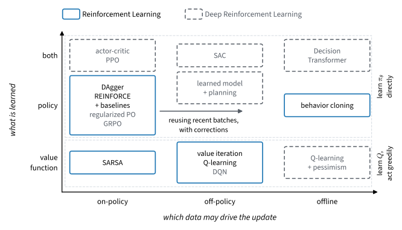

# Deep Reinforcement Learning
:label:`chap_deep_rl`

The last agent of :numref:`chap_reinforcement_learning` swung a pendulum up after a few hundred thousand steps. A simulator makes that cheap. A robot arm would wear out first, and a language model trained on its own answers cannot discard each batch of answers after one update. The agent waited for every episode to end, used each batch once and never limited how far an update moved its policy. How much can one sample teach, and what goes wrong when we make it teach more?

Four ideas answer, each with an error of its own. An agent can trust a learned estimate of the rest of an episode instead of waiting for it :cite:`Samuel.1959,Sutton.1988`; the estimate is biased while it is young. It can reuse an older policy's data, reweighted or replayed :cite:`Lin.1992`; the data goes stale and the targets move. It can bound each update by the change in the policy's behavior :cite:`Kakade.Langford.2002,Schulman.Wolski.Dhariwal.ea.2017`; the bound limits each step, not where the steps lead. It can learn a model of the environment and plan in it :cite:`Sutton.1990`, inheriting the model's errors and computing at every step. Together, a learned target, a network shared across states and another policy's data can make values diverge, which a table never does. Controllers, game players and post-trained language models are built from these ideas.

:numref:`sec_actorcritic` asks whether a policy must wait for the episode to end. :numref:`sec_ppo` asks whether one batch can drive several updates, and how far. :numref:`sec_regularized` asks how far a policy may stray from the data behind a learned reward. :numref:`sec_dqn` asks whether a network can learn values from any transition, as a table can. :numref:`sec_sac` asks how the pendulum can be learned in a few thousand steps. :numref:`sec_model_based` asks whether an agent that learns the physics from a few hundred steps can plan its way up. :numref:`sec_offline` asks what can be learned when no new action may be tried. :numref:`sec_rl_sequences` asks what survives when the environment appends tokens and a checker gives the reward.

CartPole carries the three methods with discrete actions, so that their sample counts share one axis, and Pendulum carries soft actor-critic and the learned model. Exact answers come from the verifier task and two gridworlds: one built so that a learned reward can be exploited, and the slippery lake. The code, in PyTorch and JAX, runs in CPU minutes. :numref:`fig_rl_roadmap` and :numref:`tab_rl_map` place every method of both chapters, and :numref:`sec_deep_rl-further-reading` collects those this chapter names without teaching. Several agents, hidden state, and meta- and hierarchical learning are left out; the Language Models part treats post-training at scale, including learning from human preferences, in more depth.

```toc
:maxdepth: 2

actor-critic
ppo
regularized
dqn
sac
model-based
offline-rl
rl-sequences
further-reading
```

## Resources and Further Reading {.unnumbered}

The resources of :numref:`chap_reinforcement_learning`, among them CleanRL's single-file implementations and the catalog of PPO's implementation details, serve this chapter as well. The following accompany particular sections; :numref:`sec_deep_rl-further-reading` turns to the methods and topics the chapter does not teach.

- Chapters 11 to 13 of Sutton and Barto :cite:`Sutton.Barto.2018` treat the $\lambda$-return and eligibility traces of :numref:`sec_actorcritic`, the actor-critic methods built on them, and the deadly triad of :numref:`sec_dqn` with what can be proved once one of its three ingredients is dropped. Their chapter 8 develops Dyna and planning with a learned model, the tabular ancestors of :numref:`sec_model_based`.
- The controlled study of :citet:`Engstrom.Ilyas.Santurkar.ea.2020` accompanies :numref:`sec_ppo`: at matched code-level choices PPO and TRPO perform nearly alike, so much of PPO's practical edge comes from details its objective does not mention.
- The [RL Baselines3 Zoo](https://github.com/DLR-RM/rl-baselines3-zoo) :cite:`Raffin.Hill.Gleave.ea.2021` ships tuned hyperparameters per environment for the PPO, DQN and SAC of :numref:`sec_ppo`, :numref:`sec_dqn` and :numref:`sec_sac`, the starting point when one of them meets a task other than CartPole or Pendulum.
- [rliable](https://github.com/google-research/rliable) :cite:`Agarwal.Schwarzer.Castro.ea.2021` provides interval estimates and performance profiles for results over a few seeds, the statistics behind every comparison across seeds in this chapter.
- The survey of :citet:`Levine.Kumar.Tucker.ea.2020` continues :numref:`sec_offline` from the tabular diagnosis to the deep offline methods.
- [The RLHF book](https://rlhfbook.com/) :cite:`Lambert.2026` develops the post-training methods whose update :numref:`sec_regularized` and :numref:`sec_rl_sequences` assemble, at the scale of real language models.

<!-- slides -->

::: {.slide}
::: {.cover}
[Dive into Deep Learning · §15]{.kicker}

Getting more from each sample<br>
**actor-critic · PPO · KL penalties · DQN · SAC · learned models · offline data · post-training**
:::
:::

::: {.slide title="The Pendulum Took a Few Hundred Thousand Steps to Swing Up"}
[The problem]{.kicker}

- Pendulum: a torque in $[-2, 2]$; doing nothing scores about $-1200$ per
  episode, and $-200$ or better holds the pendulum up.
- REINFORCE with a learned baseline crosses $-200$ after 150 to 300 updates
  of 1,600 steps each: a few hundred thousand steps.
- It waits for whole episodes, uses each batch once, and never limits how
  far an update moves the policy.
- A robot arm wears out first; a language model cannot resample its
  training set after every update.

::: {.d2l-note}
How much can one sample teach, and what goes wrong when we make it teach
more?
:::
:::

::: {.slide title="By the End of This Chapter You Can"}
[Goals]{.kicker}

- update a policy after one transition, and choose how far to trust a critic;
- reuse a batch for several clipped updates, and read when to stop;
- train a value network from replay, and detect when it overestimates;
- learn the pendulum in thousands of steps, or hundreds with a model;
- learn from a fixed log, and assemble the update that post-trains
  language models.

**Running examples:** CartPole and Pendulum; two gridworlds; four prompts
and a verifier.
:::

::: {.slide title="This Chapter Puts Networks Inside the Update and Reuses Data"}
[Where this fits]{.kicker}

::: {.cols .vc}
::: {.col}
| part or chapter | the learner learns from |
|---|---|
| Basics | a fixed dataset, a label for every example |
| Reinforcement Learning | its own attempts, on problems solved exactly |
| **Deep Reinforcement Learning** | **value networks in the update; reused, modeled and fixed data** |
| Language Models | post-training at scale, preferences |
:::

::: {.col .narrow}
- **Uses:** policy gradient with a baseline, Q-learning, the Bellman
  backup, the Gaussian policy.
- **Skips:** several agents, hidden state, meta- and hierarchical
  learning.
:::
:::
:::

::: {.slide title="Four Ideas Get More from Each Sample, Each with Its Own Error"}
| idea | what it changes | the new error |
|---|---|---|
| trust a learned value | update after one transition | the critic's bias while it is young |
| reuse old data | reweight by a ratio, or replay | stale data, moving targets |
| bound the step | limit the change in behavior | limits each step, not the destination |
| learn a model, plan in it | experience trains a model | model error, computation per step |

::: {.d2l-note}
Each idea removes a reason to collect new data, and adds an estimate that
can be wrong.
:::

[Samuel 1959 · Sutton 1988 · Lin 1992 · Kakade and Langford 2002 · Schulman et al. 2017 · Sutton 1990]{.small}
:::

::: {.slide title="A Learned Target, a Network and Another Policy's Data Can Diverge"}
- **Bootstrapping:** the target $r + \gamma \hat{V}(s')$ contains the
  estimate being fitted.
- **Function approximation:** one update moves the estimate at every state.
- **Off-policy data:** the states come from a policy other than the one
  evaluated.
- All three together can diverge even with exact expectations and a linear
  model: Baird's seven-state example.
- A table fitted to exact backups always converges.

::: {.d2l-note .warn}
A value loss can fall while the values diverge: check the values, not the
loss.
:::
:::

::: {.slide title="Check: Which Idea Explains Each Symptom?"}
[Check]{.kicker}

1. Early on CartPole, a policy trained on one-step TD errors lags behind one
   trained on whole returns.
2. Reusing each batch for twenty epochs of the unclipped ratio objective at
   a large step size, the return collapses to about 9.
3. A Q-network's estimate at the start state climbs past the best return
   any policy can earn.

::: {.fragment .fade-up}
1. Trusting a learned value: the young critic is biased.
2. An unbounded step: nothing limits how far the policy moves.
3. A learned target fitted on replayed data, plus a maximum over noisy
   estimates.
:::
:::

::: {.slide title="Two Questions Place Every Method: What It Learns, Which Data Drives It"}
{width=86%}

- Solid boxes: the previous chapter; dashed boxes: this one.
- Left to right, the update may use older data, then no new data at all.
:::

::: {.slide title="CartPole and Pendulum Measure What Each Method Costs in Steps"}
[Running examples]{.kicker}

- CartPole: four numbers of state, two actions, reward 1 per step while the
  pole is up, cut at 500 steps.
- At $\gamma = 0.99$, balancing forever is worth $1/(1-\gamma) = 100$; the
  500-step cut leaves $99.3$.
- Actor-critic, PPO and DQN all run on CartPole, so their step counts
  compare.
- Pendulum: three numbers of state, a torque in $[-2, 2]$, 200 steps per
  episode.
- Soft actor-critic and the learned model run on Pendulum.
:::

::: {.slide title="Three Small Problems Have Exact Answers"}
[Running examples]{.kicker}

- A $4 \times 4$ grid with a costly lane the reference policy rarely visits:
  a reward fitted from comparisons cannot see the cost.
- The slippery lake: logs of past episodes, judged against the exact
  optimum.
- Four prompts and a verifier: the reference passes 6.2% of the time, the
  ceiling is 50%.

::: {.d2l-note}
An exact answer turns "the curve looks good" into "the promise exceeds
the optimum".
:::
:::

::: {.slide title="Eight Sections, One Question Each"}
[Chapter map]{.kicker}

| section | question |
|---|---|
| Actor-Critic Methods | must a policy wait for the episode to end? |
| Proximal Policy Optimization | can one batch drive several updates, and how far? |
| KL-Regularized Policy Optimization | how far may a policy stray from a learned reward's data? |
| Deep Q-Networks | can a network learn values from any transition? |
| Soft Actor-Critic | how is the pendulum learned in a few thousand steps? |
| Learned Models and Planning | can a model from a few hundred steps plan the swing-up? |
| Offline Reinforcement Learning | what can be learned when no action may be tried? |
| Sequence Generation | what survives when actions are tokens and a checker pays? |
:::

::: {.slide title="From Hundreds of Thousands of Steps to a Few Hundred"}
| method | task, goal | environment steps |
|---|---|---|
| REINFORCE, learned baseline | Pendulum, $-200$ | a few hundred thousand |
| PPO, 1 or 4 epochs per batch | CartPole, 475 | 50,000 or more, or about 25,000 |
| DQN | CartPole, 500 | 35,000 to 45,000 |
| SAC, 1 or 10 updates per step | Pendulum, $-200$ | 5,400 to 11,200, or 2,400 to 4,000 |
| a learned model and a planner | Pendulum, swing-up | 200 to 600 |

::: {.d2l-note}
Fewer environment steps cost more computation per step: ten gradient
steps, or 12,500 model evaluations per action.
:::
:::

::: {.slide title="Check: Which Section Answers Each Finding?"}
[Check]{.kicker}

1. With each action offered nine times, a Q-network ends above the best
   possible return on every seed.
2. A planner whose data never left the bottom of the swing fails until its
   own failed attempts collect new states.
3. A table learned from a narrow log promises more than the optimum on
   almost every dataset.

::: {.fragment .fade-up}
1. Deep Q-Networks: the maximum picks the luckiest of nine noisy estimates.
2. Learned Models: a model is accurate only where the data went.
3. Offline: the best-looking actions are the rarely tried ones.
:::
:::

::: {.slide title="The Chapter Ends Where Post-Training Begins"}
- A response is a trajectory whose actions are tokens; a checker's verdict
  arrives once, at the end.
- The update that post-trains language models combines a group baseline, a
  clipped probability ratio and a KL penalty to a reference.
- Each piece comes from this chapter or the previous one.
- The Language Models part treats post-training at scale, including
  learning from human preferences, in more depth.
:::

::: {.slide title="Wrap-up"}
[Wrap-up]{.kicker}

- The previous chapter's pendulum needed a few hundred thousand steps.
- Four ideas: trust a critic, reuse data, bound the step, learn a model;
  each adds an error.
- A learned target, a network and another policy's data can diverge
  together.
- Steps fall to tens of thousands on CartPole, a few thousand with SAC and
  a few hundred with a model.
- Small problems with exact answers expose overestimation.

**Next:** a learned critic in place of the rest of the episode.
:::
